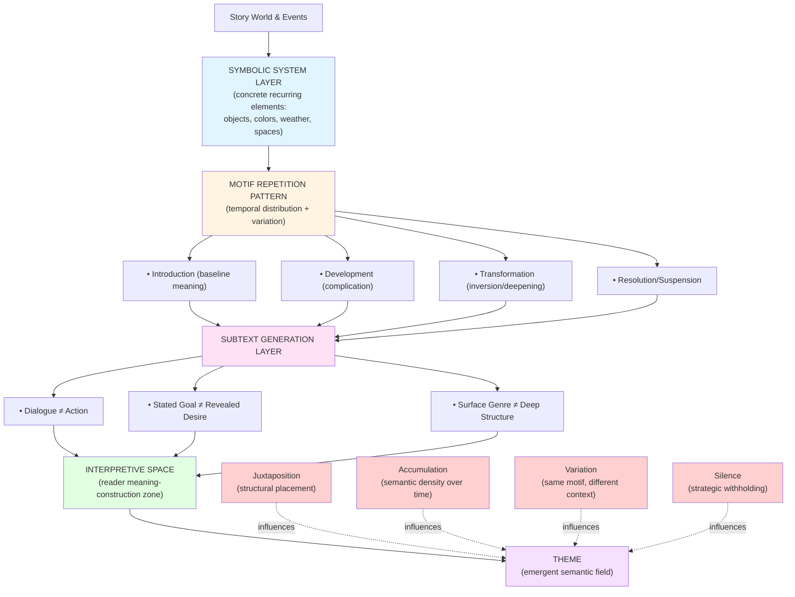

# Lesson 5: Thematic Architecture

## 1. First-Principles Intuition & Invariants

Theme operates as the gravitational field of narrative—invisible, pervasive, and structuring the trajectory of every element within the story's system. Unlike plot, which concerns the sequence of causally-linked events, or character, which concerns the psychology and agency of actors within that sequence, theme addresses the *meaning-generation substrate* that emerges from the interaction of all narrative components. It is the pattern of significance that readers construct from the accumulation of symbolic weight, moral tension, and recurring motifs threaded through the work's architecture.

The fundamental error most developing writers commit is conflating theme with moral or treating it as a message to be delivered. This reductionist view produces didactic fiction—stories that function as vehicles for preordained conclusions rather than as exploratory meaning-making engines. True thematic architecture operates through *resonance mechanics* rather than declarative assertion. The writer does not inscribe meaning onto the narrative surface but instead constructs the conditions under which meaning crystallizes in the reader's interpretive consciousness through the collision and interference patterns of recurring symbolic elements.

Consider the invariant structure underlying all robust thematic systems: **multiplicity over singularity, tension over resolution, implication over statement**. A story animated by genuine thematic architecture does not argue a single position but instead stages an irresolvable dialectic—thesis and antithesis held in productive tension without collapsing into synthetic resolution. *The Brothers Karamazov* does not settle whether God exists; it constructs a narrative field in which the question gains maximum voltage through the collision of Ivan's intellectual atheism, Alyosha's mystical faith, and Dmitri's sensual desperation. The theme emerges not from authorial verdict but from the irreducible complexity of perspectives the architecture sustains.

The mechanical foundation of theme rests on three core invariants that govern all successful implementations. First, **symbolic recurrence with variation**: a motif must repeat across the narrative timeline, but each instantiation must modulate in context, emotional valence, or interpretive possibility. Static repetition produces mere pattern recognition; varied recurrence generates semantic accumulation and deepening significance. Second, **structural embedding across narrative layers**: theme cannot reside solely in dialogue or action but must permeate setting, imagery, sentence rhythm, chapter structure, and narratorial tone. Surface-level thematic gestures—characters discussing the theme explicitly—represent the weakest possible implementation. Third, **controlled ambiguity and interpretive aperture**: the architecture must create bounded space for reader interpretation while preventing infinite semantic drift. The work establishes constraints—this story is *about* mortality, betrayal, and artistic legacy—but does not prescribe the conclusions readers must draw about those domains.

The distinction between theme and motif requires precision. A motif is a concrete, recurring element—an object, phrase, color, or sensory detail that appears multiple times across the narrative. A theme is the abstract semantic field that motifs collectively generate through their patterned deployment. In *The Great Gatsby*, the green light at the end of Daisy's dock is a motif; the American Dream's corruption through materialism and nostalgia is the theme that the green light, the ash valley, the billboard eyes, and the party scenes collectively construct. Motifs are the instrumenta; theme is the music they produce through orchestrated interaction.

Thematic architecture also requires understanding the distinction between *explicit* and *implicit* meaning-generation systems. Explicit theme surfaces in character dialogue, chapter titles, epigraphs, or narratorial commentary—places where semantic content is directly stated. Implicit theme emerges from structure, juxtaposition, pattern, and silence—the meaning readers construct from what is shown, contrasted, and withheld. Advanced fiction weights the implicit system far more heavily, trusting readers to perform the interpretive labor that transforms raw narrative material into coherent significance. The explicit layer serves primarily to establish interpretive boundaries and prevent semantic chaos, while the implicit layer does the actual work of meaning-generation.

The temporal dimension of thematic architecture is equally critical. Theme does not remain static across the narrative's duration but instead *develops*, deepens, and refracts through progressive complications. Early instantiations of a motif carry different semantic weight than late-stage recurrences because the reader's accumulated context has changed. A red scarf introduced in chapter one as a symbol of passionate love may, when it appears in chapter twenty stained with blood, activate an entirely different resonance cluster—the transformation encapsulating the theme's evolution across the narrative arc. The architecture must therefore account for temporal positioning, ensuring that symbolic elements appear in sequences that maximize semantic accumulation and reinterpretation.

Finally, thematic architecture intersects with genre expectations in complex ways. Genre fiction—mystery, romance, horror, science fiction—arrives with pre-loaded thematic templates that readers expect the work to engage, subvert, or complicate. A detective novel inherently invokes themes of justice, truth, and social order; the writer cannot avoid these but must decide whether to affirm, interrogate, or deconstruct them. Literary fiction operates under different thematic norms, typically demanding greater moral ambiguity, psychological interiority, and resistance to genre-conventional resolutions. The writer must diagnose the thematic substrate their genre activates by default and make conscious architectural decisions about alignment or deviation.

## 2. Core Architecture & Mechanics

Constructing functional thematic architecture requires systematic deployment of symbolic systems, layered motif networks, and subtext generation mechanisms across all narrative dimensions. The process begins not with selecting a theme to impose but with identifying the *thematic question* the narrative will explore—the unresolved tension that will generate semantic energy across the work's duration.

The thematic question differs fundamentally from the dramatic question. The dramatic question concerns plot outcome: Will the detective solve the murder? Will the lovers unite? The thematic question concerns meaning-space: What does it cost to pursue justice beyond legal boundaries? Can love survive the erosion of selfhood it requires? The dramatic question drives forward momentum; the thematic question drives depth accumulation. A robust narrative architecture requires both operating simultaneously, with plot events designed to systematically stress-test the thematic question from multiple vectors.

Once the thematic question is established, the writer must construct the **symbolic system**—the concrete vocabulary of objects, images, colors, weather patterns, animals, spatial configurations, and sensory textures that will carry thematic charge. This system requires both internal coherence and sufficient complexity to prevent reductive symbolism. Single-symbol systems—where a rose always means love, winter always means death—produce allegory, not thematic fiction. Functional symbolic systems deploy symbol clusters with overlapping and sometimes contradictory valences, creating interference patterns that deepen rather than simplify meaning.

Consider McCarthy's symbolic architecture in *Blood Meridian*. The color red recurs obsessively—red sunrises, red dust, red blood, red clay, red rock formations—but the text never stabilizes its meaning. Red accumulates associations: violence, desert landscape, apocalyptic judgment, physical matter's stubborn persistence, beauty in desolation. The symbolic system gains power precisely through semantic instability, forcing readers to hold multiple interpretive possibilities in suspension. The writer constructs such systems by cataloging the recurring concrete elements essential to their story's world, then consciously modulating their contextual deployment to accumulate layered associations.

The **motif repetition pattern** governs the temporal distribution and variation of symbolic elements across the narrative's length. Effective distribution follows principles derived from music: introduce, develop, transform, resolve or suspend. The motif appears first in a context that establishes baseline meaning. Subsequent appearances occur in contexts that stress, complicate, or invert that baseline. By the narrative's conclusion, the motif has accumulated sufficient semantic weight that its final appearance functions as emotional and intellectual crescendo.

The mechanical implementation of motif repetition requires tracking systems. Professional fiction writers maintain symbol logs during revision—spreadsheets or notebooks cataloging each appearance of significant motifs with scene number, context, and emotional charge. This allows diagnostic analysis: Are appearances distributed evenly or clustered? Do later instances carry greater complexity than early ones? Has the motif appeared recently enough that readers will recall its previous significance? The architecture collapses when critical motifs vanish for hundreds of pages, severing the pattern that generates thematic resonance.

Variation within repetition prevents motifs from becoming mechanical. Each recurrence should modulate at least one parameter: the character interacting with it, the emotional context, the sensory details, the narrative distance, or the interpretive frame. A character's childhood blanket might appear first in a warm memory, second in a moment of desperate nostalgia, third discovered moth-eaten in storage, and finally burned in a gesture of liberation or destruction. Same object, escalating semantic complexity through varied context. The underlying structure resembles musical theme-and-variation form: the melodic core remains recognizable while harmonic, rhythmic, and instrumental treatments transform its emotional impact.

**Thematic layering** addresses the challenge of sustaining reader interest across long-form narrative by ensuring the work explores multiple thematic dimensions simultaneously. Single-theme stories risk monotony and didacticism; multi-theme architectures create the semantic density that distinguishes major works from competent ones. The technical implementation involves identifying a primary thematic question and at least two secondary questions that intersect with but do not duplicate the primary concern.

In *Beloved*, Morrison's primary thematic question concerns slavery's psychological legacy and whether the past can be confronted or only endured. Secondary themes include maternal love's destructive potential, community versus isolation, embodiment and haunting, and the reliability of memory. These layers interact continuously—the ghost plot literalizes both trauma's persistence and memory's unreliability; Sethe's fierce motherhood both demonstrates love and enacts violence; the community's rejection and eventual acceptance of Sethe stages the tension between individual suffering and collective healing. The layers do not operate independently but interweave, each complicating and enriching the others.

The mechanical challenge in layered thematic architecture is preventing muddle—ensuring that multiple themes create productive complexity rather than incoherent noise. The solution lies in **hierarchical organization**: the primary theme provides the dominant interpretive lens, while secondary themes function as modulating forces that prevent single-axis reductionism. Every major scene should engage the primary theme while activating at least one secondary layer. This ensures tonal and semantic consistency while building dimensional depth.

**Subtext construction** represents the technical mechanism by which theme operates beneath the narrative's explicit surface. Subtext is the semantic layer generated by the gap between what characters say and what they mean, between what events seem to signify and what they actually encode, between the narrator's stated perspective and the reader's diagnostic interpretation. Building functional subtext requires constructing intentional discrepancies across three key fault lines: dialogue versus action, stated motivation versus revealed desire, and surface genre versus underlying structure.

Dialogue-action subtext emerges when characters' words contradict their behavior. A character who repeatedly declares "I'm fine" while exhibiting physical collapse, emotional volatility, or compulsive behaviors creates subtext around denial, social performance, or psychological fragmentation—all potentially thematic concerns. The writer constructs this by scripting dialogue that serves characters' self-protective or socially-acceptable impulses, then staging actions that reveal the suppressed truth. The thematic weight accumulates in the gap between the two channels.

Motivation-desire subtext operates when characters pursue goals they believe they want while the narrative reveals deeper, often unconscious drives. A character claims to seek career success but systematically sabotages opportunities might be exploring themes of fear, unworthiness, or rebellion against parental expectations. The architectural requirement is ensuring that both the stated goal and the revealed desire remain consistently traceable across the narrative—readers must perceive the pattern, not just isolated incidents of contradiction.

Surface-structure subtext involves genre misdirection or tonal layering. A narrative that presents as romance but structurally follows tragic inevitability patterns creates subtext about love's impossibility or self-deception. A comic surface with horror architecture underneath generates subtext about denial or civilization's fragility. This technique requires mastery of genre conventions in both modes, ensuring the surface layer remains plausible while the underlying structure systematically undermines or darkens it.

**Moral complexity frameworks** prevent thematic architecture from collapsing into didacticism or relativistic mush. Moral complexity does not mean that all positions are equally valid or that actions carry no consequences. It means that characters operate from internally coherent value systems that produce genuine dilemmas—situations where meaningful goods conflict or all available choices carry unacceptable costs. The writer's task is constructing scenario architectures where reasonable people can disagree about the right course while maintaining narrative investment in the outcome.

The technical implementation involves three structural elements. First, establish that all major positions within the thematic debate are represented by intelligent, articulate characters capable of defending their viewpoints. Second, ensure that each position yields both benefits and costs when enacted—no choice is without consequence, but no choice is purely destructive. Third, stage situations where characters must choose between conflicting goods rather than between good and evil: loyalty versus justice, mercy versus accountability, individual freedom versus collective welfare, truth versus kindness.

Consider *The Remains of the Day*'s moral architecture around dignity, service, and wasted life. Stevens's commitment to perfect service represents genuine virtue—self-discipline, excellence, loyalty—but the narrative reveals its catastrophic costs: emotional atrophy, complicity with fascism, lost love. The book does not simply condemn Stevens's choices; it grants them full weight while exposing their tragedy. Miss Kenton's alternative—emotional availability, willingness to break protocol—carries its own costs and compromises. The architecture sustains moral complexity by refusing to fully validate either path while making both comprehensible.

**World-theme integration** addresses the challenge of ensuring that setting, historical context, and physical environment actively reinforce thematic concerns rather than functioning as inert backdrop. Every significant element of the story's world should carry thematic charge: weather patterns that mirror emotional states, architectural spaces that embody power relations, technological systems that literalize philosophical positions, ecological conditions that externalize moral decay or renewal.

The mechanical process involves systematic interrogation of worldbuilding choices through a thematic lens. If exploring themes of surveillance and privacy erosion, the story's physical spaces should architecturally encode those concerns: glass-walled apartments, open-plan offices, security cameras, smart home systems that monitor inhabitants. If examining themes of class stratification, the built environment should visually and spatially manifest hierarchy: vertical city layouts with wealthy elites above and poor below, gated communities, differential access to green space or natural light. The world becomes thematic argument made concrete.

This technique extends to temporal setting. Historical fiction's thematic power often emerges from the resonance between past depicted and present implicit—readers perceive contemporary concerns refracted through historical narrative. *The Crucible* dramatizes 1692 Salem witch trials but generates thematic energy from 1950s McCarthyism; the architecture works because the historical setting provides both sufficient distance for objectivity and sufficient parallel for recognition. The writer must ensure that the chosen temporal setting offers concrete details and conflicts that naturally manifest the thematic questions at stake.

**Resonance mechanics** govern how symbolic and thematic elements achieve maximum emotional and intellectual impact through positioning, accumulation, and controlled release. Resonance occurs when a motif, image, or thematic statement arrives at the narratively-prepared moment—after sufficient buildup that readers recognize its significance but before repetition breeds numbness. The technical challenge resembles joke timing: too early and the setup isn't complete; too late and momentum dissipates.

The mechanical implementation requires mapping thematic intensity across the narrative's duration. Identify the moments where thematic questions reach maximum urgency: climactic confrontations, revelation scenes, moments of irrevocable choice. Ensure that the symbolic vocabulary associated with those themes appears with increasing frequency and complexity as those peak moments approach. The pattern should create a gradient of intensification—sparse appearance in early sections, rising density in middle development, concentrated deployment in climactic sequences.

Consider the resurrection imagery in *A Tale of Two Cities*: "recalled to life" appears first as bureaucratic phrase, later as psychological process, eventually as literal sacrifice. The phrase accumulates meaning through varied contexts until Carton's execution transforms it from motif into thematic crescendo. The architecture works because each appearance deepens rather than duplicates the previous instantiation, and the timeline ensures sufficient spacing that readers register continuity without exhaustion.

The **implicit meaning-generation system** operates through techniques of withholding, juxtaposition, and pattern rather than direct statement. The most powerful thematic architectures communicate primarily through what remains unsaid—gaps readers must interpretively fill, connections they must construct, judgments they must formulate from accumulated evidence. This system respects reader intelligence and co-opts their active participation in meaning-making, creating stronger emotional investment than passive reception of authorial pronouncement.

Juxtaposition represents the core technique: placing scenes, characters, images, or chapters in deliberate sequence such that their adjacency generates meaning beyond what either contains individually. A chapter depicting a lavish party followed immediately by a chapter showing poverty-stricken desperation creates implicit commentary on inequality without requiring authorial editorializing. A character's idealistic speech juxtaposed with their subsequent cruel action generates implicit theme about hypocrisy or self-deception through structural placement alone.

Pattern recognition forms the second pillar of implicit meaning-generation. Readers naturally detect recurring structures: a character repeatedly faces variations of the same choice, multiple characters experience parallel trajectories, plot events mirror earlier symbolic moments. The writer constructs these patterns deliberately, then trusts readers to perceive and interpret them. The architecture fails when patterns become too obvious—hitting the same note three times risks didacticism—or too obscure, such that only academic close-reading detects them. The functional zone lies between, where attentive readers perceive patterns that reward but do not require detection for basic narrative comprehension.

The **interpretive space design** addresses the final architectural challenge: calibrating how much ambiguity the work sustains and where it directs reader interpretive energy. Total ambiguity produces incoherence; zero ambiguity produces propaganda. Functional thematic architecture establishes clear boundaries—this work concerns these questions, not those—while refusing to prescribe answers within that bounded space.

The technical mechanism involves distinguishing between infrastructural clarity and thematic openness. Infrastructure includes causal logic, character motivation consistency, worldbuilding rules—elements that require stability for narrative coherence. These must remain clear, even when complex. Thematic openness operates at the level of meaning and judgment: readers should understand what happens and why characters act, but should retain interpretive freedom about whether those actions were right, what they signify, or what conclusions to draw about the thematic questions at stake.

The controlled ambiguity technique involves staging scenes that permit multiple equally-defensible interpretations without supporting all possible readings. An ambiguous ending might leave unclear whether the protagonist achieves redemption, but it should not leave unclear what actually happened in plot terms. The famous spinning top conclusion of *Inception* works because the factual question—does it fall?—remains open, but the thematic question—whether Cobb still cares about the distinction between dream and reality—achieves resolution. The architecture preserves interpretive space while providing sufficient closure for emotional satisfaction.

## 3. High-Performance Optimization & Failure Modes

The optimization of thematic architecture requires balancing semantic density against readability, ensuring that the meaning-generation system operates at sufficient complexity to sustain long-form engagement without collapsing into opacity or pretension. The primary failure mode in advanced thematic construction is over-engineering: symbolic systems so elaborate and motif networks so dense that the narrative infrastructure becomes visible, breaking immersion and transforming fiction into puzzle.

The diagnostic test for over-engineered theme is simple: if readers discuss the symbolic architecture more than the characters and story, the balance has failed. Theme should enrich narrative experience, not replace it. The optimization strategy involves ensuring that every symbolic element and thematic gesture also serves immediate narrative function—advancing plot, revealing character, building tension, or delivering sensory texture. Motifs that exist solely to carry thematic weight without contributing to scene-level experience represent inefficiency and should be cut or integrated more fully into the dramatic fabric.

The **revision protocol for thematic architecture** differs substantially from plot or character revision. Initial drafts should prioritize story momentum and character authenticity over thematic coherence; attempting to engineer theme into early drafts produces stilted, artificial prose. Instead, the first-draft task is simply noticing what images, objects, and questions recur organically—the raw material from which thematic architecture will be constructed. Many writers discover their actual themes only upon completing a discovery draft and perceiving the patterns their unconscious mind generated.

Second-draft work involves systematizing those organic patterns into intentional architecture. The writer catalogs all recurring elements, identifies which clusters serve thematic potential, and makes strategic decisions about retention, elimination, and amplification. Elements that appeared accidentally but serve emerging themes get strengthened and distributed more deliberately. Thematic gestures that feel forced or disconnected from the narrative's organic concerns get removed, regardless of how intellectually interesting they seem in isolation.

Third-draft work focuses on variation and subtlety—ensuring that motifs recur with sufficient difference that each appearance deepens meaning, and that thematic content operates primarily through implication rather than statement. This phase involves cutting explicit thematic dialogue and replacing it with juxtaposition, pattern, and symbolic weight. Characters should rarely discuss theme directly; when they do, their perspectives should be partial, biased, or contradicted by events. Narrators in third-person fiction should largely avoid thematic editorializing, trusting the staged events to generate meaning.

The **pacing of thematic revelation** requires particular attention in optimization. Early sections of the narrative should establish symbolic vocabulary and hint at thematic questions without fully articulating them. This creates forward momentum—readers perceive that certain elements carry significance not yet revealed, generating the desire to continue reading. Middle sections develop and complicate thematic questions through varied instantiations and moral stress-tests. Final sections achieve thematic crystallization—the moment where accumulated symbolic weight and moral complexity cohere into recognizable (though not necessarily resolved) significance.

The failure mode of premature thematic revelation occurs when the work articulates its themes too early or too explicitly, eliminating forward momentum and transforming the remaining narrative into redundant illustration. If a character delivers a speech in chapter five that fully explains the book's thematic argument, the subsequent fifteen chapters will feel like unnecessary elaboration. The optimization involves delaying thematic clarity until readers have experienced sufficient narrative complexity that the themes emerge as hard-won insights rather than announced premises.

The opposite failure mode—thematic inscrutability—occurs when symbolic systems remain so private or ambiguous that readers cannot construct coherent interpretations. This typically results from insufficient infrastructure clarity or motif distribution so sparse that pattern recognition fails. The diagnostic test involves beta readers: if intelligent, attentive readers cannot articulate what the book is *about* beyond plot summary, the thematic architecture has failed to generate sufficient explicit markers to guide interpretation. The solution involves strategically strengthening infrastructural clarity—ensuring causal logic is sound, character motivations are traceable—and slightly increasing motif frequency in early sections to establish pattern recognition earlier.

**Symbolic system optimization** requires achieving maximum resonance with minimum vocabulary. Overloaded symbolic systems—where twenty different objects carry thematic weight—diffuse rather than concentrate meaning. The optimization target for novel-length fiction typically involves three to five core symbol clusters, each containing two to four related elements. This creates sufficient complexity for semantic richness while maintaining clear enough boundaries that readers can track patterns without external aids.

The selection criteria for core symbols should prioritize elements that are narratively necessary, sensorially vivid, and semantically flexible. Narratively necessary means the symbol emerges naturally from the story's world and events—not imported artificially. A sea-based narrative naturally supports water imagery; forcing ocean metaphors into a landlocked urban story strains credibility. Sensorially vivid means the symbol engages multiple senses, creating memorable concrete detail. Semantically flexible means the symbol can accumulate contradictory or evolving meanings without breaking—more verb than noun, more process than static object.

The **thematic dialogue optimization** technique addresses the challenge of allowing characters to discuss ideas without producing essays disguised as fiction. Effective thematic dialogue observes three constraints. First, characters speak from their own psychological, professional, and educational contexts—a philosophy professor and a mechanic will articulate thematic concerns using radically different vocabularies and levels of abstraction. Second, thematic discussions occur during dramatically justified situations—arguments, teaching moments, crises of conscience—not as idle conversation. Third, thematic dialogue remains incomplete and contestable—one character's perspective, not authorial truth.

The failure mode of "mouthpiece dialogue" occurs when characters speak with implausible eloquence or philosophical sophistication, clearly serving as authorial vehicles rather than authentic personalities. The diagnostic test is removing character attribution: if the dialogue could be swapped between any two characters without violence to their established voices, those characters have dissolved into mouthpieces. The solution involves grounding thematic discussion in specific character concerns and limitations, allowing intelligence to manifest through their particular domains of expertise while remaining blind or inarticulate in others.

**Genre-specific thematic optimization** acknowledges that different genres sustain different thematic densities and complexities. Literary fiction readers expect and reward elaborate thematic architecture; commercial thriller readers prioritize narrative momentum and may experience dense symbolic systems as pretentious drag. The optimization strategy involves diagnosing genre expectations for your target readership and calibrating thematic complexity accordingly.

Commercial genre fiction should prioritize implicit over explicit theme, concentrating symbolic weight in plot-critical moments rather than distributing it evenly. The core thematic question should align with genre conventions—honor in warrior fiction, trust in romance, justice in mystery—while finding fresh angles or complications within those established frameworks. Motif repetition should be sparse but powerful, appearing at structural hinges: inciting incident, midpoint reversal, climax, resolution. The symbolic vocabulary should be immediately accessible, avoiding academic or esoteric reference.

Literary fiction permits and rewards greater thematic complexity, denser symbolic architecture, and more ambiguous moral frameworks. The optimization involves ensuring that the complexity serves emotional and philosophical depth rather than demonstrating cleverness. Literary readers tolerate slower pacing and less plot momentum but still require narrative drive—thematic complexity cannot substitute for stakes, character development, and structural coherence. The failure mode of literary overreach occurs when symbolic systems become so baroque or themes so abstract that the human story disappears beneath intellectual scaffolding.

**Cross-cultural thematic resonance** represents an advanced optimization challenge for writers seeking audiences beyond their immediate cultural context. Symbols and motifs carry culturally-specific associations that may not transfer: color symbolism, animal associations, religious imagery, historical references all operate within culturally-bounded semantic fields. The optimization strategy involves distinguishing between universal human concerns—mortality, love, justice, belonging—that transcend cultural boundaries, and culture-specific instantiations that may require contextualization or substitution.

The technical approach involves grounding symbolic systems in human universals: body, landscape, elemental forces, fundamental relationships. A story exploring themes of oppression might use architectural enclosure as core symbol—cages, walls, locked rooms—which translates across cultures more reliably than symbols dependent on specific historical events or religious traditions. When culture-specific elements are essential to the story's setting and authenticity, the writer must provide sufficient context through dramatized experience rather than explanatory intrusion, allowing readers to construct understanding through immersive encounter.

The **thematic scope limitation** principle addresses the temptation to address every interesting philosophical question within a single work. Thematic bloat—attempting to explore too many unrelated concerns—produces narrative incoherence and superficial treatment of all themes. The optimization involves ruthless prioritization: identify the two or three questions the narrative genuinely obsesses over, the concerns that permeate every structural level, and subordinate or eliminate themes that feel grafted on or tangential.

The diagnostic process involves listing every thematic concern the work touches and rating each for integration depth: Does it appear in worldbuilding, plot structure, character psychology, symbolic systems, and narrative voice? Or does it surface only in one character's dialogue or a single subplot? Themes that achieve full-spectrum integration merit retention; themes that appear superficially should be cut or deepened through systematic architectural integration across all narrative layers.

The final optimization concerns **thematic freshness and avoiding cliché**. Every theme has been explored before; the question is whether the writer finds a new vector of approach, a fresh complication, or an unexpected synthesis. The failure mode of thematic cliché occurs when the work rehearses familiar arguments through familiar symbolic vocabulary: light versus dark, nature versus civilization, innocence versus experience, without finding new dimensions within those ancient binaries.

The optimization strategy involves intersection and complication: combine themes in unexpected ways, or introduce elements that prevent easy resolution. Rather than exploring "love conquers all," explore "love as colonization" or "love's incompatibility with selfhood." Rather than "technology dehumanizes," explore "technology as prosthetic intimacy" or "digital spaces as new modes of authentic connection." The goal is not novelty for its own sake but finding the genuine complexity and contradiction within thematic territories that lazy thinking has flattened into truisms.

The revision question for every thematic gesture should be: Does this complicate or simplify? Thematic architecture that continually introduces complexity, contradiction, and new angles of perception remains vital across hundreds of pages. Architecture that repeatedly confirms the same insight through varied illustration exhausts itself and the reader's patience. The writer's task is constructing meaning-generation systems that teach readers how to read the work, then reward that acquired literacy with continuously deepening returns.
