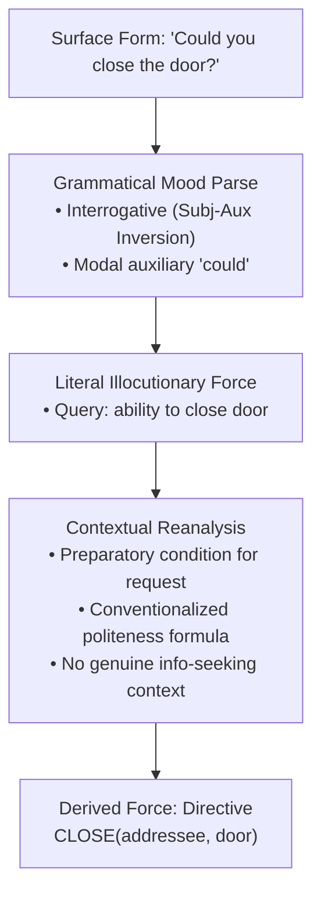
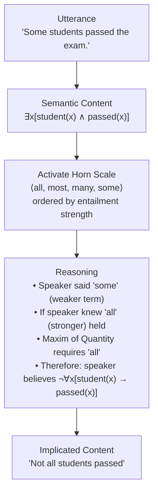
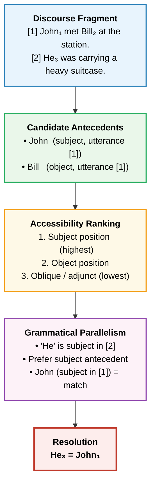
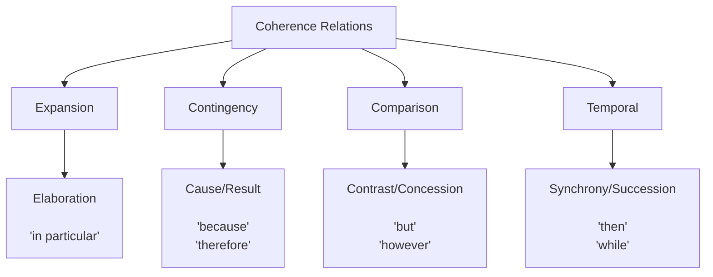

# Lesson 5: Pragmatic Discourse Principles

## 1. First-Principles Intuition & Invariants

The essence of pragmatic competence lies in recognizing that meaning transcends the literal semantic content of utterances. When a speaker produces the sentence "Can you pass the salt?", the grammatical form encodes an interrogative structure querying the addressee's physical capability, yet every competent English speaker interprets this as a polite directive rather than a genuine question about arm reach or motor function. This gulf between sentence meaning and speaker meaning constitutes the foundational problem space of pragmatics, the discipline that investigates how context, shared knowledge, and social convention enable interlocutors to convey and recover intended meanings that far exceed what the grammar and lexicon explicitly encode.

The theoretical architecture of English pragmatics rests on several interdependent invariant principles. At the most fundamental level, we must distinguish between locutionary acts—the production of well-formed phonological and syntactic structures—and illocutionary acts, which represent the communicative force or intended effect of an utterance. J.L. Austin's speech act theory established that every meaningful utterance performs an action: asserting, promising, requesting, warning, apologizing, or any of dozens of conventionalized social moves. The illocutionary force of "I promise to return your book tomorrow" is not merely descriptive but performative; the utterance itself constitutes the promise rather than reporting on some internal mental state. This performative dimension operates through felicity conditions, contextual prerequisites that must obtain for the speech act to succeed. A promise requires that the speaker intends to perform the future action, believes it possible, and assumes the hearer desires its performance. Violations of these conditions result in pragmatic infelicity rather than grammatical ungrammaticality.

The second foundational invariant emerges from H.P. Grice's Cooperative Principle, which posits that rational communicators adhere to four conversational maxims unless they signal otherwise. The Maxim of Quantity instructs speakers to provide neither more nor less information than required for current conversational purposes. The Maxim of Quality demands truthfulness, requiring speakers to avoid assertions they believe false or lack adequate evidence to support. The Maxim of Relation mandates relevance, ensuring contributions connect appropriately to the ongoing discourse topic. The Maxim of Manner governs clarity, prescribing brevity, orderly presentation, and avoidance of obscurity or ambiguity. These maxims do not function as rigid prescriptive rules but rather as defeasible expectations that create the interpretive scaffolding for conversational implicature.

Conversational implicature represents the mechanism by which speakers convey meanings that go beyond—and sometimes contradict—the literal semantic content of their utterances. When a reference letter writer states "Mr. Smith has excellent handwriting and attended all lectures punctually," the recipient infers that Mr. Smith lacks substantive intellectual or professional qualifications, despite the fact that no such negative proposition appears in the semantic composition. This inference arises because the Maxim of Quantity creates the expectation that the writer would mention relevant positive qualities if they existed. The deliberate underinformativeness generates a scalar implicature, wherein the failure to assert a stronger proposition on an informativeness scale implicates the negation of that stronger proposition. Similarly, when a dinner guest responds to "Would you like more potatoes?" with "I'm trying to cut back on carbohydrates," the Maxim of Relation ensures the addressee interprets this as a polite refusal despite the absence of explicit negation.

Presupposition introduces a distinct dimension of projected meaning that survives under negation, interrogation, and modal embedding. The utterance "John stopped smoking" presupposes that John previously smoked, and this existential commitment persists even when the sentence is negated ("John didn't stop smoking") or questioned ("Did John stop smoking?"). English encodes presupposition triggers through specific lexical items and syntactic constructions. Factive verbs like "realize," "regret," and "know" presuppose the truth of their complement clauses: "Sarah regrets missing the concert" presupposes that Sarah did in fact miss the concert. Definite descriptions trigger existential and uniqueness presuppositions: "The King of France is bald" presupposes the existence of a unique French monarch, and the utterance suffers from presupposition failure in contexts where France has no king. Cleft constructions create presuppositional focus structures: "It was the butler who murdered Lord Ashford" presupposes that someone murdered Lord Ashford and asserts that the butler fills this role.

The pragmatic phenomenon of reference resolution exposes the intricate interplay between linguistic form and contextual identification. Pronouns, demonstratives, and definite descriptions function as anaphoric devices that instruct the hearer to locate their referents through various resolution strategies. Personal pronouns like "he," "she," and "it" typically retrieve their referents from the immediately preceding discourse, with syntactic prominence and topicality governing accessibility hierarchies. When discourse contains multiple potential antecedents of the same gender, speakers exploit structural parallelism, verb semantics, and world knowledge to disambiguate. Consider the sequence "John told Bill that he should leave." The pronoun "he" exhibits systematic ambiguity: it can refer to either John or Bill depending on subtle prosodic, contextual, and lexical-semantic factors. Demonstrative pronouns encode proximal-distal distinctions, with "this" signaling psychological or spatial nearness and "that" marking distance. Definite descriptions trigger accommodation mechanisms when their presupposed referents lack explicit introduction: hearing "The burglar escaped through the window" for the first time in a narrative, comprehenders automatically construct a mental representation of a burglar and window without requiring prior explicit mention.

Information structure organizes clausal content according to its discourse status and communicative function. The information packaging system of English distinguishes between given information—entities, propositions, and frames already established in the discourse model—and new information that updates or extends this model. Topic represents what the sentence is about, the entity or frame under current discussion, while focus marks the informative core, the element that answers the implicit or explicit question under discussion. English exploits multiple formal mechanisms to signal information structure. Prosodic prominence, realized through pitch accent and increased duration, marks focal stress: "MARY bought the car" (not someone else), "Mary BOUGHT the car" (rather than leasing it), "Mary bought the CAR" (not the motorcycle). Syntactic dislocations reorder constituents to align with information-structural requirements. Left-dislocation promotes topics to clause-initial position: "That old house on Elm Street, we should demolish it before winter." Right-dislocation postpones heavy or low-accessibility material: "She's brilliant, that new quantum physicist from Cambridge." Cleft constructions rigidly partition presupposition and focus: "What Mary bought was the car" presupposes that Mary bought something and focuses on the car as the answer to this implicit question.

Coherence relations provide the semantic glue that binds individual clauses and sentences into unified, interpretable discourse. Unlike cohesion, which concerns surface-level lexical and grammatical links, coherence operates at the level of propositional content and rhetorical structure. Narrative discourse typically progresses through temporal sequencing, where successive clauses describe events in chronological order unless explicitly marked otherwise. Elaboration relations expand on entities, events, or states introduced in prior discourse, providing additional descriptive detail or explanatory context. Explanation and result relations encode causal connections, with the former moving from effect to cause and the latter from cause to effect. Contrast and concession mark relationships where expectations are violated or propositions stand in opposition. English signals these coherence relations through both explicit discourse connectives—"therefore," "however," "because," "although," "moreover"—and implicit inferential processes guided by world knowledge and the Cooperative Principle.

The interplay between these pragmatic dimensions creates the rich interpretive tapestry that characterizes natural language understanding. A single utterance simultaneously performs a speech act, generates conversational implicatures, projects presuppositions, establishes reference, packages information according to discourse status, and contributes to ongoing coherence relations. Mastery of English pragmatics requires not merely passive recognition of these phenomena but active command of their manipulation in real-time discourse production and comprehension.

## 2. Core Architecture & Mechanics

The internal architecture of pragmatic processing in English discourse operates through multiple parallel subsystems that interact with grammatical encoding, semantic composition, and contextual knowledge bases. Understanding this architecture requires examining how each pragmatic dimension interfaces with linguistic form and how comprehenders execute the interpretive algorithms that recover speaker meaning from surface utterances.

Speech act recognition proceeds through a multi-stage process that begins with illocutionary force indicators encoded in grammatical mood, intonation patterns, and performative vocabulary. English distinguishes three primary mood categories that correlate imperfectly with illocutionary force. Declarative mood, marked by subject-auxiliary word order and falling terminal intonation, prototypically performs assertions: "The library closes at nine." Interrogative mood, signaled through subject-auxiliary inversion ("Does the library close at nine?") or wh-fronting ("When does the library close?"), canonically performs questions. Imperative mood, characterized by bare verb forms and null subjects, conventionally encodes directives: "Close the door." Yet this form-function mapping exhibits extensive indirection. Interrogative syntax frequently expresses directives through conventionalized politeness strategies: "Could you close the door?" functions as a request despite its yes-no question format. Declarative syntax can perform questions when combined with rising intonation: "The library closes at nine?" This intonational contour, transcribed as a high boundary tone (H%) in autosegmental-metrical phonology, overrides the mood-based default and signals interrogative force.

Performative verbs constitute a specialized lexical class that explicitly names the speech act being performed. First-person present-tense constructions with these verbs function as self-verifying performatives: "I hereby promise to repay the loan," "I apologize for the delay," "I warn you that the ice is thin." The felicity conditions for each performative verb type constrain their appropriate usage contexts. Commissives like "promise," "vow," and "guarantee" require the speaker to commit to future action and presuppose the hearer's interest in this commitment. Directives such as "order," "request," and "forbid" require appropriate authority or social relations between interlocutors. Expressives including "thank," "congratulate," and "apologize" presuppose the existence of specific prior events or states that warrant the emotional stance expressed.

The mechanism of conversational implicature derivation operates through systematic reasoning about violations of or adherence to Gricean maxims. Scalar implicatures arise when speakers select weaker terms from informativeness scales, thereby implicating the negation of stronger alternatives. English possesses numerous scalar sets organized by entailment relationships: quantifiers (all > most > many > some), modals (must > should > might), and evaluative adjectives (excellent > good > adequate). The utterance "Some students passed the exam" implicates "Not all students passed" because if the speaker knew that all students passed, the Maxim of Quantity would have required asserting the stronger proposition. This implicature remains defeasible and can be explicitly canceled: "Some students passed—in fact, all of them did." Generalized conversational implicatures arise systematically across contexts, while particularized implicatures depend on specific situational factors. When asked "How was the concert?" and responding "The violinist showed up on time," the particularized implicature that the performance was poor arises from the Maxim of Relation combined with the expectation that concert reviews mention musical quality rather than punctuality.

Presupposition projection exhibits complex compositional behavior as presuppositions introduced in embedded clauses interact with logical operators and propositional attitudes. Negation, questions, and modals constitute the canonical tests for presupposition because, unlike assertions, presupposed content survives under these operators. The presupposition that John smoked projects from "John stopped smoking" through negation ("John didn't stop smoking" still presupposes prior smoking), through questions ("Did John stop smoking?"), and through modals ("John might have stopped smoking"). Yet certain embeddings create filtering environments where presuppositions fail to project to matrix clause level. Conditional antecedents filter presuppositions when the antecedent provides the information that would otherwise be presupposed: "If John used to smoke, then he has stopped smoking" does not presuppose that John smoked because the conditional antecedent explicitly introduces this possibility. Disjunctions exhibit asymmetric filtering: "Either John never smoked or he has stopped smoking" does not project the smoking presupposition from the second disjunct.

The presupposition accommodation mechanism operates as a repair strategy when presupposed content lacks explicit prior introduction. Upon encountering a definite description or factive construction whose presuppositions find no antecedent in the discourse model, comprehenders automatically enrich their contextual representation to satisfy the presuppositional requirements. This process operates silently and rapidly, creating the impression of seamless understanding despite the logical gaps. Bridging inferences represent a subtype of accommodation where comprehenders infer unstated relations between introduced entities and prior discourse referents. Hearing "John bought a car. The engine makes a strange noise," comprehenders automatically establish that the definite description "the engine" refers to the engine of the recently mentioned car through part-whole bridging, despite the absence of explicit linguistic marking.

Reference resolution algorithms exploit multiple information sources organized in accessibility hierarchies. Centering Theory formalizes these preferences through the notions of forward-looking centers (potential referents available for subsequent mention) and backward-looking centers (the most salient referent from the previous utterance). Entities introduced in subject position and maintained across successive utterances as subjects achieve highest accessibility and serve as preferred pronoun antecedents. Passages exhibiting center continuation, where the same entity remains the backward-looking center across utterances, achieve maximal coherence. Center shift, where a new entity becomes the backward-looking center, requires more processing effort and typically correlates with discourse segment boundaries or topic shifts.

Syntactic constraints on pronoun binding prevent certain coreference relations even when semantic plausibility would permit them. C-command requirements dictate that reflexive pronouns must be bound by antecedents within the same local domain (roughly, the same clause or tensed complement). The sentence "John₁ thinks that Bill₂ likes himself₃" allows only the interpretation where "himself" refers to Bill, not John, because Bill c-commands the reflexive within its governing category. Conversely, non-reflexive pronouns typically cannot corefer with c-commanding antecedents in the same local domain, explaining the disjoint reference in "He₁ thinks that John₂ is brilliant" where "he" and "John" must refer to different individuals if "he" occupies subject position in the matrix clause.

Information structure marking in English exploits the interplay between prosody, syntax, and information-theoretic constraints. The given-new contract, a pragmatic principle governing information flow, prescribes that speakers should place given information in prosodically weak positions and new information in prosodically prominent positions. This principle manifests in the preference for rightward placement of focal stress and leftward positioning of topics. Contrastive focus receives marked prosodic prominence and can override default nuclear stress patterns. Compare neutral "What did Mary buy?" / "Mary bought a CAR" (rightmost primary stress) with contrastive "Did Mary buy a motorcycle?" / "No, Mary bought a CAR" (contrastive stress on "car" overrides rightmost stress position).

Cleft structures provide rigid information-structural templates that separate presupposed and focal content through syntactic means. It-clefts position the focus immediately after the copula: "It was SHAKESPEARE who wrote Hamlet" presupposes someone wrote Hamlet and focuses on Shakespeare as the answer. Wh-clefts (pseudoclefts) invert this order: "What Mary bought was a CAR" places the wh-clause in topic position and the post-copular constituent in focus position. Reverse wh-clefts further manipulate information flow: "A CAR is what Mary bought." These constructions not only mark information structure but also constrain the range of possible question-answer pairs in discourse. An it-cleft like "It was in PARIS that John met Susan" can felicitously answer "Where did John meet Susan?" but not "Who met Susan?" because the focus position specifies the questioned constituent.

Coherence relation identification proceeds through recognition of both explicit discourse connectives and implicit inferential patterns. Explicit connectives form a closed lexical class with specialized members encoding specific relation types. Causal relations surface through "because," "since," "therefore," and "as a result." Contrastive relations employ "but," "however," "although," and "in contrast." Temporal sequencing uses "then," "afterwards," "subsequently," and "meanwhile." Elaboration signals include "in particular," "for instance," and "namely." Yet much discourse coherence operates through implicit relations recoverable from world knowledge and logical inference. The sequence "John pushed Bill. Bill fell down" exhibits a result relation without explicit marking, comprehenders inferring the causal connection from their knowledge of physical mechanics and typical push-fall sequences.

The interaction between these pragmatic subsystems creates emergent interpretive effects. A single utterance can simultaneously perform a speech act, generate scalar implicatures, trigger presupposition projection, establish reference through anaphora, mark information structure through prosody and syntax, and contribute to discourse coherence through explicit or implicit relations. Consider the discourse fragment: "A: Did everyone enjoy the presentation? B: SOME people found it interesting." The response performs an assertion while simultaneously generating the scalar implicature "Not everyone found it interesting" through the quantifier choice. The contrastive stress on "some" signals focus structure and strengthens the scalar inference by highlighting the quantifier choice as deliberate. The definite description "the presentation" achieves reference through discourse deixis to A's question, and the overall exchange exhibits a question-answer adjacency pair structure that constrains B's response to be relevant to A's query.

## 3. High-Performance Optimization & Failure Modes

Mastery of English pragmatic principles requires developing robust production and comprehension strategies that operate efficiently under real-time processing constraints while remaining sensitive to the rich contextual factors that determine interpretation. Advanced speakers optimize their pragmatic performance through systematic exploitation of conventionalized patterns, strategic manipulation of information structure, and careful calibration of speech act directness to social context.

The most critical optimization for speech act production involves recognizing and deploying conventionalized indirect request formulas. English possesses a highly structured inventory of politeness strategies organized around face-threatening acts, communicative situations where speakers risk damaging either their own or their interlocutor's public self-image. Directives inherently threaten the addressee's negative face, their desire for autonomy and freedom from imposition. Rather than using bald on-record imperatives ("Close the window"), sophisticated speakers employ query preparatory conditions through modal interrogatives: "Could you close the window?" "Would you mind closing the window?" "Might I ask you to close the window?" These formulas have undergone pragmatic fossilization, becoming so conventionalized that comprehenders process them as direct requests rather than genuine ability questions, dramatically reducing processing cost compared to non-conventionalized indirect strategies.

The choice among politeness strategies follows systematic sociopragmatic principles governed by three primary variables: social distance between interlocutors, relative power differential, and the objective degree of imposition. High social distance, low speaker power, and high imposition favor maximally indirect strategies with extensive mitigation. A junior employee requesting a day off might produce: "I was wondering whether it might be possible, if it's not too much trouble, to perhaps take next Friday off?" This utterance layers multiple mitigation devices: past progressive construction ("was wondering") creates temporal distance, modal auxiliary ("might") reduces assertiveness, conditional structure ("if it's not too much trouble") acknowledges imposition, and hedge adverb ("perhaps") further weakens the directive force. Conversely, close social distance, equal power, and low imposition permit direct strategies: "Can I take Friday off?" Miscalibration of directness to social parameters constitutes a primary source of pragmatic failure, producing either excessive bluntness that damages social relations or obsequious over-mitigation that signals inappropriate power asymmetries.

Advanced implicature generation exploits multiple layers of Gricean reasoning to convey complex meanings with maximal efficiency. Metalinguistic negation provides a sophisticated device for rejecting the form, register, or presuppositions of prior utterances rather than their semantic content: "A: Did John stop beating his wife? B: John didn't 'stop beating his wife'—he never beat her in the first place." The quotative intonation and explicit metalinguistic framing signal that the negation targets the presupposition of prior wife-beating rather than the temporal claim about cessation. Damning with faint praise represents an advanced implicature strategy where deliberately weak praise in contexts requiring strong evaluation generates negative inferences: "Professor Smith's lecture was adequately organized and he spoke clearly enough to be understood" implicates that the lecture lacked intellectual depth, originality, or engaging content because the Maxim of Quantity requires mentioning substantive virtues if they exist.

Strategic information structure manipulation enables speakers to guide comprehender attention and constrain subsequent discourse moves. Topic-comment articulation organizes information flow to maintain discourse coherence while introducing new content. Skillful speakers employ left-dislocation to explicitly mark discourse topics while using right-dislocation to delay heavy constituents that would otherwise interrupt prosodic flow: "That proposal Johnson submitted, I don't think we can implement it given our current budget constraints." The fronted topic establishes the frame for evaluation while postponing the complex evaluation content. Cleft structures serve as powerful tools for correcting misapprehensions or resolving ambiguities by isolating the corrected or disambiguated element in focus position: "A: Did Mary buy the motorcycle? B: No, it was the CAR that Mary bought." The it-cleft structure ensures "car" receives maximal prosodic prominence while backgrounding the already-established buying event.

Presupposition management requires careful attention to accommodation costs and common ground establishment. Speakers who introduce definite descriptions or factive constructions without ensuring their presuppositions are satisfied in the common ground force comprehenders to perform costly accommodation inferences. Consider the discourse-initial utterance: "The burglar who escaped through the second-floor window left fingerprints on the sill." This sentence presupposes the existence of a burglar, an escape event, a second-floor window, and prior knowledge that the escape occurred through this particular window. In narrative contexts where these presuppositions have been gradually established, the utterance processes smoothly. Introducing it without prior context creates massive accommodation load as comprehenders scramble to construct the necessary background frame. Strategic presupposition introduction builds common ground incrementally: "There was a burglary last night. A burglar broke in through a second-floor window. The burglar who escaped through that window left fingerprints." This sequencing respects information structure principles by introducing new referents with indefinite descriptions before subsequently referring to them with definite descriptions once they enter the common ground.

Reference tracking across extended discourse requires maintaining and updating discourse representations that map linguistic expressions to their real-world or fictional referents. Pronouns and definite descriptions create anaphoric chains that link multiple mentions of the same entity. Competent speakers ensure these chains remain unambiguous by avoiding introduction of referents with matching phi-features (gender, number, person) when pronouns will subsequently refer to established referents. When ambiguity cannot be avoided through pronoun use, speakers employ repeated names, epithets, or definite descriptions that include disambiguating modifiers: "John told Bill that he was mistaken" risks ambiguity, but "John told Bill that the accountant was mistaken" achieves clarity if "accountant" uniquely identifies one participant. Cross-sentence reference tracking exhibits recency and topicality effects: entities mentioned more recently and those serving as discourse topics achieve higher accessibility and can be referenced with weaker forms (pronouns rather than full noun phrases). Skilled speakers exploit these accessibility gradients to maintain coherence while avoiding excessive repetition.

Coherence relation marking exhibits a trade-off between explicitness and brevity. Explicit connectives provide unambiguous relational cues but increase sentence length and can sound pedantic in contexts where relations are readily inferable: "John studied diligently for the examination and therefore he achieved a high score" versus "John studied diligently. He achieved a high score." The implicit causal relation in the second version creates a more natural, less formal register while relying on comprehenders' ability to infer the causal connection. Technical and academic writing conventionally prefers explicit marking to reduce processing load and prevent misinterpretation, while narrative and conversational discourse favors implicit relations to maintain fluent pacing. Advanced writers calibrate connective use to discourse genre and audience sophistication.

The phenomenon of pragmatic overload occurs when utterances simultaneously exploit multiple pragmatic effects in ways that create processing bottlenecks or interpretation conflicts. Consider: "A: Everyone attended the meeting, right? B: Well, SOME people showed up." B's response generates a scalar implicature (not everyone), marks contrastive focus on the quantifier, employs the hedge "well" to signal upcoming face-threat, and performs a polite disagreement that corrects A's presupposition. This layering of pragmatic effects achieves sophisticated communicative goals but risks exceeding working memory capacity, particularly for non-native speakers or in contexts with degraded auditory signal. Strategic simplification that distributes pragmatic work across multiple utterances reduces cognitive load: "B: Well, I'm not sure everyone made it. I saw some people there, but I don't think it was the full group."

Failure modes in speech act performance typically stem from mismatches between illocutionary force and perlocutionary effect, the actual impact an utterance has on the hearer. A speaker may intend a suggestion but produce an utterance that the hearer interprets as a directive, creating resentment or resistance. Indirect speech acts particularly suffer from cross-cultural variation in conventionalization patterns. "Would you like to close the window?" functions as a directive in American English but might be interpreted as a genuine preference question in cultures with different politeness conventions. Explicit performatives can fail when felicity conditions are not satisfied: "I promise to make it rain tomorrow" fails as a promise because the speaker cannot control meteorological phenomena, and promises require speaker commitment to actions within their control. Recognition of these failure modes requires metacognitive monitoring of hearer uptake through back-channel feedback, requests for clarification, and compliance behavior.

Implicature recovery can fail when speakers and hearers operate under different contextual assumptions or possess asymmetric world knowledge. A speaker might employ a cultural reference expecting it to generate a particularized implicature, but hearers lacking the cultural frame will fail to derive the intended inference. "The dinner went about as well as the Titanic's maiden voyage" implicates disaster to those familiar with the ship's fate but communicates nothing to those lacking this historical knowledge. Scalar implicatures exhibit cross-linguistic and individual variation in strength: some comprehenders automatically derive scalar inferences while others require explicit prompting. The utterance "Some students passed" may be interpreted as leaving open whether all passed (no implicature derived) or as definitely implicating that not all passed (implicature derived). Speakers who rely on implicatures without considering their defeasibility risk miscommunication when hearers interpret utterances literally rather than pragmatically.

Presupposition failure manifests when presupposed content contradicts the common ground or when accommodation attempts fail due to lack of contextual support. The question "Have you stopped cheating on exams?" presupposes prior cheating and creates a presupposition trap where both affirmative and negative answers accept this presupposition. Respondents must reject the presupposition explicitly: "I never cheated in the first place, so there's nothing to stop." Bridge inference failure occurs when comprehenders cannot identify the intended referent of a definite description through part-whole, set-member, or causal relations to prior discourse entities. "John bought a house. The real estate agent was incompetent" requires bridging from "house" to "real estate agent" through the transaction frame, but if this frame is not activated, the definite description feels unanchored and infelicitous.

Reference resolution ambiguities create significant comprehension difficulties when multiple potential antecedents possess matching phi-features and similar accessibility levels. Extended discourse about two same-gender individuals necessitates frequent use of proper names or definite descriptions rather than pronouns, increasing production costs. Cataphora, where pronouns precede their antecedents, creates temporary ambiguity that must be resolved retroactively: "Before he left, John locked the door" requires comprehenders to hold the pronoun in working memory until the proper name appears. Excessive cataphora use degrades comprehension fluency and should be avoided in all but the most rhetorically motivated contexts.

Information structure mismatches between production and comprehension expectations create processing difficulties. When speakers place focal stress on elements that hearers expect to be given, or treat as given elements that hearers consider new, comprehension slows and interpretation becomes uncertain. A speaker who produces "Mary bought the CAR" with focal stress on "car" in a context where no vehicle contrast was established forces hearers to reconstruct the implicit question under discussion that would license this focus pattern. Similarly, cleft structures that focus already-established information create pragmatic oddity: "It was JOHN who bought the car" sounds infelicitous as a discourse-initial utterance because it presupposes that someone bought the car without having established this information.

Coherence maintenance failures typically arise from inadequate signaling of topic shifts, insufficient elaboration of causal chains, or misuse of discourse connectives. Abrupt topic shifts without explicit framing leave hearers struggling to relate new content to prior discourse: "We discussed the budget extensively. The weather forecast looks promising" lacks any explicit or inferable connection. While context might eventually reveal the relevance, immediate comprehension suffers. Causal chains that skip intermediate steps force hearers to fill large inferential gaps: "The stock market crashed. Therefore, we need to hire more engineers" obscures the causal path connecting these events. Misuse of connectives that signal relations contradicting actual propositional relationships creates local incoherence: "The candidate was eminently qualified. However, we hired her immediately" uses a contrastive connective where a causal or result connective would be appropriate.

Optimization of pragmatic competence ultimately requires extensive exposure to authentic discourse across diverse registers, genres, and social contexts. Formulaic sequences and conventionalized patterns must be acquired through usage-based learning rather than explicit rule instruction. Native speakers possess vast inventories of speech act formulas, implicature-generating constructions, and information-structure templates that they deploy automatically without conscious pragmatic reasoning. Advanced second-language learners and linguistically sophisticated native speakers can accelerate this acquisition through deliberate analysis of naturally occurring discourse, explicit instruction in pragmatic principles, and extensive practice in diverse communicative contexts that require calibrating pragmatic choices to social parameters and genre constraints. The ultimate goal is achieving the pragmatic flexibility that allows speakers to operate effectively across the full spectrum of English registers, from intimate conversation through professional discourse to formal academic and literary production, while maintaining sensitivity to the intricate interplay between linguistic form, contextual factors, and communicative intention that defines pragmatic competence.
