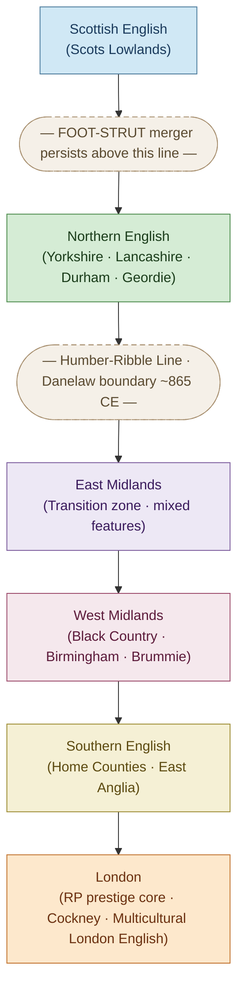

# Lesson 6: Sociolinguistic Variation & Diachrony

## 1. First-Principles Intuition & Invariants

Language is not a monolith. It is a population of competing forms, each one a small wager placed by a speaker in a specific social moment, and the aggregate of those wagers, compounded across generations and geographies, is what we call language change. English, more than almost any language in the Germanic family, dramatizes this truth. It has absorbed a Norman aristocracy, industrialized a nation, colonized continents, and then watched its prestige center dissolve into a dozen competing international standards. Understanding how that happened is not mere antiquarianism. It is the foundational skill for anyone who must analyze corpus data, work across dialectal registers, train language models, or teach the language across cultural contexts. The practitioner who cannot read variation as structured signal — rather than noise — will misinterpret data, make poor pedagogical decisions, and produce brittle linguistic tools.

The first invariant to internalize is that **variation is never random**. Every variant — a dropped consonant, a raised vowel, a shifted auxiliary — is conditioned by at least one of three forces: **phonological environment** (the sounds surrounding it), **social environment** (who is speaking to whom, in what domain, with what stakes), and **historical trajectory** (what the form used to be, and what pressures have acted on it). William Labov's foundational work in New York and Martha's Vineyard during the 1960s demonstrated this conclusively: the centralization of the diphthongs in words like *right* and *house* on Martha's Vineyard, like the raised vowel of *caught* in New York, was not random drift but a socially indexed marker, more pronounced in speakers with strong local identity, and tracking the social history of the island in real time. This means that when you encounter variation in a corpus or in live speech, your first analytical reflex must be to ask all three questions simultaneously.

The second invariant is the **arbitrariness of the standard**. Received Pronunciation (RP) and General American (GenAm) are not the apex of linguistic evolution. They are, respectively, the dialects of the educated London-adjacent gentry and the Midwestern broadcast industry, elevated by institutional power, print technology, and economic prestige into normative reference points. The Great Vowel Shift — the cascade of vowel changes that swept through Middle English between roughly 1400 and 1700 — did not produce a tidy endpoint. It produced a moving target that the printing press then froze in orthography at a particular moment, creating the notorious mismatch between English spelling and English pronunciation. Modern *name* is spelled with a final *e* that once indicated a long vowel /naːmə/; the vowel has since diphthongized to /neɪm/, but the letter stayed. The practitioner who understands this history navigates spelling-pronunciation anomalies diagnostically rather than treating them as arbitrary exceptions to memorize.

The third invariant is **contact as engine**. English has never evolved in isolation. The Old Norse spoken by Scandinavian settlers in the Danelaw (roughly 865–954 CE) contributed structural simplification of inflectional endings — a process that may have accelerated the loss of grammatical gender and case — alongside direct lexical borrowing (*sky*, *egg*, *they*, *them*, *their*). The Norman Conquest of 1066 installed a French-speaking court for roughly three centuries, producing the characteristic English doublet system: Germanic *begin* beside Latinate *commence*, Germanic *kingly* beside Romance *royal*, Germanic *gut* beside Latinate *intestine*. These are not synonyms but register-indexed variants, and the ability to switch between them is precisely what English speakers mean when they talk about "formal" versus "informal" language. The practitioner analyzing register must therefore understand that English formality is largely a matter of etymological stratum: reaching for Latinate vocabulary signals institutional or academic register almost automatically.

The fourth invariant is the **observer's paradox**, Labov's famous problem: the speech community you want to observe is vernacular speech in unmonitored contexts, but the act of observation changes the monitoring level of speakers. Every fieldwork methodology, corpus design, and annotation protocol in variationist linguistics is ultimately a strategy for triangulating around this problem.

---

## 2. Core Architecture & Mechanics

### The Diachronic Sound-Change Cascade: Grimm's Law to the Great Vowel Shift

To work fluently with English dialectal data, you need a mental model of the phonological architecture and how it got here. That architecture was built in two great movements separated by roughly fifteen hundred years.

The first movement is **Grimm's Law**, the consonantal chain shift that separated the Germanic languages from the rest of Proto-Indo-European and was systematized by Jacob Grimm in 1822. The shift operates in three cycles. Voiceless stops in PIE became voiceless fricatives in Proto-Germanic: PIE \**pṓds* (foot) → PGmc \**fōts* → English *foot*, Latin *pēs/pedis* retaining the original. Voiced stops became voiceless stops: PIE \**dékm̥* (ten) → PGmc \**tehun* → English *ten*, Latin *decem*. Voiced aspirated stops became voiced fricatives or stops: PIE \**bʰrāter* (brother) → PGmc \**brōþer* → English *brother*. Verner's Law (1875) then explained the apparent exceptions: when the PIE accent did not fall on the syllable immediately preceding the consonant, the voiceless fricatives produced by Grimm's first shift became voiced instead. This is why English has *father* (< \**fader*, Verner voicing) alongside Gothic *fadar*, both cognate with Latin *pater*. For the analyst working with historical texts or comparative cognates, Grimm's and Verner's Laws are the decryption key: they let you identify cognate pairs across languages and explain apparent irregularities in Old and Middle English manuscripts.

The second great movement is the **Great Vowel Shift**, and it is the reason Modern English spelling is such a poor guide to pronunciation. The shift affected the seven long monophthongs of Middle English, raising each one step higher in the oral cavity in a chain reaction, and the two that could not raise further — the high vowels /iː/ and /uː/ — diphthongized instead. The cascade can be visualized as a movement through vowel space:

```text
MIDDLE ENGLISH        MODERN ENGLISH
Long Vowel → Shift Target → Reflex

/iː/ (as in write)  →  diphthongizes  →  /aɪ/   (write)
/eː/ (as in feet)   →  raises to /iː/ →  /iː/   (feet)
/ɛː/ (as in name)   →  raises to /eː/ →  /eɪ/   (name)
/aː/ (as in make)   →  raises to /ɛː/ →  /eɪ/   (make, merged with name)
/ɔː/ (as in boat)   →  raises to /oː/ →  /oʊ/   (boat)
/oː/ (as in moon)   →  raises to /uː/ →  /uː/   (moon)
/uː/ (as in house)  →  diphthongizes  →  /aʊ/   (house)
```

The shift was not instantaneous or uniform. It began in the south and southeast of England around 1400, spread northward slowly, and was still in progress when Caxton introduced the printing press in 1476. Because printing standardized spelling against the written norms of the London scriptorium, the orthography was frozen at a moment when the spoken language was mid-shift. Northern English dialects and Scottish English show lesser degrees of the shift — Scots *oot* and *hoose* for *out* and *house* retain monophthongs rather than the diphthongs that resulted from the Great Vowel Shift in Southern English — and this is precisely why these dialects are sometimes dismissed as "archaic" by southern speakers. They are not archaic; they simply followed a different trajectory.

### Dialectal Architecture: A Structural Map

The dialect geography of English is best understood not as a set of discrete boxes but as a set of **isogloss bundles** — lines on a map where one or more linguistic features change. Where many isoglosses cluster together, we perceive a dialect boundary; where they are dispersed, we see a dialect continuum. The major structural divisions in British English fall along a north-south axis, with the **Humber-Ribble line** (the old boundary of the Danelaw) functioning as a persistent phonological and lexical fault line. North of this line, the distinction between /ʊ/ and /ʌ/ is largely absent — *foot* and *strut* share the vowel /ʊ/ — and vocabulary shows higher rates of Scandinavian borrowing (*lake*, *beck*, *gill* for geographic features, versus Southern English *pond*, *stream*).



In the United States, the dialectal architecture is shaped by settlement patterns and the sociolinguistic consequences of migration waves. The **Northern Cities Vowel Shift** (NCVS), documented extensively by Labov, Ash, and Boberg in *The Atlas of North American English* (2006), shows cities along the Great Lakes — Chicago, Detroit, Cleveland, Buffalo — undergoing a rotation of vowel nuclei quite unlike anything in British English. The vowel in *caught* lowers and fronts toward /æ/; the vowel in *cat* raises toward /eɪ/; the vowel in *bus* fronts. The result is that a speaker from Chicago saying "The boss got a lot of hot coffee" sounds, to an outsider, as though several vowels have swapped positions. This is not sloppy speech. It is a systematically innovative dialect that is diverging from, rather than converging toward, standard American English — a fact that challenges the folk-linguistic assumption that mass media produces dialect leveling.

### Register Stratification: The Etymological Stack

English register operates primarily through what can be called the **etymological stack**: a three-layer architecture of vocabulary sorted by historical origin, social context, and institutional domain.

| Layer | Origin | Typical Register | Examples |
|---|---|---|---|
| Stratum I | Old English / Proto-Germanic | Vernacular, intimate, concrete | *begin, eat, drink, die, make, child* |
| Stratum II | Old Norse / Low German contact | Neutral to informal | *sky, egg, hit, get, they* |
| Stratum III | Norman French / Anglo-French | Professional, legal, courtly | *commence, nourish, beverage, decease, construct, infant* |
| Stratum IV | Latin / Greek (learned) | Academic, scientific, ecclesiastical | *initiate, consume, mortality, fabricate, neonate* |

A practitioner analyzing register shift in a corpus can operationalize this table as a measurement instrument: the ratio of Stratum I–II tokens to Stratum III–IV tokens in a text window is a proxy for register formality with surprising reliability. Legal documents push hard toward Stratum III–IV not because lawyers are pretentious but because that stratum carries institutional authority by historical convention — it is the language of the Norman courts, and its prestige calcified over centuries of professional use.

### Language Contact and Structural Borrowing

Contact-induced change operates at different levels of linguistic structure, and the depth of integration is roughly proportional to the duration and intensity of contact. Lexical borrowing is shallowest and fastest: English borrowed thousands of French words within two centuries of the Conquest without fundamentally altering its phonology or morphosyntax. Phonological borrowing is deeper: the introduction of the voiced labiodental fricative /v/ as a phoneme distinct from /f/ in English is partly attributable to French loanwords (*veil, virtue, vine*) forcing a distinction that Old English had maintained only allophonically. Structural borrowing is deepest and most contested: the debate over whether Old Norse contact accelerated the loss of English inflectional morphology (simplifying case endings that were already converging in some dialects) is still active, but the geographical correspondence between areas of dense Scandinavian settlement and early inflectional loss is striking.

The contemporary example is **Multicultural London English (MLE)**, the contact variety that emerged in inner London from the 1980s onward among speakers with Jamaican Creole, West African, Bangladeshi, and other heritage backgrounds. MLE has become the prestige vernacular among young urban speakers of all backgrounds across London and several other British cities. Its phonological features include TH-fronting (/ð/ → /d/, /θ/ → /f/), the replacement of the traditional Cockney diphthong /æɪ/ with a backer variant, and the near-categorical use of *man* as a singular first-person pronoun in certain constructions (*Man can't be dealing with this*). Its grammar shows aspectual marking with *been* (*I been told you*), use of *bare* as an intensifying determiner (*bare people, bare jokes*), and a default past tense *was* extending to plural contexts. MLE is not degraded Cockney. It is a contact-generated innovation that is now **exporting features back** into mainstream British English through media, music, and social networks — the typical trajectory of a high-vitality urban vernacular.

---

## 3. High-Performance Optimization & Failure Modes

### Corpus Analysis Workflows for Variationists

The professional practitioner working with English dialectal data needs a reproducible analytical workflow that can handle the gap between orthographic text and phonological reality. The standard toolkit combines corpus linguistics software (AntConc, Sketch Engine, COCA/BNC interfaces), acoustic analysis (Praat for formant extraction), and sociolinguistic annotation frameworks.

When working with historical corpora — the **Helsinki Corpus of English Texts** (covering 730–1700 CE), the **Corpus of Early English Correspondence**, or the **Penn-Helsinki Parsed Corpus of Middle English** — the central discipline is resisting the urge to normalize spelling before analysis. Middle English spelling variation is data, not noise. A scribe who writes *hevene* versus *heven* versus *heoven* for "heaven" is giving you evidence about regional provenance, scribal training, and possibly vowel quality. Normalizing to a standard lemma for frequency counts is appropriate for some queries, but it must be a deliberate choice, not a default.

For acoustic corpus work on modern dialects, the standard workflow begins with forced alignment using a tool like the **Montreal Forced Aligner (MFA)** or **FAVE-align**, which takes a transcript and an audio file and returns word and phone boundaries in Praat TextGrid format. From those boundaries, automated formant extraction scripts (typically written in Praat's scripting language or via the **FAVE-extract** pipeline) pull F1 and F2 measurements at the vowel midpoint. These measurements are then plotted in F1×F2 vowel space — where F1 tracks vowel height (low F1 = high vowel) and F2 tracks backness (high F2 = front vowel) — to visualize the vowel system of an individual speaker or a dialect community. The Northern Cities Vowel Shift, for example, is immediately visible as a counterclockwise rotation in this space when you plot Chicago speakers against a Southern standard reference.

The critical optimization at this stage is **normalization across speakers**. Because vocal tract length varies by sex, age, and individual anatomy, raw formant values are not directly comparable across speakers. The Lobanov normalization procedure (z-score normalization within each speaker's vowel space) or the Nearey normalization (log-mean subtraction) allows cross-speaker comparison by factoring out anatomical variance while preserving dialect-level contrasts. Using raw formant values across a demographically mixed corpus is a common failure mode that produces apparent dialect differences that are actually anatomical differences.

### Variable Rules and Probabilistic Conditioning

The standard statistical tool for quantitative sociolinguistics is **Varbrul** (Variable Rules) analysis, now implemented in the **Goldvarb** suite or its successor **Rbrul** (an R package). Varbrul fits a logistic regression model to the probability of a linguistic variant conditioned on a set of factors: phonological environment, social class, sex, age, speech style. The output is a set of factor weights ranging from 0 to 1, where 0.5 is neutral, values above 0.5 favor the variant, and values below 0.5 disfavor it.

A worked example: analyzing /t/-deletion in English (*best friend* → *bes' friend*) using Varbrul would typically reveal that word-final /t/ followed by a consonant-initial word (CC cluster) strongly favors deletion, following a vowel strongly disfavors it, working-class speakers show higher rates across styles than middle-class speakers, and casual style raises rates for all groups. Each of these is a conditioning factor with a recoverable weight. The practitioner who reports only raw deletion rates ("Working-class speakers delete /t/ 60% of the time") without factor analysis is missing the structured conditioning and cannot distinguish phonological effect from social effect. This is a common failure mode in informal dialect reporting and in some corpus linguistics studies that treat variation as a frequency problem rather than a conditioned probability problem.

### Register Miscalibration: The Practitioner's Most Common Error

For language teachers, editors, translators, and NLP practitioners, the most consequential failure mode in English is **register miscalibration**: choosing a word from the wrong etymological stratum for the intended audience and purpose. The error is systematic and teachable. A technical writer who defaults to Stratum IV vocabulary (*utilize* for *use*, *initiate* for *start*, *terminate* for *end*) in documentation aimed at non-specialist users will reliably reduce comprehension. The plain-language movement in government and legal writing is essentially a campaign to shift default register from Stratum III–IV back to Stratum I–II for public communication.

The reverse error — over-colloquialization in formal writing — is equally damaging and increasingly common as speakers transfer informal digital register into academic prose. The intrusion of discourse markers from spoken English (*basically, like, so, you know*) into written argumentation, or the use of second-person address (*you can see that*) in formal analysis, signals register incoherence that experienced readers perceive as a credibility problem rather than merely a stylistic preference.

The diagnostic test for a register decision is deceptively simple: for any candidate word pair (*use/utilize, start/initiate, end/terminate, ask/inquire*), ask who your audience is, what institutional relationship you have to them, and what the dominant register of the surrounding text is. The Germanic root is almost always the safer choice for clarity; the Latinate root is appropriate when precision, institutional authority, or disciplinary convention demands it.

### Standardization Processes and Their Limits

The standardization of English proceeded through three mechanisms operating in sequence: **selection** (choosing one dialect as the base, in England's case the East Midland dialect of London and the universities), **elaboration of function** (extending that dialect into all public domains: administration, literature, religion), and **codification** (dictionaries, grammars, and style guides that stabilize the written norm). Johnson's *Dictionary* (1755) and Lowth's *Short Introduction to English Grammar* (1762) are the codification phase's key artifacts, and both made decisions that remain contested: Johnson's etymologism led him to prefer spellings that recalled Latin roots (*debt* with its silent *b*, from Latin *debitum*), and Lowth's prescriptive grammar introduced the prohibition on sentence-final prepositions and split infinitives — rules borrowed from Latin grammar and applied to a language with fundamentally different structure.

The critical invariant here is that **standardization describes one variety's capture of institutional resources, not the linguistic superiority of that variety**. Modern descriptive linguistics has established this beyond reasonable dispute. The practitioner consequence is practical: a language educator or sociolinguist who treats non-standard features — African American English's aspectual *be* (*she be working*), Scots English's resultant perfect (*I'm just after eating*), or New Zealand English's high rising terminal — as errors to be corrected rather than structured variants to be described is not being rigorous. They are importing a social judgment into a linguistic description, and that move degrades the analysis.

### The Apparent-Time and Real-Time Methods

One of the most elegant methodological achievements in variationist linguistics is the **apparent-time construct**, which allows diachronic inference from synchronic data. If speakers largely preserve the dialect features they acquired during the critical period of language acquisition (roughly ages five to fifteen), then a cross-sectional sample of speakers of different ages in a community provides a proxy time series. If sixty-year-old speakers use feature X at a high rate and twenty-year-old speakers use it at a low rate, the community is probably losing the feature in real time, and the trajectory can be extrapolated. Conversely, if young speakers lead in a new variant, the community is in the early stages of a change in progress.

The failure mode of apparent-time analysis is **age-grading**: the phenomenon where speakers genuinely change their speech across the lifespan in a consistent, recurring pattern that is not change in progress but a lifecycle effect. English speakers typically shift toward more standard variants as they enter the workforce and toward more conservative forms in old age, without the community's overall system changing. Distinguishing genuine change in progress from age-grading requires either panel studies (following the same speakers over decades, as in Trudgill's re-studies of Norwich or Labov's restudy of Philadelphia) or close attention to whether the apparent-time gradient is linear and monotonic (consistent with change in progress) or non-linear and U-shaped (consistent with age-grading). The practitioner who uses a single cross-sectional corpus to make diachronic claims without confronting this distinction is making an inferential error that real-time replication would likely expose.

### A Practical Exercise: Analyzing a Variable in Context

Consider the following four renditions of the same propositional content, drawn from different registers and dialects of contemporary English:

> **A.** *I ain't seen him in time, man. Bare jokes though, trust.*
> **B.** *I haven't seen him in ages. It's been quite funny, actually.*
> **C.** *I have not encountered him for some considerable time. The situation has afforded a degree of amusement.*
> **D.** *The subject has not been observed within the specified reporting period. Incident classification: low severity.*

Sentence A deploys MLE features (*ain't* as negated auxiliary, *bare* as intensifier, discourse marker *trust* for solidarity assertion), unmarked for formality, high solidarity indexicality. Sentence B is educated Southern British English, formal enough for professional conversation, with *actually* as a hedge-and-soften particle. Sentence C moves to Stratum III–IV vocabulary (*encountered, afforded, amusement*) with complex nominal constructions, signaling written formal register. Sentence D abandons first-person entirely, shifts to passive and nominalized constructions, and indexes bureaucratic or technical reporting genre.

The practitioner exercise is to identify, for each sentence: (1) the grammatical features that mark it, (2) the etymological stratum of its content vocabulary, (3) the social domain it indexes, and (4) the conditions under which producing it in the wrong context would constitute a register error. This kind of contrastive analysis — moving fluidly between descriptive accuracy about how the language works and prescriptive awareness of when each variant is appropriate — is the core competency that separates the advanced practitioner from the intermediate learner. English variation is not a problem to be solved. It is the most revealing evidence we have about the social history of one of the world's most consequential contact languages, and reading it fluently is a practitioner skill of the highest order.
