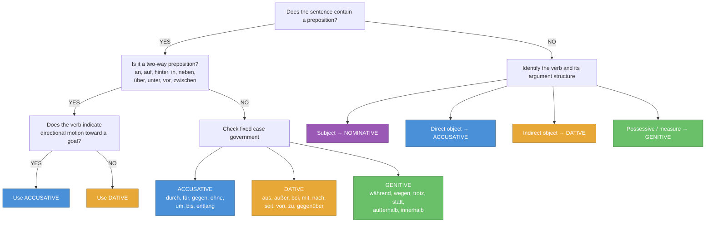

# Operational Verification Labs: German

## Objective & Operational Lab Setup

These operational verification labs transform theoretical knowledge of German linguistic mechanics into embodied, measurable competency. The exercises operate on the principle that language acquisition is a motor skill requiring neuroplastic conditioning through repetitive, high-precision articulation drills, real-time error detection, and iterative correction cycles. The German language presents a rich verification environment due to its rigorous grammatical architecture: four-case nominal declension, verb-second (V2) topology in main clauses, verb-final positioning in subordinate structures, and the intricate morphophonemic dance of separable prefix verbs.

The operational setup requires three parallel diagnostic channels. First, establish an audio recording environment capable of capturing spectral detail in the 80 Hz to 8 kHz range to verify accurate production of the German uvular fricative [χ] and [ʁ], the voiceless alveolar affricate [ts], and the voiceless palato-alveolar fricative [ʃ]. Any smartphone voice recorder application with waveform visualization suffices, though Praat acoustic analysis software provides professional-grade formant tracking for vowel quality verification. Second, construct a written production workspace using a plain text editor or word processor configured with German keyboard layout (QWERTZ) to drill the muscle memory for umlauted vowels (ä, ö, ü) and the Eszett (ß). Third, maintain a spreadsheet-based error taxonomy log with columns for error type (phonological, morphological, syntactic), source context, correction, and retrieval strength rating on a five-point scale. This log becomes the empirical foundation for targeted remediation cycles.

The analytical framework for these exercises derives from item response theory and spaced repetition algorithms. Each drill isolates a specific linguistic parameter—case marking, word order topology, aspectual prefix semantics—and measures accuracy, latency, and retention across multiple exposure cycles. The initial baseline assessment establishes your pre-intervention performance ceiling. Subsequent exercises systematically stress this ceiling through parameter variation, embedding target structures in progressively complex sentence matrices, and introducing temporal pressure constraints. The recovery protocol then diagnoses failure modes through contrastive minimal pair analysis and error pattern clustering.

Prepare your workspace with the following materials: a German-English bidirectional dictionary (preferably Langenscheidt or Pons), a comprehensive reference grammar (Hammer's German Grammar and Usage remains the gold standard), a corpus of authentic German text samples spanning registers from news articles (Die Zeit, Süddeutsche Zeitung) to literary prose (Kafka, Hesse, contemporary authors), and access to native speaker audio resources through Deutsche Welle's Langsam gesprochene Nachrichten or similar corpora. Install Anki or a comparable spaced repetition system for long-term retention tracking. Configure your browser to access Leo.org for contextual usage examples and DWDS (Digitales Wörterbuch der deutschen Sprache) for diachronic semantic evolution data.

## Exercise 1: Foundational Practical Implementation

### Drill 1A: Phonological Articulatory Calibration — The German R

The German R represents the primary phonological discriminator between native and non-native production. Unlike the English alveolar approximant [ɹ], German employs either the uvular fricative [ʁ] in standard High German or the alveolar trill [r] in Southern dialects. This exercise establishes production accuracy through mechanical isolation and acoustic verification.

Begin by positioning a mirror at eye level. Open your mouth to a neutral mid-central position. The target articulation for [ʁ] requires the back of your tongue to approximate the uvula while maintaining voicing. The resulting sound should exhibit turbulent airflow friction without the crisp closure characteristic of velar stops. To build the motor pathway, start with a gargling motion using water, then attempt the same muscular configuration while exhaling air without water. The acoustic signature should show continuous spectral energy concentrated between 1500 and 3000 Hz with no sharp formant transitions.

Record yourself producing the following minimal triplet sequence, pausing three seconds between each item:

**Rabe** (raven) — **Rache** (revenge) — **Rahmen** (frame)

Replay the recording and compare against native speaker models from Forvo.com. Mark the timestamp of any production that sounds closer to English [ɹ]. The error typically manifests as insufficient uvular contact and excessive tongue blade elevation. Remediate by physically pressing the tongue blade down with a finger while attempting production, forcing the tongue root backward. Repeat the triplet twenty times, recording every fifth iteration. By iteration fifteen, you should achieve consistent uvular approximation verified by the absence of the English retroflex acoustic signature.

Progress to word-medial and word-final contexts where the R often undergoes vocalization in casual speech, merging with the preceding vowel as a centering diphthong. Compare careful vs. casual register production:

**Tier** (animal) — careful: [tiːʁ] vs. casual: [tiːɐ̯]  
**Uhr** (clock) — careful: [uːʁ] vs. casual: [uːɐ̯]  
**Ohr** (ear) — careful: [oːʁ] vs. casual: [oːɐ̯]

This sociolinguistic variation is not optional affectation but rather the unmarked phonological behavior in connected speech. Practice transitioning between registers by reading the same sentence in formal lecturing style, then in conversational tempo. The sentence "Mein Bruder fuhr um vier Uhr nach Berlin" (My brother drove to Berlin at four o'clock) contains five R tokens spanning all positional contexts. Record both registers and measure the duration of each R segment. The casual register should show R-vocalization reducing segment duration by 40-60 milliseconds.

### Drill 1B: Case System Calibration — Definite Article Declension Matrix

The German four-case system (Nominative, Accusative, Dative, Genitive) manifests most visibly in the definite article paradigm. This drill establishes pattern recognition and production automaticity across all sixteen forms through exhaustive paradigm completion and rapid-fire inflection exercises.

Construct the complete definite article declension table by hand, writing each form in a four-by-four grid with cases as rows and genders (masculine, feminine, neuter, plural) as columns:

| Case | Masculine | Feminine | Neuter | Plural |
|-----------|-----------|----------|--------|--------|
| Nominative| der | die | das | die |
| Accusative| den | die | das | die |
| Dative | dem | der | dem | den |
| Genitive | des | der | des | der |

Memorize this matrix through spatial position encoding. Close your eyes and mentally traverse the grid left-to-right, top-to-bottom, vocalizing each form. Then traverse by column (all masculine forms, then all feminine, etc.). Finally, traverse by case (all nominative forms across genders, then all accusative forms, etc.). This multi-axial encoding prevents rote sequence memorization and builds genuine structural competence.

The operational verification comes through rapid noun phrase generation under case constraint. Set a timer for ninety seconds. Given the noun **der Tisch** (the table, masculine), generate well-formed noun phrases instantiating all four cases:

**Nominative:** Der Tisch ist groß. (The table is large.)  
**Accusative:** Ich sehe den Tisch. (I see the table.)  
**Dative:** Ich stehe neben dem Tisch. (I stand next to the table.)  
**Genitive:** Die Farbe des Tisches ist braun. (The color of the table is brown.)

Repeat with **die Lampe** (the lamp, feminine):

**Nominative:** Die Lampe leuchtet hell. (The lamp shines brightly.)  
**Accusative:** Ich kaufe die Lampe. (I buy the lamp.)  
**Dative:** Das Licht kommt von der Lampe. (The light comes from the lamp.)  
**Genitive:** Der Schirm der Lampe ist rot. (The shade of the lamp is red.)

Now **das Buch** (the book, neuter):

**Nominative:** Das Buch liegt dort. (The book lies there.)  
**Accusative:** Ich lese das Buch. (I read the book.)  
**Dative:** Ich schreibe in dem Buch. (I write in the book.)  
**Genitive:** Der Autor des Buches ist berühmt. (The author of the book is famous.)

Finally, **die Kinder** (the children, plural):

**Nominative:** Die Kinder spielen. (The children play.)  
**Accusative:** Ich rufe die Kinder. (I call the children.)  
**Dative:** Ich gebe den Kindern Süßigkeiten. (I give the children candy.)  
**Genitive:** Die Stimmen der Kinder sind laut. (The voices of the children are loud.)

Log your completion time and error count. Native-level automaticity requires completing all sixteen phrases in under ninety seconds with zero errors. Any hesitation exceeding two seconds indicates incomplete paradigm internalization. Remediate by returning to the grid visualization and re-encoding the specific case-gender intersection that triggered the delay.

### Drill 1C: Verb-Second Topology Verification

German main clause syntax obeys a strict verb-second (V2) constraint: the finite verb must occupy the second structural position regardless of what constituent appears first. This topology is non-negotiable and violations produce immediate ungrammaticality. This exercise builds topological awareness through systematic permutation of initial constituents.

Take the base sentence **Der Mann kauft ein Buch** (The man buys a book). The finite verb **kauft** occupies second position after the subject **Der Mann**. Now systematically front different constituents, triggering subject-verb inversion:

**Base:** Der Mann kauft ein Buch.  
**Object-fronted:** Ein Buch kauft der Mann.  
**Temporal adverb:** Heute kauft der Mann ein Buch. (Today the man buys a book.)  
**Locative adverb:** Im Laden kauft der Mann ein Buch. (In the store the man buys a book.)  
**Manner adverb:** Gern kauft der Mann ein Buch. (The man gladly buys a book.)

Produce ten additional variants using the same core sentence, fronting different elements. Verify V2 compliance by underlining the finite verb in each sentence—it must always appear as the second element. Common errors include failing to invert after fronted adverbials, producing illicit V3 structures like **\*Heute der Mann kauft ein Buch**.

Now introduce subordinate clauses where verb-final topology applies. The conjunction moves the finite verb to clause-final position:

**Main clause:** Der Mann kauft ein Buch.  
**Subordinate:** Ich weiß, dass der Mann ein Buch kauft. (I know that the man buys a book.)

Note the topology shift: **kauft** moves from second position to final position after the subordinating conjunction **dass**. Generate five main-subordinate clause pairs using different subordinating conjunctions:

**weil** (because): Ich bleibe zu Hause, weil es regnet. (I stay home because it rains.)  
**wenn** (if/when): Ich komme, wenn du mich rufst. (I come when you call me.)  
**obwohl** (although): Er arbeitet, obwohl er müde ist. (He works although he is tired.)  
**damit** (so that): Ich lerne Deutsch, damit ich in Berlin arbeiten kann. (I learn German so that I can work in Berlin.)  
**als** (when [past]): Ich war glücklich, als ich ihn sah. (I was happy when I saw him.)

Record yourself reading each sentence pair at natural conversational speed. The prosodic contour should show rising intonation through the subordinate clause with the verb receiving primary stress at the end. Replay and verify that the finite verb appears clause-finally in all subordinate structures. Any premature verb production indicates incomplete topology internalization.

## Exercise 2: Parameter Variation & Empirical Analysis

### Drill 2A: Case Government Under Preposition Variation

German prepositions govern specific cases, and certain prepositions toggle between Accusative and Dative based on the semantic distinction between directional motion (Accusative) and static location (Dative). This two-way preposition system requires real-time semantic analysis during production. The exercise isolates the nine core two-way prepositions and measures case selection accuracy under temporal pressure.

The complete two-way preposition inventory: **an** (at, on), **auf** (on, upon), **hinter** (behind), **in** (in, into), **neben** (next to), **über** (over, above), **unter** (under), **vor** (in front of, before), **zwischen** (between). Each must be followed by Accusative case when indicating directional motion toward a goal, and Dative case when indicating static position.

Set a metronome to 60 beats per minute. On each beat, produce a complete sentence using the prompted preposition and case. Alternate between directional and static semantics:

**Beat 1 (Accusative/directional):** Ich gehe in den Park. (I go into the park.)  
**Beat 2 (Dative/static):** Ich bin in dem Park. (I am in the park.)  
**Beat 3 (Accusative/directional):** Ich lege das Buch auf den Tisch. (I lay the book onto the table.)  
**Beat 4 (Dative/static):** Das Buch liegt auf dem Tisch. (The book lies on the table.)  
**Beat 5 (Accusative/directional):** Die Katze springt hinter das Sofa. (The cat jumps behind the sofa.)  
**Beat 6 (Dative/static):** Die Katze sitzt hinter dem Sofa. (The cat sits behind the sofa.)

Continue for all nine prepositions, producing eighteen total sentences. Log any production latency exceeding one beat duration and any case selection errors. The error taxonomy reveals systematic patterns: speakers with Romance language backgrounds often over-generalize Accusative due to Spanish/French preposition-object constructions lacking case morphology. Germanic L1 speakers (English) typically struggle with the semantic distinction itself, requiring explicit training on the motion-vs-location conceptual boundary.

Increase the cognitive load by embedding the two-way prepositions within complex sentence matrices involving modal verbs and clause-final verb positioning:

Ich muss das Bild an die Wand hängen. (I must hang the picture on the wall. — Accusative/directional)  
Das Bild soll an der Wand hängen. (The picture should hang on the wall. — Dative/static)

Generate ten such sentence pairs, alternating between modal constructions. The clause-final infinitive creates working memory pressure that increases case selection error rates. Track your error percentage across repetitions. A learning curve showing error reduction from 30% to under 5% across fifty trials indicates successful parameter acquisition.

### Drill 2B: Verb Prefix Separation Under Topology Constraints

German employs a rich system of separable prefix verbs where the prefix detaches from the verb stem and moves to clause-final position in main clauses, but remains attached in subordinate clauses and non-finite forms. This parameter variation drill establishes production automaticity across syntactic contexts.

Take the separable verb **anfangen** (to begin). The prefix **an-** separates in main clauses:

**Main clause:** Ich fange um acht Uhr an. (I begin at eight o'clock.)

But remains attached in subordinate clauses:

**Subordinate:** Ich weiß, dass ich um acht Uhr anfange. (I know that I begin at eight o'clock.)

And in infinitive constructions:

**Infinitive:** Ich will um acht Uhr anfangen. (I want to begin at eight o'clock.)

Generate complete conjugation paradigms across all three contexts for the following separable verbs. Each verb entry must include present tense conjugation for all six persons (ich, du, er/sie/es, wir, ihr, sie/Sie), main clause separation examples, subordinate clause attachment examples, and modal+infinitive constructions.

**aufstehen** (to get up, to stand up):

**Main clause separation:**  
Ich stehe um sechs Uhr auf.  
Du stehst um sechs Uhr auf.  
Er steht um sechs Uhr auf.  
Wir stehen um sechs Uhr auf.  
Ihr steht um sechs Uhr auf.  
Sie stehen um sechs Uhr auf.

**Subordinate clause attachment:**  
Ich weiß, dass ich um sechs Uhr aufstehe.  
Du weißt, dass du um sechs Uhr aufstehst.  
Er weiß, dass er um sechs Uhr aufsteht.  
Wir wissen, dass wir um sechs Uhr aufstehen.  
Ihr wisst, dass ihr um sechs Uhr aufsteht.  
Sie wissen, dass sie um sechs Uhr aufstehen.

**Modal + infinitive:**  
Ich muss um sechs Uhr aufstehen.  
Du musst um sechs Uhr aufstehen.  
Er muss um sechs Uhr aufstehen.  
Wir müssen um sechs Uhr aufstehen.  
Ihr müsst um sechs Uhr aufstehen.  
Sie müssen um sechs Uhr aufstehen.

Repeat this complete paradigm generation for **anrufen** (to call [on the phone]), **mitkommen** (to come along), **ausgehen** (to go out), and **zurückkommen** (to come back). The prefix semantics often provide compositional transparency: **auf** (up) + **stehen** (stand) = stand up; **an** (on) + **rufen** (call) = call someone; **mit** (with) + **kommen** (come) = come along. Internalize these semantic decompositions as mnemonic anchors.

The empirical analysis phase requires rapid context switching. Set a timer for five minutes. Read the following prompt sentences and immediately produce the corresponding German translation with correct prefix positioning:

Prompt: "I'm calling my mother tomorrow." (main clause)  
Response: Ich rufe morgen meine Mutter an.

Prompt: "He knows that I'm calling my mother tomorrow." (subordinate)  
Response: Er weiß, dass ich morgen meine Mutter anrufe.

Prompt: "I want to call my mother tomorrow." (infinitive)  
Response: Ich will morgen meine Mutter anrufen.

Generate thirty such prompt-response cycles covering all five verbs and all three syntactic contexts in random order. Log reaction time and accuracy. The target performance threshold is 95% accuracy with mean reaction time under three seconds per prompt. Any systematic error pattern—such as consistently failing to separate in main clauses or incorrectly separating in subordinate clauses—indicates incomplete topology rule internalization.

### Drill 2C: Adjective Declension Under Gender-Case Variation

German adjectives inflect for case, number, and gender when appearing attributively (before a noun). The inflectional pattern depends on the determiner type: strong declension after no determiner, weak declension after definite determiners, and mixed declension after indefinite determiners. This exercise exhaustively generates all possible declension forms through systematic parameter variation.

Begin with strong declension (no determiner). The adjective carries the case-gender marking that would otherwise appear on a definite article. Using the adjective **gut** (good), generate all sixteen forms:

| Case | Masculine | Feminine | Neuter | Plural |
|-----------|-----------|----------|--------|--------|
| Nominative| guter | gute | gutes | gute |
| Accusative| guten | gute | gutes | gute |
| Dative | gutem | guter | gutem | guten |
| Genitive | guten | guter | guten | guter |

Embed each form in a complete noun phrase with an appropriate noun. For masculine nominative: **Guter Wein schmeckt toll** (Good wine tastes great). For feminine accusative: **Ich trinke gute Milch** (I drink good milk). For neuter dative: **Ich spreche von gutem Wetter** (I speak of good weather). For plural genitive: **Die Meinung guter Leute zählt** (The opinion of good people counts).

Progress to weak declension after definite articles. The adjective reduces to either **-e** or **-en** because the article already carries the case-gender information:

| Case | Masculine | Feminine | Neuter | Plural |
|-----------|-----------|----------|--------|--------|
| Nominative| der gute | die gute | das gute | die guten |
| Accusative| den guten | die gute | das gute | die guten |
| Dative | dem guten | der guten | dem guten | den guten |
| Genitive | des guten | der guten | des guten | der guten |

Generate complete sentences for all sixteen combinations: **Der gute Mann hilft mir** (The good man helps me), **Ich sehe den guten Mann** (I see the good man), etc.

Finally, tackle mixed declension after indefinite articles (ein, kein, possessive determiners). This paradigm combines features of strong and weak declension:

| Case | Masculine | Feminine | Neuter | Plural |
|-----------|-----------|----------|--------|--------|
| Nominative| ein guter | eine gute | ein gutes | keine guten |
| Accusative| einen guten | eine gute | ein gutes | keine guten |
| Dative | einem guten | einer guten | einem guten | keinen guten |
| Genitive | eines guten | einer guten | eines guten | keiner guten |

The mixed pattern emerges from the fact that indefinite articles lack distinct forms in certain cells (masculine nominative **ein** doesn't mark case as clearly as definite **der**), so the adjective must carry stronger marking in those positions.

The operational verification requires rapid declension type switching. Present a noun phrase frame like "\_\_\_ Wein" (wine, masculine) and randomly specify determiner type and case. The participant must produce the correct form within two seconds:

Prompt: "Strong declension, Nominative" → **Guter Wein**  
Prompt: "Weak declension, Accusative" → **Den guten Wein**  
Prompt: "Mixed declension, Dative" → **Einem guten Wein**

Execute fifty such trials spanning all three declension types, all four cases, and all four genders. Calculate accuracy by declension type. Most learners show strong > mixed > weak in terms of error rate, counterintuitively, because strong declension maps directly to definite article forms, while weak declension requires remembering the reduced **-e/-en** distribution, and mixed declension requires context-sensitive selection.

## Exercise 3: Stress Testing, Boundary Failure & Recovery Protocol

### Drill 3A: Complex Sentence Matrix Construction Under Temporal Pressure

This exercise pushes syntactic production capacity to failure by constructing deeply embedded sentence structures with multiple subordinate clauses, separable verbs, and case-marked constituents, all under timed constraints. The objective is not perfect production but rather identifying the specific structural boundaries where your grammatical competence collapses.

Begin with a simple main clause: **Ich glaube** (I believe). Add a subordinate clause: **Ich glaube, dass er kommt** (I believe that he comes). Now embed another layer: **Ich glaube, dass er kommt, weil er das Buch braucht** (I believe that he comes because he needs the book). Add a temporal clause: **Ich glaube, dass er kommt, weil er das Buch braucht, wenn ich zu Hause bin** (I believe that he comes because he needs the book when I am at home).

Set a timer for thirty seconds. Produce a four-level embedded sentence following this template:

**Main clause** + **dass-subordinate** + **weil-subordinate** + **wenn-subordinate**

Example production: **Ich denke, dass Maria anruft, weil sie wissen will, ob wir morgen kommen** (I think that Maria calls because she wants to know if we come tomorrow).

Record your production. Analyze the recording for three error types:

1. **Topology violations:** Did the finite verb appear clause-finally in all subordinate clauses?
2. **Case errors:** Did all accusative objects appear in accusative case and all dative complements in dative case?
3. **Agreement failures:** Did all verbs agree with their subjects in person and number?

Increase cognitive load by introducing separable verbs in the embedded clauses. Produce: **Ich weiß, dass er morgen anruft, weil er mitkommen will, wenn ich ausgehe** (I know that he calls tomorrow because he wants to come along when I go out). The separable verbs **anrufen**, **mitkommen**, and **ausgehen** must remain attached in subordinate contexts. Any illicit separation (e.g., **\*dass er morgen ruft an**) indicates incomplete rule acquisition.

The stress boundary appears when clause embedding depth exceeds working memory capacity. Most intermediate learners collapse at three levels of embedding; advanced learners at four or five. Log the maximum depth at which you maintain 90% accuracy. This number serves as your current syntactic production ceiling.

### Drill 3B: Register Shift Verification — Formal vs. Colloquial Production

German exhibits significant register variation between formal written standard (Standardsprache) and colloquial spoken varieties. This drill verifies your ability to produce appropriate forms across registers by translating the same semantic content into formal and colloquial variants.

Take the sentence "I didn't do that." In formal written German: **Ich habe das nicht getan.** In colloquial speech, particularly Southern varieties, this might become **Ich hab das net gemacht** (contracted auxiliary, regional negation particle, different verb choice). While you need not master dialect features, you must control the formal-colloquial axis along several dimensions.

First dimension: auxiliary contraction. Formal **Ich habe** → colloquial **Ich hab**. Produce ten sentence pairs showing this contrast:

Formal: Ich habe das Buch gelesen.  
Colloquial: Ich hab das Buch gelesen.

Formal: Ich habe gestern gearbeitet.  
Colloquial: Ich hab gestern gearbeitet.

Second dimension: genitive case vs. prepositional paraphrase. Formal German uses genitive to express possession; colloquial German increasingly substitutes **von + Dative**:

Formal: Das Auto meines Vaters ist rot. (My father's car is red.)  
Colloquial: Das Auto von meinem Vater ist rot.

Formal: Der Titel des Buches ist interessant. (The title of the book is interesting.)  
Colloquial: Der Titel von dem Buch ist interessant.

Generate eight such pairs covering different noun genders and numbers. The dative form after **von** is critical: **von dem** contracts to **vom** in natural speech, yielding **Das Auto von meinem Vater** → **Das Auto vom Vater** with possessive pronoun drop.

Third dimension: preterite vs. perfect tense for past time reference. Formal written German, especially narrative prose, employs preterite extensively. Colloquial spoken German overwhelmingly prefers perfect tense except for high-frequency verbs like **sein** (to be) and modal verbs.

Formal (preterite): Er ging nach Hause und las ein Buch. (He went home and read a book.)  
Colloquial (perfect): Er ist nach Hause gegangen und hat ein Buch gelesen.

Formal: Sie kam gestern an und brachte Geschenke mit.  
Colloquial: Sie ist gestern angekommen und hat Geschenke mitgebracht.

Produce ten translation pairs. Then perform register recognition: given a mixed set of twenty sentences, classify each as formal or colloquial based on the features above. Calculate classification accuracy. Target threshold is 95% correct classification.

The recovery protocol for register errors involves explicit feature marking. Create a checklist:

- [ ] Auxiliary contracted? (colloquial)
- [ ] Genitive vs. von-paraphrase? (formal vs. colloquial)
- [ ] Preterite vs. perfect? (formal vs. colloquial)
- [ ] Modal particles present (doch, mal, ja, eben)? (colloquial)

Apply this checklist to any sentence you produce. If your intended register is formal but the checklist reveals colloquial features, systematically convert each feature.

### Drill 3C: Real-Time Translation Under Accuracy Constraints

The ultimate operational verification is real-time bidirectional translation between English and German with quantified accuracy measurement. This exercise establishes baseline translation competence and identifies systematic transfer errors.

Set up two parallel text columns. In the left column, write twenty English sentences of varying complexity. Leave the right column blank. Set a timer for ten minutes. Translate all twenty sentences into German. After the timer expires, halt translation regardless of completion status.

Example input sentence set:

1. The book lies on the table.
2. I gave my brother a present yesterday.
3. She doesn't know whether he will come.
4. We went to the movies because the weather was bad.
5. The teacher, whose name I forgot, explained the lesson well.
6. If I had known that, I would have stayed home.
7. He keeps talking although nobody is listening.
8. The faster you run, the sooner you arrive.
9. I'm learning German in order to work in Switzerland.
10. Despite the rain, the children played outside.
11. The car that I bought last year is already broken.
12. Tell me when you're done!
13. I can't find my keys anywhere.
14. He must have forgotten the appointment.
15. She's been living in Berlin for five years.
16. The more I study, the less I understand.
17. You should've called me earlier.
18. By the time we arrived, the store had already closed.
19. I wish I could speak German fluently.
20. What would you do if you won the lottery?

After producing your translations, verify each against reference translations (use DeepL or a professional translation database, not machine translation for pedagogical analysis). Categorize each error:

- **Lexical error:** wrong word choice
- **Morphological error:** incorrect case, gender, number, tense, or agreement
- **Syntactic error:** word order violation, incorrect clause structure
- **Register error:** inappropriate formality level
- **Idiom error:** literal translation of non-compositional expression

Calculate error rate by category. The error distribution reveals systematic gaps. High morphological error rates indicate incomplete paradigm internalization; high syntactic error rates indicate topology rule failures; high lexical error rates indicate insufficient vocabulary breadth.

The recovery protocol involves targeted micro-drills on the highest-error category. If morphological errors dominate, return to Exercise 1B and 2C for case and adjective declension drilling. If syntactic errors dominate, return to Exercise 1C and 3A for topology training. If lexical errors dominate, implement a spaced repetition vocabulary program targeting the 3,000 most frequent German lemmas.

Repeat this translation drill weekly. Track your error rate over time. A successful learning trajectory shows exponential decay in error rate with asymptotic approach to 5% residual errors (largely idiomatic expressions requiring memorization rather than rule application). Plateau in error reduction indicates a structural knowledge gap requiring intervention with a reference grammar or native speaker consultation.

## Operational Reference Guide & Diagnostic Checklist

This section provides rapid-access reference tables and diagnostic decision trees for troubleshooting production failures in real time. Consult these references during active speaking or writing tasks when uncertainty arises.

### Case Selection Decision Tree

### Adjective Declension Quick Reference

**Strong Declension (no determiner):** Adjective endings mirror definite article forms

| Case | M | F | N | Pl |
|---|---|---|---|---|
| N | -er | -e | -es | -e |
| A | -en | -e | -es | -e |
| D | -em | -er | -em | -en |
| G | -en | -er | -en | -er |

**Weak Declension (after definite article):** Only -e or -en

| Case | M | F | N | Pl |
|---|---|---|---|---|
| N | -e | -e | -e | -en |
| A | -en | -e | -e | -en |
| D | -en | -en | -en | -en |
| G | -en | -en | -en | -en |

**Mixed Declension (after indefinite article):** Combination pattern

| Case | M | F | N | Pl |
|---|---|---|---|---|
| N | -er | -e | -es | -en |
| A | -en | -e | -es | -en |
| D | -en | -en | -en | -en |
| G | -en | -en | -en | -en |

### Verb Position Diagnostic Matrix

| Clause Type | Finite Verb Position | Non-finite Verb Position | Example |
|-------------|---------------------|------------------------|---------|
| Main declarative | Second (V2) | Clause-final | Ich **kaufe** heute ein Buch. |
| Main interrogative (yes/no) | First (V1) | Clause-final | **Kaufst** du heute ein Buch? |
| Main interrogative (wh-) | Second (V2) | Clause-final | Was **kaufst** du heute? |
| Subordinate (dass, weil, etc.) | Clause-final | Before finite verb | Ich weiß, dass du heute ein Buch **kaufst**. |
| Subordinate with modal | Clause-final | Before finite modal | Ich weiß, dass du heute ein Buch kaufen **musst**. |
| Relative clause | Clause-final | Before finite verb | Das Buch, das ich gestern **kaufte**, ist gut. |

### Common Morphological Error Patterns and Corrections

**Error Pattern 1:** Over-generalization of nominative case in object position  
**Example Error:** *Ich sehe der Mann.  
**Correction:** Ich sehe **den** Mann. (Accusative required for direct object)  
**Drill:** Generate twenty sentences with transitive verbs, marking both nominative subject and accusative object.

**Error Pattern 2:** Failure to separate separable verb prefixes in main clauses  
**Example Error:** *Ich anrufe dich morgen.  
**Correction:** Ich rufe dich morgen **an**.  
**Drill:** Produce thirty main clauses with separable verbs, physically circling the finite verb and the separated prefix.

**Error Pattern 3:** Incorrect adjective declension after indefinite articles  
**Example Error:** *Ein guten Mann hilft mir.  
**Correction:** Ein **guter** Mann hilft mir. (Mixed declension: nominative masculine takes -er)  
**Drill:** Complete paradigm tables for three adjectives across all three declension types.

**Error Pattern 4:** Genitive case avoidance leading to awkward prepositional constructions  
**Example Error:** Das Auto von meinem Vater (acceptable in colloquial register, but not formal writing)  
**Correction:** Das Auto **meines Vaters** (genitive required in formal register)  
**Drill:** Translate twenty possessive constructions from English, producing both formal genitive and colloquial von-paraphrase variants.

**Error Pattern 5:** Preterite-perfect confusion in narrative contexts  
**Example Error:** Using perfect tense in written narrative: *Er ist nach Hause gegangen und hat ein Buch gelesen.*  
**Correction:** Er **ging** nach Hause und **las** ein Buch. (Preterite for written narrative)  
**Drill:** Rewrite a short story (200 words) from perfect tense into preterite tense, then reverse.

### Phonological Production Checklist

Execute this checklist weekly by recording a five-minute monologue on a prepared topic (e.g., describe your daily routine, summarize a news article, explain a recipe). Transcribe the recording orthographically, then analyze:

- [ ] **Uvular R production:** Count instances of English-like alveolar [ɹ]. Target: zero occurrences.
- [ ] **Final devoicing:** Verify that word-final obstruents are devoiced (Tag [taːk], not [taːg]). Target: 100% compliance.
- [ ] **Ich-laut vs. ach-laut:** After front vowels (i, e, ä, ö, ü), verify palatal [ç] (ich, nicht); after back vowels (a, o, u), verify velar [x] (Bach, Buch). Target: 95% correct distribution.
- [ ] **Vowel length:** Mark all long vowels. Verify that closed syllables have short vowels and open syllables have long vowels. Target: 90% accuracy.
- [ ] **Schwa reduction:** Count unreduced schwa in unstressed syllables (e.g., pronouncing the -e in "gute" as full [eː] instead of [ə]). Target: zero occurrences.

### Spaced Repetition Vocabulary Maintenance Protocol

Install Anki or equivalent spaced repetition software. Import a German-English frequency-ranked deck (Routledge Frequency Dictionary of German recommended). Configure the following parameters:

- **New cards per day:** 20
- **Review interval after "Good":** 1 day → 3 days → 7 days → 14 days → 30 days → 90 days
- **Lapse relearning steps:** 10 minutes → 1 day
- **Maximum reviews per day:** unlimited

Card format must include:

- **Front:** German word in isolation
- **Back:** English translation + example sentence in German + gender/plural for nouns + principal parts for strong verbs
- **Audio:** Native speaker pronunciation from Forvo

Perform daily reviews with 90% retention threshold. Any word falling below 90% retention (marked as "Again" or "Hard" more than twice) gets flagged for micro-drilling: generate ten novel sentences using the word, record yourself producing each sentence, and verify grammatical integration (correct case marking if a noun, correct conjugation if a verb, correct declension if an adjective).

Track cumulative vocabulary size in your error log spreadsheet. The target acquisition rate for intermediate learners is 2,500 active vocabulary items per year, asymptotically approaching the 10,000-word threshold for C1-level reading comprehension.

### Weekly Error Log Analysis Protocol

At the end of each week, open your error taxonomy spreadsheet. Generate a pivot table summarizing error count by category (phonological, morphological, syntactic, lexical, register). Identify the category with the highest error count. Allocate 60% of the following week's practice time to targeted drilling in that category using the exercises from this lab guide.

Compute a rolling four-week error rate. If the error rate plateaus (less than 5% reduction over four weeks), the current training protocol has reached its effectiveness ceiling. Implement protocol escalation:

1. **Escalation Level 1:** Increase exposure to authentic native-speaker input (add 30 minutes daily of German podcast listening or reading).
2. **Escalation Level 2:** Engage in production-focused conversation exchange with a native speaker (minimum twice weekly, 30-minute sessions).
3. **Escalation Level 3:** Consult a professional German grammar reference on the specific error pattern and work through all provided exercises in that section.
4. **Escalation Level 4:** If error rate remains plateaued after eight weeks of escalated intervention, the error may reflect fossilization requiring explicit meta-linguistic instruction from a qualified instructor.

This operational verification protocol provides a complete empirical framework for measuring, diagnosing, and remediating German language production failures. The exercises operationalize abstract grammatical knowledge into measurable behavioral competencies. The diagnostic checklists and decision trees enable real-time error correction during active language use. The spaced repetition and error logging protocols ensure long-term retention and systematic gap closure. Execute these labs in sequence, maintain rigorous error logs, and apply the recovery protocols at each plateau. Mastery emerges not from passive exposure but from deliberate, measured practice guided by empirical feedback loops.
