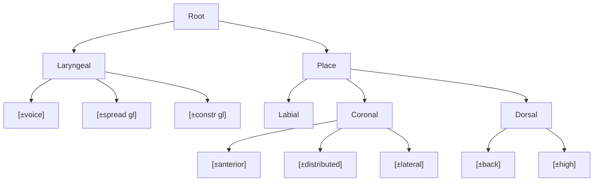

# Lesson 1: Phonetics, Phonology, Distinctive Features

## 1. First-Principles Intuition & Invariants

Human speech emerges from a remarkably constrained physical system. The vocal tract—a biological resonating chamber extending from the larynx through the oral and nasal cavities—produces all linguistic sounds through coordinated movements of the tongue, lips, velum, and larynx. Despite anatomical uniformity across our species, the world's languages exploit this shared apparatus in spectacularly divergent ways, carving up the continuous acoustic space into discrete, contrastive units that carry meaning. Phonetics and phonology together constitute the foundational inquiry into how humans produce, perceive, and mentally organize these speech sounds.

Phonetics operates as the natural science of speech. It investigates the physical reality of sound production through articulatory mechanics, the acoustic properties of the resulting waveforms, and the psychoacoustic mechanisms by which listeners decode these signals. Articulatory phonetics dissects the anatomical configurations and muscular gestures required to produce each sound segment. Acoustic phonetics analyzes speech as a time-varying pressure wave, extracting formant frequencies, spectral envelopes, and temporal patterns from spectrographic representations. Auditory phonetics examines how the cochlea transduces acoustic energy into neural firing patterns and how the auditory cortex segments the continuous stream into perceptual categories.

Phonology, by contrast, functions as the cognitive algebra of sound systems. While phonetics concerns itself with what is physically possible and acoustically measurable, phonology investigates what is mentally real and linguistically contrastive within a given language. The central construct here is the phoneme—an abstract unit of sound that distinguishes meaning. The English phonemes /p/ and /b/ differentiate "pat" from "bat," yet both represent families of acoustic variants. The /p/ in "pin" is aspirated with a burst of air, while the /p/ in "spin" lacks aspiration, but English speakers perceive both as instances of a single underlying category. Korean, however, maintains a three-way laryngeal distinction among lenis, fortis, and aspirated stops, treating as separate phonemes what English collapses into one. This exemplifies the core phonological insight: languages impose discrete categorical structure onto continuous phonetic space, and these category boundaries are arbitrary, learned, and language-specific.

The relationship between phonetics and phonology mirrors the distinction between performance and competence, between physical implementation and cognitive representation. Phonetic variation is gradient, continuous, and context-dependent. Individual speakers produce slightly different acoustic realizations of "the same sound" depending on surrounding segments, speaking rate, prosodic context, and idiolectal habits. Phonological representations, conversely, are discrete, categorical, and governed by mental grammar. A phonological rule applies or fails to apply; there is no intermediate state. This discreteness allows phonology to interface cleanly with morphology and syntax, where combinatorial operations require symbolic manipulation of discrete units rather than continuous signal processing.

Distinctive feature theory provides the atomic vocabulary for phonological description. Rather than treating phonemes as indivisible primes, generative phonology decomposes each segment into a bundle of binary or privative features representing articulatory or acoustic properties. The feature [±voice] distinguishes /p/ from /b/, /t/ from /d/, /s/ from /z/. The feature [±nasal] separates oral stops from nasal stops. Features capture natural classes—groups of sounds that pattern together in phonological processes. In English, the plural morpheme surfaces as [s] after voiceless consonants, [z] after voiced sounds, and [ɪz] after sibilants. This distribution references the natural class of voiceless obstruents, which shares the feature specification [−voice, −sonorant], rather than requiring an arbitrary list of individual segments.

Feature geometry organizes features into hierarchical structures rather than flat bundles. The root node dominates major class features distinguishing consonants from vowels. Below this, the laryngeal node groups voicing, aspiration, and glottal constriction features. The place node branches into labial, coronal, and dorsal articulators, each potentially subdivided further. This geometry predicts which features spread together in assimilation processes and which features can change independently. When nasalization spreads from a nasal consonant onto a preceding vowel in Portuguese, the entire [+nasal] feature propagates, not separate features for velum lowering and oral closure. When place assimilation occurs in English prefixes—"impossible" but "intolerable"—only the place node spreads while laryngeal features remain stable.

Syllable structure constitutes another fundamental organizational principle. Phonological processes often reference syllable constituents rather than linear segment sequences. A syllable consists of an obligatory nucleus, typically a vowel, optionally surrounded by consonantal margins. The onset precedes the nucleus; the coda follows it. The nucleus and coda together form the rhyme. Languages impose phonotactic constraints on permissible syllable structures. English allows complex onsets like [str] in "string" and complex codas like [ksts] in "texts," but many languages restrict syllables to simple CV patterns. Japanese largely prohibits codas except for moraic nasals and geminates, forcing loanword adaptation: "strike" becomes [sutoraiku], inserting epenthetic vowels to satisfy syllable well-formedness.

Sonority plays a crucial role in syllable organization. Segments fall along a sonority hierarchy from least to most sonorous: stops < fricatives < nasals < liquids < glides < vowels. Well-formed syllables typically exhibit sonority rise from margin to nucleus and sonority fall from nucleus to coda. This explains why [str] forms a legal English onset—sonority increases across the cluster—while [rts] does not. Cross-linguistic variation in sonority thresholds accounts for differences in permissible clusters. Russian tolerates onset clusters like [rtʃ] in "ртуть" (mercury) that violate sonority sequencing principles enforced in English, suggesting parametric variation in how strictly languages implement sonority constraints.

Prosody extends phonological organization beyond the segment and syllable to suprasegmental domains. Stress assigns relative prominence to syllables within words through acoustic correlates of duration, intensity, and fundamental frequency. English stress is lexically contrastive—"récord" (noun) versus "recórd" (verb)—and phonologically predictable in regular patterns. Stress placement interacts with vowel quality: unstressed vowels in English often reduce to schwa, a central mid vowel that neutralizes underlying contrasts. This reduction drives much of English's rhythmic character, creating a stress-timed cadence where stressed syllables occur at roughly regular intervals regardless of intervening unstressed syllable count.

Tone and intonation exploit fundamental frequency as a phonological dimension. Tone languages like Mandarin assign lexical pitch contours to syllables: "mā" (high level tone, mother), "má" (rising tone, hemp), "mǎ" (low dipping tone, horse), "mà" (falling tone, scold). These tonal melodies function as phonemes, contrastive elements that distinguish word meanings. Intonation in non-tonal languages like English encodes pragmatic and syntactic information through pitch patterns spanning entire phrases. Rising intonation typically signals questions; falling intonation marks declarative finality. Pitch accent systems occupy intermediate typological space, as in Japanese where each word carries at most one accent—a high-to-low pitch transition at a specific mora.

Underspecification theory addresses representational economy in mental phonology. Rather than fully specifying every feature for every segment, the grammar stores only unpredictable, contrastive information, leaving predictable features to be filled in by default rules. In Turkish, vowel harmony propagates backness and rounding across suffixes, but underlying representations need only specify these features on root vowels. Suffix vowels remain unspecified until harmony rules copy feature values from preceding syllables. This captures the insight that speakers store minimal information and compute surface forms through rule application, paralleling how generative systems derive outputs from underlying forms through ordered transformations.

Phonological rules formalize these transformations as context-sensitive rewrite operations. The notation A → B / C __ D specifies that segment A becomes B when preceded by C and followed by D. English flapping realizes /t/ and /d/ as the tap [ɾ] intervocalically when the first vowel is stressed: "writer" and "rider" are near-homophones despite underlying voicing contrast. The rule captures this allophony: /t, d/ → [ɾ] / V́ __ V, where V represents a vowel and the accent marks stress. Rule ordering determines derivational sequence when multiple processes interact. Opacity arises when rule application obscures underlying forms or when an earlier rule's output feeds or bleeds a later rule, creating surface patterns that appear irregular without derivational analysis.

The tension between derivational and representational approaches continues to animate phonological theory. Classical generative phonology emphasized serial rule application, deriving surface forms through ordered transformations from underlying representations. Autosegmental and metrical phonology introduced multilinear representations where features, tones, and prosodic structure occupy separate tiers linked by association lines, allowing spreading and deletion operations that linear models could not capture. Optimality Theory abandoned rules entirely, generating candidate outputs freely and selecting the optimal form through ranked violable constraints. Each framework offers distinct analytical leverage for different empirical phenomena, and practicing phonologists deploy multiple formal tools depending on the problem domain.

Understanding phonetics and phonology equips the analyst to decode any human sound system's organizing principles, to predict allophonic variation from phonemic representation, to diagnose phonological pathologies in language acquisition and speech disorders, and to engineer phonologically-informed systems for speech recognition, synthesis, and linguistic fieldwork. The physical reality of articulation and acoustics constrains what is possible, but the cognitive reality of mental representation determines what is contrastive. Between these levels, the discipline reveals both the universal architecture of human speech capacity and the spectacular diversity of solutions that individual languages construct within that shared space.

## 2. Core Architecture & Mechanics

The vocal tract functions as an acoustic tube roughly 17 centimeters long in adult humans, extending from the glottis through the oral and nasal cavities to the lips and nostrils. Sound generation begins at the larynx, where the vocal folds—twin muscular folds of tissue—modulate airflow from the lungs. When adducted and tensed appropriately, these folds vibrate under subglottal pressure, producing periodic acoustic pulses that form the source signal for voiced sounds. The fundamental frequency of this vibration, typically 100-120 Hz for adult males and 200-250 Hz for adult females, establishes the perceived pitch of speech. Voiceless sounds result when the vocal folds remain abducted, allowing turbulent airflow without periodic vibration.

Above the larynx, the vocal tract acts as a resonating filter that shapes the source signal's spectral envelope. The tongue, a massive muscular hydrostat, occupies the oral cavity's floor and central volume. Its extraordinary mobility allows fine-grained constriction and shaping along both anterior-posterior and superior-inferior dimensions. The tongue tip (apex) and blade can articulate against the upper teeth, alveolar ridge, or hard palate. The tongue body (dorsum) can rise toward the hard palate for palatal articulations or retract toward the soft palate (velum) for velar articulations. The tongue root can advance or retract, expanding or constricting the pharyngeal cavity's volume.

The lips form the anterior boundary, capable of rounding (protruding forward and reducing aperture), spreading (stretching laterally), or closing (forming complete occlusion). The velum, a muscular flap extending posteriorly from the hard palate, controls oro-nasal coupling. When raised, it seals the nasal passage, directing airflow exclusively through the oral cavity for oral sounds. When lowered, it permits nasal airflow for nasal consonants and nasalized vowels. The jaw provides a structural frame and modulates mouth opening, indirectly affecting tongue position and lip configuration.

Articulatory phonetics categorizes consonants along three primary dimensions: place of articulation, manner of articulation, and phonation type. Place specifies where in the vocal tract the primary constriction occurs. Bilabial consonants like [p, b, m] involve both lips. Labiodental sounds like [f, v] contact upper teeth against lower lip. Dental consonants articulate tongue tip against upper teeth. Alveolar sounds like [t, d, s, n, l] involve tongue-to-alveolar ridge contact. Postalveolar and palatoalveolar fricatives like [ʃ, ʒ] position constriction slightly posterior. Retroflex consonants curl the tongue tip upward and backward. Palatal consonants raise the tongue body toward the hard palate. Velar sounds like [k, g, ŋ] contact tongue dorsum against the soft palate. Uvular, pharyngeal, and glottal places occupy progressively more posterior positions.

Manner of articulation describes the constriction geometry and airflow dynamics. Stops (plosives) form complete oral occlusion, building up pressure before sudden release. Fricatives create narrow constriction generating turbulent airflow noise. Affricates combine stop closure with fricative release in a single complex segment. Nasals involve complete oral closure with velum lowering, channeling airflow through the nasal cavity. Liquids include laterals like [l], where airflow passes around tongue-side occlusion, and rhotics like [r], which exhibit diverse articulatory strategies across languages. Glides (semivowels) produce vowel-like articulations with brief duration and consonantal distribution.

Vowels are characterized primarily through tongue position and lip configuration rather than constriction location. The traditional vowel quadrilateral maps vowel space along two dimensions: tongue height (high, mid, low) and tongue backness (front, central, back). High front unrounded [i] positions the tongue blade near the hard palate without lip rounding. Low back rounded [ɔ] lowers and retracts the tongue while rounding the lips. Central mid vowel [ə] (schwa) adopts a neutral, minimally displaced configuration. Additional parameters include tenseness (distinguishing [i] from [ɪ], [u] from [ʊ]), nasalization (whether the velum is lowered during vowel production), and length (phonemic duration contrasts in languages like Finnish and Japanese).

Acoustic phonetics analyzes speech as time-varying waveforms and spectrograms. The spectrogram displays frequency on the vertical axis, time horizontally, and amplitude through darkness or color intensity. Vowels exhibit clear formant structure—resonant frequency bands corresponding to vocal tract resonances. The first formant (F1) correlates inversely with tongue height: high vowels have low F1, low vowels high F1. The second formant (F2) correlates with tongue backness: front vowels exhibit high F2, back vowels low F2. Lip rounding lowers all formants, particularly F2 and F3. Consonants display characteristic spectral signatures: stop bursts appear as transient vertical spikes, fricatives as broad-band noise concentrated in frequency regions determined by place of articulation, and nasals as low-frequency energy with antiformant damping.

```
Vowel Formant Space (schematic F1-F2 plot)

F2 (Hz)
3000      2000      1000
  ├─────────┼─────────┤
  │    i    │         │  300 ← F1 (Hz)
  │         │    u    │
  │    e    │    o    │  500
  │         │         │
  │    ɛ    │    ɔ    │  700
  │         │         │
  │      a  │         │  900
  └─────────┴─────────┘

High vowels (i, u): Low F1 (~300 Hz)
Low vowels (a): High F1 (~900 Hz)
Front vowels (i, e): High F2 (~2000+ Hz)
Back vowels (u, o): Low F2 (~1000 Hz)
```

Distinctive feature decomposition represents segments as matrices of binary or privative features. Major class features distinguish broad categories: [±consonantal] separates consonants from vowels and glides, [±sonorant] divides sonorants (vowels, nasals, liquids, glides) from obstruents (stops, fricatives, affricates). Laryngeal features include [±voice] for vocal fold vibration, [±spread glottis] for aspiration, and [±constricted glottis] for glottalization and ejectives. Manner features specify [±continuant] (whether airflow continues during articulation), [±nasal], [±lateral], and [±strident] (high-amplitude frication noise).

Place features organize hierarchically under a Place node. The feature [Labial] activates for bilabials and labiodentals. [Coronal] specifies tongue tip/blade articulation, subdividing into [±anterior] (alveolar vs. postalveolar) and [±distributed] (apical vs. laminal contact). [Dorsal] identifies tongue body articulation, with [±back] and [±high] specifying position within velar-palatal-uvular space. Vowel features include [±high], [±low], [±back], [±round], and [±ATR] (advanced tongue root, distinguishing tense from lax vowel sets in languages like Akan and Igbo).

Feature geometry structures these features hierarchically rather than as flat bundles:



This hierarchy predicts spreading domains in assimilation. When a nasal consonant triggers nasalization on a preceding vowel, the [+nasal] feature under the root node spreads, bringing along velum lowering without affecting oral articulator configuration. When place assimilation occurs—as in the prefix /in-/ surfacing as [im] before bilabials ("impossible"), [iŋ] before velars ("incomplete"), or [in] before coronals ("intolerable")—only the Place node copies from the following consonant while laryngeal features remain stable.

Syllable structure imposes hierarchical constituent organization on segment sequences. The syllable (σ) dominates onset and rhyme constituents. The onset contains prevocalic consonants; the rhyme branches into nucleus (typically a vowel) and coda (postvocalic consonants):

```
       σ
      / \
  Onset  Rhyme
    |    /   \
    C   Nucleus Coda
         |      |
         V      C

Example: "spring" /sprɪŋ/

       σ
      / \
    [spr] Rhyme
          /   \
         [ɪ]  [ŋ]
```

Languages parametrize maximal onset and coda complexity. Japanese enforces strict CV structure except for moraic nasals and geminates, prohibiting complex margins. English tolerates substantial complexity: three-consonant onsets in "string" and four-consonant codas in "texts." Sonority Sequencing Principle mandates rising sonority from onset through nucleus and falling sonority from nucleus through coda, with languages varying in how strictly they enforce this universal tendency.

Phonotactic constraints restrict permissible segment combinations beyond sonority principles. English prohibits onset [tl] despite adequate sonority profile (*[tlɑ] is impossible), though Russian permits it in "тля" (aphid). English requires obstruent clusters in onsets to agree in voicing (*[zb] and *[ps] are illegal word-initially), a constraint absent in Russian and Polish. Morpheme structure constraints restrict root-internal phonotactics more severely than derived environments: English roots lack [ŋ] initially, though "singer" contains word-internal [ŋ] derived from /sɪŋ+ər/.

Stress systems assign metrical prominence through various mechanisms. Fixed-stress languages like Finnish (initial), Polish (penultimate), and French (final) place stress predictably based on word edge. Weight-sensitive languages like Latin and Arabic assign stress based on syllable weight: heavy syllables (those with long vowels or coda consonants) attract stress. Quantity-insensitive languages like Czech place stress without reference to syllable weight. Lexical stress languages like English and Russian exhibit partly unpredictable stress that must be specified in underlying representation, though subject to statistical tendencies.

Metrical phonology formalizes stress patterns through hierarchical tree structures or metrical grids. Binary branching feet group syllables into strong-weak or weak-strong pairs. Iambic feet (weak-strong) appear in English content words. Trochaic feet (strong-weak) characterize languages like Finnish. Quantity-sensitive feet respect moraic weight: a heavy syllable can constitute a degenerate monosyllabic foot. Extrametricality allows peripheral constituents to be invisible to stress rules: English stress often ignores word-final consonants when calculating syllable weight for stress assignment.

Tone operates as a suprasegmental phoneme realized through fundamental frequency modulation. Register tone systems like Yoruba and Thai distinguish level pitch targets: high, mid, low. Contour tone languages like Mandarin employ dynamic pitch movements: rising, falling, dipping. Tone bearing units (TBUs) are typically moras or syllables, though some languages assign tone to entire morphemes. Tonal melodies can spread across syllable sequences, and tonal phonology displays assimilation, dissimilation, and neutralization processes analogous to segmental phonology. Floating tones, specified in underlying representation but lacking segmental anchor, dock onto nearby TBUs through association conventions.

Phonological rules formalize sound alternations through context-sensitive transformations. The general schema specifies input structure, output structure, and conditioning environment. Assimilation rules make segments more similar to neighbors: nasal place assimilation renders /n/ as [m] before bilabials, [ŋ] before velars. Dissimilation rules increase contrast: Latin "arbor" (tree) derives from earlier *arber, dissimilating the first rhotic to avoid rhotic-rhotic sequence. Deletion rules remove segments: English /t, d/ deletion between consonants in "postman" pronounced [poʊsmən]. Insertion (epenthesis) rules add segments: Spanish speakers often produce "eSpain" for "Spain," inserting prothetic vowel to avoid illegal sC- onset. Coalescence rules merge two segments into one bearing features of both: English "did you" often surfaces as [dɪdʒu], coalescing /d/ and /j/ into [dʒ].

Autosegmental representations employ multiple parallel tiers linked by association lines, allowing one-to-many and many-to-one mappings impossible in strictly linear models. Tone melodies occupy a separate autosegmental tier from tone bearing units, spreading or delinking independently:

```
Linear model (inadequate for spreading):
      m  a  m  a
      |  |  |  |
      H  L  H  L

Autosegmental model (captures spreading):
Tone tier:    H    L
              |  ╱ |
              | ╱  |
Segment tier: m a  m a

After L-spread:
Tone tier:    H    L
              |  ╱ ╲
              | ╱   ╲
Segment tier: m a  m a

Result: [ma̋ mâ] (contour tone on second syllable)
```

Natural classes emerge from feature specifications. The class of voiced stops {b, d, g} shares [+consonantal, −sonorant, −continuant, +voice]. The class of front vowels {i, e, ɛ} shares [−consonantal, +syllabic, −back]. Natural classes participate in phonological rules as unified categories: a single rule references the natural class rather than enumerating members individually. This predicts learnability: children acquire phonological patterns referencing natural classes earlier than arbitrary segment lists, and cross-linguistically, productive alternations overwhelmingly target natural classes.

Underspecification eliminates redundant feature specifications from underlying representations. Redundancy rules fill in predictable features during derivation. In English, sonorants are redundantly [+voice], so underlying sonorant representations omit voice specification. In languages with anticipatory nasal place assimilation, nasal place is predictable from following consonant, so underlying nasals may be placeless, receiving place features via spreading. Radical underspecification maximizes economy by specifying only contrastive features: in a five-vowel system {i, e, a, o, u}, markedness considerations might leave [a] completely unspecified as the default vowel, with other vowels specified only for features that distinguish them from [a].

Opacity arises when surface patterns obscure underlying relationships due to rule interaction. In Bedouin Arabic, underlying /a/ raises to [i] adjacent to high vowels, but then a later rule deletes short high vowels in open syllables. The result is surface [katab-it-i] (she wrote) where the final [i] triggers raising of [a] to [i] despite being subsequently deleted: underlying /katab-at-i/ → /katab-it-i/ (by raising) → [katab-t-i] (by deletion). The surface form contains no high vowel to explain the raising, creating opacity. Rule ordering—raising before deletion—explains the surface pattern, though the intermediate stage never surfaces.

Opacity motivated Optimality Theory's shift from derivational to parallel evaluation. OT generates candidate outputs freely and evaluates them against ranked violable constraints. Faithfulness constraints penalize divergence from input: MAX prohibits deletion, DEP prohibits insertion, IDENT preserves feature values. Markedness constraints penalize dispreferred structures: *COMPLEX bans consonant clusters, ONSET requires syllables to begin with consonants, NOCODA prohibits syllable codas. Constraint ranking determines language-specific patterns: ranking NOCODA above MAX favors deletion to eliminate codas (Japanese-style adaptation), while ranking MAX above NOCODA tolerates codas to preserve segments (English-style phonotactics).

Prosodic phonology recognizes phonological domains beyond the segment and syllable: the phonological word, the phonological phrase, the intonational phrase, and the utterance. Phonological rules may apply specifically within or across these domains. External sandhi processes operate across word boundaries within phrases: French liaison pronounces latent final consonants before vowel-initial following words ("les amis" [lezami] vs. "les chiens" [leʃjɛ̃]). Internal sandhi occurs within words. Prosodic domains do not always align with morphosyntactic constituents: phonological words may contain multiple morphological words (cliticization) or subdivide single morphological words (compound stress domains).

Phonological acquisition follows predictable trajectories as children construct mental phonologies. Babbling initially produces random articulatory gestures, progressively converging on ambient language phonotactics by 10 months. First words exhibit systematic substitution patterns reflecting unmarked segment preference: stops replace fricatives, oral stops replace nasals, coronal place generalizes over labial and velar. Cluster reduction simplifies complex onsets and codas. These patterns reflect markedness hierarchies: children acquire unmarked structures before marked ones, and cross-linguistic markedness predicts acquisition order. Feature geometry predicts spreading patterns in child phonology: entire place nodes spread in reduplication and assimilation, not isolated features.

Speech perception involves categorical perception of continuous acoustic variation. Voice onset time (VOT)—the interval between stop release and voicing onset—varies continuously from negative values (voicing precedes release) through zero (simultaneous release and voicing) to positive values (voicing lags release). Yet English speakers perceive sharp category boundaries: VOT below 25 ms is heard as /b/, above 25 ms as /p/, with minimal sensitivity to within-category variation and maximal sensitivity to cross-boundary distinctions. This categorical warping of perceptual space is learned through exposure to language-specific phoneme distributions, demonstrating that phonological categories reshape perceptual sensitivity.

Second language acquisition must overcome established phonological categories. Spanish speakers perceive English /i/-/ɪ/ distinction poorly because Spanish lacks tense-lax vowel contrasts, collapsing both into native /i/ category. Japanese speakers struggle with English /r/-/l/ because Japanese /r/ is articulatorily intermediate, occupying perceptual space spanning both English categories. Production errors mirror perceptual difficulties: non-native phoneme contrasts collapse to native categories, and phonotactic constraints from L1 are imposed on L2 (Spanish speakers inserting epenthetic vowels in English sC- onsets). Training perceptual sensitivity to non-native contrasts through high-variability phonetic training can improve both perception and production.

Laboratory phonology applies experimental methods to phonological questions. Instrumental techniques measure articulation directly: electromagnetic articulography tracks fleshpoint movements via sensors glued to tongue and lips; ultrasound imaging visualizes tongue contours in real time; electropalatography records tongue-palate contact patterns. Acoustic analysis extracts formant trajectories, voice onset time, spectral moments, and prosodic parameters from speech waveforms. Production experiments manipulate speaking conditions to probe phonological planning units and constraints. Perception experiments using synthesized or manipulated stimuli reveal category boundaries and cue weighting.

Phonological fieldwork documents underdescribed languages, beginning with phonetic inventory and distributional analysis. Minimal pair elicitation identifies contrastive segments: if two words differ only in one segment and carry distinct meanings, those segments are separate phonemes. Complementary distribution reveals allophony: if two phones never occur in the same environment, they may be allophones of a single phoneme. Instrumental recording preserves acoustic data for subsequent analysis. Phonotactic analysis catalogs permissible syllable structures and segment sequences. Prosodic transcription marks stress, tone, and intonational contours. Phonological analysis formulates rules or constraints explaining observed alternations and distributions.

Computational phonology implements phonological theories as executable models. Finite state transducers encode phonological rules as regular relations mapping underlying to surface forms. Optimality Theory can be implemented via constraint ranking algorithms, though full GEN (candidate generation) and EVAL (constraint evaluation) require careful complexity management for non-trivial grammars. Probabilistic models assign graded well-formedness scores to phonological structures, capturing gradient acceptability judgments and lexical frequency effects. Neural network models learn phonological mappings from input-output pairs, successfully modeling human-like generalization and acquisition trajectories without explicit feature or rule representations.

Speech technology relies fundamentally on phonological representations. Automatic speech recognition systems decode acoustic waveforms into phoneme sequences before linguistic decoding. Speech synthesis engines convert text to phoneme sequences via grapheme-to-phoneme rules, then synthesize acoustic waveforms using concatenative, formant, or neural vocoding techniques. Both tasks require extensive phonological knowledge: coarticulation modeling predicts acoustic variation from phonological context, pronunciation lexicons encode word-level phonological representations, and prosodic models generate natural-sounding intonation and rhythm. Advances in deep learning have not eliminated the need for phonological insight—rather, phonological structure often emerges implicitly in trained neural representations, and explicitly incorporating phonological features frequently improves performance.

## 3. High-Performance Optimization & Failure Modes

Articulatory precision determines intelligibility under adverse conditions. When speaking in noisy environments, hyper-articulation—exaggerated articulatory movements that expand phonetic vowel space and enhance consonant contrasts—significantly improves listener comprehension. Conversely, hypo-articulation in casual rapid speech compresses vowel space toward central schwa, reduces articulatory targets, and increases coarticulation, resulting in increased confusability. Professional voice users—actors, public speakers, language instructors—train to maintain articulatory precision even at rapid speaking rates, preserving phonemic contrasts that untrained speakers sacrifice for temporal efficiency.

Acoustic optimization for recording and broadcast requires careful microphone technique and signal processing. Plosive stops produce high-energy transient bursts that cause clipping distortion if gain staging is inadequate. Pop filters attenuate plosive energy before it reaches the microphone diaphragm. High-pass filtering below 80 Hz removes subsonic energy from handling noise without affecting speech content. Subtle de-essing reduces sibilant fricative energy that otherwise sounds harsh in reproduced audio. Multiband compression balances spectral energy distribution, enhancing intelligibility without introducing overt processing artifacts. Normalization brings peak or RMS levels to target values for consistent loudness across speakers and recordings.

Spectrographic analysis workflow begins with appropriate window size selection. Short windows (5-10 ms) provide fine temporal resolution at the cost of frequency resolution, suitable for analyzing stop bursts and rapid formant transitions. Long windows (25-50 ms) yield high frequency resolution for precise formant measurement but blur temporal dynamics. The Hann or Hamming window functions taper signal edges to reduce spectral leakage from discontinuities. Spectrogram dynamic range should span approximately 50-70 dB to reveal both high-energy vowel formants and low-energy fricative noise. Linear frequency scaling suits broadband visualization, while logarithmic scaling matches perceptual frequency resolution for specialized tasks.

Formant tracking algorithms extract formant trajectories from spectrograms using linear predictive coding (LPC) or cepstral analysis. LPC fits an all-pole filter model to the speech spectrum, yielding formant frequencies and bandwidths. Analyst-specified model order determines the number of formants extracted: order 10-12 typically suffices for adult male speech, while order 12-14 suits higher-pitched female and child voices with more widely-spaced formants. Tracking errors occur when formants cross or approach closely, when formant bandwidth is unusually large (breathy phonation), or when spectral noise from frication interferes with formant estimation. Manual correction of tracking errors remains necessary for high-quality acoustic analysis.

Phonetic transcription practice develops perceptual acuity through repeated transcription of diverse speech materials followed by comparison with expert transcriptions. Begin with clear citation-form pronunciations before advancing to casual conversational speech exhibiting extensive reduction and assimilation. Training materials should sample diverse speakers varying in age, sex, dialect, and speaking style to prevent overfitting to narrow phonetic distributions. Transcription software like Praat allows time-aligned annotation synchronized with waveform and spectrogram displays, enabling perceptual judgments to be cross-validated with acoustic measurements. Regular transcription practice sharpens categorical perception while maintaining sensitivity to fine phonetic detail.

Phonological analysis failure modes include several systematic errors. Distributional analysis may incorrectly identify separate phonemes when encountering free variation or sociolinguistic variables: English /t/ varies freely between [t], [ʔ], and [ɾ] in certain environments, yet all are allophones of /t/, not separate phonemes. Phonotactic generalizations may overfit to accidental gaps: English lacks initial [tl], but this reflects historical accident rather than principled constraint, as demonstrated by borrowings like "Tlingit" that violate the gap. Rule formulation may propose arbitrary segment lists rather than natural classes when feature analysis is inadequate: positing separate rules for {p, t, k} aspiration and {b, d, g} non-aspiration misses the generalization that [−voice] stops aspirate while [+voice] stops do not.

Prosodic analysis requires attention to multiple acoustic correlates simultaneously. Stressed syllables exhibit increased duration, higher intensity, and often but not always higher fundamental frequency. Pitch accents coincide with stressed syllables but are independent of stress: not all stressed syllables bear pitch accents, and stress can occur without pitch prominence. Analyzing stress from intensity alone produces errors because intensity varies with vowel quality (high vowels are inherently quieter than low vowels) and with consonantal context (vowels following voiceless stops have delayed voicing onset, creating spurious intensity dips). Duration comparisons must normalize for intrinsic vowel duration and speaking rate. Fundamental frequency analysis requires robust pitch tracking algorithms that correctly handle voiceless intervals and creaky phonation where periodicity is irregular.

Fieldwork phonology faces challenges when working with small speaker populations or moribund languages. Limited lexical material may provide insufficient minimal pairs to establish full phonemic inventory. Speakers experiencing language attrition may show inconsistent phoneme realization or influence from dominant language contact. Recording quality in field conditions often suffers from environmental noise, poor microphone quality, and lack of acoustic isolation. Instrumental analysis becomes difficult with low signal-to-noise recordings. Multiple recording sessions with multiple speakers become essential to distinguish robust patterns from individual variation or recording artifacts.

Cross-linguistic phonological analysis requires sophisticated typological awareness to avoid imposing familiar categories onto divergent systems. Many languages lack phonemic voicing distinctions, instead contrasting aspiration (Korean, Thai, Armenian), glottalization (Hausa, Q'eqchi'), or tenseness (Shanghainese, Danish). Three-way or four-way laryngeal contrasts cannot be adequately described using binary [±voice] feature alone; more articulated feature geometries or privative features become necessary. Tone analysis in languages with large tone inventories (Cantonese six tones, Oto-Manguean languages up to twelve) requires careful attention to phonetic realization, sandhi processes, and morphophonemic alternations before positing underlying tonal specifications.

Phonological rule formulation benefits from constraint on arbitrary power. Grammars that can describe anything explain nothing. Suspected phonological rules should be checked against typological attestation: is the proposed process cross-linguistically common, or would it be unprecedented? Natural phonological processes typically involve assimilation to adjacent segments, simplification of marked structures, or enhancement of perceptual contrast. Arbitrary mappings unmotivated by phonetic pressures (e.g., /p/ → [k] / __ /i/) should be viewed skeptically and alternative analyses pursued. Rule conspiracies—multiple distinct rules achieving the same structural goal—suggest underlying constraint-based analysis rather than independent rule stipulation.

Feature system optimization balances descriptive power against proliferation of primitives. Classical SPE features numbered approximately thirty, sufficient to describe most segment inventories but requiring extensive diacritics and ad-hoc features for unusual sounds. Government Phonology and Dependency Phonology proposed radical feature reduction, analyzing all segments as combinations of a few privative elements. While elegant, extremely minimal feature systems sometimes struggle to capture natural classes cross-linguistically. Current practice balances parsimony with empirical coverage, adopting established features where adequate and proposing novel features only when necessary to characterize robust cross-linguistic patterns or natural classes participating in productive phonological processes.

Underspecification theory must be constrained to avoid vacuity. If analysts are free to underspecify arbitrary features, any pattern can be "explained" by choosing convenient underspecifications. Principled underspecification follows from markedness: specify only marked values, leaving unmarked values unspecified. Contrastive underspecification specifies only features necessary to distinguish segment from minimal contrasting segments. Radical underspecification maximizes underspecification while preserving predictability of surface forms. Whichever approach is adopted must be consistently applied across the entire phonological system rather than adjusting underspecification opportunistically to make particular analyses work.

Phonological opacity presents challenges for learning and processing. Opaque patterns require abstract intermediate representations that never surface, creating a poverty-of-stimulus problem for acquisition: how do learners infer underlying forms and rule orderings without direct evidence? Experimental work suggests learners initially construct transparent grammars and only gradually acquire opaque patterns through repeated exposure. Processing studies show increased reaction times and error rates for opaque patterns compared to transparent ones, suggesting opacity imposes cognitive cost. Phonological theory must account for why opacity exists if it is difficult to learn and costly to process—likely because diachronic sound change creates opacity as a byproduct, not because opacity serves any functional advantage.

Optimality Theory faces computational challenges in candidate generation and evaluation. Candidate sets are potentially infinite: any mapping from input to output is permitted. Rich Base hypothesis assumes candidates are generated from underlying forms via unrestricted GEN, but this requires either brute-force enumeration (computationally intractable) or clever pruning strategies informed by phonological universals. Constraint conjunction (logical AND of constraints) and local constraint conjunction (conjoined constraints evaluated over prosodic domains) vastly expand the constraint space, requiring principled limits on which conjunctions are permitted. Learning algorithms for constraint ranking (Recursive Constraint Demotion, Error-Driven Constraint Demotion, Gradual Learning Algorithm) face local optima problems and require carefully structured training data.

Acoustic analysis artifacts arise from signal processing assumptions. Aliasing occurs when sampling rate is insufficient to capture high-frequency components, causing spectral energy above the Nyquist frequency to be erroneously reflected back into lower frequencies. Pre-emphasis filtering boosts high-frequency energy to compensate for typical speech spectrum slope, but excessive pre-emphasis creates unnatural spectral balance. Window functions trade main lobe width against side lobe suppression: rectangular windows have narrowest main lobes but highest side lobes, while Hamming windows have broader main lobes but greatly suppressed side lobes. Formant synthesis artifacts in text-to-speech systems result from inadequate modeling of formant transitions, causing robotic or unnatural vocal quality despite accurate steady-state formant values.

Phonological transcription conventions require consistency across annotators for reliable corpus construction. Transcriber training involves iterative cycles of independent transcription, comparison with gold-standard transcriptions, and discussion of discrepancies. Inter-annotator agreement should be quantified using kappa statistics, with acceptable agreement typically requiring kappa > 0.7. Difficult cases should be resolved through consensus or adjudication by senior phoneticians rather than majority vote. Transcription guidelines must explicitly address ambiguous cases, such as whether to transcribe phonetic detail (narrow transcription) or phonological categories (broad transcription), how to handle unclear or overlapping speech, and whether to mark prosody and non-verbal vocalizations.

Phonological database design requires careful attention to data structure. Segment inventories should be stored with full feature specifications, allowing queries by natural class. Lexical entries should encode underlying phonological forms separate from surface forms, with derivational histories if rule-based analysis is employed. Recording metadata must include speaker demographics, recording conditions, session identifiers, and elicitation context. Time-aligned transcriptions link annotation tiers at multiple granularities: utterances, prosodic phrases, words, syllables, segments, and features. Relational database schemas or XML markup enable complex queries across these tiers. Version control and data provenance tracking prevent loss or corruption of valuable field data.

Phonological patterns in signed languages demonstrate that phonology is modality-independent, arising from cognitive constraints on possible form contrasts rather than from acoustic-auditory channel properties. Signs decompose into formational parameters analogous to phonological features: handshape, location, movement, palm orientation, and non-manual features (facial expression, head movement, body posture). Phonotactic constraints restrict permissible parameter combinations. Phonological processes include assimilation (handshape anticipation, location perseveration), deletion (sign reduction in rapid signing), and prosodic structure (syllable-like movement units, prosodic words, intonational phrases marked by brow position and head nods). Minimal pairs demonstrate contrastive parameter values. This phonological structure in a completely non-acoustic modality confirms that phonology reflects general cognitive constraints on symbolic systems rather than properties specific to vocal-auditory channel.

Clinical phonology applies phonological analysis to speech disorders. Phonological disorders exhibit systematic substitution patterns: fronting (velar → alveolar), stopping (fricative → stop), cluster reduction, and weak syllable deletion. These patterns mirror unmarked substitutions in typical phonological development but persist beyond age-appropriate stages. Apraxia of speech involves impaired motor planning for speech gestures, causing inconsistent articulatory errors and particular difficulty with complex syllable structures and longer words. Dysarthria results from neuromuscular impairment affecting speech execution, producing consistent distortions of articulatory targets. Phonological analysis informs remediation by identifying error patterns, prioritizing treatment targets based on markedness and functional load, and monitoring generalization from treated to untreated exemplars.

Phonological theory must ultimately connect to neuroscience, explaining how mental phonological representations and processes are implemented in neural circuitry. Neuroimaging studies reveal partially distinct cortical substrates for phonological processing: left superior temporal cortex for auditory-phonetic processing, left inferior frontal regions for articulatory phonology and phonological working memory, left supramarginal gyrus for phonological sequencing. Electrophysiological responses differentiate phoneme categories as early as 100 ms post-stimulus, demonstrating rapid categorical perception. Patient studies following focal brain lesions dissociate phonological abilities: some patients lose phonemic distinctions while preserving semantic knowledge, others show phonological assembly deficits for output while comprehension remains intact. These neural and clinical dissociations provide external validation for theoretical distinctions between underlying representation, phonological derivation, and phonetic implementation.
