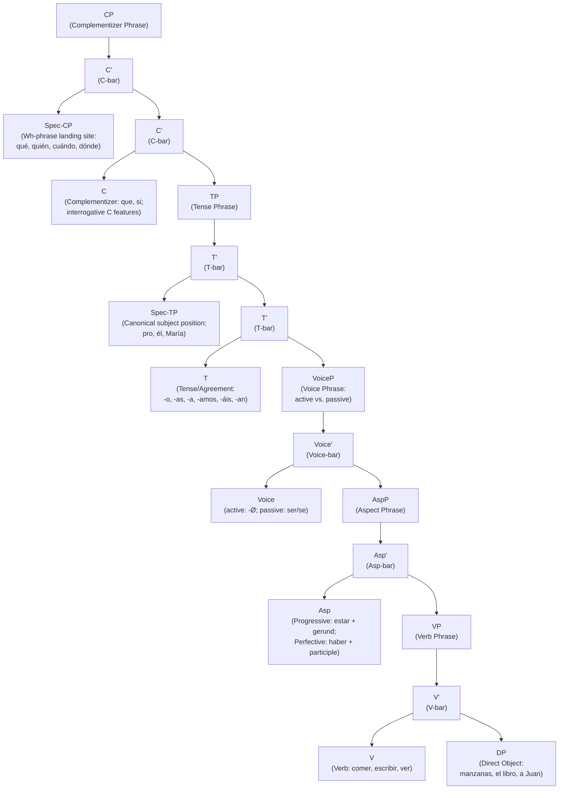

# Lesson 3: Syntactic Architecture, Clause Typology, Movement Operations

## 1. First-Principles Intuition & Invariants

Spanish syntax presents a fascinating tension between two competing organizational principles: the configurational rigidity inherited from Latin's subject-verb-object (SVO) typology and the morphological richness that permits dramatic surface reordering. Unlike English, where word order carries nearly all grammatical weight—shifting "The dog bit the man" to "The man bit the dog" reverses semantic roles entirely—Spanish exploits verbal agreement morphology and accusative clitic pronouns to license flexible constituent ordering while preserving interpretive clarity. This flexibility is not chaotic variation but systematic optionality governed by information structure, discourse salience, and syntactic constraints that operate at the interface between morphology and pragmatics.

At the foundation of Spanish clause architecture lies the **pro-drop parameter**, a cluster of properties distinguishing null-subject languages from obligatory-subject languages like English and French. Spanish licenses phonetically null pronominal subjects because its verbal inflection paradigm is sufficiently rich to recover person and number features from morphological agreement alone. When a Spanish speaker produces *Habla francés* without an overt subject pronoun, the third-person singular morpheme *-a* unambiguously identifies the subject as *él*, *ella*, or *usted*. This is not ellipsis or deletion but a grammatical option where the subject occupies a syntactic position—commonly analyzed as Spec-TP (the specifier of Tense Phrase)—but remains unpronounced, represented in generative frameworks as *pro*, a phonetically null pronoun bearing phi-features (person, number, gender) licensed by agreement with the inflected verb.

The pro-drop parameter correlates with several syntactic phenomena beyond null subjects: free inversion of subject and verb (*Llegó María* vs. *María llegó*), extraction of subjects from embedded clauses without triggering that-trace effects, and expletive-less weather predicates (*Llueve* rather than English's obligatory *It rains*). These properties form a typological cluster, suggesting that Spanish syntax privileges verb-internal inflectional features over positional encoding of grammatical relations, creating a configurational architecture that nonetheless tolerates substantial surface variation.

Word order in Spanish declarative clauses canonically follows SVO patterning—*El niño come manzanas* (The boy eats apples)—but this baseline is disrupted by information-structural pressures and syntactic movement operations. Subject-verb inversion to VSO or VOS order occurs obligatorily in certain contexts (unaccusative intransitives like *Llegó el tren*, "The train arrived") and optionally to mark focus or contrast (*Compró Juan el libro*, emphasizing that Juan, not another person, bought the book). Object fronting to OSV configurations (*El libro compró Juan*) is grammatical but pragmatically marked, requiring contrastive or topical licensing in discourse. These reorderings are not free scrambling but result from syntactic movement to designated left-peripheral positions—topic phrases and focus phrases—that encode information-structural features in the clausal spine.

Clitic pronouns introduce additional architectural complexity, occupying a morphosyntactic zone intermediate between independent words and inflectional affixes. Spanish clitics (*me, te, lo, la, le, nos, os, los, las, les*) cannot stand alone or receive prosodic stress; they must attach to a verbal host, appearing proclitic (pre-verbal) in finite clauses (*Lo veo*, "I see it") but enclitic (post-verbal, fused orthographically) in infinitives, gerunds, and affirmative imperatives (*verlo*, "to see it"; *viéndolo*, "seeing it"; *¡Míralo!*, "Look at it!"). This positional alternation reflects syntactic height: clitics target functional projections above VP but below Tense, climbing to attach to the highest available verbal head. When multiple clitics co-occur, their linear order follows a rigid template—person hierarchy (1st/2nd before 3rd) and case hierarchy (dative before accusative)—producing sequences like *me lo dio* ("he gave it to me") but blocking impossible orders like **lo me dio*.

The interaction between clitic placement and infinitival complements reveals deep syntactic structure. In restructuring contexts with modal, aspectual, or motion verbs, clitics may either attach locally to the embedded infinitive (*Quiero verlo*, "I want to see it") or climb to the matrix finite verb (*Lo quiero ver*), both variants grammatically acceptable and semantically equivalent. This optionality diagnoses clause union or restructuring, where the embedded infinitive forms a monoclausal domain allowing the clitic to satisfy its attachment requirements at either verbal position. Non-restructuring predicates disallow clitic climbing; *Lamento haberlo perdido* ("I regret having lost it") permits only enclitic attachment to the infinitive, blocking **Lo lamento haber perdido*, because the embedded clause retains full CP structure and resists transparency to matrix operations.

Subordination in Spanish imposes a strict partitioning between indicative and subjunctive moods, a morphosyntactic distinction grammaticalizing speaker stance toward propositional content. The indicative mood signals assertion, factual commitment, or epistemic certainty: *Sé que María viene* ("I know that María is coming"). The subjunctive mood marks non-assertion, irrealis modality, or speaker doubt: *Dudo que María venga* ("I doubt that María is coming"). This division is not freely chosen but syntactically governed by the semantic class of the matrix predicate, the polarity of the embedding environment, and the presence of intensional operators. Verbs of epistemic certainty (*saber, creer* in affirmative contexts), perception (*ver, oír*), and declarative speech (*decir* when asserting) select indicative complements. Verbs of volition (*querer, desear*), emotion (*temer, alegrarse*), doubt (*dudar, negar*), and impersonal expressions of necessity (*es necesario, es importante*) obligatorily select subjunctive complements.

The subjunctive extends to adverbial clauses encoding temporal contingency (*antes de que llegues*, "before you arrive"), purpose (*para que entiendas*, "so that you understand"), and concession (*aunque llueva*, "even if it rains"), contrasting with indicative mood in temporal clauses denoting completed or habitual events (*cuando llegaste*, "when you arrived"). Negative polarity triggers subjunctive in relative clauses modifying indefinite or non-specific antecedents: *Busco un libro que explique esto* (indicative: "I'm looking for a book [a specific one] that explains this") versus *Busco un libro que explique esto* (subjunctive: "I'm looking for a book [any book] that explains this"). The subjunctive thus grammaticalizes a tripartite modal system distinguishing realis (indicative), irrealis (subjunctive in volitional and dubitative contexts), and non-veridical domains (subjunctive under negation and in conditional antecedents).

Interrogative formation in Spanish operates through multiple syntactic strategies depending on clause type and information structure. Yes-no questions optionally invert subject and verb—*¿Viene María?* or *¿María viene?*—with rising intonation disambiguating interrogative force in non-inverted orders. Wh-questions obligatorily front the interrogative phrase to clause-initial position: *¿Qué compró Juan?* ("What did Juan buy?"). This fronting leaves a syntactic gap or trace in the canonical object position, analyzed in generative syntax as movement to Spec-CP (the specifier of Complementizer Phrase), the left-peripheral landing site for operators and focus-bearing elements. Spanish permits long-distance wh-extraction across clause boundaries without overt complementizer deletion: *¿Qué dijo María que compró Juan?* ("What did María say that Juan bought?"), contrasting with English's optional *that*-deletion in these contexts.

Multiple wh-questions reveal superiority effects and intervention constraints inherited from universal syntactic principles. When two wh-phrases compete for fronting, Spanish exhibits partial wh-movement, fronting the highest wh-element while leaving the lower in situ: *¿Quién compró qué?* ("Who bought what?"). This asymmetry reflects featural Attract operations in the clausal spine, where the interrogative C head probes and attracts the closest matching wh-phrase, freezing lower wh-elements in their base-generated positions unless discourse-pragmatic factors license additional fronting to topic or focus projections.

Copular constructions in Spanish instantiate a principled division between two phonologically distinct but semantically specialized verbs: *ser* and *estar*. This binary opposition grammaticalizes the aspectual and ontological distinction between permanent, inherent predication (*ser*) and transient, contingent predication (*estar*). *Ser* combines with noun phrases (*Es médico*, "He is a doctor"), adjectives denoting permanent properties (*Es inteligente*, "He is intelligent"), and temporal/locative expressions anchoring essential identity (*La fiesta es el sábado*, "The party is on Saturday"; *Soy de Chile*, "I am from Chile"). *Estar* selects locative predicates denoting spatial position (*Está en casa*, "He is at home"), stage-level adjectives describing temporary states (*Está cansado*, "He is tired"), progressive aspect (*Está comiendo*, "He is eating"), and resultant states derived from past participles (*La puerta está cerrada*, "The door is closed").

The *ser*/*estar* distinction with adjectives creates minimal pairs encoding aspectual contrast. *Es aburrido* ("He is boring") attributes a dispositional property, characterizing an individual's inherent nature, while *Está aburrido* ("He is bored") describes a temporary psychological state resulting from external circumstances. This division extends to locative predicates: *ser* for event location (*La conferencia es en el hotel*, "The conference is at the hotel") and *estar* for entity location (*Juan está en el hotel*, "Juan is at the hotel"). The systematic nature of this split reveals that *ser* and *estar* occupy distinct positions in the clausal functional sequence, with *ser* merging as a purely copular head lacking aspectual features and *estar* encoding a stative or resultative aspect layer.

Passive voice in Spanish manifests through two competing constructions: the **periphrastic passive** formed with *ser* plus past participle (*El libro fue escrito por Cervantes*, "The book was written by Cervantes") and the **reflexive passive** formed with the reflexive clitic *se* (*Se venden casas*, literally "Houses sell themselves," i.e., "Houses are sold"). The periphrastic passive aligns with cross-linguistic canonical passives, promoting the underlying object to subject position while demoting the agent to an optional *por*-phrase adjunct. The past participle agrees in gender and number with the derived subject: *Las cartas fueron escritas* ("The letters were written," feminine plural agreement). This construction occurs predominantly in formal registers and written discourse, contrasting with spoken Spanish's preference for active voice or reflexive alternatives.

The reflexive passive, or *se*-passive, originated historically from reflexive and middle voice constructions but grammaticalized into an impersonal or anti-causative strategy suppressing agent specification. In *Se habla español* ("Spanish is spoken"), the verb appears in third-person singular agreement, and no overt subject surfaces, yielding an impersonal interpretation equivalent to English generic "one speaks Spanish" or "Spanish is spoken." When the patient is plural, verb agreement surfaces: *Se venden casas* ("Houses are sold"). This agreement pattern diagnoses syntactic subjecthood of the patient, distinguishing reflexive passives from impersonal *se* constructions, which invariably show singular agreement regardless of the semantic patient's number: *Se ayuda a los refugiados* ("Refugees are helped," literally "One helps the refugees," with accusative *a* marking the patient and blocking agreement).

The distribution of *se* constructions extends beyond passive voice to reflexive, reciprocal, inherent reflexive, and unaccusative middle interpretations, creating a complex syncretism resolved only through context and syntactic diagnostics. *Se cortó* can mean "He cut himself" (true reflexive), "The knife cuts well" (anti-causative middle), or in appropriate discourse, "He was cut" (passive). Disambiguation relies on detecting causative alternations, agent suppression, and compatibility with adverbials of manner versus result. This polysemy reflects *se*'s historical trajectory from a reflexive anaphor to a valency-reducing operator absorbing external argument structure, ultimately grammaticalizing into a voice morpheme licensing argument demotion and agent defocusing.

## 2. Core Architecture & Mechanics

Spanish clause structure follows the universal functional sequence proposed in cartographic syntax, a hierarchical spine of functional projections hosting interpretive and morphosyntactic features. At the base, the lexical verb merges with its internal argument (the object) in VP, forming the thematic core where semantic roles are assigned. This VP layer embeds within a series of functional projections encoding aspect, voice, tense, mood, and complementizer structure. Examining this architecture from bottom to top reveals the syntactic positions where clitics, subjects, and moved constituents surface.



The subject occupies Spec-TP in canonical configurations, though Spanish's rich verbal morphology licenses null pronunciation, yielding *pro* in the specifier position when the subject is discourse-recoverable or generic. Verb movement to T is obligatory in finite clauses, driven by T's strong inflectional features attracting the verbal head to check tense and agreement. In non-finite clauses (infinitives and gerunds), the verb remains in situ or raises only to a lower functional head, accounting for the distinct clitic placement patterns: proclisis in finite contexts reflects clitic attachment to the raised verb in T, while enclisis in non-finite contexts attaches the clitic to the lower verbal base.

Clitic positioning obeys the **Tobler-Mussafia Law**, a Romance-wide generalization prohibiting clitics from occupying absolute clause-initial position. In finite clauses, this forces proclisis: *Lo veo* ("I see it") positions the clitic immediately left-adjacent to the finite verb. In non-finite and affirmative imperative contexts, where the verb does not raise to T or raises to a lower head, the clitic attaches enclitically: *verlo* ("to see it"), *viéndolo* ("seeing it"), *¡Dámelo!* ("Give it to me!"). Negative imperatives, however, trigger proclisis—*¡No me lo des!* ("Don't give it to me!")—because the negative adverb *no* occupies a clause-initial functional head (NegP), satisfying the Tobler-Mussafia constraint and permitting the clitic to procliticize to the verbal complex.

Clitic climbing in restructuring configurations demonstrates clause union or syntactic transparency. With verbs like *querer* (want), *poder* (can), *ir a* (going to), and *empezar a* (begin to), the embedded infinitive loses its independent CP layer, forming a monoclausal extended projection that allows the clitic to attach either to the embedded infinitive or climb to the matrix finite verb:

```text
Restructuring (Monoclausal Domain):

Structure: [TP Subj [T' quiero [AspP [VP [V ver] DP-lo]]]]

Output 1 (Enclitic to infinitive): Quiero verlo.
Output 2 (Proclitic to matrix verb): Lo quiero ver.

Both variants grammatical; clitic satisfies attachment at either V or T.
```

Non-restructuring verbs like *lamentar* (regret), *prometer* (promise), and factive predicates retain full CP embedding, blocking clitic climbing:

```text
Non-Restructuring (Biclausal Domain):

Structure: [TP Subj [T' lamento [CP [C que/Ø] [TP pro [VP haber perdido DP-lo]]]]]

Output: Lamento haberlo perdido.
*Blocked: *Lo lamento haber perdido.

Clitic cannot climb across CP boundary.
```

Subject-verb inversion to VSO order occurs systematically with unaccusative verbs—intransitives whose single argument is an underlying object rather than an external agent. Verbs of appearance (*aparecer, llegar*), existence (*existir, ocurrir*), and change of state (*caer, morir*) are unaccusative, assigning their theme argument inside VP and failing to project an external argument in Spec-VoiceP. The theme argument raises to Spec-TP for case and agreement but may surface post-verbally if an expletive or locative element occupies the higher position:

```text
Unaccusative VSO:

Llegó el tren. (Arrived the train = "The train arrived.")

Structure: [TP expletive [T' llegó [VP [V tLlegó] [DP el tren]]]]

The DP "el tren" originates in complement position, raises for agreement, 
but surfaces post-verbally.
```

This post-verbal subject position contrasts with transitive VSO orders, which result from subject rightward dislocation or focus-driven movement, not unaccusativity. Transitive inversion signals information-structural marking—rhematic focus on the subject—and is restricted to specific discourse contexts.

Interrogative wh-movement to Spec-CP follows familiar cross-linguistic patterns but interacts distinctively with Spanish's null-subject parameter. Wh-fronting is obligatory in matrix questions:

```text
Wh-Fronting (Matrix):

¿Qué compró Juan?
"What bought Juan?" = "What did Juan buy?"

Structure: [CP [Spec-CP Qué] [C' [C +Q] [TP Juan [T' compró [VP tQué]]]]]

The wh-phrase "qué" raises from object position to Spec-CP, 
leaving a trace/copy in VP.
```

Long-distance wh-extraction crosses clause boundaries without overt resumptive pronouns or island violations, provided no intervening barriers (adjunct islands, complex NP islands) block movement:

```text
Long-Distance Wh-Movement:

¿Qué dijo María que compró Juan?
"What said María that bought Juan?" = "What did María say that Juan bought?"

Structure: [CP [Spec-CP Qué] [C' [C +Q] [TP María dijo [CP que [TP Juan compró tQué]]]]]

The wh-phrase extracts from the embedded object position, 
transiting through the embedded Spec-CP (successive-cyclic movement).
```

Subjunctive mood selection is syntactically encoded in the feature specification of the matrix predicate and the embedded complementizer. Verbs selecting subjunctive complements bear an irrealis or non-veridical feature that propagates to the embedded C head, which in turn transmits subjunctive morphology to the embedded T. This featural agreement explains the obligatory subjunctive in complements of volitional, dubitative, and emotive predicates:

```text
Subjunctive Selection:

Quiero que vengas.
"I want that you-come.SUBJ." = "I want you to come."

Structure: [TP yo quiero [CP que [TP pro vengas]]]
                        ↑               ↑
                 [+irrealis]     Subjunctive T morphology
```

Indicative complements surface when the matrix predicate lacks irrealis features, asserting the complement proposition as actual or epistemically certain:

```text
Indicative Selection:

Sé que vienes.
"I know that you-come.IND." = "I know you are coming."

Structure: [TP yo sé [CP que [TP pro vienes]]]
                     ↑             ↑
               [-irrealis]    Indicative T morphology
```

In relative clauses, subjunctive mood correlates with the (in)definiteness and specificity of the antecedent. Definite or specific antecedents license indicative mood, while indefinite or non-specific antecedents trigger subjunctive:

```text
Indicative Relative (Specific Antecedent):

Conozco a una mujer que habla ruso.
"I know a woman who speaks Russian." [a specific woman I know]

Subjunctive Relative (Non-Specific Antecedent):

Busco a una mujer que hable ruso.
"I seek a woman who speaks Russian." [any woman who meets the criterion]
```

This distribution reflects the semantic correlation between definiteness, presupposition, and veridicality: definite antecedents presuppose existence, licensing indicative mood, whereas indefinite antecedents in intensional contexts denote non-existent or merely possible entities, triggering subjunctive.

Copular constructions with *ser* and *estar* project distinct aspectual structures. *Ser* merges directly as a copular head without aspectual features, combining with predicate nominals and individual-level adjectives:

```text
Ser Copula (Individual-Level Predicate):

Es inteligente.
"Is intelligent." = "He/She is intelligent."

Structure: [TP pro [T' es [PredP [Pred' [Pred es] [AP inteligente]]]]]

No aspectual layer; property predication is stative and permanent.
```

*Estar*, by contrast, projects an additional aspectual layer encoding resultativity or temporary state:

```text
Estar Copula (Stage-Level Predicate):

Está cansado.
"Is tired." = "He/She is tired."

Structure: [TP pro [T' está [AspP [Asp' [Asp está] [PredP [AP cansado]]]]]]

Aspectual head introduces temporary state or result interpretation.
```

This structural difference explains why certain adjectives alternate in meaning depending on the copula: *ser bueno* ("to be good-natured") versus *estar bueno* ("to be tasty/attractive"), *ser listo* ("to be clever") versus *estar listo* ("to be ready"). The alternation is not lexical ambiguity but aspectual modulation imposed by the presence or absence of the Asp head.

Passive constructions instantiate argument-structure reduction, suppressing the external argument and promoting the internal argument to subject. The periphrastic passive with *ser* explicitly encodes passive voice morphology on the participle:

```text
Periphrastic Passive:

El libro fue escrito por Cervantes.
"The book was written by Cervantes."

Structure: [TP [DP el libro] [T' fue [VoiceP [Voice PASS] [VP escrito tDP]]]]

The DP "el libro" raises from object position to Spec-TP; 
the agent surfaces in an optional adjunct PP "por Cervantes."
```

The reflexive *se*-passive suppresses the agent through *se*-insertion in Voice or v, absorbing the external argument role:

```text
Reflexive Passive:

Se venden casas.
"SE sell houses." = "Houses are sold."

Structure: [TP [DP casas] [T' se venden [VoiceP [Voice SE] [VP tDP]]]]

The DP "casas" originates as object, raises for agreement with T, 
and SE absorbs the external argument.
```

The difference between these two passive strategies reflects register and argument realization: periphrastic passives permit overt agent phrases and appear in formal written contexts, while *se*-passives block agent realization and dominate in spoken discourse and journalistic prose.

## 3. High-Performance Optimization & Failure Modes

Mastering Spanish syntactic operations requires distinguishing grammatical optionality from ungrammaticality, recognizing the pragmatic licensing conditions that govern surface variation, and internalizing the featural triggers that select mood, agreement, and movement. The flexibility of Spanish word order is not free variation but parametrized by information structure: fronted constituents bear topic or focus interpretation, post-verbal subjects indicate rhematic newness or unaccusativity, and clitic doubling (co-occurrence of a clitic with a lexical direct object) signals definiteness and topicality. Exploiting this flexibility demands sensitivity to discourse context and register conventions.

Clitic sequencing errors are pervasive among learners unfamiliar with the rigid templatic order governing clitic clusters. Spanish prohibits sequences where two third-person clitics with identical case features co-occur: **le lo dio* is ungrammatical and must surface as *se lo dio* ("he gave it to him/her") through spurious *se* insertion, a morphological repair strategy replacing the dative clitic *le/les* with *se* when followed by an accusative clitic *lo/la/los/las*. This repair is obligatory and applies across all varieties of Spanish, reflecting a phonological dissimilation constraint blocking adjacent [le] clitics.

Clitic climbing ambiguity between restructuring and non-restructuring contexts requires memorization of verb classes. Restructuring verbs—modal (*poder, querer, deber*), aspectual (*empezar, seguir, terminar*), motion (*ir, venir, subir, bajar*)—permit both enclitic and proclitic attachment. Non-restructuring verbs—factive (*lamentar, sentir*), propositional attitude (*prometer, jurar*), and most control predicates—disallow climbing. Misapplying clitic climbing to non-restructuring contexts produces ungrammatical outputs: **Lo lamento haber hecho* is impossible; only *Lamento haberlo hecho* is grammatical. Diagnosing restructuring versus non-restructuring status involves testing auxiliary selection, VP-fronting possibilities, and clitic climbing acceptability.

Subjunctive versus indicative mood selection is the most persistent challenge for learners, particularly speakers of mood-impoverished languages like English. The subjunctive is not "future" or "hypothetical" in any simple sense but encodes irrealis modality, presupposition suspension, and non-veridicality. The indicative asserts propositional content as epistemically accessible or actual; the subjunctive marks it as dependent on a controlling attitude, contingent on conditions, or situated in a non-factual domain. Polarity plays a critical role: *Creo que viene* (indicative: "I believe he is coming") versus *No creo que venga* (subjunctive: "I don't believe he is coming"). Negation of epistemic predicates suspends veridicality, flipping mood selection from indicative to subjunctive.

Temporal and concessive adverbial clauses show mood alternation based on aspectual and temporal grounding. *Cuando vengas* (subjunctive: "when you come" [future, unrealized]) contrasts with *Cuando vienes* (indicative: "when you come" [habitual, realized]). Future temporal reference triggers subjunctive; past or habitual reference selects indicative. Similarly, *aunque llueve* (indicative: "although it is raining" [factual concession]) differs from *aunque llueva* (subjunctive: "even if it rains" [hypothetical concession]). Mastery requires sensitivity to temporal anchoring and the realis/irrealis distinction encoded in clause-embedding semantics.

Long-distance wh-extraction is vulnerable to island constraints—syntactic configurations that block movement. Spanish respects complex NP islands, adjunct islands, and coordinate structure constraints, though it tolerates some violations marginal in English. Extracting from within a relative clause produces degraded acceptability: *?¿Qué conociste al hombre que compró?* ("What did you meet the man who bought?") is marginal or ungrammatical compared to *¿Qué compró el hombre que conociste?* ("What did the man you met buy?"). Extraction from adjunct clauses—temporal, causal, conditional—is similarly restricted: **¿Qué te fuiste porque compró?* ("What did you leave because he bought?") is ungrammatical. Recognizing island contexts prevents production of illicit extractions and guides paraphrasing strategies using resumptive pronouns or cleft constructions.

Subject-verb agreement in *se*-passive constructions is a common error site, particularly when the semantic patient is plural. Learners produce **Se vende casas*, failing to recognize that the plural noun *casas* is the syntactic subject and triggers plural verb agreement: the correct form is *Se venden casas*. Diagnosing syntactic subjecthood involves agreement tests, case assignment (nominative versus accusative), and raising diagnostics. When the patient is marked with accusative *a* (differential object marking), agreement is blocked: *Se ayuda a los estudiantes* ("Students are helped") shows singular agreement because *a los estudiantes* is an accusative object, not a nominative subject.

Copula selection errors—using *ser* where *estar* is required or vice versa—stem from misunderstanding the aspectual and ontological distinction. *Ser* predicates inherent, permanent properties; *estar* predicates contingent, temporary states. The sentence *Es cansado* means "He is tiresome/boring" (an inherent trait), while *Está cansado* means "He is tired" (a temporary state). Location is similarly split: *Ser* locates events (*La reunión es en la sala*, "The meeting is in the room"), while *Estar* locates entities (*Juan está en la sala*, "Juan is in the room"). Adjectives denoting evaluative or permanent qualities (*inteligente, alto, español*) take *ser*; adjectives denoting states or conditions resulting from change (*cansado, roto, lleno*) take *estar*. Certain adjectives shift meaning depending on copula choice: *ser aburrido* ("to be boring") versus *estar aburrido* ("to be bored"), *ser verde* ("to be green [in color]") versus *estar verde* ("to be unripe").

Word order variation interacts with clitic doubling, a phenomenon where an accusative clitic co-occurs with a lexical direct object. Clitic doubling is obligatory with animate, specific direct objects marked with *a* (differential object marking): *Lo vi a Juan* ("I saw him Juan" = "I saw Juan") is the standard construction; omitting the clitic yields marginal or ungrammatical results in most dialects: *?Vi a Juan*. Clitic doubling signals topicality and definiteness, distinguishing specific, discourse-prominent referents from non-specific or rhematic objects. The presence or absence of clitic doubling thus encodes information-structural distinctions beyond syntactic case or agreement.

Pro-drop licensing creates ambiguity in null-subject contexts when multiple third-person referents are discourse-active. The sentence *Dijo que venía* ("He/she said he/she was coming") is ambiguous between same-subject and disjoint-subject readings unless context or overt pronoun insertion disambiguates. Spanish speakers exploit this ambiguity in informal discourse, relying on pragmatic inference, but formal or written registers often insert overt pronouns (*Él dijo que ella venía*) to eliminate referential uncertainty. Learners must develop sensitivity to anaphoric dependencies and context-driven null-subject resolution.

Embedded interrogative clauses (indirect questions) require subjunctive mood when embedded under verbs of uncertainty or when the embedded question is non-presuppositional. *No sé dónde esté* (subjunctive: "I don't know where he is") contrasts with *Sé dónde está* (indicative: "I know where he is"). The subjunctive in indirect questions is regionally variable—common in Latin American dialects, especially Mexican Spanish, but largely absent in Peninsular Spanish, which uses indicative across the board. Recognizing dialectal variation prevents overgeneralization and supports register-appropriate production.

Passive voice in Spanish is stylistically marked compared to English, where passive constructions saturate formal and technical registers. Spanish strongly prefers active voice or reflexive *se*-passives over periphrastic *ser*-passives, except in highly formal, legal, or academic prose. Overusing periphrastic passives produces stilted, non-native-sounding Spanish; idiomatic Spanish reformulates passive meaning through active voice with indefinite subjects (*Escribieron el libro en 1605*, "They wrote the book in 1605") or *se*-passives (*El libro se escribió en 1605*, "The book was written in 1605"). Mastery involves recognizing register-appropriate voice selection and exploiting the full range of Spanish's argument-structure strategies.

Subjunctive morphology in irregular verbs presents memorization challenges, particularly in high-frequency verbs with stem changes or suppletive forms. The present subjunctive of *ser* is *sea, seas, sea, seamos, seáis, sean*, unrelated to its indicative forms. The verb *ir* ("to go") has present subjunctive *vaya, vayas, vaya, vayamos, vayáis, vayan*. *Haber* ("to have") surfaces as *haya* in the subjunctive. *Saber* ("to know") irregularly forms *sepa*, and *dar* ("to give") is *dé* (with orthographic accent to distinguish from the preposition *de*). These forms must be internalized through paradigm drills and contextualized sentence production, as no productive rule derives them from infinitival stems.

Clitic attachment to compound verb forms (perfect tenses formed with *haber* plus participle) restricts the clitic to the auxiliary, not the participle: *Lo he visto* ("I have seen it") is grammatical, but **He vistolo* is impossible. This contrasts with enclitic attachment to infinitives and gerunds, where the clitic fuses orthographically to the non-finite form. Understanding the syntactic distinction between finite auxiliaries and non-finite verb forms governs clitic placement across tense and aspect paradigms.

Mastery of Spanish syntactic architecture culminates in the ability to manipulate clause structure fluidly, exploiting word order variation for information-structural effects, selecting mood and voice according to semantic and pragmatic constraints, and integrating clitic pronouns seamlessly into verbal complexes. The syntactic flexibility of Spanish is not chaos but parametrized optionality governed by deep grammatical principles—pro-drop licensing, featural agreement, movement to designated functional projections, and aspectual layering in the clausal spine. Internalizing these principles transforms surface variation from arbitrary alternation into systematic, meaning-driven architectural design, allowing the speaker to navigate Spanish syntax with the precision of a native architect constructing discourse.
