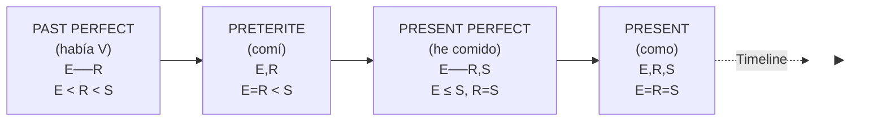
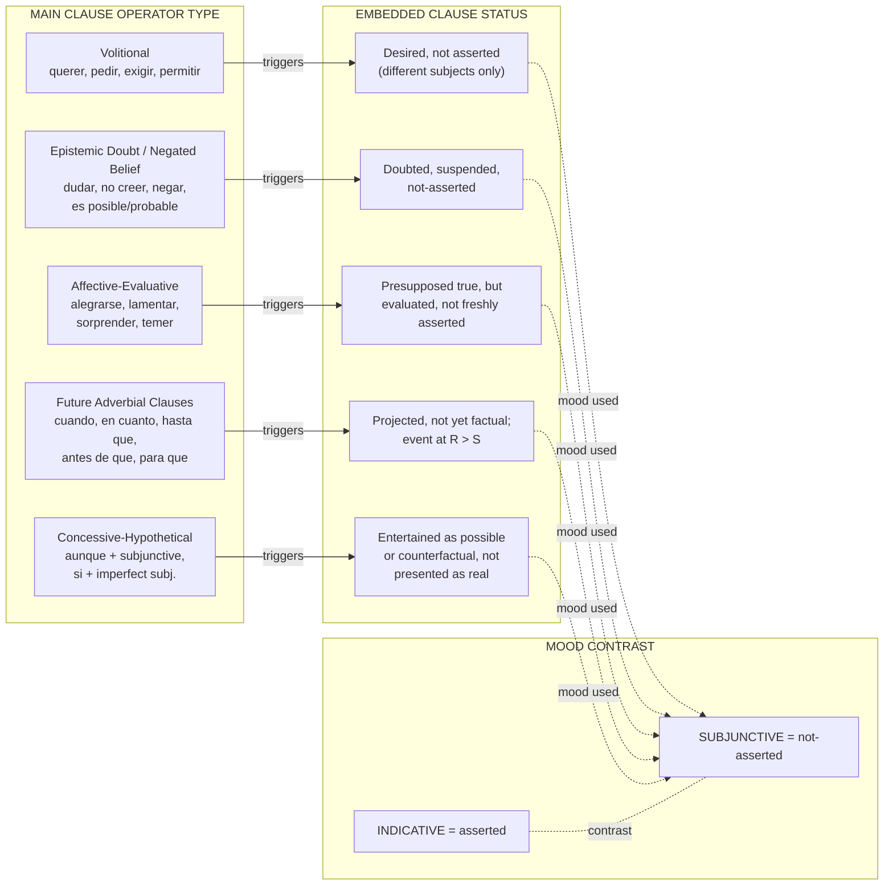
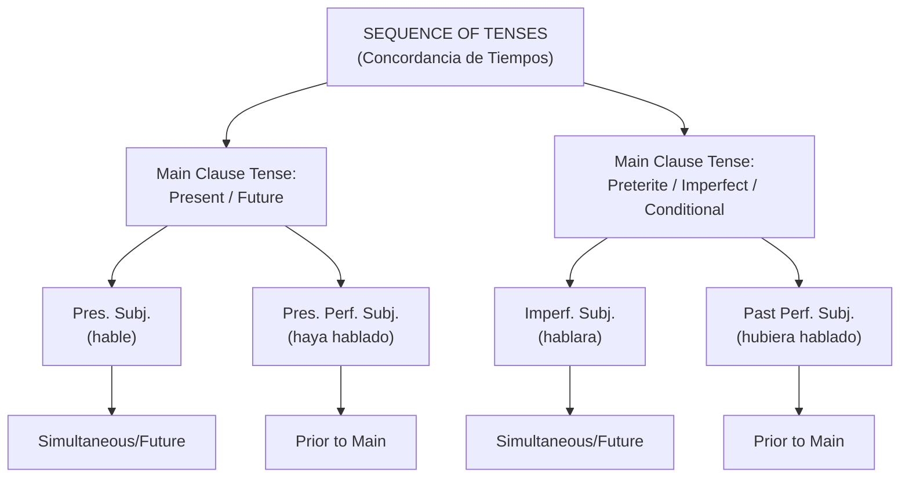

# Lesson 4: Semantic Composition, Aspectual Systems, Modal Architecture

## 1. First-Principles Intuition & Invariants

Spanish encodes time differently from English, and that difference is not cosmetic. Where English speakers typically reach for the past tense as a single undifferentiated tool for locating events before the present moment, Spanish grammaticalizes a distinction that is simultaneously temporal and conceptual: the distinction between *how an event is bounded* and *how it flows through time*. This is the aspectual system, and it sits at the very center of Spanish semantics. Before drilling its mechanics, you need to feel the first principle from which everything else follows.

The invariant is this: *aspect is not about when something happened; it is about whether the speaker presents the event as a closed, completed whole or as an open, ongoing process.* Tense locates events on a timeline. Aspect frames how the speaker conceptualizes the internal structure of those events. These are logically independent operations. The preterite (*pretérito indefinido*) and the imperfect (*pretérito imperfecto*) are both past tenses, but they cut reality at fundamentally different seams.

When a speaker selects the preterite — *comí*, *salió*, *llegaron* — she is packaging the event into a bounded, perfective whole. The event has an endpoint that is relevant and asserted. The situation is conceptualized from outside, like a stone dropped into water: the splash is visible as a discrete, complete occurrence. When she selects the imperfect — *comía*, *salía*, *llegaban* — she is presenting the event as an unbounded, imperfective process. The endpoint is irrelevant, backgrounded, or non-existent. The event is conceptualized from inside, as a continuous state or repeated habit within which other things could occur. Crucially, neither form makes any claim about objective reality. A war that lasted forty years can appear in the preterite if the speaker is summing it up as a closed chapter: *Duró cuarenta años*. A single-second event can appear in the imperfect if the speaker is describing the moment she was inside it: *Mientras caía, pensé en mi madre.*

This inside/outside distinction is not merely poetic. It has precise, compositional consequences for how clauses interact with one another, for how narratives are structured, and for how temporal reference propagates through discourse. The preterite advances the narrative line; each perfective verb moves the story clock forward by asserting a new completed event. The imperfect freezes the story clock and paints the scene in which those events take place. This is why literary Spanish almost invariably uses the imperfect for descriptions and the preterite for plot-advancing actions. The two forms create a figure-ground architecture: preterite events are foreground figures; imperfect states and habits are background ground.

### Lexical Aspect: Aktionsarten as the Deeper Layer

Before the grammatical aspect encoded by verb morphology, there is a prior semantic layer: the inherent temporal profile of the lexical verb itself. This framework, rooted in Aristotelian distinctions and formalized in twentieth-century linguistics as *Aktionsarten* (German for "types of action"), classifies verbs according to whether they describe states, activities, accomplishments, or achievements. Spanish-speaking practitioners ignore this layer at their peril, because the grammatical aspect morphology interacts with lexical aspect in ways that produce meaning shifts that cannot be predicted from either layer in isolation.

States (*estados*) are homogeneous and atelic: *saber*, *conocer*, *tener*, *querer*. They have no natural endpoint and no internal phases. Activities (*actividades*) are dynamic and also atelic: *correr*, *nadar*, *trabajar*, *llorar*. They are processes without a built-in terminus. Accomplishments (*realizaciones*) are dynamic, telic, and durative: *escribir una novela*, *construir una casa*, *aprender ruso*. They involve a process that moves toward a natural endpoint. Achievements (*logros*) are instantaneous and telic: *llegar*, *nacer*, *reconocer*, *romper*. They describe events that occur at a point.

The interaction between Aktionsart and grammatical aspect produces the aspectual coercion effects that trip up advanced learners. When you place a state verb like *saber* (to know) in the preterite, you coerce a punctual reading: *supo la verdad* does not mean "he knew the truth" but "he found out / came to know the truth." The preterite's perfective framing reinterprets the normally atelic state as a bounded transition — an ingressive reading. When you place an achievement verb like *llegar* in the imperfect — *llegaban los invitados* — you coerce a habitual or iterative reading: "guests would arrive / kept arriving." The normally instantaneous achievement is reinterpreted as a repeated series. The practitioner who recognizes these coercions can both decode native-speaker prose accurately and produce sentences with surgical precision.

The following table organizes the four Aktionsarten classes with canonical Spanish examples and their characteristic interaction with perfective and imperfective framing:

| Aktionsart Class | Spanish Label | Key Features | Preterite Effect | Imperfect Effect |
|---|---|---|---|---|
| State | *Estado* | Atelic, non-dynamic, homogeneous | Ingressive coercion (*supo* = found out) | Simple state (*sabía* = knew) |
| Activity | *Actividad* | Atelic, dynamic, homogeneous | Bounded process, terminated (*corrió* = ran and stopped) | Ongoing activity (*corría* = was running) |
| Accomplishment | *Realización* | Telic, dynamic, durative | Completion reached (*escribió la carta* = wrote and finished) | Process without endpoint (*escribía la carta* = was writing) |
| Achievement | *Logro* | Telic, punctual, instantaneous | Single occurrence (*llegó* = arrived) | Habitual/iterative coercion (*llegaba tarde* = used to arrive late) |

---

## 2. Core Architecture & Mechanics

### The Preterite-Imperfect Opposition: Inflectional Paradigms and Distributional Rules

The morphological paradigms for the two past tenses must be internalized completely. The following tables present full conjugation for the three conjugation classes, using *hablar*, *comer*, and *vivir* as canonical models. Notice that the imperfect is morphologically regular for virtually all verbs (only three verbs are irregular: *ser*, *ir*, and *ver*), while the preterite carries a heavier irregular burden in high-frequency verbs.

**Pretérito Indefinido (Perfective Past)**

| Pronoun | *hablar* (AR) | *comer* (ER) | *vivir* (IR) |
|---|---|---|---|
| yo | hablé | comí | viví |
| tú | hablaste | comiste | viviste |
| él/ella/Ud. | habló | comió | vivió |
| nosotros | hablamos | comimos | vivimos |
| vosotros | hablasteis | comisteis | vivisteis |
| ellos/Uds. | hablaron | comieron | vivieron |

**Pretérito Imperfecto (Imperfective Past)**

| Pronoun | *hablar* (AR) | *comer* (ER) | *vivir* (IR) |
|---|---|---|---|
| yo | hablaba | comía | vivía |
| tú | hablabas | comías | vivías |
| él/ella/Ud. | hablaba | comía | vivía |
| nosotros | hablábamos | comíamos | vivíamos |
| vosotros | hablabais | comíais | vivíais |
| ellos/Uds. | hablaban | comían | vivían |

The three irregular imperfects — *era/eras/era/éramos/erais/eran* (ser), *iba/ibas/iba/íbamos/ibais/iban* (ir), and *veía/veías/veía/veíamos/veíais/veían* (ver) — must be memorized independently since they fall outside the regular paradigm. Among high-frequency preterite irregulars, the practitioner must internalize the stem-and-ending set for *tuve, estuve, pude, puse, quise, vine, dije, traje, hice, fui/fue* — these behave as a family, taking the strong preterite endings *-e, -iste, -o, -imos, -isteis, -ieron/-eron* (with -eron for j-stem verbs like *dijeron*, *trajeron*) without the final accent that the regular paradigm carries on the first and third person singular.

The distributional rules can be mapped against a small but reliable set of diagnostic contexts. The preterite is selected when the sentence asserts a specific time-delimited event (*ayer*, *el lunes pasado*, *en 1492*, *de repente*, *de golpe*), when it marks a sequence of plot-advancing events (and then... and then...), when it expresses a bounded duration of a state (*estuvo enferma tres días* — she was sick for three days, then recovered), or when it summarizes a process as a completed unit (*vivió en Barcelona durante diez años*). The imperfect is selected for background settings and descriptions (*hacía frío, la calle estaba vacía*), habitual or repeated past actions (*todos los veranos íbamos al mar*), ongoing states or processes interrupted by a preterite event (*dormía cuando sonó el teléfono*), and indirect speech or thought expressed from a past perspective (*dijo que tenía hambre*).

The interrupted-action construction deserves particular attention because it is a productive template for discourse: *Cuando + imperfect + preterite*. The imperfect clause provides the open temporal frame; the preterite event punctures it.

> *Cuando llegué, ella dormía.* — When I arrived, she was sleeping.
> *Cuando dormía, llegó ella.* — While he was sleeping, she arrived.

Both sentences use the same two verbs, but the assignment of aspect encodes a different narrative relationship between the two events. This is not a stylistic variation — it is a semantic contrast with real cognitive content.

### Temporal Reference Systems and Discourse Cohesion

Spanish organizes temporal reference through a layered system of deictic center, reference time, and event time, following the architecture formalized in Hans Reichenbach's theory of tense. The speech time (S) is the moment of utterance. The reference time (R) is the temporal vantage point from which the event is viewed. The event time (E) is when the described situation holds. The simple past (*comí*) encodes E=R<S: the event and the reference point coincide and both precede speech. The past perfect (*había comido*) encodes E<R<S: the event preceded the reference point, which itself precedes speech. This is the foundational architecture of narrative anteriority in Spanish.

The *pretérito perfecto compuesto* (*he comido*) in Peninsular Spanish encodes E < R = S: the event precedes the reference point, which coincides with speech time, maintaining relevance or connection to the present moment. This form diverges significantly across dialect regions. In most of Latin America, the compound perfect is used far less frequently and the simple preterite takes over its functions; *comí* and *he comido* are largely interchangeable in Mexican and Argentine Spanish. In Spain, the two remain functionally distinct: *Hoy he comido paella* (today, still part of my present) versus *Ayer comí paella* (yesterday, closed off from today). Advanced practitioners must calibrate to their target dialect.

The *pretérito pluscuamperfecto* (*había hablado*, *habías comido*) uses the imperfect of *haber* as its auxiliary, which is significant: the imperfective framing of the auxiliary signals that the anterior reference point is itself embedded in an ongoing imperfective context. This is why *había comido* appears so naturally in clauses subordinated to other imperfects — *Cuando llegué, ya había cenado* — where the past perfect event is anterior to the preterite arrival event, which itself punctured an imperfect frame.

### Modal Architecture: The Subjunctive as Epistemic Scope Operator

The subjunctive is not a tense. It is a mood, and its function is to signal that the proposition it governs falls within the scope of an operator in the main clause that marks the proposition as epistemically or volitionally subordinate. The indicative presents a proposition as asserted fact. The subjunctive marks the embedded proposition as filtered through doubt, volition, emotion, or unreality. This is the invariant core, and every individual trigger can be derived from it.

The subjunctive has four forms: present (*hable*), imperfect (*hablara / hablase*), present perfect (*haya hablado*), and past perfect (*hubiera/hubiese hablado*). The sequence of tenses (*concordancia de tiempos*) connects the main clause tense to the appropriate subjunctive form through a rule of temporal alignment: a present or future main clause selects the present subjunctive for simultaneous or future reference and the present perfect subjunctive for prior reference; a past main clause selects the imperfect subjunctive for simultaneous or future reference and the past perfect subjunctive for prior reference.

**Full Subjunctive Paradigms**

*Present Subjunctive — Presente de Subjuntivo*

| Pronoun | *hablar* | *comer* | *vivir* |
|---|---|---|---|
| yo | hable | coma | viva |
| tú | hables | comas | vivas |
| él/ella/Ud. | hable | coma | viva |
| nosotros | hablemos | comamos | vivamos |
| vosotros | habléis | comáis | viváis |
| ellos/Uds. | hablen | coman | vivan |

*Imperfect Subjunctive — Pretérito Imperfecto de Subjuntivo (-ra form, standard written and spoken)*

| Pronoun | *hablar* | *comer* | *vivir* |
|---|---|---|---|
| yo | hablara | comiera | viviera |
| tú | hablaras | comieras | vivieras |
| él/ella/Ud. | hablara | comiera | viviera |
| nosotros | habláramos | comiéramos | viviéramos |
| vosotros | hablarais | comierais | vivierais |
| ellos/Uds. | hablaran | comieran | vivieran |

The *-se* alternate forms (*hablase, comiese, viviese*) are morphologically equivalent and stylistically preferred in certain registers of Peninsular written prose and literary fiction. Both are grammatically correct in all contexts.

*Present Perfect Subjunctive — Pretérito Perfecto de Subjuntivo*

| Pronoun | Form |
|---|---|
| yo | haya hablado / comido / vivido |
| tú | hayas hablado / comido / vivido |
| él/ella/Ud. | haya hablado / comido / vivido |
| nosotros | hayamos hablado / comido / vivido |
| vosotros | hayáis hablado / comido / vivido |
| ellos/Uds. | hayan hablado / comido / vivido |

*Past Perfect Subjunctive — Pretérito Pluscuamperfecto de Subjuntivo*

| Pronoun | Form |
|---|---|
| yo | hubiera / hubiese hablado |
| tú | hubieras / hubieses hablado |
| él/ella/Ud. | hubiera / hubiese hablado |
| nosotros | hubiéramos / hubiésemos hablado |
| vosotros | hubierais / hubieseis hablado |
| ellos/Uds. | hubieran / hubiesen hablado |

### Subjunctive Triggers: Architecture of Scope

The triggers for the subjunctive can be organized by the type of operator that takes the embedded proposition into its scope.

**Volitional triggers** introduce subjunctive because an act of will — wanting, commanding, requesting, permitting, or prohibiting — takes a proposition as its object. The proposition is not asserted; it is desired. The subject of the main clause exercises volition over the subject of the subordinate clause, and because these are different subjects (or the construction has an implicit second person), the subjunctive is obligatory: *quiero que vengas*, *te pido que lo hagas*, *el jefe exige que todos lleguen a tiempo*, *no permitas que te manipule*. When the subjects of main and subordinate clause are identical, Spanish uses the infinitive instead of a subjunctive clause: *quiero venir* (I want to come), not *quiero que yo venga*.

**Epistemic doubt and negated knowledge** triggers subjunctive because the proposition is marked as not-asserted, merely entertained or doubted: *dudo que sea verdad*, *no creo que tengan razón*, *es posible que llueva mañana*, *no es cierto que lo haya dicho*. The key diagnostic here is the polarity flip: *creo que tiene razón* (indicative — I assert this as my belief) versus *no creo que tenga razón* (subjunctive — I retract the assertion). The negation of the epistemic verb removes the assertive force and forces the embedded proposition into the scope of doubt. This polarity sensitivity is one of the most reliable mechanical rules in the entire system.

**Emotional and evaluative triggers** introduce subjunctive because the main clause encodes a subjective reaction to a proposition rather than an assertion of it: *me alegra que estés bien*, *es una lástima que no puedas venir*, *tiene miedo de que lo descubran*, *es increíble que lo haya conseguido*. The proposition is known or presupposed to be true, but the speaker is not asserting it — she is reacting to it. This distinguishes emotional triggers from epistemic ones: in *me alegra que estés aquí*, the speaker is not in doubt that the interlocutor is present; she is expressing affective valuation. The subjunctive here marks evaluative scope, not epistemic uncertainty.

**Adverbial clause triggers** depend on the temporal or conditional relationship between the subordinate event and the main event. Future-oriented adverbial clauses of time (*cuando llegues*, *en cuanto termines*, *tan pronto como salgas*) require subjunctive because the event described has not yet occurred at speech time — it is projected rather than factual. When the same connectors refer to habitual or past situations, the indicative is used: *cuando llegaba* (when he would arrive, habitually), *cuando llegó* (when he arrived, completed past). The contrast between *cuando llega* (factual present habit, indicative) and *cuando llegue* (future-projected, subjunctive) is a minimal pair that every advanced practitioner must have fully internalized.

Concessive and conditional clauses follow parallel logic. *Aunque* introduces a concession that may be real (*aunque está cansado* — even though he is tired, asserted) or hypothetical (*aunque estuviera cansado* — even if he were tired, non-asserted). *Si* clauses for open conditionals (future-possible) use the present indicative in the condition: *si tienes tiempo, llámame*. Hypothetical or counterfactual conditionals use the imperfect subjunctive in the condition and the conditional in the main clause: *si tuvieras tiempo, me llamarías*. Counterfactual past conditions use the past perfect subjunctive and the conditional perfect: *si hubieras llegado antes, lo habrías visto*. This three-way conditional architecture — open, hypothetical, counterfactual — maps precisely onto a scale of epistemic distance from actual reality.

The following diagram maps the subjunctive trigger architecture by operator type and epistemic distance:

---

## 3. High-Performance Optimization & Failure Modes

### Failure Mode 1: Treating Preterite and Imperfect as Interchangeable with Different Time Anchors

The most common advanced failure is selecting preterite or imperfect based on perceived duration rather than aspectual framing. A student who has been told that "imperfect = long actions, preterite = short actions" will produce errors that are systematic and invisible to their own self-monitoring, because the duration heuristic sometimes produces correct output by accident. The correct mental model is conceptual framing, not clock time.

The diagnostic drill: take a single event and practice wrapping it in both frames to feel the semantic shift. *Fui al supermercado* (preterite: bounded, completed trip, asserted as a plot event) versus *iba al supermercado* (imperfect: in-progress journey or habitual practice, depending on context). Neither says anything about how long the trip took. The only difference is how the speaker packages the event relative to other events in the discourse.

Optimization practice: take any paragraph of literary prose in Spanish — García Márquez's *Cien años de soledad*, Borges's *Ficciones*, Javier Marías's *Tu rostro mañana* — and perform a systematic annotation exercise: label every finite past-tense verb as perfective or imperfective, then describe what narrative function it serves. Identify the moment where the story clock advances versus where the camera pans a scene. After ten such annotated passages, the aspectual filter becomes internalized rather than calculated.

### Failure Mode 2: Over-Triggering the Subjunctive on Assertive Predicates

A second endemic error is using the subjunctive after assertive predicates that do not suspend assertive force. *Es verdad que tiene razón* takes the indicative because *es verdad que* confirms the truth of the embedded proposition rather than suspending it. Similarly, *es obvio que*, *está claro que*, *es evidente que*, and *es cierto que* all select the indicative in positive assertions. The subjunctive becomes available when these expressions are negated (*no es cierto que*) or questioned (*¿es posible que...?*), because negation and questioning remove the assertive licensing of the proposition.

Optimization: build a two-column mental register. On one side, **assertive-bridge predicates** that pass indicative into the complement (*saber que, ver que, es verdad que, está claro que*). On the other, **non-assertive operators** that require subjunctive (*dudar que, no creer que, es posible que, ojalá*). When a new predicate is encountered, the practitioner should ask: does this predicate assert the truth of its complement, or does it suspend, doubt, desire, or evaluate it? The answer determines mood with high reliability.

### Failure Mode 3: Miscalibrating Sequence of Tenses

Sequence-of-tenses violations produce sentences that are grammatical in isolation but that break temporal coherence in extended discourse. The most common form of this failure is using the present subjunctive in a context subordinated to a past main clause: **le pedí que venga* instead of *le pedí que viniera*. The rule is not arbitrary: the imperfect subjunctive aligns the subordinate event temporally with the past main clause, encoding that the requested event was simultaneous with or future relative to the moment of asking. The present subjunctive would situate the event relative to speech time, creating a temporal mismatch that marks the speaker as a non-native or as careless with register.

The practitioner should internalize the sequence-of-tenses architecture as a dependency graph: the main clause tense selects one of two temporal planes — present/future or past — and the subjunctive form must track that plane consistently throughout the sentence and its discourse environment.

### Failure Mode 4: Blocking Aspectual Coercion Readings

When a native speaker produces *conocía a María desde hacía años y de repente la odié*, the advanced practitioner must recognize that *odié* is an achievement coercion: the ingressive reading means "I came to hate her" rather than "I hated her (for a completed duration)." Missing this reading degrades comprehension of literary and spoken register simultaneously. The fix is to build an active Aktionsart filter: before assigning a semantic reading to any past-tense verb, the practitioner should identify the base lexical class (state, activity, accomplishment, achievement) and ask whether the grammatical aspect frame coerces a non-default reading. For state verbs in the preterite, always check for the ingressive reading. For achievement verbs in the imperfect, always check for the habitual or conative (attempted-but-not-completed) reading: *los negociadores llegaban a un acuerdo* can mean "the negotiators were on the verge of / kept trying to reach an agreement" — an event that never reached its natural endpoint.

### Production Optimization: The *Ojalá* Spectrum and Modal Gradience

One high-yield area that advanced practitioners often neglect is the modal spectrum from possibility to counterfactuality, all accessible through a single entry point. *Ojalá* (from Arabic *inshallah*, "God willing") is one of the few main-clause operators in Spanish that takes the subjunctive without a subordinating conjunction, and it covers the full range of modal gradience depending on the subjunctive tense it selects.

*Ojalá venga* (present subjunctive): hopeful expectation about a real future possibility. *Ojalá viniera* (imperfect subjunctive): wish about a present or future situation the speaker considers unlikely or contrary to expectation. *Ojalá hubiera venido* (past perfect subjunctive): regret about a past situation that did not occur — counterfactual retrospection. These three constructions are semantically distinct and cover three positions on the scale from probable to counterfactual. Drilling them as a triplet — taking the same base proposition through all three modal framings — is one of the most efficient exercises for internalizing the interaction of modal semantics and subjunctive morphology simultaneously.

> *Ojalá (que) gane el partido.* — I hope they win the match. (Real future, possible)
> *Ojalá (que) ganara el partido.* — I wish they would win the match. (Unlikely, contrary to expectation)
> *Ojalá (que) hubiera ganado el partido.* — I wish they had won the match. (Counterfactual past, they didn't)

The same modal gradience applies to conditional sentences and to subordinate clauses under epistemic operators. The consistent underlying principle is that the degree of morphological distance from the indicative present — from indicative, to present subjunctive, to imperfect subjunctive, to past perfect subjunctive — tracks the degree of distance from factual reality. This gradient is one of the most elegant structural properties of the Spanish verbal system, and mastering it gives the practitioner not a collection of rules to memorize but a single productive principle from which complex modal meanings can be generated and interpreted in real time.
