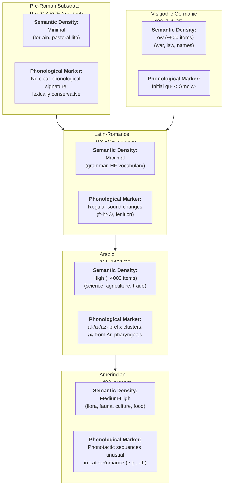
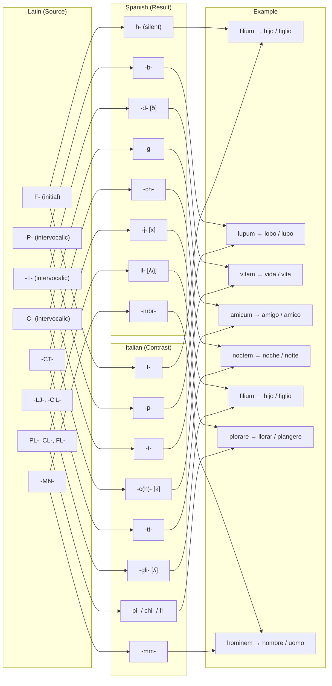

# Lesson 6: Historical Evolution, Sociolinguistic Stratification, Contact Phenomena

## 1. First-Principles Intuition & Invariants

Spanish is not a language that was invented. It accumulated — the way a river accumulates sediment, depositing layers of contact, conquest, and community until the channel runs deep enough to carry a civilization. Understanding it as a practitioner means understanding that every phoneme you produce and every grammatical choice you make is a fossil record. The alveolar tap in *pero* ("but") and the trill in *perro* ("dog") are not arbitrary conventions; they are the residue of competing Latin phonological pressures that survived because speakers needed the distinction. The *h* you do not pronounce in *hablar* was once an *f* you would have breathed hard against your upper teeth. These survivals and erasures are not trivia. They are the load-bearing architecture of the language.

### The Latin Substrate and the Vulgar Latin Problem

Classical Latin, the prestige register of Cicero and Virgil, was never the language people actually spoke. Vulgar Latin — the oral, phonologically unstable, morphologically eroding vernacular carried by legionaries, merchants, and colonists — was. The Iberian Peninsula came under Roman administration following the Second Punic War (218–201 BCE), and the Latin that colonized it arrived not in the polished form of the Senate but in the mouths of soldiers from Latium and Campania. This is not a minor distinction. The gap between the written Classical norm and spoken Vulgar reality was wide enough that the two systems operated on different phonological and syntactic assumptions.

Vulgar Latin was collapsing its case system even as Classical Latin grammarians were insisting on its maintenance. By the time Roman administration weakened across the Peninsula in the fifth century CE, the spoken Latin of Hispania had already begun eroding the six-case nominal paradigm toward a two-case remnant (nominative versus oblique), and eventually toward the caseless analytical structure that modern Spanish inherits. The practitioner's first invariant, then, is this: Spanish grammar is a record of morphological erosion managed by syntactic compensation. What Latin encoded in noun endings, Spanish encodes in word order and prepositions. The accusative *dominum* ("master") becomes *señor* without inflection, but its syntactic role is now fixed by position relative to the verb.

### Sound Change as Systematic Drift

Sound changes are not mistakes. They are biomechanical optimizations — tendencies toward articulatory ease, perceptual salience, and phonological symmetry that operate across entire speech communities simultaneously. Understanding the major sound shifts that produced Spanish from Latin is not academic ornamentation; it is diagnostic knowledge that lets you predict vocabulary, decode cognates across Romance languages, and understand why Spanish looks the way it does on the page.

The shift **f > h > ∅** (voiceless labiodental fricative to glottal fricative to zero) is the most distinctive feature of Castilian phonology, and it has no parallel in Portuguese, Catalan, or Italian. Latin *filium* ("son") becomes *hijo*, Latin *facere* ("to do/make") becomes *hacer*, Latin *fabulare* ("to speak") becomes *hablar*. The pattern is consistent: syllable-initial Latin /f/ before a vowel underwent lenition to /h/ in medieval Castilian, and that /h/ subsequently went silent, leaving only the orthographic ghost of the *h* you see today. The *h* in *hablar* is therefore not a spelling error or a borrowing from French. It is an archaeological marker — the place where a sound used to live.

The traditional explanation, associated most prominently with Ramón Menéndez Pidal and later contested and refined by scholars including Diego Catalán and Joan Corominas, proposed that Basque influence triggered the shift, since Basque lacked a phonemic /f/ and Basque-Latin bilingualism in the northern Meseta may have weakened speakers' production of the sound. Subsequent scholarship, particularly the work of Ralph Penny and Roger Wright, has complicated this by pointing out that the shift appears unevenly distributed across early Castilian texts and may reflect a more complex interplay of regional dialect contact and prestige diffusion rather than a single substrate cause. For the practitioner, the operative point is not to adjudicate between theories but to internalize the correspondence: wherever you see initial Latin *f-*, expect Spanish *h-* (silent), and wherever you see cognates in French or Italian beginning with *f-*, you have a direct window onto what Castilian discarded.

**Consonant lenition** in intervocalic position is the second great systematic drift. Vulgar Latin had already begun weakening consonants when they appeared between vowels — a cross-linguistically common process driven by the reduced articulatory effort expended on sounds that carry less perceptual weight between sonorous environments. In Spanish, this produced a cascade of correspondences: voiceless stops between vowels either voiced or dropped entirely. Latin *lupum* ("wolf") becomes *lobo*, with the intervocalic *p* voiced to *b*. Latin *vitam* ("life") becomes *vida*, with the intervocalic *t* voiced to *d* (which in modern spoken Spanish further fricativizes to [ð], especially in rapid speech). Latin *amicum* ("friend") becomes *amigo*, with *c* [k] voiced to *g*. The practitioner who internalizes this voicing pattern gains the ability to reconstruct Spanish vocabulary from Latin cognates and to understand why Spanish and Italian diverge so sharply in their consonant inventories: Italian generally preserved the geminate consonants and voiceless intervocalic stops that Spanish eroded.

The loss of final consonants is equally systematic. Latin *amare* ("to love") drops its final *-e* in inflected forms; Latin *cantant* loses its final *-t* in Vulgar Latin, leaving the Spanish *cantan*. The accusative singular marker *-m* had been phonologically weak enough to be elided even in Classical Latin poetry through liaison, and in Vulgar Latin it disappeared entirely, which is why Spanish nominal forms derive from the accusative without its final nasal: *rosam* yields *rosa*, *panem* yields *pan*.

### Morphological Restructuring: From Synthesis to Analysis

Latin was a synthetic language: it packed grammatical information into the internal structure of words through inflectional endings. Spanish is analytic: it distributes grammatical information across separate words, particularly through the auxiliary verb system, prepositions, and fixed word order. This restructuring is not complete — Spanish still maintains full verbal conjugation and grammatical gender agreement in ways that make it considerably more synthetic than English — but the direction of the drift over two millennia is unmistakable.

The Latin noun system collapsed from six cases to effectively none. What was encoded by case morphology is now encoded by prepositions: the dative *amico* ("to the friend") becomes *al amigo*, the genitive *amici* ("of the friend") becomes *del amigo*. The prepositional system that Spanish inherited from Vulgar Latin is therefore not an optional stylistic overlay but the structural replacement for a lost morphological system. This is why the distinction between *a* and *de* carries enormous grammatical weight in Spanish in ways that have no perfect English parallel: they are doing the work that case endings did in Latin.

Analogical leveling — the process by which irregular paradigms are regularized under pressure from more productive patterns — operated throughout the medieval period and continues today in vernacular speech. Latin had a class of deponent verbs (passive in form, active in meaning) that simply disappeared from Vulgar Latin because the passive morphology was becoming opaque. Latin had three genders (masculine, feminine, neuter); Spanish collapsed neuter into masculine, with traces surviving only in the demonstrative pronouns *esto*, *eso*, *aquello* and the neuter article *lo*. Latin strong perfects (formed by internal vowel change, e.g., *feci* from *facere*) survive in Spanish as irregular preterites (*hice* from *hacer*), but the broader trend favored the weak perfect formed with the suffix *-avi/-evi/-ivi*, which became the Spanish *-é/-í* endings of the first and second-conjugation preterites. Analogical leveling always moves toward the productive pattern — the one that most verbs follow — which means that over time irregular forms either succumb to regularization or survive as high-frequency lexical items whose opacity is tolerated because speakers encounter them so often.

---

## 2. Core Architecture & Mechanics

### Stratification of the Lexicon: Substrate, Superstratum, Adstratum

The Spanish lexicon is not homogeneous. It is a layered geological formation in which each major historical contact event deposited a stratum of vocabulary, phonology, and occasionally morphology. Practitioners working at the advanced level need a mental map of this stratification because it predicts phonological behavior, registers, and semantic fields with high reliability.

The deepest layer is the **Latin-Romance core**, which provides the highest-frequency vocabulary: body parts (*mano, pie, cabeza*), basic actions (*comer, beber, ir, venir, hablar*), kinship terms (*madre, padre, hijo*), numbers, and grammatical function words. This stratum follows the phonological evolution described above with regularity. When a word looks like a direct derivation from Latin through the sound changes already detailed, it belongs to this layer and behaves predictably.

The **pre-Roman substrate** contributes less but is not negligible. The Iberian Peninsula was linguistically diverse before Roman conquest, with Iberian (a language isolate), Celtiberian (an Indo-European Celtic language), and Basque (a pre-Indo-European isolate that survives today) among its inhabitants. Substrate influence on Spanish vocabulary is modest but detectable: words like *barro* ("mud/clay"), *páramo* ("high plateau"), *izquierdo* ("left"), and *pizarra* ("slate/blackboard") are attributed with varying degrees of scholarly confidence to Iberian or Basque origin. The Basque origin of *izquierdo* is particularly well supported — it displaces the Latin *sinister*, whose semantic drift toward "sinister/evil" may have made it sociolinguistically uncomfortable. For the practitioner, the key observation is that substrate vocabulary clusters in terrain features, pastoral activities, and body parts not easily lexicalized in Latin — the semantic domains where the colonized population's daily experience was most resistant to wholesale replacement.

The **Visigothic Germanic layer** (roughly fifth through early eighth centuries) contributed approximately five hundred lexemes, concentrated in the semantic fields of warfare, personal names, and certain agricultural and legal concepts. Words like *guerra* ("war"), *robar* ("to steal/rob"), *guardar* ("to guard/keep"), *orgullo* ("pride"), and *yelmo* ("helmet") derive from Germanic roots brought by the Visigoths. These words are identifiable by their phonological profile — they tend to have initial *gu-* clusters where Latin had *w-*, a spelling convention adopted because Latin had no *w* phoneme and used the digraph *gu* before front vowels to prevent palatalization. This is why *guerra* has that initial *gu-*: it represents the Germanic /w/ of the original *werra*.

The **Arabic layer** is the most substantial non-Latin influence on Spanish and deserves sustained attention. Between 711 CE (the Umayyad conquest of Hispania) and 1492 (the fall of Granada, the last Nasrid emirate), Arabic was the prestige language of the most culturally and scientifically advanced civilization on the Iberian Peninsula. Al-Andalus was not a cultural backwater; it was a center of astronomy, mathematics, medicine, philosophy, agronomy, and architecture. The lexical transfer from Arabic to Spanish reflects this directly.

Spanish contains approximately four thousand lexemes of Arabic origin, the highest density of Arabic borrowings in any Romance language. They are recognizable by the agglutinated Arabic definite article *al-* (or its phonological variants *a-, ar-, az-*), which was borrowed together with the noun rather than stripped away: *al-qutun* > *algodón* ("cotton"), *al-sukkar* > *azúcar* ("sugar"), *al-kimiya* > *alquimia* ("alchemy"), *al-qāḍī* > *alcalde* ("mayor"), *al-funduq* > *alfóndiga/alhóndiga* ("commodity exchange"), *az-zarāfa* > *jirafa* ("giraffe"). The semantic clustering is revealing: agriculture and irrigation (*acequia*, *noria*, *alcachofa*), mathematics and science (*álgebra*, *algoritmo*, *cero*, *cifra*), architecture (*alcázar*, *alminar*, *azulejo*), trade (*almacén*, *almoneda*), administration (*alcalde*, *alguacil*), and everyday material culture (*almohada*, *alfombra*, *albornoz*). This is not random borrowing. It is the systematic adoption of a technologically and culturally dominant vocabulary by a population that needed names for the things, institutions, and ideas that Arabic civilization had developed.

Phonologically, Arabic borrowings introduced into Spanish the pharyngeal and uvular sounds of Arabic in a weakened or transformed state. The Arabic pharyngeal fricative /ħ/ was the most likely trigger for the Spanish /x/ (the velar fricative spelled *j* or *g* before front vowels), since the correspondence between Arabic words with /ħ/ or /x/ and their Spanish derivatives with /x/ is systematic. Words like *jarra* (from Arabic *jarra*) and *jebe* (from Arabic *šabb*) carry this phonological signature.

The **Amerindian lexical layer** was deposited beginning in 1492 with extraordinary speed, driven by the practical necessity of naming an entirely new ecological, biological, cultural, and geographical reality. The Spanish colonizers encountered thousands of items for which they had no vocabulary and no analogy. The Taíno language of the Caribbean contributed the first wave: *canoa* ("canoe"), *hamaca* ("hammock"), *maíz* ("maize/corn"), *huracán* ("hurricane"), *tabaco* ("tobacco"), *iguana*, *manatí*, *cacique* ("chief"). Nahuatl, the administrative language of the Aztec Triple Alliance, contributed *chocolate*, *tomate*, *aguacate*, *chile*, *cacao*, *guajolote*, *mecate*, and hundreds of others. Quechua, the administrative language of the Inca Empire, contributed *papa* (the word used in Latin America and Spain for "potato," alongside the Taíno-derived *batata*), *llama*, *puma*, *cóndor*, *quinua*, *cancha*, and *pampa*. These borrowings entered Spanish at the moment of first contact and spread globally through Spanish as the conduit — which is why words like *chocolate* and *tomato* are recognizable in virtually every European language.

The practitioner needs a functional mental model of this layering, which can be represented in terms of the sequence, semantic density, and phonological signature of each stratum:

### Sound Correspondences: The Practitioner's Diagnostic Table

For analysts working across Romance languages or reconstructing Spanish vocabulary from Latin sources, the following systematic correspondences function as a diagnostic toolkit. Each row represents a productive rule — not an occasional pattern but a regular correspondence that holds across a large class of lexical items.

The *-CT- > -ch-* correspondence deserves particular emphasis because it is highly productive and frequently overlooked by learners. Latin *noctem* ("night") > Spanish *noche*, Latin *pectum* ("chest") > *pecho*, Latin *lactem* ("milk") > *leche*, Latin *dictum* ("said") > *dicho*, Latin *factum* ("done/made") > *hecho*. The sequence of events was: /kt/ > /jt/ (the velar stop palatalized before the front environment) > /tʃ/ (the palatal glide and alveolar stop merged into an affricate). This is a convergent development with similar processes in French (*nuit* from *noctem*, *lait* from *lactem*) and Italian (*notte*, *latte*), but the Spanish output differs because the affricate retained its full palatal character rather than devoicing or simplifying.

### Diglossia, Register Architecture, and the Standard Language

No language that covers twenty-one nations and roughly five hundred million speakers is monolithic. Spanish exists in a state of structured sociolinguistic variation that practitioners must navigate actively. The concept most useful for framing this is **diglossia**, defined by Charles Ferguson (1959) as the stable coexistence within a speech community of a High variety (used in formal, written, and prestigious contexts) and a Low variety (used in informal, intimate, and domestic contexts), where the two varieties are genetically related but functionally differentiated.

The classical Fergusonian diglossia is not the dominant condition in most Spanish-speaking communities today, but elements of it persist and intersect with more complex multilingual situations. In Paraguay, Spanish and Guaraní are both official languages, and the actual speech of Paraguayans — Jopara, a contact variety mixing Guaraní morphosyntax with Spanish vocabulary — occupies the functional middle ground that neither the Spanish High norm nor the Guaraní Low norm fully covers. This is not diglossia in Ferguson's strict sense; it is a contact-driven continuum where the boundaries between languages are actively negotiated by speakers in real time.

In Catalonia, the Basque Country, and Galicia, Spanish coexists with Catalan, Basque (Euskara), and Galician respectively — languages with their own literary traditions, standardization processes, and official status. The sociolinguistic dynamics in these regions are not diglossic in the classical sense because neither language is a mere vernacular variety of the other; they are typologically distinct languages (in the case of Basque, from an entirely different family) in contact through shared political and economic space. The practitioner working in these regions needs to understand that language choice is not stylistic decoration. It is a political and identitarian act, and treating it as otherwise is a significant professional error.

The **Real Academia Española (RAE)**, founded in 1713 under Bourbon patronage with the motto *Limpia, fija y da esplendor* ("It cleans, fixes, and gives splendor"), represents the institutionalized standardization effort for the Castilian-based written norm. Its *Diccionario de la lengua española* and the *Ortografía* and *Gramática* produced in collaboration with the Asociación de Academias de la Lengua Española (ASALE, representing twenty-two national academies) constitute the normative infrastructure of pan-Hispanic written Spanish. But the relationship between this normative infrastructure and actual spoken Spanish across twenty-one countries is one of productive tension rather than compliance. The RAE standardizes; communities speak. The academies follow more than they lead — the 2010 orthographic reform that eliminated the accent marks on *solo/sólo* and demonstrative pronouns (*este/éste*) acknowledged a practice that educated writers had already largely adopted, rather than prescribing a new one.

Latin American standardization is an independent history with deep political stakes. The independence movements of the early nineteenth century were accompanied by debates about whether the newly independent nations should maintain the Castilian standard, develop independent national norms, or pursue pan-American linguistic unity independent of Spain. Andrés Bello, the Venezuelan philologist who authored the foundational *Gramática de la lengua castellana destinada al uso de los americanos* (1847), argued for a rational, usage-based normative approach that acknowledged American Spanish as a legitimate standard on its own terms rather than a deviation from a Peninsular norm. This was a politically charged position: linguistic authority was an extension of cultural authority, and accepting the RAE's prescriptions meant accepting, symbolically, a continued colonial relationship with Madrid.

### Code-Switching: Mechanics and Social Function

Code-switching — the alternation between two or more languages within a single conversation, utterance, or even sentence — is not a failure of linguistic competence. This cannot be stated clearly enough, because the folk ideology that treats code-switching as "mixing up" languages or as evidence of insufficient mastery of either has been comprehensively refuted by decades of sociolinguistic research, beginning with the foundational work of Uriel Weinreich, John Gumperz, and Shana Poplack.

Poplack's constraint-based analysis of Puerto Rican Spanish-English code-switching in New York City established that bilingual speakers switch between languages at grammatically principled points, respecting the syntactic constraints of both languages simultaneously. The **Free Morpheme Constraint** holds that switching does not occur between a bound morpheme and the stem it attaches to (you do not get *eat-ando* where *-ando* is the Spanish progressive suffix attached to an English verb stem in fluent bilingual speech — when this does occur, as in *troca* from English "truck," it represents lexical borrowing, not switching). The **Equivalence Constraint** holds that switching occurs at points where the surface syntax of the two languages is structurally parallel, so that the switch does not violate the grammatical rules of either language simultaneously.

The functional motivations for code-switching are both interactional and referential. Speakers switch to signal in-group solidarity (*confianza*), to quote someone who originally spoke in the other language, to fill a lexical gap (particularly for culturally specific referents that exist in one language's world but not the other's), to soften or intensify an utterance, or to manage the social meaning of what they are saying — switching to Spanish in an English-dominant interaction, for example, may signal intimacy, exclusion of a monolingual interlocutor, or pride in cultural identity. The practitioner who can read these functions is a more effective analyst and a more culturally competent interlocutor.

**Spanglish**, the contact variety of Spanish and English prevalent in U.S. Latino communities (particularly but not exclusively Puerto Rican, Dominican, Mexican-American, and Cuban-American communities), is the most extensively studied Spanish contact phenomenon in applied sociolinguistics. It is not a single variety but a family of contact practices whose features vary by generation, regional community, phonological background, and educational history. It includes established loanword integrations (*lonche* from "lunch," *troca* from "truck," *parquear* from "to park"), calques (loan translations such as *llamar para atrás* from "call back," following English syntax rather than Spanish *devolver la llamada*), and genuine intrasentential code-switching by fluent bilinguals. The practitioner should distinguish these three phenomena analytically, since they have different sociolinguistic statuses, different levels of speaker awareness, and different implications for linguistic change.

---

## 3. High-Performance Optimization & Failure Modes

### Active Diagnostic Drills: Sound Change Internalization

The goal of this section is not to describe what you know intellectually but to build the procedural fluency that lets you work with these patterns in real time — recognizing Arabic-origin vocabulary by its morphological signature, reconstructing Spanish vocabulary from Latin cognates, and switching registers appropriately in spoken and written production.

**Drill 1: The f > h > ∅ Correspondence**
Given the following Latin words, produce the expected Spanish reflex applying the f > h > ∅ rule, the intervocalic lenition rule, and the -CT- > -ch- rule as applicable. Work through each before checking:

*filum* (thread), *fabulare* (to speak), *ferrum* (iron), *folia* (leaf), *frigus* (cold), *formica* (ant), *fovea* (pit/hole), *fugere* (to flee).

Expected Spanish outputs: *hilo*, *hablar*, *hierro*, *hoja*, *frío* (note: *fr-* cluster blocks the shift — the rule applies to *f* before a vowel, not before another consonant), *hormiga*, *hoya*, *huir*. The *frío* exception is productive: consonant clusters beginning with *f-* followed by another consonant preserve the *f-* because the phonological conditioning environment (pre-vocalic position) is absent. This is not an irregularity; it is the rule applied correctly.

**Drill 2: Arabic *al-* Identification and Register**
In the following sentence, identify all Arabic-origin lexemes and assign each to its semantic field: *El alcalde ordenó limpiar el almacén de algodón junto a la acequia antes de que llegara la caravana con azúcar y azafrán.* 

Analysis: *alcalde* (administration, from *al-qāḍī*), *almacén* (trade/storage, from *al-maxāzin*), *algodón* (agriculture/textile, from *al-qutun*), *acequia* (irrigation/agriculture, from *as-sāqiya*), *azúcar* (food/trade, from *as-sukkar*), *azafrán* (food/spice trade, from *az-za'farān*). Every one of these words was part of the daily economic and administrative vocabulary of a medieval Iberian town, and together they describe a scene that would have been entirely ordinary in thirteenth-century Toledo or Córdoba. This clustering is not coincidental — it reflects the structural depth of Arabic influence on the material and institutional life of the Peninsula.

**Drill 3: Register Switching in Written Spanish**
One of the most consequential practical skills for advanced practitioners is the ability to shift between colloquial, standard, and formal registers while maintaining semantic precision. Consider the following proposition: "They couldn't reach an agreement." 

In colloquial register (Peninsular): *No se pusieron de acuerdo.* In standard written register: *No lograron alcanzar un acuerdo.* In formal/legal register: *Las partes no llegaron a un acuerdo satisfactorio.* In academic prose: *No se produjo consenso entre las partes implicadas.*

The practitioner should notice that the verb choice (*poner*, *lograr*, *llegar*, *producir*), the lexical choices (*acuerdo* versus *consenso*), and the syntactic framing (personal versus passive or reflexive constructions) all shift simultaneously across registers. This is not four ways of saying the same thing with equivalent social meaning — each encoding carries different presuppositions about formality, relationship, and authority.

### Failure Modes in Sociolinguistic Analysis

The most consequential failure mode for practitioners working with Spanish across its geographic spread is **monolingual projection** — the assumption that the analyst's variety of Spanish (whether Peninsular, Mexican, Rioplatense, or any other) represents the unmarked standard, and that other varieties are deviations requiring explanation. This assumption is false and produces analytical errors. Seseo (the merger of /s/, /θ/ in Latin American Spanish and southern Peninsular Spanish) is not an error or a simplification of a Castilian distinction. It is the continuation of an earlier medieval pattern that sixteenth-century Seville exported to the Americas before the Castilian distinction between *c/z* (pronounced /θ/) and *s* had fully stabilized as the prestige norm. The Americas preserved the earlier state; it was Castile that innovated. Treating Latin American seseo as a deficiency relative to Peninsular ceceo/distinción inverts the historical reality.

Similarly, **voseo** — the use of *vos* as the second-person singular pronoun with its associated verb forms in Argentina, Uruguay, Paraguay, Central America, and parts of Colombia and Venezuela — is not a dialectal irregularity. *Vos* was the standard second-person singular address form in sixteenth-century Spain. It was the Peninsular norm that changed, generalizing *usted* (from *vuestra merced*, "your grace/mercy") and eventually recategorizing *vosotros* as the informal plural. The Americas preserved *vos* as the informal singular because the innovation from Castile arrived after the colonial period had already stabilized the lexical norm. The practitioner who describes *vos* as "dialectal" or "irregular" is describing the history backwards.

A second significant failure mode is **contact variety delegitimization** — treating Jopara, Spanglish, Portuñol (Spanish-Portuguese contact on the Brazilian-Uruguayan and Brazilian-Paraguayan borders), and similar contact varieties as corrupt or degenerate forms rather than as rule-governed linguistic systems with their own grammars, social functions, and speaker communities. This failure mode has real consequences: in educational policy, it results in the systematic undervaluation of bilingual children's actual linguistic competence; in translation and localization work, it produces outputs that are technically standard but socially tone-deaf; in fieldwork and journalism, it produces misreadings of community identity and solidarity.

The third failure mode — specifically for historical analysis — is **teleological reconstruction**: treating the development from Latin to modern Spanish as a directed process toward an inevitable endpoint, as if the language was always going to become what it is. Sound changes were not guided by any purpose. They were the aggregate result of millions of individual articulations across generations of speakers, each making locally motivated phonetic choices that happened to be systematically similar enough to produce a coherent directional drift in the written record. Grimm's Law, the f > h > ∅ shift, the collapse of the case system — none of these was inevitable. Each could have been arrested or reversed by prestige contact with a differently evolving variety, and in several cases analogical leveling did reverse productive changes. Medieval Spanish texts show hypercorrect *f-* spellings in words where the *f* had already shifted to *h* in speech, suggesting that scribes were consciously correcting their phonological intuitions toward what they perceived as the Latin-based prestige norm. The standard is always a negotiated outcome, not a natural endpoint.

### Language Ideology and the Practitioner's Ethics

Language ideology — the structured beliefs, attitudes, and presuppositions through which speakers understand their own and others' linguistic practices — shapes every aspect of how Spanish is taught, evaluated, and institutionalized. Practitioners who ignore ideology operate naively within ideological systems they do not understand and cannot critique.

The ideology of **purismo** (purism) holds that Spanish has an essential correct form that must be defended against contamination from loan words, dialectal variation, and contact phenomena. It manifests in complaints about anglicismos in contemporary Spanish (*implementar* for *poner en práctica*, *chequear* for *comprobar*, *formatear* for *dar formato a*), in RAE pronouncements about "correct" usage, and in public debates about whether English loanwords in technical domains represent necessary modernization or cultural surrender. The practitioner can hold these debates analytically without taking a naive position on either side: Spanish has absorbed massive lexical material from Arabic, Amerindian languages, and French across its history without losing structural coherence, which makes the claim that anglicismos represent an unprecedented existential threat historically implausible. At the same time, the speed and institutional density of English influence in the twenty-first century — particularly through digital platforms, global business communication, and American cultural exports — represents a qualitatively different contact pressure than previous historical episodes, and its long-term structural effects on Spanish verbal morphology and syntactic patterns warrant serious monitoring.

The ideology of **hispanofonía** — the imagining of the Spanish-speaking world as a unified cultural and political community defined by language — is the official ideology of the Cervantes Institute and underpins the ASALE's pan-Hispanic normative project. Its value is real: it enables mutual intelligibility, shared literary culture, and common educational standards across twenty-one nations. Its cost is also real: it suppresses the recognition of internal linguistic diversity, delegitimizes indigenous languages and bilingual contact varieties, and represents the linguistic dimension of a colonial heritage that has not been fully reckoned with. The practitioner who works in language education, policy, translation, or any professional field touching Spanish in multilingual communities is not exempt from these stakes. They are embedded in them.

Mastery of historical evolution, sociolinguistic stratification, and contact phenomena in Spanish is ultimately not about accumulating historical knowledge as a credential. It is about developing the analytical precision and cultural literacy to work with language as it actually exists — in the mouths of real speakers, in the negotiations of real communities, and in the ongoing, unfinished project of making meaning across five centuries of geographic dispersal and human complexity.
