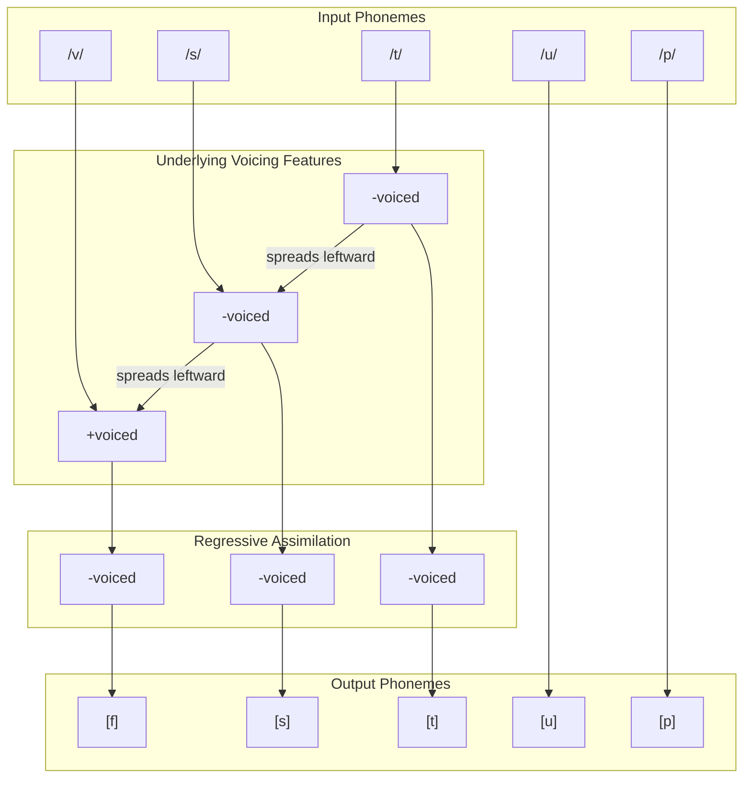

# Lesson 1: Phonology, Orthography, Prosodic Structure

## 1. First-Principles Intuition & Invariants

Czech phonology presents a deceptively regular surface system that conceals profound underlying mechanical complexity. Unlike the Romance languages with their tendency toward open syllables and phonotactic simplicity, or even German with its relatively constrained cluster formations, Czech operates under a profoundly different architectural principle: maximal consonantal density combined with rigid prosodic anchoring. The language permits consonant clusters of extraordinary length—sequences like *zmrzl* (froze) or *scvrkl* (shriveled) that would violate phonotactic constraints in virtually every other European language—while simultaneously maintaining absolute predictability in stress placement through initial-syllable fixation.

The phonemic inventory divides cleanly into two parallel subsystems: a consonantal architecture built on systematic voicing assimilation that operates regressively across morpheme and word boundaries, and a vocalic system distinguished not by qualitative vowel harmony or diphthongization but by phonemic length distinctions that carry lexical and morphological weight. This length contrast, marked orthographically by the acute accent (čárka) over vowels, creates minimal pairs throughout the lexicon: *pas* (belt) versus *pás* (waist), *byl* (he was) versus *býl* (he used to be habitually). The length distinction applies uniformly across all five cardinal vowels /a e i o u/, yielding a ten-vowel phonemic system when quantity is factored into the inventory.

What distinguishes Czech most dramatically from its Slavic relatives—Russian, Polish, even closely related Slovak—is the systematic preservation of syllabic sonorants inherited from Proto-Slavic. Where Russian resolved Common Slavic syllabic liquids through vowel epenthesis (*vьlkъ* → *volk*, wolf) and Polish through a similar process with different vowel outcomes (*wilk*), Czech retained the syllabic function of both /r/ and /l/ in environments where they historically bore syllabic weight. The result is a phonological system where *vlk* (wolf), *krk* (neck), *prst* (finger), and *smrt* (death) function as perfectly well-formed monosyllables with the liquid sonorant serving as the syllabic nucleus. This syllabicity extends beyond lexical roots into productive derivational morphology: the past participle *mrznul* (he froze) can reduce colloquially to *mrzl*, and the instrumental singular of *ministr* (minister) surfaces as *ministrem* with syllabic /r̩/ bearing the nuclear position of the initial syllable.

The stress system represents another point of absolute invariance. Czech assigns primary stress categorically to the initial syllable of every phonological word, regardless of morphological complexity, syllable weight, or lexical class. This initial-stress fixation creates a prosodic signature utterly distinct from the mobile stress systems of Russian (where stress position is lexically specified and morphologically mobile) or the penultimate stress default of Polish. The consequence of this rigid initial anchoring is that Czech listeners acquire a powerful perceptual cue for word boundary detection: every stressed syllable marks the beginning of a new lexical unit. This prosodic regularity permits extraordinary morphological concatenation—compounds and prefixed verbs can extend across many syllables without creating prosodic ambiguity, since the stress pattern segments the acoustic signal into clear word-sized chunks.

Voicing assimilation in Czech obeys a regressive spreading rule that applies at every morpheme boundary and across word boundaries within phonological phrases. The crucial distinction lies in understanding that Czech does not simply neutralize voicing in word-final position, as German does with its Auslautverhärtung. Instead, Czech maintains underlying voicing contrasts but enforces complete voicing agreement within obstruent clusters through regressive assimilation. When a voiced obstruent precedes a voiceless obstruent, the voiced segment devoices: */ob-tisk/* (impression) surfaces as [*optisk*]. Conversely, when a voiceless obstruent precedes a voiced one, the voiceless segment voices: */kot-by* (cat-conditional) surfaces as [*godby*]. This assimilation crosses word boundaries in connected speech: *v parku* (in the park) is pronounced [*fparku*], with the preposition /v/ devoicing to [f] before the voiceless /p/ of *parku*. Sonorants and vowels remain transparent to this process—they neither trigger assimilation nor undergo it—but obstruent sequences must achieve complete voicing homogeneity.

The orthographic system encodes these phonological distinctions through a modified Latin alphabet augmented by diacritics. The háček (caron, wedge) marks palatal and post-alveolar consonants: *č* represents the voiceless post-alveolar affricate [t͡ʃ], *š* the voiceless post-alveolar fricative [ʃ], *ž* its voiced counterpart [ʒ], *ř* the uniquely Czech voiced alveolar fricative trill [r̝], and *ň*, *ď*, *ť* the palatal nasal and stops [ɲ ɟ c]. The čárka (acute accent) marks vowel length: *á é í ó ú ý* represent long vowels [aː eː iː oː uː iː], with the graphemic distinction between *í* and *ý* preserved purely for etymological and morphological transparency despite phonetic identity. The ring diacritic appears exclusively on *ů*, which phonetically equals *ú* [uː] but signals distinct morphological origins: *ů* derives historically from a long diphthong, while *ú* represents underlying length, a distinction visible in alternations like *dům* (house-nominative) ~ *domu* (house-genitive) where the length reflects Proto-Slavic accentual patterns.

## 2. Core Architecture & Mechanics

The consonant inventory of Czech consists of twenty-five core phonemes organized into a three-dimensional matrix defined by place of articulation, manner of articulation, and voicing. The system exhibits near-perfect symmetry in its voicing pairs among obstruents, with each voiceless obstruent matched by a voiced counterpart, creating the mechanical regularity necessary for the regressive voicing assimilation rule to operate without exception.

Beginning with the labials, Czech contrasts the stops /p b/, the labiodental fricatives /f v/, and the nasal /m/. The dental-alveolar series includes stops /t d/, the nasal /n/, the lateral approximant /l/, the trill /r/, and the sibilant fricatives /s z/. The post-alveolar position hosts the affricates /t͡ʃ d͡ʒ/ (orthographically *č* and *dž*), the fricatives /ʃ ʒ/ (*š* and *ž*), and crucially the uniquely Czech consonant /r̝/, a voiced alveolar fricative trill orthographically represented as *ř*. This segment combines the articulatory gestures of a trill with those of a fricative: the tongue tip vibrates against the alveolar ridge while the tongue body maintains a narrow constriction that generates frication noise. No other Slavic language preserves this reflex of Proto-Slavic *ř̥*, which merged with *r* in most Slavic branches but developed distinctive acoustic characteristics in Czech through a chain shift that maintained its phonemic independence. The palatal series includes the nasal /ɲ/ (*ň*), the stops /c ɟ/ (*ť* and *ď*), and the approximant /j/ (*j*). The velar stops /k ɡ/ and the velar fricative /x/ (*ch*) complete the obstruent inventory, with /x/ patterning as voiceless while its voiced counterpart /ɣ/ appears only in loanwords and as an assimilated allophone before voiced obstruents.

The voicing assimilation mechanism operates as a regressive spreading rule triggered at every obstruent cluster boundary. The algorithm evaluates each sequence of adjacent obstruents from right to left, copying the voicing specification of the rightmost obstruent backward through the entire cluster. In the sequence */vstup/* (entry), the underlying /v/ (voiced) precedes /s/ (voiceless), which precedes /t/ (voiceless). The rightmost obstruent /t/ is voiceless; this voiceless specification spreads leftward, devoicing /s/ (which is already voiceless, creating no change) and then devoicing /v/ to [f], yielding the surface form [*fstup*]. In the reverse configuration */prosba/* (request), the underlying /s/ (voiceless) precedes /b/ (voiced). The rightmost obstruent /b/ is voiced; this voicing spreads leftward, voicing /s/ to [z], producing [*prozba*]. The rule applies iteratively across morpheme boundaries: the prefix */roz-/* (dis-, apart) surfaces as [*roz*] before voiced obstruents (*rozbit* [*rozbit*], to break apart) but as [*ros*] before voiceless obstruents (*rozpad* [*rospad*], disintegration). Word-final obstruents devoice only when followed by a pause or a voiceless segment across the word boundary; before voiced segments in connected speech, they assimilate to voicing: *sad* (orchard) is [*sat*] in isolation but [*sad velký*] (large orchard) maintains voicing before the voiced /v/ of *velký*.

Vowel length operates as a phonemic contrast independent of stress or syllable position. Short vowels /a e i o u/ and their long counterparts /aː eː iː oː uː/ occupy identical positions in the vowel space; the acoustic distinction lies purely in durational ratio, with long vowels approximately 1.5 to 2 times the duration of short vowels. This length contrast persists in all prosodic positions, including unstressed syllables, unlike the quantity systems of Latin or Sanskrit where length neutralizes in certain environments. The length distinction creates a dense network of minimal pairs: *drahý* [*draɦiː*] (expensive, dear) versus *drahý* [*draɦiː*] showing length on the adjective suffix, *pás* (waist, zone) versus *pas* (belt), *vím* (I know) versus *vim* (I twist). Morphologically, length signals inflectional categories: the instrumental singular of masculine animate nouns takes the ending *-em* with short /e/ (*student* → *studentem*), while the instrumental plural takes *-ími* with long /iː/ (*studenti* → *studentími*). Derivational morphology exploits length alternations: the root *kráva* (cow) contains a long /aː/, but the derived adjective *kravský* (bovine) shortens to /a/ through a morphophonological rule that applies in specific derivational contexts.

Syllabic sonorants /r̩/ and /l̩/ function as syllable nuclei in environments where they are flanked by consonants or occur at word margins. The syllabicity is not a separate phoneme but rather a positional allophone of /r/ and /l/ when they occupy the nucleus slot. In *vlk* (wolf), the /l/ is syllabic because it stands between two consonants /v_k/ with no intervening vowel; the syllable structure is [vlk̩] with /l̩/ as nucleus. In *prst* (finger), the /r/ is syllabic [pr̩st]. These syllabic sonorants can bear length distinctions orthographically unmarked: *krk* (neck) has a short syllabic /r̩/, but in the genitive plural *krků* the sonorant remains short, while historically some forms exhibited long syllabic liquids (now largely eliminated from standard Czech). The crucial phonotactic constraint is that syllabic sonorants appear only where a vowel would be impossible or absent in the underlying form; Czech does not permit sequences like *\*volk* or *\*perest* where the sonorant is followed by a vowel within the same morpheme, because in such cases the vowel serves as nucleus and the sonorant as onset or coda.

Permissible consonant clusters in Czech extend to sequences that violate sonority sequencing principles operative in most Indo-European languages. The sonority sequencing generalization predicts that syllable onsets should rise in sonority from the margin to the nucleus, and codas should fall in sonority from the nucleus to the margin. Czech permits extensive violations: *mzda* (wage) begins with the cluster /mzd/, where the nasal /m/ (high sonority) precedes the fricative /z/ (lower sonority) and the stop /d/ (still lower), creating a sonority plateau and then a fall before reaching the nuclear vowel /a/. The word *scvrkl* (shriveled) begins with /sc/ (both fricatives, a sonority plateau) followed by /v/ (higher sonority), then /r/ (higher still), creating a sonority rise-fall-rise pattern within the onset. These clusters are phonotactically licit because Czech permits sonorants to adjoin freely to obstruent clusters, and permits obstruent clusters of arbitrary length as long as voicing assimilation is satisfied. The longest attested clusters approach six consonants in casual speech forms: *ztvrdl* (hardened) + inflectional suffix can yield surface forms like [*ztvrdls*] with a five-consonant coda.

The orthographic representation of phonemic length through the čárka creates a one-to-one mapping for most vowels: *á é í ó ú* unambiguously represent [aː eː iː oː uː]. The grapheme *ý* represents [iː] identically to *í*, but the two graphemes are not interchangeable; they mark morphological and etymological distinctions. The ending *-ý* marks masculine animate nominative singular adjectives (*mladý*, young), while *-í* marks soft adjectives and certain nominal endings (*jarní*, spring-adjective; *učitelé* with *í* in the nominative plural). The grapheme *ů* represents [uː] and alternates with *ú* according to morphophonological rules: *ú* appears in roots and at morpheme boundaries (*úhel*, angle; *neúspěch*, failure), while *ů* appears in positions reflecting historical contraction of a diphthong (*dům* from earlier *\*domъ* with raised vowel). The háček marks palatality and post-alveolar articulation systematically: *ť ď ň* represent true palatal stops and nasal [c ɟ ɲ], while *č š ž* represent post-alveolar affricates and fricatives [t͡ʃ ʃ ʒ]. The letter *ř* stands alone as the graphemic representation of [r̝], the alveolar fricative trill that constitutes the single most challenging articulatory target for non-native speakers.

The stress rule admits no exceptions: primary stress falls on the initial syllable of every phonological word. In monomorphemic words like *okno* (window), stress falls on /o/: [ˈokno]. In prefixed verbs like *přijít* (to arrive), stress falls on the prefix: [ˈpr̝ijiːt]. In compounds like *sedmdesát* (seventy, literally seven-ten), primary stress falls on the leftmost element: [ˈsedmdesaːt], with secondary stress possible on the second element in careful speech. Clitics—short grammatical words like auxiliary verbs, prepositions, and conjunctions—are prosodically dependent; they form a phonological word with the following stressed word and do not receive stress themselves. The clitic *jsem* (I am) in *jsem byl* (I was) attaches prosodically to *byl*, yielding [ˈjsem ˈbil] with stress only on *byl*. Prepositions attach to their following noun: *v domě* (in house-locative) is [ˈvdomɲe] with stress on /d/. This initial-stress fixation creates a rhythmic iambic tendency in longer words but, crucially, stress does not shift regardless of syllable weight or vowel length. The word *učitel* (teacher) is [ˈut͡ʃitel] with stress on the first syllable despite the long vowel /iː/ in the second syllable; stress and length operate as independent parameters.

## 3. High-Performance Optimization & Failure Modes

Mastery of Czech phonology requires targeted drill protocols designed to automate the regressive voicing assimilation rule and to achieve native-like articulation of the syllabic sonorants and the fricative trill /r̝/. The voicing assimilation rule, despite its mechanical simplicity, presents an execution challenge because it must apply rapidly and automatically in connected speech, overriding the orthographic representation. The orthographic form *obchod* (store) is spelled with *b* (voiced) and *ch* (voiceless /x/), but the surface pronunciation must be [ˈopxot] with both obstruents devoiced. Learners exhibit systematic failure by pronouncing the orthographic form directly, producing [ˈobxot] with a voiced-voiceless cluster that violates the phonotactic constraint. The remediation protocol involves minimal pair drills that contrast forms distinguished solely by voicing assimilation: *vždy* (always) [ˈvʒdi] versus *fšanc* (fashion, loanword) [ˈfʃant͡s], *rozbit* (broken) [ˈrozbit] versus *rozpad* (decay) [ˈrospad]. The learner must produce these pairs in rapid alternation until the assimilation rule applies subconsciously without reference to orthography.

The syllabic sonorants /r̩/ and /l̩/ present a perceptual and articulatory challenge distinct from any sound in English or the major Romance languages. English speakers perceive syllabic sonorants as consonant clusters followed by a schwa: *vlk* is misperceived as [vəlk] or [vələk], introducing a non-existent vowel. The articulatory target requires maintaining the lateral or trill articulation while modulating subglottal pressure and vocal fold vibration to create a sonorant peak without transitioning to a true vowel. The drill protocol begins with words where the sonorant follows an obstruent and precedes another obstruent: *vlk, srp* (sickle), *prst*, *krk*. The learner sustains the lateral or trill articulation while slowly opening the vocal tract to create sonority without inserting a schwa. A spectrogram provides visual feedback: a true syllabic sonorant shows formant structure concentrated in the sonorant segment without a distinct vocalic formant transition. The failure mode—schwa insertion—manifests as a distinct formant pattern with higher F2 values indicating a true vowel nucleus. The advanced drill extends to syllabic sonorants in morphologically complex forms: the instrumental singular *blbem* (fool-instrumental) becomes [ˈbl̩bem] with syllabic /l̩/ in the root, and the past participle *mrzl* (froze) is [ˈmr̩zl̩] with syllabic /r̩/ in the root and syllabic /l̩/ in the suffix.

The fricative trill /r̝/ (orthographic *ř*) represents the single most difficult articulatory target in Czech phonology for non-native speakers. The segment requires simultaneous execution of two incompatible articulatory gestures: the tongue tip must vibrate against the alveolar ridge as in a trill, while the tongue body maintains a narrow constriction that generates turbulent airflow as in a fricative. The acoustic output combines periodic energy from the trill vibration with aperiodic noise from the frication. English /r/ is an approximant with no contact or vibration; English speakers substituting an approximant produce [ɹ̝] with frication but no trill, creating a perceptible foreign accent. Spanish or Italian speakers with native trills but no fricative trills produce a plain /r/, losing the fricative component. The articulatory training sequence begins with a sustained alveolar trill /r/ at high airflow velocity, then gradually constricts the tongue body to add frication without losing the trill. The proprioceptive cue is a sensation of buzzing or tickling at the alveolar ridge combined with friction noise at the post-alveolar region. The drill vocabulary targets minimal pairs: *ráno* (morning) [ˈraːno] with plain /r/ versus *řád* (order) [ˈr̝aːt] with fricative trill, *mírný* (mild) [ˈmiːrniː] versus *mířit* (to aim) [ˈmiːr̝it]. The failure mode is substitution with approximant /ɹ/ or plain trill /r/, both of which create lexical ambiguity: *říci* (to say) [ˈr̝iːt͡si] versus *řídit* (to drive) [ˈr̝iɟit] must not be confused with *rici* or *ridit* (non-words), but learners substituting plain /r/ collapse these distinctions.

Vowel length distinctions create a high cognitive load because length operates independently of stress, syllable position, and orthographic cues in many Romance and Germanic languages. English speakers associate vowel length with stress and tense-lax distinctions; they perceive Czech long vowels as stressed even when they occur in unstressed syllables. The word *máma* (mom) has stress on the initial syllable [ˈmaːma], but *maminka* (mommy, diminutive) has stress on the first syllable [ˈmaminka] and short /a/ throughout. English speakers produce *\*máminka* with lengthened vowels in stressed positions, violating the phonemic inventory. The drill protocol employs minimal length pairs in identical prosodic positions: *drahý* (expensive) versus *drahý* with length alternations, *pas* versus *pás*, *sud* (barrel) versus *soud* (court, judgment). The learner produces these pairs in carrier frames that control for stress: *To je ___* (That is ___) places the target word in immediate post-copular position with identical prosodic structure, forcing attention to length alone. The acoustic correlate is durational ratio: long vowels must be at least 1.5 times the duration of short vowels, measurable via spectrogram analysis or durational annotation in Praat.

Consonant cluster sequences that violate sonority sequencing require phonotactic retraining because English phonotactics forbid such clusters. The word *mzda* (wage) begins with /mzd/, a sequence that is phonotactically impossible in English; English speakers insert a schwa or delete the nasal: [məˈzda] or [ˈzda]. Czech permits these clusters because sonorants adjoin freely to obstruent clusters without constituting a separate syllable nucleus. The training protocol builds clusters incrementally: begin with legal English clusters like /st/, extend to Czech clusters like /stv/ in *ství* (noun suffix, as in *království*, kingdom), then to /mst/ in *mstít* (to avenge), and finally to /mzd/ in *mzda*. The learner must articulate the nasal with full closure and nasal airflow, transition immediately to the fricative with no vocalic release, and then to the stop. The proprioceptive cue is continuous articulatory motion without pausing for a vowel. The failure mode—schwa insertion—manifests in spectrograms as a distinct vowel formant between consonant segments; the correct production shows immediate formant transitions from nasal to fricative without intermediate vocalization.

The interaction between voicing assimilation and syllabic sonorants creates complex surface forms that require integrated processing of both rules. The word *vrba* (willow) contains /v/ (voiced) followed by /r/ (sonorant), followed by /b/ (voiced); no assimilation applies because sonorants are transparent to voicing. But in *vrbách* (willows-locative), the final sequence is /b/ (voiced) followed by /x/ (voiceless), triggering regressive devoicing: [ˈvr̩baːx] becomes [ˈvr̩paːx]. The learner must apply syllabic /r̩/ in the root while simultaneously computing voicing assimilation in the suffix. The drill protocol intersperses forms requiring syllabic sonorants only (*vlk*, *prst*), voicing assimilation only (*obchod*, *vždy*), and both simultaneously (*vrbách*, *krkem* from *krk-instrumental*). The cognitive load is high because both processes must execute automatically; conscious processing introduces latency that disrupts fluency.

Prosodic errors arise when learners transfer stress rules from their native language. Spanish speakers, accustomed to penultimate or ultimate stress depending on word class, produce *\*oknó* instead of [ˈokno] for *okno* (window). Russian speakers with mobile lexical stress produce *\*učítel* with stress on the suffix instead of [ˈut͡ʃitel]. The remediation protocol uses nonsense words that control for morphological and lexical cues: Czech-like syllable sequences such as *palůnka*, *kolista*, *vetroba* are presented with orthographic stress marks on non-initial syllables, and the learner must override the markings to produce initial stress. This trains the invariant rule: stress the initial syllable regardless of any other factor. The perceptual drill reverses the task: the learner hears Czech words with artificially shifted stress—*oknó*, *učítel*—and must identify them as non-native or incorrect while accepting *ókno*, *učitel* as correct. This negative evidence reinforces the categorical nature of the initial stress rule.

Length neutralization in casual speech represents an advanced optimization where native speakers reduce length contrasts in fast speech, but learners must avoid premature neutralization. In formal or careful speech, all length contrasts are maintained: *pás* is distinctly longer than *pas*, and *máma* has a clear long initial vowel. In rapid conversational speech, native speakers may reduce long vowels in unstressed syllables or in contexts of high information predictability, but they never neutralize length contrasts in stressed syllables or in contexts where length carries lexical load. The learner's failure mode is premature neutralization: shortening all vowels in fast speech, losing lexical distinctions. The training protocol distinguishes obligatory length (stressed syllables in lexical roots, morphologically contrastive suffixes) from reducible length (unstressed syllables in highly predictable contexts). The learner produces sentences at varying speech rates, maintaining obligatory length while allowing reducible length to compress naturally. Acoustic measurements confirm that even in fast speech, obligatory long vowels maintain a minimum 1.3:1 durational ratio relative to short vowels.

The orthographic system presents a low error rate once the diacritic-to-phoneme mappings are learned, but the *í*/*ý* distinction creates persistent errors because the two graphemes represent identical phonemes. The rule is morphological, not phonological: adjective endings use *-ý* for masculine nominative singular (*mladý*, young), while soft adjectives and certain nominal forms use *-í* (*jarní*, spring-related). Learners produce spelling errors when they rely on phonetic transcription alone; they write *\*mladí* or *\*jarný* by analogy. The remediation protocol requires explicit memorization of morphological templates: hard adjectives take *-ý/-á/-é* (masculine/feminine/neuter nominative singular), soft adjectives take *-í* uniformly. The paradigm tables provide the distributional facts:

**Hard Adjective *mladý* (young):**
- Masculine nominative singular: *mladý* [ˈmladiː]
- Feminine nominative singular: *mladá* [ˈmladaː]
- Neuter nominative singular: *mladé* [ˈmladeː]

**Soft Adjective *jarní* (spring-related):**
- Masculine nominative singular: *jarní* [ˈjarɲiː]
- Feminine nominative singular: *jarní* [ˈjarɲiː]
- Neuter nominative singular: *jarní* [ˈjarɲiː]

The *ů*/*ú* distinction follows a complementary distribution: *ú* appears word-initially and after prefixes (*únor*, February; *neúspěch*, failure), while *ů* appears word-internally in positions reflecting historical diphthong contraction (*dům*, house; *stůl*, table). The learner memorizes this distribution as a lexical property: roots with *ů* maintain it throughout the paradigm (*dům*, *domu*, *domům*), while roots with *ú* maintain initial *ú* but may alternate in derived forms.

The ultimate performance target is spontaneous connected speech where voicing assimilation, syllabic sonorants, length contrasts, and stress placement operate automatically without conscious monitoring. The learner achieves this through progressive automation drills: begin with isolated words pronounced in citation form, advance to two-word phrases (*v parku*, *odbratra*), then to full sentences where multiple phonological processes interact (*Viděl jsem vlka v lese*, I saw a wolf in the forest), producing [ˈvɪɟel jsem ˈvl̩ka ˈvlese] with syllabic /l̩/ in *vlka* and voicing assimilation across word boundaries. The cognitive load decreases as phonological rules become proceduralized; the learner transitions from controlled processing (applying rules consciously) to automatic processing (rules apply without awareness). This automation is measurable through reaction time: native speakers process Czech sentences with no latency penalty for complex clusters or voicing assimilation, while learners exhibit increased reaction times proportional to cluster complexity until automaticity is achieved.
