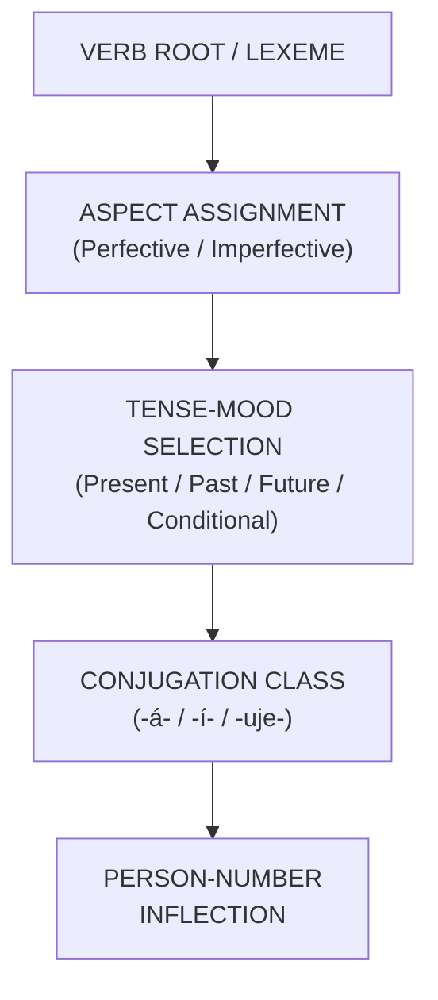

# Lesson 3: Verbal Aspect, Tense, Conjugation Classes

## 1. First-Principles Intuition & Invariants

The Czech verbal system stands as one of the most intricate and philosophically consequential components of Slavic grammar, demanding that every speaker conceptualize temporal action not merely as a point on a timeline but as a geometric object possessing internal texture, boundary conditions, and completion states. Unlike the Germanic and Romance verbal architectures, which privilege tense as the primary organizational axis—anchoring events to past, present, and future coordinates—Czech subordinates absolute temporal reference to a higher-order cognitive primitive: **grammatical aspect**. Aspect compels the speaker to make an immediate, obligatory judgment about whether an action is viewed as a bounded, completed whole (the perfective aspect) or as an ongoing, iterative, or habitual process with no intrinsic endpoint (the imperfective aspect). This is not a stylistic flourish or optional nuance; it is a structural invariant encoded into the morphology of nearly every verb in the language, such that failing to internalize aspectual thinking renders fluent production impossible.

The perfective aspect foregrounds the totality and finality of an event. When a Czech speaker selects a perfective verb, they signal that the action has an inherent boundary—a moment of inception and a moment of termination—and that the speaker's cognitive focus rests on the completion or result of that action rather than its internal temporal unfolding. The perfective verb *napsat* (to write, perfective) does not merely denote the act of writing; it asserts that the writing reached its natural conclusion, producing a finished letter, essay, or document. The semantic weight falls on the resultant state: the completed artifact. Perfective verbs cannot, by their nature, express ongoing or habitual actions in the present tense; they describe punctual events that occupy a single, non-divisible temporal unit. Consequently, perfective verbs in Czech possess no present tense form for describing simultaneous, unfolding action. When conjugated in what appears morphologically to be the present tense, perfective verbs always project into the future, treating the present moment as a vantage point from which the speaker anticipates a bounded event that has not yet occurred.

The imperfective aspect, by contrast, foregrounds the internal duration, repetition, or habitual nature of an action. The imperfective verb *psát* (to write, imperfective) directs attention to the process itself—the act of putting pen to paper, the iterative strokes, the ongoing engagement—without asserting whether the action reaches completion. Imperfective verbs tolerate open-ended temporal structures: they can describe actions in progress at the moment of speech, habitual routines repeated indefinitely, or states that persist without specified termination. The imperfective paradigm dominates present-tense narration precisely because the present moment is, phenomenologically, an ongoing, unbounded slice of experience. An imperfective verb in the past tense reconstructs this same unbounded quality in historical time, portraying events as they unfolded without guaranteeing their completion or foregrounding their outcomes.

This aspectual dichotomy permeates the entire verbal lexicon. The vast majority of Czech verbs exist not as isolated lexemes but as **aspectual pairs**: morphologically and semantically linked forms that denote the same core action but differ in aspectual perspective. The canonical pairing strategy involves prefixation. A base imperfective verb (often morphologically simple) acquires a prefix that perfectively bounds its meaning while simultaneously narrowing or modulating its semantic scope. The imperfective *dělat* (to do, to make) becomes *udělat* (to do/make completely, to finish making) through the addition of the perfectivizing prefix *u-*. The prefix does not alter the core lexical content—the action remains "doing" or "making"—but it reframes the verb's aspectual geometry, transforming an open-ended process into a completed event. Other prefixes carry more specific directional, locational, or metaphorical overlays while still perfectivizing: *psát* (to write, impf.) yields *napsat* (to write completely, perf.), where *na-* adds a sense of writing "onto" a surface and achieving a finished product, and also *vypsat* (to write out, to fill in completely, perf.), where *vy-* emphasizes extraction or exhaustive enumeration.

Prefixation, however, is not the sole mechanism. Some aspectual pairs arise through **suffixation**, where a perfective base acquires an imperfectivizing suffix to generate a secondary imperfective form. This pattern emerges when a prefixed perfective verb needs to express iterative or habitual meaning. For instance, the perfective *přečíst* (to read through, to finish reading) undergoes suffixation with *-ává-* to produce the secondary imperfective *přečítávat* (to read through habitually, to be in the habit of reading completely). Here, the suffix restores the unbounded, processual quality while retaining the semantic contribution of the prefix. Suffixation also appears in morphological derivations where the perfective and imperfective forms diverge more substantially in stem shape, often involving vowel alternations or infixation, as in *otevřít* (to open, perf.) versus *otevírat* (to open, impf.), where the suffixal extension *-ír-* lengthens the stem and imperfectivizes.

A third, rarer strategy is **suppletion**, where the aspectual pair consists of entirely unrelated lexical roots. The most notorious example is the pair *vzít* (to take, perf.) and *brát* (to take, impf.), which share no morphological connection whatsoever. Suppletion occurs in high-frequency verbs where historical phonological erosion and semantic drift have severed the etymological link between forms, yet speakers maintain the functional pairing through sheer usage frequency. Suppletion demands rote memorization and places a cognitive burden on learners, as no morphological cues signal the aspectual relationship.

The interaction between aspect and tense produces a constrained but richly expressive temporal system. Czech possesses three primary temporal frames: past, present, and future. The present tense, formed through a set of personal inflections applied directly to the verb stem, is the exclusive domain of imperfective verbs when describing simultaneous actions. A speaker conjugates *psát* as *píšu* (I write, I am writing) to narrate an action unfolding at the moment of speech. Perfective verbs, when conjugated in the morphological present, shift semantically to the future: *napíšu* does not mean "I write completely" in the present but rather "I will write, I will have written." This aspectual-temporal binding rule is inviolable and reflects a deeper cognitive principle: the perfective aspect's insistence on bounded, completed events clashes with the open, unbounded nature of the experiential present, forcing the temporal reference forward.

The past tense in Czech relies on an **l-participle** construction, morphologically descended from the Old Church Slavonic perfect but now functioning as a simple past tense marker. The l-participle is formed by attaching the suffix *-l* (with gender and number inflections) to the verb stem, and it combines with the present tense of the auxiliary verb *být* (to be) in the first and second persons, though the auxiliary is typically omitted in the third person. The aspectual distinction remains fully operative in past-time reference: imperfective past forms describe actions that were ongoing, habitual, or repeated in the past without asserting completion (*psal jsem*, "I was writing, I used to write"), while perfective past forms assert that the action reached its endpoint and produced a result (*napsal jsem*, "I wrote, I have written, I finished writing"). The morphological structure of the l-participle is identical for both aspects, but the semantic interpretation diverges radically based on the verb's inherent aspectual value.

Future tense formation bifurcates along aspectual lines. Perfective verbs, as noted, use their present-tense conjugations to encode future meaning, requiring no additional morphology. Imperfective verbs, however, cannot exploit this shortcut, as their present-tense forms are reserved for ongoing present actions. To express future time with an imperfective verb, Czech employs a **periphrastic future** construction: the future tense of the auxiliary *být* (which is itself perfective-like in its future forms: *budu*, *budeš*, *bude*, etc.) combines with the infinitive of the main verb. Thus, *budu psát* translates to "I will be writing, I will write (with ongoing, habitual, or indefinite aspectual quality)." This analytic construction foregrounds the processual character of the future action, contrasting sharply with the synthetic, punctual future conveyed by perfective present forms.

Conjugation class membership cross-cuts aspectual distinctions and organizes verbs into morphological paradigms based on stem-final phonology and thematic vowel patterns. Czech grammarians traditionally identify four major conjugation classes, though finer subdivisions exist. The first class, often called the **-á- conjugation**, includes verbs whose infinitive ends in *-at* and whose present-tense stem exhibits a thematic vowel *-á-* before personal endings (e.g., *dělat* → *dělám*, *děláš*, *dělá*). This class is the largest and most productive, encompassing both imperfective and perfective verbs. The second class, the **-í- conjugation**, groups verbs ending in *-it*, *-ět*, or occasionally *-at* with a stem-final *-í-* or *-ě-* in the present tense (e.g., *myslit* → *myslím*, *myslíš*, *myslí*). This class includes many stative and inchoative verbs. The third class, the **-uje/-ova- conjugation**, comprises verbs with infinitives in *-ovat* and present-tense stems in *-uj-* (e.g., *pracovat* → *pracuji*, *pracuješ*, *pracuje*). This class is highly regular and frequently absorbs loanwords. The fourth class is a catch-all for irregular verbs with stems ending in consonants, nasal vowels, or suppletive forms, including the verb *být* itself, which exhibits profound irregularity across all tenses and moods.

The auxiliary verb *být* serves as the structural backbone for numerous analytic constructions. In its present tense, *být* conjugates as *jsem*, *jsi*, *je*, *jsme*, *jste*, *jsou*, with the negative forms *nejsem*, *nejsi*, etc. Its future tense, formed from a perfective root, is *budu*, *budeš*, *bude*, *budeme*, *budete*, *budou*. The l-participle of *být* is *byl* (masc. sg.), *byla* (fem. sg.), *bylo* (neut. sg.), with plural forms *byli*, *byly*, *byla*. In compound past-tense constructions, the present tense of *být* fuses with the l-participle to form the synthetic past (*psal jsem* for first person, though *jsem* often drops in speech for third person: *psal*). The auxiliary also anchors the **conditional mood**, which expresses hypothetical, counterfactual, or polite statements. The conditional is formed by combining the conditional auxiliary *bych*, *bys*, *by*, *bychom*, *byste*, *by* with the l-participle of the main verb, yielding constructions like *psal bych* (I would write), *napsal bych* (I would have written). The aspectual distinction persists in the conditional: imperfective forms describe hypothetical processes, while perfective forms describe hypothetical completed events.

The **imperative mood** commands or requests action and exhibits its own aspectual nuances. Imperfective imperatives issue commands for ongoing, repeated, or general actions (*piš!* "write!" in the sense of "keep writing, be writing"), while perfective imperatives demand the completion of a single, bounded action (*napiš!* "write!" in the sense of "write this and finish it"). The morphological formation of imperatives varies by conjugation class but generally involves a stem vowel shift or truncation, with second-person singular forms often unmarked or bearing a minimal suffix (*-Ø*, *-i*, *-ej*), and plural or polite forms extended with *-te* or *-eme*. The interplay between aspect and imperative force allows speakers to modulate urgency, politeness, and expectation of compliance: imperfective imperatives often soften requests or invite indefinite engagement, while perfective imperatives convey decisiveness and expectation of immediate, conclusive action.

## 2. Core Architecture & Mechanics

The internal architecture of the Czech verbal system rests on a triadic interaction among **aspect**, **tense-mood**, and **conjugation class**. Aspect functions as the primary categorical filter, dividing the verbal lexicon into two exhaustive, mutually exclusive subsets before any temporal or modal marking applies. Tense and mood operate as secondary layers that modulate temporal reference and epistemic stance, but they do so within the constraints imposed by aspectual value. Conjugation class, meanwhile, governs the surface morphology—the specific phonological shapes of inflectional endings and stem alternations—without altering the semantic or functional properties of aspect or tense.

To visualize this layered dependency:



This dependency cascade enforces strict ordering: aspect must be determined before tense-mood marking, because the availability of certain tense forms depends on aspectual value (e.g., perfective verbs lack true present-tense forms), and conjugation class applies only after the tense-mood frame is established, as it dictates the phonological realization of inflectional suffixes.

Aspectual pairing through prefixation follows a predictable derivational pattern but introduces semantic micro-shifts that complicate one-to-one lexical mapping. Consider the imperfective base *číst* (to read). Prefixation generates a family of perfective derivatives, each modulating the core meaning:

- *přečíst* (to read through, to finish reading): prefix *pře-* emphasizes traversal across the entirety of a text.
- *dočíst* (to read to the end, to finish reading): prefix *do-* highlights arrival at a terminal point.
- *načíst* (to read onto, to load data): prefix *na-* introduces a locational or accumulative nuance, common in computing contexts.
- *vyčíst* (to read out, to infer): prefix *vy-* suggests extraction or emanation.
- *pročíst* (to read through, to skim): prefix *pro-* conveys motion through a space or cursory coverage.

Each prefixed perfective can, in turn, spawn a secondary imperfective through suffixation:

- *přečíst* → *přečítat* (to read through habitually)
- *dočíst* → *dočítat* (to be finishing, to be in the process of reading to the end)

The secondary imperfective retains the semantic contribution of the prefix while restoring unbounded, iterative aspectual force. This recursion—base imperfective → prefixed perfective → suffixed secondary imperfective—creates triadic chains that encode fine-grained distinctions in Aktionsart (lexical aspect) layered atop grammatical aspect.

Conjugation class mechanics hinge on stem-final phonology and the morphophonological rules governing vowel-consonant interactions. The **-á- class** verbs take present-tense endings *-m*, *-š*, *-Ø* (third singular often null after vowel), *-me*, *-te*, *-jí* (or *-í*), yielding paradigms like:

```text
dělat (to do, impf.) — Infinitive
dělám     (I do)
děláš     (you do, sg.)
dělá      (he/she/it does)
děláme    (we do)
děláte    (you do, pl.)
dělají    (they do)
```

The thematic vowel *-á-* surfaces consistently before consonantal endings but may undergo reduction or deletion before vocalic endings in rapid speech. Stress falls predictably on the initial syllable in Czech, reducing vowel-reduction pressures relative to Russian, but inflectional morphology still exhibits allomorphic variation conditioned by stem-final consonants.

The **-í- class** exhibits stem-final palatal softening and thematic *-í-*:

```text
myslit (to think, impf.) — Infinitive
myslím    (I think)
myslíš    (you think, sg.)
myslí     (he/she/it thinks)
myslíme   (we think)
myslíte   (you think, pl.)
myslí     (they think)
```

Note the homophony in third-person singular and plural forms (*myslí*), disambiguated only by subject or context. Verbs in this class often undergo consonant alternations in the imperative: *myslit* → *mysli!* (think!), where the imperative suffix *-i* triggers palatalization of the preceding consonant if applicable.

The **-uje-/-ova- class** is maximally regular and transparent:

```text
pracovat (to work, impf.) — Infinitive
pracuji    (I work)
pracuješ   (you work, sg.)
pracuje    (he/she/it works)
pracujeme  (we work)
pracujete  (you work, pl.)
pracují    (they work)
```

The infinitive suffix *-ovat* drops its *-va-* component in the present tense, yielding the stem *pracuj-*, to which standard endings attach. This class absorbs foreign borrowings with high fidelity: English "to file" becomes *fajlovat* → *fajluji*, German "studieren" becomes *studovat* → *studuji*.

Past-tense l-participle formation applies uniformly across conjugation classes but respects stem phonology. The l-participle suffix is *-l* (masc. sg.), *-la* (fem. sg.), *-lo* (neut. sg.), *-li* (masc. animate pl.), *-ly* (fem. or masc. inanimate pl.), *-la* (neut. pl.). For *dělat*, the l-participle stem is *dělal*:

```text
dělal jsem     (I did, masc.)
dělala jsem    (I did, fem.)
dělal jsi      (you did, masc. sg.)
dělala jsi     (you did, fem. sg.)
dělal          (he did)
dělala         (she did)
dělalo         (it did)
dělali jsme    (we did, masc. animate)
dělaly jsme    (we did, fem./neut./inanimate)
dělali jste    (you did, masc. animate pl.)
dělaly jste    (you did, fem./neut./inanimate pl.)
dělali         (they did, masc. animate)
dělaly         (they did, fem./neut./inanimate)
```

The auxiliary *jsem*, *jsi* often contracts in colloquial speech (*dělal sem*, *dělal si*) and drops entirely in third-person forms in informal registers, where context suffices to mark tense. The aspectual partner *udělat* (perfective) inflects identically but shifts semantic weight to completion: *udělal jsem* means "I finished doing, I completed."

Conditional mood formation layers the conditional auxiliary onto the l-participle, mirroring past-tense structure but introducing hypothetical modality:

```text
dělal bych     (I would do, masc.)
dělala bych    (I would do, fem.)
dělal bys      (you would do, masc. sg.)
dělala bys     (you would do, fem. sg.)
dělal by       (he would do)
dělala by      (she would do)
dělalo by      (it would do)
dělali bychom  (we would do, masc. animate)
dělaly bychom  (we would do, fem./neut./inanimate)
dělali byste   (you would do, masc. animate pl.)
dělaly byste   (you would do, fem./neut./inanimate pl.)
dělali by      (they would do, masc. animate)
dělaly by      (they would do, fem./neut./inanimate)
```

The perfective conditional *udělal bych* translates as "I would have done, I would finish doing," emphasizing hypothetical completion. The conditional auxiliary *by* is a bound clitic, subject to second-position placement in clause structure (Wackernagel's law), though in matrix clauses it typically follows the l-participle directly.

Imperative formation varies by conjugation class but follows derivable patterns. For -á- verbs, the second-person singular imperative often truncates to the bare stem with final vowel shortening: *dělat* → *dělej!* (do!). The plural or polite form appends *-te*: *dělejte!* (do!, pl./polite). For -í- verbs, the singular imperative takes *-i* or null: *myslit* → *mysli!* (think!), plural *myslete!*. For -uje- verbs, the singular imperative uses *-uj*: *pracovat* → *pracuj!* (work!), plural *pracujte!*. First-person plural hortative forms use *-me* or *-eme*: *dělejme!* (let's do!), *pracujme!* (let's work!). Negative imperatives typically employ the imperfective aspect to soften prohibition: *nedělej to!* (don't do that!) sounds less abrupt than a perfective negative imperative, though both are grammatical.

The irregular verb *být* demands exhaustive memorization due to its suppletion and high frequency:

```text
PRESENT:
jsem    (I am)
jsi     (you are, sg.)
je      (he/she/it is)
jsme    (we are)
jste    (you are, pl.)
jsou    (they are)

FUTURE:
budu    (I will be)
budeš   (you will be, sg.)
bude    (he/she/it will be)
budeme  (we will be)
budete  (you will be, pl.)
budou   (they will be)

PAST (l-participle + present auxiliary):
byl jsem     (I was, masc.)
byla jsem    (I was, fem.)
byl jsi      (you were, masc. sg.)
byla jsi     (you were, fem. sg.)
byl          (he was)
byla         (she was)
bylo         (it was)
byli jsme    (we were, masc. animate)
byly jsme    (we were, fem./neut./inanimate)
byli jste    (you were, masc. animate pl.)
byly jste    (you were, fem./neut./inanimate pl.)
byli         (they were, masc. animate)
byly         (they were, fem./neut./inanimate)

CONDITIONAL (l-participle + conditional auxiliary):
byl bych     (I would be, masc.)
byla bych    (I would be, fem.)
byl bys      (you would be, masc. sg.)
byla bys     (you would be, fem. sg.)
byl by       (he would be)
byla by      (she would be)
bylo by      (it would be)
byli bychom  (we would be, masc. animate)
byly bychom  (we would be, fem./neut./inanimate)
byli byste   (you would be, masc. animate pl.)
byly byste   (you would be, fem./neut./inanimate pl.)
byli by      (they would be, masc. animate)
byly by      (they would be, fem./neut./inanimate)

IMPERATIVE:
buď!         (be!, sg.)
buďte!       (be!, pl./polite)
buďme!       (let's be!)
```

The suppletive stems *js-*, *bud-*, and *byl-* reflect Proto-Slavic and Proto-Indo-European root layering (*h₁es-* for present stative, *bʰuH-* for future and past). Modern Czech fossilizes this suppletion without phonological transparency.

## 3. High-Performance Optimization & Failure Modes

Achieving native-level fluency in Czech verbal aspect requires internalization of aspectual selection as an automatic, pre-lexical cognitive operation. Learners must train themselves to evaluate every intended utterance for boundedness and completion before retrieving a verb form, effectively installing aspect as a grammatical firewall that precedes all other morphosyntactic decisions. The most pernicious failure mode is **aspectual interference from the native language**, where speakers of non-Slavic languages default to tense-based reasoning and select verbs based on temporal reference alone, ignoring the aspectual dimension entirely. This produces utterances that are morphologically well-formed but semantically incoherent or pragmatically inappropriate: using an imperfective past form *četl jsem* (I was reading, I used to read) when the intended meaning is "I read the book (and finished it)," which demands the perfective *přečetl jsem*. The listener infers either that the reading remains incomplete or that the speaker habitually reads books, neither of which may match the intended message.

To counter this failure mode, learners must construct **aspectual mental models** for high-frequency verbs through exhaustive drilling of paired sentences. For the pair *psát* (impf.) / *napsat* (perf.), drill the following contrasts in past, present-future, and conditional frames:

- *Včera jsem psal dopis.* (Yesterday I was writing a letter. [ongoing, no assertion of completion])
- *Včera jsem napsal dopis.* (Yesterday I wrote a letter. [completed, letter exists])
- *Píšu dopis.* (I am writing a letter. [right now, ongoing])
- *Napíšu dopis.* (I will write a letter. [future, will complete])
- *Psal bych dopis, ale nemám čas.* (I would be writing a letter, but I have no time. [hypothetical process])
- *Napsal bych dopis, ale nemám čas.* (I would write a letter, but I have no time. [hypothetical completion])

Repeat this drill for core verb pairs (*dělat/udělat*, *číst/přečíst*, *kupovat/koupit*, *říkat/říct*) until aspectual selection becomes reflexive. The goal is to eliminate the cognitive delay between conceptualizing an action and selecting the correct aspectual form, collapsing what initially requires conscious deliberation into a single, instantaneous lexical retrieval.

Prefix semantics present a second optimization challenge. Czech possesses approximately 15 productive verbal prefixes (*do-, na-, od-, po-, pře-, při-, про-, roz-, s-, u-, v-, vy-, z-, za-*), each contributing directional, locational, inchoative, terminative, or intensive nuances. Mastery requires constructing a **semantic network** for each prefix across multiple verb stems, identifying recurring patterns. The prefix *do-* consistently encodes "motion to a destination" or "achievement of a goal": *dojít* (to walk to, to arrive on foot), *dočíst* (to finish reading), *dostat* (to receive, to get). The prefix *vy-* signals "outward motion" or "extraction": *vyjít* (to go out, to exit), *vybrat* (to choose, to select out), *vypsat* (to write out, to fill in). The prefix *roz-* conveys "dispersal" or "inception": *rozjet se* (to set off, to get moving), *rozumět* (to understand, to mentally "unfold"). Learners should maintain a prefix-verb matrix, charting how each prefix modulates meaning across semantically related bases, thereby building intuition for compositional semantics and reducing reliance on rote memorization of individual prefixed forms.

Conjugation class assignment is largely predictable from infinitive morphology, but irregular verbs and stem alternations introduce performance bottlenecks. The verb *jít* (to go on foot, impf.) and its prefixed perfectives (*přijít*, *odejít*, *vejít*, etc.) exhibit stem suppletion between present tense (*jdu*, *jdeš*, *jde*) and past tense (*šel*, *šla*, *šlo*), with no phonological bridge. The verb *moci* (to be able, impf.) conjugates as *mohu/můžu*, *můžeš*, *může* in the present but uses *mohl* in the past. Such verbs demand explicit memorization of each tense stem. To mitigate cognitive load, learners should prioritize the 50 highest-frequency verbs and drill their full paradigms (present, past, future, conditional, imperative) in isolation before integrating them into conversational contexts. Flashcard systems should isolate stem forms as atomic units: one card for *jít* (infinitive), one for *jdu* (present stem), one for *šel* (past stem), one for *pojď!* (imperative), ensuring that each stem is retrievable independently.

A common error pattern involves **conditional auxiliary placement**. The conditional clitic *by* (and its person-inflected forms *bych*, *bys*, *bychom*, *byste*) must occupy second position in the clause according to Wackernagel's law, but learners often misplace it, producing ungrammatical strings. The correct form is *Kdybych měl čas, napsal bych dopis* (If I had time, I would write a letter), with *bych* following the first stressed constituent in each clause. Incorrect placement (*Kdybych měl čas, bych napsal dopis*) violates clitic syntax. Drilling second-position placement with varied clause-initial elements (temporal adverbs, conditional subordinators, topicalized objects) ingrains correct prosodic phrasing.

Aspect selection in imperatives introduces pragmatic subtleties that learners often overlook. An imperfective imperative invites indefinite or repeated action, often softening the command: *Piš mi!* (Write to me! [keep writing, write regularly]) versus the perfective *Napiš mi!* (Write to me! [one time, complete the action]). Learners defaulting to perfective imperatives risk sounding brusque or demanding. In polite or hortatory contexts, imperfective imperatives convey invitation and flexibility, while perfective imperatives signal urgency and expectation of immediate compliance. Drilling imperative pairs in situational contexts—requests to friends versus instructions to subordinates, invitations versus commands—calibrates pragmatic intuition.

Resource scaling for aspectual mastery involves constructing a **personal aspectual lexicon**: a curated database of verb pairs encountered in authentic input, annotated with example sentences, prefix semantics, and conjugation paradigms. This lexicon should be searchable by prefix, semantic domain (motion, communication, creation, perception), and conjugation class, enabling rapid lookup and pattern recognition. Digital tools such as Anki or custom spreadsheets facilitate spaced repetition and cross-referencing. Over time, the lexicon should expand to encompass 300–500 verb pairs, covering the productive core of Czech verbal lexis.

Failure to internalize aspectual distinctions results in semantic ambiguity and pragmatic mismatch. A learner who consistently uses imperfective forms in past-tense narration fails to signal whether actions reached completion, leaving listeners uncertain about event outcomes. Conversely, overusing perfective forms in contexts requiring habitual or ongoing reference produces semantic anomalies: *Každý den napsal dopis* (Every day he wrote a letter [and completed it]) sounds odd because the perfective clashes with the iterative adverb *každý den* (every day), which calls for the imperfective *psal*. The correct form is *Každý den psal dopis* (Every day he was writing a letter, he wrote letters [habitually]). Training on adverbial collocations (*vždycky, často, obvykle, někdy* with imperfectives; *náhle, konečně, okamžitě, už* with perfectives) sharpens distributional intuition.

Edge cases include **biaspectual verbs**, a small class of verbs that function as both perfective and imperfective depending on context, such as *věnovat* (to dedicate, to give as a gift) or *jmenovat* (to name, to appoint). These verbs require contextual disambiguation: *Věnoval jsem jí knihu* is ambiguous between "I was dedicating a book to her" (imperfective) and "I dedicated a book to her" (perfective), resolved only by surrounding discourse or explicit aspectual modification. Learners should flag biaspectual verbs for special attention and rely on co-textual cues (adverbs, temporal clauses) to disambiguate.

The ultimate optimization strategy is **immersive comprehensible input** saturated with aspectual contrasts. Native-speaker podcasts, news broadcasts, and narrative fiction foreground aspectual distinctions through natural discourse patterns. Learners should actively shadow spoken input, repeating utterances with attention to aspectual forms and their discourse functions. Transcription drills, where learners transcribe short audio segments and annotate each verb for aspect, tense, and conjugation class, solidify morphological recognition and deepen metalinguistic awareness. Over time, this input-driven training compresses aspectual selection into an automatic, unconscious process, enabling fluent production under real-time conversational pressure.
