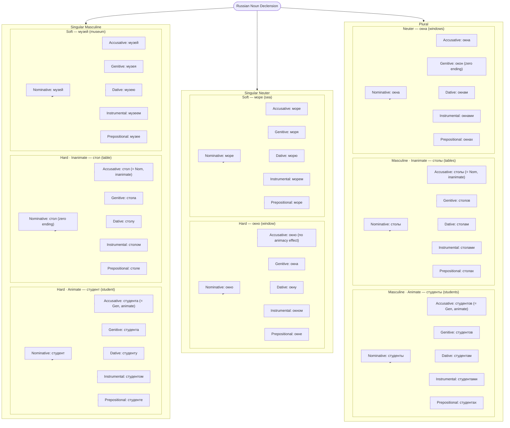
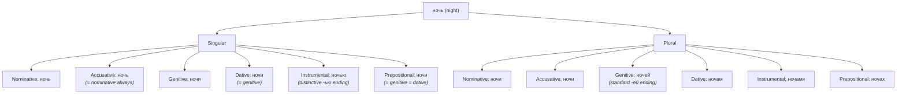
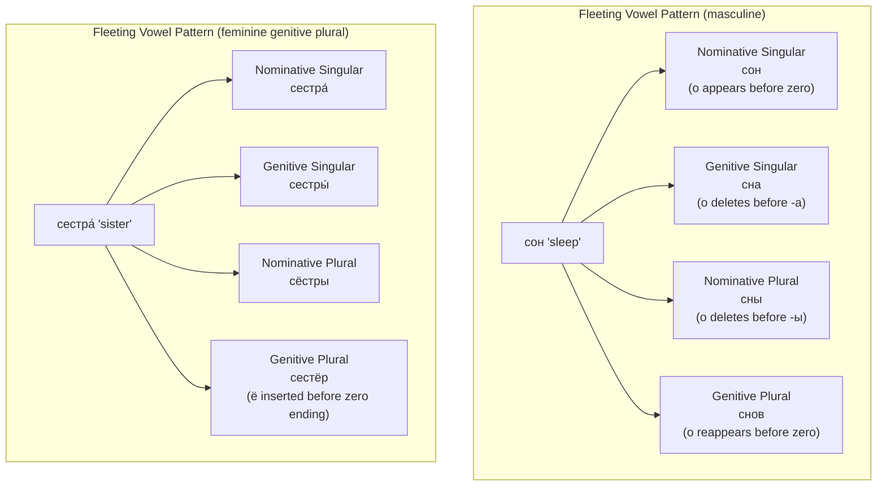
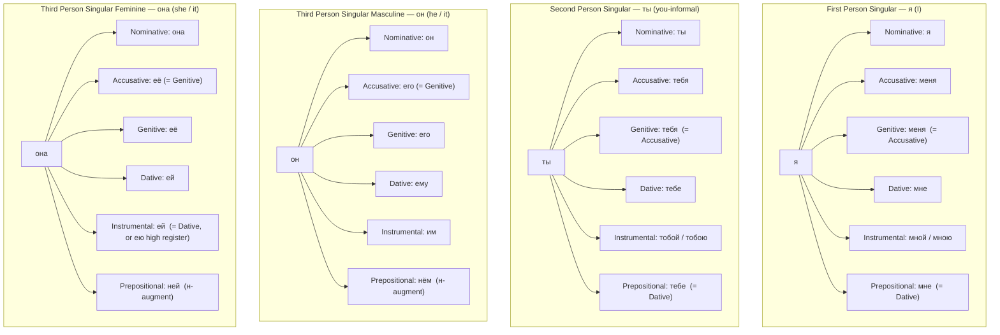

# Lesson 3: Nominal Declension System

## 1. First-Principles Intuition & Invariants

The Russian nominal declension system represents one of the most intricate and systematic implementations of morphological case in the Indo-European family. Unlike English, which preserves case distinctions only vestigially in its pronoun system, Russian maintains a full six-case paradigm that encodes grammatical relationships through inflectional suffixes rather than rigid word order or prepositional constructions. This architectural choice creates a language of extraordinary syntactic flexibility—a Russian sentence can scramble its constituents to emphasize different informational centers while the case endings preserve the underlying grammatical skeleton.

The fundamental invariant governing Russian nominal morphology is the triadic intersection of **gender**, **animacy**, and **number** with the six-case functional paradigm. Every Russian noun carries an inherent gender classification—masculine, feminine, or neuter—determined primarily by phonological form rather than semantic properties. This gender assignment cascades through the entire nominal phrase, forcing obligatory agreement on all attributive adjectives, possessive pronouns, demonstratives, and past-tense verb forms. The gender system is not arbitrary decoration but rather a syntactic indexing mechanism that allows listeners to parse complex sentences by tracking agreement patterns across potentially distant constituents.

Animacy introduces a second classificatory dimension that crosscuts gender, creating asymmetric case syncretism patterns in the accusative. Animate masculine nouns in the singular and all animate plurals conflate their accusative forms with the genitive, while inanimate nouns maintain accusative-nominative identity. This morphological split reflects a deep cognitive distinction in Slavic case semantics: animate direct objects—beings capable of volition and agency—receive differential morphological marking to distinguish them from backgrounded, affected inanimate entities. The animacy hierarchy extends beyond biological criteria to encompass entities conceived as agent-like, including deceased persons in ritual contexts and personified abstractions in poetic register.

Number operates as the third classificatory axis, but Russian number morphology does not map isomorphically to English singular-plural distinctions. The language historically possessed a dual number for paired entities, traces of which survive in fossilized forms like *два/две* (two) triggering genitive singular government rather than nominative plural. Modern Russian retains complex interactions between numerical quantifiers and case assignment: the numerals *два/три/четыре* (two/three/four) govern genitive singular, while *пять* (five) and above govern genitive plural, creating non-intuitive morphological environments where syntactic plurality coexists with morphological singularity.

The six-case inventory itself forms a structured semantic field mapping syntactic roles to morphological exponents. The **nominative** marks the absolute form and syntactic subject; the **accusative** encodes direct objects and goal-of-motion with certain prepositions; the **genitive** expresses possession, partitive quantity, and source-negation contexts; the **dative** indicates indirect objects, beneficiaries, and experiencers in impersonal constructions; the **instrumental** denotes means, accompaniment, and predicate nominals; while the **prepositional** (or locative) appears exclusively in prepositional phrases indicating location or topic. This case geometry creates a radial semantic network where each case occupies a prototypical functional core while extending into metaphorical and grammaticalized domains.

Russian nominal declension organizes itself into three primary declension classes roughly correlated with gender and phonological stem shape. First declension encompasses most feminine nouns ending in *-а/-я* and a small class of masculine nouns denoting male persons (*папа* "dad", *дядя* "uncle"). Second declension contains masculine nouns with consonant-final or *-й/-ь* stems and neuter nouns in *-о/-е*. Third declension comprises feminine nouns terminating in the soft sign *-ь*. Beyond these core paradigms lie irregular pluralia tantum nouns, indeclinable foreign borrowings, and suppletive high-frequency lexemes that defy systematic classification.

The morphological exponents encoding case distinctions consist primarily of suffixal material appended to the nominal stem, though stem-internal vowel alternations (*беглые гласные*—fleeting vowels) create surface allomorphy when zero endings trigger vowel deletion. Hard and soft stem variants generate parallel declension subtypes, with palatalized consonants conditioning fronted vowel alternants in accordance with Russian phonotactic constraints forbidding certain consonant-vowel sequences. The interplay between phonological rules and morphological templating produces a system where learners must simultaneously master paradigmatic inflectional patterns and phonologically conditioned allomorphic variation.

Adjectival agreement constitutes a mandatory morphosyntactic operation in Russian whereby attributive adjectives and participles must match their head nouns in gender, number, case, and animacy. This quadruple agreement requirement transforms adjectives into portable case-marking devices that redundantly encode the nominal's morphosyntactic features, providing robust perceptual cues even when phonological erosion obscures nominal endings. The adjectival paradigm exhibits greater regularity than nominal declension, following a quasi-transparent hard/soft dichotomy with predictable stress patterns, making adjectives a reliable diagnostic for case identification in ambiguous nominal contexts.

The animacy distinction in accusative case marking extends from nominals to their adjectival modifiers, creating a morphological echo where both noun and adjective simultaneously exhibit genitive-accusative syncretism for animate referents. This agreement propagation reveals the deep integration of animacy as a morphosyntactic feature rather than merely a semantic annotation on individual lexemes. The system tolerates certain violations in colloquial register—particularly with masculine given names—but prescriptive norms enforce strict animacy concord in formal written varieties.

Understanding Russian nominal declension requires recognizing it not as a collection of arbitrary memorized tables but as a structured morphological architecture where phonological, semantic, and syntactic principles interact to generate surface forms. The system's complexity arises from historical sound changes that collapsed formerly distinct endings, creating homophony between cases in certain paradigmatic cells. Modern Russian preserves this inherited syncretism while maintaining functional load through context, word order preferences, and redundant agreement marking across the nominal phrase. Mastery demands both explicit knowledge of paradigmatic templates and implicit recognition of usage probabilities across grammatical contexts.

## 2. Core Architecture & Mechanics

The internal architecture of Russian nominal declension rests upon the notion of the **stem** as the invariant morphological base to which case-number suffixes attach. Extracting the stem requires identifying and removing the nominative singular ending, though this process admits complications when zero morphemes or fleeting vowels intervene. For first declension nouns like *книга* (book), the stem *книг-* emerges cleanly after removing *-а*, but second declension masculine nouns like *стол* (table) possess a zero nominative marker, making the stem identical to the nominative surface form. Neuter nouns in *-о* such as *окно* (window) yield stems in *окн-*, while soft variants in *-е* like *море* (sea) provide *мор-* with obligatory soft-sign palatalization.

Third declension feminine nouns ending in *-ь* such as *ночь* (night) present analytical challenges because the soft sign represents stem-final palatalization rather than a removable suffix, producing stems like *ноч'-* where the palatalization feature must be maintained through all case forms. Irregular nouns with mobile stress (*голова́/го́ловы* "head/heads") or suppletive plural stems (*ребёнок/дети* "child/children") demand lexical memorization of stem alternants that cannot be derived by regular phonological rules.

**First Declension: Feminine and Masculine Nouns in -а/-я**

The first declension paradigm governs the majority of Russian feminine nouns and a small but high-frequency set of masculine nouns denoting male persons. The declension operates under a hard/soft dichotomy determined by stem-final consonant quality. Hard-stem variants take back-vowel suffixes (*-а, -ы, -е, -у, -ой*) while soft stems select front-vowel alternants (*-я, -и, -е, -ю, -ей*). The paradigmatic template distributes case-number exponents across twelve cells (six cases in singular and plural), though syncretism collapses several distinctions.

```mermaid
flowchart TD
    Root["Russian Feminine Noun Declension"]
    
    Root --> SingHard["Singular Declension<br/>Hard Stem: книга 'book'"]
    Root --> SingSoft["Singular Declension<br/>Soft Stem: земля 'earth/land'"]
    Root --> PlurHard["Plural Declension<br/>Hard Stem: книги 'books'"]
    Root --> PlurSoft["Plural Declension<br/>Soft Stem: земли 'lands'"]
    
    SingHard --> SH_Nom["Nominative: книга<br/>(subject, predicate nominal)"]
    SingHard --> SH_Acc["Accusative: книгу<br/>(direct object, motion goal)"]
    SingHard --> SH_Gen["Genitive: книги<br/>(possession, partitive, negation)"]
    SingHard --> SH_Dat["Dative: книге<br/>(indirect object, beneficiary)"]
    SingHard --> SH_Ins["Instrumental: книгой<br/>(means, accompaniment)"]
    SingHard --> SH_Pre["Prepositional: книге<br/>(location, topic with prepositions)"]
    
    SingSoft --> SS_Nom["Nominative: земля"]
    SingSoft --> SS_Acc["Accusative: землю"]
    SingSoft --> SS_Gen["Genitive: земли"]
    SingSoft --> SS_Dat["Dative: земле"]
    SingSoft --> SS_Ins["Instrumental: землёй/землёю"]
    SingSoft --> SS_Pre["Prepositional: земле"]
    
    PlurHard --> PH_Nom["Nominative: книги"]
    PlurHard --> PH_Acc["Accusative: книги<br/>(inanimate = nominative)"]
    PlurHard --> PH_Gen["Genitive: книг<br/>(zero ending with fleeting vowel rules)"]
    PlurHard --> PH_Dat["Dative: книгам"]
    PlurHard --> PH_Ins["Instrumental: книгами"]
    PlurHard --> PH_Pre["Prepositional: книгах"]
    
    PlurSoft --> PS_Nom["Nominative: земли"]
    PlurSoft --> PS_Acc["Accusative: земли"]
    PlurSoft --> PS_Gen["Genitive: земель<br/>(inserted fleeting vowel е/о)"]
    PlurSoft --> PS_Dat["Dative: землям"]
    PlurSoft --> PS_Ins["Instrumental: землями"]
    PlurSoft --> PS_Pre["Prepositional: землях"]
```

Critical syncretism patterns emerge in this declension: dative and prepositional collapse in the singular, while nominative and accusative merge in both singular inanimate and all plural forms. The genitive plural presents maximum allomorphic complexity due to zero-ending realization triggering fleeting vowel insertion (*книг-∅ → книг* but *сестра → сестёр* with inserted *-ё-*) to satisfy Russian phonotactic prohibition against certain consonant clusters. Stress mobility further complicates the picture, with some nouns shifting stress between stem and ending across paradigmatic cells (*стена́/сте́ны* "wall/walls").

**Second Declension: Masculine and Neuter Nouns**

The second declension encompasses two morphologically distinct gender classes that share similar case-marking patterns. Masculine nouns appear in zero, *-й*, or soft-sign variants, while neuter nouns uniformly terminate in *-о* or *-е*. The animacy distinction activates critically in this declension, creating accusative-genitive syncretism for animate masculine singulars and all animate plurals regardless of gender.

The nominative plural formation follows stem-type sensitivity: hard masculine stems take *-ы* while soft stems select *-и*, but spelling rules override this distribution after velars (*г, к, х*), sibilants (*ш, щ, ж, ч*), and *ц*, forcing *-и* even on phonologically hard stems (*друг → друзья* with consonant mutation, but *карандаш → карандаши* "pencils"). Neuter plurals uniformly take *-а* for hard stems and *-я* for soft, creating surface identity with feminine genitive singular forms but distinguished by agreement patterns.

The genitive plural again constitutes the morphological complexity peak. Masculine nouns employ *-ов* for hard stems (*столов*) and *-ев/-ёв* for soft (*музеев*), while neuter nouns prefer zero endings (*окон*) with fleeting vowel insertion when clusters arise (*окно → окон* but *письмо → писем* "letters"). Stress patterns show maximum variability in this cell, with paradigmatic stress shifts differentiating otherwise homophonous forms.

**Third Declension: Feminine Nouns in Soft Sign**

The third declension represents a relatively small but morphologically conservative class of feminine nouns characterized by stem-final palatalized consonants marked orthographically with *-ь*. This declension exhibits maximum case syncretism, collapsing nominative-accusative, genitive-dative-prepositional in the singular, and nominative-accusative in the plural. The paradigm employs uniformly soft endings with minimal allomorphy.

The instrumental singular *-ью* serves as the diagnostic case for third declension membership, providing a unique morphological signature absent from other paradigms. The genitive-dative-prepositional syncretism in *-и* creates interpretive ambiguity resolvable only through prepositional government or broader syntactic context. Third declension nouns show minimal stress mobility, typically maintaining stem stress throughout the paradigm, though exceptions like *любо́вь/любви́* "love" exhibit accent shifts.

**Adjectival Declension and Agreement**

Russian adjectives decline through a parallel but more regular paradigm than nominals, with hard and soft variants determined by stem-final consonant quality. Adjectives must agree with their head nouns in gender (singular only), number, case, and animacy, creating a four-way concord requirement enforced across all attributive positions. The adjectival paradigm exhibits transparent case marking with minimal syncretism outside the accusative, making adjectives more reliable case indicators than the nouns they modify.

```mermaid
flowchart TD
    Root["новый 'new'<br/>(Hard-Stem Adjective)"]
    
    Root --> SingMasc["Singular Masculine"]
    Root --> SingFem["Singular Feminine"]
    Root --> SingNeut["Singular Neuter"]
    Root --> Plural["Plural (all genders)"]
    
    SingMasc --> SM_Nom["Nominative: новый"]
    SingMasc --> SM_Acc["Accusative: новый/нового<br/>(inanimate/animate)"]
    SingMasc --> SM_Gen["Genitive: нового"]
    SingMasc --> SM_Dat["Dative: новому"]
    SingMasc --> SM_Ins["Instrumental: новым"]
    SingMasc --> SM_Pre["Prepositional: новом"]
    
    SingFem --> SF_Nom["Nominative: новая"]
    SingFem --> SF_Acc["Accusative: новую"]
    SingFem --> SF_Gen["Genitive: новой"]
    SingFem --> SF_Dat["Dative: новой"]
    SingFem --> SF_Ins["Instrumental: новой"]
    SingFem --> SF_Pre["Prepositional: новой"]
    
    SingNeut --> SN_Nom["Nominative: новое"]
    SingNeut --> SN_Acc["Accusative: новое<br/>(= nominative)"]
    SingNeut --> SN_Gen["Genitive: нового"]
    SingNeut --> SN_Dat["Dative: новому"]
    SingNeut --> SN_Ins["Instrumental: новым"]
    SingNeut --> SN_Pre["Prepositional: новом"]
    
    Plural --> P_Nom["Nominative: новые"]
    Plural --> P_Acc["Accusative: новые/новых<br/>(inanimate/animate)"]
    Plural --> P_Gen["Genitive: новых"]
    Plural --> P_Dat["Dative: новым"]
    Plural --> P_Ins["Instrumental: новыми"]
    Plural --> P_Pre["Prepositional: новых"]
```

The soft-stem adjectival paradigm follows an identical structural template but substitutes front vowels for back vowels: *синий/синяя/синее/синие* "blue" parallels *новый/новая/новое/новые* with systematic vowel fronting. Adjectives in *-ой* like *большой* "big" carry stem stress throughout the paradigm, while most adjectives exhibit ending stress in the short-form predicative variants (*краси́в/красива́/краси́во/краси́вы* "beautiful").

Animacy agreement operates mechanically: if the head noun is animate, the accusative adjective form merges with the genitive across all genders and numbers. This creates the surface pattern *Я ви́жу но́вого студе́нта* "I see a new student" versus *Я ви́жу но́вый стол* "I see a new table", where the adjective's case form differentiates animate from inanimate direct objects. The agreement cascade extends to multiple adjectives modifying a single noun, requiring each attributive modifier to independently compute the full agreement specification.

**Stem Alternations and Fleeting Vowels**

Russian nominal morphology admits stem-internal alternations that create surface allomorphy across the paradigm. The most productive pattern involves fleeting vowels (*беглые гласные*)—specifically *е* and *о*—that appear in certain stem-final consonant clusters when zero endings attach but delete before overt vowel suffixes. This process maintains phonotactic legality by breaking up impermissible consonant sequences.

Consonant mutations accompany certain case formations, particularly in nominative plural where hard-stem feminine nouns in nominative plural take *-ы* or *-и* endings without velar palatalization: *рука́ → ру́ки* "hand/hands", *нога́ → но́ги* "leg/legs", *му́ха → му́хи* "fly/flies". These alternations reflect historical Proto-Slavic palatalization processes now lexicalized as paradigmatic irregularities requiring lexeme-specific memorization.

Mobile stress constitutes another dimension of stem allomorphy. Some noun classes exhibit systematic stress shifts between stem and ending across case forms or between singular and plural numbers. The patterns include fixed stem stress (*го́род/го́рода* "city/cities"), fixed ending stress (*стол/столы́*), and alternating stress (*окно́/о́кна* "window/windows"). Stress mobility interacts with vowel reduction through akan'ye, such that unstressed *о* reduces to [ɐ], creating surface pronunciation differences (*го́род* [ˈɡorət] versus *города́* [ɡərɐˈda]) that must be mastered for native-like phonological competence.

**Declension of Pronouns and Demonstratives**

Personal pronouns in Russian follow suppletive declension patterns that preserve archaic stem alternations absent from regular nominal paradigms. The first and second person pronouns exhibit stem suppletion across cases, while third person forms derive historically from demonstrative stems and maintain gender distinctions in the singular.

The prepositional forms of third person pronouns obligatorily take an initial *н-* (*его → него*, *их → них*) when governed by prepositions, a morphophonological process preventing vowel-initial forms in post-prepositional position. This *н-* augmentation applies consistently across all prepositional government contexts but never appears in non-prepositional oblique cases, creating a diagnostic alternation: *у него́* "at his place" versus *его́ дом* "his house".

Demonstrative pronouns like *этот* "this" and *тот* "that" decline as hard-stem adjectives with regular case marking across gender and number, though the stem *эт-/т-* remains invariant. Possessive pronouns (*мой* "my", *твой* "your", *наш* "our", *ваш* "your-plural") follow soft adjectival declension with full agreement requirements, while the reflexive possessive *свой* "one's own" operates anaphorically to indicate possession by the grammatical subject regardless of person.

**Quantification and Numeral Government**

Russian numerical expressions interact intricately with nominal case assignment through a system of quantifier-triggered government distinct from West European patterns. The fundamental principle states that numerals themselves decline for case, but they simultaneously govern the case form of the quantified noun according to complex rules stratified by number value and syntactic position.

The numeral *оди́н* "one" behaves as an attributive adjective, declining for gender, number, and case while agreeing with its noun in all features. The compound numerals *два/две* "two", *три* "three", and *четы́ре* "four" govern genitive singular of the quantified noun when appearing in nominative or accusative case positions, but in oblique cases the numeral and noun decline in parallel agreement: *два студе́нта* "two students" (nominative construction with genitive singular noun) versus *двух студе́нтов* "of two students" (genitive construction with genitive plural noun).

Numerals from *пять* "five" upward historically derived from nouns and consequently govern genitive plural in nominative and accusative constructions: *пять студе́нтов* "five students". When these numerals appear in oblique cases, they continue to govern genitive plural while themselves declining: *пяти́ студе́нтов* "of five students" (genitive numeral + genitive plural noun). This split government pattern creates number-case mismatches where syntactically plural quantified phrases exhibit morphologically singular or genitive plural forms rather than expected nominative plural.

## 3. High-Performance Optimization & Failure Modes

Achieving fluency in Russian nominal declension demands strategic optimization of cognitive load through staged mastery progressions and pattern-based recognition training. The sheer paradigmatic density—over seventy distinct inflectional cells across three genders, two numbers, six cases, and multiple declension classes—overwhelms working memory if approached through brute-force memorization. High-performance acquisition instead leverages structural regularities, exploits syncretism patterns, and builds procedural automaticity through intensive form-meaning mapping drills.

**Staged Acquisition Pathways**

The optimal learning trajectory prioritizes high-frequency paradigmatic cells and exploits cross-paradigm regularities to maximize transfer. Initial focus should concentrate on nominative, accusative, and genitive cases across all declensions before expanding to the remaining oblique cases. These three cases account for the vast majority of tokens in natural discourse: nominative marks subjects and predicate nominals, accusative encodes direct objects, and genitive appears in possessive constructions, partitive contexts, and after numerous prepositions. Deferring dative, instrumental, and prepositional cases until after core competence in the primary three allows learners to participate in meaningful communication earlier while gradually expanding morphological repertoire.

Within each case, prioritize inanimate singular forms before introducing animacy distinctions and plural formations. The inanimate masculine accusative-nominative identity and absence of animate accusative-genitive syncretism simplifies initial paradigm exposure, allowing consolidation of basic case suffixes before introducing the animacy overlay. Once singular inanimate forms achieve automaticity, layer in animate masculine singular patterns, then extend to plural forms where animacy effects apply across all genders.

Exploit inter-declension parallels by teaching corresponding cases across paradigms simultaneously. The genitive singular endings *-ы/-и* (first declension), *-а/-я* (second declension masculine), and *-и* (third declension) can be presented as a unified cross-paradigm pattern rather than isolated facts. Similarly, plural oblique cases show remarkable regularity: dative plural universally attaches *-ам/-ям*, instrumental takes *-ами/-ями*, and prepositional employs *-ах/-ях* across all declensions. This structural regularity means mastering plural oblique paradigms requires learning only six total suffixes applicable across all noun classes.

**Recognition Drills and Production Exercises**

Automated case recognition develops through exposure to inflected forms in syntactically diverse contexts. High-performance training employs annotated sentence parsing where learners identify each noun's case marking, trace agreement relationships between nouns and modifiers, and reconstruct the syntactic function motivating each case selection. This analytical approach builds explicit metalinguistic knowledge that supports conscious monitoring during early production phases before proceduralized automaticity emerges.

Translation drills targeting specific case environments accelerate form-meaning mapping. Design exercises requiring transformation of English possessive constructions into Russian genitive phrases (*the student's book → кни́га студе́нта*), direct object sentences triggering accusative case assignment (*I see the table → Я ви́жу стол*), and beneficiary constructions eliciting dative marking (*I gave the book to the student → Я дал кни́гу студе́нту*). Constrain initial drills to single-clause sentences with transparent argument structure before introducing subordination, topicalization, and other syntactic complications that obscure basic case functions.

Minimal pair discrimination exercises heighten sensitivity to morphological contrasts that distinguish cases. Present sentence pairs like *Студе́нт чита́ет кни́гу* "The student is reading the book" (accusative) versus *Студе́нту ну́жна кни́га* "The student needs a book" (dative subject of impersonal construction) where case selection alters grammatical relations and semantic interpretation. Systematic exposure to such contrasts trains discriminative perception of suffixal differences and prevents fossilization of case-insensitive production strategies.

Dictation and shadowing exercises at near-native speech rates force rapid morphological processing under time pressure. Authentic audio materials featuring case-rich registers—news broadcasts, academic lectures, narrative prose—provide exposure to inflected forms in phonologically reduced environments where vowel reduction and consonant assimilation obscure orthographic case markers. Transcription tasks followed by explicit case identification and syntactic analysis integrate perceptual processing with metalinguistic awareness.

**Stress and Phonological Reduction Mastery**

Russian lexical stress interacts with vowel reduction rules to create surface pronunciation variability that impacts morphological transparency. Unstressed *о* and *а* merge to [ɐ] in pretonic position (akan'ye) and further reduce to [ə] in other unstressed syllables, while unstressed *е* and *и* converge toward [ɪ] (ikan'ye). These reduction processes mean that case suffixes undergo phonological neutralization in unstressed positions, collapsing distinctions preserved in spelling.

Consider the first declension dative-prepositional syncretism in *-е*, with genitive distinct in *-и* versus nominative *-а*. In words like *страна́* "country", the nominative ending *-а́* carries stress and surfaces as [ˈa], while the genitive *страны́* shifts stress to the suffix *-ы́* [ˈɨ], and the dative *стране́* stresses the *-е́* [ˈɛ]. However, in *кни́га* with stem stress, the genitive *кни́ги* and dative *кни́ге* both exhibit unstressed suffixes that reduce toward [ə], making the *ы/е* contrast nearly imperceptible in rapid speech. Learners must develop sensitivity to these subtle phonetic differences while recognizing that syntactic context and prepositional government often provide more reliable case cues than suffix phonology alone.

Stress mobility presents a major acquisition challenge because it creates paradigmatic variability unpredictable from the nominative singular form. Approximately one-third of common nouns exhibit stress shifts between singular and plural or between stem and ending within a number. The pattern *окно́/о́кна* "window/windows" shifts stress from ending to stem in the plural, while *стол/столы́* "table/tables" maintains ending stress. Others like *рука́/ру́ку/руке́/ру́ки* "hand" show complex alternations across cases. Since stress is not marked in most Russian texts, learners must either memorize stress patterns for each lexeme or rely on internalized phonological templates that develop through extensive listening exposure.

High-performance stress acquisition requires dictionary consultation habits that note paradigmatic stress patterns using standard annotation conventions: *а* marks fixed stem stress, *b* indicates fixed ending stress, *c* denotes mobile stress with endings stressed in singular and stem-stressed in plural, and *d* represents stem-stressed singular with ending-stressed plural. Systematic logging of stress patterns during vocabulary acquisition prevents later fossilization of incorrect stress placement, which native speakers perceive as highly marked and potentially comprehension-impairing.

**Failure Modes and Diagnostic Remediation**

The most prevalent failure mode in nominal declension acquisition involves **case substitution errors** where learners deploy incorrect case marking for syntactic contexts. Genitive-for-accusative substitution commonly afflicts English-speaking learners who overgeneralize the animate accusative-genitive syncretism, producing forms like *\*Я ви́жу стола́* (intended: *Я ви́жу стол* "I see the table") by incorrectly treating inanimate direct objects as requiring genitive marking. Remediation requires intensive drills contrasting animate and inanimate accusatives with explicit metalinguistic discussion of animacy as a morphosyntactic feature distinct from biological animacy.

Conversely, **accusative-for-genitive substitution** appears in possessive and partitive contexts where English uses *of*-phrases or possessive *'s* constructions. Learners produce *\*дом студе́нта* correctly but fail with less transparent genitives like *\*чашка чая́* "cup of tea" (correct: *ча́шка ча́я* with genitive partitive). This error reflects incomplete acquisition of genitive's semantic range beyond prototypical possession. Targeted practice with quantity expressions, partitive constructions, and genitive-governing prepositions builds the requisite form-meaning mappings.

**Dative avoidance** constitutes another common pattern where learners substitute prepositional phrases for dative marking to express beneficiaries or experiencers: *\*Я дал кни́гу для студе́нта* (English calque: "I gave the book for the student") instead of the required *Я дал кни́гу студе́нту*. This avoidance strategy reflects uncertainty about dative case functions and triggers. Remediation demands explicit instruction on dative-selecting predicates (*дать* "give", *помо́чь* "help", *показа́ть* "show") and dative experiencer constructions (*Мне хо́лодно* "I am cold", literally "To-me cold").

**Gender misassignment** propagates through entire nominal phrases via agreement, creating cascading errors across adjectives, demonstratives, and past-tense verbs. Learners frequently assign masculine gender to *соль* "salt" (feminine third declension) or neuter gender to *пла́тье* "dress" (neuter, but semantically associated with feminine referents). Since Russian gender is largely formalist—determined by phonological ending rather than semantics—acquisition requires explicit memorization of gender for each noun as an inherent lexical feature. Diagnostic testing should isolate gender knowledge from case declension by using nominative singular forms with adjectival modifiers (*но́вая соль*, not *\*но́вый соль*) before progressing to oblique cases where gender and case conflate.

**Adjectival agreement failures** manifest as partial agreement where learners correctly match gender but fail to propagate case marking: *\*Я ви́жу но́вый студе́нта* (mixing nominative adjective *но́вый* with animate accusative noun *студе́нта*; correct: *Я ви́жу но́вого студе́нта* with both in accusative-genitive). This error type reveals incomplete integration of case as a phrasal feature requiring concord across all nominal constituents. Remediation exercises should require full nominal phrase production in various syntactic slots, forcing explicit computation of complete agreement specifications.

**Genitive plural zero-ending errors** arise from uncertainty about fleeting vowel insertion rules. Learners produce phonotactically illegal clusters like *\*сестр* (correct: *сестёр*) or hypercorrect by inserting vowels where none belong: *\*студентов* remains correct, but learners might incorrectly produce *\*окнов* instead of *окон* by overgeneralizing the *-ов* genitive plural marker. These errors require morphophonological instruction on permissible consonant clusters and fleeting vowel distribution patterns. Practice should include contrastive pairs highlighting when zero endings surface directly (*стол/столо́в → стол/-ов*) versus when fleeting vowels insert (*окно́/о́кон → окн-∅ + fleeting о deletion yields окон*).

**Preposition-case government confusion** emerges when learners fail to encode the lexical case requirements of individual prepositions. The preposition *в* "in/into" governs accusative for directional motion (*в шко́лу* "to school") but prepositional for static location (*в шко́ле* "at school"). Learners frequently overgeneralize one pattern: *\*в шко́лу* for both meanings or *\*в шко́ле* for motion. Similar confusion affects *на* "on/onto", *за* "behind/beyond", and other prepositions exhibiting directional-static case alternations. Remediation requires explicit lexical encoding of each preposition's case frame and intensive drills contrasting directional versus locational meanings.

**Syncretism misinterpretation** occurs when learners fail to recognize that morphologically identical forms may encode distinct cases. The first declension genitive-dative-prepositional singular identity in *-е* means *о кни́ге* could theoretically represent genitive, dative, or prepositional, though prepositional government by *о* "about" disambiguates. Errors arise when learners assume surface identity implies functional identity, producing sentences where case selection violates syntactic requirements despite using a form that exists in the paradigm. Explicit instruction on syncretism patterns and reliance on prepositional government and verbal case frames prevents such misanalyses.

**Mobile stress fossilization** represents a persistent late-stage error where learners acquire fixed stress patterns for paradigmatically mobile-stress nouns. Producing *окно́* correctly but maintaining ending stress in the plural *\*окна́* instead of shifting to stem-stress *о́кна* marks non-native phonology. Since stress errors rarely impair comprehension, they often escape correction in communicative contexts, requiring explicit phonological training with minimal pair discrimination (*окна́* "window frames" versus *о́кна* "windows") and paradigmatic drilling of mobile-stress patterns.

**Collocational case frame errors** afflict learners who acquire individual lexemes without their governing case requirements. The verb *жда́ть* "wait for" governs genitive (*жда́ть по́езда* "wait for the train"), unlike English *wait for* suggesting prepositional constructions. Similarly, *помога́ть* "help" selects dative (*помога́ть студе́нту*), not accusative. These idiosyncratic case frames must be encoded as part of lexical knowledge, with verbs stored together with their case government specifications. Remediation involves returning to previously learned verbs and explicitly annotating their case frames, then drilling production of full argument structures.

**Overreliance on word order** as a substitute for case marking leads learners to assume SVO order disambiguates grammatical relations, producing sentences like *\*Студе́нт ви́дит учи́тель* (intended: "The student sees the teacher") where both nouns appear in nominative because the learner trusts word order to signal object status. While Russian permits flexible word order for information structure purposes, case marking remains obligatory. Remediation requires exposure to non-canonical word orders (*Учи́теля ви́дит студе́нт* with topicalized object fronting) demonstrating that case, not position, determines grammatical function.

**Production latency and disfluency** characterize intermediate learners who possess declarative knowledge of paradigms but lack proceduralized automatic access. These learners pause before each inflected form, mentally conjugating through the paradigm to retrieve the target case suffix. Fluency emerges only through massed production practice exceeding the threshold where explicit paradigmatic search gives way to direct form retrieval. Timed production drills, real-time conversation practice, and extensive reading aloud build the processing speed required for native-like inflectional fluency.

Advanced mastery of Russian nominal declension transcends accurate paradigmatic production to encompass stylistic sensitivity regarding case usage preferences in different registers. Formal written Russian employs genitive attributes and instrumental predicate nominals more liberally than colloquial speech, which prefers prepositional paraphrases and possessive pronouns. The dative-infinitive construction *мне́ идти́* "I must go" (literally "to-me to-go") characterizes spoken vernacular, while written prose would more likely deploy finite modal verbs. Such register-specific distributional patterns constitute the final frontier of case system mastery, attainable only through extensive engagement with authentic texts across stylistic varieties and conscious analysis of case selection preferences in context.
