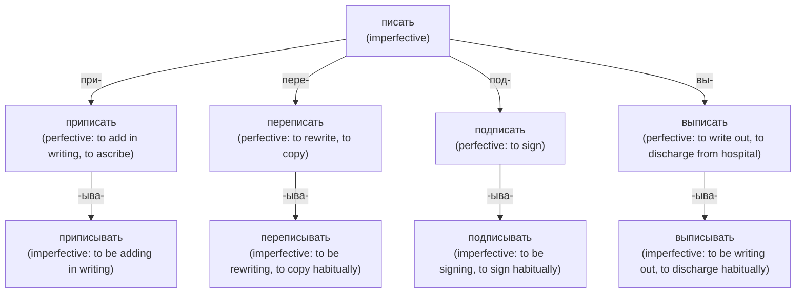

# Lesson 4: Verbal Aspect Architecture

## 1. First-Principles Intuition & Invariants

The Russian verbal aspect system represents one of the most architecturally elegant yet conceptually demanding features of Slavic grammar. Unlike the Romance and Germanic languages, which encode temporal relations primarily through tense morphology, Russian grammar partitions the verbal domain along a fundamentally different axis: the internal temporal constituency of the action itself. Every Russian verb exists in one of two aspectual states—perfective or imperfective—and this binary opposition governs not merely stylistic preference but the grammatical licensing of entire tense paradigms, the semantic compatibility with temporal adverbials, and the pragmatic felicity of utterances in discourse.

The perfective aspect views an action as a bounded, complete totality, a singular quantum of event structure with clear inception and terminus points. The perfective verb presents the action as a discrete whole, abstracted from internal phases and removed from durational extension. When a speaker selects the perfective aspect, they signal that the action has achieved its natural telos, crossed its semantic boundary, and transitioned from process to resultant state. The perfective aspect answers the question "What happened?" with finality and closure. It encodes completion, achievement, and the irreversible alteration of reality.

The imperfective aspect, in contrast, directs attention to the internal temporal unfolding of the action. It foregrounds process over result, duration over boundary-crossing, and repeatability over singularity. The imperfective presents the action as an open interval, either in progress at a reference time, habitual across multiple occasions, or abstract in its potential for instantiation. The imperfective aspect does not commit to whether the action reached completion; indeed, it remains agnostic about terminal boundaries altogether. It answers the question "What was happening?" or "What used to happen?" with emphasis on the ongoing or iterative nature of the event.

This aspectual opposition operates as a grammatical invariant throughout the verbal system. With exceedingly rare exceptions, every Russian verb belongs to either the perfective or imperfective class, and the overwhelming majority of semantic roots manifest in aspectual pairs: two lexically cognate verbs, one perfective and one imperfective, sharing a common lexical core but differing in their temporal constituency structure. The pairing mechanism operates bidirectionally through two primary morphological strategies: prefixation, which typically perfectivizes an imperfective base verb, and suffixation, which secondarily imperfectivizes a prefixed perfective to restore imperfective meaning while retaining the semantic modifications introduced by the prefix.

The aspectual choice cascades through the grammatical architecture with systematic consequences. The perfective aspect cannot form present tense indicatives; what appears morphologically as a present tense conjugation of a perfective verb functions semantically as a perfective future, expressing a single completed action that will occur. The imperfective aspect alone commands the full three-tense paradigm: present, past, and future (formed analytically with the auxiliary *быть* "to be" plus the imperfective infinitive). In the imperative mood, aspect selection encodes pragmatic nuance: perfective imperatives issue categorical directives for single actions to be completed, while imperfective imperatives request ongoing actions, invite the addressee to begin a process, or soften the directive force through durational framing.

The aspect-tense interaction reveals a profound architectural principle: aspect selection precedes tense selection in the grammatical hierarchy. A speaker first decides whether to frame an action as bounded or unbounded, completed or ongoing, singular or habitual. Only after this aspectual commitment does the tense system become available, and even then, the available tense inventory depends on the aspectual choice already made. This hierarchical dependency underscores the primacy of aspect in the Russian verbal architecture.

Beyond the simple perfective-imperfective binary, the system encodes finer-grained semantic distinctions through *Aktionsart* classes—lexical aspect categories that reflect inherent temporal properties of verb meanings. Verbs of different Aktionsart classes interact differently with aspectual morphology and exhibit distinct constraints on aspectual pairing. Semelfactive verbs denote single punctual actions (a knock, a jump, a flash); delimitative verbs add prefixes to restrict an action to a short duration; inceptive verbs mark the beginning phase of a process; completive verbs emphasize thoroughness or exhaustive scope. These Aktionsart classes layer atop the grammatical aspect system, creating a rich multidimensional space for encoding temporal and phasal nuance.

The governing principles of aspect selection emerge from the interaction of several factors: the inherent lexical semantics of the verb root, the discourse context and narrative structure, the presence or absence of explicit result states, the speaker's subjective focus on process versus outcome, and the compatibility with temporal adverbials. Adverbs of specific duration (*два часа* "for two hours") naturally co-occur with imperfective verbs, while adverbs marking discrete time points (*вдруг* "suddenly") prefer perfective verbs. The narrative structure of Russian texts typically employs perfective verbs for the main event line—the sequence of completed actions that advance the plot—while imperfective verbs provide background, scene-setting, and simultaneous ongoing states.

Mastery of the Russian aspect system demands more than rote memorization of aspectual pairs. It requires internalizing the semantic opposition between bounded and unbounded event structure, developing intuitions about how actions decompose into phases and endpoints, and cultivating sensitivity to the discourse-pragmatic functions that aspect serves in extended text and conversation. The aspect system represents the conceptual core of Russian verbal architecture, and fluency in aspect selection marks the boundary between intermediate competence and advanced mastery.

## 2. Core Architecture & Mechanics

The morphological machinery of aspectual pairing operates through three principal mechanisms: prefixation, suffixation, and suppletion. Prefixation stands as the most productive strategy, accounting for the majority of aspectual pairs and introducing the most complex semantic layering. Suffixation serves primarily to restore imperfective aspect to prefixed perfective verbs, creating secondary imperfectives that preserve the semantic modifications encoded by the prefix. Suppletion, the least common mechanism, pairs etymologically unrelated verbs to express aspectual opposition for a handful of high-frequency roots.

Prefixation transforms an imperfective base verb into a perfective derivative by attaching a spatial or directional prefix. The process accomplishes two simultaneous operations: it perfectivizes the verb by imposing a boundary on the action, and it modifies the lexical semantics by adding directional, completive, or phasal meaning. Consider the unprefixed imperfective verb *писать* (to write, to be writing), which denotes the ongoing process of writing without commitment to completion. The addition of the prefix *на-* yields *написать* (to write, to finish writing), a perfective verb that encodes both the completion of the writing action and the achievement of a result state—a finished written text. The prefix *на-* contributes a sense of surface accumulation or resultant product, transforming the open-ended process into a bounded achievement.

The system of verbal prefixes draws from a shared inventory with spatial prepositions and motion semantics. The prefix *вы-* (out, forth) adds a sense of exit or extraction: *ходить* (to walk, to go habitually, imperfective) becomes *выходить* (to go out, perfective). The prefix *при-* (toward, arrival) encodes the culmination of motion at a destination: *ехать* (to ride, to travel by vehicle, imperfective) becomes *приехать* (to arrive by vehicle, perfective). The prefix *за-* introduces inception or the crossing of a boundary into a new state: *петь* (to sing, imperfective) becomes *запеть* (to start singing, perfective). The prefix *по-* often adds delimitative meaning, restricting the action to a short period: *работать* (to work, imperfective) becomes *поработать* (to work for a while, perfective).

The semantic contribution of prefixes creates a proliferation of aspectual relationships beyond simple binary pairs. A single imperfective base verb may combine with multiple prefixes, generating a family of perfective derivatives, each encoding a distinct semantic modification. The verb *делать* (to do, to make, imperfective) combines with *с-* to form *сделать* (to do, to complete, perfective), with *пере-* to form *переделать* (to redo, to remake, perfective), with *до-* to form *доделать* (to finish doing, perfective), and with *за-* to form *заделать* (to seal up, to patch, perfective). Each prefixed perfective occupies a distinct semantic niche while maintaining aspectual opposition to the base imperfective.

This proliferation necessitates the second major mechanism: suffixation to create secondary imperfectives. When a prefix perfectivizes a base verb and simultaneously shifts its lexical meaning, the language requires a new imperfective form to express the ongoing or habitual version of that modified meaning. The secondary imperfectivizing suffixes *-ива-/-ыва-* and *-ва-* attach to perfective stems to restore imperfective aspect while preserving the semantic content introduced by the prefix. The perfective *написать* (to write, to complete writing) undergoes secondary imperfectivization with the suffix *-ыва-*, yielding *написывать* (to be writing habitually, to write repeatedly, imperfective). The perfective *переделать* (to redo) forms the secondary imperfective *переделывать* (to be redoing, to redo habitually). The perfective *приехать* (to arrive) forms the secondary imperfective *приезжать* (to be arriving, to arrive habitually), with additional consonant mutation reflecting phonological adjustments.

The suffix *-а-/-я-* operates as an alternative secondary imperfectivizing mechanism, often causing stem-internal vowel mutations and consonant alternations. The perfective *решить* (to solve, to decide) derives from the root *реш-* and forms the secondary imperfective *решать* (to be solving, to solve habitually) through suffixation and vowel backing. The perfective *купить* (to buy) forms the secondary imperfective *покупать* (to be buying, to buy habitually) after prefixation with *по-* (which here adds perfectivity without strong spatial semantics) and secondary imperfectivization. The suffix *-ва-* attaches to stems ending in vowels: the perfective *дать* (to give) combines with the prefix *от-* to form *отдать* (to give back, to return something, perfective), which then forms the secondary imperfective *отдавать* (to be giving back, to give back habitually).

The triadic structure of base imperfective, prefixed perfective, and secondary imperfective establishes the canonical aspectual chain. This chain manifests clearly in motion verbs. The indeterminate imperfective *ходить* (to walk, to go habitually, multidirectional) pairs with the determinate imperfective *идти* (to walk, to go, to be going, unidirectional), which then accepts prefixes. The prefix *при-* attaches to *идти* to form *прийти* (to arrive on foot, perfective), which then undergoes secondary imperfectivization to yield *приходить* (to be arriving on foot, to arrive on foot habitually, imperfective). The prefix *вы-* attaches to *идти* to form *выйти* (to exit, to go out, perfective), which forms the secondary imperfective *выходить* (to be exiting, to exit habitually, imperfective). This triadic pattern—indeterminate imperfective for general habitual motion, determinate imperfective for concrete ongoing motion, prefixed perfective for completed motion with directional meaning, secondary imperfective for habitual or ongoing motion in that direction—structures the architecture of the entire motion verb paradigm.

Suppletion operates for a small set of high-frequency verbs where the aspectual partners derive from entirely different etymological roots. The imperfective *говорить* (to speak, to say) pairs with the perfective *сказать* (to say, to tell) in many contexts, though the semantic overlap remains partial. The imperfective *брать* (to take) pairs with the perfective *взять* (to take). The imperfective *класть* (to put, to lay) pairs with the perfective *положить* (to put, to lay). These suppletive pairs must be memorized as lexical facts, as no morphological regularity predicts the pairing.

The architectural schematic of aspectual pairing proceeds as follows:

```
BASE IMPERFECTIVE (unprefixed)
    ↓
PREFIX ATTACHMENT → PERFECTIVE (prefixed)
    ↓
SECONDARY IMPERFECTIVIZING SUFFIX → SECONDARY IMPERFECTIVE (prefixed + suffix)
```

For the concrete example of the root *писать* (to write):

```
писать (to write, imperfective, unprefixed)
    ↓ [prefix на-]
написать (to write/finish writing, perfective, prefixed)
    ↓ [suffix -ыва-]
написывать (to write habitually/repeatedly, imperfective, prefixed + suffix)
```

The same base imperfective may spawn multiple such chains in parallel:



This radial structure generates aspectual families rather than simple pairs, with each prefixed branch encoding a distinct semantic modification while maintaining aspectual opposition through suffixation.

Certain Aktionsart classes impose constraints on aspectual pairing. Semelfactive verbs, which denote single instantaneous actions, typically form through suffixation with *-ну-* attached to imperfective bases. The imperfective *прыгать* (to jump, to be jumping habitually) forms the semelfactive perfective *прыгнуть* (to make a single jump). The imperfective *кричать* (to shout, to be shouting) forms the semelfactive perfective *крикнуть* (to give a single shout). These semelfactive perfectives resist further prefixation or secondary imperfectivization, as their semantics already encode atomicity and completion.

Delimitative verbs, formed with the prefix *по-* attached directly to imperfective bases, encode actions restricted to a short or moderate duration. The imperfective *спать* (to sleep) forms the delimitative perfective *поспать* (to sleep for a while). The imperfective *читать* (to read) forms the delimitative perfective *почитать* (to read for a while). Delimitative perfectives do not ordinarily undergo secondary imperfectivization, as their semantics inherently resist habitualization—one does not habitually engage in temporally delimited actions as a category.

The aspect-tense interaction manifests in paradigm availability. Perfective verbs conjugate in only two tenses: past and future. The perfective past conjugates with the standard past tense suffixes (*-л, -ла, -ло, -ли*), agreeing in gender and number. The perfective future conjugates using present tense personal endings, but the resulting forms express future meaning. The perfective verb *написать* (to write, to finish writing) conjugates in the future as *напишу, напишешь, напишет, напишем, напишете, напишут* (I will write, you will write, he/she will write, we will write, you will write, they will write). These forms are morphologically present but semantically and functionally future.

Imperfective verbs, by contrast, command the full three-tense paradigm. The imperfective present uses present tense personal endings to express ongoing or habitual actions in the present. The imperfective past uses past tense suffixes to express ongoing, habitual, or incomplete actions in the past. The imperfective future forms analytically with the future tense of the auxiliary *быть* (to be)—*буду, будешь, будет, будем, будете, будут*—plus the imperfective infinitive. The imperfective verb *писать* (to write, to be writing) conjugates as follows:

Present: *пишу, пишешь, пишет, пишем, пишете, пишут* (I am writing, you are writing, etc.)

Past: *писал, писала, писало, писали* (I was writing, you were writing, etc.; gender and number agreement)

Future: *буду писать, будешь писать, будет писать, будем писать, будете писать, будут писать* (I will be writing, you will be writing, etc.)

The imperative mood encodes aspectual distinctions with pragmatic consequences. Perfective imperatives issue categorical commands for single completed actions: *Напиши письмо!* (Write the letter! [complete the action]). Imperfective imperatives invite the addressee to engage in the action, to begin a process, or soften the force of the directive: *Пиши письмо!* (Write the letter! [start writing, be engaged in writing]). The imperfective imperative may also function as a general invitation to perform an action habitually or as a matter of course: *Пиши мне чаще!* (Write to me more often!). The perfective imperative would be pragmatically odd in contexts of habitual or repeated action.

Negation interacts with aspect in systematic ways. Perfective imperatives, when negated, typically shift to imperfective forms. Instead of the perfective negative imperative *не напиши!* (which is grammatically possible but rare and marked), Russian strongly prefers the imperfective negative imperative *не пиши!* (don't write!). The imperfective form in negated imperatives emphasizes the request to avoid engaging in the action altogether, rather than merely to avoid completing it. This constraint reflects a broader tendency: negated perfectives often carry specific emphatic or cautionary meanings, warning against accidental completion, while negated imperfectives function as standard prohibitions.

The infinitive form alternates between perfective and imperfective depending on the governing verb and modal semantics. Modal verbs of ability, necessity, and permission select aspectual infinitives based on whether the speaker frames the action as a single completed instance or an ongoing or habitual process. The construction *мочь + infinitive* (to be able to, can) accepts both aspects: *Я могу написать письмо* (I can write the letter [complete it]) versus *Я могу писать письмо* (I can write the letter [be engaged in writing it]). The modal *начать* (to begin) strongly prefers imperfective infinitives, as beginning entails entry into an ongoing process: *Я начал писать* (I began to write). The modal *кончить/закончить* (to finish) requires imperfective infinitives, as one finishes being engaged in an ongoing action: *Я кончил писать* (I finished writing).

Phasal verbs—verbs denoting the beginning, continuation, or cessation of an action—impose aspectual constraints on their infinitival complements. The verb *начать* (to begin, perfective) / *начинать* (to begin, imperfective) governs imperfective infinitives: *Он начал читать книгу* (He began reading the book). The verb *продолжать* (to continue, imperfective) similarly governs imperfective infinitives: *Он продолжал читать* (He continued reading). The verb *перестать* (to stop, to cease, perfective) / *переставать* (to stop, imperfective) governs imperfective infinitives: *Он перестал читать* (He stopped reading). These constraints follow from the semantic logic: phasal verbs reference the internal temporal structure of the action, which only imperfective verbs expose.

## 3. High-Performance Optimization & Failure Modes

Achieving native-level fluency in aspectual selection demands more than mastering the morphological patterns and grammatical rules. Advanced practitioners must internalize the semantic and pragmatic principles that govern aspect choice in authentic discourse. Optimization strategies center on developing robust mental models of event structure, cultivating sensitivity to contextual cues, and establishing rapid decision-making heuristics for aspectual selection in real-time production.

The foundational optimization strategy involves conceptualizing actions not as undifferentiated events but as structured temporal objects with internal phase topology. Every action decomposes into an optional preparatory phase, a core processual phase, and an optional culminating phase that transitions into a resultant state. The imperfective aspect foregrounds the core processual phase, presenting the action as an open interval of activity. The perfective aspect foregrounds the boundary-crossing moment, abstracting away from internal temporal structure and emphasizing the transition from one state to another. Training the aspectual intuition requires cultivating the habit of asking, "Am I describing what was happening inside the action, or am I describing the fact that the action happened and changed the world?"

Temporal adverbials provide critical diagnostic cues for aspectual selection. Duration adverbials—expressions quantifying the temporal extent of an action such as *два часа* (for two hours), *весь день* (all day), or *долго* (for a long time)—co-occur naturally with imperfective verbs, as they presuppose access to the internal temporal structure of the action. The sentence *Я читал книгу два часа* (I was reading the book for two hours) employs the imperfective *читал*, as the adverbial measures the duration of the ongoing reading process. Point-time adverbials—expressions locating an action at a specific moment such as *вдруг* (suddenly), *сразу* (immediately), or *в три часа* (at three o'clock)—prefer perfective verbs when the action is construed as a singular completed event. The sentence *Он вдруг встал и ушёл* (He suddenly stood up and left) employs the perfectives *встал* and *ушёл*, as the adverbial *вдруг* frames the actions as punctual boundary-crossings.

Frequency adverbials—expressions indicating repetition such as *часто* (often), *всегда* (always), *каждый день* (every day), or *обычно* (usually)—strongly prefer imperfective verbs, as habitual and repeated actions are modeled as ongoing processes iterated across multiple occasions rather than as sequences of discrete completed events. The sentence *Я каждый день писал письма* (Every day I wrote letters / I used to write letters every day) employs the imperfective *писал*, as the adverbial *каждый день* signals habitual repetition. A perfective verb in such contexts would be ungrammatical or would force a reinterpretation of the adverbial as distributive over a closed set of occasions.

Narrative discourse structure exhibits systematic aspectual patterning. The main event line—the sequence of completed actions that advance the plot chronologically—employs perfective verbs exclusively. Each perfective verb contributes a discrete event that moves narrative time forward. The sentence *Он встал, оделся, позавтракал и вышел из дома* (He got up, got dressed, had breakfast, and left the house) consists entirely of perfectives (*встал, оделся, позавтракал, вышел*), forming a linear sequence of completed actions. Imperfective verbs in narrative discourse provide background, describe simultaneous ongoing states, or establish habitual patterns that frame the perfective event sequence. The sentence *Пока он завтракал, его жена читала газету* (While he was having breakfast, his wife was reading the newspaper) embeds imperfective verbs (*завтракал, читала*) to describe two simultaneous background processes, while perfective verbs would appear in the subsequent event line that interrupts or follows this background.

Resultative and non-resultative contexts impose aspectual constraints. Perfective verbs entail the existence of a result state that persists after the action's completion. The sentence *Я написал письмо* (I wrote the letter) entails that a completed letter now exists as a result of the writing action. Imperfective verbs do not entail such result states; they remain agnostic about whether the action achieved its natural endpoint. The sentence *Я писал письмо* (I was writing the letter) does not entail that the letter reached completion; the writing process may have been interrupted, abandoned, or still ongoing at the reference time. Contexts that presuppose the existence of a completed result—such as object reference to the product of an action—strongly prefer perfective verbs. The sentence *Покажи мне письмо, которое ты написал* (Show me the letter that you wrote) employs the perfective *написал*, as the relative clause presupposes a completed letter available for demonstration.

Aspectual selection under negation requires careful attention to scopal interpretation. Negated perfective verbs typically deny that the action reached completion or occurred at all within the expected timeframe, while negated imperfective verbs deny engagement in the action as an ongoing process or habitual practice. The sentence *Я не прочитал книгу* (I did not read the book [did not finish it]) employs the perfective *прочитал*, denying that the reading process reached its natural culmination. The sentence *Я не читал книгу* (I did not read the book [did not engage in reading it]) employs the imperfective *читал*, denying engagement in the reading process without commitment to whether completion was expected or attempted. In past tense contexts, the perfective negation often implies an expectation or obligation that was not fulfilled, while the imperfective negation makes a simpler factual denial of participation.

Modal contexts introduce additional optimization complexity. Deontic modals expressing obligation, permission, or prohibition interact with aspect to encode nuances of single versus repeated actions, specific versus general directives, and categorical versus process-oriented framing. The obligation construction *должен + infinitive* (must, have to) accepts both aspects with distinct interpretations. The sentence *Ты должен написать письмо* (You must write the letter [complete it]) employs the perfective infinitive *написать*, imposing an obligation to achieve the completed result. The sentence *Ты должен писать письмо* (You must write the letter [be engaged in writing it, make progress on it]) employs the imperfective infinitive *писать*, imposing an obligation to engage in the process without specifying completion. Epistemic modals expressing possibility or probability prefer perfective infinitives when speculating about completed events and imperfective infinitives when speculating about ongoing states.

Common failure modes in aspectual selection cluster around several systematic error patterns. Anglophone learners frequently overgeneralize perfective aspect, treating it as a default past tense marker analogous to the English simple past. This error produces sentences like *Вчера я читал и написал* (Yesterday I read and wrote) when the intended meaning involves two simultaneous background activities requiring dual imperfectives: *Вчера я читал и писал* (Yesterday I was reading and writing). The perfective overgeneralization error also manifests in habitual contexts, where learners produce ungrammatical or pragmatically odd sentences like *Каждый день я написал письмо* (Every day I wrote a letter [perfective]) instead of the correct imperfective *Каждый день я писал письмо* (Every day I wrote letters / I used to write a letter every day).

The converse error—imperfective undergeneralization—occurs when learners fail to recognize narrative-advancing completed events, instead treating them as background processes. This produces narrative sequences where perfective verbs should appear in the event line but imperfective verbs are used instead, creating a sense of non-progression or simultaneity rather than chronological sequence. The sentence *Он вставал, одевался, завтракал и выходил из дома* (He was getting up, getting dressed, having breakfast, and going out of the house) uses imperfectives where perfectives are required for narrative progression, resulting in an interpretation of habitual or repeated actions rather than a single completed sequence.

Prefix selection errors occur when learners select the wrong prefix for the intended semantic modification, producing aspectual pairs that are morphologically well-formed but semantically inappropriate. The distinction between *написать* (to write, to finish writing) and *подписать* (to sign, literally to write under) rests on prefix semantics; confusing these produces grammatical but nonsensical sentences. Similarly, motion verb prefixes encode precise directional meanings: *войти* (to enter, literally to in-go) versus *выйти* (to exit, to go out) versus *прийти* (to arrive on foot, literally to toward-go) versus *уйти* (to leave, to go away). Selecting the wrong prefix produces sentences that are aspectually correct but directionally incoherent.

Secondary imperfective omission errors arise when learners attempt to express habitual or ongoing versions of prefixed perfective verbs without applying secondary imperfectivization. This produces ungrammatical combinations of frequency adverbials with perfective verbs. The sentence *Я часто написал письма* (I often wrote letters [perfective]) is ungrammatical; the correct form requires the secondary imperfective *писал* or, if the prefixed semantics must be preserved, the secondary imperfective *написывал*: *Я часто писал письма* or *Я часто написывал письма*. The latter sentence, using the secondary imperfective *написывал*, is less common and carries an emphatic or unusual flavor, as secondary imperfectives often sound marked or bookish in ordinary speech unless the prefixed semantics genuinely require expression.

Imperative aspect misalignment produces pragmatically inappropriate or rude-sounding commands. Using a perfective imperative where an imperfective would soften the directive creates an overly categorical tone: *Садись!* (Sit down! [imperfective, invitation to be seated]) versus *Сядь!* (Sit down! [perfective, brusque command to complete the action of sitting]). Conversely, using an imperfective imperative where a perfective is required dilutes the urgency or specificity of the command: *Закрывай дверь!* (Close the door! [imperfective, perhaps ongoing or repeated action]) versus *Закрой дверь!* (Close the door! [perfective, single completed action expected now]). Native speakers modulate politeness, urgency, and social register through aspectual choice in imperatives, and learners who ignore these distinctions risk sounding either inappropriately harsh or insufficiently direct.

Optimization of aspectual fluency proceeds through intensive pattern recognition drills with aspectual minimal pairs. Constructing sentence sets that differ only in aspectual choice, while holding all other lexical and syntactic variables constant, trains the learner to perceive the semantic and pragmatic contrasts encoded by aspect. Example drill set:

*Я читал книгу, когда ты позвонил.* (I was reading a book when you called. [imperfective *читал*: background ongoing activity])

*Я прочитал книгу, когда ты позвонил.* (I finished reading the book when you called. [perfective *прочитал*: completed action at the moment of the call])

*Я читал эту книгу.* (I was reading this book / I read this book [process emphasized, no commitment to completion]. [imperfective])

*Я прочитал эту книгу.* (I read this book / I finished this book. [perfective, completion entailed])

*Что ты делал вчера?* (What were you doing yesterday? [imperfective *делал*: asking about ongoing activities])

*Что ты сделал вчера?* (What did you do yesterday? / What did you accomplish yesterday? [perfective *сделал*: asking about completed achievements])

Intensive listening exposure to native narrative discourse provides essential input for aspectual intuition development. Learners should analyze recorded narratives, identifying the perfective verbs that form the event line and the imperfective verbs that provide background, simultaneity, and habitual framing. Transcription and annotation exercises, where learners mark each verb for aspect and justify the choice based on discourse function, solidify the connection between aspectual morphology and narrative pragmatics.

Production drills should incorporate constrained narrative generation tasks where learners recount personal experiences or construct fictional narratives, forcing explicit aspectual choices at every verb. Peer review or instructor feedback on these narratives should focus specifically on aspectual appropriateness, identifying instances where aspect selection creates semantic anomalies, pragmatic infelicity, or narrative incoherence. Revision exercises that require learners to rewrite the same narrative content with alternative aspectual choices, examining how aspect shift changes meaning and discourse function, deepen metalinguistic awareness.

Advanced practitioners benefit from explicit study of Aktionsart classes and their interaction with aspectual morphology. Analyzing verbs according to their inherent temporal properties—whether they denote states, activities, accomplishments, or achievements in the classic Vendlerian taxonomy—provides a framework for predicting aspectual behavior and constraints. Stative verbs like *знать* (to know) and *любить* (to love) resist perfective aspect in most contexts, as states lack the internal temporal structure and boundary-crossing events that perfectivity encodes. Activity verbs like *гулять* (to stroll, to walk for pleasure) and *работать* (to work) readily accept both aspects but favor imperfective for ongoing or habitual readings. Accomplishment verbs like *строить дом* (to build a house) and *писать роман* (to write a novel) naturally pair with perfective aspect when the focus is on achieving the culminating endpoint. Achievement verbs like *находить* (to find) and *умирать* (to die) inherently encode punctual boundary-crossing and strongly prefer perfective aspect for completed events.

Mastery of the motion verb system represents a critical high-performance optimization target, as motion verbs exhibit the most elaborate aspectual architecture in Russian. The fourteen primary motion verb pairs—each consisting of an indeterminate imperfective for multidirectional or habitual motion and a determinate imperfective for unidirectional ongoing motion—combine with the full inventory of directional prefixes to generate hundreds of aspectual derivatives. The determinate imperfective *идти* (to go on foot, unidirectional) combines with *при-* (arrival), *у-* (departure away), *вы-* (exit), *вхо-* (entrance), *подо-* (approach), *отъ-* (departure from), *про-* (through), *пере-* (across, over), *до-* (reaching up to), *об-* (around), and others, each generating a prefixed perfective that then forms a secondary imperfective. Drilling motion verb aspectual chains to automaticity—where the learner can rapidly produce the full morphological paradigm and deploy the correct aspectual form in context—constitutes an essential fluency milestone.

The ultimate optimization target is the internalization of aspectual choice as a pre-articulatory cognitive operation. Native speakers do not consciously deliberate over aspectual selection; the choice emerges automatically from the conceptualization of the event structure and the discourse context. Advanced learners approach this native-like automaticity through sustained immersion, massive input exposure, and iterative production practice with corrective feedback. Aspectual mastery marks the transition from analytic, rule-governed language use to intuitive, experience-driven fluency, where the grammatical architecture operates below the threshold of conscious awareness, enabling effortless real-time communication.
