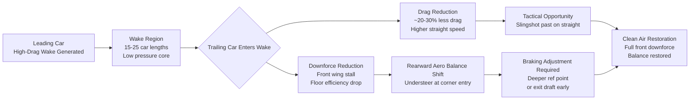

# Lesson 4: Driver Exploitation of Aerodynamic Performance

## 1. First-Principles Intuition & Invariants

There is a moment, familiar to any driver who has pushed a high-downforce car to its genuine limit, where the machine feels less like a vehicle and more like a pressure differential made physical. The front axle bites with a ferocity that defies the posted speed. The rear squats and plants under traction in a way no spring rate alone could explain. The car communicates not through steering weight or seat-of-the-pants g-forces in isolation, but through a composite sensation that is partly mechanical and partly aerodynamic — and the driver who cannot distinguish between the two will never fully exploit either.

Aerodynamic performance is not simply a chassis setup variable handed down from the garage. It is a dynamic, speed-dependent force field that the driver actively navigates, exploits, and must learn to feel as a live input rather than a static constant. Understanding why requires beginning at the physics of the tire contact patch, because every aerodynamic device on the car ultimately exists to serve that small rectangle of rubber.

### The Tire, the Contact Patch, and the Case for Downforce

A racing tire generates lateral force through slip angle: the angular difference between the direction the tire's contact patch is physically traveling and the direction the wheel plane is pointing. As slip angle increases from zero, lateral force rises, reaches a peak at some optimal angle — typically between 4° and 10° depending on compound, construction, and load — and then drops off as the contact patch transitions from elastic deformation into sliding friction. This relationship is captured in the Pacejka "Magic Formula" tire model, but more immediately useful to the driver is the physical intuition behind it: the tire is a pneumatic spring loaded in shear, and it generates maximum lateral grip when it is working, but not overworking.

What aerodynamic downforce does to this relationship is not glamorous, but it is profound. The vertical load $F_z$ on the tire shifts the entire Pacejka curve upward. More precisely, the peak lateral force $F_y^{peak}$ scales roughly with $F_z$ — not linearly (there is diminishing return due to the friction coefficient $\mu$ itself degrading slightly under higher normal load), but strongly enough that doubling downforce can increase available lateral force by 60–70% at circuit speeds. The practical consequence is that at 180 km/h, a modern GT3 car with moderate downforce is generating lateral forces at its front axle that would destroy the front tires of an identical car with the wings removed at the same speed, simply because the aerodynamic package creates the prerequisite vertical load for the tire to function in its designed operating window.

This creates the first invariant of driver aerodynamic exploitation: **downforce is not primarily a cornering force — it is a tire load management system.** The wings do not steer the car. They permit the tires to operate at slip angles deep enough to generate the steering forces required at speed. A driver who treats downforce as a passive background phenomenon and focuses only on mechanical grip is ignoring half the physics of their car.

The second invariant is speed-dependency. Aerodynamic forces scale with the square of velocity: $F_{aero} = \frac{1}{2} \rho v^2 C A$, where $\rho$ is air density, $v$ is velocity, $C$ is the relevant aerodynamic coefficient, and $A$ is the reference area. This square-law relationship means that the aerodynamic contribution to total vertical load is negligible at low speed and dominant at high speed. A car that behaves neutrally through a slow chicane on mechanical grip alone may feel radically different — tighter, more planted, with sharper initial turn-in response — at the same steering input geometry at 200 km/h, because the aerodynamic map has fundamentally changed the front-to-rear load distribution. The driver must internalize this speed-dependent shift in car balance and adjust their inputs accordingly across the full velocity spectrum of a lap.

The third invariant concerns aerodynamic balance sensitivity to ride height and pitch attitude. The distribution of downforce between the front and rear axles is not fixed by wing angles alone. Floor-generated downforce — the dominant source in modern single-seaters and increasingly significant in GT cars with structured underfloors — is acutely sensitive to the gap between the reference plane and the road surface. A car that pitches forward under braking compresses that gap at the front, increasing front diffuser efficiency and potentially creating an aerodynamic oversteer condition at turn-in that the driver interprets as mechanical understeer corrected by pace reduction, when the actual cause is aerodynamic front-loading. Correctly diagnosing these coupled mechanical-aerodynamic behaviors is the foundation of everything that follows.

### The G-G Diagram Revisited Under Aerodynamic Loading

The classical G-G friction circle models the total available tire force as a fixed radius — a constraint envelope determined by the coefficient of friction and the static normal load. Under aerodynamic loading, this model must be extended because the available friction envelope itself grows with speed. At 60 km/h, the friction circle radius for a high-downforce car is determined almost entirely by mechanical parameters: spring rate, ride height, weight distribution, and static corner weights. At 240 km/h, the aerodynamic contribution to normal load may exceed the car's static weight, effectively doubling the friction circle radius in both lateral and longitudinal dimensions simultaneously.

This creates a regime that most drivers transitioning from low-downforce machinery find deeply counterintuitive: the car is faster through a high-speed corner when driven closer to its geometric apex at higher speed, because the aero loads are higher, the tire patch is more loaded, and the grip envelope is wider. The instinct to lift and slow down to "find grip" is mechanically correct in a low-downforce context and aerodynamically counterproductive in a high-downforce one. Learning to trust the car at speed — to hold throttle in a 220 km/h sweeper well past the point where instinct demands a lift — is the central psychological challenge of transitioning into serious aerodynamic downforce categories, and it is conquered only through deliberate telemetry validation.

---

## 2. Core Architecture & Mechanics

### Aero-Limited vs. Grip-Limited Driving Regimes

The most operationally important conceptual distinction in high-performance aerodynamic driving is understanding when the car is operating in an aero-limited regime versus a grip-limited one, because the driving techniques that maximize performance in each regime are not simply different — they are sometimes directly opposed.

A grip-limited corner is one where the available tire adhesion constrains cornering speed regardless of aerodynamic state. This is characteristic of slow to medium-speed corners: hairpins, tight chicanes, 90-degree bends entered below approximately 100 km/h in a typical GT or prototype car. Here, aerodynamic downforce is minimal, the floor is not generating meaningful ground effect, and the physics governing the corner are dominated by the tire's mechanical friction coefficient, the car's weight distribution and roll stiffness, and the driver's ability to manage load transfer transitions. Optimal technique in this regime is well-understood: late apex geometry, deliberate trail braking to maintain front axle load through turn-in, and progressive throttle application timed to allow the rear to settle before full power. The driver who rushes these transitions in a grip-limited corner will induce weight transfer transients that momentarily unload a contact patch below the threshold needed to sustain the required lateral force, and the result is a snap oversteer or understeer that no amount of aerodynamic downforce can prevent because the downforce is not present in meaningful quantity.

An aero-limited corner inverts much of this logic. At Eau Rouge/Raidillon at Spa, or through the Maggotts-Becketts-Chapel complex at Silverstone, or in the first sector at Suzuka, cornering speed is constrained not by the fundamental mechanical friction coefficient but by the driver's confidence in sustaining the aerodynamic load through the corner arc. The limiting factor is not grip in the sense of a fixed friction circle — it is the driver's ability to maintain the speed, ride height attitude, and steering geometry that keeps the aerodynamic devices operating at peak efficiency while simultaneously maintaining the car at the edge of the mechanical contact-patch limit.

The workflow of identifying which regime governs a given corner begins with channel data. A well-instrumented car logged on a data acquisition system (MoTeC i2 Pro, AIM RS3 Analysis, or the Bosch DDU ecosystem) should be analyzed with the following channel stack during post-session review:

| Channel | Physical Source | Sample Rate |
|---|---|---|
| Lateral Acceleration $G_y$ | IMU (3-axis accelerometer) | 100 Hz minimum |
| Longitudinal Acceleration $G_x$ | IMU | 100 Hz minimum |
| Front/Rear Ride Height | Linear potentiometers, one per corner | 200 Hz |
| Wheel Speed (×4) | Hall-effect sensors on hubs | 200 Hz |
| Steering Angle | Steering column encoder | 100 Hz |
| Throttle Position | Potentiometer or CAN from ECU | 100 Hz |
| Brake Pressure (front/rear) | Hydraulic pressure transducers | 200 Hz |

With this stack, the engineer overlays the lateral acceleration trace against the speed trace at the corner entry and apex. In an aero-limited corner, the lateral G peak will occur at or near maximum speed through the corner. The critical diagnostic is the shape of the $G_y$ trace: a smooth, sustained plateau held at high lateral G through mid-corner at high speed is the signature of an aerodynamically-loaded tire working efficiently. A trace that spikes at corner entry, dips through mid-corner, and spikes again at exit is the mechanical grip signature — load transfer transient at entry, reduced grip at mid-corner steady-state, and throttle-induced rear load increase at exit.

Equally important is the front ride height channel. If the front ride height trace shows a significant drop at mid-corner entry that recovers as the driver lifts, the floor geometry is pitch-sensitive: the front splitter and floor inlet are loading disproportionately as the nose pitches down under braking deceleration, shifting aerodynamic balance forward. This often masquerades as mechanical understeer on circuit but corrects when the driver adopts a shallower trail-braking profile that reduces nose-dip depth.

```text
Corner Entry Dynamics — Telemetry Trace Schematic

Speed (km/h)
     250 |                              ╭──────╮
     200 |                        ╭────╯        ╰────╮
     150 |               ╭───────╯                    ╰────╮
     100 |──────────╮───╯                                   ╰──
      50 |           ╰──  Braking Zone → Apex → Exit Accel
          ───────────────────────────────────────────────────► Distance

Lateral G (aero-limited, high-speed sweeper)
       2 |                       ╭────────────╮
     1.5 |                   ╭──╯              ╰──╮
       1 |               ╭──╯                      ╰──╮
     0.5 |──────────╮───╯                              ╰────
       0 |           ╰ Plateau sustained at speed = aero loading confirmed
          ───────────────────────────────────────────────────► Distance

Front Ride Height (mm from reference plane)
      60 |────────╮
      50 |         ╰──╮          ╭──────────────────────────
      40 |             ╰──╮──────╯ ← Nose pitch-down under braking recovers
      30 |                 ╰──── Minimum at peak decel: watch for aero overpush
          ───────────────────────────────────────────────────► Distance
```

### Slip Angle Management in High-Speed Cornering

Managing slip angle in high-speed aerodynamic corners demands a different physical intuition than in mechanical-grip corners, and the distinction turns on the interaction between aerodynamic downforce and the shape of the tire's lateral force-slip angle curve at high normal loads.

As vertical load increases (which it does continuously from low to high speed due to the $v^2$ scaling of downforce), the peak of the lateral force curve shifts to a slightly lower slip angle. The well-loaded aerodynamic tire at high speed achieves its peak grip at a relatively small slip angle — perhaps 4–6° — whereas the same tire at low speed with minimal downforce may need 7–9° of slip angle to reach peak lateral force. The practical implication is that high-speed aerodynamic corners should be driven with smaller steering corrections than the mechanical-grip instinct suggests. A driver trained predominantly on low-downforce cars will often oversteer through the steering wheel in fast sweepers, working the front tires into excessive slip angle precisely when the aero loading would have delivered peak lateral force at a smaller angle. The result is tire overheating on the front axle, degraded front downforce efficiency (the front wing's effectiveness is sensitive to stagnation point displacement from large steering angles), and understeer that is entirely self-induced.

The correct technique is to build steering angle smoothly to the minimum value required to hold the cornering arc, then hold it. This sounds obvious but is psychologically demanding because the sensation of a heavily loaded car at high speed with modest steering angle feels wrong to an inexperienced driver — it feels like the car is running wide, and the instinct is to add steering. Trust in this discipline comes from telemetry: comparing the steering angle trace of a fast lap against a slow lap at a 200 km/h sweeper will frequently show that the faster lap has less peak steering angle, held with greater consistency through the arc. The slow lap shows corrective inputs, mid-corner steering additions, and the characteristic "saw-tooth" steering trace of a driver chasing understeer with steering corrections that are themselves generating more front-tire slip angle and deepening the problem.

Throttle management through high-speed corners is equally precise in its aerodynamic consequences. Because the rear wing's downforce generation is load-path matched to the rear axle, any forward weight transfer induced by a premature throttle lift in mid-corner reduces rear aero efficiency at exactly the moment when the rear axle is at maximum lateral load demand. The technique is deliberate maintenance of partial throttle through the corner — enough to hold the drivetrain in slight positive torque, keeping the rear suspension geometry in its designed orientation and preventing the squat-to-extension transition that disturbs rear ride height. In many rear-wheel-drive cars with floor-generated rear downforce, a mid-corner lift changes the rear floor ride height, reduces underbody pressure, and induces a step-change loss of rear grip that feels to the driver like sudden oversteer. It is not snap oversteer in the mechanical sense — it is an aerodynamic unloading event disguised as a handling characteristic, and the correction is throttle discipline rather than chassis setup change.

### Slipstreaming: Exploiting Wake Turbulence Mechanics

Slipstreaming — drafting within the disturbed wake of a leading car — is one of the most tactically complex aerodynamic tools available to the racing driver, and its execution requires real-time reasoning about invisible fluid dynamics at race speeds.

The leading car's aerodynamic package creates a low-pressure wake region behind it. The shape of this wake is not a simple cone but a complex, three-dimensional turbulent zone whose character depends on the leading car's specific aerodynamic configuration. A high-downforce car with large rear wing produces a wide, energetic wake with a pronounced low-pressure core extending 15–25 car lengths behind it at race speed, while a low-drag configuration produces a narrower, shallower wake. The trailing driver within this zone experiences two simultaneous effects: a reduction in aerodynamic drag (because the disturbed airflow reduces the dynamic pressure seen by the car's frontal area, lowering drag force), and a reduction in aerodynamic downforce (because the same disturbed airflow reduces the velocity differential above and below the floor and wings, cutting downforce generation).

The drag reduction benefit of drafting is well understood and straightforward to exploit: a car fully inside a larger car's draft can experience drag reductions of 20–30%, translating to meaningful straightline speed gains that enable overtaking opportunities at the end of long straights. What is less understood operationally is the **downforce penalty** component, which creates a handling asymmetry that catches drivers off-guard: the car that felt perfectly balanced in clean air now has reduced front wing efficiency (the turbulent wake disrupts attached flow over the front wing's main element and flaps), reduced floor loading (the underbody flow is now working against a disturbed free-stream), and potentially a reduced rear wing contribution depending on how the wake's turbulence interacts with the rear wing's stagnation chord.

The practical effect is that a car following closely in a heavy-downforce draft will experience understeer at corner entry — particularly at fast, aero-limited corners approached at the end of a straight — because front downforce degrades more rapidly than rear downforce in turbulent wake. This is a critical safety and performance consideration: the fastest approach to a braking zone in a draft is not the same as the fastest approach in clean air, because the car's aerodynamic balance has shifted rearward, and the braking reference points and trail-braking depth that work in clean air will produce understeer and missed apexes in dirty air. Experienced drivers account for this by either breaking out of the draft earlier before a critical high-speed corner to restore clean-air front downforce, or by adjusting their braking reference point deeper into the braking zone to account for the reduced aero drag (the car will also brake differently with less drag deceleration assistance).



The slipstream-to-attack tactical workflow that maximizes both the drag benefit and minimizes the downforce penalty works as follows. The trailing driver positions the car to maximize draft benefit on the straight — typically within 0.3–0.5 seconds of gap to the leading car, which corresponds to roughly 20–30 meters at 240 km/h. Through this phase, they are aware that front downforce is compromised and avoid any high-speed mid-straight direction changes (lane changes in a straight) that would demand front axle lateral force from a partially stalled front wing. As the braking zone approaches, the driver must make a live decision: break out of the draft 50–80 meters early to restore front downforce before the threshold braking event and trail-braking arc, or stay in the draft for maximum entry speed and account for the reduced braking deceleration (less drag assistance) with a later initial brake application, while expecting the car to have reduced front-end grip through the corner entry.

This decision hinges on the specific corner geometry. At a slow-speed hairpin following a long straight, the aero-limited downforce issue is largely irrelevant because the car will have slowed to a speed where mechanical grip dominates by the time it reaches the corner apex. The draft benefit is fully exploited for entry speed, and the reduced braking from less aero drag is the primary adjustment. At a medium-high speed corner following a straight — such as a 150–180 km/h constant-radius sweeper entered immediately after the braking zone — the front downforce deficit is performance-critical, and breaking the draft early to restore clean-air front wing efficiency is often faster than maintaining maximum entry speed with compromised front axle behavior.

---

## 3. High-Performance Optimization & Failure Modes

### Optimizing the Aero-Limited High-Speed Corner

The highest-value performance gains available in high-downforce categories come from developing absolute precision in the high-speed corners where aerodynamic loading is at its peak. The incremental time available through these corners is disproportionately large: a driver who is 2 km/h faster through a 220 km/h sweeper maintains that speed advantage throughout the entire arc, whereas the same 2 km/h advantage at a 60 km/h hairpin apex contributes a fraction of that time gain.

Optimization begins in the data review. The target analysis workflow for a high-speed corner in MoTeC i2 Pro or equivalent software starts by overlaying the best lap's speed trace against the reference driver's speed trace through the corner, then examining the specific channels that explain any gap. The most common finding is a mid-corner speed delta that traces back not to corner entry speed but to steering angle consistency. A driver who is slower mid-corner will often show a steering angle trace that begins adding lock mid-corner while the reference shows a held or slightly reducing lock angle. This is the kinematic signature of understeer caused by one of three sources: front tire thermal overload from excessive entry slip angle, insufficient front ride height causing floor pitch sensitivity, or over-conservative corner entry speed below the aerodynamic loading threshold where front grip is at its peak.

Distinguishing between these causes requires cross-referencing the front tire temperature channel (infrared sensors reading inner/middle/outer tread bands if available, or tire surface temperature via pyrometer in post-session), the front ride height trace, and the steering angle trace simultaneously. Front tire overheating — indicated by inner-edge temperatures exceeding the target operating window and an asymmetric inner-biased temperature spread — points to excessive entry slip angle or insufficient negative camber. Front floor pitch sensitivity shows as a correlation between nose-dip depth during braking and the onset of understeer: the floor is creating front downforce during the pitch transient that shifts the aerodynamic balance forward, then releasing it as the car levels at mid-corner, creating the subjective sensation of "falling off" the apex. Over-conservative entry speed is identified by comparing the minimum speed point against the speed at which the lateral G trace shows the front tire approaching its slip-angle limit: if the driver is 15 km/h below that speed, they never brought the aerodynamic package into its efficient operating range.

The setup interaction most critical to high-speed corner performance is the relationship between front ride height, aerodynamic balance, and front spring rate. A front spring rate that is too soft allows excessive nose pitch under braking, which dynamically shifts aero balance forward through the entry phase before the car levels at apex. The driver compensates for this by reducing trail braking depth, sacrificing corner entry speed. The correct fix is a front spring rate increase — or stiffer front rebound damping to control the pitch velocity — that maintains a more consistent ride height through the braking-to-apex transition. The rule of thumb in prototype and formula car engineering is that every 5 mm of additional front ride height depression under peak braking deceleration corresponds to roughly 3–4% of forward aerodynamic balance shift, which requires either spring/damper correction or driver technique accommodation.

Front anti-roll bar stiffness interacts with this in a less obvious but equally important way. A stiffer front ARB reduces body roll and therefore limits the lateral migration of the front roll center, maintaining a more consistent front wing height above the road surface through the cornering arc. Because most front wing designs exhibit ground effect sensitivity — downforce increases as the front wing mainplane approaches the road — a stiff ARB that keeps the front wing at a consistent ride height produces more predictable front downforce through the corner compared to a soft ARB that allows the inside front corner to rise significantly mid-corner, reducing front wing efficiency on that side. The asymmetric loading of a turning car means the outboard front corner is the net contributor to front downforce under cornering, but the inside-corner rise still introduces a pitch asymmetry that affects the front splitter's effective angle of attack.

### Wake Turbulence Failure Modes and Mitigation

The most consequential failure mode specific to aerodynamic exploitation is the **sudden downforce loss event** — a step-change reduction in aerodynamic grip rather than a gradual degradation — which produces an abrupt and potentially unrecoverable handling condition. These events occur in several distinct scenarios, each requiring specific recognition and mitigation.

The first scenario is wake entry at high lateral load. A car already at 80% lateral G in a high-speed corner that enters the wake of a competitor — through an overtake attempt on the outside or a close-quarters midfield battle — experiences a sudden front downforce reduction mid-corner. The front axle loses grip without any driver input change, and the result is snap understeer into a wide exit or, if the driver responds with a sharp steering correction, a combined lateral and steering force demand on the front tires that exceeds the now-reduced available grip. The correct response — and the response that must be pre-planned rather than reactive — is a simultaneous minor throttle application to shift load rearward and stabilize the rear while reducing steering angle and accepting a wider corner exit. The instinct to add steering and add brake is counterproductive: it places a combined longitudinal-lateral demand on a contact patch with reduced aerodynamic load capacity.

The second scenario is floor stall under excessive ride height change. Modern closed-category cars with structured underfloors can experience a discontinuous, hysteretic floor stall — a phenomenon where the underbody flow attaches at a certain ride height, generates strong downforce, but separates suddenly if ride height exceeds a critical threshold. This threshold is not always obvious from static setup: it can be triggered by a bump, a kerb strike, or an aggressive suspension rebound event that momentarily lifts the car above the stall height. The diagnostic signature in telemetry is a sudden vertical acceleration spike (the car rising on a bump or rebound event) temporally correlated with a loss of lateral acceleration in the following corner entry. The mitigation is bump damping calibration: sufficient bump rate to control the vertical velocity on kerbs and bumps, preventing the rapid ride height excursion that triggers stall, without introducing harshness that disturbs tire contact patch conformance on the same surfaces.

The third and most purely tactical failure mode is **slipstream mismanagement in braking zones**. This occurs when a driver exploiting a draft into a heavy braking zone fails to account for the fact that aerodynamic drag — which provides meaningful braking deceleration assistance at high speed — is reduced in dirty air. A driver who follows closely in a draft, inherits the leading car's braking reference point, and applies full threshold brake pressure at the same distance marker will find that the reduced drag deceleration in the wake means their car is arriving at the corner entry with more kinetic energy than anticipated. The braking event is insufficient. The result is corner overshoot, which at a high-speed corner is dangerous and at a slow corner is merely a lost overtaking opportunity turned into a defensive mistake.

The preventive framework is straightforward in principle but requires discipline under the adrenaline of a live overtake. When following in a heavy draft, brake 5–10 meters earlier than the clean-air reference — not shallower, despite the higher entry speed, because the reduced drag means the car is both faster at the board and decelerating more slowly once brakes are applied. This is a counterintuitive double adjustment: the entry speed is higher (exploiting draft) and the braking deceleration rate is lower (less drag), so the total braking distance required is longer than clean air at the same board despite apparently being "in the slipstream with speed." Engineers should provide drivers with specific adjusted braking reference markers for high-usage overtaking zones at each circuit, calculated from the measured drag reduction coefficient in the specific car-to-car following scenario at that event.

### Developing Aerodynamic Feel: The Practitioner's Long Game

The difference between a driver who understands aerodynamics intellectually and one who exploits it at race pace is the development of what engineers call aerodynamic feel — a real-time, subconscious awareness of when the car's aerodynamic devices are working efficiently and when they are compromised. This is not an innate talent. It is built systematically through a specific practice regime.

The essential building block is deliberate telemetry review following sessions in which the driver has explicitly tried to vary their aerodynamic exploitation technique. Rather than simply reviewing the lap time delta and accepting the engineer's summary, the driver should lead the review of three specific channels: front ride height, lateral G trace shape, and steering angle trace. Reviewing these three channels after every session at a new circuit, the driver builds a mental model of how their inputs cause ride height changes, how those height changes appear as lateral G variations, and how their steering discipline appears as trace shape. After several sessions of this discipline, the driver begins to feel the onset of front wing efficiency loss before the steering registers understeer — a subtle reduction in front-end response immediacy that precedes the measurable slip angle increase by a fraction of a second, which is exactly the anticipatory margin required to make a steering or throttle adjustment before the condition develops.

The highest-level practitioners — the drivers who are genuinely fast in high-downforce categories with minimal adaptation time — share one consistent characteristic in their data: their steering angle traces are smoother, their mid-corner speed is higher relative to entry speed, and their front ride height variation is smaller through high-speed corners than their peers. These are not stylistic preferences. They are the kinematic signatures of a driver who has internalized the aerodynamic physics of their car and is delivering inputs precisely calibrated to keep the aerodynamic devices — floor, front wing, rear diffuser — operating at the efficiency they were designed for, throughout every meter of every lap.

That precision is the ultimate expression of aerodynamic exploitation in driving. It is not reading downforce figures off a data sheet. It is living inside the pressure differential, corner by corner, and conducting the car so that the downforce map the aerodynamicists designed on a CFD workstation is the same downforce map that appears in the wheel speed and ride height channels of the data logger after the session. When those two maps converge, the driver has done their job.
