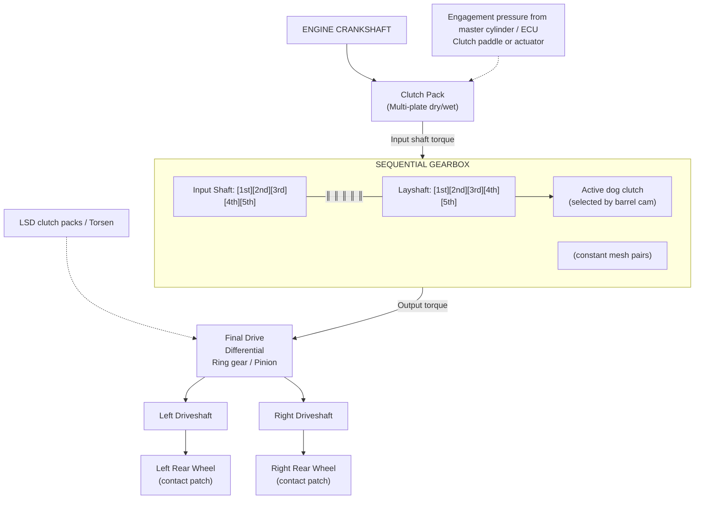
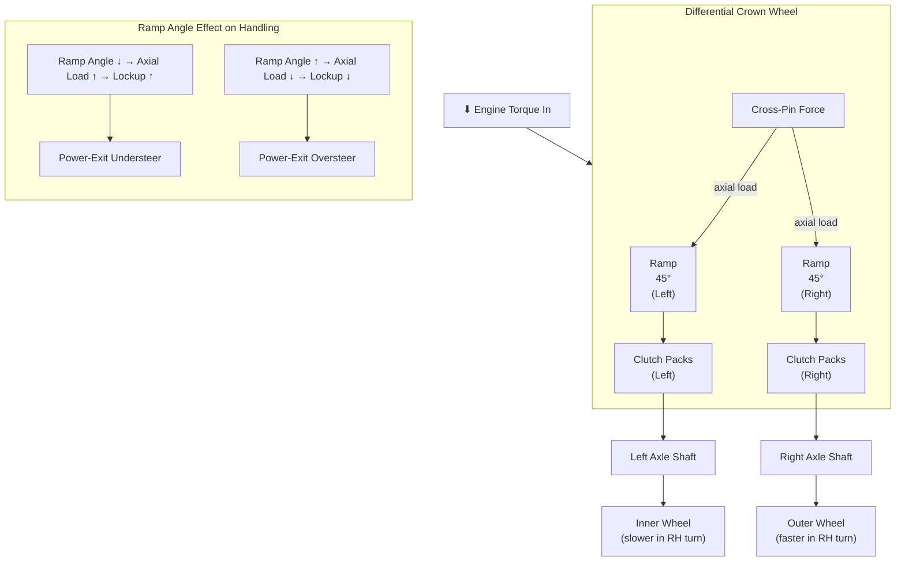

# Lesson 2: Powertrain Dynamics

## 1. First-Principles Intuition & Invariants

Every lap time ever recorded was ultimately gated by one physical reality: the powertrain's ability to convert stored chemical energy into net forward impulse at the contact patch, without overwhelming the tire's available friction budget or destroying itself in the process. Understanding powertrain dynamics at a practitioner level means understanding not just the mechanical chain from crankshaft to wheel, but the control philosophy governing how that chain is loaded, protected, and exploited at the absolute limit.

The internal combustion engine — and increasingly the hybrid traction motor — produces torque across a band of crankshaft speeds. The fundamental problem is that this torque curve is narrow. A naturally aspirated four-cylinder revving to 9,000 rpm makes useful power only above perhaps 6,000 rpm. A turbocharged unit may deliver peak torque from 2,500 rpm but fall flat at the top end. Neither curve aligns naturally with the torque demand profile of a car accelerating from 60 to 180 km/h across a straight. The transmission exists precisely to bridge this mismatch — to allow the engine to operate within its productive speed range while the wheel speed varies continuously with the car's velocity.

The governing relationship is deceptively simple. Tractive force at the driven wheels equals engine torque multiplied by the overall drivetrain ratio and final drive, divided by the loaded tire radius, with mechanical efficiency losses applied across each mesh point:

$$F_{traction} = \frac{T_{engine} \times i_{gear} \times i_{final} \times \eta_{drivetrain}}{r_{wheel}}$$

Here, $i_{gear}$ is the selected gear ratio, $i_{final}$ is the final drive ratio (ring-and-pinion), $\eta_{drivetrain}$ captures all frictional and viscous losses through the system, and $r_{wheel}$ is the dynamic rolling radius under load. What this equation encodes is a leverage relationship: a lower gear ratio multiplies engine torque more aggressively at the cost of wheel speed, while a taller gear sacrifices mechanical advantage to allow higher vehicle velocity at a given engine rpm. The race engineer's task is to construct a gear ratio stack that keeps the engine inside its peak-power band across every section of the circuit, minimizing the gaps between ratio steps so that each upshift drops revs onto the meat of the torque curve rather than into a dead zone.

The concept of **torque multiplication through ratio steps** is intuitive once you model it physically. Consider a first gear ratio of 3.0:1 combined with a final drive of 4.0:1. The total reduction from crankshaft to wheel hub is 12:1, meaning every Newton-metre the engine produces is amplified twelvefold before reaching the contact patch — minus drivetrain losses of typically 12–18% in a race-prepared sequential gearbox with dry-sump lubrication. As the driver shifts to second gear (say 2.1:1), the total ratio drops to 8.4:1, reducing the torque multiplication but allowing higher vehicle speed at the same engine rpm. The spacing between these ratios, expressed as a percentage step, determines how violently the engine falls on an upshift. A 15% step between gears is considered close for a naturally aspirated unit; turbocharged engines, whose torque curve is flatter, can tolerate 20–22% steps without the driver experiencing a dramatic surge-and-fall sensation.

Understanding this arithmetic reveals one of the most consequential decisions in car preparation: **final drive selection**. The final drive ratio sets the entire gear stack's velocity reference — it is a uniform multiplier applied to all gears simultaneously. Increasing the final drive ratio from 3.9:1 to 4.2:1 moves the entire speed range downward, shortening every gear, increasing peak acceleration in each ratio, but reducing top speed. On a tight, low-speed circuit with long second and third gear corners, a taller final drive (lower numerical ratio) sacrifices low-speed punch for a higher trap speed at the end of the main straight. Getting this decision wrong by even a tenth of a ratio can leave a driver lifting off at the braking point because the engine hits the limiter 200 metres before the corner — a situation that costs both time and mechanical sympathy.

Differential operation sits at the intersection of powertrain dynamics and vehicle handling, and it deserves a dedicated conceptual frame before we approach it mechanically. When a car corners, the outer driven wheel must rotate faster than the inner wheel because it travels a longer arc radius. An open differential accommodates this by allowing the two axle shafts to spin at different speeds while summing torque equally to both. The catastrophic limitation of an open differential in a performance context is that it sends torque to the wheel with the least resistance — which is precisely the wheel most likely to be in the air, on ice, or at peak slip angle. The result is the classic inside-wheel wheelspin that kills traction and wastes power. The limited-slip differential (LSD) addresses this by coupling the axle shafts through friction clutch packs or Torsen helical gears, restricting the speed differential between the two outputs and thereby biasing torque toward the wheel with higher available grip.

The tunable parameters of a plate-type LSD — ramp angles on the accelerating and decelerating sides of the cam plate, preload spring force, and the number of friction clutch plates — have direct, predictable effects on cornering behavior. A high power-side ramp angle (shallow, say 45°) produces aggressive lockup under throttle, pushing both driven wheels to rotate at similar speeds and generating a characteristic push (understeer) tendency as the car exits a corner under power. A steep ramp angle (90°, effectively a spool) on the coast side provides engine-braking coupling across both wheels on deceleration, increasing rear cornering stability on trail brake entry but adding a yaw resistance that can make tight hairpins feel wooden. The race engineer learns to read these behaviors not from setup sheets alone but from the driver's description of the car's attitude under power at corner exit, corroborated by telemetry traces showing differential lateral acceleration oscillation and throttle-position modulation patterns.

Drivetrain losses are rarely discussed with the precision they deserve in engineering briefings, yet they represent real lap-time. A well-engineered sequential motorsport gearbox running correct-viscosity transmission fluid at operating temperature incurs approximately 3–5% loss per gear mesh. Add the final drive hypoid mesh (another 2–4%), the differential friction losses under load, and the driveshaft plunge joint losses under suspension travel, and total drivetrain efficiency in a race-prepared car typically falls between 82% and 88%. This means that if the engine produces 300 kW at the crankshaft, between 36 and 54 kW are consumed before the power reaches the rear wheels. This is not trivial: at 180 km/h, those 36 kW represent a tractive deficit of roughly 720 N, equivalent to dragging a medium suitcase at every instant. Managing transmission fluid temperature — through dedicated oil coolers, thermostat valving, and scavenge pump flow rates — is therefore a performance issue, not merely a reliability precaution.

---

## 2. Core Architecture & Mechanics

### The Sequential Gearbox: Architecture and Power Path

The motorsport sequential gearbox replaced the H-pattern synchromesh transmission in performance applications because it eliminated the driver's need to select a specific shift gate position and because it allowed preloaded gear engagement that could be executed in 20–60 milliseconds under full engine load. Understanding its internal architecture is prerequisite to tuning it and diagnosing it.

The core of a sequential unit is a **barrel cam** (also called a shift drum) — a machined cylindrical shaft with helical grooves that accept the shift fork pins. As the drum rotates through its indexed positions (one click per gear change), the shift forks translate axially along the layshaft, sliding dog-clutch rings into engagement with the adjacent constant-mesh gear pairs. The engagement happens between dog teeth: hardened, square-profiled tabs on the sliding dog ring that lock into corresponding recesses on the gear wheel's dog face. Unlike synchromesh cones, which match shaft speeds before engagement, dog teeth engage abruptly. This demands that the shaft speeds already be matched — either by the driver precisely blipping the throttle on a downshift, or by the ECU cutting ignition and fuel briefly on an upshift to unload the drivetrain.

The power path through the gearbox is best understood as two parallel shaft systems. The input shaft receives torque from the clutch and carries a set of constant-mesh gear pairs. The layshaft (or output shaft in some designs) runs parallel, carrying the mating gears. At any moment, all gear pairs are in constant mesh — their teeth are always engaged — but only one pair is transmitting torque. The active dog clutch locks that specific gear pair to its shaft, creating the mechanical couple from input to output. All other gear pairs freewheel on their shaft bearings. The layshaft connects to the final drive pinion, which drives the ring gear in the differential housing.

The shift barrel's indexing mechanism deserves engineering attention because it is a common failure point under aggressive shifting. The barrel is indexed by a spring-loaded roller or pin that seats in detent recesses machined around the drum's end face. Under a shift input — whether from a hand-actuated lever on a sequential rod linkage, a pneumatic paddle actuator, or an electrohydraulic system — the drum rotates exactly one position. The detent spring provides the return force that positively seats the drum in the new position, preventing halfway engagement (a half-dog condition, which produces catastrophic dog tooth damage and ratio drop-out under load). Teams running pneumatic or electrohydraulic shift systems must tune actuator dwell time — the period the actuator holds pressure on the linkage — to ensure the drum completes its full rotation without overshooting the detent under high drum inertia.

### Clutch Engagement Mechanics and Launch Control

The clutch is the most operator-sensitive mechanical interface in the powertrain at race start. In a manual-clutch car without launch control, the driver must balance three competing demands simultaneously: maintaining engine rpm at a target slip point (typically 20–30% above idle, in the peak torque onset region), releasing the clutch lever or pedal at a rate that generates just enough friction disc slip to prevent stall while maximizing bite-point progression, and feeding throttle in coordination with clutch engagement to sustain the engine through the initial inertia loading. The window of time between clutch release and full mechanical lockup — commonly called the **slip phase** — represents the most energy-intensive condition the clutch faces in its entire operational life. The friction faces (typically sintered copper-based material in race applications, or Cerametallic in extreme cases) must absorb and dissipate the kinetic energy difference between the spinning engine and the stationary drivetrain.

The heat generated during this slip phase is proportional to the sliding speed between friction surfaces and the applied normal force. Because the energy absorbed scales with the square of the initial speed differential (the clutch must bring a stationary drivetrain up to engine speed), repeated launches from the same thermal baseline — as in a qualifying session or test day with multiple standing starts — will progressively degrade clutch bite point consistency as the pressure plate and friction disc accumulate heat and expand. Teams running race-start programs track clutch paddle position at slip point against lap number and ambient temperature, logging the drift of bite-point position as a thermal indicator.

Modern launch control systems remove most of this complexity from the driver's workload by automating engine torque delivery during the slip phase. The system architecture generally involves four coordinated control elements: a target rpm hold (the engine is rev-limited to a predetermined launch rpm by ignition cutting and sometimes fuel trimming), a clutch engagement schedule (expressed as a position-versus-time or position-versus-wheel-speed ramp, executed by a pneumatic or electrohydraulic actuator), a traction torque limit (the ECU reduces ignition advance and applies individual cylinder cuts to prevent wheelspin from exceeding a target slip ratio at the drive wheels), and a gear engagement logic that sequences the upshifts at peak power points on the engine map.

The launch rpm target is calibrated to the available grip and the engine's torque characteristics. On high-grip asphalt with slick tires, launch rpm is typically set near peak torque — perhaps 4,500–6,000 rpm for a turbocharged unit — to maximize initial torque multiplication through first gear. On wet or abrasive surfaces, a lower launch rpm reduces the impulsive torque demand on the contact patch. The clutch engagement ramp rate is calibrated empirically: too rapid a ramp produces wheelspin and can break traction catastrophically, while too slow a ramp overheats the clutch and extends the time the car spends at suboptimal acceleration. Data engineers look at the wheel speed versus time trace in the first 50 metres of the launch: a smooth, progressive ramp with controlled longitudinal slip peaking at 10–15% above driven-wheel speed is the target signature.

### Differential Architecture: Open, LSD, and Locking Variants

The differential's internal mechanics branch into three functional families, each with distinct operating characteristics that map to specific chassis behavior signatures on the telemetry trace.

An open differential distributes torque equally to both driven wheels regardless of speed difference. Its planetary gear architecture — a carrier housing two or four pinion gears that mesh against two side gears on the axle shafts — allows unlimited speed differential while maintaining torque balance. This is correct for road use but creates the well-known traction problem under power when one wheel loses grip.

The **mechanical plate-type LSD** adds a clutch pack on each side of the differential case, pressed together by a preload spring and additionally loaded by axial thrust forces generated by the cross-pin ramps as torque flows through the differential. When the speed differential between the two axle shafts reaches a threshold governed by the clutch pack friction coefficient, preload, and ramp angle, the clutch packs resist further differentiation. The ramp angles are the primary tuning dimension: the angle of the ramp face against which the cross-pin bears under torque. A shallow ramp angle (45°) produces high axial load per unit of transmitted torque, generating strong lockup relatively early in the torque application. A steep ramp (80°) generates minimal axial load, producing a more progressive and less aggressive lockup.

The **Torsen (Torque Sensing) differential** operates on helical worm gear principles rather than friction clutches, making it infinitely progressive and self-proportioning. Because worm gears are non-backdrivable above a certain lead angle, torque biasing happens without clutch wear or temperature sensitivity. The torque bias ratio (TBR) — the maximum ratio of torque to the fast wheel versus the slow wheel — is fixed by the gear geometry at manufacture, typically between 2.5:1 and 5:1 for motorsport units. The Torsen cannot lock completely, which makes it predictable and consistent but limits its performance on surfaces where total lockup is desirable, such as ice or gravel.

### Traction Management: From Wheelspin to Coordinated Control

Traction control in a motorsport context is not a simple wheelspin cut — it is a hierarchical torque management strategy that operates across multiple control channels simultaneously. The base layer is wheel slip detection: each driven wheel's speed is compared against a reference speed derived from the undriven wheels (or from GPS-based vehicle speed in four-wheel drive applications). When slip ratio at a driven wheel exceeds a calibrated threshold — typically 5–15% above the reference depending on track surface, tire compound, and vehicle speed — the control loop activates.

The torque reduction tools available to the ECU are, in order of response speed and resolution: ignition retard (reduces torque in roughly one crankshaft revolution, effective but thermally expensive for the exhaust), individual cylinder fuel cut (fastest torque reduction, but introduces combustion roughness and brief torque spikes on cylinder reinstatement), throttle butterfly modulation (slowest response due to intake manifold filling dynamics, but smoothest), and in turbocharged applications, wastegate opening to reduce boost pressure (a secondary-loop intervention on a 200–500 ms timescale). Sophisticated systems combine ignition retard for fast transient response with throttle modulation for sustained steady-state torque trimming, reserving cylinder cuts for the most aggressive slip events.

The driver-selectable traction control **map** (commonly referred to as a TC map or TC level) defines the allowable slip ratio threshold and the aggressiveness of the torque reduction response as a function of vehicle speed, steering angle, and lateral acceleration. At low vehicle speeds (corner exits from slow hairpins), the system must be aggressive because available grip is low and torque multiplication through first gear is high. At high vehicle speeds (long, fast sweepers), the same wheelspin threshold would be reached at much higher absolute torques, and the system must allow more slip to avoid prematurely cutting power through a fast corner where the driver relies on throttle to stabilize rear load. This two-dimensional calibration — slip threshold as a function of both vehicle speed and lateral demand — is what separates a well-calibrated traction system from a crude one that frustrates the driver by cutting power mid-corner.

---

## 3. High-Performance Optimization & Failure Modes

### Gear Ratio Stack Optimization: Circuit-by-Circuit Methodology

The practical workflow for ratio selection begins with a circuit velocity trace — either from a previous event's GPS telemetry or from a simulation tool such as Bosch's Racing Analyzer or MoTeC's i2 — from which a vehicle speed histogram is derived. The histogram shows the percentage of lap time spent in each 10 km/h velocity band. Overlaid against this, the engineer plots the engine's power curve transformed into wheel-force terms through each candidate gear ratio. The goal is to build a ratio stack where the transitions between gears keep the engine operating in the top 20% of its power band for the maximum fraction of lap time.

For a circuit like a typical club-racing track with a mix of slow second-gear corners and two long straights, the engineer works backward from maximum speed. If the engine's power peak is at 7,200 rpm and maximum design speed is 220 km/h, the top gear ratio and final drive must place the engine at approximately 7,200 rpm at 220 km/h with the selected tire diameter. The lower ratios are then chosen by walking down the rpm step per upshift. A target of no more than 20% rpm drop on each upshift — meaning that if the upshift occurs at 7,500 rpm, the revs settle at approximately 6,000 rpm — keeps the engine above 80% of peak power immediately after each shift.

The final drive ratio is adjusted to optimize the relationship between first gear and the slowest corner on the circuit. If the slowest corner is a 60 km/h hairpin exited in first gear, the final drive must allow the engine to reach at least 70% of peak torque at 60 km/h in first without exceeding redline at the exit of that corner when the driver must shift. If the first gear band is too short — the engine hits the limiter at 70 km/h — the driver must upshift before optimal traction is established, losing exit speed. If first gear is too long — the engine is below the torque peak at the initial throttle application — the car underperforms compared to its potential on exit acceleration.

Practical ratio changes in the field are limited to what spare gear sets are carried in the transporter. Most professional teams carry ±1 to ±2 ratio steps on each gear plus alternate final drive crowns. The data engineer must therefore work within this constraint, often accepting a compromised ratio on one gear to achieve the highest-priority optimization on the gears used most frequently.

### Driveline Loss Characterization and Reduction

Quantifying actual drivetrain efficiency requires either a chassis dynamometer with an in-line torque cell or a coast-down correlation between measured crankshaft torque (from a crank-mounted telemetry sender or ECU estimated torque model) and longitudinal deceleration measured by the IMU. Coast-down testing on a known-gradient section of track, with the clutch depressed (to isolate drivetrain from engine braking), gives rolling resistance and aerodynamic drag combined. With the clutch engaged and the car in a fixed gear coasting, the incremental deceleration above the clutch-disengaged baseline represents drivetrain drag — the viscous and friction losses in the gearbox, diff, and driveshafts at that speed and ratio.

Reducing these losses starts with transmission fluid specification. A higher-viscosity gear oil reduces metal-to-metal contact wear but increases viscous churning loss, particularly at high shaft speeds and low operating temperatures. Most teams run a 75W-90 or 75W-140 synthetic at fully warm temperatures, but on cold mornings (ambient below 10°C), the gearbox may require a warm-up procedure — multiple low-rpm, low-load laps — before the fluid reaches operating viscosity and losses stabilize. Some teams fit a small thermostatically controlled electric heater element in the sump pre-event to bring fluid within range before the formation lap.

Driveshaft plunge joints (the sliding element that accommodates suspension travel by allowing the shaft to change length) introduce friction losses that vary with joint angle and axial load. A heavily loaded inboard plunge joint — as occurs under hard cornering when the suspension compresses — can contribute several Newton-metres of parasitic drag. Ensuring correct grease specification (high-moly paste for Rzeppa-type joints, EP grease for tripod plunge elements) and correct shaft alignment at static ride height minimizes this loss source. If the shaft runs at a large angle at the design static position, the joint must work through a greater angular excursion during suspension travel, accelerating wear and increasing friction.

### Clutch Failure Modes and Diagnostic Indicators

The most common catastrophic clutch failure mode in competition is **heat-induced pressure plate distortion**. When the clutch friction disc slips excessively — during repeated launch sequences, a stall recovery, or a very slow-speed hillstart — the pressure plate absorbs energy faster than it can radiate it. The cast iron or billet steel plate distorts under thermal gradient, reducing the uniformity of clamp force across the friction face. The driver's first indication is a change in bite-point position — the clutch appears to engage either higher or lower on the pedal/paddle travel — followed by a progressive deterioration in engagement consistency. If the team has a clutch paddle position sensor logged in the data, the bite-point drift will appear as a gradual migration in the lever position corresponding to vehicle acceleration onset.

A second failure mode specific to dog-engagement sequential gearboxes is **dog tooth engagement failure under load** — commonly called a dog crunch. This occurs when a shift is commanded before the drivetrain torque has been sufficiently unloaded by the ignition cut or fuel cut during an upshift, or before the driver's throttle blip has adequately matched shaft speeds on a downshift. The dog teeth attempt to engage while the speed differential between the dog ring and the target gear is too high. The characteristic auditory signature is a harsh metallic rattle or crack; the telemetry signature is a brief spike in longitudinal deceleration coincident with the shift event (from the impact load), sometimes accompanied by a momentary wheel speed sensor anomaly on the driven axle. Repeated dog crunches shear the dog teeth's engagement corners, leading to eventual disengagement under load — the gear "pops out" because the chamfered (now rounded) dog faces can no longer sustain axial retention against the axial separating force generated by the helical gear teeth.

The practical mitigation is rigorous shift-cut calibration: the ECU's ignition cut duration and cylinder re-fire timing must be matched precisely to the powertrain's rotational inertia and the driver's shift speed. A driver who moves the shift paddle more slowly — introducing a 15 ms delay rather than the system's designed 10 ms cut — will re-engage the dogs while the powertrain torque is still partially loaded. This is often not a driver technique problem but a mismatch between the ECU's shift detection edge timing and the actual mechanical travel time of the linkage. Engineers should log the shift barrel position sensor against the ECU's logged shift command timestamp, confirming the two align within ±5 ms across temperature conditions, since the hydraulic or pneumatic actuator's response time drifts with fluid temperature.

### Traction Control Calibration Failures and Edge Cases

An incorrectly calibrated traction control system can be more destructive to lap time than no traction control at all. The two critical failure modes are **false activation** (the system cuts torque when the tires are not actually slipping) and **under-activation** (the system allows excessive slip that defeats the contact patch's ability to generate lateral force simultaneously with longitudinal force).

False activation typically originates from a wheel speed sensor producing noise or erratic pulse dropout. A reluctor wheel with a chipped tooth or a sensor gap outside specification generates missing pulses, which the wheel speed calculation interprets as a sudden deceleration of that wheel — identical in signal shape to traction-induced wheelspeed surge on another wheel. The control logic sees a large differential and fires a torque cut. The driver's experience is a sudden power reduction on what felt like a clean corner exit, often provoking a handling imbalance as the rear torque drops asymmetrically. The diagnosis is straightforward: plot all four wheel speed channels simultaneously at the event timestamp and look for single-wheel dropouts or impossible accelerations (a wheel that changes speed faster than physics allows given the available longitudinal tire force).

Under-activation failure — allowing too much slip — is more insidious because it manifests as simple wheelspinning oversteer and is easily misattributed to differential tuning or tire pressure setup. The key diagnostic is the slip ratio channel itself: if driven wheel slip consistently peaks above 25–30% during corner exit sequences, and the engine torque channel shows no corresponding intervention from the TC system, the slip threshold map requires a downward recalibration in that speed range. Correlate this with the lateral acceleration channel: excessive longitudinal slip in the presence of high lateral demand (the car exiting a medium-speed corner under power) violates the friction circle and directly reduces the lateral force available to the rear axle, promoting the oversteer condition. The fix is a TC map adjustment that tightens the allowable slip in the medium-lateral-g, medium-speed quadrant — often the most common operating condition on a typical club or sprint circuit.

Differential ramp angle adjustments interact with traction control in a subtler way that experienced engineers must account for. A tighter LSD (more locking under power) distributes torque more uniformly across both driven wheels, which reduces per-wheel slip in marginal traction conditions and in effect means the TC system activates later and less frequently. The two systems are therefore not independent tuning variables — an increase in diff preload can substitute partially for TC aggressiveness on power, allowing the TC map to be opened up for more aggressive overall torque delivery while the mechanical LSD handles the micro-slip equalization. The best-tuned cars use this interaction deliberately: the LSD does the coarse equalization, the TC does the fine limit management, and the driver's footwork ties both together at the contact patch.
