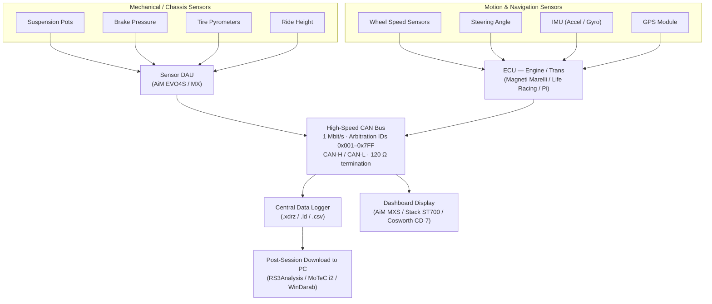

# Lesson 4: Telemetry Diagnostics

## 1. First-Principles Intuition & Invariants

The racing car is, at its core, a machine of competing forces held in perpetual, violent negotiation with the physics of a circuit. Every apex clipped, every braking zone attacked, every throttle application demands a precise orchestration of tire load, thermal state, chassis geometry, and aerodynamic balance. For decades, the engineer's only feedback loop was the driver's verbal debrief and the stopwatch. A lap time told you *what* happened; it told you nothing about *why*. The emergence of motorsport telemetry dissolved that ambiguity. Today, a modern race car generates between 500 and 2,000 channels of data at sample rates ranging from 10 Hz for slow-varying thermal measurements to 1,000 Hz for wheel speed and suspension potentiometers. The result is a complete, time-resolved physiography of everything the car experienced on track — a mechanical truth that neither driver subjectivity nor engineering intuition alone can produce.

Understanding telemetry diagnostics demands that you first understand the physical invariants it is designed to observe. The fundamental constraint governing every performance vehicle is the friction circle, also called the G-G diagram. At any given instant, the tire contact patch can generate a finite vector of combined longitudinal and lateral force, bounded by the coefficient of friction and the instantaneous normal load pressing that patch into the asphalt. The sum of centripetal lateral acceleration and longitudinal deceleration or acceleration must remain within that circle, or grip is exceeded and the tire slides. Telemetry does not change this physics — it makes the boundary visible. When you overlay a G-G scatter plot from a qualifying lap, the density of points near the circle's perimeter tells you how consistently the driver operates at the limit. A cloud of points clustered at 60% of the available friction envelope tells a completely different story than one that traces the boundary arc closely.

The second invariant is thermal degradation. Rubber compounds, brake disc carbon matrices, and hydraulic fluid all operate within specific temperature windows. Below the minimum operating temperature, a racing tire's silica- or carbon-black-reinforced compound remains too stiff to generate the molecular adhesion responsible for mechanical grip. Above the thermal ceiling, the compound degrades irreversibly — the polymer chains that give the rubber its elastic memory begin to break down, blister, or grain, depositing material and altering the contact patch geometry. A brake disc operating below 350°C may never activate the full crystallographic friction coefficient of carbon-carbon composite; operating above 1,000°C on a road car cast-iron disc risks pad fade, caliper seal failure, and fluid vaporization. Telemetry gives the engineer the continuous thermal history required to manage these windows across an entire stint, not just at a single snapshot in a pit lane pyrometer reading.

The third invariant is data fidelity. Every physical quantity the system measures passes through a transducer, an analog signal conditioning stage, an analog-to-digital converter, a CAN or serial bus, a data logger, and finally a software analysis environment. At each transition there is potential for noise, aliasing, offset drift, and latency. A strain-gauge-based suspension potentiometer with a 5V excitation rail will produce output voltage that is exquisitely sensitive to wiring harness ground loops and electromagnetic interference from the ignition system. A brake pressure transducer installed downstream of a pedal-mounted proportioning valve will produce traces that look physically plausible but systematically misrepresent the actual caliper pressure. The first discipline of telemetry diagnostics is calibration and signal verification — confirming that what the logger records faithfully represents what the car physically experienced. No amount of analytical sophistication compensates for a corrupted sensor signal interpreted as genuine data.

---

## 2. Core Architecture & Mechanics

### The Sensor Network: Transducers, Signal Conditioning, and Physical Placement

The sensor network of a modern race car is best understood as a distributed nervous system, with each node measuring one physical state variable and transmitting that measurement toward a central data acquisition unit (DAU) or dedicated ECU node. The architecture begins at the transducer — the physical device that converts a mechanical, thermal, or pressure quantity into an electrical signal.

Suspension displacement is measured via linear potentiometers or, in higher-spec applications, hall-effect sensors and linear variable differential transformers (LVDTs). A potentiometer mounted between the chassis bell-crank and the pushrod end produces a voltage output proportional to the linear travel of the suspension. The practical installation requires meticulous attention to the sensor's mechanical travel range — a 50mm-stroke pot used on a suspension that sees 60mm of droop will rail against its end-stop and saturate the signal, producing a flat-line artefact in the data that looks, to an untrained eye, like the suspension has stopped moving. The sensor must be mechanically matched to its range, and the DAU channel must be calibrated with a minimum of two known displacement points (typically full bump and full droop against a measured reference) to produce accurate millimeter readings in analysis software.

Brake system hydraulic pressure transducers are installed in the brake lines between the master cylinder and the calipers — ideally one on the front circuit and one on the rear, though high-resolution setups add a third channel at the pedal pushrod via a strain-gauge load cell to measure pedal force directly. This distinction matters enormously in diagnosis. If pedal force and caliper pressure trace identically, the hydraulic system is behaving as a linear force multiplier. If pedal force rises while caliper pressure lags or plateaus, the engineer suspects air in the system, a swelling brake hose, or pad knock-back introducing lost travel. The two signals together reveal the hydraulic system's integrity in a way that neither can alone.

Wheel speed sensors — most commonly hall-effect reluctor wheel sensors — produce a frequency-modulated digital pulse train. Each tooth on the reluctor ring generates one pulse; at 36 teeth and 100 km/h road speed, the sensor produces approximately 1,000 pulses per second. The DAU counts pulse frequency and converts it to wheel velocity. This channel is foundational: it feeds the derivation of wheel slip ratio, which is the ratio of the difference between wheel peripheral velocity and vehicle reference velocity to the reference velocity. Wheel slip ratio is the longitudinal analog of the lateral slip angle, and it governs the longitudinal friction coefficient available from the tire at any instant. During ABS activation or under hard braking, sudden divergence between front and rear wheel speed channels identifies which axle locked first — an observation of immediate setup relevance regarding brake bias calibration.

Tire temperature measurement in serious motorsport relies on infrared pyrometers — typically one per wheel, aimed at the tire surface from a fixed chassis mount — and, in higher-budget applications, embedded thermocouple arrays in the contact patch region of the tire shoulder, mid-tread, and inner edge. Pyrometer-based systems measure surface temperature, which responds within seconds to changes in contact patch friction and thermal conduction from the carcass. Contact-patch thermocouples, though expensive and demanding careful routing through the wheel rim, capture the working temperature at the actual friction interface. The difference between inner and outer shoulder temperatures across a corner reveals camber efficacy directly: an inner shoulder running 30°C hotter than the outer on the front axle in a right-hand corner suggests the front camber is aggressive enough to concentrate load on the inner edge, warming it disproportionately and potentially sacrificing overall contact patch utilization.

The steering angle sensor, mounted on the steering column just below the wheel, produces a rotary potentiometer or encoder signal calibrated in degrees of steering wheel rotation. When this channel is overlaid with lateral acceleration, the relationship between driver input demand and resulting cornering force exposes understeer and oversteer tendencies across individual corners. A trace where steering angle peaks and begins unwinding before the lateral G peaks indicates that the front axle initially understeers — the driver winds in more lock to generate the required path curvature, then the front tires finally bite and generate more lateral force than expected, requiring correction. Watching this relationship evolve across a stint as the front tires thermally build or degrade is one of the most direct diagnostic windows into balance shift over time.

### The CAN Bus Architecture and Data Acquisition Flow

The physical sensor signals described above route back to data loggers and ECUs through a network governed primarily by the Controller Area Network protocol — CAN 2.0B in most race applications, with CAN FD appearing in newer GT and prototype platforms where bandwidth demands have outgrown the classic 1 Mbit/s ceiling. Understanding the bus architecture is essential because it determines latency, message priority, and the structure of the data you will decode in analysis software.

On the CAN bus, every device is a node. Each node transmits messages framed with an 11-bit (standard) or 29-bit (extended) arbitration ID, a data length code of 0 to 8 bytes, and the payload bytes carrying the encoded physical values. The bus operates on a non-destructive bitwise arbitration scheme: when two nodes attempt to transmit simultaneously, the one with the lower numerical arbitration ID wins and the other backs off, ensuring that high-priority messages — typically ECU-broadcast engine RPM, throttle position, and wheel speed — always take precedence over lower-priority telemetry housekeeping traffic.

The DBC (Database CAN) file is the Rosetta Stone that maps raw CAN byte values to physical engineering quantities. A typical DBC entry for a front-left brake pressure channel looks like this:

| Parameter | Value |
|---|---|
| Arbitration ID | 0x1A4 |
| Start Bit | 0 |
| Bit Length | 16 |
| Byte Order | Intel (little-endian) |
| Scale Factor | 0.1 |
| Offset | 0 |
| Units | bar |
| Min / Max | 0 / 200 bar |

The raw 16-bit integer received from the CAN frame is multiplied by the scale factor (0.1) and added to the offset (0) to yield the physical value in bar. If the DBC is incorrect — say the byte order is specified as Motorola (big-endian) when the actual device broadcasts in Intel byte order — the decoded pressure values will be nonsensical garbage while still appearing structurally valid to the analysis software. This class of error is among the most time-consuming to diagnose because the data *looks* real: it has the right order of magnitude, it moves with brake events, but every peak reads systematically wrong. Cross-referencing the decoded peak brake pressure against the known hydraulic system design pressure (typically 90–130 bar peak at the front caliper in a racing application) is the fastest sanity check.

### ECU Tuning Parameters and Their Telemetry Footprint

The Engine Control Unit is not simply a data broadcaster on the CAN bus — it is an active actuator whose closed-loop control decisions leave distinct telemetry signatures. The fueling map (lambda target vs. RPM and manifold pressure), ignition advance table, variable cam timing targets, and traction control intervention threshold all produce measurable, characterizable traces in the data that allow the engineer to verify calibration in service rather than only at the dyno.

The ignition timing trace — typically broadcast on a dedicated CAN frame as degrees before top dead center (BTDC) — is one of the most revealing diagnostic channels under power. On a wide-open-throttle (WOT) run from apex to exit, ignition advance should follow the loaded map closely and smoothly. If you observe a sudden retardation event — 5–10° of advance pulled back for two or three combustion cycles — without any corresponding traction control intervention flag, the ECU knock control strategy has detected combustion knock. The accelerometer-based knock sensors embedded in the block picked up characteristic high-frequency ringing from pre-detonation, and the closed-loop strategy applied retard to protect the engine. In isolation, one such event might be dismissed as sensor noise. Across a whole stint, if these retard events cluster consistently at a particular RPM and throttle position on specific corners, they tell you that the engine is ingesting slightly hotter, less dense air at that phase of the lap — often caused by an aerodynamic feature directing warm underhood air toward the intake at a particular yaw angle — and the base ignition map may be over-aggressive for those conditions.

Traction control, implemented through combinations of ignition cut, throttle servo intervention, and sometimes individual wheel brake application, produces a compound signature in the data. The TC intervention flag channel (a simple 0/1 or 0–255 intensity value broadcast by the ECU) is the starting point. When intervention fires, the throttle position sensor trace diverges from the driver's accelerator pedal demand trace — the pedal position climbs while the throttle body angle is held or reduced. Simultaneously, the rear wheel speed channels decelerate slightly or cease their divergence from the front reference speed. The duration, frequency, and intensity of TC interventions across the lap map directly to traction-limited exit conditions — slow, tight hairpins where the rear tires are maximally unloaded from longitudinal weight transfer, or fast sweepers where combined lateral loading leaves little longitudinal capacity. Persistent heavy TC intervention on a specific exit is a flag for the engineer to revisit rear differential ramp angles, rear wing level, or tire pressure to restore mechanical grip before relying on electronic intervention to mask the deficiency.

---

## 3. High-Performance Optimization & Failure Modes

### Brake Thermal Analysis: Reading the Story of Deceleration

Of all the thermal channels in a race car's data stream, brake temperatures are simultaneously the most operationally critical and the most commonly misread. The diagnostic workflow begins not with the peak temperature value but with the shape of the temperature trace over a lap.

A healthy carbon-carbon brake disc on a prototype or high-downforce GT car operating in its correct thermal window will show a sawtooth pattern when plotted against lap distance: sharp spikes at each braking zone, followed by a gradual cooling ramp through the following corner and straight as airflow from the brake duct carries thermal energy away from the disc. The peak temperature at the first braking zone of the lap, before the brakes have fully reached operating temperature, should be noticeably lower than the peak at the second or third braking zone. By the fourth or fifth braking event, the system should be thermally saturated and peaks should stabilize at a consistent level, assuming similar brake application effort. If the peaks continue climbing lap after lap with no stabilization, brake cooling is insufficient for the ambient conditions and circuit thermal load. The duct aperture must be opened, the duct length shortened, or the bell geometry on the disc hub re-evaluated for thermal mass.

Differential brake temperature between inner and outer face of the disc — measurable with two pyrometer channels aimed at the respective faces — diagnoses disc bell design. Carbon-carbon discs transfer heat through the bell and hat assembly into the wheel hub and bearing, which is the primary failure mode: not the disc itself cracking, but the bearing overheating and seizing. If the inboard face temperature runs 150°C hotter than the outboard across a stint, the disc's internal vane geometry — the radial vanes between the two friction surfaces — may be insufficient for the airflow entering from the duct. Vane count, vane angle, and duct exit direction all influence the mass flow of air drawn through the internal channels by centrifugal pumping as the disc rotates.

Pad temperature data, available on cars equipped with thermocouple-instrumented pads or estimated through caliper body temperature as a proxy, tells you about pad compound wear rate and fade behavior. A pad compound rated for 400–700°C that sees consistent spikes above 750°C is operating in its degradation zone. The telltale signature in the pressure trace is a soft pedal — the pressure sensor records the driver applying more stroke for the same peak pressure, indicating either pad material compressing thermally, caliper seal distortion, or the onset of vapour lock in the fluid. The simultaneous presence of a high pad temperature estimate and rising stroke demand in the pressure trace is a pit lane trigger: this combination signals an impending fade event within the next two to three laps.

### Tire Pressure Monitoring and TPMS Diagnostic Workflow

Tire pressure monitoring in a motorsport context operates on entirely different logic than road car TPMS. The goal is not simply to detect a critically deflated tire but to maintain each tire within a 0.1 bar window around its target pressure across the full thermal range of the stint, because tire pressure directly governs contact patch shape, sidewall stiffness, and therefore the slip angle at which peak lateral force is generated.

Tire inflation pressure and temperature are coupled through the ideal gas law: a tire inflated to 1.8 bar cold at 20°C ambient will reach approximately 2.1–2.2 bar when the internal air temperature stabilizes around 70–80°C under racing conditions. The engineer must work backward from the target hot pressure to determine the correct cold inflation set by the tire technician on the warm-up lap. This calculation requires knowing the total internal gas volume of the tire-wheel cavity and the equilibrium air temperature at race operating conditions — values that can be measured directly with tire pressure and temperature sensors embedded in the valve stem, transmitting wirelessly to the central logger or a dedicated TPMS receiver node on the CAN bus.

The diagnostic value of real-time tire pressure data extends beyond simple inflation management. Sudden pressure loss — a trace that shows a steady plateau followed by a rapid decline of more than 0.3 bar within a single lap segment — is an unambiguous signature of a puncture or valve failure. This can be acted upon on the radio within seconds rather than waiting for the driver to report vibration or the lap time to collapse. More subtly, a tire pressure trace that rises faster than its companions on the same axle through a long, sustained corner indicates that tire is running hotter internally — experiencing more cyclic deformation, generating more hysteretic heat — which may indicate incorrect camber alignment causing the contact patch to work harder than its geometric share of the cornering load.

Pressure imbalance between left and right on the same axle at steady thermal state is a particularly useful camber and toe diagnostic. Under normal symmetric loading on a circuit with roughly equal left and right cornering work, two tires from the same batch on the same axle should converge to within 0.05–0.08 bar of each other at thermal equilibrium. A persistent 0.15 bar imbalance with the higher-pressure tire on the same side every lap indicates that side is running hotter — doing more mechanical work. This correlates with camber being too far from optimum on that corner, forcing the outer tread shoulder into excessive slip angle generation.

### Failure Modes: Sensor Artefacts, Bus Faults, and Data Corruption

The most dangerous failure mode in telemetry diagnostics is not a dead sensor — a channel that simply reads zero or rail-saturates to its maximum value is immediately obvious and easily flagged. The dangerous failure is the plausible but incorrect sensor: one that produces a continuous, physically reasonable-looking signal that is systematically offset, scaled incorrectly, or suffering from intermittent contact that produces brief, credible-looking excursions.

A suspension potentiometer with a worn resistive track will produce a trace that looks like normal suspension activity. The signal will follow the general pattern of ride height change — dropping through compression, rising through droop — but will periodically exhibit dropout spikes of 20–40ms duration where the wiper contact lifts momentarily from the resistive element. In the time domain these appear as sharp, narrow vertical spikes. In the frequency domain they appear as broadband noise injection. The diagnostic step is to examine the data at maximum time resolution — zoomed in to the 1ms sample level — looking for spikes whose duration is shorter than any physically plausible suspension event. A suspension at 100 mm/s travel velocity covers 0.1mm in 1ms; a spike that spans 5ms represents 0.5mm of travel, which is at the boundary of credibility. Spikes spanning less than 2ms in a suspension channel are almost certainly electrical artefacts and should be treated as sensor failure.

CAN bus fault conditions impose their own diagnostic signatures on the data record. Excessive bus load — a network with too many nodes transmitting too frequently, pushing bus utilization above 80% — causes message collision back-offs to accumulate, introducing variable latency into message delivery. When the logger timestamps CAN message arrival, variable latency appears as irregular sample spacing. The wheel speed signal, which the logger expects at 10ms intervals, may arrive at 10ms, 10ms, 11ms, 9ms, 23ms, 10ms intervals — the 23ms gap representing a lost message during a bus contention event. When this wheel speed signal is subsequently differentiated to compute wheel acceleration for slip ratio, the missing sample creates a falsely large acceleration spike that may trigger downstream control logic downstream in the ECU. The mitigation is proper bus load budgeting during vehicle build and periodic CAN bus load analysis using a dedicated bus analyzer before each event, targeting steady-state bus utilization below 70%.

Ground loop interference is the final failure mode that every experienced race engineer has encountered and every novice underestimates. The vehicle's electrical system operates with a chassis ground referenced to battery negative. Every sensor's output voltage is measured relative to this common ground. If two sensor ground wires follow different paths through the chassis — one through the front bulkhead, one through the floor — and those paths have different impedances due to corroded connections or inadequate wire gauge, a voltage differential exists between the two ground references. This manifests in the data as correlated noise on all sensors sharing the contaminated ground: when the ignition system fires and induces a transient current through the chassis ground, every affected sensor will show a synchronous, brief deflection. These deflections are identifiable because they occur at ignition frequency — proportional to engine RPM — and they affect multiple channels simultaneously. The fix is star-grounding: all sensor grounds return to a single low-impedance point at the logger chassis, not distributed through the vehicle structure.

### The Integrated Diagnostic Workflow: From Raw Data to Setup Decision

The practitioner's loop from data download to track-side setup change must be disciplined and systematic. After each session, the first task is data integrity verification — checking that every channel has valid data for the full session duration, that no channels are railed, frozen, or spiking, and that the timestamps align with known session events (pit lane limiter activations, yellow flag periods visible as sudden lap time increase with no matching brake pressure increase). This verification consumes three to five minutes per session and prevents the engineer from constructing a detailed setup analysis on corrupted channels.

Once data integrity is confirmed, the channel overlay comparison between the target reference lap — typically the fastest driver lap from the previous session or a known benchmark lap from the same circuit — and the current session's best lap reveals the performance delta with mechanical specificity. The comparison is not a simple lap time number but a spatially indexed trace: at every meter of track distance, what is the difference in brake pressure, wheel speed, lateral G, steering angle, and throttle position between the reference and the current lap? The area under the speed-distance curve represents the integral of velocity over distance — a proxy for average speed that immediately localizes the lap time loss. If the speed trace loses ground on the reference through a specific braking zone, the question is whether the driver is braking earlier, braking less hard, or releasing the brake more slowly. The brake pressure trace answers this directly. If brake pressure matches the reference but speed is still lower through the zone, the investigation moves to the previous corner exit: was the entry speed to this straight lower, limiting the absolute velocity available for the subsequent braking event? Every deficit propagates causally through the lap, and the engineer's role is to trace the causal chain backward to its origin.

This is the invariant discipline that separates telemetry-literate race engineering from intuition-based guesswork. The data does not make decisions; the engineer does. But the data ensures that the mechanical reality of the car — its brake temperatures, tire pressures, suspension displacements, and traction limits — informs every decision with the precision and immediacy that neither the driver's body nor the engineer's ear can match. Mastery of telemetry diagnostics is, ultimately, the mastery of asking the right question of the right channel at the right moment in the right context.
