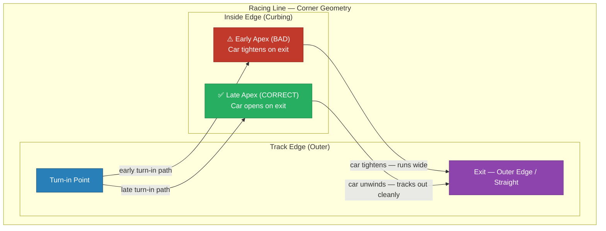

# Lesson 2: Racing Line Theory

## 1. First-Principles Intuition & Invariants

Every circuit, from Monaco's claustrophobic armco corridors to the sweeping gradient changes of Spa-Francorchamps, presents the driver with an identical fundamental problem: a road of finite width must be traversed as quickly as possible, and the path chosen through that width determines whether the lap sets a benchmark or concedes tenths. Racing line theory is the discipline that answers the question of which path is geometrically and dynamically optimal, and why that path changes depending on the car, the tire, the competitor, and the moment in a race.

The intuitive starting point is that corners slow a car down, and the degree to which they do so depends on the radius of the arc the car must follow. A tire's lateral force capacity is proportional to vertical load and inversely related to the slip angle it must generate to produce that force at the limit of adhesion. When a driver turns the steering wheel, they demand that the front tires deflect their contact patches relative to the direction of travel, generating a lateral force that curves the car's trajectory. The magnitude of centripetal acceleration required to hold that curved path is $a_c = v^2 / r$, where $v$ is velocity and $r$ is the instantaneous radius of curvature. This relationship is unforgiving: halving the cornering radius at a fixed speed doubles the lateral demand. The tire either meets that demand or it does not. When it does not, the driver has exceeded the friction circle and grip is lost.

The driver cannot change the friction coefficient of the tire compound mid-corner, nor can they repeal the relationship between speed and centripetal acceleration. What they *can* control is $r$, the radius. The geometric insight that defines classical racing line theory is that the available road width can be used to construct a cornering arc whose radius is substantially larger than the geometric center of the road would permit. By entering a corner from the outer edge of the track, touching the inner edge at the apex, and returning to the outer edge on exit, the driver effectively inscribes a circle that uses the full track width as its chord. The resulting radius is larger than any arc confined to the lane center, allowing higher cornering speed for the same tire lateral load.

This is the **geometric racing line**, and it has governed driver coaching since the mid-twentieth century. Juan Manuel Fangio understood it empirically. Ayrton Senna understood it with an almost spatial precision, threading apexes with a consistency that telemetry later confirmed was reproducible to centimeters. The theory is elegant in its simplicity, but its practical application is layered with nuance that separates the competent club racer from the professional.

The first invariant is the **minimum curvature principle**. Among all possible smooth paths connecting the entry and exit of a corner while remaining within track boundaries, the optimal geometric path is the one that minimizes peak curvature, which is equivalent to maximizing the minimum radius at any point along the arc. This matters because peak curvature determines the minimum speed at which the car can traverse the corner limited by lateral tire capacity. The driver's objective on a circuit is not to minimize the curvature integral over the whole lap, but to minimize the worst-case curvature at the **most speed-limiting corner**. At every corner, there exists a bottleneck speed: the velocity at which lateral demand exactly saturates the tire. The geometric racing line minimizes this bottleneck.

The second invariant is the **priority of exit speed**. The correlation between corner exit speed and straight-line time gain is not linear; it compounds. If two drivers exit a corner onto a one-kilometer straight with a speed differential of 5 km/h, that delta grows through every meter of the straight as the faster driver continues to pull away under acceleration. By the time the following braking zone arrives, what began as a 5 km/h advantage at the exit of the previous corner has grown into a larger braking point differential and a time advantage that cannot be recovered without a mistake. This compounding effect means that for corners leading onto long straights, exit speed carries disproportionate weight, and the geometric line must be biased accordingly: a later apex, delayed to open the exit radius and allow the driver to unwind the steering earlier, applying throttle sooner and more aggressively.

The third invariant is **continuity of path**. An abrupt change in radius mid-corner does not merely upset the car's balance; it generates a transient demand on the tires that may exceed the available friction in both lateral and longitudinal directions simultaneously. The ideal racing line is smooth, with curvature that changes gradually. In practice, this means the driver does not point the car abruptly at the apex from the entry. Instead, they modulate steering angle continuously, rotating the car through a gradual increase in curvature toward the geometric apex and then a gradual decrease as the car unwinds and tracks out. This principle underpins the trail braking technique discussed in Lesson 3, but it originates here, in the geometry of the path.

---

## 2. Core Architecture & Mechanics

### The Geometric Construction of a Single-Apex Corner

The simplest case in racing line theory is the single-apex 90-degree corner connecting two equal-width straights. Understanding the construction of the optimal line through this corner establishes the vocabulary needed to handle every more complex case.

Consider the corner as a segment of road of width $W$ that bends 90 degrees. The geometric center line describes a 90-degree arc of radius $R_0 = W/2$ measured to the inside edge. A driver confined to the center line must follow this arc at the centripetal limit for radius $R_0$. By using the full track width, the driver can construct a line whose inscribed circle has radius $R_{opt} \gg R_0$.

The classical geometric construction begins at the **entry tangent point**, the location on the outer edge of the track where the driver begins to turn in. It terminates at the **exit tangent point**, where the car returns to the outer edge of the track on the following straight. Between these two points, the driver traces a path that is tangent to the inside curbing at a single point: the **apex**.

The relationship between the apex position and the resulting radius is the central mechanism of this lesson. An **early apex** places the tangent point with the inside curb in the first half of the corner arc. This produces a path that enters with a large radius but then tightens after the apex, forcing the driver to either reduce throttle or accept understeer as the car runs toward the outside on exit. The exit radius is smaller than the entry radius. An **early apex is geometrically a trap**: it feels fast and committed on entry, but it sacrifices the exit, costing far more time down the subsequent straight than was gained by carrying fractionally more entry speed.

A **late apex** delays the tangent point with the inside curb to the second half of the corner arc, often at or slightly past the geometric midpoint of the turn. This produces a path that enters with a tighter initial radius, asks the driver to tolerate more lateral load on the first arc, and then opens progressively as the apex is reached and the car begins to unwind. The exit radius is larger than the entry radius. This is the correct construction for any corner that leads onto a meaningful straight.

The following diagram captures the relationship:

The minimum curvature path for a single constant-radius corner—solved formally as a constrained optimization—places the apex at approximately 60–70% of the corner's arc length from turn-in for a standard 90-degree bend. The exact percentage shifts with corner angle: a hairpin (180 degrees) demands a later apex, often at the 70–75% mark, while a fast sweeper (45 degrees or less) can be treated more geometrically, with the apex near 55–60%.

### The Mechanics of Entry Speed, Apex Speed, and Exit Speed

The driver's goal through a corner is not simply to maximize speed at a single point; it is to maximize the **average speed** through the corner while also maximizing exit speed onto the following straight. These two objectives exist in tension, and resolving that tension requires understanding how speed distributes across the entry, apex, and exit phases.

At the **entry phase**, the driver is decelerating from straight-line speed. Longitudinal deceleration from braking and lateral acceleration from steering both consume friction circle capacity. The entry phase is a combined-force regime: as brake pressure tapers and steering angle increases, the friction circle vector rotates from the longitudinal axis toward the lateral axis. This is the mechanical basis of trail braking, but from a pure line-theory standpoint, the entry phase defines the initial turn-in radius and the speed at which the driver arrives at the apex.

The **apex** is the minimum-speed point of the corner, the geometric bottom of the speed valley. The lap time through the corner is not determined primarily by this minimum speed; it is determined by how quickly the driver can climb out of that speed valley on the other side. Carrying 3 km/h more apex speed that forces a delayed throttle application and a tighter exit radius will cost more time on the ensuing straight than the small apex speed gain recovers. This is the most common error at the club racing level: optimizing for apex speed at the expense of exit trajectory.

At the **exit phase**, the driver unwinds the steering and applies throttle. The rate at which the steering can be unwound without the rear tires losing traction under power defines the exit envelope. A line that opens the exit radius progressively allows throttle to be applied earlier and with higher commitment. Telemetry consistently shows that the professional driver's throttle trace on exit is smoother and earlier than the amateur's—not necessarily reaching higher peak values sooner, but initiating the throttle application at a point where the amateur is still managing understeer caused by an early apex.

The speed profile through a corner can be modeled conceptually as a velocity-radius curve. The speed at any point in the corner is bounded by:

$$v_{limit} = \sqrt{\mu \cdot g \cdot r}$$

where $\mu$ is the combined longitudinal-lateral friction coefficient at that instant (representing available tire grip from the friction circle), $g$ is gravitational acceleration, and $r$ is the instantaneous radius of curvature of the path. The driver is trying to keep $v$ as close to $v_{limit}$ as the path radius permits at every point, while ensuring that the minimum of $r$ (peak curvature) occurs early enough in the corner that the arc is opening—and radius is increasing—by the time throttle application begins.

### Complex Corner Sequences: The Double Apex and the Chicane

Few real circuits consist of isolated single-apex corners. The more common challenge is a sequence of corners where the exit of one is the entry of the next, and an optimal line through the first may compromise the entry to the second. This is where geometric line theory becomes genuinely difficult, and where racecraft separates from geometry.

A **double-apex corner** is a long-radius bend that requires two apex contact points with the inside curbing to achieve the minimum curvature path. The Maggotts-Becketts-Chapel complex at Silverstone is a canonical example: a sequence of direction changes at high speed where each apex is simultaneously the exit of one curve and the entry of the next. The correct line treats the entire sequence as a single optimization problem: the geometric compromises at each individual apex are acceptable provided the cumulative path maximizes exit speed from the final element, Chapel, which opens onto Hangar Straight.

The practical implication is counterintuitive to new drivers: the fastest line through the first apex in a double-apex sequence is often *not* the geometric apex of that corner in isolation. It is a modified entry that positions the car optimally for the second apex. The driver sacrifices the geometric ideal of the first corner to gain access to the ideal of the second. When the second corner leads onto a long straight, this trade-off is mandatory. When both corners lead onto short connectors before a third braking zone, the calculus changes again.

A **chicane** presents a different problem: two direction changes in rapid succession of opposite handedness, typically designed to reduce straight-line speed before a braking zone. The geometric minimum-curvature path through a chicane is not two separate optimal arcs; it is a single S-shaped path that minimizes the direction-change angle at each inflection. The professional driver treats the chicane as a single geometric unit, taking a wide entry to the first element that sets up a late apex and an early exit trajectory pointing toward the inside of the second element. The entry of the second element is then already begun from a favorable position, and the late apex of the second half of the chicane opens onto the following straight. The critical constraint is that the two apexes cannot be independently optimized; the geometric linking of the two arcs must be treated as a single smooth curve with one inflection point.

### Telemetry Channels That Reveal Racing Line Errors

Modern data acquisition systems give the race engineer a set of channels that make racing line errors unambiguous and quantifiable. The most diagnostic are the steering angle sensor, the lateral accelerometer, the GPS/GNSS position trace, and the minimum-speed channel.

The GPS track map is the most visually immediate: a driver's path through a corner plotted on a circuit overlay will show immediately whether the apex is geometrically early or late, and whether the exit tracking is tight or open. When overlaid with a reference lap from a faster driver or the driver's own best sector, entry and exit track position discrepancies appear as deviations of centimeters at the apex and meters at the exit curb.

The lateral accelerometer trace reveals path continuity. A clean professional lap will show a lateral G trace that rises smoothly from zero at turn-in, plateaus near the lateral limit through the apex, and then decreases smoothly as the car unwinds on exit. An early apex error produces a characteristic signature: the lateral G trace climbs normally, peaks, and then instead of decreasing smoothly, it maintains or briefly increases again as the driver must increase steering angle mid-corner to avoid running off on exit. This secondary peak in the lateral G trace after the theoretical apex is the definitive telemetry fingerprint of an early apex.

The minimum speed channel, combined with the GPS position, identifies exactly where in the corner the velocity reaches its minimum. For a correctly-driven late-apex corner, this minimum should occur at or just before the apex contact point with the inside curb. If the minimum speed occurs before the geometric apex—earlier in the arc—it indicates excessive trail braking depth or a turn-in that is too early, both of which cause the driver to scrub speed mid-corner where it cannot be productively used.

---

## 3. High-Performance Optimization & Failure Modes

### Line Variance Under Traffic: Defensive and Offensive Geometry

The geometric racing line describes the optimal path in free air, with no competitor nearby. In a race, that condition rarely persists. The presence of a competitor transforms the line problem from a pure geometric optimization into a game-theoretic decision, and understanding when and how to deviate from the geometric ideal without catastrophic lap time loss is a core professional skill.

The **defensive line** is the driver's response to a competitor attempting to overtake into a corner. The standard defensive move is to take the inside line approaching the corner, denying the overtaking car access to the late-apex racing line. The geometric cost of this choice is significant: the inside approach into a corner forces an early apex, which tightens the exit, reduces exit speed, and costs time down the subsequent straight. The driver accepting the defensive line is making a deliberate trade-off: they accept a time loss in this corner to maintain track position. The error many drivers make is to take the defensive line and then also attempt to maximize entry speed—a combination that either results in running wide on exit, handing the initiative to the following car, or causes understeer that creates a contact risk. The professional commits fully to the inside line, accepts the reduced entry speed, and focuses entirely on managing the exit to minimize the time given to the competitor behind.

The **offensive line**, from the perspective of the overtaking driver, requires finding a geometry that places the car alongside the competitor through the braking zone and into the corner. The overtaking driver typically arrives on the outside of the braking zone, decelerates to arrive at the apex simultaneously with the defending car or marginally inside. The geometric challenge is that the overtaking car is now committed to a wider entry and possibly an earlier apex than the ideal, because the defensive car's presence on the inside of the corner determines where the apex contact point can be. The overtaking driver's goal is to complete the pass before corner apex and then use the more favorable exit trajectory—which the defending driver, now outside on the exit, cannot match—to consolidate the position through the following straight.

Understanding where passing opportunities arise requires knowing which corners allow an alongside position to be held through the apex and which do not. Slow, tight corners with a wide entry allow the overtaking car to arrive alongside under braking and hold position to the inside through turn-in. Fast sweepers with a single geometric line rarely produce passing opportunities because there is no wider arc available that is geometrically competitive; any deviation from the optimal radius results in dramatically reduced speed, and a car committed to a compromised line through a fast sweeper is at a fundamental aerodynamic and mechanical disadvantage. This is why passing in modern single-seater racing concentrates almost entirely at the entry to slow corners following long straights, where DRS, slipstream, and braking point variation combine to create the geometric space necessary for a side-by-side approach.

### Adapting the Line to Tire Degradation and Fuel Load

A racing car's optimal line is not constant across a stint. As fuel burns off, the car's weight decreases, reducing mechanical grip from normal load but also reducing the centripetal force demand at any given speed. The net effect is that the car typically becomes slightly more responsive but also more sensitive to oversteer under power as the rear load decreases. The practical consequence for line selection is that as fuel lightens, the driver can often carry marginally more entry speed and begin throttle application slightly earlier without exceeding the rear tire's lateral capacity on exit.

Tire degradation moves the problem in the opposite direction. As the tire wears through its working layer of rubber, the coefficient of friction decreases and the thermal operating window narrows. A tire in its final quarter of a stint will generate heat faster for a given lateral demand, and once beyond the thermal threshold, the grip degradation becomes nonlinear and rapid. The driver managing worn tires must increase corner radius—which means moving the geometric line outward, using more road on entry—to reduce the lateral demand per unit of time the tire spends at a given radius. This translates into a slightly earlier turn-in, a shorter arc through the apex, and an exit that tracks out earlier. The apex contact point often moves 2–4 meters earlier along the inside curb compared to the fresh-tire line. This is a well-understood circuit craft adjustment, though it costs between 0.1 and 0.3 seconds per corner depending on the severity of degradation and must be weighed against the alternative of a pit stop.

### Camber, Surface Variation, and Topographic Line Corrections

A circuit is not a flat plane. Camber changes, elevation gradients, surface texture variation, and the differential grip between asphalt and concrete curbing all require the geometric line to be modified from what a pure two-dimensional analysis would prescribe. These corrections are among the most difficult aspects of racing line theory to teach, because they cannot be derived from geometry alone; they must be learned from physical sensation and telemetry feedback in combination.

Road camber is particularly significant. When the road surface tilts toward the inside of a corner (positive banking relative to the direction of the cornering force), the normal load on the outer tire increases and the effective friction circle capacity rises. The car can carry more speed for the same steering angle. Many fast corners are banked in this direction by circuit designers specifically to increase the cornering speed envelope, and drivers learn to trust these surfaces with an aggression they cannot replicate on flat or negatively cambered sections. Conversely, negative camber—where the road tilts away from the cornering force—reduces effective tire load and demands either reduced speed or a modified line that shortens the duration of the cornering arc.

Elevation changes interact with line selection through their effect on weight transfer. A crest before or during a corner unloads the front axle as the car becomes geometrically light over the rise, reducing mechanical grip precisely when the driver is demanding lateral force for turn-in. The correct response is to delay turn-in slightly, allowing the front suspension to reload on the descent before the cornering demand is applied. At Eau Rouge/Raidillon at Spa, the compression at the bottom of Eau Rouge provides abnormally high normal loading on all four tires, allowing the car to generate downforce-like grip from suspension geometry alone; the subsequent crest at Raidillon then unloads the car just as it reaches maximum lateral demand. The professional driver manages this by committing to the compression-phase steering input while still loaded and then holding steering constant through the crest, trusting the aerodynamic downforce at high speed to maintain adhesion through the unloading phase.

Surface grip variation alters the line in ways that are invisible on a circuit map. The rubberized racing line through a heavily-trafficked corner carries significantly more grip than the asphalt outside that narrow band. In wet conditions, this relationship inverts: the rubber-contaminated surface retains water and reduces grip relative to the cleaner asphalt beside it, forcing the driver to use a wider, geometrically suboptimal line to access cleaner tarmac. This wet-line correction is often counterintuitive: the driver needs to use more road on entry and exit, turning in from a wider position on the entry side and tracking out to a wider exit, while simultaneously reducing entry speed to compensate for the reduced friction coefficient. Drivers who have learned the dry racing line as a physical habit and cannot consciously override it in wet conditions are almost always identified by their telemetry: they are following the dry apex contact points on a wet track, overloading tires that have insufficient grip to match the geometric demands of the dry line.

### Optimization at the Limit: The Friction Circle Boundary and Line Failure

The racing line is not merely a geometric construct; it is a dynamic path whose validity depends on the car remaining within the friction circle boundary at every instant. When the driver's demands exceed the available friction, the line fails. Understanding the modes of this failure and their geometric causes is essential for diagnosing driver errors from telemetry and for coaching corrections.

**Understeer on exit** is the most common line failure mode and almost always traces to an early apex. The geometric tightening of the path after an early apex requires that the driver add steering angle mid-corner at a point when the front tires are already at or near their lateral capacity. The additional steering demand exceeds the available friction, the front contact patches saturate, and the car pushes toward the outside of the corner. The driver's instinct is to increase steering angle further, which compounds the problem. The correct diagnostic response is to identify the apex contact point on the GPS trace and confirm it is early, then coach the driver to delay turn-in by 1–2 car-lengths and compress the entry radius to achieve a later apex. The exit radius then opens naturally and the mid-corner steering demand is eliminated.

**Snap oversteer on entry** is the failure mode associated with excessive turn-in speed combined with trail braking that is not smoothly managed. When the driver reaches the turn-in point with more speed than the late-apex geometric line can accommodate while maintaining tire adhesion, the front tires may initially grip—being loaded by the remaining longitudinal braking force—while the rear tires, relatively unloaded by the deceleration-induced pitch transfer, lose adhesion laterally. The rear steps out as the car rotates faster than the intended yaw rate. This is the geometric-dynamic intersection: the line places the car in a kinematic situation where the velocity vector does not align with the available friction, and the car resolves the discrepancy through rotation. The coaching correction is to use less entry speed and more progressive trail braking, reducing the rear unloading by keeping some throttle engagement longer before the braking event and smoothing the pitch transition.

The discipline of racing line theory ultimately resolves to a single professional insight: the line is not the fastest path through the corner. It is the path that enables the fastest car at the fastest speed that can be sustained from that path's exit point to the next braking zone. This distinction between local speed optimization and global time optimization is what a driver internalizes over thousands of laps, and what telemetry makes quantifiable and teachable. The engineer's role is to provide the data that makes the driver's physical intuition legible: to show on a screen, with a lateral G trace and a GPS overlay, the precise geometric decision that cost or recovered a tenth of a second, and to give the driver the mechanical language to understand why the geometry and the physics agreed.
