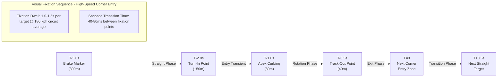
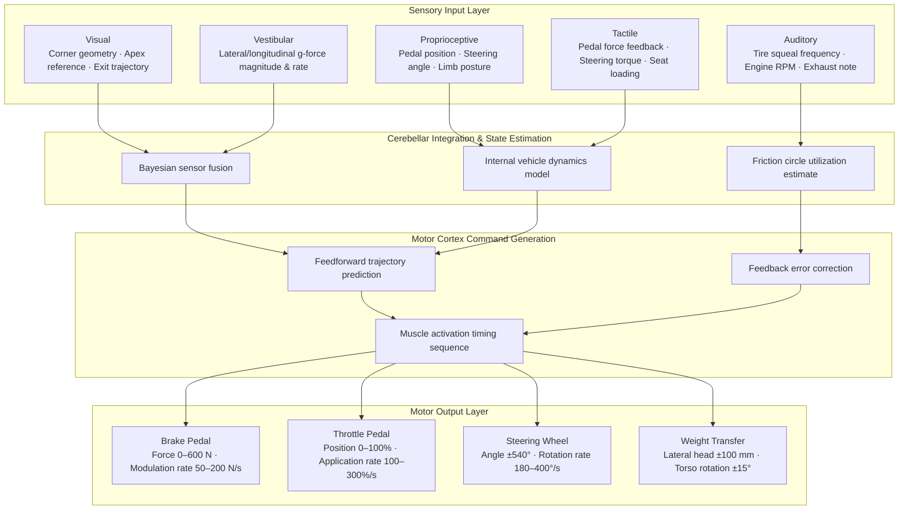

# Lesson 3: Driver Sensory Control Systems

## 1. First-Principles Intuition & Invariants

The performance driver operates as a closed-loop biological control system, executing maneuvers through continuous sensory acquisition, neural processing, and precision motor output. Unlike autonomous vehicle controllers that sample sensor data at fixed millisecond intervals and compute actuator commands through deterministic algorithms, the human driver integrates information across multiple sensory modalities—visual, vestibular, proprioceptive, auditory, and tactile—forming a probabilistic internal model of vehicle state that updates continuously and asynchronously. This biological control architecture possesses extraordinary pattern recognition capabilities and adaptive learning capacity, yet suffers from inherent latency constraints, saturation limits under cognitive overload, and training-dependent consistency.

The fundamental invariant governing driver performance is the action-perception cycle time budget. From the instant a visual target appears in the forward field of view to the completion of corrective steering input, approximately 180 to 220 milliseconds elapse in a trained driver executing practiced maneuvers. This cycle decomposes into distinct phases: retinal photoreceptor transduction and optic nerve transmission consume 20 to 40 milliseconds, primary visual cortex processing and object recognition demand another 60 to 100 milliseconds, motor cortex command generation requires 30 to 50 milliseconds, and efferent nerve propagation to skeletal muscle plus mechanical compliance in the kinetic chain adds the final 40 to 60 milliseconds. Each phase represents a biological bottleneck where neural signal fidelity degrades under stress, fatigue, or distraction, and where deliberate training protocols can harvest millisecond-scale improvements that compound into lap time reduction.

The visual system dominates the sensory hierarchy, providing approximately 80 percent of the information density used for vehicle path control. The foveal region of the retina, spanning only two degrees of visual arc, delivers high-acuity color discrimination and spatial resolution, while the peripheral visual field detects motion, contrast boundaries, and horizon references through rod photoreceptors with ten-fold greater sensitivity to flicker frequency. Expert drivers exploit this dual-stream architecture through a scanning pattern that fixates the fovea on future geometric targets—corner apex curbing, track-out exit points, braking reference markers—while the peripheral stream continuously monitors vehicle attitude relative to track boundaries and competitor positions. The untrained novice driver fixates on immediate obstacles directly ahead, creating a reactive control mode with insufficient preview distance to execute smooth, limit-condition maneuvers.

Proprioceptive feedback from mechanoreceptors embedded in skeletal muscle spindles, Golgi tendon organs, and joint capsule tissues provides continuous state estimation of limb position, force application magnitude, and rate of change. When a driver modulates brake pedal pressure, Pacinian corpuscles in the fingertips and foot sole detect pressure oscillations at frequencies up to 300 Hz, enabling detection of incipient wheel lockup through pedal pulsation before visual observation of tire smoke or auditory squeal. This high-bandwidth tactile channel operates below conscious awareness threshold in trained drivers, forming a rapid reflex arc that executes corrective input before cognitive recognition of the disturbance propagates to declarative memory. The trained driver "feels" the contact patch slip angle through steering wheel torque feedback, detecting the transition from adhesion to saturation as a subtle reduction in self-centering force that precedes yaw rate divergence by 50 to 80 milliseconds.

The vestibular apparatus in the inner ear contains three orthogonal semicircular canals filled with endolymph fluid and lined with hair cell mechanoreceptors that detect angular acceleration around roll, pitch, and yaw axes. These biological gyroscopes provide inertial reference signals independent of visual input, enabling vehicle state estimation during night driving, rain conditions with degraded visibility, or high-speed transitions where optic flow velocity saturates peripheral motion detection. The otolith organs—utricle and saccule—contain calcium carbonate crystals suspended in gelatinous matrix that deflect under linear acceleration, measuring longitudinal and lateral g-forces with sufficient fidelity to detect the onset of understeer through lateral acceleration plateau even when steering angle continues increasing. The vestibular system exhibits a critical limitation: it cannot distinguish sustained centripetal acceleration from gravitational tilt, producing spatial disorientation during prolonged constant-radius cornering where drivers perceive inward banking that does not exist.

The integration of these sensory streams occurs through Bayesian fusion in cerebellar and basal ganglia circuits, weighting each modality according to learned reliability estimates accumulated through practice repetition. When visual and vestibular signals conflict—as occurs during banking transitions or over-crest compression changes—the central nervous system resolves ambiguity by increasing reliance on proprioceptive and tactile channels that report control surface deflection and contact patch loading. This adaptive weighting explains why experienced drivers maintain precise vehicle control through visual obstructions such as spray, dust, or setting sun glare, while novices exhibit emergency braking and lane deviation when visual information degrades. The expert has trained alternative sensory pathways to sufficient fidelity that vision becomes confirmatory rather than primary.

Motor output precision depends critically on muscle fiber recruitment patterns and antagonistic co-contraction management. Smooth, progressive brake pedal application requires coordinated lengthening of tibialis anterior and soleus muscles while quadriceps femoris maintains hip angle stability against seat back reaction force. Rapid but controlled pedal release during corner entry trail braking demands precisely timed relaxation of agonist gastrocnemius contraction while antagonist tibialis anterior prevents rebound overshoot. Untrained drivers exhibit binary on-off pedal inputs with peak force overshoot followed by oscillatory correction, generating longitudinal load transfer pulses that destabilize chassis platform and induce pitch oscillation. The trained driver executes monotonic force ramps with sub-five-percent peak deviation, maintaining continuous contact patch load management throughout the corner entry phase.

Steering input represents the highest-bandwidth control channel, with professional drivers executing corrective inputs at frequencies approaching 2 Hz during high-speed chicane complexes. The neuromuscular system achieves this bandwidth through predictive feedforward commands rather than reactive feedback correction. The expert driver initiates steering rotation based on visual preview of the upcoming geometric demand, applying torque in proportion to anticipated centripetal acceleration requirement before the vehicle reaches turn-in point. This open-loop command, refined through thousands of practice repetitions that calibrate internal inverse dynamics model parameters, occurs 120 to 180 milliseconds before closed-loop feedback measurements would indicate the need for correction. The novice operates purely in feedback mode, waiting for vehicle yaw rate error to develop before applying corrective input, producing a phase lag that manifests as corner entry oscillation and mid-corner instability.

## 2. Core Architecture & Mechanics

The visual targeting system operates through a hierarchical fixation sequence that progresses from distant geometric references to near-field execution markers as the vehicle approaches each corner segment. The expert driver initiates visual acquisition of corner entry approximately 300 to 400 meters in advance on high-speed circuits, identifying braking reference markers—distance boards, pavement seams, shadow lines, or trackside objects—that define threshold brake application point. This distant fixation occurs during the preceding straight or corner exit phase when cognitive load remains low and spare attentional capacity permits scene analysis. As the vehicle closes on brake point, visual fixation transitions to the turn-in marker, typically located at corner entry where the driver will initiate steering rotation. The foveal target then advances to the geometric apex, dwelling on the apex curbing for the minimum duration required to confirm intended trajectory tangency before jumping to the track-out exit point where the vehicle will achieve maximum radius path and transition to power application.

This sequential fixation pattern creates a visual tunnel that excludes peripheral distractions while maintaining sufficient preview distance to enable feedforward motor commands. The temporal spacing of fixation transitions couples directly to vehicle speed: at 200 kph circuit velocity, each fixation dwells for approximately 0.8 to 1.2 seconds before advancing to the next target, while at 100 kph the same geometric sequence supports 1.5 to 2.0 second fixation durations. The driver learns these timing relationships through practice repetition, developing an internal clock that triggers fixation advances without conscious deliberation. Disruption of this learned timing—through traffic interference, flag condition warnings, or mechanical anomaly distraction—immediately degrades corner execution precision, producing late braking, early turn-in, or premature power application errors.

The proprioceptive feedback architecture operates through multiple receptor populations distributed across the kinetic chain from foot sole to shoulder girdle. Muscle spindle organs embedded within skeletal muscle bellies detect fiber length changes at sub-millimeter resolution, providing position sense for pedal displacement and steering wheel rotation angle. These length sensors exhibit velocity-dependent gain characteristics: slow movements generate proportional static firing rates, while rapid displacement transients produce dynamic overshoot spikes that signal movement direction and acceleration. The Golgi tendon organs located at musculotendinous junctions measure tension magnitude with logarithmic encoding, saturating at forces approaching maximum voluntary contraction while maintaining exquisite sensitivity near threshold detection limits. This logarithmic compression enables drivers to detect pedal force changes of less than two percent during light initial application while tolerating peak emergency brake forces exceeding 500 Newtons without receptor damage.

Joint mechanoreceptors in ankle, knee, elbow, and wrist capsules provide angular position reference independent of muscle length, disambiguating posture configuration when multiple joint combinations produce equivalent end-effector positions. The driver learns to decode these receptor populations through calibration practice, associating specific firing patterns with known pedal positions and steering angles measured through external reference. A critical training objective involves strengthening the neural pathway from mechanoreceptor afferents to motor cortex command generators, reducing reliance on visual confirmation of control surface position. The expert driver operates pedals and steering wheel to target positions without gaze verification, maintaining visual fixation on track geometry while executing precise control inputs through proprioceptive targeting alone.

Brake pedal modulation control represents the most demanding sensory-motor integration task in performance driving, requiring continuous force regulation across a dynamic range spanning two orders of magnitude. Initial brake application at corner entry demands rapid force ramp from zero to peak threshold value—typically 60 to 80 percent of maximum available deceleration on high-grip circuits—within 150 to 250 milliseconds. This aggressive initial pulse generates peak longitudinal load transfer, compressing front suspension and increasing front tire vertical load while relieving rear axle, creating the forward weight bias required for turn-in rotation response. The force ramp slope must achieve maximum deceleration without triggering ABS intervention or exceeding tire adhesion limit, requiring calibration to current grip level, tire temperature, and brake system thermal state.

Following peak force attainment, the driver executes a controlled pressure release ramp during corner entry rotation, termed trail braking. This progressive force reduction—typically 40 to 60 percent decay over 0.8 to 1.5 seconds—maintains front axle loading through mid-corner while gradually transferring vertical load back to the rear axle as lateral acceleration builds. The release rate must track the increasing lateral g-force demand to maintain total load magnitude near tire adhesion limit, exploiting the friction circle without exceeding combined slip saturation. Excessive trail brake retention produces front lockup and understeer, while premature release induces rear instability and oversteer rotation. The expert driver modulates release rate continuously, integrating vestibular lateral acceleration measurement with proprioceptive pedal force sensing and visual path deviation feedback to maintain the vehicle precisely on friction circle boundary.

The tactile feedback channel provides critical high-frequency information through steering wheel torque oscillations and pedal pulsations that signal impending adhesion loss. Tire contact patch slip angle generates a restoring torque proportional to lateral force magnitude, transmitted through steering column mechanical compliance as a centering force resisting steering displacement. As the front tire approaches saturation slip angle—typically 8 to 12 degrees for modern slick racing compounds—the slope of lateral force versus slip angle curve decreases, reducing the incremental restoring torque per degree of additional steering input. The driver detects this stiffness reduction as a subtle "lightness" in steering effort, occurring 50 to 100 milliseconds before yaw rate response degrades to levels detectable through vestibular or visual channels. This early warning enables corrective input—either steering angle reduction or throttle lift to transfer load forward—before the vehicle develops significant yaw rate error requiring large correction amplitude.

Throttle application strategy differs fundamentally between corner exit traction management and mid-straight full-load acceleration. During corner exit phase while steering angle remains non-zero, throttle input modulates rear tire longitudinal slip ratio to maintain operation near the peak of the traction ellipse, balancing longitudinal acceleration demand against lateral force requirement for path tracking. The driver initiates throttle opening at the point of minimum corner radius—typically 10 to 20 degrees before geometric apex on late-apex racing lines—beginning with 20 to 30 percent pedal displacement. This initial application generates modest rear axle torque that stabilizes vehicle yaw moment while lateral acceleration remains high, preventing snap oversteer from sudden load transfer.

As the vehicle tracks toward corner exit and steering angle unwinds, the driver increases throttle opening in proportion to available traction margin, monitoring rear tire slip through seat-of-pants lateral acceleration feedback and auditory exhaust note changes that correlate with wheel spin events. The throttle progression follows an approximately quadratic profile: 30 percent pedal at apex, 50 percent at mid-exit, 75 percent when steering approaches neutral, and 100 percent when the vehicle achieves straight-line trajectory. Deviation from this smooth progression—either by excessive early throttle producing power oversteer or conservative late application leaving traction unused—directly converts to lap time loss through reduced exit velocity and compromised straight speed.

Steering input precision depends on maintaining smooth, continuous rotation rate without abrupt velocity changes that excite chassis resonances. The expert driver initiates turn-in rotation with a rapid initial pulse—achieving 200 to 300 degrees per second angular velocity within 100 milliseconds—then sustains constant rotation rate through the primary steering phase before executing a symmetric deceleration ramp as the vehicle approaches target slip angle. This velocity profile minimizes excitation of chassis roll and yaw natural frequencies, typically ranging from 0.8 to 1.5 Hz depending on suspension stiffness and anti-roll bar configuration. Novice drivers produce stair-step steering inputs with multiple acceleration-deceleration cycles, generating 2 to 4 Hz oscillatory content that couples directly into chassis resonance bands and produces visible vehicle attitude oscillation.

The relationship between steering wheel angle and vehicle slip angle exhibits significant phase lag due to tire compliance, chassis roll deflection, and suspension kinematic effects. When the driver rotates the steering wheel to 120 degrees displacement, approximately 80 to 120 milliseconds elapse before the vehicle yaw rate reaches steady-state value corresponding to that input. This lag arises from tire sidewall deflection under lateral load—requiring 40 to 60 milliseconds to develop equilibrium slip angle—combined with chassis roll transient as lateral load transfer compresses outside suspension and extends inside—consuming another 40 to 80 milliseconds depending on damper velocity-sensitive characteristics. The expert driver compensates for this lag through predictive feedforward commands, initiating steering rotation before the geometric demand point and holding constant angle through the transient development period rather than chasing the lagging response with additional input corrections.

Weight transfer modulation through driver body position provides a secondary control channel exploitable on motorcycles and in open-cockpit formula cars where aerodynamic drag penalties remain modest. Lateral head displacement of 100 millimeters toward corner inside generates approximately 8 to 12 Newton-meters of roll moment in a typical single-seater, equivalent to 0.5 to 0.8 degrees of additional body roll depending on suspension roll stiffness. This small contribution becomes significant during limit-condition cornering where vehicle operates within one percent of maximum lateral acceleration capacity. The driver times body weight shift to precede or coincide with steering input, preloading the outside tire contact patch and enabling higher peak lateral force before reaching camber angle saturation. In motorcycle dynamics, rider weight transfer dominates total system roll moment due to high center-of-mass position, with 150-millimeter lateral knee displacement generating sufficient moment to alter equilibrium lean angle by 2 to 3 degrees at constant speed and radius.

## 3. High-Performance Optimization & Failure Modes

Visual targeting optimization begins with deliberate practice protocols that train fixation discipline and saccade timing precision. The driver establishes a baseline by completing practice laps while verbalizing each fixation transition—"brake marker, turn-in, apex, exit"—creating conscious awareness of the automatic scanning pattern. Video analysis with eye-tracking overlay reveals fixation dwell durations and saccade trajectories, identifying deviations from optimal sequence such as premature apex fixation before confirming turn-in point, or late exit target acquisition that forces reactive rather than predictive steering unwinding. Common failure modes include target fixation on obstacles or competitors rather than maintaining geometric reference focus, and insufficient preview distance where fixation targets lie less than one second ahead of vehicle position, forcing reactive control mode with degraded smoothness.

Correction protocols involve forced-fixation drills where the driver maintains foveal target on a designated reference marker—such as corner exit point—throughout the entire entry and rotation phase, relying exclusively on peripheral vision for intermediate execution cues. This exercise strengthens peripheral path tracking capability and breaks the habit of visually confirming each control input before advancing to the next target. Advanced drivers implement split-fixation techniques during wheel-to-wheel racing, maintaining primary foveal target on geometric references while allocating brief 100 to 150 millisecond saccades to competitor vehicle positions, then immediately returning to geometric target sequence. This rapid context switching demands high cognitive load management and degrades under fatigue or stress, producing tunnel vision collapse where peripheral awareness contracts and collision risk escalates.

Proprioceptive calibration training involves repetitive control input practice while monitoring external position references—pedal travel sensors, steering angle displays, data acquisition overlays—to strengthen the mapping between mechanoreceptor firing patterns and actual displacement values. A practical drill places the driver in static vehicle with eyes closed, executing pedal and steering inputs to verbal target callouts—"40 percent brake, 90 degrees right steering, 60 percent throttle"—then opening eyes to verify achieved position against target. Systematic error in one direction indicates learned bias requiring recalibration through repeated practice with immediate feedback. Some drivers develop asymmetric proprioceptive accuracy with superior precision in one rotational direction due to dominant-hand strength imbalance or habitual posture asymmetry, producing measurable lap time differences between left-hand and right-hand corner directions on circuits with directional imbalance.

Brake modulation precision improves through graduated pressure targeting exercises beginning in static conditions before progressing to dynamic on-track application. The driver practices achieving specific pedal force levels—25, 50, 75, and 100 percent of maximum—holding each target for five-second duration while monitoring brake line hydraulic pressure gauge. Deviation exceeding plus-or-minus five percent indicates insufficient force control requiring additional static practice before advancing to dynamic trail braking exercises. On-track progression begins with constant-pressure trail braking where the driver maintains fixed pedal force throughout corner entry despite increasing lateral acceleration, then advances to programmed release rate schedules—linear, quadratic, exponential—before achieving fully adaptive modulation that responds continuously to real-time friction circle utilization feedback.

Failure modes in brake modulation manifest as oscillatory pedal pumping at 1 to 3 Hz frequency, termed "pedal dancing," arising from excessive feedback gain in the corrective control loop. The driver detects small deviation from target pressure and applies corrective input with amplitude exceeding the original error magnitude, producing overshoot that triggers opposite-direction correction of similar excessive amplitude. This limit cycle continues indefinitely unless the driver consciously reduces feedback gain by accepting small steady-state error rather than pursuing zero-error target. The oscillation couples into longitudinal load transfer dynamics, generating pitch mode excitation that further destabilizes chassis platform. Correction requires cognitive intervention to break the automatic feedback loop, replacing continuous reactive adjustment with discrete feedforward commands—initiating target force level, monitoring but not correcting small deviations, executing planned release ramp at predetermined time index.

Throttle application optimization focuses on achieving maximum possible pedal opening rate during corner exit traction-limited phase without exceeding rear tire slip saturation. The peak sustainable throttle application rate depends on instantaneous traction margin, which varies continuously as steering angle unwinds and lateral load transfer migrates from outside to inside rear tire. A conservative application strategy uses constant pedal rate—for example, 100 percent per second—producing smooth linear progression but leaving traction unused during mid-exit phase when higher rate would remain within adhesion limit. An aggressive strategy attempts instantaneous full-throttle application, invariably exceeding traction capacity and producing wheel spin that scrubs speed and potentially destabilizes yaw angle.

The optimal strategy implements variable throttle rate coupled to steering angle feedback: high application rate near apex when steering angle remains large and traction margin is small, transitioning to maximum rate as steering unwinds and available longitudinal capacity increases. A practical implementation uses steering angle thresholds: 30 percent throttle rate when steering exceeds 60 degrees, 60 percent rate between 30 and 60 degrees steering, and 100 percent rate below 30 degrees. These thresholds require calibration to specific vehicle characteristics—particularly rear weight bias, differential locking behavior, and tire compound grip level—through systematic testing that progressively increases application rate until wheel spin onset, then backing off by 10 to 15 percent margin for consistency buffer.

Steering input optimization requires matching input frequency content to chassis natural frequency response characteristics. Every vehicle exhibits resonant modes in roll and yaw typically falling between 0.8 and 1.8 Hz depending on suspension and anti-roll bar tuning. Steering inputs containing frequency content near these resonances excite oscillatory chassis motion that persists for multiple cycles after the input concludes, producing visible vehicle attitude oscillation and requiring corrective counter-steering. The driver minimizes resonance excitation by limiting steering velocity acceleration—the second derivative of wheel angle with respect to time—through smooth progressive rotation that avoids abrupt velocity changes. A practical target constrains steering acceleration below 800 degrees per second squared during mid-corner phases, permitting higher values only during emergency avoidance maneuvers where immediate response supersedes smoothness optimization.

Data acquisition analysis reveals steering quality through derivative calculations from logged steering angle channel sampled at 100 Hz. Clean expert driver traces exhibit monotonic velocity profiles with single acceleration pulse at turn-in, constant rotation rate through primary steering phase, and symmetric deceleration pulse before reaching target angle. Novice traces show multiple velocity reversals and high-frequency jitter content indicating corrective oscillation. Power spectral density analysis quantifies frequency content distribution, with expert drivers showing dominant energy below 1 Hz and rapid rolloff above chassis natural frequency, while novices exhibit elevated energy in 2 to 4 Hz band that couples directly into chassis resonance.

Sensory bandwidth management becomes critical during high-cognitive-load scenarios such as wheel-to-wheel racing in traffic, changing weather conditions, or mechanical anomaly diagnosis while maintaining competitive pace. The human attention system operates under strict capacity limits: total information processing bandwidth remains approximately constant, requiring allocation tradeoffs between competing sensory channels and cognitive tasks. When the driver diverts attention to radio communication, flag signal interpretation, or engine sensor gauge monitoring, bandwidth available for primary vehicle control tasks diminishes proportionally, degrading precision in brake modulation, throttle application timing, and steering smoothness.

Expert drivers implement hierarchical priority management that sheds low-priority tasks under saturation conditions. Primary control loop tasks—visual targeting, pedal modulation, steering input—receive highest priority with protected bandwidth allocation. Secondary tasks such as lap timing, gap monitoring, and fuel consumption calculation receive opportunistic bandwidth during low-load straight segments. Tertiary tasks including radio communication and complex strategic decision-making get deferred until vehicle operation enters stable straight-line phase with minimal control demand. Novice drivers fail to implement priority hierarchy, attempting to maintain all task execution simultaneously and suffering proportional degradation across all channels including primary control tasks. This manifests as increased lap time variability and elevated incident frequency during high-traffic sessions.

Fatigue accumulation produces systematic degradation in sensory-motor precision following characteristic time courses. Visual saccade latency increases by 20 to 40 milliseconds after 60 minutes of continuous high-intensity driving, reflecting depletion of attentional resources required for voluntary eye movement initiation. Proprioceptive discrimination thresholds degrade by 15 to 25 percent after 90 minutes, requiring larger position or force changes to trigger detection responses. Motor output variability increases progressively, with standard deviation of pedal force control doubling after two hours of seat time. These degradation trajectories argue for structured rest intervals during extended practice sessions, with 10 to 15 minute breaks every 60 to 75 minutes providing optimal recovery while maintaining thermal and mechanical systems in operational state.

Physical conditioning specifically targeting motorsport demands includes visual training exercises that strengthen eye muscle endurance and saccade velocity, neck strengthening protocols to maintain head position stability under lateral acceleration loading, and core stabilization training to minimize torso displacement that degrades proprioceptive reference frames. Cognitive training protocols using simulators with systematic distraction introduction—radio chatter, visual alerts, secondary task demands—improve attentional capacity and priority management skill. Vestibular adaptation training using variable-axis rotation platforms reduces motion sickness susceptibility and improves g-force magnitude discrimination, particularly valuable for drivers transitioning to higher-downforce vehicle categories with increased sustained lateral acceleration exposure.
