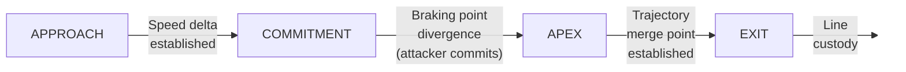
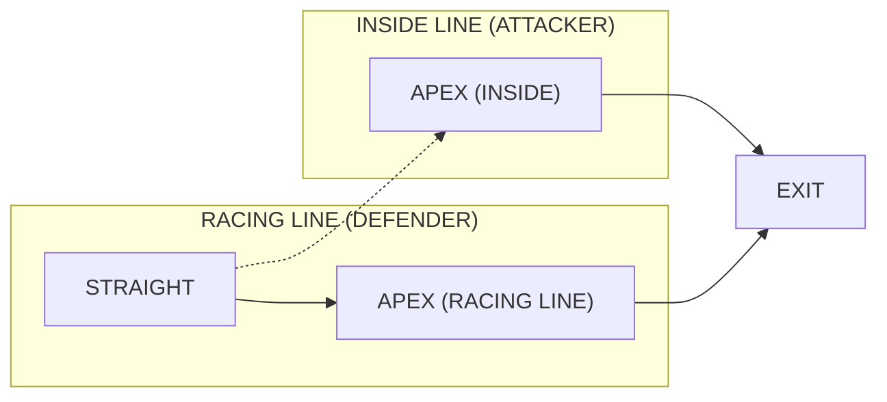
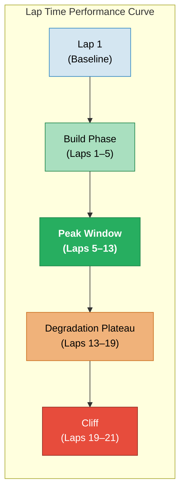
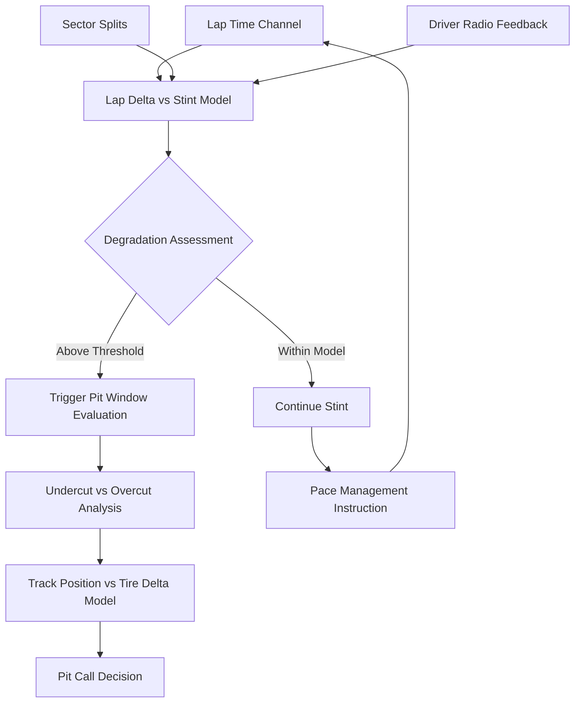

# Lesson 4: Racecraft Strategy

## 1. First-Principles Intuition & Invariants

Racecraft is the art of converting mechanical and physical advantage into competitive position across the full arc of a race. Where raw pace is the product of engineering, racecraft is the product of judgment — and judgment, unlike horsepower, cannot be bolted on between sessions. It lives in the driver's ability to read a race as a living system: a dynamic competition between degrading rubber, depleting fuel, shifting tire temperatures, and the intentions of human competitors who are simultaneously trying to read *you*.

The foundational invariant of all racecraft is that position matters more than lap time, except at the precise moments when lap time *creates* position. This distinction separates inexperienced drivers from those who win championships. A driver who pushes to their absolute limit every lap will frequently find themselves with dead tires, a compromised strategy, and no clean air — having produced spectacular sector times that translate into nothing on the results sheet. The disciplined racecraft practitioner treats the race as a resource allocation problem. The resources are tire compound, fuel load, braking component thermal budget, and the driver's own concentration — all finite, all degrading with use, all recoverable only through deliberate management.

The first principle underpinning overtaking is not speed differential alone — it is *trajectory control*. When a faster car approaches a slower one, the passing vehicle needs two things simultaneously: a speed advantage at the point of commitment and geometric access to the racing line through the corner that follows the overtaking zone. The classic mistake of novice racers is attempting an overtake mid-corner, where both cars are at maximum lateral load and neither driver has available friction budget for the longitudinal conflict of positioning that follows contact. Professional racecraft locates the overtake at the entry to a braking zone precisely because that is where longitudinal forces dominate, lateral forces are transitioning, and the natural trajectory of one car diverges from the other. The braking zone is a *funnel* where two paths into a corner can momentarily coexist before converging at the apex.

The concept of the friction circle explains why braking zones are the natural overtaking theaters of motorsport. Under maximum braking, a tire's total friction budget is consumed almost entirely in the longitudinal axis — there is virtually nothing left for cornering. As a driver begins to trail-brake into a corner, they are transitioning that budget from longitudinal deceleration toward lateral load, tracing an arc along the perimeter of the G-G diagram. When a trailing car carries more speed into the same braking zone — arriving with a higher entry velocity — they can momentarily outbrake the leading car, arriving at the turn-in point ahead, provided they manage the entry speed well enough to actually make the corner. The trap is that "out-braking" and "out-driving" are not synonymous. Arriving at the apex with ten kilometers per hour more speed than the corner allows is not an overtake; it is a lock-up and a wide exit at best, a collision at worst.

Defensive positioning theory operates on an equally rigorous physical logic. The defender's goal is to deny the attacker geometric access to the racing line — not by blocking aggressively in a way that creates a collision liability, but by occupying the track position that forecloses the attacker's trajectory options early enough in the approach that the attacker cannot respond. This is the principle of *line preemption*: moving to close a gap before the attacker has committed to it. The FIA's sporting regulations encode one move rule precisely because unlimited defensive weaving destroys this equilibrium — it allows a defender to respond to committed attackers, eliminating the risk entirely and rewarding defensive driving so heavily that overtaking becomes impossible. The legitimate defensive move must be made before the braking zone, leaving the attacker the full width of the track on the other side. If the attacker has their car alongside to the rear wheel of the defender at the braking point, the defender must leave racing room at the apex. This is the foundational case law of on-track conduct.

Traffic management during a race adds a third-party complexity layer that tests racecraft at its most demanding. Lapped traffic, cars on different fuel or tire strategies, and safety car restarts all introduce relative speed differentials that do not reflect the underlying competitive order. The experienced race driver treats traffic not as an obstacle but as a tool. A well-managed lapped car positioned between yourself and a chasing rival effectively acts as a temporary brake on the rival's pace, buying seconds that can be used to extend a pit window or rebuild a tire temperature window on fresh compound.

The deepest invariant of session-long strategy is the tension between *pace optimization* and *tire longevity*. These two objectives are not merely in conflict — they pull against each other across every lap of a stint. A driver who maximizes corner exit speed by applying full throttle at the earliest possible moment is loading the rear tires with both lateral shear stress and longitudinal torque simultaneously, operating at the outer edge of the contact patch's slip angle tolerance. This generates maximum lap time at the cost of accelerated degradation. The same driver who manages traction with a metered throttle application — slightly delayed and slightly below peak torque — loses perhaps two to three tenths per lap but preserves the rear contact patch, arriving at lap 20 of a 25-lap stint with tires that are still producing consistent lateral grip while their aggressive counterpart is managing a 1.5-second lap time deficit from degradation alone.

The practical implication is that the fastest *race* strategy is not the fastest *qualifying* strategy applied for 50 laps. It is the precise thermal and mechanical loading rate that maximizes the *integral* of lap times across the entire stint — a subtle and circuit-specific calculation that depends on tire compound construction, ambient temperature, track surface abrasiveness, and the aerodynamic downforce generating the vertical load that heats the contact patch.

---

## 2. Core Architecture & Mechanics

### Overtaking Zone Identification

Overtaking zones are not randomly distributed around a circuit. They follow a consistent mechanical logic that derives from two geometric preconditions: a sufficiently long braking zone to allow a speed differential to manifest as a positional advantage, and a corner geometry that permits two cars to simultaneously navigate turn-in at different lateral positions without immediate conflict. The classic overtaking template is a long straight terminating in a heavy-braking, slow-speed hairpin or chicane — the Monza Variante Ascari, the Mexico City Peraltada hairpin, or the DRS-assisted run to Turn 1 at the Bahrain International Circuit's outer loop configuration.

The structural anatomy of an overtaking move can be decomposed into four sequential zones:

In the approach zone, the attacking driver is managing their slipstream position — close enough to benefit from the aerodynamic draft (reducing drag by operating in the low-pressure wake of the car ahead) but not so close that turbulent airflow over their own front wing reduces downforce enough to compromise the subsequent braking stability. At typical circuit speeds of 250–300 km/h, following within two to three car lengths in a modern aerodynamic car will cost the follower 15–25% of their front downforce due to wake turbulence. This is why drafting past the slipstream benefit point and committing to the braking zone slightly offline is frequently faster than following the racing line precisely through the approach.

At the commitment point, the attacker diverges from the racing line to claim an alternative trajectory into the corner. If they are attacking at the inside, they move to the inside reference line, initiating braking from a wider position than the racing line braking point but arriving at the inside of the apex. If attacking from the outside — a rarer but legitimate tactic on circuits with wide run-off, particularly in the wet — they maintain the outer arc to maximize radius and corner speed, depending on a later apex and earlier exit acceleration rather than an outright braking advantage.

The inside line gives the attacker geometric apex priority — they own the inside of the corner — but it carries a significant cost: the inside arc is shorter and tighter, requiring a lower mid-corner speed. The defender on the outside racing line, if they survive the entry, will have a wider radius through the corner and a superior exit trajectory. This is the essential trade in most overtaking moves: the attacker wins entry and apex but frequently concedes the exit, leaving them vulnerable to being re-passed on the following straight unless they can defend the inside position through the following complex.

This dynamic is precisely why corner sequences — Sector 2 of the Suzuka circuit, the Maggots-Becketts-Chapel complex at Silverstone, the Esses at Spa — are historically difficult overtaking venues. The sequence of rapid direction changes eliminates the geometric space for two cars to operate at different lateral positions, and the high-speed, high-lateral-load conditions through a fast sweeper destroy any longitudinal speed differential before it can be used. Attempting to outbrake into a fast sweeper is not racecraft; it is a physics misunderstanding.

### Tire Degradation Modeling

A tire's functional degradation follows a characteristic curve that experienced engineers learn to read from lap time telemetry. The curve is not linear. In a typical compound's operational window, there is an initial build phase as the tire reaches its working temperature range, a performance peak where the contact patch is at optimal temperature and chemical adhesion is maximized, and then a degradation plateau that eventually transitions into a cliff — a rapid deterioration that occurs when the rubber compound reaches critical temperature and loses structural cohesion through thermal breakdown, graining, or blistering.

The lap time signature of these phases is diagnostic. During the heat build phase, lap times improve by several tenths per lap as the front and rear tires come into their operating window. During the peak performance window, lap times stabilize and the driver's confidence in the car's limit behavior is highest. During the degradation plateau, times slowly worsen — typically one to three tenths per lap — as slip angles increase and the driver compensates through reduced entry speed or delayed throttle application. The cliff is identifiable by an abrupt, non-linear lap time increase of a full second or more accompanied by severe over- or understeer that the driver can no longer manage through technique alone.

Understanding where in this curve each tire compound sits at any given lap is the engineer's primary real-time job during a stint. This understanding draws from multiple telemetry channels simultaneously: sector time delta versus the theoretical best, minimum corner speeds through reference corners (medium-speed corners are most sensitive to lateral tire degradation), rear axle slip indicators from individual wheel speed sensor comparison, and driver voice feedback describing understeer push or oversteer rotation tendencies.

The engineer models degradation rate as a function of several physical inputs. Track ambient temperature directly determines the equilibrium temperature the tire seeks between sessions — higher ambient temperatures accelerate the approach to the thermal degradation cliff. Track surface abrasiveness, quantified by the macro-texture of the asphalt aggregate, determines the mechanical wear rate independent of thermal effects. The car's downforce level determines the contact patch load, which in turn determines the slip force and therefore the heat generation rate per corner. A car running more wing produces more downforce, which generates more tire heat, which degrades the compound faster — the aerodynamic downforce advantage carries a hidden tire life cost.

### Strategy Signal Architecture

A well-structured race engineering workflow maps telemetry, driver feedback, and competitive data into a decision tree that updates at the end of each lap. The core signal path runs as follows:

The undercut and overcut are the two fundamental strategic weapons derived from this model. An undercut involves pitting earlier than a competitor to fit fresh tires and produce faster lap times on new compound, allowing the pitting car to emerge ahead of the competitor who stayed out on degraded tires. The undercut works when the lap time delta between fresh and worn tires exceeds the time lost in the pit lane. At most circuits, the pit lane costs approximately 20–24 seconds including the drive-through time and speed limiter sections, so the undercut requires that the per-lap pace advantage on fresh tires, multiplied across the remaining stint laps, exceeds the pit-lane cost. An overcut is the inverse: staying out on current tires while a competitor pits, extending the stint to either build a gap large enough to emerge ahead after pitting, or timing the stop to arrive on track during a phase of traffic that disrupts the competitor's new-tire attack lap.

The undercut/overcut decision is never made in isolation. It is weighed against track position value — particularly in a field where overtaking is difficult — safety car probability (which resets the strategic equation entirely), and the competitor's own tire state. If the car ahead is running identically degraded tires, an undercut can be triggered earlier than the tire delta alone suggests, because the competitor cannot respond with an attack on superior rubber.

---

## 3. High-Performance Optimization & Failure Modes

### Pace Management Under Competitive Pressure

The most demanding optimization problem in professional racecraft is managing pace under simultaneous forward and rearward competitive pressure. A race leader managing lapped traffic while holding off a chasing rival on fresher tires faces three competing constraints: the need to maintain minimum lap time above the rival's capability, the need to manage their own tire wear rate below the cliff threshold, and the need to process and navigate traffic at race speed without losing time that the rival can exploit.

The professional solution is *selective push laps* — identifying one to three laps per stint where full attack pace is permissible and necessary, and managing the remainder at a pace calculated to extend tire life to the next service window. These push laps are typically triggered by specific strategic events: immediately after a safety car restart when tire temperatures are uniform across the field, in the lap immediately after pitting when fresh tires can absorb full attack pace without premature degradation, or in the final two to three laps of a stint when the rubber is already past the cliff threshold and there is nothing to conserve.

The parametric tool the driver and engineer use to execute this management is the target lap time — a figure transmitted by radio that represents the maximum pace the tire model permits at that stage of the stint. The driver executes this target by managing energy through the lap's highest-stress corners: primarily the high-speed transitions that combine maximum lateral load with throttle application, and the heavy-braking zones that impose peak longitudinal stress on the front tire contact patches. At circuits with a preponderance of high-load right-hand corners, such as Silverstone or Suzuka, the rear-left tire is typically the most stressed; tire stress dominance varies by circuit layout, and that tire's degradation rate anchors the entire stint calculation.

### Defensive Driving at the Limit

Defensive racecraft under real competitive pressure is a psychologically and physically demanding discipline. The core failure mode of inexperienced defenders is *reactive over-commitment* — moving in response to the attacker's feints and head-fakes, burning defensive moves against phantom attacks, and arriving at the actual commitment point with no legal move remaining. The professional defender ignores the attacker's body language and focuses entirely on their car's position and velocity vector. The question is never "where is the driver's head pointing?" — it is "where is the car's nose committed?"

The rule-of-thumb that experienced racers internalize is the *hip line*: if the attacker's front axle has reached the defender's hip (rear axle) at the braking point, the overtake is geometrically established and the defender must leave racing room. If the attacker has not reached that reference at the braking point, the defender retains the right to close the door. This is not arbitrary; it reflects the physical reality that at the hip line, the attacker's car is committed to a trajectory that cannot be altered without mechanical contact. Attempting to close the door past that threshold invites a collision where the defender bears responsibility.

The optimal defensive posture ahead of a braking zone is to position the car centrally or slightly toward the inside of the approaching corner, without making a sudden lateral move that constitutes a block. This occupies the inside apex reference line — the path the attacker needs — without crossing into the aggressive defense category. If the attacker swings to the outside to find the alternative line, the defender can respond with a single defensive move before the braking zone. The discipline is in accepting that a perfectly executed defense that surrenders the outside line is still a successful defense, because the outside line into a slow corner produces an inferior exit, and the defender can frequently re-establish the gap on the following straight.

### Tire Failure Modes and In-Lap Management

The most dangerous and strategically expensive failure mode in race tire management is a thermally induced flat spot — a localized contact patch geometry distortion caused by a lock-up under braking. A locked tire deposits a flat section of rubber on the track surface and simultaneously removes a corresponding patch of tread compound from the tire, creating a tire that rotates with a periodic vibration at wheel-rotation frequency. This vibration is felt through the steering wheel and floorpan and can range from annoying to genuinely debilitating at speed, as the vibration frequency approaches the natural resonance frequencies of suspension components.

The professional response to a flat spot is not to push harder through the vibration but to immediately report it to the engineer and assess the extent of the balance disturbance. Minor flat spots can be managed by modifying brake bias slightly toward the rear to prevent repeated lock-up at the flat-spotted axle, accepting slightly reduced braking performance for the remainder of the stint. Severe flat spots that cause visible aerodynamic instability or steering oscillation require an unscheduled pit stop, the strategic cost of which the engineer must immediately model against the alternative of continuing on a compromised tire.

Structural tire degradation — blistering, graining, or delamination — represents a category of failure that the driver cannot correct through technique and the engineer cannot defer indefinitely through pace management. Blistering occurs when the bulk tire temperature exceeds the compound's thermal stability range and the rubber vulcanization begins to reverse locally, creating bubbles and separations visible on the tire's shoulder. Graining — a surface texture disruption caused by thin rubber strips peeling and re-adhering — produces a temporary loss of adhesion followed by partial recovery as the grains roll off, and is associated with a tire operating below its optimal temperature window. Both failure modes produce lap time signatures that are recognizable in real-time telemetry: blistering appears as a progressive and irreversible pace loss with worsening high-speed corner behavior, while graining typically shows as a window of degraded performance in mid-stint that partially recovers as the tire surface normalizes.

The engineer's response to either failure mode involves the same decision architecture: measure the current pace loss rate against the projected lap time gain from fresh tires, adjust the pit window model, and weigh the strategy cost against the structural risk of a tire failure at speed — which is an outcome no lap time model can accommodate.

### Safety Car and Virtual Safety Car Exploitation

The safety car and Virtual Safety Car (VSC) are the highest-leverage strategic discontinuities in a race. Under a physical safety car, the entire field bunches behind the lead car at reduced and controlled speed, neutralizing any gap established through on-track competition. The strategic implication is binary and immediate: any car that pits under the safety car avoids the full pit lane time penalty, because the remaining competitors are themselves lapping slowly. The effective pit cost under safety car conditions drops to as little as three to eight seconds of net time loss versus the standard 20–24 seconds, making a tire change that was previously uneconomical suddenly the dominant strategy.

The engineering challenge is speed of decision. Teams typically have a ten to fifteen second window between the safety car deployment and the moment a car passes the pit entry — after which the driver is committed to another lap. The engineer must simultaneously confirm the incident's location and expected duration (a marshal retrieval is typically one to two laps; a barrier repair or medical intervention may extend to five or more), assess the positions of all relevant competitors and whether they are likely to pit, and model the net track position outcome of pitting versus staying out. This decision in a ten-second window, based on incomplete information, is one of the highest-pressure analytical exercises in motorsport.

The Virtual Safety Car, introduced following Jules Bianchi's 2014 accident at Suzuka, imposes a minimum lap time delta of approximately 40% above normal lap time without bunching the field. Under VSC conditions, the pit lane retains close to its full time cost because the remaining cars are slowed but not clustered. The net benefit of pitting under VSC is therefore smaller than under a physical safety car but larger than a normal-condition pit stop, primarily because the driver completes the in-lap and out-lap at a controlled pace rather than needing to build tire temperature from cold at full attack pace. Teams that correctly identify a VSC window and act in the first available lap gain a consistent two to four second strategic advantage over those who hesitate.

### Stint-Length Optimization and the Lap Time Integral

The unifying mathematical concept behind all session-long strategy is the minimization of *total race time* — not the maximization of single-lap performance. Total race time is the sum of all lap times across all stints plus all pit stop time costs. The strategy engineer's objective function is to find the number, timing, and compound sequence of pit stops that minimizes this total, subject to constraints including mandatory compound regulations, minimum drive times where applicable, and the stochastic uncertainty of safety car probability and competitor behavior.

In practice, this optimization runs as a probabilistic model updated continuously through the race. The input variables are tire degradation rate (updated each lap from real telemetry), competitor stint lengths (inferred from their lap time curves and known pit times), ambient and track temperature trends, and a safety car probability distribution derived from historical incident rates for the specific circuit. The output is a recommended pit window expressed as a range of laps — the earliest lap at which pitting becomes competitively viable and the latest lap at which staying out becomes strategically untenable — along with a priority score ranking the available strategic options.

The driver's role in this model is not passive. Through feedback, pace management, and racecraft on track, the driver can shift the boundaries of that window. A driver who manages their tires skillfully enough to extend a stint by three laps without meaningful lap time loss has changed the model's constraints, potentially enabling a one-stop strategy in a race the engineers modeled as a two-stopper. Conversely, a driver who runs off track on lap twelve and flat-spots their tires has introduced an unscheduled constraint that collapses the optimal pit window to a single lap. The model is a living instrument, and the driver's execution is its most important input channel.

This is what separates true racecraft from mere fast driving. Speed is a component — necessary but not sufficient. The driver who wins championships is the one who treats every lap as a data input into a session-long optimization, managing physical resources with the precision of an engineer and the situational awareness of a tactician, while simultaneously executing precise, limit-of-adhesion driving that leaves no performance on the table when the race calls for it. The synthesis of those two capabilities — strategic intelligence and physical execution — is what the word *racecraft* actually means.
