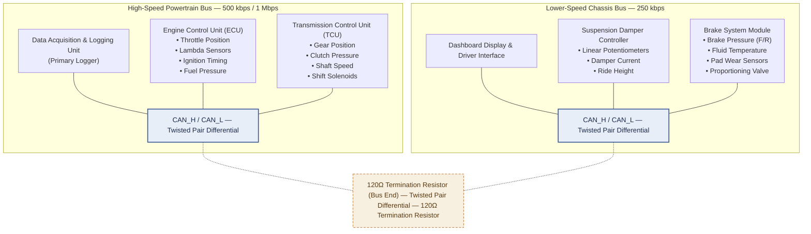

# Lesson 1: Diagnostic Fundamentals: Sensor Architecture, Signal Types, Data Acquisition Principles

## 1. First-Principles Intuition & Invariants

The diagnostic intelligence of a modern racing vehicle begins not with software or telemetry screens, but with the fundamental physics of transduction: the conversion of mechanical, thermal, optical, or electrical phenomena into measurable voltage or current signals that computational systems can interpret. Every lateral acceleration trace displayed in your telemetry suite, every brake pressure curve analyzed post-session, every wheel speed differential that triggers a traction control intervention—all originate from sensors physically embedded within the hostile thermal, vibrational, and electromagnetic environment of a competition vehicle operating at the adhesion limit.

Understanding vehicle diagnostics at the deepest level requires race engineers and dynamicists to internalize the complete signal path: from the physical phenomenon being measured, through the sensor's transduction mechanism, across analog conditioning circuits, into digital acquisition hardware, through network protocol layers, and finally into the analysis workstation where corner-by-corner performance dissection occurs. Each stage in this chain introduces characteristic artifacts, noise sources, bandwidth limitations, and potential failure modes that directly impact your ability to extract actionable intelligence from the data stream.

The foundational invariant governing all diagnostic work is the Nyquist-Shannon sampling theorem, which establishes that to faithfully reconstruct a continuous analog signal in the digital domain, the sampling frequency must exceed twice the highest frequency component present in the signal. For a racing application, this constraint immediately surfaces critical trade-offs: wheel speed sensors encoding rapid tire slip events during threshold braking demand sampling rates in the kilohertz range to capture transient lockup behavior, while coolant temperature sensors tracking thermal equilibrium over lap-duration timescales can operate with sampling periods measured in tens or hundreds of milliseconds. Violating Nyquist by undersampling introduces aliasing—high-frequency signal components folding down into lower frequency bands, creating spurious artifacts that masquerade as real physical phenomena. An improperly sampled suspension potentiometer traversing a kerb strike can alias a sharp displacement transient into a false low-frequency oscillation that suggests chassis resonance where none exists.

The second immutable principle governing diagnostic architecture is signal-to-noise ratio optimization across the complete acquisition chain. Every sensor produces a desired signal component representing the measured physical quantity, but this signal coexists with unwanted noise: thermal Johnson noise from resistive elements, electromagnetic interference from ignition systems and alternator fields, mechanical vibration coupling into mounting structures, and quantization noise introduced during analog-to-digital conversion. The race engineer's diagnostic workflow depends entirely on maintaining adequate signal margins above these noise floors. A throttle position sensor outputting a 0–5 volt swing provides far more noise immunity than a thermocouple generating millivolt-level signals; the latter demands instrumentation amplifiers with precise gain staging and careful shielding practices to prevent corruption.

The architecture of modern vehicle diagnostic networks evolved from the fundamental constraint that hundreds of sensors and control modules cannot each run dedicated wiring harnesses back to a central data logger without creating prohibitive weight, complexity, and single-point failure vulnerabilities. The Controller Area Network (CAN) protocol emerged as the dominant solution: a multi-master differential serial bus where individual electronic control units broadcast measurement messages onto a shared twisted-pair medium, with collision arbitration handled through message identifier priority rather than physical addressing. This architecture enables a tire pressure monitoring system module to broadcast current pressures every 100 milliseconds, an engine control unit to stream throttle position and lambda sensor readings at 10 millisecond intervals, and a suspension damper controller to publish potentiometer displacements every 20 milliseconds—all coexisting on the same two-wire bus without a central coordinator managing traffic flow.

Understanding the layered protocol stack that enables this distributed diagnostic ecosystem separates competent telemetry users from race engineers capable of architecting custom sensor integration and troubleshooting network pathologies. At the physical layer, CAN employs differential signaling on twisted-pair wiring with 120-ohm termination resistors at each bus endpoint, providing common-mode noise rejection essential in the electrically harsh racing environment. The data link layer implements bit stuffing for clock recovery, cyclic redundancy checksums for error detection, and automatic retransmission on corruption—mechanisms ensuring data integrity even as electromagnetic interference from spark plug discharge and alternator switching pollutes the vehicle's electrical environment. The application layer, typically instantiated through manufacturer-specific protocols or standardized frameworks like OBD-II and Unified Diagnostic Services (UDS), defines the semantic meaning of transmitted data: how to interpret a sequence of bytes as a throttle position percentage, how to request diagnostic trouble codes from an ECU, how to command a specific actuator into test mode.

The diagnostic workflow for a professional racing program operates within this layered architecture, extracting insight from sensor streams that encode every physical state variable relevant to vehicle performance. Longitudinal and lateral accelerometers measure inertial loading through micro-machined silicon structures where proof masses deflect under acceleration, generating capacitance changes transduced into proportional voltages. Strain gauge load cells bonded to suspension pushrods measure vertical wheel forces through the resistance change of metallic foils deforming under mechanical stress. Thermocouples embedded in brake rotors generate junction voltages proportional to temperature through the Seebeck effect, tracking thermal energy accumulation during high-deceleration sequences. Optical wheel speed sensors count gear teeth passing through magnetic or Hall-effect detector fields, encoding rotational velocity as pulse trains with frequency proportional to speed. Each sensor type exhibits characteristic transduction physics, output signal formats, bandwidth limitations, and failure signatures that the diagnostic engineer must internalize to separate genuine vehicle dynamics phenomena from measurement artifacts.

The race engineer confronting a telemetry trace showing unexpected oscillation in front axle ride height must systematically interrogate each stage of the signal path: Is the physical suspension displacement actually oscillating, or is the damper body potentiometer generating electrical noise from vibration-induced connector intermittency? Is the analog conditioning circuit introducing filtering artifacts? Is the sampling rate adequate to avoid aliasing high-frequency kerb strike transients? Is CAN bus loading from other modules introducing transmission delays that create apparent phase shifts? This diagnostic discipline—the methodical validation of signal integrity from transducer through network to workstation—forms the foundation upon which all higher-level vehicle dynamics analysis rests.

## 2. Core Architecture & Mechanics

The physical architecture of a racing vehicle's diagnostic network typically follows a distributed topology where subsystem control modules—engine management, transmission controller, data acquisition unit, dashboard display—interconnect via one or more CAN bus networks operating at standardized baud rates. Professional motorsport applications commonly deploy dual-redundant CAN networks: a high-speed powertrain bus running at 500 kilobits per second or 1 megabit per second carrying time-critical engine and transmission data, and a lower-speed chassis bus at 250 or 125 kilobits per second handling less latency-sensitive measurements like suspension position and tire pressure. This segregation prevents chassis sensor traffic from introducing transmission delays into engine control feedback loops where millisecond-scale timing precision directly impacts combustion phasing and torque delivery.

The fundamental signal types flowing across this network architecture divide into analog continuous-time voltages at the sensor level and digital packetized messages at the network level. Analog sensors produce output voltages that vary continuously with the measured physical quantity. A resistive throttle position sensor, mechanically coupled to the throttle butterfly shaft, implements a potentiometric voltage divider: applying a stable 5-volt reference across a resistive track with a movable wiper contact produces an output voltage proportional to angular position. At closed throttle, the wiper sits at ground potential (0 volts); at wide-open throttle, it connects to the 5-volt reference. The analog voltage between these extremes varies linearly with throttle angle, providing a continuous representation of driver input.

This analog voltage signal enters an analog-to-digital converter within the engine control unit, where the continuous voltage undergoes sampling and quantization. The sampling operation measures the instantaneous voltage at discrete time intervals determined by the ADC's clock frequency. A 12-bit ADC with 5-volt full-scale range divides the voltage span into 4096 discrete steps, yielding a quantization resolution of approximately 1.22 millivolts per least significant bit. The digital code output by the ADC represents the analog voltage as a binary integer that can be transmitted across the CAN network. The ECU packages this throttle position value into a CAN message frame along with a message identifier, cyclic redundancy check bits, and acknowledgment fields, then arbitrates for bus access and transmits the differential bit stream onto the twisted-pair wiring.

The data acquisition unit receiving this CAN message performs the inverse operation: extracting the throttle position integer from the message payload, applying calibration scaling to convert the raw ADC count into engineering units (degrees of rotation or percentage of full travel), and storing the timestamped measurement into non-volatile flash memory for post-session analysis. This complete path—from mechanical throttle shaft rotation, through resistive voltage divider, analog-to-digital conversion, CAN message encapsulation, network transmission, message decoding, and engineering unit conversion—occurs repetitively at rates determined by the sensor's update frequency, typically 10 to 100 times per second for throttle position.

Contrast this resistive position sensor architecture with the operating principles of inductive wheel speed sensors commonly deployed at each corner of the vehicle. These sensors employ a magnetic pickup positioned adjacent to a ferrous gear wheel rotating with the hub assembly. As each gear tooth passes the pickup's magnetic field, the changing flux linkage induces a voltage pulse in the pickup coil through Faraday's law of electromagnetic induction. The frequency of these voltage pulses directly encodes the rotational speed: higher wheel speeds generate higher pulse frequencies. The ECU or ABS module receiving this pulse train measures the time interval between consecutive rising edges, calculates the instantaneous rotational velocity, and packages the wheel speed value into CAN messages transmitted at fixed intervals regardless of the actual pulse timing.

This frequency-encoded sensor architecture exhibits fundamentally different noise immunity characteristics than resistive position sensors. Electromagnetic interference that might corrupt a low-level analog voltage produces minimal impact on a frequency-encoded signal where information resides in pulse timing rather than absolute voltage magnitude. However, the frequency-to-speed conversion introduces latency: the ECU must wait for at least one complete tooth passage to calculate an updated speed value. At low speeds—during launch control engagement or threshold braking near lockup—this measurement latency can span tens of milliseconds, introducing delays into traction control feedback loops that must respond within single-digit millisecond timeframes.

The CAN protocol layer managing these diverse sensor message streams implements a priority-based arbitration mechanism that determines which module gains bus access when multiple nodes attempt simultaneous transmission. Each CAN message carries an 11-bit or 29-bit identifier field that serves dual purposes: semantic message identification (which parameter the message contains) and arbitration priority. During the arbitration phase, all nodes attempting transmission monitor the bus while simultaneously driving their identifier bits onto the network. CAN employs a dominant-recessive bit encoding where a dominant (logical 0) bit overrides any recessive (logical 1) bits. A node transmitting a recessive bit that observes a dominant bit on the bus immediately ceases transmission and switches to receive mode, allowing the higher-priority message (lower identifier value) to proceed.

This distributed arbitration mechanism operates without any central bus master or time-division multiplexing, enabling deterministic worst-case message latency calculations essential for real-time control applications. An engine control unit broadcasting critical throttle position data with message identifier 0x100 preempts a lower-priority suspension position message with identifier 0x300 if both nodes attempt transmission simultaneously. The suspension module automatically retries its transmission after the higher-priority message completes. For racing applications, message identifier assignment becomes a critical network design parameter: safety-critical engine and brake signals receive low identifiers ensuring priority access, while lower-urgency telemetry channels accept longer worst-case latencies.

The actual bit-level encoding on the CAN twisted pair employs differential signaling to achieve the common-mode noise rejection essential in the electrically hostile racing environment. The CAN transceiver chips driving each node output complementary voltage levels onto the CAN_H (high) and CAN_L (low) conductors. A dominant bit drives CAN_H to approximately 3.5 volts and CAN_L to 1.5 volts, creating a 2-volt differential. A recessive bit allows both lines to float to a common 2.5-volt idle level through weak pull-up and pull-down resistors. Receiver circuits detect the differential voltage between CAN_H and CAN_L rather than absolute voltage levels, providing rejection of common-mode interference: electromagnetic noise coupling equally into both conductors appears as a common-mode offset that cancels in the differential measurement.

The 120-ohm termination resistors installed at each physical bus endpoint serve to match the characteristic impedance of the twisted-pair cable, preventing signal reflections that would otherwise corrupt bit transitions at high baud rates. Without proper termination, impedance discontinuities at cable ends reflect transmitted energy back toward the source, creating constructive and destructive interference that distorts the received bit stream. The race engineer troubleshooting intermittent CAN communication errors must verify termination resistance using a multimeter with the bus powered down: measuring 60 ohms between CAN_H and CAN_L (two 120-ohm resistors in parallel) confirms correct termination, while open-circuit or short-circuit readings indicate wiring faults or missing terminators.

The application-layer protocols built atop this physical CAN infrastructure define the semantic structure of diagnostic data. The OBD-II (On-Board Diagnostics II) standard, mandated for emissions compliance in production vehicles, specifies a set of standardized parameter IDs (PIDs) for accessing common engine measurements: coolant temperature (PID 0x05), engine RPM (PID 0x0C), vehicle speed (PID 0x0D), intake manifold pressure (PID 0x0B), and oxygen sensor voltages. An external diagnostic tool queries these parameters by transmitting a request message onto the CAN bus with service identifier 0x01 (Show Current Data) and the desired PID. The ECU responds with a message containing the requested data encoded according to the OBD-II specification's scaling factors and offset values.

Racing ECUs typically extend beyond OBD-II's limited parameter set, implementing manufacturer-specific protocols that expose detailed internal control variables: individual cylinder ignition advance, fuel injector pulse width, knock sensor intensity, lambda feedback corrections, and closed-loop target values. Accessing these extended parameters requires manufacturer-specific DBC (Database Container) files that document the message identifiers, signal names, byte positions within message payloads, scaling factors, and offset values. A DBC entry for throttle position might specify: message ID 0x100, signal name "Throttle_Position_Percent", start bit 8, length 8 bits, scale factor 0.392157 (100/255), offset 0. This metadata enables telemetry software to parse the raw byte stream and reconstruct engineering-unit measurements.

The Unified Diagnostic Services (UDS) protocol, standardized as ISO 14229, provides a more sophisticated diagnostic framework supporting not just parameter reading but active control: ECU reprogramming (flash updates), actuator testing, fault code management, and security-access mechanisms. A UDS session begins with a diagnostic session control service (0x10) that transitions the ECU from normal operating mode into a diagnostic state where additional services become accessible. Security access (service 0x27) implements a challenge-response authentication sequence preventing unauthorized parameter modification: the diagnostic tool requests a random seed from the ECU, computes a cryptographic response using a manufacturer-specific algorithm, and transmits the response for validation. Only after successful authentication can the tool execute write operations like modifying fuel maps or recalibrating sensor offsets.

## 3. High-Performance Optimization & Failure Modes

Optimizing diagnostic performance for professional racing applications demands systematic attention to sampling strategy, bandwidth allocation, data integrity validation, and failure mode mitigation across the complete acquisition chain. The race engineer configuring a data acquisition system confronts fundamental trade-offs between measurement fidelity, storage capacity, and real-time processing overhead. Recording every sensor at maximum available bandwidth produces the highest-fidelity dataset but exhausts flash memory storage within minutes of track time and overwhelms post-processing workstations with gigabytes of data per session. Conversely, aggressive decimation—reducing sample rates to conserve storage—risks aliasing transient events that contain critical diagnostic information.

The optimal sampling strategy segments sensors into bandwidth tiers based on the physical phenomena being measured and the analysis workflows those measurements support. Wheel speed sensors encoding tire slip transients during threshold braking and traction-limited corner exit demand sampling rates of 100 to 1000 hertz to capture the rapid oscillations indicating incipient lockup or wheelspin. These high-frequency channels enable detailed analysis of ABS intervention timing, differential lockup behavior, and driver modulation technique. Suspension linear potentiometers measuring damper displacement similarly require 100 to 500 hertz sampling to reconstruct high-frequency ride events: kerb strikes, aerodynamic platform disturbances during high-speed compression, and damper hysteric behavior during rapid position reversals.

Mid-frequency channels operating at 10 to 50 hertz capture slower-varying thermodynamic and hydraulic states: brake line pressures tracking driver pedal force, coolant and oil temperatures indicating thermal equilibrium, fuel system pressures reflecting pump delivery and injector demand. These measurements vary over lap-scale timescales rather than corner-scale transients, permitting reduced sampling rates without information loss. Low-frequency channels at 1 to 5 hertz suffice for slowly-evolving quantities like ambient air temperature, GPS position updates, and lap timing markers—variables that remain essentially constant within individual corners but trend across full sessions.

CAN bus bandwidth optimization requires careful message scheduling to prevent network saturation. A 500 kilobit-per-second CAN bus theoretically supports 500,000 bits per second of payload data, but protocol overhead (message framing, arbitration, acknowledgment bits, inter-frame spacing) reduces effective throughput to approximately 50-60 percent of raw bandwidth. A worst-case network utilization analysis sums the transmission time required for all scheduled messages: for each message, calculate the frame length including identifier, data payload, CRC, and overhead, divide by the baud rate to obtain transmission duration, multiply by the message repetition rate, and sum across all messages. Maintaining utilization below 70 percent provides margin for worst-case arbitration delays and transient burst traffic.

When bandwidth constraints prevent transmitting all desired parameters at full rate, strategic multiplexing trades individual channel update rates for increased parameter diversity. A single CAN message with 8-byte payload can carry throttle position (1 byte), brake pressure (2 bytes), steering angle (2 bytes), and gear position (1 byte) in one consolidated frame transmitted every 10 milliseconds. Splitting these parameters across separate messages transmitted at the same rate would consume five times the bus bandwidth. The trade-off appears in diagnostic resolution: if the consolidated message format requires future expansion to include clutch position, either an existing parameter must be removed or message length increased beyond 8 bytes, requiring network-wide DBC file updates and potential gateway reprogramming.

Data integrity validation mechanisms protect against corrupted measurements propagating into analysis workflows and triggering false diagnostic conclusions. At the physical layer, CAN's cyclic redundancy check catches bit errors introduced by electromagnetic interference: the transmitter calculates a 15-bit CRC polynomial over the message payload and includes the CRC in the transmitted frame. Receivers compute the same CRC over the received data; mismatches indicate corruption and trigger automatic message retransmission. This mechanism catches transient bit flips but cannot detect systematic errors: a miscalibrated sensor outputting physically incorrect but electrically valid data passes CRC validation.

Application-layer validation applies reasonableness checks to decoded engineering-unit values, flagging measurements that violate physical constraints or exceed plausible ranges. A wheel speed sensor reporting 500 kilometers per hour when three other corners indicate 150 kilometers per hour reveals either sensor failure or decoding error rather than genuine vehicle motion. Longitudinal accelerometer readings exceeding 2.5 g under braking or 1.5 g under power—values beyond tire adhesion limits for the vehicle class—indicate sensor saturation, mounting failure, or signal conditioning faults. Implementing these sanity bounds as automated validation rules embedded in telemetry software prevents corrupted data from distorting performance analysis and setup decisions.

Timestamp synchronization across distributed sensors and control modules creates subtle but critical failure modes when neglected. Each CAN node maintains its own local clock for message transmission scheduling, but these unsynchronized clocks drift relative to each other due to oscillator tolerances and temperature effects. A data acquisition unit timestamping received CAN messages using its local clock creates apparent phase shifts between parameters originating from different source modules. Steering angle and lateral acceleration might show a spurious time lag suggesting delayed vehicle response, when the actual cause is 10-millisecond clock skew between the steering sensor module and the IMU module.

Professional data acquisition systems mitigate timestamp drift through external synchronization mechanisms: GPS-derived time references providing sub-microsecond absolute time accuracy, or dedicated timing modules broadcasting synchronization pulse messages at fixed intervals. Nodes receiving sync pulses adjust their local clocks to match the reference, maintaining network-wide time coherence. For chassis dyno testing or track sessions with unreliable GPS coverage, an external hardware trigger input marking lap start or driver brake application provides an event-based synchronization reference: post-processing software aligns all sensor streams to the trigger timestamp, eliminating accumulated drift.

Sensor failure modes manifest across multiple physical mechanisms, each producing characteristic signatures in telemetry data. Open-circuit failures in resistive sensors drive output voltages to supply rail extremes: a throttle position sensor with broken wiper contact reads constant 0 volts (closed throttle) or 5 volts (wide-open throttle) regardless of physical shaft position. Short-circuit failures collapse voltage outputs to ground or power rail depending on fault location. Intermittent connector faults produce transient dropouts: brief periods where sensor output jumps to invalid rail voltage before recovering to valid measurement. These dropout events lasting milliseconds to seconds appear as sharp spikes in telemetry traces, distinguishable from genuine physical transients by their rail-voltage magnitude and abrupt transitions.

Thermocouple failures exhibit temperature-dependent failure modes driven by thermal fatigue and oxidation at the junction bead. Thermocouples generate junction voltages on the order of tens of microvolts per degree Celsius through the Seebeck effect, demanding high-gain instrumentation amplifiers for signal conditioning. Junction degradation reduces Seebeck coefficient, causing measured temperatures to read lower than actual values—a failure mode that biases brake temperature monitoring conservative (apparent cooler operation than reality) but risks missing thermal limit exceedances. Complete junction failure creates open-circuit conditions where the amplifier output drifts to supply rail limits, producing obvious invalid readings.

Inductive wheel speed sensors experience intermittent dropouts when air gap between pickup and tone wheel exceeds magnetic coupling range, typically occurring from bearing wear increasing hub runout or impact damage displacing sensor mounting. During dropout periods, the wheel speed channel reports zero velocity despite actual rotation, triggering traction control faults or ABS warning indicators. Distinguishing genuine lockup events from sensor dropouts requires cross-checking against other channels: if GPS velocity and engine RPM indicate continued motion while a single wheel reports zero speed, sensor failure rather than genuine lockup is indicated.

Electromagnetic interference introduces noise that manifests differently depending on sensor signal type and coupling mechanism. Capacitively-coupled interference from spark plug discharge creates sharp transient spikes on analog sensor channels, appearing as brief excursions superimposed on the underlying measurement. These spikes occur synchronously with engine RPM, producing a characteristic repetition rate at ignition frequency (four spikes per revolution for a four-cylinder engine). Spectral analysis of contaminated signals reveals discrete frequency components at ignition harmonics, distinguishing EMI artifacts from genuine high-frequency mechanical vibration.

Inductively-coupled interference from alternator switching fields creates sinusoidal modulation at alternator frequency (typically 200-2000 hertz depending on RPM and pulley ratio). This interference appears as periodic oscillation riding atop the true sensor signal, potentially aliasing into lower frequencies if inadequately filtered before ADC sampling. Analog anti-aliasing filters—low-pass RC networks or active filter stages inserted before the ADC—attenuate high-frequency interference components while preserving measurement bandwidth. A 40 hertz low-pass filter protecting a 100 hertz sampled channel provides over 20 dB attenuation at alternator frequencies while introducing minimal phase lag in the measurement passband.

Ground loop noise arises when sensor reference ground and data acquisition ground sit at different potentials due to current flow through chassis return paths. The resulting ground potential difference appears as a common-mode voltage offset on single-ended analog signals, corrupting the measurement. Differential sensor connections—where both signal and reference conductors run as twisted pair back to the acquisition unit—reject common-mode ground offsets since both conductors experience identical interference. For sensors constrained to single-ended outputs (many resistive position sensors), star-grounding topologies minimize ground loops by connecting all sensor grounds to a single reference point rather than distributed chassis grounds.

The race engineer troubleshooting erratic sensor behavior must develop systematic diagnostic workflows that isolate failure location across the signal path. Begin with static validation: with the vehicle stationary, manually actuate the sensed component (rotate steering wheel, move damper through travel, apply brake pedal) while monitoring telemetry output. Smooth, monotonic response to physical input indicates functional sensor and wiring; erratic jumps or dead zones reveal sensor element failure or connector intermittency. Apply gentle wiggling to connectors and wiring harnesses while monitoring output—transient faults appearing during mechanical disturbance isolate physical connection issues.

Dynamic validation under operating conditions reveals failures that only manifest under thermal, vibrational, or electrical loading. A damper potentiometer functioning correctly on the shop floor may generate noise or dropout under high-frequency kerb strike impacts, indicating mounting resonance or inadequate vibration isolation. Brake pressure sensors reading accurately during static pedal application may exhibit thermal drift during sustained high-temperature racing, revealing insufficient thermal compensation in the transducer design. These environment-dependent failures demand testing under conditions replicating the operational environment rather than relying solely on bench validation.

When multiple simultaneous sensor faults appear across different subsystems, suspect common-cause failures affecting shared infrastructure rather than independent component failures. Widespread erratic readings across multiple analog channels suggest power supply noise, inadequate grounding, or electromagnetic interference affecting the entire acquisition system. Simultaneous dropouts across multiple CAN-connected modules indicate bus-level faults: termination resistor failure, damaged twisted pair wiring, or transceiver chip failure in a critical node. Methodically isolating subsystems—disconnecting CAN bus segments, temporarily disabling suspected noisy modules, adding external filtering—narrows the fault domain.

The ultimate validation of diagnostic system integrity occurs through closed-loop verification: using telemetry data to predict vehicle behavior, then comparing predictions against observed performance. If brake pressure telemetry indicates 100 bar front line pressure and suspension load cells show 800 kilograms of vertical wheel load, the calculated tire deceleration should match IMU longitudinal acceleration within friction circle limits. Discrepancies between independent measurement modalities reveal calibration errors, sensor failures, or analysis methodology flaws. A suspension potentiometer indicating 40 millimeters of front compression while onboard accelerometer reads 2 g downward acceleration violates the expected spring stiffness relationship, signaling either sensor miscalibration or mechanical suspension failure.

This closed-loop validation discipline—treating diagnostic data not as ground truth but as measurement estimates subject to verification through physical consistency checks—separates superficial telemetry review from rigorous engineering analysis. The race engineer who develops this diagnostic skepticism, systematically validating sensor integrity before trusting conclusions drawn from the data, builds a reliable foundation for the vehicle dynamics optimization work that follows.
