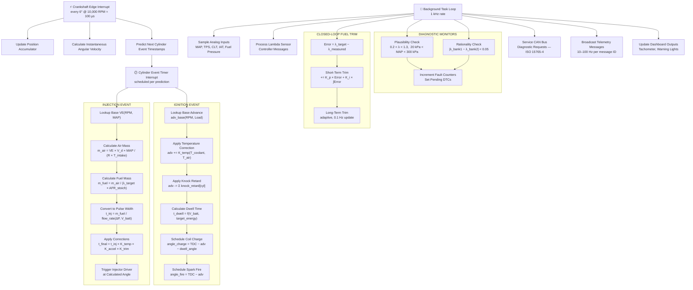

# Lesson 2: Electronic Control Systems: ECU Logic, Telemetry Streams, Fault Code Taxonomy

## 1. First-Principles Intuition & Invariants

The modern racing engine is not a purely mechanical artifact but a hybrid electromechanical system governed by millisecond-resolution digital logic. At its core lies the Engine Control Unit (ECU), a real-time embedded computer that transforms sensor voltage readings into actuator commands—fuel injector pulse widths, ignition coil dwell times, throttle body motor positions, and wastegate solenoid duty cycles. The ECU operates in a closed-loop control regime, constantly measuring the thermodynamic state of the combustion chamber through manifold absolute pressure, intake air temperature, lambda oxygen sensor feedback, and crankshaft position encoder pulses, then adjusting fuel delivery and spark timing to chase target air-fuel ratios and torque outputs while respecting knock sensor detonation margins and exhaust gas temperature limits.

Understanding ECU logic begins with recognizing that the control software operates under stringent real-time constraints. The engine's four-stroke Otto cycle demands that fuel injection and ignition events occur at precise crankshaft angles, synchronized to piston position within fractions of a degree. A typical high-performance ECU samples crankshaft position at 360 pulses per revolution or higher, using a 60-minus-2 reluctor wheel pattern that provides a missing-tooth reference for absolute angular determination. The microcontroller interrupt service routine must decode this pulse train, predict the arrival time of the next compression stroke top dead center, calculate the required fuel mass based on manifold pressure and volumetric efficiency tables, convert that mass into injector open time using injector flow characterization curves corrected for fuel pressure and battery voltage, then trigger the injector driver transistor at the precise crank angle to achieve the desired end-of-injection timing. This entire computational chain must complete in under one millisecond to maintain synchronization across all cylinders at 10,000 RPM, where each cylinder fires every 20 milliseconds in a four-cylinder engine.

The fundamental control invariant governing fuel injection is the stoichiometric air-fuel ratio for gasoline, 14.7:1 by mass, often expressed in lambda notation where λ = 1.0 represents stoichiometry. Maximum power output occurs slightly rich, at λ = 0.85 to 0.90 (AFR 12.5:1 to 13.2:1), because the excess fuel provides charge cooling that suppresses knock detonation and allows higher ignition advance. The ECU maintains this target lambda through closed-loop feedback from wideband oxygen sensors mounted in the exhaust primary collectors, adjusting a multiplicative fuel correction factor every 50 to 100 milliseconds. Open-loop operation occurs during cold starts, wide-open throttle transients, and overrun fuel cut conditions when the sensor readings are unreliable or the transient response is too slow. The fuel map itself is a three-dimensional lookup table indexed by engine speed (RPM) and load (manifold absolute pressure or throttle position), storing base fuel pulse widths that are then multiplied by correction factors for air temperature, coolant temperature, barometric pressure, and transient throttle enrichment.

Ignition timing control similarly relies on multidimensional mapping but operates under a different physical constraint: the propagation speed of the flame front across the combustion chamber. Peak cylinder pressure must occur approximately 15 degrees after top dead center to maximize the mechanical work extracted during the expansion stroke. Since the flame front requires roughly 2 milliseconds to traverse the bore diameter, the spark plug must fire before TDC—this advance angle increases with engine speed because the piston continues rotating during the constant-time flame propagation delay. At 6000 RPM, the crankshaft rotates 36 degrees per millisecond, so a 2-millisecond burn duration requires 72 degrees of ignition advance to place peak pressure at 15 degrees ATDC. The ignition advance map is therefore indexed by RPM and load, with additional correction factors for coolant temperature (more advance when cold due to slower flame speed) and knock sensor retard.

The knock sensor introduces a critical safety feedback loop. Detonation—the spontaneous autoignition of end-gas ahead of the flame front—generates high-frequency pressure oscillations in the 5 to 20 kHz range that the piezoelectric knock sensor detects as structure-borne vibration. When the ECU identifies a knock event by comparing the sensor signal to a frequency-selective threshold during the post-ignition window, it immediately retards ignition timing in that cylinder by 2 to 4 degrees and enriches the mixture slightly. The system then gradually advances timing again over several seconds until either the optimal advance is recovered or knock recurs, establishing a dynamic equilibrium at the knock-limited spark advance. This closed-loop knock control allows the base calibration to operate aggressively close to the detonation boundary, extracting maximum power without requiring conservative safety margins that would sacrifice performance.

Vehicle telemetry expands beyond engine control to encompass the complete electromechanical state of the racing car: suspension potentiometer positions tracking ride height and wheel travel, strain gauge wheel force transducers measuring vertical load and lateral scrub, brake line pressure sensors monitoring hydraulic bias and pedal modulation, steering angle encoders capturing driver input, and inertial measurement units recording three-axis acceleration and yaw rate. The telemetry stream is fundamentally a time-series data collection problem where dozens to hundreds of analog channels are sampled at rates from 10 Hz for slowly varying quantities like coolant temperature up to 1000 Hz for suspension displacement and brake pressure. The data acquisition system must timestamp each sample with microsecond precision, multiplex the channels into a single serial stream, and either store the data to onboard flash memory or transmit it via radio link to the pit lane for real-time visualization.

The fault code taxonomy represents the ECU's self-diagnostic capability, a systematic framework for detecting sensor failures, actuator malfunctions, and logical inconsistencies in the control system. Diagnostic Trouble Codes follow the ISO 15031 / SAE J2012 standardized five-character format: a leading letter indicating the subsystem (P for powertrain, C for chassis, B for body, U for network communication), a digit specifying generic (0) versus manufacturer-specific (1) codes, a digit identifying the subsystem (1 for fuel/air metering, 2 for injector circuit, 3 for ignition system, 4 for emissions control, 5 for speed/idle control, 6 for ECU and outputs, 7 and 8 for transmission), and finally a two-digit sequential identifier. For example, P0171 decodes to Powertrain-Generic-Fuel/Air-Metering fault 71, specifically "System Too Lean Bank 1," indicating the closed-loop fuel trim has reached its maximum positive correction attempting to compensate for an air leak or weak fuel pressure.

The diagnostic system operates through continuous monitoring routines that evaluate sensor plausibility and functional rationality. Plausibility checks verify that sensor readings fall within physically possible ranges—manifold absolute pressure cannot exceed atmospheric pressure plus boost, coolant temperature cannot increase faster than thermodynamic heating rates, and throttle position must correlate with manifold pressure under steady-state conditions. Rationality checks compare redundant sensor inputs for consistency: the two oxygen sensors on a V-configuration engine should read within 5% lambda when operating closed-loop, wheel speed sensors should agree within slip ratio tolerances, and calculated airflow from the mass airflow sensor should match the speed-density calculation from manifold pressure and volumetric efficiency. When a plausibility or rationality check fails for a calibrated duration—typically 2 to 5 seconds to avoid transient false triggers—the ECU sets a pending fault code and may enter a limp-home mode that limits engine power to prevent damage.

Freeze-frame data captures the complete operating state at the moment a fault code first sets, providing forensic context for diagnosis. The snapshot includes engine speed, load, coolant temperature, intake air temperature, calculated load value, short-term and long-term fuel trim percentages, throttle position, vehicle speed, and time since engine start. This frozen context allows the race engineer to reconstruct the failure conditions: a lean fault that occurs at 7200 RPM and 95 kPa manifold pressure with short-term fuel trim at +25% suggests fuel starvation from a weak pump or restricted filter, whereas the same fault at idle with 35 kPa manifold pressure points to a vacuum leak downstream of the mass airflow sensor. The distinction between pending, confirmed, and permanent codes reflects the diagnostic maturity—pending codes require a second consecutive drive cycle failure to confirm, while permanent codes indicate emissions-critical faults that cannot be cleared until the underlying problem is repaired and the monitor runs successfully.

Live data streaming provides real-time visibility into ECU calculations and actuator commands, transforming the black-box controller into a transparent computational engine. Accessing this data requires either an OBD-II scan tool that implements the ISO 15765-4 CAN diagnostic protocol or a direct CAN bus logger that decodes the broadcast telemetry messages. The distinction is critical: OBD-II diagnostics use a request-response protocol where the scan tool sends a query (Service $01 PID $0C for engine RPM) and the ECU replies with the current value at a rate limited by the serial bandwidth to approximately 10 Hz. In contrast, racing ECUs typically broadcast all telemetry parameters continuously on the CAN bus at their native update rates—engine speed at 100 Hz, throttle position at 50 Hz, lambda sensor at 10 Hz—allowing a passive logger to capture the full-bandwidth data without loading the ECU with query overhead.

## 2. Core Architecture & Mechanics

The ECU hardware architecture centers on a 32-bit microcontroller with dedicated peripherals for engine synchronization and analog signal conditioning. Modern racing ECUs employ ARM Cortex-M4 or Infineon Tricore processors running at 120 to 300 MHz, providing sufficient computational headroom to execute complex control algorithms while maintaining hard real-time guarantees. The microcontroller interfaces with a suite of specialized analog-to-digital converters that sample sensor voltages, high-current MOSFET drivers that switch injector and ignition coil primary currents, and dedicated timer-counter modules that decode crankshaft and camshaft position encoder patterns with hardware-accelerated edge capture and compare-match interrupts.

Sensor signal conditioning transforms the raw physical transducer outputs into clean digital values suitable for algorithmic processing. A typical manifold absolute pressure sensor produces a ratiometric voltage output from 0.5V at vacuum to 4.5V at maximum boost, referenced to the ECU's precision 5.0V supply. The ECU's 12-bit ADC samples this voltage with 1.22 mV resolution (5V / 4096 steps), then applies a two-point calibration curve to convert ADC counts into engineering units of kilopascals. Temperature sensors use negative temperature coefficient thermistors whose resistance decreases exponentially with temperature; the ECU applies a known reference voltage through a series resistor, measures the voltage divider output, then applies the Steinhart-Hart equation coefficients to solve for absolute temperature. Wideband oxygen sensors require active electronics that control the sensor's internal heater and Nernst cell pumping current while measuring the pump voltage, a complex closed-loop system typically implemented in a dedicated lambda controller IC that outputs a linearized 0-5V signal or CAN bus message representing lambda from 0.65 to 1.30.

Crankshaft position decoding forms the temporal foundation of all engine control functions. The reluctor wheel, a toothed ferromagnetic disk mounted to the crankshaft nose, rotates past a variable reluctance sensor that generates a sinusoidal voltage as each tooth tip modulates the magnetic flux. The ECU's input conditioning circuit shapes this analog signal into clean logic edges, then a hardware timer captures the timestamp of each rising edge with microsecond precision. The firmware decodes the 60-minus-2 pattern by detecting the missing-tooth gap where two consecutive teeth are absent, establishing an absolute angular reference. Once synchronized, the firmware predicts the arrival time of future crankshaft angles by extrapolating the instantaneous angular velocity calculated from the most recent tooth period, accounting for acceleration by applying a quadratic prediction filter. This angle prediction enables the system to schedule injection and ignition events relative to future piston positions rather than reacting to past encoder edges.

Fuel injection pulse width calculation proceeds through a hierarchical sequence of lookups and corrections. The base fuel map stores volumetric efficiency values indexed by RPM and manifold pressure, representing the ratio of actual inducted air mass per cylinder per cycle to the air mass that would fill the cylinder displacement at intake manifold pressure and temperature. The ECU multiplies this volumetric efficiency by the cylinder displacement, manifold pressure, and inverse of intake air temperature (via the ideal gas law) to compute inducted air mass. Dividing by the target lambda value and the stoichiometric air-fuel ratio yields the required fuel mass, which is then divided by the injector flow rate to determine the base pulse width. This base value is multiplied by correction factors: a battery voltage compensation curve that accounts for the nonlinear relationship between injector open time and delivered fuel volume at different supply voltages, an air temperature enrichment factor, a coolant temperature enrichment factor that provides extra fuel during warmup, a transient throttle enrichment pulse that compensates for manifold wetting dynamics, and finally the closed-loop lambda correction trim that adjusts for long-term drift and short-term transients.

The ignition timing calculation similarly begins with a base map indexed by RPM and load, storing the optimal spark advance in crankshaft degrees before top dead center under ideal conditions. Corrections are then applied for coolant temperature (advance increases as the engine warms due to improved combustion stability), intake air temperature (advance decreases with hot dense air due to increased knock propensity), and knock sensor feedback (retard accumulates with each detected knock event). The final calculated advance angle is converted to an absolute crankshaft angle by subtracting from the cylinder's TDC position, then the hardware timer is programmed to generate an output compare match at that predicted angle. The ignition coil dwell time, the duration the primary current flows to build magnetic energy before the spark event, is separately calculated based on battery voltage to ensure sufficient secondary voltage while avoiding coil saturation.

Telemetry message framing on the CAN bus follows the Controller Area Network 2.0B specification, where each message consists of an 11-bit identifier, a 0-8 byte data payload, and a 15-bit cyclic redundancy check. Racing ECUs broadcast telemetry using periodic messages with fixed identifiers: ID 0x200 might carry engine speed and throttle position every 10 milliseconds, ID 0x201 carries coolant temperature and intake air temperature every 100 milliseconds, and ID 0x202 carries fuel pressure and lambda sensor readings every 50 milliseconds. The data payload packs multiple parameters into the 8-byte frame using fixed-point integer scaling: engine speed is transmitted as a 16-bit unsigned integer representing RPM directly, throttle position as an 8-bit value scaled 0-255 representing 0-100%, and temperatures as 8-bit signed integers representing degrees Celsius plus an offset to handle negative values. Decoding requires a DBC (Database Container) file that specifies the bit position, length, scaling factor, and offset for each parameter within each message identifier.

The diagnostic protocol operates over the same CAN bus infrastructure but uses a request-response mechanism with reserved identifier ranges. OBD-II diagnostics use ID 0x7DF for functional broadcast requests, with the standard ECU responding on address 0x7E8; multi-ECU systems use ISO 15765-4 physical addressing (0x7E0 + ECU index) for targeted requests. A typical diagnostic session begins with a Service $01 request for current powertrain data, specifying a Parameter ID (PID) in the data payload: PID $05 requests coolant temperature, PID $0C requests engine speed, PID $0D requests vehicle speed. The ECU responds with a message containing the service number plus $40 (indicating a positive response), the PID, and the data bytes formatted according to the PID specification. Service $03 requests stored diagnostic trouble codes, returning a list of active DTCs in the format described earlier. Service $04 clears stored codes and resets the freeze-frame data, effectively erasing the fault history.

Freeze-frame capture logic monitors for the first occurrence of a confirmed diagnostic trouble code within a drive cycle. When a fault transitions from pending to confirmed status—typically requiring the failure condition to persist for two consecutive monitoring sequences—the ECU immediately snapshots all relevant parameters into nonvolatile memory. The freeze-frame structure allocates 32 to 64 bytes per fault, storing 10 to 15 critical parameters in compressed format. The timestamp records seconds since engine start rather than absolute calendar time. The calculated load value, a normalized representation of engine load from 0-100% that accounts for atmospheric pressure variations, provides altitude-independent context. Fuel trim percentages capture the deviation from the base calibration, with short-term trim reflecting the immediate lambda correction and long-term trim representing learned adaptations over multiple drive cycles.

The distinction between live data and stored fault codes reflects different phases of the diagnostic workflow. Live data streaming provides immediate visibility into current ECU calculations and sensor readings, enabling the engineer to verify sensor functionality, observe control loop behavior, and trigger specific operating conditions while monitoring the response. This real-time access is essential for dynamic testing: running the engine at 4000 RPM under 80% load while watching lambda sensor feedback, fuel trim corrections, and ignition advance allows immediate identification of control instabilities or sensor anomalies. In contrast, stored fault codes represent historical events that occurred during previous operation, preserving evidence of intermittent failures that may not be present during the current diagnostic session. The freeze-frame context helps bridge this temporal gap by capturing the operating conditions that triggered the fault.

The control loop architecture separates time-critical hard real-time tasks from lower-priority background operations through a two-tier scheduling hierarchy. Crankshaft synchronization and cylinder event scheduling execute in interrupt context with microsecond latency guarantees, preempting all other code. The background task loop handles slower operations like ADC sampling, diagnostic monitoring, and communication protocol processing at a fixed 1 kHz tick rate, providing deterministic execution without disrupting the angular-synchronous engine control.

## 3. High-Performance Optimization & Failure Modes

Achieving maximum engine performance requires aggressive calibration optimization that pushes every control parameter to its physical limit while maintaining sufficient safety margins to prevent catastrophic failure. The ignition timing advance map exemplifies this tension: advancing spark timing increases indicated mean effective pressure and torque output up to the point where knock detonation begins, but excessive advance triggers the knock control system to retard timing, actually reducing power. The optimal calibration strategy operates the base advance map 2 to 4 degrees beyond the knock threshold at full load, then allows the closed-loop knock control to dynamically retard timing in real-time based on instantaneous detonation events. This approach extracts maximum power under ideal conditions—high-octane fuel, cool intake air, low altitude—while the knock control provides automatic derating when conditions deteriorate.

Fuel pressure regulation critically affects both power output and control precision. Most racing fuel systems employ a mechanical bypass regulator that maintains constant differential pressure across the injectors by referencing manifold pressure, ensuring that injector flow rate remains proportional to pulse width independent of boost level. However, the finite pressure drop across fuel lines and the regulator's dynamic response lag introduce transient errors during rapid throttle movements. At the instant of throttle snap from cruise to wide-open, manifold pressure rises 150 kPa in 200 milliseconds while fuel pressure lags behind, temporarily reducing the actual fuel delivery below the commanded pulse width. The ECU compensates through transient enrichment—a calibrated fuel adder keyed to throttle rate-of-change—but inadequate compensation results in a momentary lean spike that triggers knock or damages the catalyst. Data logging both commanded and measured lambda during throttle transients reveals the adequacy of the enrichment calibration.

Oxygen sensor response dynamics limit the bandwidth of closed-loop fuel control, creating a fundamental tradeoff between stability and transient tracking. Wideband zirconia sensors exhibit first-order lag with time constants of 80 to 150 milliseconds from the exhaust gas transport delay through the sensor's diffusion barrier and the electrochemical pumping cell response. Attempting to close the fuel control loop with high gain and aggressive integral action causes limit-cycle oscillations where the control overshoots, drives lambda rich, then overcorrects lean in a continuous hunting pattern. Conservative PID tuning with low gains stabilizes the loop but allows steady-state lambda errors from sensor drift and calibration inaccuracies. Advanced ECUs implement adaptive learning where the long-term fuel trim accumulates over multiple drive cycles, slowly adjusting the base calibration to eliminate persistent offsets while the short-term trim handles transient disturbances with tight bandwidth.

Diagnostic trouble code interpretation requires understanding the underlying failure modes and their characteristic signatures in the freeze-frame data. A P0171 "System Too Lean Bank 1" fault with short-term fuel trim at +25% and long-term trim at +20% indicates the ECU is commanding maximum positive correction, yet the lambda sensor still reads lean. Possible root causes include an unmetered air leak downstream of the mass airflow sensor (intake manifold gasket, throttle body shaft seals, brake booster vacuum line), insufficient fuel pressure from a weak pump or clogged filter, or a failed mass airflow sensor reading low. Differentiating these failures requires examining additional freeze-frame parameters: if fuel pressure is low, the pump or filter is suspect; if manifold pressure exceeds the speed-density airflow prediction, an air leak is likely; if the MAF sensor voltage is at the low end of its range while actual airflow is high, the sensor has failed or is contaminated with oil residue.

Intermittent faults present the most challenging diagnostic scenarios because the failure is not present during the inspection, yet the stored DTC and freeze-frame indicate a legitimate fault occurred. Connector corrosion, vibration-induced wire chafing, and thermally-induced solder joint fractures create electrical opens and shorts that manifest only under specific environmental conditions. A P0335 "Crankshaft Position Sensor A Circuit Malfunction" that sets only during sustained high-RPM operation suggests a marginal sensor air gap where centrifugal crankshaft growth at high speed increases the reluctor wheel clearance beyond the sensor's pickup threshold. The freeze-frame showing the fault occurred at 8200 RPM confirms this hypothesis, guiding the repair toward shimming the sensor closer to the reluctor wheel. In contrast, the same DTC setting at idle with high engine temperature points to a thermal breakdown in the sensor winding insulation or connector pin contact resistance.

CAN bus communication errors introduce subtle failure modes that may not trigger explicit diagnostic codes but degrade telemetry reliability and cross-ECU coordination in systems with distributed control. The CAN physical layer requires matched 120-ohm termination resistors at each end of the bus to prevent signal reflections, and an open terminator increases bit error rates during high-traffic conditions. Symptoms appear as intermittent data dropouts in telemetry logs: a channel that normally updates at 100 Hz suddenly shows repeated stale values for 50 to 200 milliseconds before resuming. CAN bus loading also limits telemetry bandwidth—the 1 Mbps bus rate provides approximately 8,000 frames per second of throughput, and exceeding 80% utilization (6,400 frames/sec) causes arbitration delays that introduce jitter in time-critical messages. Racing systems optimize bandwidth by reducing update rates for slowly-varying parameters, packing multiple related values into single messages, and using CAN 2.0B extended identifiers or migrating to CAN FD for the 5 Mbps data rate.

Fuel injector characterization nonlinearity at short pulse widths creates calibration errors at low engine loads where precise idle control is critical. Electromagnetic fuel injectors exhibit a dead time of 0.8 to 1.2 milliseconds during which the solenoid armature overcomes spring preload and magnetic reluctance before the pintle lifts off its seat and fuel begins flowing. Below this threshold, increasing pulse width produces no additional fuel delivery; above it, flow increases linearly with time. The ECU compensates by applying a piecewise-linear injector model that adds the dead time offset to commanded pulse widths, but this characterization drifts with injector aging, fuel pressure variations, and battery voltage. An injector that has accumulated 500 hours of operation may exhibit 10% longer dead time than when new, requiring recalibration to maintain accurate fueling at idle and light cruise conditions where pulse widths approach 2 milliseconds.

Ignition coil saturation and misfire detection represent coupled failure modes where inadequate dwell time causes weak spark energy, incomplete combustion generates elevated exhaust hydrocarbon levels, and the misfire monitor detects the resulting crankshaft angular acceleration irregularity. Modern coils store 50 to 100 millijoules of magnetic energy when properly saturated, requiring 3 to 5 milliseconds of primary current dwell at 12 volts. At 10,000 RPM with a firing interval of 12 milliseconds per cylinder in a four-cylinder engine, allocating 5 milliseconds to dwell consumes approximately 42% of the available time budget. If battery voltage drops to 10.5 volts under high electrical load (fuel pumps, fans, data logging, radio telemetry), the coil requires 30% longer dwell to reach the same energy storage, but the ECU's voltage compensation may be inadequate. The resulting weak spark causes partial combustion, the misfire monitor increments the cylinder-specific misfire counter, and after 30 misfires in 200 engine revolutions, the system sets a P030X code where X identifies the affected cylinder.

Throttle position sensor redundancy and rationality checking illustrate the architecture of safety-critical sensor validation. Racing throttle bodies employ dual independent potentiometers on the same shaft, one outputting 0.5-4.5V proportional to angle, the second outputting 4.5-0.5V inversely proportional. The ECU continuously sums the two voltages and verifies the total remains within 4.8-5.2V; any deviation indicates sensor supply corruption or wiring damage, immediately triggering a P2135 "Throttle Position Sensor A/B Voltage Correlation" fault and forcing the engine into limp-home mode with 30% maximum throttle opening. Additionally, the ECU compares throttle position against manifold pressure rationality: at steady-state cruise, manifold pressure should correlate with throttle opening according to the engine's pumping characteristic. A 50% throttle opening at 3000 RPM should produce approximately 60-70 kPa manifold pressure; if actual pressure reads 40 kPa while throttle reads 50%, either the throttle sensor has failed high, the MAP sensor has failed low, or a manifold air leak exists. This cross-validation transforms two independent sensor failures into a detectable inconsistency that triggers diagnostic action.

Telemetry synchronization across distributed acquisition systems poses timing challenges when combining ECU CAN data with chassis telemetry from independent loggers. The ECU timestamps its telemetry messages based on its internal real-time clock, while a suspension data acquisition system uses its own GPS-synchronized clock. Merging the two data streams in post-processing requires either hardware synchronization via a common GPS time source or software alignment using cross-correlation of a shared signal like vehicle speed or longitudinal acceleration. Even microsecond-precision timestamps suffer from clock drift if the acquisition runs for 30-minute sessions without resynchronization, potentially introducing 10 milliseconds of relative drift that smears out transient event correlation when overlaying throttle position against suspension displacement during a brake-turn-in transition.

Advanced ECU calibration optimization employs statistical design-of-experiments methods to efficiently map the high-dimensional parameter space of ignition advance, fuel enrichment, and cam timing. A full factorial sweep varying ignition advance in 1-degree steps across 20 load points and 15 RPM points requires 300 test cells, consuming multiple hours of dyno time. Latin hypercube sampling reduces this to 50 strategically chosen test points that provide uniform coverage across the parameter space, then Gaussian process regression interpolates the torque response surface to predict optimal settings at unmeasured conditions. This approach accelerates calibration development from weeks to days while improving optimality by avoiding the discrete grid bias of traditional lookup tables that may miss the true peak torque angle lying between calibrated grid points.
