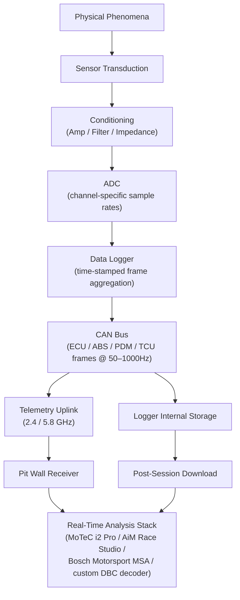

# Lesson 4: Race-Specific Diagnostic Workflows: Real-Time Fault Isolation, Performance Degradation Detection, Pit Decision Protocols

## 1. First-Principles Intuition & Invariants

There is a particular quality of attention that separates a competent race engineer from a great one, and it has nothing to do with the depth of their spreadsheet models or the elegance of their simulation pipelines. It is the ability to hold a mental model of the entire car simultaneously, to feel through data streams what a driver is experiencing at 280 kilometers per hour, and to make a correct decision in the ninety seconds between a warning flag and a pit window. This is not intuition in the mystical sense. It is pattern recognition built on a rigorous understanding of cause-and-effect chains across mechanical, thermal, and software domains, compressed by experience into something that feels instantaneous.

The invariant at the foundation of all race diagnostics is this: **every symptom has a signal ancestry**. No wheel locks, overheats, loses traction, or degrades in isolation. Each event propagates from a physical root cause through a chain of sensors, into a CAN bus frame, through a telemetry uplink, and onto a timing screen or engineer's laptop. When you understand that ancestry completely — which sensors lie upstream of which aggregated parameters, where filtering and smoothing obscure transient events, which channels are sampled at 1 kHz versus which are averaged over 100 milliseconds — you can trace any symptom backward to its mechanical origin with surgical precision. The engineer who cannot trace that ancestry is forced to guess. Guessing in a race is statistically expensive.

The second invariant is that **degradation is always gradual before it is catastrophic**. Brake pad thickness does not reach zero in a single corner. A wheel bearing does not seize in a straight. A gearbox oil temperature does not spike from nominal to critical between one gear shift and the next. The catastrophic event is simply the terminal point of a degradation curve that the diagnostic system had been sampling, often for laps, before anyone chose to interpret it. The practical implication is that the most valuable diagnostic work happens not at the moment of failure but in the fifteen to twenty minutes preceding it, when the signal-to-noise ratio of degradation indicators is still low enough that only a correctly calibrated alert threshold or a sharp-eyed engineer will catch it. The frameworks described in this lesson are designed precisely for that pre-catastrophic window.

The third invariant governs competitive constraint. Unlike a road car diagnostic environment where the technician can park the vehicle, run a full scan, and take as long as necessary, race diagnostics operate under a continuous time-cost function. Every lap spent nursing a degrading system is a lap in which the gap to the car ahead either shrinks or widens. Every pit stop costs somewhere between eighteen and forty seconds of track position, depending on the series. This means that the decision to pit — and the decision about what to tell the driver while running — must be framed not as a pure engineering judgment but as a **risk-adjusted competitive trade-off**. A brake temperature that is thirty degrees above nominal on a car that is P4 with eight laps remaining demands a different response than the same reading on a car that is P1 with the same margin.

Understanding these three invariants — signal ancestry, gradual degradation, and competitive constraint — is the prerequisite for everything that follows. They shape how diagnostic matrices are structured, how sensor cross-validation is sequenced, and how pit decisions are framed. They also explain why the best race engineers develop a certain economy of language with their drivers: a channel that is trending toward a threshold does not warrant a paragraph of explanation over the radio. It warrants a single, pre-agreed code word that the driver already knows how to respond to.

### The Physics of What You Are Actually Measuring

Before discussing diagnostic workflows, it is worth grounding the discussion in what the sensors are actually sensing — not in the abstract, but in terms of the physical phenomena that connect driver input to data channel output. This grounding matters because misreading a sensor's physical meaning is the most common source of false diagnostic conclusions.

A wheel speed sensor — typically a Hall-effect device reading a reluctor ring on the hub — measures the rotational velocity of the wheel rim, not the velocity of the car. The difference between wheel speed and vehicle speed (derived from GPS or from a consensus of all four wheel speed sensors) is the slip ratio, and that ratio carries enormous diagnostic information. A rear-left wheel speed that persistently reads two to three percent below the rear-right under power indicates a differential behavior anomaly or a tire with measurably different rolling radius due to pressure or wear asymmetry. A sudden step-change to zero on any wheel channel during braking is an ABS intervention event — or, more seriously, a sensor dropout that the ABS module may interpret as a locked wheel, triggering unwarranted hydraulic release. These two failure modes produce superficially similar channel signatures but have entirely different mechanical consequences, and they are distinguished only by cross-referencing the ABS module's intervention flag channel and the brake hydraulic pressure transducer simultaneously.

Suspension potentiometers, mounted on linear push-rod or pull-rod actuators, measure damper displacement and by extension suspension travel. Their diagnostic value extends far beyond simple ride height monitoring. A potentiometer that returns a constant value mid-corner, when the car should be rolling and pitching by several millimeters, indicates a binding damper or a seized top mount — not a nominal condition. Conversely, a potentiometer that returns high-frequency oscillation at a frequency consistent with the wheel's natural frequency indicates insufficient damping force, almost always from a cavitated or low-fluid damper. Cross-referencing all four corners' potentiometer traces during a known reference corner allows an engineer to build a spatial picture of body motion that no single-axis accelerometer can provide.

Brake temperature sensors — either thermocouples embedded in the hat or non-contact infrared pyrometers measuring disc face temperature — measure a thermal phenomenon that is the cumulative integral of braking energy over time minus the heat dissipated by convection and radiation. This means that brake temperature at any given moment is a function of the car's deceleration history over the preceding several laps, not just the most recent braking zone. A car whose disc temperatures are rising lap-on-lap, even though the lap times are consistent, is typically experiencing reduced airflow to the brake duct — from a blockage, a deteriorating duct seal, or an aerodynamic change that has redirected the cooling flow — rather than driver brake technique change. Distinguishing those two causes requires comparing brake temperature rate-of-rise against brake pressure trace and corner brake point marker, which is a cross-validation operation that most engineers perform instinctively but should be encoded explicitly into diagnostic alert logic.

---

## 2. Core Architecture & Mechanics

### The On-Car Data Acquisition Spine

The diagnostic architecture of a modern race car is a layered system in which raw physical phenomena are transduced, digitized, multiplexed, transmitted, and interpreted through a set of distinct functional tiers. Understanding the architecture at this level of detail is not academic — when a diagnostic alert fires, knowing which tier is producing it determines whether the response is mechanical, software, or radio.

At the base layer, sensors convert physical quantities into electrical signals. These signals are conditioned — amplified, filtered, and impedance-matched — by the data acquisition unit's input circuits before analog-to-digital conversion. The ADC sampling rate varies by channel type: wheel speed sensors are typically sampled at 1 kHz or higher because the high-frequency content of ABS events and wheel hop is diagnostically meaningful; a water temperature sensor is meaningfully sampled at 10 Hz because its physical time constant is on the order of seconds. Sampling everything at 1 kHz is not a virtue; it generates storage and telemetry bandwidth costs without proportional diagnostic benefit for slow-time-constant channels. The engineer who understands sampling theory knows that thermal channels are oversampled at 100 Hz and that chassis sensors are potentially undersampled at 200 Hz on a car with active suspension.

The data acquisition unit — in a professional single-seater or GT car, this will typically be a MoTeC C Series logger, a Pi Research Sigma, an AIM MXS, or an Autosport Labs RaceCapture system in lower formula — aggregates all conditioned sensor signals into a single timestamped frame that also includes CAN bus data from the ECU, ABS module, PDM (power distribution module), and transmission controller. This aggregation is critical. It means that the logger is the single authoritative source of time-aligned data, and any diagnostic analysis that works from non-logger-sourced data risks time-alignment errors that produce spurious correlations.

The CAN bus structure in a racing car carries several distinct classes of information simultaneously. The powertrain CAN carries engine RPM, throttle position sensor (TPS), fuel injector duty cycle, manifold absolute pressure (MAP), lambda sensor values, oil pressure, and water temperature at frame rates typically between 50 and 200 Hz per channel. The chassis CAN carries ABS module outputs, steering angle sensor (SAS) data, and suspension control data at rates up to 1 kHz for active-system cars. The body CAN — where it exists — carries PDM channel states, fan relay status, and dashboard lighting. These buses are physically separate on most race cars to prevent a powertrain fault (such as an alternator generating CAN noise) from corrupting safety-critical chassis data.



The telemetry uplink introduces its own diagnostic complexity. Depending on the series and circuit, 2.4 GHz telemetry links can suffer multipath interference in certain circuit sections — specifically in tunnel sections, under bridges, and in armco-walled valleys where the signal bounces create destructive interference. This means that telemetry dropout is not always a sign of hardware failure; it is frequently a geometry-of-circuit problem, and the engineer who interprets a telemetry gap as a sensor fault will draw a false diagnostic conclusion. The correct response to any telemetry gap is to compare the post-session downloaded logger data against the real-time telemetry record and confirm whether the channels were actually nominal during the gap. If the downloaded data shows a clean signal through the gap period, the problem was the uplink, not the sensor.

### The In-Race Diagnostic Prioritization Matrix

Race diagnostics require a triage structure because not all faults demand the same response urgency and because cognitive bandwidth on a pit wall during a race is a genuinely scarce resource. The diagnostic prioritization matrix codifies this triage into three tiers based on safety criticality and time-to-consequence.

**Tier 1 — Immediate Safety Threat.** These are fault conditions where continued racing presents an immediate risk of driver injury or catastrophic mechanical failure. Brake hydraulic pressure loss (either circuit), suspension geometry sensors indicating structural failure (a potentiometer reading beyond its physical range in a direction consistent with collapse), oil pressure drop below the minimum lubrication threshold, and wheel speed sensor total loss on any corner (which may indicate impending wheel separation) all belong in this tier. The correct response to any Tier 1 alert is a direct, immediate radio call to the driver with a pre-agreed pit-in instruction. The engineer does not investigate further before making the call. Investigation happens after the car is in the pit lane.

**Tier 2 — Active Performance Degradation with Safety Margin.** These are fault conditions where the car's performance is measurably degrading, there is a defined safety margin remaining, and the response requires a time-sensitive but not immediate pit decision. Brake temperature approaching but not yet exceeding material limits, gearbox oil temperature in a rising trend that projects to critical within ten to fifteen laps, tire pressure rising above the optimal pressure window, and misfire codes on individual cylinders with no secondary consequence faults all sit in Tier 2. The correct response involves cross-validating the channel against at least one corroborating sensor, estimating the remaining useful window using the degradation rate, and framing a pit window recommendation that weighs the safety margin against track position cost.

**Tier 3 — Latent Degradation or Data Anomaly.** These are conditions that require monitoring and potentially a setup adjustment at the next pit stop but do not demand any immediate race strategy alteration. A single corner's brake temperature running slightly higher than the other three, a mild wheel speed asymmetry under power, a potentiometer whose readings show slightly increased noise floor suggesting mechanical wear — all Tier 3. These get logged, flagged for in-session strategy review, and fed back to the driver only if they will change driving behavior.

The practical implementation of this matrix in a race engineering environment is an alert configuration file — in MoTeC terminology, a "condition" set within i2 Pro's math channel and alarm framework. Each diagnostic parameter has three threshold values: a yellow advisory threshold that places the channel on the engineer's monitoring dashboard, an orange action threshold that triggers an audible alert and requires investigation, and a red immediate threshold that maps directly to a Tier 1 radio call. These thresholds are car-specific and should be derived from pre-event testing data, not from generic defaults. A brake disc temperature threshold that is appropriate for a cast-iron disc in GT4 is not appropriate for a carbon-carbon disc in LMP2.

### Sensor Cross-Validation Architecture

No single sensor in isolation should ever be trusted for a safety-critical diagnostic conclusion. The cross-validation principle requires that any diagnostic conclusion above Tier 3 be confirmed by at least one physically independent sensor channel that measures a correlated but distinct physical quantity. This is not bureaucratic caution — it is a statistical necessity given sensor failure modes in the racing environment.

Consider a wheel speed sensor that reads zero. The possible physical explanations include a locked wheel under braking, a physically separated wheel, a failed sensor, a severed wiring harness, a corroded connector, or a failed sensor power supply rail. These causes range from "stop immediately" to "ignore and investigate post-session." Distinguishing them requires a cross-validation sequence: does the GPS-derived vehicle speed show a simultaneous deceleration consistent with a locked wheel? Does the brake pressure trace show active braking at the moment of the event? Does the adjacent corner's potentiometer show the suspension response you would expect from a wheel-lock-induced attitude disturbance? If all three of those corroborating channels are consistent with a locked wheel, the diagnosis is mechanical. If the other three wheel speeds are unaffected, brake pressure is nominal, the potentiometer shows no disturbance, and the GPS speed shows no deceleration event, the sensor has failed or its wiring has opened. That is a Tier 3 diagnosis, not a Tier 1.

The cross-validation matrix for the most common racing diagnostic scenarios is built around four physical domains — kinematic, thermal, hydraulic, and electrical — and the principle that a true mechanical event will produce correlated anomalies in at least two domains simultaneously. A sensor failure typically produces an anomaly in only one domain, and usually with a characteristic signature: a step-change to zero (open circuit), a step-change to full-scale (short to supply), or a jump to a fixed intermediate value (stuck bit in ADC or failed sample-and-hold).

```text
Diagnostic Scenario: Rear Brake Anomaly

Primary Channel:          Rear brake temperature rising above threshold

Cross-Validation Layer 1: Rear brake pressure trace (hydraulic domain)
  → Is rear bias valve position consistent with temperature rise?
  → Is rear pressure higher than expected for the deceleration event?

Cross-Validation Layer 2: Rear wheel speed sensors (kinematic domain)
  → Is there evidence of partial lock under threshold braking?
  → Is rear wheel deceleration steeper than front in matched braking zones?

Cross-Validation Layer 3: Rear suspension potentiometers (kinematic domain)
  → Is there pitch attitude anomaly consistent with rear brake bias?
  → Is rear-left vs. rear-right balance symmetric?

Cross-Validation Layer 4: Driver feedback (qualitative domain)
  → "It's pushing at turn-in" → understeer consistent with front brake fade
  → "It's stepping out under brakes" → rear lock-up consistent with over-bias
```

The qualitative driver feedback domain deserves particular attention here because it is frequently undervalued in engineering workflows. Driver feedback is not telemetry — it has no timestamp, no calibration, no noise floor — but it is a measurement made by a human sensor with enormous bandwidth operating in a feedback loop directly with the car. When a driver says "the car is twitchy at turn-in on the left-handers," that is a kinematic-domain observation. When they say "the left rear feels light under power," that is a load-transfer-domain observation. When they say "the brakes feel soft," that is a hydraulic-domain observation. Each of these maps to specific channels and can be used to either narrow or widen the cross-validation search. The discipline of driver-to-telemetry correlation is discussed fully in Section 3, but it begins here with the recognition that verbal feedback is a diagnostic channel that must be treated with the same systematic rigor as an electrical one.

### ECU Fault Codes and CAN-Level Diagnosis

Modern racing ECUs — the MoTeC M1, Cosworth Pi, Pectel T6, or Magneti Marelli 7SM series — maintain internal fault code registers that are accessible both through direct serial/USB connection in the pits and through dedicated CAN messages broadcast at defined intervals on the powertrain bus. Understanding the structure of these fault messages is essential because they carry more information than a simple error code.

An ECU fault frame on the CAN bus typically encodes several fields within its data bytes: a fault code identifier, a fault status byte (pending, confirmed, historical, or healed), a frequency counter indicating how many times the fault has been detected in the current power cycle, and in some implementations a severity ranking. Correctly decoding this structure from the DBC file is prerequisite to understanding whether a fault code represents a persistent failure — which demands immediate action — or a transient electrical disturbance that healed itself — which may be log-and-monitor.

The DBC decode for a typical powertrain fault message might look as follows, expressed in the structure a MoTeC or CANalyzer decode rule would implement:

| CAN ID | Signal Name | Start Bit | Length | Factor | Offset | Unit |
|---|---|---|---|---|---|---|
| 0x### | FaultCodeID | 0 | 16 | 1 | 0 | — |
| 0x### | FaultStatus | 16 | 4 | 1 | 0 | enum |
| 0x### | FaultFreqCount | 20 | 8 | 1 | 0 | count |
| 0x### | FaultSeverity | 28 | 4 | 1 | 0 | enum |
| 0x### | EngineProtectFlag | 32 | 1 | 1 | 0 | bool |
| 0x### | LimpModeActive | 33 | 1 | 1 | 0 | bool |

The `EngineProtectFlag` and `LimpModeActive` bits are the ones that elevate a fault from engineering interest to immediate pit decision. When `LimpModeActive` is set, the ECU has already implemented a protective strategy — typically fuel cut above a threshold RPM, injection timing retard, or boost pressure reduction — that will be directly visible in the driver's experience as sudden power loss. The driver will almost certainly report this before the engineer reads it off the telemetry screen. The discipline is to have already seen it on the screen, understood the fault ancestry, and have the response framed before the driver finishes their radio sentence.

---

## 3. High-Performance Optimization & Failure Modes

### Performance Envelope Monitoring and Degradation Fingerprinting

The concept of a performance envelope is familiar from general engineering — it is the region of operating space within which a system performs within its designed parameters. For a race car's diagnostic system, the performance envelope is not a static boundary but a dynamic one that changes with fuel load, tire age, track temperature, and accumulated mechanical fatigue. Effective performance envelope monitoring means tracking not just where the car is operating right now but where the boundary of acceptable performance currently sits, and whether the gap between current operation and that boundary is shrinking.

The most powerful tool for this in-race is the **lap-delta overlay**, implemented in real time against a reference lap stored either from qualifying or from the previous stint's early laps. The lap-delta trace shows the cumulative time gain or loss lap-on-lap as a function of track position. When a car degrades mechanically, the lap-delta trace almost always shows the degradation pattern before overall lap time shows it, because the lap-time is an integral of performance over the entire lap and masks the spatial location of the problem. A lap-delta trace that widens specifically and repeatedly at a heavy braking zone — say, at the chicane entry on lap 28, 29, and 30 of a stint — while remaining consistent everywhere else, is a spatially resolved diagnostic signal. The loss is happening at that braking zone, not at the following corner. That eliminates aero balance shift, engine power fade, and tire wear across all four corners as primary causes, and focuses the investigation on brake system performance and driver's ability to maintain reference brake point.

Tire degradation fingerprinting deserves its own treatment because tire condition is often the dominant performance variable in endurance racing and is also one of the hardest to diagnose precisely from pit-wall telemetry. The channels available are tire temperature (from infrared sensors reading the tread surface at three lateral positions across the contact patch), tire pressure (from TPMS sensors on the valve stem or from pressure transducers on rotating assemblies), wheel speed (from which slip ratio is derived), and lateral acceleration (from the IMU). None of these directly measures rubber compound health or tread depth, but their combination produces a readable degradation signature.

A tire in its performance window will show an inner-to-outer temperature differential that is consistent with the mechanical camber setting — typically warmer on the inner shoulder for a road-circuit configuration with negative camber. As the tire degrades, one of three things happens: the temperature across the patch homogenizes as the compound loses its ability to generate and retain heat differentially, indicating compound fade; the inner shoulder temperature rises disproportionately as the sidewall stiffness reduces and the contact patch geometry migrates inward, indicating structural fatigue; or the pressure rises beyond the optimal window as the tire's internal gas heats from compound degradation, indicating that the initial hot-inflation pressure was set too low for the current track conditions and degradation rate. The first two patterns are signs of a tire that is past its limit and will produce a progressive understeer condition as the front tires lose lateral stiffness. The third is an operational error that can be corrected at the next pit stop with a cold pressure adjustment.

### Predictive Maintenance Triggers and Trend Analysis

Predictive maintenance in racing is not the same as predictive maintenance in an industrial plant, where sensor fusion algorithms run continuously on a fleet of fifty machines with years of historical data to train models. In racing, the dataset is small — sometimes just a single day of testing plus the race weekend — and the consequence of a missed prediction is immediate and irreversible. The methods must therefore be simpler, more transparent, and more robust to sparse data.

The most effective predictive trigger in race engineering is the **rate-of-change alert**, applied to slowly evolving thermal and pressure channels. Rather than alerting when a channel exceeds a threshold, the rate-of-change alert fires when the derivative of the channel — computed over a rolling window of typically ten to thirty seconds — exceeds a defined rate. A brake temperature rising at five degrees per lap is nominal for a typical aerodynamic downforce level and pad compound. The same brake temperature rising at twenty degrees per lap with no change in driving style or lap time indicates a cooling airflow problem that, if unaddressed, will reach material limits within four to six laps. The rate-of-change alert catches this condition two to three laps earlier than a simple threshold alert would, which in a tightly contested race can mean the difference between a planned pit stop at the optimal strategic window and an emergency pit stop that destroys track position.

Gear shift quality monitoring is a subtler but equally important predictive channel in sequential transmission cars. The transmission controller — or in a paddleshift car, the gear actuator's position sensor combined with the ECU's gear position channel — records shift duration in milliseconds from the moment the driver actuates the paddle to the moment gear engagement is confirmed by the neutral detection switch. Nominal shift duration for a well-adjusted sequential dog-engagement gearbox is typically in the range of fifty to one hundred and fifty milliseconds, depending on the box design and actuator type. As the dog rings wear, as oil temperature rises, or as the actuator's return spring fatigues, shift duration increases and shift completion confirmation becomes less reliable. A gradual increase in average shift duration from ninety milliseconds at the start of the race to one hundred and forty milliseconds by lap thirty is a wear signature. If that trend continues at the same rate, a failure-to-engage event — which in a mid-corner power reapplication scenario carries a significant vehicle dynamics consequence — becomes probable within ten to twenty additional shifts. That trend, flagged in real time by a shift-quality math channel in the data system, is the trigger for a lubricant analysis check at the next pit stop and a conversation with the driver about shifting technique under high lateral load.

### Driver Feedback Correlation: The Human Sensor in the Loop

The driver is the highest-bandwidth sensor on the car, and also the noisiest. Training a driver to give diagnostically useful feedback during a race is itself a discipline that belongs in the race engineering toolkit, and the correlation technique — mapping verbal feedback to specific telemetry channels — is a skill that develops over seasons of working together.

The fundamental correlation technique is to ask the driver to associate their feedback with a track reference point rather than a vague description of feel. "The car is oversteering" is not a diagnostic input. "The car is stepping out at the apex of Turn 7 under power" is a diagnostic input that maps to a specific track position, a specific dynamic condition (power application transitioning from apex to exit), and a specific subset of telemetry channels: rear wheel speed differential at that GPS position, differential lock percentage from the ECU's torque management channel, rear lateral potentiometer deflection rate under power. The engineer can go directly to those channels for the relevant lap section and confirm or deny the driver's sensation.

Where driver feedback and telemetry diverge — where the driver reports oversteer but the potentiometers and wheel speed sensors show no corresponding signature — the divergence itself is diagnostic. It indicates either a tactile sensitivity in the driver that the sensor resolution cannot capture (possible with a highly experienced driver and low-resolution sensors), a driver error in localizing the sensation to the wrong track section (common under fatigue), or a chassis motion that is below the detection threshold of the installed sensors but above the driver's vestibular threshold. In all three cases, the correct engineering response is to ask the driver to describe the sensation in more physical terms — "is it a rotation or a push?" — and to look at higher-frequency channels (IMU yaw rate and lateral acceleration sampled at 200 Hz or above) rather than the coarser potentiometer traces.

The experienced engineer builds a mental library of driver-feedback-to-channel mappings specific to each driver they work with. Driver A's "the front isn't turning in" almost always corresponds to front brake bias that has shifted rearward due to front pad wear, confirmed by brake pressure ratio channel. Driver B's "it's nervous on the straight" reliably corresponds to rear wing aerodynamic buffeting at above 220 km/h, visible in the high-frequency IMU lateral acceleration trace. These mappings are not generic — they are calibrations of the human sensor that must be rebuilt whenever a new driver joins the team.

### Pit Decision Protocols Under Competitive Constraint

The pit decision is the moment at which all of the diagnostic work described above is converted into an operational action with direct, measurable, and irreversible competitive consequences. The engineering quality of the diagnostic workflow only matters if it can be distilled into a clear, timely, and correctly framed pit call.

The protocol begins before the fault event. During pre-race preparation, the engineer and driver should agree on a set of fault conditions that constitute automatic pit-in calls — conditions where the driver does not wait for instruction but begins the pit-in procedure immediately on feeling or reading the symptom. These are the Tier 1 conditions: brake pedal going long and soft, sudden power loss with the `LimpModeActive` flag on the steering wheel light matrix, or any hard contact that the driver felt as potentially wheel-or-suspension-damaging. Automating the response to these conditions removes the communication latency — typically five to fifteen seconds in a race environment with radio congestion — that could be safety-critical.

For Tier 2 conditions, the protocol involves a structured radio call that follows a specific information sequence: state the channel, state the value, state the trend, state the remaining margin, and state the recommendation. An engineer's call that says "brake temperatures rising, they're at 420°C on the front left, been climbing three degrees per lap for the last eight laps, we have about twelve laps of margin at this rate, recommend pitting in two laps at the end of the current stint window" gives the driver everything they need to inform their driving and their mental preparation for a stop, without ambiguity and without overwhelming detail. Contrast this with "brake temps are getting high, we might need to look at coming in soon," which is not a diagnostic communication — it is an anxiety transfer.

The timing of the pit-in call within a Tier 2 scenario is itself an optimization problem. The engineer must balance three competing factors: the safety margin remaining (how many laps before the fault condition crosses into Tier 1), the strategic pit window (the range of laps within which a pit stop costs the least track position relative to competitor strategies), and the driver's current track position relative to their competitors. When the remaining safety window and the optimal strategic window overlap, the decision is straightforward. When they do not, the engineer must choose: accept a suboptimal strategic moment to preserve safety margin, or extend and accept the increasing risk. The correct framework for this decision is not engineering intuition alone — it requires the race strategist's model of competitor pit cycles and the engineer's projection of the fault's remaining useful life. Building this joint decision protocol before the race, using fault-scenario simulations during debriefs, is what prevents the fifteen-second confused radio discussion that costs position when the actual event occurs.

The final element of the pit decision protocol is the debrief loop. After every unplanned pit stop or after any in-race diagnostic event, the downloaded logger data must be reviewed against the telemetry record within the same session, ideally during the driver's out-lap or during the next planned pit window. The goal is to confirm the diagnostic conclusion — was the cross-validation interpretation correct? — and to update the remaining-event thresholds for the rest of the race. A brake temperature event that was confirmed as a cooling duct seal failure means the diagnostic picture for the rest of the race is different than it was before: the threshold for the next warning must be set lower because the cooling capacity is permanently reduced until the duct is repaired. This closed-loop update is the mechanism by which good race engineering prevents the same fault from surprising the team twice in the same race.

The aggregate of these practices — the signal ancestry model, the prioritization matrix, the cross-validation discipline, the predictive rate-of-change triggers, the driver feedback correlation, and the structured pit decision protocol — forms a coherent diagnostic system that operates at the speed the race demands. None of it requires technology beyond what is already installed on a competitively prepared race car. It requires, instead, the deliberate engineering of the diagnostic process itself: deciding in advance what channels matter for which fault conditions, what cross-validation rules apply, what thresholds have been calibrated for this car on this circuit, and what the communication protocol looks like when a threshold is reached. That pre-race engineering of the diagnostic workflow is what makes the in-race execution feel, to an outside observer, like intuition. It is not. It is preparation.
