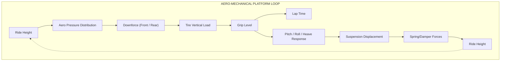
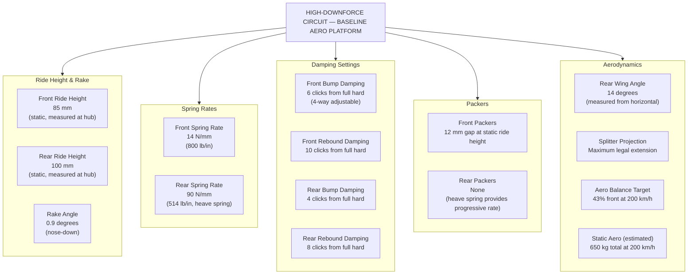

# Lesson 4: Aerodynamics, Stability, Dynamic Balance Integration

## 1. First-Principles Intuition & Invariants

Aerodynamic downforce is the single largest performance differentiator in modern motorsport, yet it remains the most commonly misunderstood platform variable at the track. The reason is straightforward: mechanical grip operates through tire contact patch loading that varies with load transfer, suspension geometry, and surface conditions, all of which are quantities a driver can feel through the seat and steering wheel. Aerodynamic downforce, by contrast, acts invisibly, applied as a distributed pressure field across the bodywork and underfloor. The driver perceives only the downstream effects, higher overall grip at speed, a shifting front-to-rear balance that may never have appeared in low-speed testing, and a platform whose ride height moves the center of pressure in ways that can transform the car's character over a single lap.

The fundamental invariant is that aerodynamic downforce does not add grip for free. It adds vertical load to the tires, and tire load sensitivity, the well-known property that a tire's friction coefficient decreases as vertical load increases, means that downforce yields diminishing returns per additional kilogram. What downforce does, though, that spring rate changes and anti-roll bar adjustments cannot do, is add load to all four tires simultaneously while adding minimal unsprung mass. This is why a high-downforce configuration will almost always outperform a mechanically optimized low-downforce configuration on any track where cornering forces dominate straight-line speed. The lap-time gain from carrying twenty kilometers per hour more through a high-speed corner almost always exceeds the time lost to drag on the following straight, unless that straight is exceptionally long relative to the cornering section.

The second invariant, and the one that causes the most setup grief, is that aerodynamic balance is not static. The center of pressure, the theoretical point at which the net aerodynamic downforce acts, migrates forward and rearward as ride height changes, and ride height changes constantly. Under hard braking, the front compresses, the rear extends, the floor's leading edge draws closer to the ground, and the diffuser's expansion ratio increases. Downforce at the rear grows, shifting the center of pressure rearward. Under acceleration, the rear squats, the front rises, the front splitter loses ground proximity, and the center of pressure shifts forward again. A car that is beautifully balanced at static ride height can be terrifyingly unstable under braking or under power, not because the mechanical balance is wrong, but because the aero balance is chasing the pitch attitude across the lap.

The practitioner's job is to manage this migration. The car does not need perfect balance at every instant; it needs balance that stays within a window the driver can exploit. That window is roughly two to four percent of total downforce front bias, depending on the driver's preference and the track layout. Beyond that window, the driver begins to modulate inputs to compensate, braking earlier to avoid entry understeer, applying throttle later to avoid exit oversteer, and the lap time evaporates in the modulation itself, not in the grip deficit.

---

## 2. Core Architecture & Mechanics

### The Aero-Mechanical Platform as a Coupled System

The core architecture of a racing car's platform is a coupled spring-mass-damper system in which the aerodynamic load is not an external force applied to a fixed structure but a self-generated pressure field whose magnitude and distribution depend on the structure's own position and velocity. This feedback loop is what separates aero-platform tuning from pure mechanical setup.



The suspension springs support both the mechanical mass of the car and the aerodynamic downforce. When downforce increases with speed, the car compresses further onto its springs, lowering the ride height, which in turn increases downforce further until the aerodynamic load equals the spring force at the new equilibrium. At high speed, a GT3 car running 700 kg of total downforce at 250 km/h may sit 8 to 12 mm lower than its static ride height purely because of aero compression. A Formula car with higher downforce-to-mass ratios can compress 15 to 25 mm. This compression is not a problem in itself; it is a design variable. The problem arises when the compression moves the floor or splitter into a regime where the flow stalls or becomes unstable.

### Ride Height Sensitivity and the Pitch Window

The relationship between ride height and downforce is not linear. For a diffuser or underfloor, downforce increases as the gap between the floor's leading edge and the ground decreases, because the Venturi constriction accelerates the flow and lowers the static pressure beneath the car. This relationship holds down to a critical ride height, typically 10 to 15 mm for a flat-floor car and 20 to 30 mm for a venturi tunnel car, below which the flow cannot maintain attachment. The boundary layer thickens, the underbody flow chokes, and downforce drops abruptly, sometimes catastrophically. This is the mechanism behind porpoising.

Pitch sensitivity is the slope of the downforce-versus-ride-height curve at the operating point. A car operating near the cliff of the curve is pitch-sensitive: a 5 mm compression under braking yields a large downforce change, which loads the tires unevenly and can provoke instability. A car operating on the flatter part of the curve, with more static ride height margin, sacrifices peak downforce for platform stability. The race engineer's job is to find the ride height that puts the car on the productive part of the curve with enough margin to absorb the pitch excursions the track and driving style will produce.

Front and rear ride heights are set independently, and the difference between them is rake angle. Rake, typically 0.5 to 2.0 degrees nose-down for ground-effect cars, accelerates underfloor flow by creating a diverging channel toward the diffuser. More rake generally means more rear downforce, up to the point where the front splitter gets too close to the ground and the flow stalls at the leading edge. Rake also affects the static center of pressure position: more rake moves it rearward, which can help a car that is aero-understeering but will make an already loose car worse.

### Aerodynamic Balance Quantified

Aero balance is the fraction of total downforce acting on the front axle:

```text
Aero Balance (% Front) = F_front_downforce / F_total_downforce × 100
```

For a rear-wing-dominated formula car, static aero balance typically sits between 35% and 45% front. For a GT car with a front splitter and rear wing, 40% to 48% is common. The target depends on the mechanical balance: if the car mechanically understeers, a slightly more forward aero bias can help, but only if the front end can exploit the additional load without overheating the front tires. The interplay is subtle. More front aero load increases front grip but also increases front tire temperature and degradation. On a stint-limited car, the aero balance that produces the fastest single lap may not be the one that produces the fastest stint.

The critical practical metric is dynamic aero balance, measured across the speed and pitch range the car actually sees on track. This requires either on-car pressure tapping, where pressure sensors are mounted at key locations on the front splitter, floor, and rear wing to reconstruct the downforce map, or careful inference from suspension load cells and damper potentiometer traces. Most professional teams use both: pressure taps for absolute downforce measurement and damper pots for pitch and heave tracking.

### Yaw Stability and Directional Control

Aerodynamic yaw stability is the tendency of the bodywork to generate a restoring yaw moment when the car adopts a slip angle relative to the incoming airflow. A car traveling straight sees airflow aligned with its longitudinal axis. In a corner, the car yaws relative to the airflow direction, and the bodywork begins to generate side force. If this side force acts ahead of the center of gravity, it destabilizes the car, pushing the nose further into the slip. If it acts behind the center of gravity, it stabilizes, creating a restoring moment.

```text
┌────────────────────────────────────────────────────────────┐
│              YAW STABILITY: SIDE FORCE MOMENT               │
│                                                            │
│      Airflow Direction ──────►                              │
│                                                            │
│           CG          Side Force                           │
│           ├──────────────┤                                │
│           │              │                                │
│      ┌────┴──────────────┴────┐  ◄── Restoring Yaw Moment  │
│      │                        │      (stable, if F_behind) │
│      │       Vehicle Body     │                            │
│      │                        │                            │
│      └────────────────────────┘                           │
│           │              │                                │
│           └──────────────┘                                │
│           Slip Angle (β) relative to airflow               │
└────────────────────────────────────────────────────────────┘
```

Rear wings generate side force naturally because they sit high in cleaner airflow, and that side force acts behind the center of gravity, providing a stabilizing moment. This is why removing rear downforce for a low-drag configuration can make a car spooky in high-speed corners: the stabilizing side force disappears and the car becomes free in yaw. Front wings and splitters also generate side force, but since they act ahead of the center of gravity, their contribution is destabilizing. The net yaw stability is the sum of all aerodynamic yaw moments, and it changes with slip angle, ride height, and the yaw rate itself.

### Combined Aero-Mechanical Platform Behavior

The platform that the driver feels is the sum of mechanical and aerodynamic contributions, and they interact in ways that make isolated tuning of either domain insufficient. Consider corner entry under trail braking. The car is decelerating at 1.5 g, the front is compressed 20 mm, the rear is extended 15 mm, and the aero balance has shifted rearward because the diffuser is now more effective. The driver asks for steering input at turn-in. The front tires must generate lateral force, but they are loaded by mechanical transfer plus aero compression, while the rear has reduced aero load from the pitch shift but increased mechanical load from the deceleration. If the rear aero drops faster than the mechanical load increases, the rear tire contact patches lose total load and the car steps out. This is the classic high-speed entry instability, and it is an aero-mechanical coupling problem, not a pure aero or pure mechanical problem.

The damper settings control the transient path through this phase. Front bump damping controls how quickly the nose dives under braking, which controls how quickly the diffuser reaches maximum effectiveness, which controls the rate at which rear aero builds. More front bump damping slows the pitch transient, giving the rear aero time to build in step with the mechanical unloading of the rear tires. Less front bump damping lets the nose snap down, the diffuser snaps to full effectiveness, and the rear aero spikes before the driver has finished the steering input. This is why damper tuning for aero-affected cars is fundamentally different from damper tuning for low-speed mechanical cars. The damping ratios are not just controlling tire load variation; they are controlling the aerodynamic pressure field's response time.

---

## 3. High-Performance Optimization & Failure Modes

### The Setup Compromise Space

Every aero setup is a compromise among three axes: downforce level, aero balance, and platform stability. Increasing downforce by adding wing angle or closing the diffuser exit raises both downforce and drag, which sets the top-speed trade-off. Shifting aero balance forward or rearward via wing angle, splitter extension, or rake adjustment moves the handling balance but also changes tire temperature distribution and wear. Increasing platform stability by raising ride height or softening spring rates reduces peak downforce but widens the operating window.

The practical approach is to work the axes in order of sensitivity. Start with ride height, because everything else depends on it. Set the front and rear static ride heights to put the car on the productive part of the downforce curve with sufficient pitch margin. The margin should account for the worst-case compression, which is peak braking at the highest-speed braking zone plus the static aero compression at that speed. If the car bottoms out, or if the damper pot traces show the front splitter within 3 mm of the ground under braking, raise the front ride height and accept the downforce loss.

```text
AERO SETUP WORKFLOW (track-side)

1. Set static ride heights (front, rear) on setup pad
   Target: splitter/floor 5-8 mm above critical stall height
   Verify with ride-height laser sensors at operating aero speed

2. Set rake angle based on baseline track type
   High-downforce track: 0.8-1.2° rake
   Medium-downforce: 0.5-0.8° rake
   Low-downforce (Le Mans type): 0.3-0.5° rake

3. Set wing angles to target downforce/drag level
   Measure with rear wing pressure tap or wing-mounted load cell
   Cross-check against straight-line top speed target

4. Balance the car: start with static aero balance 42-44% front
   Driver feedback + tire temp/pressure to refine
   Front-heavy understeer: reduce front wing or add rear rake
   Rear instability: add rear wing or reduce rear ride height

5. Damper tuning for aero platform control
   Front bump: control dive rate to manage diffuser ramp-up
   Rear rebound: control anti-squat and rear aero bleed-off rate
   Verify with damper pot traces at the critical corner

6. Final validation: full-tank run with telemetry overlay
   Check: damper travel, pitch angle, tire temp, brake pressure
```

Once ride height is fixed, tune the aero balance. The tool is usually rear wing angle, because it is the most independent variable. Changing rear wing angle shifts rear downforce without significantly affecting front downforce, so the balance moves cleanly. Front splitter or dive plane changes affect front downforce but also influence the underbody flow, making the front a less independent variable. The convention is to use the rear wing for coarse balance adjustment and the front splitter or front wing for fine balance and front load targeting.

### Porpoising: Diagnosis and Mitigation

Porpoising is the aeroelastic oscillation that occurs when a car operates near the stall boundary of its underfloor flow. The mechanism is a feedback loop between ride height and downforce. As ride height decreases, downforce increases, compressing the suspension further. If the ride height drops below the stall threshold, the underbody flow separates, downforce drops abruptly, and the suspension rebounds. The ride height rises, the flow reattaches, downforce returns, and the cycle repeats. The frequency is typically 5 to 10 Hz, set by the spring rate and the aero pressure recovery time, and the amplitude can be 10 to 20 mm of heave oscillation at the floor.

```text
PORPOISING MECHANISM

  Ride Height (mm)
       │
  25 ─ ┤ ●────────► Flow Attached (DF Building)
       │   ╲
  20 ─ ┤    ╲
       │     ╲
  15 ─ ┤      ●──────► Stall Onset (DF Drops)
       │       ╲        
  10 ─ ┤        ╲       
       │         ╲      
   5 ─ ┤          ●─────► Flow Detached (DF Lost)
       │           │     
       │      Spring Rebounds → RH Rises → Reattach
       │           │     
       │      ┌────┴────┐
       │      │ Loop:   │ 5-10 Hz oscillation
       │      │ 5-10 Hz │
       │      └─────────┘
       └──────────────────────────────► Time
```

The driver feels porpoising as a violent vertical bouncing, sometimes through the floor, sometimes through the steering column if the front floor is the stall source. It is not just uncomfortable; it destroys tire contact patch consistency and makes the car undrivable in the affected speed range. The telemetry signature is unmistakable: the front and rear damper potentiometer traces show high-frequency, large-amplitude oscillation synchronized with the heave accelerometer channel.

Mitigation strategies, in order of preference:

Raise the static ride height to move away from the stall boundary. This is the most reliable fix but costs downforce. Stiffen the front spring rate or packer engagement to resist the compression that triggers the stall. Packers, the bump rubber pads added to the damper shaft, are the primary tool here because they add progressive resistance only at the end of the travel, allowing soft mechanical compliance for grip while preventing the floor from reaching the stall height. Adjust the diffuser angle or gurney flap to change the stall characteristic. A more conservative diffuser angle delays the stall to a lower ride height but reduces peak downforce. Bleed air from the front floor or splitter region via louvers or strakes to reduce the pressure differential that drives the stall onset.

The trade-off with packers is that they introduce a sudden increase in wheel rate at the end of travel, which can cause the tire to lose contact patch load consistency over kerbs and bumps. The packer gap, the distance between the damper piston and the bump rubber at static ride height, is a critical setup parameter. A typical starting point is 10 to 15 mm of packer gap at the front for a high-downforce circuit, allowing the suspension to absorb kerb impacts before the packer engages, but catching the floor before it stalls.

### Aero Stall in Yaw: The High-Speed Spin Mechanism

A more dangerous failure mode is aero stall in yaw. When a car slides at a large slip angle, the underbody flow sees a crossflow component. The splitter and floor edges, which are designed for aligned flow, begin to generate vortices and separation bubbles. If the underbody flow stalls at a critical slip angle, the downforce drops asymmetrically, the car loses the aero load it was relying on, and the slide becomes unrecoverable. This is the mechanism behind many high-speed spins in formula cars and prototypes, and it is why yaw stability is tested in simulation and in dedicated crosswind or slip-angle runs before a new aero configuration is raced.

The practical mitigation is to ensure that the aero platform degrades gracefully in yaw. This means designing the floor edges, splitter endplates, and diffuser strakes so that they maintain flow attachment across a wide slip angle range. The trackside indicator is whether the car spins under controlled slides. If the driver can catch slides at moderate slip angles but loses the car abruptly at larger angles, the aero platform is likely stalling in yaw. The fix is aero geometry, not setup, but the setup can compensate by raising ride height to provide more stall margin, or by adding rear wing to increase the stabilizing side force at large slip angles.

### Telemetry Validation of Aero Platform Behavior

The telemetry channels that matter for aero platform validation are ride height, damper position, heave/pitch/roll from IMU, and brake/throttle/steering as driver inputs. The key analysis is overlaying damper position traces across a lap to see how the platform moves through each phase.

```mermaid
flowchart TD
    ROOT["🛰️ KEY TELEMETRY CHANNELS\nAero Platform Analysis"]

    subgraph RH ["Ride Height"]
        FRH["Front Ride Height\n📡 Laser / Cable Pot"]
        RRH["Rear Ride Height\n📡 Laser / Cable Pot"]
    end

    subgraph DP ["Damper Position"]
        FDP["Front Damper Pos\n📡 Linear Potentiometer"]
        RDP["Rear Damper Pos\n📡 Linear Potentiometer"]
    end

    subgraph IMU ["IMU Channels"]
        HAC["Heave Acceleration\n📡 IMU Z-Axis"]
        PR["Pitch Rate\n📡 IMU Gyro Y-Axis"]
        YR["Yaw Rate\n📡 IMU Gyro Z-Axis"]
    end

    subgraph DRV ["Driver Inputs"]
        SA["Steering Angle\n📡 Rotary Potentiometer"]
        BP["Brake Pressure\n📡 Hydraulic Transducer"]
        TP["Throttle Position\n📡 TPS / Pedal Pot"]
    end

    ROOT --> RH
    ROOT --> DP
    ROOT --> IMU
    ROOT --> DRV

    FRH --> FRH_OBS["⚠️ Pitch under braking"]
    RRH --> RRH_OBS["⚠️ Squat under power"]
    FDP --> FDP_OBS["⚠️ Porpoising\n5–10 Hz oscillation"]
    RDP --> RDP_OBS["⚠️ Diffuser stall\nsudden rebound"]
    HAC --> HAC_OBS["⚠️ Vertical platform\noscillation"]
    PR  --> PR_OBS["⚠️ Dive / squat\ntransients"]
    YR  --> YR_OBS["⚠️ Slip angle /\nstability"]
    SA  --> SA_OBS["⚠️ Driver correction\nfrequency"]
    BP  --> BP_OBS["⚠️ Trail braking\ndepth"]
    TP  --> TP_OBS["⚠️ Application rate\nvs. aero load"]

    style ROOT fill:#1a1a2e,color:#e0e0ff,stroke:#4a4aff,stroke-width:2px
    style RH   fill:#0f3460,color:#e0e0ff,stroke:#4a90d9,stroke-width:1.5px
    style DP   fill:#0f3460,color:#e0e0ff,stroke:#4a90d9,stroke-width:1.5px
    style IMU  fill:#0f3460,color:#e0e0ff,stroke:#4a90d9,stroke-width:1.5px
    style DRV  fill:#0f3460,color:#e0e0ff,stroke:#4a90d9,stroke-width:1.5px

    style FRH fill:#16213e,color:#cce5ff,stroke:#4a90d9
    style RRH fill:#16213e,color:#cce5ff,stroke:#4a90d9
    style FDP fill:#16213e,color:#cce5ff,stroke:#4a90d9
    style RDP fill:#16213e,color:#cce5ff,stroke:#4a90d9
    style HAC fill:#16213e,color:#cce5ff,stroke:#4a90d9
    style PR  fill:#16213e,color:#cce5ff,stroke:#4a90d9
    style YR  fill:#16213e,color:#cce5ff,stroke:#4a90d9
    style SA  fill:#16213e,color:#cce5ff,stroke:#4a90d9
    style BP  fill:#16213e,color:#cce5ff,stroke:#4a90d9
    style TP  fill:#16213e,color:#cce5ff,stroke:#4a90d9

    style FRH_OBS fill:#2d1b00,color:#ffd580,stroke:#ffaa00
    style RRH_OBS fill:#2d1b00,color:#ffd580,stroke:#ffaa00
    style FDP_OBS fill:#2d1b00,color:#ffd580,stroke:#ffaa00
    style RDP_OBS fill:#2d1b00,color:#ffd580,stroke:#ffaa00
    style HAC_OBS fill:#2d1b00,color:#ffd580,stroke:#ffaa00
    style PR_OBS  fill:#2d1b00,color:#ffd580,stroke:#ffaa00
    style YR_OBS  fill:#2d1b00,color:#ffd580,stroke:#ffaa00
    style SA_OBS  fill:#2d1b00,color:#ffd580,stroke:#ffaa00
    style BP_OBS  fill:#2d1b00,color:#ffd580,stroke:#ffaa00
    style TP_OBS  fill:#2d1b00,color:#ffd580,stroke:#ffaa00
```



A well-tuned platform shows damper traces that move smoothly through braking, turn-in, mid-corner, and exit, with no high-frequency oscillation and no sudden jumps. The front should compress under braking, hold through mid-corner with a slight further compression as lateral load transfers, and extend as the driver applies throttle on exit. The rear should extend under braking, compress slightly as lateral load transfers at mid-corner, and compress further under power. If the rear damper trace shows a sudden extension at high speed without a corresponding throttle or steering input, the diffuser is stalling. If the front shows a high-frequency buzz through a fast corner, the front floor is near the stall boundary and the driver is feeling it as numbness in the steering.

### The Setup Sheet: Concrete Starting Points

For a high-downforce circuit, a concrete starting platform for a GT3-class car with front splitter, flat floor, and rear wing:



The spring rates and packer gaps are the platform control variables. The front spring is soft enough to absorb kerb impacts but stiff enough, combined with the packer engagement at 12 mm compression, to prevent the splitter from reaching the stall height under peak braking. The rear heave spring provides a progressive rate that resists aero compression at speed without the harshness of a packer. The bump and rebound settings control the transient pitch behavior that determines how the aero balance shifts through braking and exit.

For a medium-downforce circuit, the changes are ride height up by 5 to 8 mm at both ends, rake reduced to 0.6 degrees, rear wing angle reduced to 9 degrees, and front packer gap opened to 18 mm. The larger packer gap gives more mechanical compliance for the bumpier medium-downforce circuits, which tend to be less smooth than the high-downforce tracks, while the reduced downforce means the suspension sees less aero compression and the packer is less likely to be needed.

### The Driver's Role in Aero Platform Tuning

The driver's feedback is the final calibration tool, but it must be specific. "The car is scary in high-speed corners" is not actionable. "The car understeers on entry at Turn 1 above 220 km/h but is fine below that speed" is actionable. The speed threshold tells the engineer that something changes at that speed, and the most likely candidate is an aero phenomenon: front splitter stall, diffuser stall, or aero balance shift as the platform compresses. The engineer then pulls the damper traces for that corner at that speed and looks for the signature.

The driver should be able to report balance changes by corner phase: entry, mid-corner, and exit. Entry balance is dominated by the pitch under braking, which is aero-relevant if the braking zone is high-speed. Mid-corner balance is the steady-state aero balance at the corner's apex speed, which is where the static aero balance target matters most. Exit balance is influenced by the squat under power and the aero bleed-off as the car accelerates and the platform rises. A car that is balanced at mid-corner but understeers on exit is likely losing front aero as the front rises under power, and the fix is either more front packer to hold the front down or a mechanical adjustment to compensate for the aero shift.

### Convergence: When the Platform is Right

The platform is right when the damper traces are smooth and bounded across the lap, the tire temperatures are even across each axle, the driver is not making corrections at high speed, and the aero balance measured from pressure taps or load cells stays within a 3% window across the speed range. At that point, further aero gains require geometry changes to the bodywork, not setup adjustments. The setup has done its job when it has made the aero platform transparent to the driver, so that the driver thinks about the corner, not the car.
