# Lesson 1: Pre-Operation Inspection Protocols

## 1. First-Principles Intuition & Invariants

The pre-operation inspection represents the foundational barrier between mechanical integrity and catastrophic failure at the limit of adhesion. In professional motorsport environments, where vehicles operate within margins measured in tenths of seconds and components endure cyclic loads orders of magnitude beyond street conditions, the pre-flight protocol serves as both quality assurance gate and risk mitigation framework. Unlike passenger vehicle maintenance intervals measured in months or thousands of kilometers, competition machinery demands scrutiny before every session, with acceptance criteria calibrated to detect incipient failures before they manifest as safety-critical events at racing speeds.

The inspection philosophy derives from aviation pre-flight doctrine, adapted to ground-based dynamics where contact patch forces generate vertical loads exceeding three times vehicle mass during hard braking and lateral accelerations approaching 5g in modern ground-effect prototypes. Every fastener torque specification, every fluid level tolerance, and every tire pressure delta exists within a design envelope where deviation propagates through coupled mechanical systems. A single undertorqued wheel nut creates bearing preload asymmetry, inducing thermal gradients that accelerate race degradation and ultimately compromise the kinematic constraint holding the wheel carrier to the upright. The inspection protocol exists to intercept these failure cascades before they enter the critical propagation phase.

The fundamental invariant governing all pre-operation procedures centers on deterministic repeatability. Professional race teams execute identical inspection sequences regardless of session type, ambient conditions, or time pressure, because deviation from standardized protocol introduces uncontrolled variables that corrupt telemetry interpretation and failure mode analysis. When a component fails during a session, engineers must distinguish between inherent design limitations, installation errors, or pre-existing damage. Only through rigorous pre-session verification can post-incident analysis isolate root causes with confidence sufficient to implement corrective measures without introducing false correlations.

Modern competition vehicles embody complex mechatronic systems where mechanical assemblies interface with electronic control units through sensor networks operating at kilohertz sampling rates. The pre-operation inspection must therefore address both physical component integrity and data acquisition system functionality. A wheel speed sensor with contaminated magnetic pickup may report valid signals during static checks but generate intermittent dropout events under suspension articulation, corrupting traction control algorithms precisely when intervention becomes critical. The inspection protocol must probe dynamic operating conditions wherever practical, subjecting sensors to mechanical displacement, thermal cycling, and vibration representative of track loads.

The acceptance criteria framework operates on binary thresholds calibrated to quantifiable risk metrics. Unlike subjective "looks good" assessments common in casual vehicle maintenance, motorsport inspection employs go/no-go gauges, calibrated torque wrenches with documented calibration certificates, and dimensional measurements traceable to national metrology standards. When brake pad material measures 2.8mm remaining and minimum specification calls for 3.0mm, the component fails inspection regardless of session duration or championship points implications. This disciplined approach eliminates cognitive biases where competitive pressure might rationalize marginal components into service, trading short-term performance for unquantified failure probability.

The temporal sequencing of inspection tasks follows load path hierarchy, beginning with safety-critical systems that directly affect driver protection and control authority, progressing through performance-relevant components, and concluding with auxiliary systems whose failure modes degrade data quality or operational efficiency without immediate safety implications. Steering mechanical retention, brake hydraulic integrity, and harness attachment constitute the first inspection tier. Suspension geometry, drivetrain torque transmission, and aerodynamic element security form the secondary tier. Telemetry sensor function, radio communication, and cockpit ergonomics complete the tertiary inspection phase. This prioritization ensures that catastrophic failure modes receive attention even under compressed session schedules where complete inspection sequences cannot execute.

## 2. Core Architecture & Mechanics

The pre-operation inspection architecture decomposes into systematic visual survey, dimensional verification, functional testing, and documentation workflows that transform subjective observation into quantified component state assessment. The visual survey protocol employs structured scanning patterns designed to achieve complete surface coverage across all critical assemblies, preventing attention fixation bias where previous damage or recent work concentrates inspector focus while other areas receive cursory examination. Professional teams implement checklist-driven sequences that force explicit verification signoff for each component group, creating audit trails that support failure investigation and regulatory compliance requirements.

The visual inspection sequence initiates with external aerodynamic surfaces, where carbon fiber composite damage manifests as surface delamination, matrix cracking, or fiber exposure indicating structural compromise. The inspector examines leading edges on front wing elements for impact damage from track debris, checking for radial cracks propagating from puncture sites that weaken the sandwich core structure. Underfloor plank wear receives particular scrutiny, as excessive abrasion indicates insufficient ride height margin or damper bottoming events that compromise aero platform stability. On vehicles equipped with active aerodynamic devices, the inspector cycles DRS actuators through full range of motion, verifying mechanical authority and detecting binding that might cause asymmetric deployment under racing loads.

Wheel and tire inspection follows aerodynamic survey, beginning with lug nut torque verification using calibrated torque wrenches that provide audible click indication at specified preload values. Modern center-lock designs employ single large-diameter nuts torqued to 600 Nm or higher, where undertorquing permits bearing preload loss and overtorquing induces thread yield that compromises retention security. The inspector confirms torque stripe alignment, paint marks applied across nut flats and wheel carrier that reveal any rotation indicating loosening. Tire inspection examines tread surface for cuts, blisters, or chunking that exposes cord reinforcement, with particular attention to shoulder regions where lateral load concentration peaks during high-speed cornering. Tire pressure measurement occurs after thermal stabilization to ambient conditions, with acceptance bands typically spanning ±0.5 psi around target pressures derived from tire manufacturer data and vehicle setup sheets.

Suspension geometry verification employs string alignment rigs or laser measurement systems to confirm static toe, camber, and ride height settings match setup specifications within documented tolerances. Front toe settings typically resolve to ±0.5mm total, measured as differential dimension between wheel rim leading and trailing edges. Negative camber angles range from 2° to 4° depending on circuit characteristics, with acceptance tolerance around ±0.2°. Ride height measurement references standardized datum points on chassis floor, with front and rear targets balanced to achieve aerodynamic platform attitude optimized for downforce generation. The inspector logs all dimensional measurements in session setup sheets, creating time-series data that reveals suspension settling trends or bushing wear patterns requiring corrective maintenance.

```mermaid
flowchart TD
    Start["Pre-Operation Inspection Sequence Flow"]
    
    Start --> SafetyTier["SAFETY CRITICAL TIER<br/>(30 minutes)"]
    Start --> PerfTier["PERFORMANCE SYSTEMS TIER<br/>(20 minutes)"]
    Start --> DataTier["DATA ACQUISITION TIER<br/>(15 minutes)"]
    
    SafetyTier --> Aero["Aerodynamic Surface Survey"]
    SafetyTier --> Wheel["Wheel & Tire Verification"]
    SafetyTier --> Susp["Suspension Geometry Measurement"]
    SafetyTier --> Brake["Brake System Inspection"]
    SafetyTier --> Steer["Steering System Verification"]
    SafetyTier --> Driver["Driver Safety Equipment"]
    
    Aero --> Aero1["Leading edge impact damage inspection"]
    Aero --> Aero2["Underfloor plank wear depth measurement"]
    Aero --> Aero3["Active aero actuator range-of-motion test"]
    
    Wheel --> Wheel1["Lug nut torque check (600 Nm centerlock)"]
    Wheel --> Wheel2["Torque stripe alignment confirmation"]
    Wheel --> Wheel3["Tire pressure measurement (±0.5 psi)"]
    Wheel --> Wheel4["Tread surface integrity inspection"]
    
    Susp --> Susp1["Static toe alignment (±0.5mm total)"]
    Susp --> Susp2["Camber angle verification (±0.2°)"]
    Susp --> Susp3["Ride height dimensional check"]
    
    Brake --> Brake1["Pad thickness measurement (>3.0mm min)"]
    Brake --> Brake2["Rotor friction surface inspection"]
    Brake --> Brake3["Caliper piston seal integrity check"]
    Brake --> Brake4["Hydraulic line routing/chafing survey"]
    
    Steer --> Steer1["Column U-joint backlash assessment"]
    Steer --> Steer2["Rack end ball joint play measurement"]
    Steer --> Steer3["Tie rod locknut torque confirmation"]
    Steer --> Steer4["Steering wheel retention bolt check"]
    
    Driver --> Driver1["Harness webbing condition inspection"]
    Driver --> Driver2["Buckle latch mechanism function test"]
    Driver --> Driver3["HANS device tether attachment"]
    Driver --> Driver4["Fire suppression system charge pressure"]
    
    PerfTier --> Power["Powertrain Inspection"]
    PerfTier --> Fuel["Fuel System Verification"]
    PerfTier --> AeroBalance["Aerodynamic Balance Elements"]
    
    Power --> Power1["Oil level/condition assessment"]
    Power --> Power2["Coolant level/pressure cap integrity"]
    Power --> Power3["Exhaust system mounting/hanger security"]
    Power --> Power4["Driveshaft CV joint boot condition"]
    
    Fuel --> Fuel1["Fuel cell vent check valve function"]
    Fuel --> Fuel2["Filler cap seal integrity inspection"]
    Fuel --> Fuel3["Fuel line routing/mounting security"]
    Fuel --> Fuel4["Collector tank breather condition"]
    
    AeroBalance --> AeroB1["Rear wing endplate attachment security"]
    AeroBalance --> AeroB2["Gurney flap mounting screw torque"]
    AeroBalance --> AeroB3["Dive plane retention verification"]
    
    DataTier --> Sensor["Sensor Function Verification"]
    DataTier --> Telem["Telemetry System Health"]
    DataTier --> Cockpit["Cockpit Interface Elements"]
    
    Sensor --> Sensor1["Wheel speed sensor air gap measurement"]
    Sensor --> Sensor2["Suspension potentiometer sweep test"]
    Sensor --> Sensor3["Brake pressure transducer zero offset"]
    Sensor --> Sensor4["Steering angle sensor calibration check"]
    
    Telem --> Telem1["Data logger memory capacity verification"]
    Telem --> Telem2["GPS antenna mounting security"]
    Telem --> Telem3["CAN bus termination resistance check"]
    Telem --> Telem4["Radio transponder battery voltage"]
    
    Cockpit --> Cockpit1["Dashboard display pixel integrity"]
    Cockpit --> Cockpit2["Rotary switch detent function"]
    Cockpit --> Cockpit3["Paddle shift microsensor response"]
    Cockpit --> Cockpit4["Drink system reservoir fill level"]
    
    Aero1 --> Doc["DOCUMENTATION SIGNOFF"]
    Aero2 --> Doc
    Aero3 --> Doc
    Wheel1 --> Doc
    Wheel2 --> Doc
    Wheel3 --> Doc
    Wheel4 --> Doc
    Susp1 --> Doc
    Susp2 --> Doc
    Susp3 --> Doc
    Brake1 --> Doc
    Brake2 --> Doc
    Brake3 --> Doc
    Brake4 --> Doc
    Steer1 --> Doc
    Steer2 --> Doc
    Steer3 --> Doc
    Steer4 --> Doc
    Driver1 --> Doc
    Driver2 --> Doc
    Driver3 --> Doc
    Driver4 --> Doc
    Power1 --> Doc
    Power2 --> Doc
    Power3 --> Doc
    Power4 --> Doc
    Fuel1 --> Doc
    Fuel2 --> Doc
    Fuel3 --> Doc
    Fuel4 --> Doc
    AeroB1 --> Doc
    AeroB2 --> Doc
    AeroB3 --> Doc
    Sensor1 --> Doc
    Sensor2 --> Doc
    Sensor3 --> Doc
    Sensor4 --> Doc
    Telem1 --> Doc
    Telem2 --> Doc
    Telem3 --> Doc
    Telem4 --> Doc
    Cockpit1 --> Doc
    Cockpit2 --> Doc
    Cockpit3 --> Doc
    Cockpit4 --> Doc
    
    Doc --> Setup["Setup Sheet Completion"]
    
    Setup --> Setup1["Inspector identification and timestamp"]
    Setup --> Setup2["Component serial number logging"]
    Setup --> Setup3["Measured dimension entry"]
    Setup --> Setup4["Discrepancy notation and resolution tracking"]
```

Brake system inspection constitutes the highest-priority mechanical verification, as hydraulic failure modes directly compromise vehicle control authority with minimal warning. The inspector measures brake pad friction material thickness using depth micrometers, rejecting pads below 3.0mm remaining thickness to ensure adequate thermal mass for sustained high-energy braking zones. Rotor friction surfaces receive visual inspection for heat checking, a network of fine radial cracks indicating thermal fatigue accumulation from repeated thermal cycling between ambient and 800°C peak temperatures. Severe heat checking creates stress concentration sites where crack propagation can cause catastrophic rotor failure, ejecting fragments that puncture tire sidewalls or damage suspension components. Caliper piston dust seals undergo inspection for tears or extrusion that permit contamination ingress, degrading hydraulic pressure sealing and causing inconsistent brake pedal feel that corrupts driver braking threshold precision.

Steering system mechanical integrity receives exhaustive scrutiny due to the catastrophic consequences of control input loss at racing speeds. The inspector manipulates the steering column through full lock-to-lock rotation while observing universal joint articulation for backlash or binding, conditions indicating bearing wear or insufficient lubrication. Steering rack inner tie rod ball joints undergo manual force application perpendicular to motion axis, detecting radial play exceeding 0.2mm that introduces compliance into the steering kinematic chain. This compliance manifests as steering wheel position uncertainty during rapid direction transitions, degrading driver confidence in vehicle response precision. The quick-release steering wheel retention mechanism receives torque verification, as insufficient preload allows steering wheel migration under cornering loads that generate substantial inertial forces.

Driver safety equipment inspection begins with seat harness webbing examination for ultraviolet degradation, abrasion, or chemical contamination that compromises tensile strength. Professional harness assemblies carry date codes indicating manufacturing date, with replacement intervals mandated regardless of apparent condition to eliminate age-related material degradation risk. The harness buckle latch mechanism undergoes function testing to confirm positive engagement and release authority, as any hesitation in emergency egress creates unacceptable safety risk. HANS device tethers attach to helmet anchor points through sliding clips that must articulate freely while maintaining retention security, preventing head excursion during frontal impact deceleration while allowing unrestricted head rotation for situational awareness.

Powertrain inspection focuses on fluid containment and thermal management system integrity rather than internal engine mechanical condition, as reciprocating assembly inspection requires disassembly incompatible with pre-session time constraints. Engine oil level verification occurs with vehicle on level surface and oil temperature stabilized to ambient, as viscosity variation affects dipstick reading accuracy. The inspector examines oil condition for metallic contamination indicating bearing wear or fuel dilution that reduces lubricating film strength, conditions requiring oil change before competition operation. Coolant system inspection verifies expansion tank level and pressure cap seal integrity, as any cooling system leak under pressure causes rapid coolant loss and engine thermal shutdown. Exhaust system mounting inspection confirms flexible joint integrity and hanger security, preventing vibration-induced fatigue failures that separate exhaust components during operation.

Fuel system verification addresses both supply reliability and regulatory compliance, as racing fuel cell specifications mandate specific vent and filler designs preventing fire propagation during impact events. The inspector confirms fuel cell vent check valve operation by applying gentle positive pressure to the filler, verifying valve opening permits pressure relief while preventing reverse flow that might ingest atmospheric moisture. Fuel line routing inspection ensures adequate clearance from exhaust components and suspension members whose motion might induce chafing wear, creating fuel leak ignition sources near hot surfaces. Collector tank breather tubes require inspection for debris obstruction that would prevent fuel system venting under negative pressure conditions during high-speed cornering.

The data acquisition system inspection sequence verifies sensor function and signal integrity across the distributed measurement network feeding the central data logger. Wheel speed sensors employ magnetic pickup designs sensitive to air gap between sensor tip and tone wheel teeth, with nominal clearance around 1.0mm. Excessive gap from mounting bracket deflection or tone wheel corrosion causes signal amplitude reduction that corrupts wheel speed calculation, introducing errors in traction control intervention and corner entry overspeed warnings. Suspension position potentiometers undergo manual sweep testing, displacing suspension through representative travel range while observing voltage output for monotonic response without dead zones indicating wiper track contamination. Brake pressure transducers require zero offset verification with hydraulic system at ambient pressure, eliminating offset drift that corrupts absolute pressure readings and invalidates brake balance calculations.

Telemetry system health verification confirms data logger memory capacity sufficient for session duration at configured sample rates, typically 100 Hz for chassis channels and 1 kHz for engine parameters. GPS antenna mounting security receives inspection attention, as any antenna motion relative to chassis introduces position calculation errors that corrupt lap timing precision and velocity vector accuracy. CAN bus network termination resistance measurement employs digital multimeter measurement between CANH and CANL conductors with all electronic control units powered down, verifying 60-ohm nominal resistance from dual 120-ohm terminator resistors at network extremities. Incorrect termination causes signal reflection that corrupts message arbitration, generating intermittent communication errors that compromise vehicle system coordination.

## 3. High-Performance Optimization & Failure Modes

The pre-operation inspection protocol optimization centers on workflow efficiency gains that compress inspection duration without sacrificing verification thoroughness, enabling teams to execute complete safety checks within compressed practice session schedules where track time carries premium value. Professional operations employ parallel inspection workflows where multiple technicians simultaneously address independent subsystems, dividing the vehicle into steering/brakes, suspension/wheels, powertrain/fuel, and data acquisition zones that permit concurrent verification. This parallelization reduces total inspection time from 90 minutes single-inspector sequential execution to 35 minutes with four-person crew coordination, critical in championship competition where practice session allocation may provide only 60-minute intervals between track sessions.

Inspection tool organization represents another high-leverage optimization opportunity, as technician motion waste searching for measurement instruments or fastener drivers compounds across dozens of verification steps. Racing teams deploy dedicated inspection carts equipped with calibrated torque wrenches, depth micrometers, tire pressure gauges, and CAN bus diagnostic interfaces arranged in standardized layouts that eliminate search time. Tool foam cutout trays provide visual inventory management, immediately revealing missing instruments that might indicate incomplete inspection or tools left installed on the vehicle. This visual management approach originates from aerospace maintenance practice where foreign object debris control prevents catastrophic turbine ingestion failures, adapted to motorsport where forgotten tools can damage rotating components or lodge in suspension articulation paths.

Digital inspection platforms replace paper checklist workflows in cutting-edge race operations, employing tablet computers running structured inspection applications that enforce sequential task completion and automatically timestamp verification events. These digital systems eliminate transcription errors between handwritten notes and electronic setup databases while generating audit trails proving regulatory compliance with sanctioning body technical regulations. Photography integration allows inspectors to capture component condition documentation directly within inspection records, providing visual evidence for failure mode investigation and warranty claims against defective parts. Cloud synchronization distributes inspection data across engineering team members in real-time, allowing race engineers to monitor pre-session preparation status remotely and identify bottlenecks requiring resource reallocation.

The most insidious failure mode affecting pre-operation inspection effectiveness involves normalization of deviance, the gradual erosion of safety standards through incremental acceptance of minor non-conformances that eventually accumulate into catastrophic system failures. This phenomenon manifests when inspectors repeatedly observe marginal component conditions like slightly undertorqued fasteners or tire pressures 2 psi below specification without documented correction, unconsciously recalibrating acceptance criteria toward less stringent thresholds. Over successive sessions, the effective safety margin gradually contracts until a statistically inevitable load excursion exceeds the degraded component capability, producing failure during competition. Professional teams combat normalization through periodic inspection audits where senior engineers shadow technicians, verifying adherence to written procedures and calibrating inspector judgment against documented acceptance criteria.

Wear pattern recognition constitutes an advanced inspection skill distinguishing experienced technicians from novice personnel, as component degradation frequently exhibits characteristic signatures indicating specific failure mechanisms or operational stress patterns. Tire shoulder blistering concentrated on outside edges signals excessive negative camber combined with aggressive cornering loads that generate localized overheating beyond compound thermal limits. Brake rotor scoring patterns parallel to rotational direction indicate pad material glazing from insufficient bedding procedures, while radial scoring suggests pad contamination with abrasive particles. Suspension bushing cracking oriented perpendicular to primary load axis reveals cyclic fatigue from articulation cycles, while circumferential cracking indicates insufficient preload allowing relative motion between bushing inner sleeve and retention bore.

Battery state-of-charge verification represents a frequently overlooked inspection element despite its criticality for data acquisition system operation and electronic control unit supply voltage stability. Modern racing vehicles employ lightweight lithium iron phosphate batteries optimized for high discharge rate capacity at minimum mass, trading energy density for power density. These battery chemistries exhibit flat discharge voltage curves that provide minimal warning before sudden voltage collapse, unlike traditional lead-acid batteries with gradual voltage sag. The pre-operation inspection must include battery voltage measurement under representative electrical load, cycling high-current accessories while monitoring voltage sag to assess cell internal resistance indicating degradation. Battery replacement occurs proactively based on cycle count and voltage droop metrics rather than waiting for in-session failure that truncates valuable track time.

Fastener security represents perhaps the most fundamental mechanical verification task, yet torque wrench technique errors introduce substantial variation in achieved preload for ostensibly identical torque values. Proper torque wrench application requires perpendicular force application to wrench handle at the calibrated grip location, with smooth continuous pull until audible click indication. Jerky or impact-style application generates inertial forces that corrupt torque measurement, potentially undertorquing critical fasteners by 15-20% despite nominal torque value achievement. Thread condition assessment before fastener installation ensures that galling, corrosion, or debris contamination won't create friction coefficient variation that alters the relationship between applied torque and achieved clamping force. Racing teams frequently employ controlled-bolt tensioning for critical applications, using ultrasonic bolt elongation measurement to verify actual clamping force independent of torque-friction correlation uncertainties.

Telemetry sensor calibration drift represents a progressive failure mode that degrades data quality without triggering discrete fault indications, slowly corrupting the correlation between measured parameters and actual physical quantities. Brake pressure transducers exhibit zero offset drift from thermal cycling and mechanical shock, requiring periodic recalibration against reference pressure gauges traceable to national standards. Suspension position potentiometers experience wiper track wear that introduces dead zones or non-linearities, degrading damper velocity calculations derived from position differentiation. The inspection protocol must include sensor calibration verification procedures that compare measured outputs against known physical stimuli, identifying degradation requiring sensor replacement before errors accumulate sufficient to corrupt vehicle setup decisions based on telemetry analysis.

The acceptance criteria framework must account for component interdependencies where multiple marginal conditions collectively produce unacceptable risk despite each individual parameter residing near specification limits. A tire operating at minimum tread depth combined with brake pads at minimum thickness and ambient temperature at session maximum creates compounded thermal loading that exceeds any single-component safety margin. Professional inspection protocols employ matrix-based decision logic that evaluates component condition combinations, applying more conservative acceptance thresholds when multiple stress factors coincide. This systems-level risk assessment prevents localized optimization that meets component specifications while overlooking coupled failure modes spanning subsystem boundaries.
