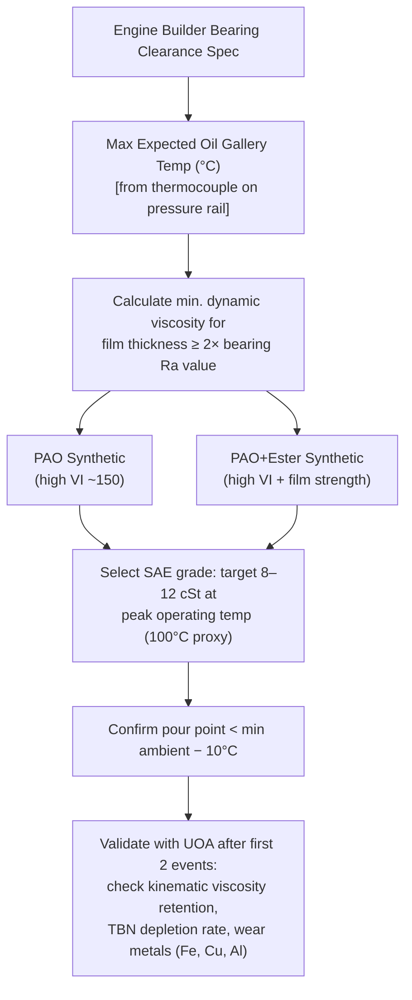

# Lesson 2: Fluid Systems Management

## 1. First-Principles Intuition & Invariants

Every mechanical system that converts chemical energy into rotational work does so at the cost of heat, friction, and molecular degradation. In a racing context, where engines spin beyond 8,000 RPM for hours, brakes absorb kinetic energy equivalent to dozens of emergency stops per lap, and coolant circuits must reject heat loads that would boil a household kettle in seconds, fluid systems are not support infrastructure — they are the boundary condition between performance and catastrophic failure. Understanding why fluids behave as they do, rather than merely accepting manufacturer guidelines as liturgy, is what separates a race engineer who prevents failures from one who explains them afterward.

### The Thermodynamic Contract

Every fluid in a racing vehicle exists to manage energy in one of three ways: to reduce friction between surfaces (lubrication), to transport thermal energy away from a heat source (cooling), or to transmit mechanical force through hydraulic incompressibility (braking). Each role imposes a specific thermodynamic contract on the fluid, and the moment a fluid can no longer honor that contract — because its viscosity has collapsed, its boiling point has been breached, or its molecular chains have sheared — the system it serves fails. The pace at which fluids degrade under racing conditions is orders of magnitude faster than road use, which makes the management of fluid condition a live performance variable rather than a scheduled maintenance afterthought.

The first invariant that underpins all fluid system reasoning is that **viscosity is not a fixed property — it is a function of temperature, shear rate, and molecular integrity.** Engine oil viscosity describes the fluid's internal resistance to flow, and it determines the thickness of the hydrodynamic film that separates metal surfaces. When that film thins below the critical threshold for a given bearing clearance and surface speed, the system transitions from full-film hydrodynamic lubrication into mixed lubrication, and then into boundary lubrication, at which point metal-to-metal contact and accelerated wear are inevitable. The Society of Automotive Engineers viscosity grading system — expressing an oil as, say, 10W-60 — encodes two distinct behaviors: the cold-start cranking viscosity at low temperature (the W grade) and the high-temperature kinematic viscosity at 100°C. For a racing engine, the concern is almost entirely the high-temperature end, because the oil in a circuit racing engine never sees extended cold temperatures and spends its entire operating life at oil gallery temperatures between 110°C and 135°C under hard use.

The second invariant is that **heat rejection capacity is thermodynamically finite and constrained by fluid-specific heat capacity, flow rate, and temperature differential.** Coolant circuits do not destroy heat; they transport it from the engine block to the radiator, where it is rejected to ambient air. The rate of heat rejection is governed by Newton's Law of Cooling: the heat flux is proportional to the surface area of the heat exchanger, the thermal conductivity of the coolant, and the temperature differential between the fluid and the ambient air. When ambient temperature rises — as it does during summer endurance events — the temperature differential shrinks, and the radiator's heat rejection rate falls even if everything else remains constant. Race engineers who understand this relationship will adjust coolant mixture ratios, radiator duct sizing, and fan strategies in direct response to ambient conditions rather than waiting for water temperature alarms.

The third invariant governs the hydraulic braking circuit: **brake fluid boiling point is not a constant — it degrades continuously from the moment the fluid absorbs moisture from the atmosphere.** This hygroscopic behavior is the central physical reality of brake fluid management in motorsport, and it is the reason that fluid change intervals on race cars are measured in event weekends rather than mileage intervals.

---

## 2. Core Architecture & Mechanics

### Engine Oil: Viscosity Mechanics and Selection Criteria

Engine oil performs multiple simultaneous functions: it lubricates bearing surfaces, cools pistons via oil jet squirters, cleans combustion by-products through detergent additive packages, and protects metal surfaces from corrosive acids generated during combustion. Each function places a competing demand on the base oil and additive chemistry, and viscosity selection must balance all of them under the worst-case operating condition the engine will face.

The kinematic viscosity of an oil is measured in centistokes (cSt) at two standardized temperatures: 40°C and 100°C. The viscosity index (VI) describes how much the viscosity changes between those two measurement points — a high VI oil is relatively stable across the temperature range, while a low VI oil thins dramatically as it heats up. Conventional mineral base oils have VIs in the range of 90 to 120. Fully synthetic polyalphaolefin (PAO) base stocks achieve VIs of 130 to 160, which is why synthetic oils maintain a more consistent hydrodynamic film across the wide temperature swings of a cold start and a fully loaded engine exit from a long corner. For racing applications, full synthetic base stocks are non-negotiable, not because of brand prestige but because the VI stability directly determines film thickness consistency under the thermal cycling that a race engine endures.

The relationship between bearing clearance and required oil viscosity is direct and calculable. The minimum oil film thickness $h_0$ in a hydrodynamic bearing is approximated by the Sommerfeld relationship, where film thickness scales with dynamic viscosity $\mu$, shaft rotational speed $N$, and the bearing geometry, while scaling inversely with bearing load $W$. Race engines are built to tighter bearing clearances than road engines — typically 0.025 to 0.040 mm on main and rod bearings versus 0.040 to 0.060 mm on road engines — specifically to allow the use of lower viscosity oils that reduce viscous drag and improve power output. A 10W-60 oil that performs correctly in a road-specification engine may actually be too thick for a race-specification engine running tight clearances at 130°C oil temperatures, where a 0W-40 or 5W-50 fully synthetic will maintain adequate film thickness with less pumping loss and faster thermal stabilization.

Viscosity modifiers (VM) are polymer additives used in multi-grade oils to improve VI by expanding in higher temperatures (resisting thinning) and contracting in lower temperatures (resisting thickening). Under high shear rates — the conditions inside a loaded bearing — these polymer chains can be mechanically torn apart in a process called permanent shear degradation. After shear degradation, the oil's high-temperature viscosity is permanently lower than its fresh specification. This is why oil from a racing engine that has completed a 24-hour event will often test 20 to 25% lower in kinematic viscosity at 100°C compared to its fresh-fill specification, even when the oil's appearance and acid number suggest it is still serviceable. Used oil analysis (UOA) must therefore include a kinematic viscosity measurement at 100°C on every sample, not just metal content and TBN (Total Base Number).

The practical selection workflow for race engine oil begins with the engine builder's bearing clearance specification. From that clearance and the anticipated maximum oil temperature — measured at the pressure gallery, not the sump — the engineer calculates the minimum required dynamic viscosity to maintain a film thickness above the surface roughness of the bearing shells. For most purpose-built race engines running PAO-based full synthetic oil, the selection will fall into the 5W-50 or 10W-60 range, with the specific choice governed by the ambient temperature range of the event and the engine's thermal management system effectiveness. An engine running in a 35°C ambient endurance race with marginal oil cooling will need a higher-viscosity selection than the same engine in a 15°C sprint event with an oversized oil cooler.

### Coolant Thermodynamics and Mixture Management

The cooling circuit in a race car operates as a closed-loop heat exchanger network, and its performance is governed by the thermodynamic properties of the coolant mixture, the pressure cap rating, and the radiator's heat rejection surface area. Water has a specific heat capacity of 4.18 kJ/kg·K — higher than almost any practical automotive coolant — which means it can absorb more heat per unit mass per degree of temperature rise than any alternative. Pure water is therefore an excellent heat transfer medium, and in motorsport series without ethylene glycol restrictions, some teams run near-distilled water with only a corrosion inhibitor package, accepting the reduced freeze protection in exchange for superior heat capacity.

Ethylene glycol (EG) antifreeze, when mixed with water at the standard 50/50 ratio, reduces the specific heat capacity of the mixture to approximately 3.4 kJ/kg·K — a 19% reduction compared to pure water — while also raising the mixture's boiling point and lowering its freezing point. For racing applications where freeze protection is irrelevant (most circuit and endurance events), the question becomes: what is the minimum glycol concentration that provides adequate corrosion protection and anti-boil margin without unnecessarily sacrificing heat capacity? The practical answer, validated by most factory endurance programs, is a 30% glycol / 70% distilled water mixture. This ratio provides a boiling point of approximately 109°C at atmospheric pressure, which rises to 125°C with a 1.1 bar pressure cap — giving adequate headroom above the 105 to 115°C operating range of a highly loaded race engine.

Coolant degradation in racing follows a predictable chemical pathway. The glycol molecule is relatively stable, but the organic acid inhibitor packages (OAT-based inhibitors use carboxylate chemistry) deplete as they neutralize corrosion products and are consumed by high-temperature oxidation. As the inhibitor package depletes, pH drops, and the coolant becomes increasingly corrosive to aluminum alloy components — cylinder heads, water pump impellers, and radiator cores. The critical threshold is a pH below 7.0; below this point, aluminum oxide film dissolution accelerates dramatically. Coolant pH should be measured at every service interval using a calibrated digital pH meter, not litmus strips, which lack the resolution to distinguish between a pH of 7.1 and 6.8. OAT-inhibited coolants in racing service typically hold acceptable pH above 7.0 for 12 to 18 months in a race car that is drained and refilled between seasons, but under continuous endurance racing conditions, the inhibitor depletion can occur within a single event.

The pressure cap rating is not arbitrary. Because the coolant system is sealed, every 0.1 bar increase in system pressure raises the boiling point of the coolant mixture by approximately 2°C. A 1.3 bar pressure cap therefore adds approximately 25°C of boiling point margin compared to an atmospheric system. Race cars typically run 1.1 to 1.5 bar caps depending on the pressure tolerance of the radiator, hose connections, and water pump seal. Running the highest pressure cap the system can sustain is straightforward thermal management: it is free boiling-point margin that costs nothing except a slightly higher stress on seals and hose clamps.

### Brake Fluid: Hygroscopic Degradation and the Boiling Point Cascade

Polyethylene glycol ether (PGBE)-based brake fluids — which encompass the DOT 3, DOT 4, and DOT 5.1 classifications — are inherently hygroscopic. The ether linkages in their molecular structure are polar and attract water molecules from the atmosphere, absorbing moisture through microscopic permeation of rubber hoses, master cylinder seals, and caliper dust seals even in a fully sealed system. This is not a contamination event — it is a thermodynamic inevitability.

The practical consequence is that the fluid's dry boiling point (measured with zero absorbed moisture, as supplied from a sealed container) is never the number that matters in service. What matters is the **wet boiling point**: the boiling point measured after the fluid has absorbed 3.7% water by mass, which the SAE J1703 and FMVSS 116 standards specify as the equilibrium moisture content of a fluid in long-term service. DOT 4 fluid has a minimum dry boiling point of 230°C and a minimum wet boiling point of 155°C. Race-specification DOT 4+ or racing brake fluid formulations achieve dry boiling points above 300°C and wet boiling points above 200°C through the use of borate ester chemistry combined with high-molecular-weight glycol ethers that absorb moisture more slowly than standard formulations.

The failure mode is vapor lock: when brake fluid temperature at the caliper exceeds the fluid's wet boiling point, the fluid locally vaporizes, creating a compressible vapor bubble in the hydraulic line. The driver experiences an immediate and dramatic reduction in pedal pressure and travel — the pedal becomes soft and may go to the floor under heavy application. At the threshold of a high-speed braking zone, vapor lock is a safety-critical failure with no warning, which is why brake fluid management in racing is treated with the same urgency as tire condition.

The moisture content of brake fluid can be measured in the field with a refractometer calibrated for glycol-based fluids, or more accurately with a hand-held boiling-point tester. The boiling-point tester works by immersing a probe in a small sample of drawn fluid and applying a measured current to heat the sample, measuring the temperature at which it transitions to vapor. Race teams running serious programs draw a 5 ml sample from each caliper bleed nipple after qualifying and before the race to establish a per-corner moisture baseline. If any corner reads a wet boiling point below 180°C for DOT 4+ fluid, the entire system is flushed and refilled before the car goes back on track.

The flushing protocol matters as much as the choice of fluid. Flushing with a syringe-type vacuum bleeder does not remove all contaminated fluid from caliper bores and ABS modulator cavities. A pressure-bleed system pushing 0.5 to 0.7 bar of nitrogen through the master cylinder reservoir, while opening each caliper bleeder in sequence from the furthest from the master cylinder to the nearest, will purge approximately 95% of the old fluid volume if the system is bled until three full caliper-bore volumes of fresh fluid have passed through each corner.

### Fuel System Contamination Mechanics

Contamination in a racing fuel system follows different pathways than consumer automotive practice, primarily because the fuel compounds used in motorsport — high-octane gasoline blends, E85 ethanol mixtures, or homologated fuel specifications — have specific stability and hygroscopic behaviors that standard fuel system protocols do not address.

Ethanol-blended fuels (E10 through E85) present a particular storage challenge because ethanol is miscible with water in all proportions. When ambient humidity is high and storage containers are not sealed against moisture ingress, the ethanol component of the blend will absorb atmospheric moisture through a mechanism called **phase separation**: at a critical water content (approximately 0.5% by volume in E10), the ethanol-water mixture separates from the hydrocarbon fraction, forming a distinct lower phase that is rich in ethanol and water. This phase is both less combustible than the original blend and highly corrosive to aluminum fuel system components. Teams running E85 in endurance applications should store fuel in sealed, inert-atmosphere containers (nitrogen blanket) and use a dedicated moisture indicator on the drum or tank.

Particulate contamination typically originates from three sources: fuel drum residue, filling hose particulate, and in-tank corrosion products. The standard practice in professional endurance racing is to filter fuel at filling through a 100-micron pre-filter at the drum face and a 10-micron fine filter at the car's fuel cell filler port. High-pressure fuel injectors in modern direct-injection race engines have orifice diameters of 100 to 200 microns; particulate above 50 microns can partially obstruct injector orifices, causing lean misfires that are difficult to diagnose from lambda sensor data alone and are frequently misattributed to ignition or mapping issues.

---

## 3. High-Performance Optimization & Failure Modes

### Oil System: Running the Edge and Recognizing Collapse

The most consequential and least dramatic oil system failure mode in racing is **oil starvation under sustained lateral G-loading**. When a vehicle sustains 2.5 to 3.5G of lateral acceleration through a long, high-speed corner — an esses complex, a banked oval, or a compound curve — the oil in the sump migrates laterally away from the pump pickup. If the sump has inadequate baffling or the dry-sump tank's pickup geometry is not aligned with the prevailing G vector, the pump momentarily picks up air. The result is a transient loss of oil pressure lasting 0.5 to 2 seconds, which appears on the data logger as a sharp pressure dip rather than a sustained drop. Engineers who do not overlay oil pressure against lateral G-force on the same telemetry channel frequently miss this event entirely, attributing the pressure dip to a sensor artifact.

The diagnostic workflow requires reviewing every lap's oil pressure trace synchronized against the lateral accelerometer channel. Any pressure drop below 20% of the nominal stabilized pressure value that co-occurs with a lateral G-peak above 2.0G is a sump starvation signature. The corrective intervention depends on the sump design: for wet-sump engines, the first step is installing additional sheet metal baffles around the pickup tube and verifying the flap-valve anti-surge baffle is functional. For dry-sump systems, the corrective action is adjusting the scavenge pump stage priority to maintain a dry sump at all times, increasing scavenge capacity by opening additional scavenge stages, or repositioning the pressure tank relative to the car's lateral G direction.

Oil temperature management presents a different optimization challenge. Race engines require oil temperatures above 80°C to fully evaporate accumulated condensation and water from combustion blowby, but temperatures above 135°C accelerate additive depletion and base oil oxidation at a rate that roughly doubles with every 10°C increase above the threshold (following Arrhenius kinetics). The ideal oil temperature operating window is 100 to 120°C measured at the pressure gallery, and maintaining this range requires a thermostatic oil cooler bypass valve that prevents overcooling on cold laps while preventing overheating during sustained high-load running. Teams that bypass the thermostat entirely — often done as a "safety" measure — frequently run oil temperatures 15 to 20°C below the ideal window, which paradoxically reduces oil life by keeping high-viscosity cold oil in the bearings longer during warm-up and by preventing full combustion water evaporation.

Used oil analysis (UOA) is the highest-value diagnostic tool available for proactive engine management, and it is chronically underutilized in amateur and semi-professional motorsport. A complete UOA panel from a certified lab (Blackstone, Oil Analyzers, Polaris Laboratories) provides elemental spectroscopy (iron, copper, aluminum, chromium, tin, lead, silicon, sodium, boron) alongside kinematic viscosity at 40°C and 100°C, TBN, and total acid number (TAN). The wear metal targets for a healthy racing engine — expressed in parts per million (ppm) — are engine-type specific, but as a working reference for a four-cylinder naturally aspirated race engine: iron below 50 ppm per 1,000 km of operation, copper below 20 ppm, aluminum below 15 ppm. Silicon above 20 ppm indicates air filter bypass or contaminated oil fill, and sodium above 15 ppm is a cooling system leak indicator. These numbers only become meaningful as trend data across sequential samples; a single sample tells you the current state, while three to five sequential samples at defined drain intervals tell you the trajectory.

### Coolant System: Pressure, Aeration, and Head Gasket Precursors

The failure mode that destroys race engines most silently is **coolant aeration** — the entrainment of air bubbles into the coolant circuit through a failed head gasket weep path, a micro-crack in a coolant passage, or inadequate degassing of the system after a fill. Aerated coolant has dramatically reduced heat capacity per unit volume, because the air bubbles displace coolant at the highest-temperature interfaces — the cylinder liner walls and cylinder head ports — where heat transfer is most critical. An aerated cooling system can appear normal on the water temperature sensor, which measures bulk fluid temperature in the outlet gallery, while localized hot spots in the combustion chamber approach metal temperatures sufficient to cause pre-ignition.

The definitive field test for head gasket integrity is a combustion gas test on the coolant. The test uses a chemically sensitive detector fluid (similar in concept to a CO detector) that changes color in the presence of hydrocarbons or combustion gas oxides. With the engine running at operating temperature, the detector is held over the coolant reservoir; if the detector fluid transitions from blue to yellow, combustion gases are present in the coolant loop, confirming a head gasket weep path. This test should be part of every pre-event and post-event coolant service on a race engine, taking no more than three minutes and requiring equipment that costs less than any other diagnostic instrument in the pit lane.

Coolant system pressure decay testing — pressurizing the system to its cap rating plus 20% using a radiator cap adapter and hand pump, then monitoring for pressure decay over ten minutes — will detect external leaks at hose joints, water pump weep holes, and radiator core micro-cracks before they become race-ending failures. Any system showing more than 0.05 bar of decay over ten minutes requires further investigation before the car runs.

### Brake Fluid: Managing the Vapor Lock Threshold

The practical challenge of brake fluid management in endurance racing is that the highest thermal load on the fluid occurs at the front calipers of a heavy braking car, but the master cylinder and ABS modulator contain fluid that is less thermally loaded and therefore less degraded. A system bled only at the wheel calipers will have clean fluid in the modulator and master cylinder passages but degraded fluid in the caliper pistons, which is precisely the volume adjacent to the heat source.

For endurance applications, the correct protocol is a complete system displacement bleed — pushing fresh fluid from the master cylinder reservoir through the modulator and all four calipers in sequence — rather than a spot bleed of individual corners. The volume of fluid required to fully displace a standard racing brake system (four six-piston calipers, one dual-circuit master cylinder, ABS modulator) is typically 300 to 400 ml. Attempting to minimize fluid consumption by bleeding only a fraction of this volume leaves degraded fluid in the hydraulic path and negates the purpose of the service.

Brake duct sizing is the first line of defense against high caliper temperatures and the resulting thermal load on the fluid. A properly ducted front brake assembly on a circuit racing car should maintain rotor temperatures below 650°C for iron and steel rotors and below 1000°C for carbon-ceramic rotors during sustained braking. Caliper body temperature — measured with a thermocouple embedded in the caliper bridge — should remain below 150°C. If caliper temperatures exceed this threshold despite adequate duct sizing, the solution is not higher-spec fluid alone but a combination of improved ducting, caliper insulation spacers between the pad backplate and piston face, and fluid with a higher thermal mass per unit volume. Increasing fluid boiling point threshold is the last line of defense; reducing the thermal input to the fluid is the engineering priority.

### Fuel System: Contamination Prevention Workflow

Preventing fuel contamination in a racing environment requires treating the fuel supply chain as a controlled process from bulk storage to injector orifice. The contamination entry points, in order of probability, are the bulk storage container, the transfer pump and hose, the car's fuel cell filler, and the in-tank pickup screen.

At the bulk storage level, fuel drums should be stored vertically with bungs tightly sealed and inspected for any sign of corrosion at the bung threads or drum seams. Before any fuel transfer, the drum should be settled for a minimum of 30 minutes after any movement, allowing particulate and water to settle to the bottom. The first 500 ml drawn from any drum should be discarded or collected into a separate clear container for visual inspection — cloudy fuel indicates water emulsion, and visible particulate sediment indicates drum contamination. The transfer pump should have a dedicated, labeled, 100-micron inline filter that is replaced after every event weekend and never used for other fluid transfers.

At the car's fuel filler, a 10-micron sintered metal filter cone installed in the filler neck provides the last line of particulate defense. These filters require inspection and replacement when their pressure drop (observed as slowing fill rate) increases beyond 10% of the baseline fill time for a known fuel volume. Teams that fill from standardized fuel churns in controlled conditions typically replace these elements every two to three event weekends; teams operating from bulk drum transfers in dusty paddock environments should replace them every event.

Sampling for fuel quality analysis — which should include water content by Karl Fischer titration, octane verification, and spectrographic analysis for metallic contamination — requires a 500 ml sample drawn from mid-depth in the storage container using a stainless steel sampling probe, not from the bottom where sediment concentrates. The sample should be stored in a glass or HDPE container, sealed, and submitted to the analysis lab within 48 hours. Prolonged storage in polypropylene containers can leach plasticizer compounds into the sample, producing false positive readings for organic contamination.

### Fluid Sampling Protocols: Building Trend Databases

The value of any single fluid analysis result is limited without a comparison baseline. The discipline of fluid trending requires consistent sampling intervals, consistent sample collection technique, and a structured database that records not just the analytical results but the operational context: ambient temperature, track surface temperature, lap count, any notable mechanical events during the session, and the specific fluid batch in service. Without this context, an elevated iron reading in an oil sample cannot be distinguished between normal running wear, an oil change that partially introduced old fluid, or the beginning of a main bearing failure.

The minimum viable fluid trending database for a club-to-professional level race operation covers four fluid streams: engine oil (sampled from the pressure gallery sampling port under operating temperature, never from the sump drain), coolant (sampled from the top hose after the engine has cooled to 40°C to avoid thermal measurement error), brake fluid (sampled from each caliper bleed point with the first 1 ml discarded to clear the bleed path), and fuel (sampled from the in-tank return line after a session). Each sample should be labeled with car number, corner or circuit identification (for brake fluid), event name, session, and cumulative distance since last service. Storing these records in a structured spreadsheet with conditional formatting that highlights values outside the established normal range transforms raw analytical data into an early warning system — one that, when properly maintained over a full season, can predict component failures three to five events before they occur.
