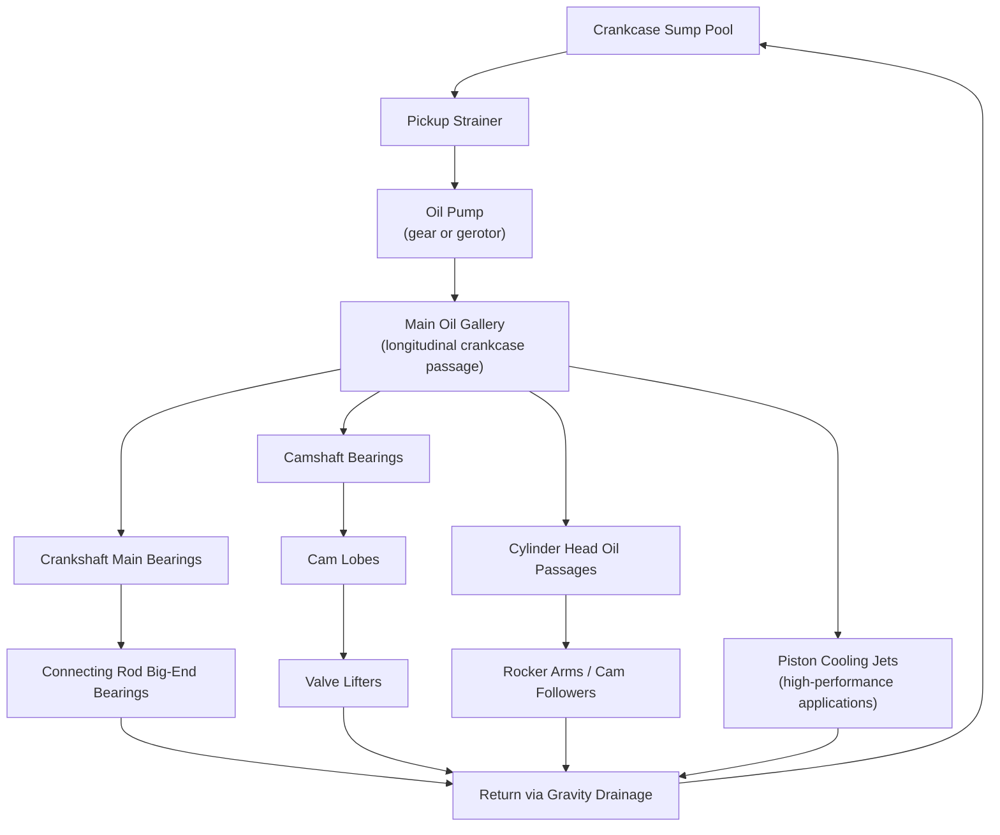
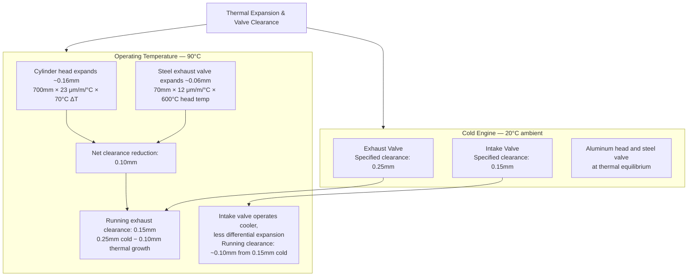

# Lesson 1: Engine Fundamentals, Lubrication Systems, Thermal Management

## 1. First-Principles Intuition & Invariants

The internal combustion engine remains the beating heart of motorcycle performance, converting chemical potential energy stored in hydrocarbon fuel into rotational kinetic energy through a precisely orchestrated sequence of thermodynamic events. Understanding the four-stroke cycle at a mechanistic level forms the foundation upon which all subsequent maintenance, tuning, and diagnostic work depends. Unlike automotive powerplants that prioritize low-end torque and smoothness across broad RPM ranges, motorcycle engines—particularly in sport and racing applications—pursue peak specific output through aggressive valve timing, high compression ratios, and sustained operation at revolution speeds that would grenade a passenger car engine within minutes.

The four-stroke Otto cycle unfolds across two complete crankshaft revolutions, or 720 degrees of rotation, divided into four discrete strokes: intake, compression, power, and exhaust. During the intake stroke, the piston descends from top dead center while the intake valve opens, drawing a fuel-air mixture into the combustion chamber. The pressure differential between atmospheric conditions and the expanding cylinder volume drives mass flow, with intake tract geometry, valve lift profiles, and port velocities determining volumetric efficiency. As the piston reaches bottom dead center, the intake valve closes and the compression stroke begins. The ascending piston compresses the trapped charge, raising both temperature and pressure according to the ideal gas law, though real-world behavior deviates due to heat transfer through cylinder walls and imperfect sealing past piston rings.

At the moment of maximum compression, the spark plug initiates combustion through electrical discharge, ionizing the mixture and creating a rapidly expanding flame front that propagates outward from the plug electrodes. This marks the transition to the power stroke, where combustion chamber pressure drives the piston downward, converting thermal energy into mechanical work through the connecting rod and crankshaft. Peak cylinder pressures in high-performance motorcycle engines routinely exceed 1,200 psi, imposing tremendous mechanical loads on reciprocating components. Finally, as the piston approaches bottom dead center once more, the exhaust valve opens and the piston rises during the exhaust stroke, expelling spent combustion gases through the exhaust port. Residual cylinder pressure at the moment of valve opening creates the characteristic exhaust pulse, with header primary tube length and diameter tuned to exploit pressure wave reflections that enhance cylinder scavenging and volumetric efficiency at specific engine speeds.

The thermodynamic efficiency of this process remains fundamentally constrained by the Carnot limit, with real-world brake thermal efficiency in motorcycle engines ranging from 25 to 35 percent depending on load conditions and engine design. The remaining energy escapes as waste heat through three primary pathways: exhaust gas enthalpy, convective and radiative heat transfer from external surfaces, and conductive heat transfer into the cooling system. Managing these thermal flows becomes critical in racing environments where sustained high load operation pushes coolant temperatures toward boiling points and oil temperatures into regimes where lubricant viscosity breakdown accelerates.

Valve train dynamics introduce additional complexity layers that directly impact both performance and reliability. The camshaft, driven at half crankshaft speed through either chain, gear, or belt drive, controls intake and exhaust valve motion through cam lobe profiles engineered to balance peak lift, duration, and acceleration rates against mechanical stress limits and valvetrain mass. In pushrod configurations, the cam actuates rocker arms through lifters and pushrods, introducing compliance and inertial delays that limit maximum sustainable RPM. Overhead cam designs place the camshaft directly above the valves, reducing reciprocating mass and enabling more aggressive valve motion at the cost of increased mechanical complexity and lubrication challenges. Desmodromic valve systems, famously employed by Ducati, eliminate valve springs entirely through positive closure via dedicated closing cam lobes, allowing extreme valve acceleration and eliminating the float phenomenon that plagues spring systems at high RPM.

Valve clearance specifications exist to accommodate thermal expansion of valve train components as operating temperatures rise. A typical steel exhaust valve might grow 0.15mm in length between cold assembly and full operating temperature, while aluminum cylinder heads expand at nearly twice the rate of steel valve stems. Insufficient clearance causes valves to remain partially open at temperature, destroying compression and inviting catastrophic valve-to-piston contact. Excessive clearance generates impact loads at valve seating that accelerate wear and create characteristic clicking noise. Shim-under-bucket valve adjustment systems require disassembly to swap precision shims, while screw-and-locknut adjusters permit roadside correction but introduce additional mass and potential failure points.

The lubrication system serves multiple critical functions beyond simply reducing friction between moving surfaces. Oil forms hydrodynamic films that physically separate metal components, with film thickness measured in microns depending on surface velocity, load, and oil viscosity. These films also conduct heat away from high-temperature zones including piston crowns, cylinder walls, and bearing surfaces, with oil temperature rises of 30 to 50 degrees Celsius across a single pass through the engine being common. Additionally, the pressurized oil system actuates hydraulic valve lifters, tension timing chains, and operates variable valve timing mechanisms in modern designs.

Oil viscosity describes resistance to flow and shear, traditionally measured in Society of Automotive Engineers grades. A 10W-40 oil exhibits 10-weight flow characteristics at 0°F cold cranking conditions and 40-weight characteristics at 100°C operating temperature, with the "W" denoting winter-grade low-temperature performance. The viscosity index quantifies how much an oil's viscosity changes with temperature, with synthetic base stocks demonstrating superior stability compared to mineral oils. At microscopic scales, viscosity emerges from intermolecular forces and the physical entanglement of long-chain hydrocarbon molecules. Under high shear conditions—such as between cam lobe and lifter surfaces where contact pressures exceed 200,000 psi—even the best oils see temporary viscosity loss as molecular chains align with flow direction.

Thermal management extends beyond preventing catastrophic overheating to maintaining optimal operating temperatures that balance combustion efficiency, oil viscosity, and thermal stress. Air-cooled engines rely entirely on convective heat transfer from finned cylinder and head castings, with fin geometry optimized to maximize surface area while maintaining adequate structural rigidity. Liquid-cooled systems circulate coolant through water jackets surrounding cylinders and combustion chambers, absorbing heat and transporting it to a radiator where forced convection from ram air and fan flow dissipates thermal energy to the atmosphere. The thermostat regulates coolant circulation to maintain target temperatures, remaining closed during warm-up to accelerate thermal equilibrium and opening progressively as temperature rises. Pressurized cooling systems raise the boiling point of coolant above 100°C through increased pressure—a typical 1.1 bar radiator cap elevates boiling point to approximately 120°C, providing critical margin during high-load operation.

## 2. Core Architecture & Mechanics

The physical layout of a motorcycle engine's lubrication system follows one of two fundamental architectures: wet sump or dry sump. In wet sump designs, the crankcase itself serves as the oil reservoir, with a pickup tube submerged in the oil pool at the lowest point of the sump. The oil pump, typically a gear-type or gerotor design driven directly from the crankshaft or transmission input shaft, draws oil through a coarse strainer screen and delivers it under pressure to the main oil gallery—a drilled passage running the length of the crankcase. From this primary distribution point, branch passages supply oil to crankshaft main bearings, connecting rod big-end bearings, camshaft bearings, and valve train components. Crankshaft journals feature precisely drilled cross-holes that align with gallery ports during specific rotation phases, allowing pressurized oil to enter the hollow crankshaft and flow radially outward through connecting rod oil passages to lubricate the small-end wrist pin bearing.

Dry sump systems separate the oil storage function into an external reservoir tank, employing multiple pump stages: scavenge pumps actively evacuate oil from collection points throughout the engine, while a pressure pump delivers oil from the tank to the main gallery. This architecture offers several performance advantages. First, the shallow crankcase reduces overall engine height, lowering the motorcycle's center of gravity. Second, eliminating a large oil pool in the crankcase reduces windage losses from the crankshaft churning through liquid, freeing horsepower at high RPM. Third, the external tank permits increased total oil capacity and improved oil cooling through larger surface area and optional heat exchanger integration. Racing applications almost universally employ dry sump systems, accepting the added complexity and component count in exchange for these benefits.

Oil filtration occurs either in full-flow or bypass configurations. Full-flow filters process all oil delivered to the engine, capturing particles down to 20 to 40 microns depending on media specifications. The filter element—typically pleated paper or synthetic fiber media—presents flow resistance that increases as contamination accumulates, eventually triggering a bypass valve that shunts unfiltered oil directly to the engine when differential pressure across the element exceeds design thresholds, typically 20 to 25 psi. This bypass function prevents oil starvation but allows potentially damaging particles to circulate. Bypass filtration systems route a small percentage of total flow through an extremely fine filter (down to 2 microns) operating in parallel with the main circuit, gradually polishing the entire oil volume over multiple circulations. Some high-end systems incorporate magnetic drain plugs that capture ferrous wear particles, providing both filtration and a diagnostic indicator of abnormal wear rates when inspected during oil changes.

The cooling system architecture in liquid-cooled engines consists of several interconnected subsystems working in concert. Coolant jackets surrounding each cylinder and the combustion chambers feature carefully shaped passages that promote turbulent flow, maximizing convective heat transfer coefficient at critical high-heat-flux zones. The coolant pump, typically centrifugal and driven by the crankshaft through belt or gear, circulates coolant in a closed loop. From the pump outlet, coolant flows into the cylinder block jackets, rises through head passages absorbing heat from combustion chamber walls and exhaust ports, and exits the head through an upper hose connection to the thermostat housing. When coolant temperature falls below the thermostat's opening threshold—typically 80 to 85°C—the thermostat remains closed and coolant recirculates through a bypass passage back to the pump inlet. This accelerates engine warm-up and prevents localized overcooling of the cylinder head. As temperature rises above the threshold, the thermostat progressively opens, diverting an increasing fraction of flow to the radiator.

The radiator functions as a liquid-to-air heat exchanger, constructed from parallel rows of thin aluminum tubes running between pressed aluminum header tanks. These tubes feature internal turbulators to promote coolant mixing and are surrounded by serpentine fin stacks that maximize air-side surface area. As coolant flows through the tubes, heat conducts through the tube walls into the fins, where forced convection from ram air and fan-driven flow carries thermal energy away. The effectiveness of this heat transfer depends critically on air velocity, fin density, and the temperature differential between coolant and ambient air. A typical sport bike radiator might dissipate 15 to 25 kilowatts of thermal power at highway speeds, representing roughly half of the engine's waste heat output with the remainder escaping through exhaust gases and convective losses from external surfaces.

The pressurized nature of the cooling system dramatically improves performance margins. Water at sea-level atmospheric pressure boils at 100°C, but every 0.1 bar of pressure increase raises the boiling point by approximately 3 degrees Celsius. A radiator cap rated at 1.1 bar absolute (0.1 bar gauge pressure) elevates boiling point to roughly 120°C, while a 1.3 bar cap pushes it to 125°C. This matters critically because nucleate boiling—the formation of vapor bubbles on hot surfaces—destroys the convective heat transfer mechanism, replacing liquid contact with insulating vapor pockets. Localized boiling at cylinder head exhaust ports can trigger cascading thermal failure even when bulk coolant temperature remains nominally acceptable. The pressure cap also incorporates a vacuum relief valve that opens during cool-down, preventing negative pressure from collapsing hoses and allowing coolant to be drawn back from the overflow reservoir to fill contraction voids.

Valve train mechanical design varies widely across motorcycle architectures, but all implementations must solve the fundamental challenge of converting rotary cam motion into reciprocating valve motion while surviving contact stresses that exceed most materials' elastic limits. In overhead cam configurations, the cam lobe directly contacts either a bucket-type tappet riding on the valve stem, or a rocker arm that pivots to actuate the valve. Bucket tappets offer simplicity and low mass but require shim replacement for clearance adjustment. Rocker arms permit center-pivot or end-pivot configurations, with roller-tipped designs reducing sliding friction at the cam interface. The contact patch between cam lobe and follower measures only a few square millimeters, yet must transmit forces exceeding 500 pounds during peak acceleration phases. This extreme Hertzian contact stress—often surpassing 300,000 psi—necessitates case-hardened steel components with surface hardness above 60 HRC and specific cam lobe profiles that limit jerk rates to prevent impact loading.

Valve springs provide the restoring force that maintains follower contact with the cam lobe during the closing phase and acceleration reversals. Spring rate, preload, and installed height must be carefully matched to camshaft profile, engine RPM range, and valvetrain mass. Insufficient spring force causes valve float at high RPM when spring acceleration cannot match cam deceleration, allowing the valve to separate from the cam lobe and bounce uncontrollably. Excessive spring force accelerates wear, increases friction losses, and loads valve stems with compressive stress that can cause buckling failure. Progressive-rate springs—which exhibit increasing stiffness as they compress—help balance these requirements by providing high open-valve preload without excessive closed-valve loads. Dual concentric springs, with an inner spring wound in the opposite direction from the outer spring, prevent harmonic resonance and provide redundancy against single spring breakage.

Thermal expansion characteristics dominate valve clearance specifications and adjustment procedures. Exhaust valves operate in the most severe thermal environment, with head temperatures routinely exceeding 700°C in high-performance engines. The valve stem, connecting the head to the cooler guide region, creates a thermal gradient that drives expansion on the order of 0.10 to 0.15mm between cold and hot states. Aluminum cylinder heads expand roughly 23 microns per meter per 100°C temperature rise, while steel valve stems expand at approximately 12 microns per meter per 100°C. This differential expansion means that as the engine reaches operating temperature, the aluminum head "grows away" from the valve stem tip, effectively reducing the clearance gap. Intake valves run significantly cooler—typically 300 to 400°C—due to cooling from incoming charge flow, and therefore exhibit less expansion and often require tighter cold clearances than exhaust valves to achieve similar hot running clearances.

## 3. High-Performance Optimization & Failure Modes

The pursuit of maximum power output drives engine builders toward operational extremes that stress every thermal and mechanical system to its design limits and beyond. Peak specific output in modern superbike engines approaches 200 horsepower per liter, achieved through compression ratios exceeding 13:1, valve overlap periods measured in 60-plus degrees of crankshaft rotation, and sustained operation above 10,000 RPM. These conditions amplify every thermal load, lubrication challenge, and mechanical stress factor discussed previously, transforming routine maintenance items into potential failure points that can destroy an engine in seconds when neglected.

Oil selection for racing applications requires balancing multiple competing requirements. Lower viscosity reduces friction losses—particularly at high shear rates between cam and lifter—freeing measurable horsepower. A switch from 10W-40 to 5W-30 might liberate 2 to 3 horsepower at redline, a meaningful gain when races are decided by tenths of seconds. However, thinner oils sacrifice film strength under boundary lubrication conditions where load exceeds the oil's capacity to maintain full separation, allowing metal-to-metal contact and accelerated wear. Synthetic ester-based oils demonstrate superior film strength at equivalent viscosity grades compared to conventional mineral or polyalphaolefin synthetics, but cost several times more and break down more rapidly under thermal stress. Racing teams frequently specify oil change intervals measured in hours rather than miles, sometimes replacing oil after every race weekend to ensure fresh additive packages and maximum viscosity stability.

Oil temperature management becomes critical in sustained high-load operation. While manufacturers typically specify maximum oil temperature limits around 120 to 130°C, optimum performance often occurs between 90 and 110°C where viscosity remains stable and the oil maintains full film strength. Above 120°C, viscosity loss accelerates and additive packages begin thermal decomposition, producing acids and sludge that further degrade lubricant performance. External oil coolers—essentially small radiators plumbed into the pressure side of the lubrication system—provide additional heat rejection capacity, with thermostatic control valves maintaining temperature within the target range across varying load conditions. Proper cooler sizing requires calculating heat rejection requirements based on engine power output, mechanical efficiency, and expected ambient conditions. An undersized cooler might reduce peak temperature by only 10 degrees, providing insufficient margin during extended track sessions. An oversized cooler risks overcooling during warmup or cool ambient conditions, delaying the engine reaching optimum operating temperature and potentially causing localized cold spots that promote condensation and corrosion.

Coolant selection extends beyond simple water and ethylene glycol mixtures. Pure water offers superior specific heat capacity and thermal conductivity compared to glycol solutions, but freezes at 0°C and provides no corrosion inhibition. A 50/50 water-glycol blend depresses the freezing point to approximately -35°C and raises boiling point (at atmospheric pressure) to 108°C, while maintaining acceptable heat transfer properties. Racing applications operating in controlled temperature environments often run pure water with corrosion inhibitor additives, sacrificing freeze protection for maximum cooling capacity. The addition of surfactant "water wetter" products reduces surface tension, improving coolant contact with metal surfaces and reducing the nucleation site energy required for bubble formation, effectively raising the boiling point by an additional 5 to 10 degrees through better wetting characteristics.

Radiator capacity and airflow become limiting factors in racing environments where sustained full-throttle operation generates heat loads far exceeding street riding conditions. A 600cc supersport engine producing 120 horsepower at the rear wheel delivers roughly 160 horsepower at the crankshaft, with the 40-horsepower deficit dissipated as heat through friction and driveline losses. Assuming 30 percent brake thermal efficiency, the engine burns fuel at a rate corresponding to approximately 400 horsepower of chemical energy, with 160 horsepower converted to mechanical work and 240 horsepower rejected as waste heat. The cooling system must dissipate roughly half of this waste heat—120 horsepower or 90 kilowatts—continuously. This requires substantial radiator surface area, high coolant flow rates, and aggressive fan operation to force sufficient air through the core when vehicle speed drops below levels adequate for ram air cooling.

Valve train failure modes in high-RPM applications typically manifest as catastrophic events rather than gradual degradation. Valve float occurs when spring force becomes insufficient to maintain follower contact during cam deceleration phases, allowing the valve to separate from the cam lobe. When the cam subsequently accelerates to close the valve, the follower impacts the lobe at high velocity, generating shock loads that can fracture valve stems, shatter rocker arms, or damage cam lobes beyond repair. Float-induced failure leaves unmistakable evidence: fractured valve stems with the break initiating at the keeper groove stress concentration, cam lobes with impact craters on the closing flank, and occasionally bent pushrods in overhead valve engines. Preventing float requires either increasing spring rate (with attendant friction penalties), reducing valvetrain mass through lightweight components, or limiting maximum RPM.

Valve-to-piston contact represents another catastrophic failure mode, typically resulting from incorrect valve timing, failed timing chain tensioners, or insufficient valve clearance at operating temperature. When timing slips by even a few teeth, valves open at incorrect crankshaft positions, potentially positioning an open valve directly in the path of the ascending piston at top dead center. The collision instantly bends valve stems, punches holes in piston crowns, and often destroys the cylinder head through secondary impacts. Interference engines—designs where piston-to-valve clearance at some crankshaft positions measures zero or negative—offer performance benefits through higher compression ratios and more aggressive cam timing but leave zero margin for timing system failures. Non-interference engines maintain positive clearance at all positions, sacrificing performance for the ability to survive timing failures without total destruction.

Thermal stress failures in cylinder heads typically originate at the exhaust valve bridge—the thin metal section separating adjacent exhaust valves in multi-valve designs. This region experiences the highest thermal flux and operates under continuous thermal cycling as exhaust pulses pass. Cracks initiate at the valve seat interface or coolant jacket boundary where stress concentrations combine with temperature gradients exceeding 100°C per centimeter. Once initiated, cracks propagate through thermal cycling, eventually connecting valve seats or penetrating into coolant passages. Head cracking symptoms include compression loss between cylinders, coolant consumption without external leakage, and occasionally hydrostatic lock when coolant accumulates in cylinders during shutdown. Preventing thermal cracking requires maintaining adequate coolant flow, avoiding excessive lean air-fuel ratios that elevate exhaust gas temperatures, and respecting thermal soak procedures after shutdown to prevent shock cooling.

Oil starvation failures occur when the lubrication system cannot deliver adequate flow to critical bearing surfaces, typically due to low oil level, failed pump, blocked passages, or extreme acceleration forces that move oil away from the pickup tube. Bearing damage progresses rapidly: within seconds of losing hydrodynamic film, bearing surfaces contact directly and friction generates extreme temperatures exceeding 300°C. The bearing material—typically a soft tin-aluminum or copper-lead alloy bonded to a steel backing—melts and smears, scoring the crankshaft journal and potentially welding the bearing to the shaft. Total seizure follows within minutes as clearances close and friction locks the rotating assembly. Prevention requires religious attention to oil level checks, especially on dry sump systems where external tank levels must be verified with the engine off and oil fully drained back, and immediate shutdown at any sign of oil pressure loss indicated by warning lights or gauge readings.

The interplay between these systems becomes apparent during extended track sessions where multiple thermal limits approach simultaneously. As oil temperature climbs through 110°C, viscosity drops and bearing clearances effectively increase, reducing oil pressure. Rising coolant temperatures reduce the temperature differential driving heat transfer, allowing cylinder head temperatures to climb further. Intake charge temperatures increase, reducing air density and volumetric efficiency while increasing the propensity for detonation. Each system's degradation compounds the others: hotter oil cools components less effectively, driving coolant temperatures higher. Higher coolant temperatures reduce cooling efficiency, allowing oil temperatures to rise further. Breaking this feedback loop requires either reducing power output to decrease heat generation, improving heat rejection through better cooling system capacity, or accepting that sustained operation at absolute limits necessarily involves component wear rates that require frequent maintenance and eventual replacement. Race teams balance these factors through careful data logging, establishing temperature and pressure thresholds that trigger driver warnings or automatic power reduction to protect the engine while maximizing competitive performance.
