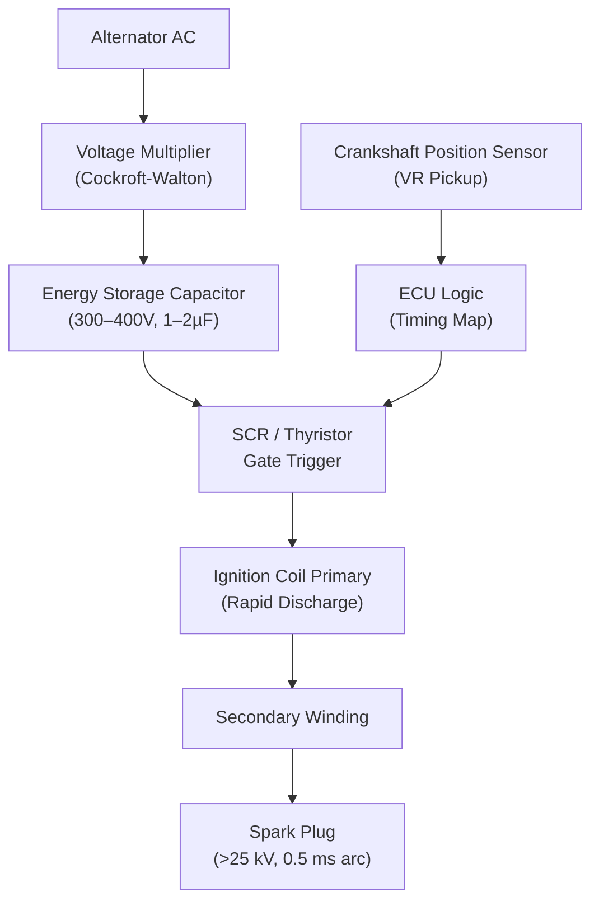

# Lesson 3: Ignition Systems

## 1. First-Principles Intuition & Invariants

The ignition system occupies a singular position in motorcycle architecture: it is the temporal gatekeeper of combustion energy release. Every molecule of fuel entering the combustion chamber possesses latent chemical energy, but this energy remains dormant until the ignition event initiates the exothermic oxidation cascade. The precision with which this event occurs—measured in crankshaft degrees and microseconds—determines whether the expanding gas front delivers maximum work to the piston crown or dissipates as heat into the cylinder head and exhaust stream. For the race engineer tuning a superbike at Mugello or Phillip Island, ignition timing represents one of the most powerful levers for extracting peak power and throttle response, yet it is also one of the most treacherous: advance the spark too far, and detonation destroys pistons; retard it excessively, and exhaust gas temperature climbs while power evaporates.

At its core, the ignition system must perform three fundamental operations in precise temporal coordination with crankshaft rotation. First, it must accumulate electromagnetic energy in an inductive coil primary winding during the dwell period, storing sufficient joules to overcome the dielectric breakdown voltage of the spark plug gap—typically fourteen to twenty thousand volts under atmospheric conditions, climbing higher under compression. Second, it must collapse this magnetic field at the precise crankshaft angle dictated by engine speed, load, and environmental conditions, inducing a high-voltage pulse in the secondary winding through Faraday's law of electromagnetic induction. Third, it must deliver this pulse to the spark plug with minimal resistive loss and electromagnetic interference, ionizing the air-fuel mixture in the combustion chamber to initiate flame kernel propagation.

The combustion process itself imposes strict temporal boundaries on ignition timing. Modern four-stroke engines achieve peak cylinder pressure approximately fifteen to twenty crankshaft degrees after top dead center during the power stroke. To reach this optimal pressure phasing, flame front propagation must begin before the piston reaches top dead center, accounting for ignition delay and laminar flame speed through the charge mixture. This advance angle varies dramatically with engine speed: at idle, perhaps eight to twelve degrees before top dead center suffices, but at thirteen thousand RPM, the spark may fire forty degrees or more in advance. The ignition system must continuously recalculate this timing target, integrating crankshaft position sensor data with throttle position, manifold pressure, coolant temperature, and ambient air density to thread the needle between optimal combustion phasing and detonation onset.

The physical invariants governing ignition energy release derive from classical electromagnetics and thermodynamics. The energy stored in the ignition coil primary winding follows the inductive energy equation: one-half multiplied by inductance multiplied by current squared. A typical motorcycle ignition coil primary winding exhibits inductance between three and eight millihenries, carrying peak currents of six to ten amperes before collapse. This yields stored energy in the range of one hundred to four hundred millijoules per spark event—sufficient to ionize the plug gap and sustain arc duration for one to two milliseconds. The secondary winding voltage gain follows the turns ratio between primary and secondary windings, typically one hundred to one or greater, but the actual peak voltage depends on the rate of primary current collapse: faster switching yields higher voltage spikes but shorter energy delivery duration. This fundamental tension between voltage magnitude and energy delivery shapes ignition coil design across all motorcycle platforms.

Spark plug heat range introduces a critical thermal management dimension to ignition system design. The spark plug tip operates in a brutal thermal environment, exposed to peak combustion temperatures exceeding two thousand degrees Celsius for milliseconds per cycle while conducting electrical discharge energy. The ceramic insulator nose must remain hot enough to burn off carbon and oil deposits through self-cleaning action, typically above four hundred degrees Celsius, yet cool enough to prevent pre-ignition from surface hot spots, remaining below eight hundred fifty degrees. This narrow thermal window defines the heat range specification: cold plugs dissipate heat rapidly through shorter insulator noses and wider heat transfer paths, suitable for sustained high-load racing conditions; hot plugs retain heat through longer insulator noses, appropriate for low-load street riding and cold-start conditions. Selecting incorrect heat range leads to catastrophic failure: too cold, and carbon fouling shorts the electrode; too hot, and the plug becomes an uncontrolled ignition source triggering detonation.

The charging system closes the electrical energy loop, replenishing battery capacity consumed during starting and powering continuous electrical loads: fuel injection, electronic control units, cooling fans, lighting systems. Motorcycles universally employ alternating current generators driven directly from the crankshaft, converting mechanical shaft power into three-phase AC voltage through rotating permanent magnets and stationary stator windings. The permanent magnet alternator architecture offers supreme reliability and minimal rotating mass compared to automotive-style wound-field alternators, but it presents a unique regulation challenge: output voltage rises linearly with engine speed, from perhaps twelve volts at idle to sixty volts or more at redline without regulation. The voltage regulator-rectifier unit performs dual functions: first, converting three-phase AC into direct current through a full-wave bridge rectifier; second, clamping output voltage to the battery charging specification—typically fourteen point four volts for lead-acid chemistry—through shunt regulation or series pass regulation topologies.

Battery chemistry selection carries profound implications for cranking performance, charge acceptance, and service life in racing applications. Traditional flooded lead-acid batteries deliver robust cranking current—three hundred to four hundred cold cranking amperes from a six-pound package—but suffer from acid stratification, sulfation during storage, and catastrophic failure if mounting orientation allows electrolyte spillage during crashes. Absorbed glass mat lead-acid batteries address the spillage concern by immobilizing electrolyte in fiberglass separators, maintaining similar energy density while tolerating inverted mounting and high vibration environments. Lithium iron phosphate batteries revolutionized racing applications by delivering equivalent cranking current at one-third the weight, accepting charge at rates exceeding one C without thermal runaway risk, and exhibiting flat discharge curves maintaining voltage under load. However, lithium chemistry demands careful voltage regulation: overcharge beyond fourteen point six volts initiates irreversible lithium plating on the anode, while deep discharge below nine volts triggers copper dissolution from current collectors, permanently degrading capacity.

Wiring harness design represents the invisible infrastructure upon which all electrical systems depend. Every conductor introduces resistive voltage drop proportional to current draw and wire length, governed by Ohm's law and the resistivity of copper. A ten-ampere ignition coil primary circuit running through four feet of eighteen-gauge wire—common in production motorcycles—drops approximately point two volts under full load, extracting two watts as heat dissipation. This seemingly trivial loss compounds across multiple circuits: fuel pump, cooling fans, electronic control unit power supply, each stealing voltage and current capacity from the charging system. Racing harnesses minimize these losses through oversized conductors, typically fourteen or sixteen gauge for high-current paths, and aggressive wire routing minimizing total length. Connector selection matters equally: crimp terminals must achieve gas-tight contact through proper crimping force and terminal barrel deformation, preventing oxidation and subsequent resistance rise over thermal cycles. Weatherpack and Deutsch connectors dominate racing applications, offering environmental sealing and gold-plated contacts resistant to corrosion in salt spray and fuel vapor environments.

Electromagnetic interference couples into ignition systems through capacitive and inductive mechanisms, corrupting sensor signals and electronic control unit logic. Every spark event radiates broadband RF energy from one kilohertz to one gigahertz, propagating through space and coupling into adjacent wiring through parasitic capacitance. Suppressor resistors embedded in spark plug caps—typically five to ten kilohms—limit peak discharge current, reducing radiated energy at the cost of slightly reduced spark energy delivery. Resistor-core spark plug wires extend this suppression philosophy, distributing resistance along the entire secondary circuit length to prevent the wire itself from acting as an efficient antenna. Modern fuel-injected motorcycles employ additional shielding strategies: twisted-pair wiring for critical sensor signals like crankshaft position and throttle position, routing high-voltage ignition cables away from control harnesses, and ferrite bead chokes on electronic control unit power supplies to block conducted interference from entering logic circuits.

The fundamental challenge facing ignition system designers remains unchanged since the earliest magneto-equipped racing motorcycles of the 1920s: delivering repeatable, high-energy spark events at the correct crankshaft angle across the entire operating envelope from cold idle to maximum RPM at full throttle. Every subsequent technological evolution—from magneto to battery-coil ignition to capacitor discharge ignition to modern multi-coil distributorless systems—represents an incremental refinement toward this singular goal. Understanding the physical principles governing energy storage, electromagnetic induction, and combustion timing allows the race engineer to diagnose ignition system failures in the paddock, optimize timing maps for circuit-specific power delivery, and specify component upgrades that extract genuine performance rather than merely adding weight and complexity.

## 2. Core Architecture & Mechanics

The magneto represents the oldest self-contained ignition architecture, converting crankshaft rotational energy directly into high-voltage spark without external power supply. This elegant simplicity made magnetos the dominant ignition system for racing motorcycles through the 1970s, and they remain specified on certain modern dirt bikes and vintage racing classes where electrical system simplicity and weight minimization outweigh performance optimization. The core magneto mechanism consists of a permanent magnet rotor mechanically coupled to the crankshaft, rotating past a stationary iron-core coil assembly. As the magnet sweeps past the coil poles, magnetic flux density through the coil core rises from zero to maximum, inducing primary winding current according to Faraday's law: electromotive force equals the negative rate of change of magnetic flux linkage. This rising current stores energy in the coil's magnetic field. At the precise crankshaft angle dictated by mechanical cam geometry, a set of breaker points opens, interrupting primary current flow and collapsing the magnetic field. The rapid flux change induces high voltage in the secondary winding, ionizing the spark plug gap.

The magneto's Achilles heel lies in its mechanical timing mechanism. The breaker points consist of a spring-loaded contact pair, one stationary and one riding on a rotating cam lobe. Every time the cam opens the points, a high-voltage arc forms across the separating contacts, eroding the tungsten contact surfaces through thermionic emission and metal vaporization. This erosion progressively increases contact resistance and alters the opening timing as the rubbing block wears against the cam profile. Racing teams using magneto ignition perform points inspection every practice session, measuring contact gap with feeler gauges and dressing the contact surfaces with a fine stone to remove pitting and oxidation. The points capacitor—typically a 0.1–0.3 µF capacitor wired across the contact pair—absorbs the inductive kickback voltage spike during opening, reducing arc energy and extending contact life, but capacitor failure leads to catastrophic point erosion within minutes of operation.

Magneto timing adjustment occurs through physical rotation of the entire magneto body relative to the crankshaft drive coupling. The stator assembly mounts to the engine cases through slotted bolt holes, allowing perhaps twenty degrees of rotational freedom. Advancing timing rotates the stator opposite to the direction of crankshaft rotation, causing the breaker points to open earlier in the cycle; retarding timing rotates in the direction of crankshaft rotation. This mechanical adjustment provides no dynamic timing control: the advance curve remains fixed by the cam profile geometry, typically delivering full advance by three thousand RPM and holding constant thereafter. Centrifugal advance mechanisms found in automotive magnetos rarely appear on motorcycles due to packaging constraints and the violent vibration environment. This static timing compromise forces tuners to select a timing value that balances cold-start tractability against high-RPM power output, accepting suboptimal combustion phasing across much of the operating range.

The capacitor discharge ignition system revolutionized motorcycle ignition by replacing the magneto's mechanical switching with solid-state thyristor control. The CDI architecture stores energy in a high-voltage capacitor rather than the ignition coil's magnetic field, then discharges this capacitor through the primary winding when triggered by the electronic control unit. The energy storage capacitor typically charges to three hundred to four hundred volts through a DC-DC converter driven by the alternator's AC output, accumulating one to two joules of energy per ignition cycle. When the electronic control unit determines the correct firing angle based on crankshaft position sensor data, it triggers a silicon-controlled rectifier or thyristor, dumping the capacitor's charge through the ignition coil primary in a violent, sub-microsecond pulse. This rapid primary current rise induces an extremely high secondary voltage—often exceeding thirty thousand volts—but with correspondingly short arc duration, typically point five milliseconds or less.

The CDI architecture's primary advantage over magneto and battery-coil systems lies in its immunity to spark energy degradation at high engine speeds. Traditional inductive ignition systems require dwell time—the period during which current builds in the primary winding—to store sufficient energy for the next spark event. At ten thousand RPM, each ignition cycle completes in six milliseconds for a four-stroke engine firing once per two revolutions; subtracting the time required for combustion and exhaust processes leaves perhaps three milliseconds of available dwell. If the ignition coil primary inductance and supply voltage yield a current rise time of four milliseconds to reach saturation current, the system cannot deliver full spark energy at this speed, leading to misfires and power loss. CDI systems circumvent this limitation entirely: the energy storage capacitor charges continuously during the entire engine cycle, then discharges in microseconds regardless of engine speed. This characteristic makes CDI the dominant architecture for high-RPM racing two-strokes and motocross bikes regularly exceeding twelve thousand RPM.

However, CDI spark characteristics prove suboptimal for lean-mixture combustion in modern four-stroke engines. The brief, high-intensity CDI spark creates a small initial flame kernel, adequate for rich mixtures with short flame propagation distances, but struggling to ignite lean mixtures where fuel molecules are spaced farther apart and initial flame speed is slower. Inductive ignition systems with longer arc duration—two milliseconds or more—maintain the spark channel while the flame front develops, increasing ignition reliability at stoichiometric and lean air-fuel ratios. This combustion efficiency advantage led most modern sport bikes to adopt transistor-controlled inductive ignition with individual coils per cylinder, relegating CDI to applications where extreme RPM capability outweighs fuel efficiency concerns.

The inductive ignition system powered by battery voltage and controlled by transistor switching represents the current state of the art in motorcycle ignition architecture. Each cylinder receives a dedicated ignition coil mounted directly above the spark plug, eliminating long secondary cables and associated resistive losses. The electronic control unit commands a power transistor—typically an insulated-gate bipolar transistor rated for ten to twenty amperes—to conduct primary winding current for the calculated dwell period. During dwell, primary current rises exponentially toward the saturation limit determined by coil inductance and battery voltage, following the first-order inductive transient response. When the ECU determines the correct firing angle has arrived, it switches the transistor off, interrupting primary current and collapsing the magnetic field. The secondary winding voltage rises until sufficient to ionize the spark plug gap, then maintains arc current for the duration determined by stored magnetic energy.

Modern electronic control units implement three-dimensional ignition timing maps, indexing spark advance against engine speed and manifold pressure or throttle position. A typical racing ignition map might specify twelve degrees advance at idle, climbing to thirty-eight degrees at peak torque engine speed, then retarding slightly to thirty-five degrees at maximum RPM to prevent detonation under high cylinder pressure and temperature. The map also incorporates load sensitivity: at wide-open throttle, the dense air-fuel charge permits aggressive timing advance; at part throttle, reduced cylinder filling and slower flame speeds require conservative timing. The ECU interpolates between map cells in real time, recalculating spark advance every engine cycle—every six milliseconds at ten thousand RPM—based on current sensor inputs. This dynamic timing control extracts power and efficiency impossible with mechanical systems.

Ignition coil primary dwell control adds another optimization dimension. Excessive dwell wastes electrical power heating the primary winding and risks saturating the core iron, while insufficient dwell fails to store adequate spark energy. The ECU calculates required dwell based on battery voltage: at fourteen volts, a typical coil reaches saturation current in three milliseconds; at eleven volts during cold cranking, the same coil requires five milliseconds. The dwell calculation accounts for engine speed, ensuring the dwell period never exceeds the available time between firing events. At maximum RPM with firing occurring every three milliseconds, the ECU limits dwell to perhaps two point five milliseconds, accepting slightly reduced spark energy to prevent overlapping dwell periods that would short-circuit the previous ignition event.

Crankshaft position sensing provides the temporal reference for all ignition timing calculations. Variable reluctance sensors—simple magnetic pickups consisting of a permanent magnet, iron core, and wound coil—generate AC voltage pulses as ferrous trigger teeth on the crankshaft or camshaft pass the sensor tip. The frequency and phase of these pulses encode crankshaft angle with resolution determined by tooth count: a thirty-six-tooth wheel provides ten-degree resolution, adequate for timing control but insufficient for misfire detection. Modern systems employ sixty-minus-two tooth wheels, providing six-degree resolution with two missing teeth creating a synchronization marker for absolute position determination. Hall effect sensors offer an alternative, using semiconductor magnetic field sensing to generate square-wave digital outputs directly compatible with ECU logic inputs, eliminating the need for AC signal conditioning and threshold detection circuits.

The electronic control unit processes crankshaft position sensor data through input capture hardware peripherals that timestamp rising or falling signal edges with microsecond precision. By measuring the time interval between successive trigger teeth, the ECU calculates instantaneous crankshaft angular velocity and extrapolates future crankshaft position based on current acceleration. This prediction enables the ECU to command ignition coil dwell initiation and firing with sub-degree accuracy despite the computational latency required for sensor data processing, map interpolation, and output hardware control. Racing ECUs update these predictions every trigger tooth, recalculating timing targets at ten-degree intervals—thirty-six times per crankshaft revolution—to track rapid throttle transients and gear shifts.

Spark plug design balances electrode durability, thermal management, and flame kernel geometry. The center electrode consists of a nickel alloy core clad in copper for thermal conductivity, topped with a platinum or iridium tip to resist erosion from arc discharge. The ground electrode forms an L-shape, welded to the spark plug shell and positioned to create a gap of point six to one point one millimeters with the center electrode. This gap dimension represents a critical compromise: wider gaps require higher voltage to ionize but generate larger flame kernels and better ignition of lean mixtures; narrower gaps fire reliably at lower voltages but create small flame kernels prone to quenching against cold combustion chamber surfaces. Racing applications typically specify wider gaps—point nine to one millimeter—accepting the higher voltage requirement in exchange for ignition system margin and mixture sensitivity.

Heat range selection follows empirical testing under race conditions, correlating spark plug appearance with observed performance. A correctly heat-ranged plug exhibits light tan to gray ceramic insulator color after sustained full-throttle operation, indicating the self-cleaning temperature range has been maintained without approaching pre-ignition temperatures. A white or blistered insulator signals too hot a heat range, risking detonation and piston crown melting. Black, sooty deposits indicate too cold a heat range, fouling from unburned hydrocarbons and oil accumulation. Race teams carry heat range inventories spanning perhaps six steps, testing colder plugs when ambient temperatures climb or boost pressure increases, and hotter plugs when racing in cold conditions or at high-altitude tracks where reduced air density lowers combustion temperatures.

Iridium and platinum electrode materials extend spark plug service life by resisting the erosive effects of arc discharge. Every spark event vaporizes minute quantities of electrode material, gradually rounding the sharp edges and increasing the voltage required to initiate breakdown. Conventional nickel electrodes require replacement every five thousand to ten thousand kilometers in street use; iridium fine-wire electrodes extend this interval to thirty thousand kilometers or more. Racing applications benefit less from longevity—most race teams replace spark plugs every event regardless of condition—but gain from the fine-wire electrode's ability to focus electric field intensity, reducing firing voltage requirements and improving ignition reliability in marginal conditions.

The charging system begins with the permanent magnet alternator, a three-phase AC generator driven by the crankshaft. The rotor consists of permanent magnets—typically neodymium-iron-boron rare earth magnets providing high magnetic flux density—embedded in a steel cup that bolts to the crankshaft end. The stator comprises three separate coil windings wound around iron laminations and potted in epoxy resin, mounted to the engine case in fixed position as the rotor spins around it. As the rotor magnets sweep past each stator coil, the coil generates sinusoidal AC voltage with frequency proportional to rotor speed and amplitude proportional to magnetic field strength and coil turn count. A typical motorcycle alternator produces thirty to fifty volts RMS at idle, climbing to one hundred volts or more at maximum RPM, with each of the three phases offset by one hundred twenty electrical degrees.

The voltage regulator-rectifier module converts this three-phase AC into regulated DC suitable for battery charging and electrical system loads. The rectifier section consists of six power diodes arranged in a three-phase full-wave bridge configuration: two diodes per phase, one conducting during the positive half-cycle and one during the negative half-cycle, routing current from any phase at any time to the DC bus. This full-wave rectification produces DC voltage with only four percent residual ripple at the six-times line frequency, minimizing battery stress and electrical noise. The regulation section employs one of two topologies: series-pass regulation using a power transistor to absorb excess voltage as heat, or shunt regulation using silicon-controlled rectifiers to short surplus current to ground. Modern systems universally adopt shunt regulation despite lower efficiency, because series-pass regulation concentrates all dissipated power in a single transistor junction, creating thermal management nightmares exceeding fifty watts at maximum alternator output.

Shunt regulation operates by sensing battery voltage through a resistive divider network and comparing it against a precision voltage reference—typically a temperature-compensated zener diode or bandgap reference circuit. When battery voltage exceeds the regulation setpoint, indicating full charge state, the regulator triggers SCRs that short two or all three alternator phases to ground, diverting current away from the battery and electrical loads. This shunting action dissipates power in the alternator stator windings and SCRs rather than the regulator itself, distributing thermal load. The regulation circuit operates in closed-loop fashion, continuously adjusting SCR conduction duty cycle to maintain battery voltage at the fourteen point four volt setpoint regardless of alternator speed or load current demand.

Battery charging characteristics vary dramatically between lead-acid and lithium chemistries, requiring different regulation strategies. Lead-acid batteries exhibit logarithmic charge acceptance curves: they absorb current rapidly when deeply discharged, slowing to trickle rates as voltage approaches full charge. The standard fourteen point four volt regulation setpoint represents a compromise between charge speed and overcharge prevention: sufficient voltage to drive moderate charging current into a partially depleted battery, yet low enough to prevent excessive gassing and water loss in flooded cells. Absorbed glass mat batteries tolerate slightly higher voltages—up to fourteen point eight volts—enabling faster charge acceptance without spillage concerns, valuable in racing applications where the battery must recover from starting within a single session.

Lithium iron phosphate batteries demand stricter voltage regulation. The LiFePO4 cell chemistry exhibits a flat discharge curve at three point two to three point three volts per cell; a four-cell pack operates at twelve point eight to thirteen point two volts, substantially lower than lead-acid's nominal thirteen volts. Charging requires fourteen point four to fourteen point six volts to drive current into the pack, but exceeding fourteen point six volts initiates lithium plating on the graphite anode—an irreversible degradation mechanism that reduces capacity and increases internal resistance. Racing teams using lithium batteries often install aftermarket voltage regulators with adjustable setpoints, calibrating to fourteen point five volts and monitoring battery voltage with dedicated telemetry channels to detect regulation failures before permanent damage occurs.

Lithium battery management systems add active cell balancing and protection functions beyond simple voltage regulation. Each cell in a series pack charges and discharges at slightly different rates due to manufacturing tolerances and thermal gradients, causing voltage imbalance over charge cycles. Passive balancing circuits bleed excess charge from high-voltage cells through resistors, equalizing voltages at the cost of wasted energy. Active balancing transfers charge between cells using DC-DC converters, improving efficiency but adding complexity and cost. Protection circuits monitor individual cell voltages and pack temperature, disconnecting the battery from charge or discharge if any parameter exceeds safe limits. These protections prevent thermal runaway—the catastrophic failure mode where internal short circuits generate heat faster than it dissipates, leading to cell venting or fire.

Wiring harness design begins with conductor sizing based on current draw and acceptable voltage drop. American Wire Gauge standards specify conductor cross-sectional area and DC resistance per unit length: eighteen-gauge wire exhibits twenty-one milliohms per meter; fourteen-gauge drops to eight point three milliohms per meter. The voltage drop across a conductor follows Ohm's law: voltage drop equals current multiplied by resistance. A ten-ampere ignition coil circuit using three meters of eighteen-gauge wire drops point six three volts under load—significant when operating on a thirteen-volt battery bus. Upgrading to fourteen-gauge wire reduces this drop to point two five volts, recovering power delivered to the coil and improving spark energy. Racing harnesses specify conductor gauge based on maximum expected current, typically oversizing by fifty percent to account for connector resistance and future modifications.

Connector selection focuses on contact resistance and environmental sealing. Crimp terminals form gas-tight connections between wire strands and terminal barrels through cold-working deformation: proper crimping compresses the barrel into a hexagonal or B-crimp profile, welding copper strands together without introducing heat that would anneal the metal and increase resistance. Poorly crimped terminals exhibit high resistance from oxidation between incompletely compressed strands, increasing voltage drop and generating heat that accelerates corrosion. Weatherpack connectors dominate motorsport wiring, providing IP67 sealing through silicone rubber seals compressed between plastic housings and secondary locks that prevent terminal backout from vibration. Deutsch connectors offer superior vibration resistance through threaded coupling nuts and gold-plated contacts, but at significantly higher cost per mated pair.

Electromagnetic compatibility requires intentional wiring topology and shielding strategies. Twisted-pair wiring for sensor signals like crankshaft position and throttle position creates common-mode rejection: noise current induced in both conductors generates equal and opposite voltage at the receiver differential input, canceling through subtraction. This topology rejects interference by forty to sixty decibels compared to parallel conductors. Shielded cables add a braided or foil shield conductor surrounding the signal pair, providing a low-impedance path for coupled noise current to return to ground rather than flowing through the signal circuit. The shield connects to ground at one end only—typically the ECU chassis—to prevent ground loop currents from flowing through the shield and defeating the shielding effectiveness.

High-voltage ignition cables demand special consideration for dielectric strength and interference suppression. Solid-core copper conductors offer minimum resistance but radiate broadband RF energy from every spark discharge, coupling into adjacent wiring and corrupting sensor signals. Resistor-core cables distribute five to ten kilohms of resistance along the cable length using carbon-impregnated fiber cores, limiting peak discharge current and reducing radiated field strength without concentrating heat dissipation in a single component like a plug cap resistor. Carbon core resistance remains stable over thermal cycles, unlike wire-wound resistors that drift with temperature and vibration. High-performance ignition cables use silicone rubber insulation rated for two hundred degrees Celsius continuous operation, surviving direct contact with exhaust manifolds and valve covers in tightly-packaged engine bays.

## 3. High-Performance Optimization & Failure Modes

Ignition timing optimization in racing applications requires systematic empirical testing correlated with cylinder pressure analysis and power output measurement. Dynamometer testing establishes baseline timing maps across the entire speed-load envelope, sweeping advance from conservative values toward aggressive settings while monitoring torque output and exhaust gas temperature. Peak torque generally occurs at the advance angle that positions maximum cylinder pressure fifteen to eighteen degrees after top dead center: advancing further gains nothing because combustion completes too early, wasting expansion work; retarding loses power because peak pressure arrives too late in the power stroke. The optimal advance varies with air-fuel ratio, ambient temperature, fuel octane rating, and combustion chamber geometry, requiring track-specific calibration for different circuits and conditions.

Detonation detection protects against catastrophic engine damage from uncontrolled combustion. Detonation occurs when end-gas mixtures—the unburned fuel-air charge ahead of the propagating flame front—autoignite from compression heating before the flame front arrives, creating multiple simultaneous flame fronts that collide and generate pressure waves propagating across the combustion chamber at sonic velocity. These pressure waves ring the cylinder structure at characteristic frequencies between five and fifteen kilohertz, detectable through accelerometers or in-cylinder pressure transducers. Racing ECUs process knock sensor signals through bandpass filters centered on the expected knock frequency, comparing signal amplitude against calibrated thresholds to identify genuine detonation events versus mechanical noise. Upon detecting sustained knock, the ECU retards timing by two to four degrees and enrichens mixture, then gradually returns to the nominal map if knock ceases.

Cold-start timing requirements differ dramatically from hot-running calibration. During cold cranking, reduced oil viscosity increases compression leakage past piston rings, lowering effective compression ratio and cylinder pressure. Fuel vaporization suffers from cold manifold surfaces, creating slow flame speeds and incomplete combustion. Cold-start timing calibrations advance spark by five to ten degrees compared to warm idle, compensating for slower flame speed and incomplete fuel vaporization in a cold engine. The ECU monitors coolant temperature and progressively advances timing as the engine warms, reaching nominal values within thirty to sixty seconds of starting. Racing applications often skip this complexity, as engines are pre-warmed to operating temperature using external coolant heaters before track sessions.

Fuel octane rating directly determines maximum allowable ignition advance before detonation onset. Octane number quantifies fuel's resistance to autoignition: higher octane tolerates higher compression heating without premature ignition. Racing fuel blends specify octane by the research octane number and motor octane number test protocols, averaging the two for pump-gas anti-knock index ratings. High-performance race fuels achieve RON values exceeding one hundred through aromatic hydrocarbons like toluene and xylene, permitting several degrees additional timing advance compared to pump premium's ninety-one to ninety-three octane. This advance translates to measurable power gains: advancing timing from thirty degrees to thirty-four degrees might yield three percent torque improvement, worth five horsepower on a one hundred sixty horsepower engine. Teams running control fuel regulations must accept timing limits imposed by octane rating, while teams with fuel freedom optimize timing to the ragged edge of detonation.

Spark plug heat range tuning correlates with power output and combustion efficiency metrics. Installing progressively colder heat range plugs during dyno testing reveals the optimal thermal balance: as heat range drops, the plug runs cooler and carbon fouling risk increases, but pre-ignition risk decreases. The correct heat range allows maximum ignition timing advance without detonation or pre-ignition, directly translating to peak power output. Teams document heat range selections for each track based on ambient temperature and throttle duration: tight, technical circuits with limited full-throttle time tolerate hotter plugs; high-speed tracks like Mugello or Monza demand cold plugs to survive sustained wide-open throttle. Track-day riders often run one step hotter than racing specification to prevent fouling during parade laps and cool-down periods where combustion temperatures drop.

Spark plug gap optimization balances ignition energy requirements against voltage margin. Wider gaps create larger flame kernels and better ignition of lean mixtures, but demand higher coil output voltage. Testing proceeds by incrementally opening plug gaps from point six millimeters to one millimeter in point one millimeter steps, measuring firing voltage with an oscilloscope probe clipped to the secondary coil terminal. Firing voltage should remain below twenty-five kilovolts at maximum RPM under load to maintain voltage margin against electrode erosion and fouling. If firing voltage approaches thirty kilovolts—near the dielectric breakdown limit of many coil designs—the gap is too wide for reliable ignition, risking misfires that scatter unburned fuel into the exhaust and potentially damage catalytic converters. Race engines typically settle on point eight to point nine millimeter gaps, providing robust flame kernels without excessive voltage stress.

Ignition coil upgrade decisions hinge on energy delivery requirements at maximum RPM. Stock coils designed for street use may struggle to deliver full spark energy at racing RPM, constrained by primary inductance and dwell time limitations. Aftermarket racing coils reduce primary inductance from six millihenries to three millihenries, allowing saturation current to be reached in half the dwell time while storing equivalent magnetic energy through higher saturation current. This lower inductance enables full-energy sparks at sixteen thousand RPM or beyond, eliminating the power falloff experienced with stock coils. However, racing coils demand higher primary current—up to twelve amperes versus eight amperes for stock—requiring verification that the ECU's transistor drivers can safely switch this load without thermal overload or avalanche breakdown.

Charging system failures manifest as declining battery voltage under electrical load, typically caused by regulator-rectifier component degradation. Shunt regulation SCRs fail in one of two modes: short-circuit, which continuously grounds the alternator phases and prevents charging, or open-circuit, which disables shunt action and allows unregulated voltage to climb toward battery destruction. Diagnosis begins with battery voltage measurement at idle and high RPM: voltage should rise from thirteen point two volts at idle to fourteen point four volts at three thousand RPM, holding steady regardless of additional RPM. Voltage exceeding fifteen volts indicates failed or miscalibrated regulation; voltage failing to reach fourteen volts suggests rectifier diode failure or alternator stator winding damage. Advanced diagnosis uses an oscilloscope to examine AC ripple on the DC bus: excessive ripple amplitude indicates failed diodes allowing AC breakthrough, while abnormal ripple frequency suggests open-circuit stator windings.

Battery capacity degradation follows predictable aging mechanisms specific to chemistry type. Lead-acid batteries lose capacity through sulfation: lead sulfate crystals form on the negative plate during discharge, normally reconverting to metallic lead during charging, but if the battery sits discharged for extended periods, the crystals grow too large to reverse, permanently reducing capacity. Racing batteries subjected to repeated deep discharges during practice sessions and inadequate recharging between sessions exhibit accelerated sulfation, losing fifty percent capacity within a single season. Capacity testing requires controlled discharge at one-fifth C-rate—eight amperes for a forty amp-hour battery—measuring time to reach ten point five volt cutoff. Batteries delivering less than eighty percent of rated capacity warrant replacement before they strand the rider on grid with a dead starter.

Lithium battery failures typically present as sudden capacity loss or internal resistance rise rather than gradual degradation. Lithium iron phosphate cells tolerate thousands of charge-discharge cycles under proper voltage management, but single overvoltage or overdischarge events trigger irreversible damage. Copper dissolution from current collectors during deep discharge creates internal shorts that manifest as self-discharge: the battery loses charge over days even disconnected from all loads. Diagnosing internal shorts requires voltage monitoring over twenty-four hours with no load connected; open-circuit voltage should remain constant within ten millivolts. Voltage dropping by more than point one volt per day indicates internal leakage requiring pack replacement. Unlike lead-acid batteries, lithium packs cannot be recovered from deep discharge: cells discharged below two point zero volts suffer permanent structural damage and must be discarded.

Wiring harness troubleshooting begins with voltage drop testing under operational load. A digital multimeter set to DC voltage mode connects between battery positive terminal and the component power supply terminal—for example, the ignition coil positive—while the component operates under maximum load. Voltage drop exceeding point five volts indicates excessive resistance from corroded connectors, undersized conductors, or damaged insulation allowing water ingress. Resistance measurement with the circuit de-energized isolates the fault location: sequential measurements from battery to intermediate connectors to final component identify which segment contributes the excessive resistance. Corrosion typically concentrates at connector pins where dissimilar metals create galvanic cells, accelerated by salt spray and moisture in marine environments.

Electromagnetic interference diagnosis isolates coupling mechanisms and propagation paths. Time-domain oscilloscope analysis captures ignition noise transients on sensor signal wires during spark discharge events: conducted interference appears as voltage spikes coincident with primary coil switching; radiated interference shows delayed coupling correlated with secondary arc discharge. Differential sensor inputs reject common-mode interference, but single-ended signals—like analog throttle position sensors—remain vulnerable. Mitigation strategies include adding series resistance to sensor supplies to limit transient current injection, installing bypass capacitors directly at ECU input terminals to shunt high-frequency noise to ground, and rerouting high-voltage ignition cables away from sensitive harness bundles. In extreme cases, using shielded resistor-core ignition cables provides superior radiated emission control, grounding the shield at both the coil and plug cap to intercept radiated fields before they couple into adjacent wiring.

Spark plug fouling from oil consumption or rich mixtures presents as rough idle and misfire at light loads, often clearing under sustained full throttle when combustion temperatures rise. Reading spark plugs after a fouling event reveals black, wet carbon deposits bridging the center electrode to ground, reducing effective gap and diverting spark current through the conductive carbon path rather than jumping the gap. Fouled plugs require immediate replacement or ultrasonic cleaning in solvent, as carbon deposits do not burn off during normal operation once they bridge the gap. Preventing recurrence demands addressing root causes: piston ring wear allowing oil into the combustion chamber, overly rich fuel injection calibration, or ignition timing too retarded causing incomplete combustion. Racing engines with intentionally rich full-throttle mixtures—lambda point eight five—often foul plugs during warmup and parade laps, requiring a plug swap after out-lap before the green flag.

Pre-ignition differs fundamentally from detonation despite both producing catastrophic piston damage. Pre-ignition occurs when a hot spot in the combustion chamber—a glowing carbon deposit, overheated exhaust valve edge, or spark plug insulator nose—ignites the mixture before the spark fires. This premature ignition advances combustion timing uncontrollably, often by twenty or thirty degrees, causing cylinder pressure to peak while the piston still rises toward top dead center. The piston absorbs this pressure as negative work, converting the combustion chamber into a brake that opposes crankshaft rotation while generating extreme thermal loading. Pre-ignition events escalate rapidly: the first event generates additional hot spots from detonation damage, triggering subsequent cycles to pre-ignite even earlier. Detecting pre-ignition requires cylinder pressure analysis or high-speed video of combustion chamber luminosity; by the time power loss becomes apparent, the engine has likely suffered ring land cracks or piston crown melting. Prevention relies on correct spark plug heat range, meticulous combustion chamber decarburizing, and avoiding sustained operation at marginal detonation.

Track-specific ignition calibration accounts for circuit characteristics and ambient conditions. High-altitude tracks like Autódromo Hermanos Rodríguez at twenty-two hundred meters elevation present twenty percent reduced air density compared to sea level, lowering cylinder filling and combustion temperature. This reduced charge density permits two to three degrees additional timing advance before detonation onset, partially recovering power lost to lower volumetric efficiency. Cold ambient temperatures similarly permit aggressive timing: a ten-degree Celsius drop in intake air temperature increases charge density by three percent and lowers peak combustion temperature, allowing one to two degrees additional advance. Teams maintain separate timing maps for hot and cold conditions, swapping maps based on track temperature telemetry. Some advanced racing ECUs implement automatic timing correction based on manifold pressure and temperature sensors, eliminating manual map swaps.

Ignition system telemetry provides real-time diagnostic data during track sessions, revealing incipient failures before they cause DNFs. Battery voltage, ignition coil primary current, and firing voltage monitoring detect charging system degradation, coil saturation issues, and spark plug fouling. Racing ECUs log these parameters at ten-hertz sample rates, sufficient to capture transient events like momentary voltage sags during acceleration and gear shifts. Post-session data analysis correlates ignition parameters with lap times and sector performance: consistent firing voltage across all cylinders indicates healthy plugs and coils; rising firing voltage in one cylinder suggests electrode erosion or gap opening from thermal stress; falling voltage indicates fouling or coil degradation. Teams establish baseline parameter ranges during dyno development, then flag deviations during racing for investigation in the paddock.

The ignition system's role in overall engine performance cannot be overstated: even the most sophisticated engine management, optimal air-fuel calibration, and precise throttle control become meaningless if the ignition event fails to occur at the correct crankshaft angle with sufficient energy to initiate flame propagation. Understanding ignition architecture from first principles—electromagnetic energy storage, high-voltage generation, spark discharge physics—empowers the race engineer to optimize timing maps for circuit-specific power delivery, diagnose ignition failures through systematic electrical testing, and specify component upgrades that extract genuine performance gains rather than merely adding complexity. Whether tuning a vintage magneto on a classic racer, calibrating CDI timing on a two-stroke Grand Prix bike, or optimizing three-dimensional timing maps on a modern superbike, the fundamental challenge remains unchanged: delivering reliable, high-energy spark at precisely the right moment across every operating condition from cold idle to maximum attack lap at Phillip Island.
