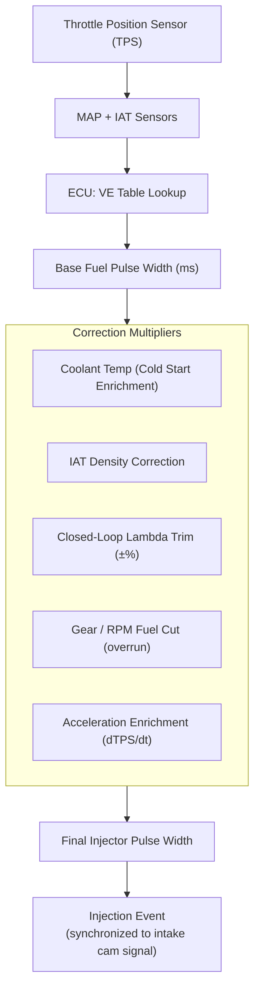

# Lesson 2: Fuel Induction, Air Metering, Ignition Systems

## 1. First-Principles Intuition & Invariants

Every internal combustion engine is, at its core, an air pump. The crankshaft turns, pistons sweep volume, and the entire thermal cycle exists to convert the chemical potential energy locked inside a hydrocarbon fuel into mechanical work. But the engine can only release that energy in proportion to the mass of air it ingests. Fuel is the variable you control; air mass is the constraint you work around. Understand this asymmetry and every downstream decision — carburetor needle taper, injector pulse width, ignition advance angle — becomes intuitive rather than arbitrary.

For a gasoline engine burning a conventional pump fuel or race blend, the chemically ideal ratio of air to fuel by mass sits at approximately 14.7:1. This is the stoichiometric point, the ratio at which the oxygen molecules in the charge are almost perfectly matched to the carbon and hydrogen atoms in the fuel, leaving combustion products of carbon dioxide and water vapor with minimal unburned residuals. Race engineers rarely want to live at stoichiometry during wide-open-throttle operation because maximum power typically requires a slightly richer mixture, somewhere between 12.5:1 and 13.2:1 depending on the fuel blend and combustion chamber geometry. The richer charge cools the combustion event through the latent heat of fuel evaporation, protecting the piston crown and exhaust valve seat from thermal stress while also ensuring that every available oxygen molecule finds a combustion partner. Leaning past stoichiometry under load, by contrast, leaves excess oxygen in the cylinder, raises peak cylinder temperatures dramatically, and shortens the path to detonation and mechanical failure.

The lambda (λ) value is simply the ratio of the actual air-fuel mixture to the stoichiometric ideal. At λ = 1.0, you are exactly at stoichiometry. At λ = 0.88, you are running a mixture roughly 12% richer than stoichiometric, which corresponds to approximately 12.9:1 AFR on pump gasoline — a typical wide-open-throttle target for a naturally aspirated four-stroke race engine. At λ = 1.05, you are lean, and while lean operation improves fuel economy and reduces hydrocarbon emissions, it is combustion territory that demands respect on a race bike because the temperature margin to detonation collapses.

The challenge for any induction system — mechanical carburetor or silicon-governed fuel injection — is to maintain a coherent, correctly proportioned air-fuel mixture across an operating envelope that spans idle at 1,200 rpm to peak power at 14,000 rpm, from a cold wet morning in October to a baking August afternoon, from sea level to a mountain circuit at 2,000 meters elevation. Temperature, pressure, humidity, throttle rate of change, engine load, and fuel blend all conspire to shift the mixture away from the target. The history of motorcycle powertrain development is, in a meaningful sense, the history of increasingly sophisticated attempts to solve this single coordination problem.

The carburetor was the dominant solution for most of the twentieth century, and understanding why it works — and why it fails — is prerequisite knowledge for any engineer working with modern EFI calibration. A carburetor is a passive air-metering device that exploits the Venturi principle: a constriction in the air passage accelerates the airflow and creates a local pressure drop. That pressure drop is exposed to a fuel reservoir held at atmospheric pressure through a calibrated orifice called the main jet. The differential pressure draws fuel from the float bowl into the air stream, where it atomizes and mixes. The elegance of the system is that the fuel delivery is inherently proportional to airflow — more throttle, more airspeed, more pressure drop, more fuel — without any electronics or sensors. A properly jetted carburetor at sea level on a temperate day is a beautifully self-regulating system.

The limitation is that the Venturi effect depends on air density, and air density varies continuously with altitude, temperature, and humidity. When a carburetor calibrated at sea level is taken to a high-altitude circuit, the same throttle opening draws the same volume of air but at lower mass due to reduced atmospheric pressure. The fuel circuit, referenced to absolute atmospheric pressure, continues to deliver roughly the same fuel mass, pushing the mixture rich. The experienced mechanic's response is to fit a smaller main jet — reducing the orifice area to restore the target AFR. This is exactly the kind of track-day tuning intervention that defined motorcycle preparation for decades, and it still matters on vintage race classes and certain budget production categories where carburetors remain mandated.

Electronic fuel injection inverts the control architecture entirely. Rather than relying on a passive physical phenomenon to meter fuel proportionally, an EFI system uses sensors to measure the actual air mass entering the engine and then commands a fuel injector to deliver a precisely calculated fuel pulse to match it. The fundamental equation governing injector operation is deceptively simple: the fuel mass injected equals the injector flow rate multiplied by the pulse width (the time the injector solenoid holds the needle valve open). Everything else in the EFI calibration process is an exercise in determining what pulse width to command under any given set of operating conditions.

The invariant that makes this work is conservation of mass across the combustion event. The engine cannot burn fuel it does not receive, and it cannot produce power from air that arrives without a combustion partner. Every tuning decision — needle taper, pilot jet, main jet in the carburetor world; base fuel map, multiplier corrections, closed-loop lambda trim in the EFI world — is a direct expression of this physical constraint.

---

## 2. Core Architecture & Mechanics

### Carburetor Architecture: The Slide and the Circuit System

A motorcycle carburetor, particularly the constant-velocity (CV) design that became standard on Japanese four-strokes from the late 1970s onward, is best understood as a collection of semi-independent fuel circuits that hand off to one another across the throttle range. No single circuit handles the full rpm span; instead, they overlap in a carefully staged transition.

The pilot circuit governs idle and very light throttle, from closed throttle up to roughly 25% opening. It draws fuel through a small-diameter pilot jet and delivers a pre-atomized mixture through a pilot outlet positioned upstream of the throttle slide, where manifold vacuum is high and air velocity is low. The pilot jet size and the pilot air screw position (which controls the air bleed ratio into this circuit) together set the idle mixture quality. On a correctly tuned pilot circuit, slow-rolling the throttle from idle should produce clean, responsive pickup without stumble or hanging idle as the butterfly closes.

The needle and needle jet form the transitional circuit covering approximately 25% to 75% throttle. The throttle slide lifts a tapered needle partially out of a calibrated needle jet tube, changing the annular gap through which fuel is drawn by the Venturi. The critical tuning variable here is the needle taper profile and the clip position, which raises or lowers the needle relative to the needle jet and effectively shifts the mixture curve richer or leaner across mid-range. On a CV carburetor, the diaphragm-controlled slide rises in response to manifold vacuum rather than directly following the rider's throttle input, which provides inherent acceleration enrichment behavior and damps the mixture disturbance caused by rapid throttle openings.

The main jet takes over above approximately 75% throttle, feeding fuel directly into the main bore under full Venturi effect. At peak airflow, the main jet size is the dominant determinant of wide-open-throttle mixture strength. A main jet that is two or three sizes too lean at peak power — a situation that is easy to create when moving to a free-flowing aftermarket air filter or exhaust — will produce a lean surge at the top of the rpm band, elevated exhaust temperatures, and, under sustained load, piston crown erosion.

A four-stroke race bike running carburetors will almost always benefit from a float bowl vented to atmosphere rather than the airbox, ensuring that fuel delivery remains referenced to true atmospheric pressure rather than the slight depression inside the airbox at high airflow. The accelerator pump, where fitted on slide-type carburetors, displaces a small squirt of raw fuel directly into the bore on rapid throttle opening, covering the momentary lean spike that occurs before the Venturi effect has re-established equilibrium. The pump stroke volume and check-valve timing are tunable and often overlooked during carburetor preparation.

### EFI Architecture: Throttle Bodies, Injectors, and the ECU Control Loop

A motorcycle EFI system organizes itself around four interdependent subsystems: the air metering path, the fuel delivery circuit, the sensor array providing closed-loop feedback, and the engine control unit (ECU) executing the control strategy. Understanding the signal path from intake air to injector fire event is the foundation of competent ECU calibration.

The throttle body replaces the carburetor's Venturi bore and slide with a precision-machined aluminum housing containing a butterfly valve driven directly by the rider's throttle input (or, on ride-by-wire systems, by a stepper motor commanded by the ECU based on throttle position sensor input and traction management logic). Bore diameter is a primary architectural decision: a larger bore reduces intake velocity and charge turbulence, which benefits top-end power but hurts low-rpm mixture homogeneity and throttle response. Modern MotoGP and Superbike throttle bodies are sized for peak power targets and compensate for low-speed mixture quality through injector placement, spray pattern geometry, and injection timing relative to the intake valve opening event.

Fuel injectors on performance motorcycle engines are solenoid-actuated needle valves fed by a pressurized fuel rail maintained at a constant differential pressure above intake manifold pressure, typically 2.5 to 4.0 bar gauge. The injector opens when the ECU grounds the solenoid circuit, and closes when the coil is de-energized, with the actual open time — the pulse width, measured in milliseconds — determining the fuel mass delivered per injection event. High-performance engines frequently use dual-injector stacks: a primary low-flow injector positioned close to the intake port for precise low-load metering, and a secondary high-flow injector positioned upstream in the velocity stack for high-rpm, high-load enrichment where the primary injector's duty cycle would otherwise exceed approximately 80% and begin introducing timing instability.

The air metering signal feeding the ECU's fuel calculation comes from one of two philosophies. Speed-density systems infer air mass from the manifold absolute pressure (MAP) sensor reading combined with an intake air temperature (IAT) sensor, using the ideal gas law to calculate charge density and then multiplying by an estimated volumetric efficiency value stored in the ECU's VE table. Mass airflow (MAF) systems use a hot-wire anemometer in the intake tract to measure air mass flow directly, without relying on a VE model. Speed-density is by far the more common architecture on motorcycles because the pulsed, high-frequency pressure waves in a short intake tract make MAF sensor readings noisy and difficult to filter without introducing calibration lag. Speed-density systems are also more tolerant of intake modifications because recalibrating the VE table is a straightforward dyno exercise, whereas a MAF-based system requires physical sensor relocation when intake geometry changes.

The signal path from throttle input to injector fire event in a typical speed-density EFI system follows a coherent logic chain:

The VE table itself is the heart of the calibration. It is a two-dimensional lookup table indexed by engine rpm on one axis and throttle position or MAP on the other, with each cell containing a volumetric efficiency percentage that the ECU uses to scale the theoretical air mass into a real-world charge mass estimate. A freshly built engine will require a full VE table calibration run on a chassis dynamometer or engine dyno before it is race-ready. The process involves holding steady-state operating points across the rpm-load matrix, using a wideband lambda sensor to measure actual AFR, and adjusting each VE cell until the measured lambda matches the target lambda stored in the separate target-AFR table.

### Lambda Sensors: Narrowband vs. Wideband

The lambda sensor is the closed-loop feedback element that makes real-time mixture correction possible, and the distinction between narrowband and wideband sensor technology has direct implications for how aggressively you can trust closed-loop correction in a race calibration.

A narrowband lambda sensor, typically a zirconia oxygen cell, produces a voltage output that switches sharply between approximately 0.1 V (lean) and 0.9 V (rich) around the stoichiometric crossover point. Its useful operating range spans roughly λ = 0.97 to λ = 1.03, which makes it an excellent idle and light-cruise mixture regulator but essentially useless for characterizing wide-open-throttle mixture strength at λ = 0.88. Street motorcycle ECUs use narrowband sensors to maintain tight stoichiometric control in closed-loop mode during light load, primarily for emissions compliance.

A wideband lambda sensor — the Bosch LSU 4.9 being the industry-standard element — uses a dual-cell pump-and-sense architecture to actively control the oxygen partial pressure inside the sensor's measurement cavity, providing a linear and accurate lambda reading from approximately λ = 0.65 to λ = 1.6. This is the sensor type that belongs on every performance motorcycle during dyno calibration and, in increasingly common practice, during race operation where the ECU uses wideband-informed closed-loop correction across the full load range. The sensor's controller outputs a 0–5 V analog signal (or CAN bus data in integrated units like the Bosch LSU 4.2 with dedicated controller) that the ECU or standalone data logger reads as a continuous lambda value.

During a calibration session, the wideband reading is typically logged simultaneously with TPS, MAP, rpm, injector duty cycle, and ignition timing, allowing the calibrator to overlay the measured lambda trace against the target lambda map and calculate the cell-by-cell error that becomes the VE table correction delta.

### Ignition Architecture: From Points to Digital Advance Maps

The ignition system's task is to deliver a spark of sufficient energy at precisely the right crankshaft angle to initiate combustion, allowing the flame front to propagate across the combustion chamber and reach peak cylinder pressure at the optimal point in the expansion stroke — typically 10–15° after top dead center (ATDC) for maximum mechanical work extraction.

The key variable is ignition advance: the number of crankshaft degrees before top dead center (BTDC) at which the spark fires. Because the flame front travels at a finite speed through the compressed charge (approximately 15–30 m/s for a gasoline-air mixture under typical conditions), the ignition event must anticipate TDC by enough time for combustion to be near-complete as the piston passes over the top. At higher rpm, the piston moves through the same angular displacement faster, so the flame front has less absolute time to complete combustion in a given crank-angle window. The spark must therefore be advanced earlier, in degrees BTDC, as rpm rises.

The traditional mechanical solution was a centrifugal advance mechanism: rotating weights in the distributor or magneto assembly would fly outward with increasing rpm, rotating the trigger position and advancing the ignition timing automatically. The advance curve was set by spring rate and flyweight geometry, and tuning it meant swapping springs or weights — a physical, analog process with no feedback and limited precision.

Modern engine management systems replace this with a fully digital ignition advance map, structurally identical to the fuel VE table: a two-dimensional matrix indexed by rpm and load (MAP or TPS), with each cell containing a spark advance value in degrees BTDC. The ECU reads crankshaft position from a reluctor wheel sensor or optical encoder, determines the current rpm-load cell, retrieves the advance value, and fires the ignition coil at the computed crankshaft angle with timing precision measured in fractions of a degree. The resulting flexibility is extraordinary: different advance values for every combination of rpm and throttle position, asymmetric curves for acceleration versus deceleration, different maps for different fuel grades, and real-time advance retard in response to knock sensor events.

A representative ignition advance map for a naturally aspirated 600cc inline-four race engine might look like this across its key operating regions:

| RPM \ MAP (kPa) | 20 kPa (idle/light) | 50 kPa (part throttle) | 95 kPa (full load) |
|---|---|---|---|
| 2,000 | 18° BTDC | 32° BTDC | 20° BTDC |
| 5,000 | 24° BTDC | 36° BTDC | 28° BTDC |
| 8,000 | 30° BTDC | 38° BTDC | 32° BTDC |
| 11,000 | 34° BTDC | 40° BTDC | 34° BTDC |
| 14,000 | 36° BTDC | 40° BTDC | 36° BTDC |

The apparent paradox — that advance values are higher at light load than at full load for a given rpm — reflects combustion physics. At light throttle and low MAP, the in-cylinder charge is dilute and the mixture is homogeneous but sparse, which makes the flame front propagate more slowly. The ignition event must therefore occur earlier to allow adequate burn time. At full load with a dense, slightly rich charge, the flame front propagates faster through the compressed mixture, and less advance is needed to place peak pressure at the optimal crank angle.

### Knock Detection and Advance Retard Strategy

Detonation, commonly called knock, occurs when a pocket of unburned end-gas ahead of the propagating flame front reaches its auto-ignition temperature and explodes spontaneously rather than burning progressively. The resulting pressure spike is abrupt, asymmetric, and mechanically destructive: it produces a sharp ringing vibration in the cylinder block at frequencies between approximately 6 and 15 kHz, bends connecting rods, erodes piston crowns, and in sustained instances can destroy an engine within seconds.

A piezoelectric knock sensor mounted to the cylinder block acts as an accelerometer tuned to the detonation frequency band. The ECU's knock detection algorithm samples the sensor signal in a narrow crankshaft-angle window following the expected spark event, integrates the energy in the detonation frequency band, and compares it against a learned background noise threshold for each cylinder. When the signal exceeds this threshold, the ECU interprets the event as knock and immediately retards ignition timing on the affected cylinder by a programmed step, typically 2–4°, before slowly recovering toward the nominal map value over subsequent engine cycles. This closed-loop knock control allows the ECU to run the ignition advance map very close to the detonation boundary — where maximum thermal efficiency lives — while maintaining a hardware-enforced safety margin.

For race applications running controlled fuel grades (such as VP Racing's C12 or Sunoco GT260), the knock threshold is known and the ignition map can be calibrated very aggressively. For street-derived race classes where fuel quality is uncontrolled, the knock integration window, the retard step size, and the recovery rate all become calibration variables that determine how much timing the engine protects versus sacrifices when detonation occurs.

---

## 3. High-Performance Optimization & Failure Modes

### Dyno Calibration Workflow for EFI Motorcycles

The sequence for calibrating a fresh EFI installation or recalibrating after significant engine modifications follows a logical order that respects the dependency chain between subsystems. Beginning with the ignition timing before the fuel map is stable is a common mistake that produces misleading results, because an excessively rich or lean mixture burns at a different rate and shifts the apparent MBT (minimum spark advance for best torque) point.

The correct sequence is to establish a safe, slightly rich fuel map first — targeting λ = 0.88 to 0.90 across the full throttle range — and then optimize ignition timing by advancing in 1° increments at each rpm-load cell until torque on the dyno load cell stops increasing. This is the MBT sweep. Once MBT advance is mapped, the fuel calibration is refined by walking each cell toward the target λ value using the wideband sensor as the arbiter, monitoring torque simultaneously to confirm that the fuel correction is not moving the engine away from MBT conditions. Pilot/idle circuit tuning is done last, at warm operating temperature, by adjusting the idle fuel correction and idle ignition advance for the cleanest, most stable idle and the crispest closed-to-open throttle transition without stumble.

When working with Dynojet's Power Commander platform or a reflashable OEM ECU accessed through a laptop via USB and the manufacturer's mapping software (Yamaha's YEC system, Honda's PGM-FI Calibration Tool, Kawasaki's K-Con), the workflow for each steady-state calibration point is to hold engine rpm and load stable under dyno eddy-current braking, record wideband lambda, calculate the percentage error from target lambda, and apply that error as a direct correction to the VE table cell. Most professional ECU platforms allow this process to be automated through autotune algorithms, where the software continuously modulates VE cell values toward the target lambda table in real time. Autotune accelerates the initial map construction significantly but should never replace a manual review pass, because the algorithm cannot distinguish between a correctly converged calibration and a local oscillation around an unstable operating point, nor can it account for sequential injection timing effects that influence mixture quality independent of fuel mass.

### Cold-Start Enrichment and Open-Loop Warm-Up Strategy

A cold engine presents a mixture quality problem that neither the VE table nor closed-loop lambda correction can fully solve on their own. At low coolant temperatures, fuel deposited on the relatively cold intake port walls and piston crown during the induction stroke fails to fully vaporize before the compression event, effectively removing it from the combustible charge. The engine receives less fuel in vapor form than the injector delivered in liquid form. Simultaneously, lubricating oil viscosity is high, increasing mechanical friction and demanding more torque — and therefore richer mixture — to maintain idle stability.

The cold-start enrichment system addresses this by multiplying the base fuel pulse width by a correction factor derived from a coolant temperature lookup table, adding what amounts to a fixed offset of additional fuel scaled to the degree of thermal deficit. A typical enrichment factor at -10°C ambient might add 50–70% additional fuel above the warm-idle base pulse width, tapering linearly toward unity (no correction) as coolant temperature approaches 80°C. During this warm-up phase, the lambda sensor is below its minimum operating temperature (approximately 350°C for a narrowband cell, 700°C for a wideband Bosch LSU under full electrical heating) and the closed-loop correction is disabled; the ECU runs fully open-loop on the enrichment table alone.

The practical implication for race preparation is that any morning grid slot with a cold-soak start requires either an adequate warm-up period on a paddock stand or a properly calibrated cold-start and warm-up table in the ECU. A motorcycle launched on the warm-up lap with a half-warmed engine running 20% excess enrichment will exhibit sluggish throttle response, increased fuel consumption, and potentially fouled spark plugs if the enrichment is not calibrating itself out as coolant temperature rises. Some aftermarket ECUs allow a time-based warm-up correction decay in addition to the temperature-based one, which is useful when the coolant temperature sensor response is slow relative to the actual combustion chamber thermal state — common on air-cooled race engines where the cylinder head heats rapidly but coolant circulation is minimal.

### Fuel Atomization Quality and Injector Spray Targeting

The power output difference between a well-specified fuel injector setup and a compromised one is not theoretical. Poor atomization — caused by worn injector needle seats, incorrect spray cone angle, inadequate fuel pressure differential, or misaligned spray targeting relative to the intake valve — produces fuel droplets too large to fully vaporize before the compression stroke. Large droplets hit port walls, agglomerate into a liquid film, and enter the cylinder partially unvaporized. The result is inconsistent combustion quality cycle-to-cycle, measured as coefficient of variation (CoV) in indicated mean effective pressure, which on the dyno appears as rough torque delivery and in the data as scattered cylinder pressure traces.

High-performance injectors for race applications use multi-hole nozzle plates (typically 6–12 holes in a conical or fan pattern) rather than a single pintle-type orifice, producing a finely divided spray plume that maximizes surface-area-to-volume ratio and evaporation rate. The spray targeting angle should direct the plume toward the back face of the open intake valve, where intake air velocity is highest and droplet shear is greatest. Bosch, Magneti Marelli, and Keihin all manufacture injector variants with spray angles between 15° and 30° included cone, optimized for different throttle body geometries, and selecting the wrong spray geometry for a given throttle body-port combination is a common source of mid-range mixture inconsistency that only becomes apparent after examining individual cylinder AFR balance on a four-channel wideband system.

Fuel pressure stability under transient load is equally critical. A fuel pressure regulator that allows rail pressure to droop by 0.3 bar during peak injector demand at high rpm effectively reduces injector flow rate and leans the mixture at precisely the moment when maximum enrichment is required for power and thermal protection. The fix is usually a higher-capacity fuel pump, a shorter fuel rail with reduced internal volume that the pump must charge, or a return-line system (versus returnless architecture) that maintains continuous rail pressure through a bypass rather than accumulation. For EFI track builds, it is worth installing a fuel pressure sensor on the rail and logging its value during hot laps; a pressure trace that remains flat within ±0.1 bar confirms the delivery system is not the limiting variable in the mixture calibration.

### Common Failure Modes and Their Diagnostic Signatures

Lean misfire at high rpm is one of the most damaging failure modes in a race EFI system and one of the most difficult to diagnose without adequate datalogging. Its signature on a dyno pull is a torque plateau or slight drop in the upper third of the rpm range, accompanied by wideband lambda readings climbing toward 14.0:1 or leaner despite unchanged VE table values. The usual causes are injector duty cycle saturation (the injector cannot physically flow more fuel within the available time window), excessive fuel pressure drop under demand, a partially blocked injector orifice, or a clogged fuel filter. Increasing injector pulse width in the ECU will not resolve a duty-cycle-limited condition; the fix is higher-flow injectors or reduced fuel demand through combustion efficiency improvements.

Detonation under power, as distinct from pre-ignition, manifests on the data logger as a spike in the knock sensor channel followed by an ignition retard event in the timing log. If the retard events are frequent, the ignition map is too aggressive for the available fuel octane, the mixture is too lean, the combustion chamber has a hot spot from carbon deposits, or the coolant system is not maintaining adequate thermal control. Persistent knock events that the closed-loop system cannot suppress by retarding to the minimum advance limit indicate a fundamental tuning or fuel quality problem that will destroy the engine if ignored.

Rich fouling at idle, characterized by black exhaust deposits on the rear of the motorcycle, plug electrodes coated with black carbon, and a wideband reading below λ = 0.80 at idle, points to excessive cold-start enrichment that has not fully decayed to warm-idle values, a leaking injector needle seat that allows fuel to drip into the port between injection events, or a floating bowl in a carburetor with a failed needle valve that is flooding the main bore. Each of these has a distinct diagnostic path: a leaking injector is confirmed by a fuel pressure drop test at key-on with the pump running and no injection commanded; a floating bowl is immediately visible when the carburetor top is removed and fuel is observed pooling above the needle jet.

Intermittent stumble during rapid throttle opening — a problem experienced daily by riders who have retrofitted a high-flow airbox to a stock ECU — is almost always acceleration enrichment insufficiency. The throttle position sensor rate-of-change signal exceeds the threshold for the acceleration enrichment table's fuel addition, but the fuel added is insufficient to cover the brief lean spike caused by the increased air mass flowing before injector pulse widths have been recalculated and applied on the next injection event. The calibration fix is to increase the acceleration enrichment fuel quantity in the ECU's transient fueling table, specifically in the cells corresponding to the rate of TPS change and rpm at which the stumble occurs. This is diagnosed by logging dTPS/dt (the derivative of throttle position with respect to time) alongside wideband lambda during on-track operation: the stumble event will appear as a sharp lambda lean spike coinciding with high dTPS/dt values, and the magnitude of the spike defines exactly how much additional enrichment the transient table needs.

Each of these failure modes and their corresponding calibration responses is ultimately an expression of the same physical invariant that opened this lesson: the engine requires a correct mass ratio of air and fuel in every combustion event. When any subsystem in the induction or fueling chain disturbs that ratio — whether through passive Venturi limitations in a carburetor, injector flow constraints, sensor failure, or calibration error in the ECU — the combustion event suffers in ways that are thermodynamically predictable, instrumentally detectable, and mechanically correctable. The race engineer's job is to close that loop as tightly as the available tools allow.
