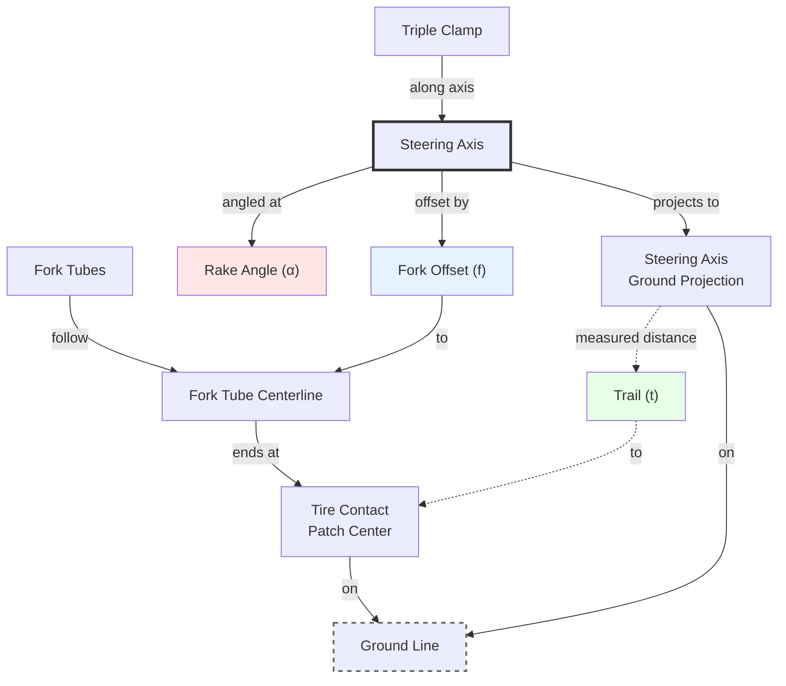

# Lesson 3: Steering Mechanisms, Stability, Countersteering Principles

## 1. First-Principles Intuition & Invariants

The single-track vehicle presents a fundamental departure from the intuitive stability of four-wheeled machines. Where automobiles rely on a stable base formed by four contact patches arranged in a rectangle, motorcycles achieve dynamic equilibrium through angular momentum, gyroscopic forces, and the rider's constant modulation of lean angle. The physics governing motorcycle steering and stability represent one of the most counterintuitive domains in vehicle dynamics, where the rider's inputs often oppose the naive expectation of control authority.

At the heart of motorcycle steering lies a paradox that confounds first-time riders and remains misunderstood even among experienced motorcyclists: to turn right, you must first push the right handlebar forward, effectively steering left. This phenomenon, termed countersteering, emerges not from arbitrary design choice but from the inescapable geometry of a tilted, rolling cylinder negotiating a curved path. The rider does not simply point the front wheel toward the desired direction of travel; instead, the rider momentarily disrupts the machine's equilibrium to initiate a lean angle, which then generates the centripetal force required for cornering through tire contact patch slip angles.

The stability of a moving motorcycle depends on a delicate interplay between several competing forces and moments. Gyroscopic precession from the rotating wheels resists changes in the vehicle's orientation, creating a stabilizing influence that grows with wheel rotational velocity. The trail dimension—the horizontal distance between where the steering axis intersects the ground and where the tire contact patch lies—produces a self-centering torque that attempts to align the front wheel with the direction of travel. Fork rake angle, the backward tilt of the steering axis from vertical, modulates both trail and the steering effort required to initiate lean. Chassis mass distribution, particularly the location of the center of gravity relative to the wheelbase, determines whether the machine exhibits docile self-correction or nervous, oscillatory behavior.

These forces manifest in distinct stability modes that emerge across different speed regimes. At parking lot velocities, the motorcycle exhibits almost no self-stability; the rider must constantly make corrective inputs to prevent toppling. As speed increases through urban traffic ranges, the machine begins to exhibit capsize stability—the tendency to self-correct from small disturbances—though it remains dependent on active rider input for sustained balance. At highway speeds, gyroscopic effects dominate, and the motorcycle resists steering inputs with palpable force while simultaneously becoming more resistant to external disturbances like crosswinds or road surface irregularities.

Two pathological instability modes plague motorcycle design: weave and wobble. Weave represents a low-frequency oscillation, typically between 3 and 5 Hz, where the entire machine yaws and rolls in a coupled motion resembling a snake's undulation. This mode appears most commonly in the 60 to 90 km/h speed range and stems from insufficient damping in the chassis structure, particularly when rear suspension settings permit excessive pitch and yaw compliance. Wobble, alternatively termed a "tank slapper" in racing vernacular, manifests as a violent, high-frequency oscillation of the front fork assembly, often exceeding 8 Hz. This mode emerges when the front tire loses momentary adhesion—through hard braking into a corner entry, over a bump, or during aggressive acceleration out of a chicane—and the subsequent regaining of traction excites an underdamped resonance in the steering head bearings and fork assembly.

The rider's control inputs exist within a narrow authority band defined by the tire contact patch's finite capacity to generate lateral force. Unlike automotive steering, where the driver rotates the steering wheel through large angular excursions to command substantial direction changes, motorcycle steering inputs consist of brief, measured pressure pulses applied to the handlebars. A experienced racer entering a high-speed sweeper might apply a 20-Newton push to the inside bar for less than half a second, allowing the resulting lean angle to persist through the corner under steady-state equilibrium. Overcorrection—a common failure mode for novice riders—results when the rider continues to apply steering torque after the desired lean angle has been achieved, creating an oscillatory hunting behavior as the machine overshoots the target attitude and the rider then applies opposite correction.

The geometry of the front fork assembly determines the machine's steering character more profoundly than any other single parameter. Trail, measured as the horizontal offset between the steering axis projection onto the ground and the tire contact patch center, creates a mechanical advantage that tends to align the front wheel with the direction of travel. When the machine leans into a corner, the trail dimension generates a steering torque proportional to the lateral force at the contact patch, creating a self-aligning moment that assists corner entry but can also produce nervousness if the trail is insufficient. Conversely, excessive trail generates heavy, sluggish steering that requires substantial rider effort to initiate lean, particularly at lower speeds where gyroscopic effects provide less assistance.

Fork rake angle, alternatively termed caster angle in suspension geometry terminology, sets the angle at which the steering axis tilts backward from vertical. A steeper rake—closer to vertical—reduces mechanical trail for a given fork offset, producing quicker steering response and lighter handlebar effort. Choppers and cruisers employ extremely relaxed rake angles, often 35 degrees or more, creating abundant trail that enhances straight-line stability at the cost of ponderous, slow steering. Sportbikes targeting circuit performance utilize much steeper rake angles, typically 23 to 25 degrees, allowing rapid transition rates between left and right lean that prove essential for navigating the rapid direction reversals of a chicane complex.

The physics of countersteering emerges directly from the constraint that a leaned vehicle generates lateral acceleration. When the motorcycle travels in a straight line, the contact patches align with the machine's longitudinal axis, and no net lateral force exists. To initiate a right turn, the rider must first lean the machine rightward, tilting the resultant force vector at the contact patch inward toward the turn center. The only mechanism available to initiate this lean from upright equilibrium involves creating a transient leftward steering input—pushing forward on the right handlebar—that momentarily steers the contact patch out from underneath the center of gravity. The machine begins to fall rightward, and the rider modulates this falling rate through a subsequent reversal of the steering input, allowing the front wheel to track back underneath the mass.

Once established in the lean, the motorcycle achieves a steady-state cornering equilibrium where centrifugal force balances gravitational force. The lean angle $\theta$ required to negotiate a turn of radius $R$ at velocity $v$ follows directly from force balance: $\tan(\theta) = \frac{v^2}{gR}$, where $g$ represents gravitational acceleration. This relationship reveals why high-speed corners demand aggressive lean angles: doubling the cornering velocity quadruples the centrifugal force, requiring a proportional increase in lean to maintain equilibrium. MotoGP machines regularly achieve lean angles exceeding 60 degrees in the fastest sections of circuits like Mugello and Phillip Island, operating within millimeters of the physical limit where hard parts contact the track surface.

The tire contact patch generates lateral force through slip angle, the deviation between the tire's heading and its actual velocity vector. As the motorcycle leans, the tire deforms, creating a contact patch that extends laterally across the tread surface. The rubber elements within this patch experience shear strain, generating lateral force through friction at the interface between rubber compound and asphalt. This slip angle remains small, typically less than 5 degrees for street riding and under 10 degrees even in racing conditions, but the lateral forces it generates can exceed 1.5 times the vertical load on the tire during aggressive cornering.

## 2. Core Architecture & Mechanics

The steering geometry of a motorcycle consists of several interdependent parameters that collectively determine handling characteristics. The steering axis, defined by a line passing through the steering head bearings, intersects the ground at a point forward of the tire contact patch. This offset, termed trail, varies dynamically as the suspension compresses and extends through its travel range. The relationship between rake angle $\alpha$, fork offset $f$, and mechanical trail $t$ obeys the geometric constraint: $t = \frac{f}{\sin(\alpha)} - \frac{r}{\tan(\alpha)}$, where $r$ represents the front tire radius. This formulation reveals that trail increases with rake angle and decreases with fork offset, providing designers two primary mechanisms to tune steering weight and self-centering torque.

The front fork assembly consists of two parallel tubes—the outer fork tubes, which connect to the front axle and contain the suspension damping mechanism, and the inner fork tubes, which slide within the outer tubes and mount to the triple clamps that connect to the steering head. The steering head itself comprises a pair of tapered roller bearings, typically arranged in a configuration where the upper bearing carries radial loads while the lower bearing absorbs both radial and thrust loads. The preload on these bearings critically influences steering friction and the damping of wobble oscillations; insufficient preload permits excessive free play that degrades steering precision, while excessive preload generates friction that masks road surface feedback and prevents the steering from naturally seeking its centered position.

Fork offset, alternatively termed "triple clamp offset" or simply "offset," measures the horizontal distance between the steering axis and the fork tube centerline. Manufacturers typically implement this offset at the lower triple clamp, where the fork tubes pass through machined holes that position the tubes forward of the steering head axis. Adjustable offset triple clamps, common on racing motorcycles, provide multiple hole positions that allow mechanics to shift the fork tubes fore or aft in 2-3 mm increments. Reducing offset increases trail, creating heavier, more stable steering; increasing offset reduces trail, quickening steering response at the expense of reduced stability under deceleration.

Gyroscopic precession manifests when an external torque acts on a spinning wheel, causing the wheel to respond with rotation about an axis perpendicular to both the applied torque and the spin axis. For a motorcycle wheel rotating with angular velocity $\omega$ and possessing moment of inertia $I$, the gyroscopic moment $M_g$ resulting from an applied steering velocity $\dot{\delta}$ follows: $M_g = I \omega \dot{\delta}$. This moment acts perpendicular to the plane containing both the wheel spin axis and the steering axis, resisting rapid changes in steering angle. At highway speeds, the front wheel rotational velocity might reach 60 radians per second, generating substantial gyroscopic resistance to quick steering inputs. This resistance increases linearly with both wheel speed and the rate of steering angle change, explaining why rapid lane changes at high velocity require firm handlebar pressure while the same angular displacement at parking lot speeds demands minimal effort.

The self-centering mechanism emerges from the interaction between trail and lateral tire force. When the front wheel steers away from the direction of travel, the contact patch generates a lateral force that acts at the trail distance behind the steering axis ground projection. This force creates a restoring moment about the steering axis equal to the lateral force magnitude multiplied by the trail dimension. The moment grows stronger as the steering angle increases—within the linear operating range of tire slip angle—creating a progressive resistance to steering displacement that naturally returns the fork to center when the rider releases the handlebars.

The dynamics of countersteering initiation involve a transient phase where the rider applies a brief steering torque in the direction opposite to the intended turn. For a right turn entry, the rider pushes forward on the right handlebar, applying a clockwise torque (viewed from above) that steers the front wheel leftward. This leftward steering moves the tire contact patch laterally away from the machine's center of gravity plane, creating an unbalanced moment that causes the motorcycle to fall rightward into the turn. The lean rate accelerates until the rider reverses the steering input, allowing the front wheel to track back toward alignment with the center of gravity trajectory. The entire process typically occurs within 0.3 to 0.5 seconds for an aggressive corner entry, with the rider's conscious perception often lagging behind the neuromuscular execution of the input.

During steady-state cornering, the front tire operates at a slip angle that generates the lateral force required to balance centrifugal acceleration. The steering angle, measured as the deviation of the front wheel heading from the machine's longitudinal axis, remains surprisingly small—often less than 3 degrees for even aggressive cornering on a sportbike. The lean angle, conversely, might reach 45 degrees or more in the same corner. This disparity between lean angle and steering angle persists because the lateral force generation occurs primarily through the tire contact patch deformation rather than through geometric steering angle. The front wheel points nearly straight ahead relative to the machine's frame, but the tire sidewall deflection and contact patch slip angle produce the necessary lateral force vector.

Stability analysis of the motorcycle requires examination of the system's eigenvalues—the natural frequencies and damping ratios of the various oscillatory modes. The weave mode exhibits complex conjugate eigenvalues with a natural frequency typically between 3 and 5 Hz and a damping ratio that may be positive (stable), near zero (neutrally stable), or negative (unstable) depending on vehicle geometry and speed. A lightly damped weave mode produces the characteristic lazy oscillation where the motorcycle yaws and rolls in phase, with a period of approximately 0.2 to 0.3 seconds per cycle. The rider can typically stabilize a weave through gentle steering corrections, though allowing the oscillation to build can lead to loss of control as the amplitude grows beyond the rider's correction authority.

The wobble mode, alternatively termed "shimmy" in bicycle dynamics literature, represents a high-frequency oscillation of the steering assembly about the steering head axis. This mode typically occurs at frequencies between 6 and 10 Hz, with a period so rapid that the rider cannot consciously track individual oscillations. The wobble emerges from underdamped resonance in the steering system, where the front tire regains traction after a transient loss of adhesion and the resulting impulse excites the natural frequency of the fork assembly rotating about the steering head bearings. The moment of inertia of the front wheel, fork tubes, brake calipers, and fender about the steering axis, combined with the stiffness provided by trail and gyroscopic effects, determines this natural frequency.

Steering head bearing friction provides critical damping for the wobble mode. Excessive friction interferes with precise steering control and masks road surface feedback, but insufficient friction permits wobble oscillations to persist with minimal decay. The optimal bearing preload varies with motorcycle geometry and intended use; sportbikes targeting track performance typically employ lighter preload than touring machines, accepting a slight increase in wobble susceptibility in exchange for reduced steering effort and enhanced feedback. Steering dampers—hydraulic devices that resist rapid changes in steering angle—provide supplemental damping that directly targets wobble suppression without introducing the static friction that would degrade low-speed steering precision.

The effect of speed on stability manifests through multiple mechanisms. Gyroscopic moments increase linearly with wheel rotational velocity, providing enhanced resistance to disturbances but also requiring greater rider effort for steering inputs. The aerodynamic forces acting on the machine and rider grow with the square of velocity, introducing both destabilizing moments (from side forces on the rider's torso and helmet) and stabilizing moments (from the weathervaning effect of bodywork that places aerodynamic center of pressure behind the center of gravity). The capsize mode—a non-oscillatory instability where the machine simply falls over—transitions from unstable to stable as speed increases beyond a critical threshold, typically between 15 and 25 km/h for conventional motorcycle geometries.

The influence of mass distribution on handling characteristics proves profound. Concentrating mass near the center of gravity, particularly by positioning heavy components like the engine and fuel tank low and central within the frame, reduces the polar moment of inertia about the vertical axis passing through the center of gravity. This reduced inertia allows the machine to change heading more rapidly during transitional steering inputs, improving the quickness of direction changes in chicane sections. Conversely, placing mass at the extremes—heavy wheels, large fuel tanks positioned high and far forward, or substantial rear luggage—increases rotational inertia, creating more ponderous steering that resists rapid direction changes but also provides enhanced stability during straight-line cruising.

The chassis frame contributes to steering response through its torsional stiffness and bending compliance. A frame that lacks torsional rigidity about the longitudinal axis permits twist between the steering head and the swingarm pivot, allowing the front and rear wheels to operate in different planes during aggressive cornering. This twist degrades steering precision and introduces a lag between rider input at the handlebars and the resulting change in machine attitude. Modern sportbike frames employ large-diameter aluminum twin-spar designs or trellis structures fabricated from chrome-molybdenum steel tubing, both optimized to maximize torsional rigidity while minimizing mass. The frame's bending stiffness in the vertical plane influences pitch damping and the transmission of suspension forces between front and rear, with insufficient stiffness producing a flexing sensation that riders describe as "vague" or "imprecise."

Tire construction and inflation pressure modulate steering response through their effect on contact patch shape and sidewall stiffness. A tire inflated to high pressure develops a narrow, elongated contact patch with reduced lateral compliance, producing quicker steering response but harsher ride quality and reduced mechanical grip at small slip angles. Lower inflation pressure creates a wider contact patch with greater lateral compliance, generating more progressive steering response and enhanced grip at the expense of increased steering effort and reduced stability at high speeds. Racing slick tires, which lack tread grooves and employ soft rubber compounds, require careful pressure optimization to achieve target operating temperatures; front tire pressures typically range from 30 to 34 psi hot, while rear pressures run 2 to 4 psi higher to compensate for the greater heat generation from drive torque and higher vertical loads.

## 3. High-Performance Optimization & Failure Modes

The optimization of motorcycle steering geometry for circuit performance requires balancing conflicting objectives across diverse track characteristics. Circuits dominated by slow-speed hairpins and chicanes demand quick-steering geometry with reduced trail, allowing the machine to flick rapidly between left and right lean. Tracks featuring long, fast sweepers benefit from increased trail that enhances mid-corner stability and reduces the rider's workload in maintaining precise lean angles. The optimal compromise depends on the specific circuit layout, with many racing teams maintaining multiple fork offset configurations and adjustable triple clamp positions to tune trail dimension based on track characteristics.

The measurement of steering response begins with accurately determining the machine's current geometry. Trail measurement requires establishing the steering axis ground projection point and the tire contact patch center location with the suspension at race sag—the amount of suspension compression under the weight of the machine plus rider. A plumb bob suspended from the lower triple clamp, aligned with the steering axis, locates the ground projection point. The contact patch center lies directly beneath the front axle when the suspension sits at static sag. The horizontal distance between these points, measured parallel to the ground, provides the mechanical trail dimension. This value changes as the suspension compresses through corners, typically reducing by 5 to 15 mm at full compression depending on fork angle and geometry.

Dynamic sag measurement establishes the suspension position during riding rather than at rest. The rider mounts the machine in riding position while an assistant measures the vertical displacement of the rear axle relative to the fully extended position. Target sag values depend on application and rider preference, but sportbikes typically run 25 to 35 mm of dynamic sag at the rear, representing 25% to 35% of total suspension travel. Front sag typically measures 5 to 10 mm less than rear sag to maintain rake angle under dynamic loads. Insufficient sag produces harsh ride quality and poor traction over bumps as the suspension cannot absorb impacts within its available compression travel. Excessive sag steepens the steering geometry, quickening steering response but also raising the machine's center of gravity and potentially creating ground clearance issues at full lean.

The adjustment of fork offset through triple clamp position changes requires careful documentation of baseline handling characteristics before modification. Reducing offset by 2 mm increases trail by approximately 2 mm (the exact amount depends on rake angle and fork offset), producing noticeably heavier steering and enhanced straight-line stability. The rider may observe reduced effort required to hold precise lean angles in long sweepers but increased difficulty flicking the machine into tight chicanes. Conversely, increasing offset reduces trail, quickening steering response but potentially introducing nervousness when exiting corners under hard acceleration. The change manifests most dramatically in the transition between left and right lean; a machine with reduced trail requires less handlebar pressure to initiate lean but may oversteer or require earlier counter-correction to prevent overshooting the target lean angle.

The diagnosis of wobble instability begins with inspection of steering head bearing condition and preload. The rider should position the machine on a paddock stand with the front wheel raised clear of the ground, then manually rotate the fork assembly through its full range of motion. Smooth, consistent resistance throughout the entire arc indicates proper bearing condition and preload. Notching—distinct detents or rough spots at specific steering angles—signals damaged bearings requiring replacement. Excessive free play, detected by grasping the lower fork tubes and attempting to push and pull parallel to the steering axis, indicates insufficient bearing preload. The adjustment procedure varies by machine, but typically involves loosening the upper triple clamp pinch bolts, tightening the steering stem nut to eliminate free play, then backing off approximately 1/8 turn and retightening the pinch bolts.

Steering damper installation and tuning provide supplemental wobble damping without introducing static friction that would degrade low-speed steering. Linear dampers mount between the frame and the upper triple clamp or fork tubes, providing resistance proportional to steering velocity but negligible resistance to slow steering inputs. Rotary dampers mount directly to the steering stem, offering more compact packaging and less change in damping force with steering angle. Damper tuning begins with minimum damping settings, then progressively increases damping until wobble oscillations decay within one or two cycles following a disturbance. Excessive damping produces noticeably heavy steering, particularly during quick transitions, and masks the feedback that alerts the rider to traction loss or suspension issues.

The optimization of tire selection and pressure for steering performance requires matching construction characteristics to the machine's geometry and the rider's style. Modern sportbike tires employ radial carcass construction, where the cords run perpendicular to the direction of travel, providing greater lateral stiffness and stability at lean compared to bias-ply designs. The profile of the tire—the curvature of the tread surface viewed in cross-section—profoundly influences steering characteristics. A tire with a pointed profile (small radius of curvature) produces quick steering as the machine transitions onto the edge of the tread, while a more rounded profile creates progressive, predictable steering that requires more lean angle change for a given change in cornering radius.

Tire pressure optimization follows an iterative process informed by temperature measurements across the tread surface. After a session of aggressive riding, an infrared pyrometer or tire probe thermometer measures temperatures at the inner edge, center, and outer edge of the tread. Optimal pressure produces uniform temperature distribution across the tread width, typically within 5 to 10 degrees Celsius variation. Cool inner edges indicate insufficient pressure, causing the tire to over-flex and preventing full contact patch utilization. Cool outer edges suggest excessive pressure, creating a rounded contact patch that concentrates load in the center. Front tire pressures exert more influence on steering feel than rear pressures; a 1 psi change in front pressure produces a noticeable difference in steering effort and feedback, while the rear proves less sensitive.

The mitigation of weave instability through chassis tuning focuses on rear suspension damping and overall chassis rigidity. Weave amplitude grows when rear suspension damping proves insufficient to control oscillatory pitch and yaw motions. Increasing rear compression damping stiffens the chassis response to longitudinal load transfer, while increased rebound damping controls the rate at which the rear suspension extends following compression. The optimal balance depends on the specific weave frequency and the machine's mass distribution, but typical corrections involve raising both compression and rebound damping by 2 to 4 clicks (on dampers with adjustment ranges of 20 to 30 clicks) while monitoring for improvements in stability without excessive harshness over bumps.

Chassis rigidity enhancement addresses weave through increased torsional stiffness between the steering head and swingarm pivot. The frame itself rarely permits modification on production machines, but strategic reinforcement of mounting points can improve overall rigidity. Engine mounts that tie the engine as a stressed member enhance torsional rigidity by using the engine's crankcase as a structural element. Swingarm pivot bearing condition influences chassis stiffness; worn pivot bearings introduce compliance that permits unwanted motion between the frame and swingarm. The inspection procedure involves removing the rear wheel and shock, then attempting to rock the swingarm vertically to detect play in the pivot bearings. Measurable free play requires immediate bearing replacement as the resulting compliance degrades both stability and suspension performance.

The management of high-speed stability during racing demands attention to aerodynamic influences on steering. At speeds exceeding 200 km/h, aerodynamic forces on the rider's helmet, torso, and limbs produce substantial moments about the steering axis. A rider who lifts their head even slightly into the airstream encounters increased drag that attempts to rotate the upper body rearward, applying a destabilizing torque to the handlebars. Experienced racers maintain extremely compact body positions in fast sections, minimizing frontal area and keeping the helmet behind the windscreen's turbulent wake. The "tuck" position places the rider's chest against the fuel tank, helmet nearly contacting the windscreen, and elbows drawn tight to the bodywork, reducing aerodynamic drag by 20% to 30% compared to upright posture.

The transition between low-speed and high-speed steering techniques requires conscious adaptation as the rider progresses from parking lot exercises to highway velocities. At walking pace, the motorcycle requires continuous corrective inputs, with the rider constantly steering to maintain balance much like a circus performer atop a rolling sphere. As speed increases through the 30 to 50 km/h range, the machine begins to exhibit self-stability, requiring less frequent corrective input but still demanding active rider participation. Above 70 km/h, gyroscopic forces dominate, and the machine actively resists steering inputs while maintaining stable equilibrium with minimal rider correction. The rider must adapt input magnitude accordingly; a handlebar pressure that produces gentle course correction at 40 km/h might prove insufficient to initiate any steering response at 150 km/h.

The quantification of steering effort through instrumented handlebar load cells provides objective data for geometry optimization. Load cells mounted within the handlebar grips measure the force applied by the rider in both push and pull directions, synchronized with lean angle sensors and GPS position data to correlate steering effort with specific corners. Analysis reveals that skilled riders apply brief, high-magnitude force pulses during turn entry—often 50 to 80 Newtons for 0.3 to 0.5 seconds—then release pressure and allow the machine to hold steady-state lean with minimal sustained force. Novice riders often exhibit continuous, lower-magnitude handlebar pressure throughout the corner, fighting the machine's self-centering tendency rather than working with it.

The failure modes associated with countersteering errors typically manifest as either understeering or oversteering during corner entry. Understeering occurs when the rider fails to apply sufficient initial countersteering input, resulting in delayed lean initiation that forces a tighter line through the corner or requires mid-corner correction. The rider perceives running wide toward the outside edge of the track and instinctively steers harder in the intended turn direction—precisely the wrong response, as this steering input reduces lean angle and exacerbates the wide trajectory. The correct response involves a second countersteering pulse to increase lean angle, though this secondary input must be measured to avoid oversteering into an excessively tight line.

Oversteering during corner entry results from excessive or prolonged countersteering input that initiates more lean angle than required for the corner radius and velocity. The machine rotates toward the inside of the turn too aggressively, pointing toward the apex before the rider intended. Novice riders often respond with panic steering in the opposite direction, which reduces lean angle and causes the machine to stand up and run wide, potentially into oncoming traffic or off the outside edge of the track. The disciplined response involves momentarily maintaining the current lean angle while assessing trajectory, then applying measured steering input to fine-tune the line rather than making abrupt corrections that destabilize the machine.

The intersection of suspension setup and steering response creates complex interdependencies that demand holistic tuning approaches. Fork spring preload influences rake angle under braking, with insufficient preload allowing excessive front-end dive that steepens the fork angle and reduces trail. This dynamic geometry change produces steering that quickens progressively as brake pressure increases—potentially useful for tightening the line during trail braking but also introducing unpredictability if the change proves too dramatic. Conversely, excessive spring preload or compression damping resists front-end dive, maintaining more consistent geometry but potentially preventing the desired load transfer onto the front tire that enhances mechanical grip during corner entry.

Rear ride height adjustment, accomplished through shock linkage positioning or threaded collar adjustment on the shock body, modifies the machine's pitch angle and consequently the fork rake. Raising the rear of the machine steepens the fork angle, reducing trail and quickening steering. Lowering the rear relaxes the fork angle, increasing trail and slowing steering response. The magnitude of this effect varies with wheelbase; machines with longer wheelbases exhibit less sensitivity to ride height changes than compact sportbikes. A typical adjustment range might span 15 to 25 mm of rear ride height change, producing trail variations of 3 to 6 mm that significantly alter steering character.

The calibration of rider technique for countersteering proficiency begins with deliberate practice in controlled environments. An empty parking lot provides adequate space for exploring the relationship between handlebar input and machine response without traffic complications. The drill involves riding in a straight line at 40 to 50 km/h, then applying a deliberate push on one handlebar while consciously observing the machine's response. The rider should feel the initial opposite steering input, followed by the machine falling into lean in the direction of the push. Repetition across multiple sessions trains the neuromuscular pathways that allow unconscious execution during dynamic riding.

The progression to higher speeds and more aggressive lean angles requires incremental confidence building. Track day environments provide ideal conditions for exploring the machine's lean angle limits with reduced consequences compared to public roads. The rider gradually increases corner entry speed across multiple laps, noting the increasing handlebar pressure required to achieve greater lean angles. Telemetry data, particularly steering angle sensors and lean angle measurements, reveal the subtle distinctions between steering input and actual lean angle, reinforcing the counterintuitive nature of the control scheme.

The mastery of emergency maneuvering techniques relies entirely on countersteering proficiency. When an obstacle appears in the rider's path—a car turning across the lane, debris in the roadway, an animal darting into traffic—the instinctive response to steer around the obstacle must be suppressed in favor of deliberate countersteering. The drill for emergency swerving involves approaching a cone or marker at moderate speed, then executing a rapid left-right-left swerve through a defined corridor. The rider must push firmly on the handlebar in the direction of the initial swerve, transition immediately to opposite pressure for the return swerve, then push again to return to the original lane. The entire maneuver occurs within 1.5 to 2 seconds, demanding rapid, forceful inputs that novice riders often fail to execute with sufficient magnitude.
