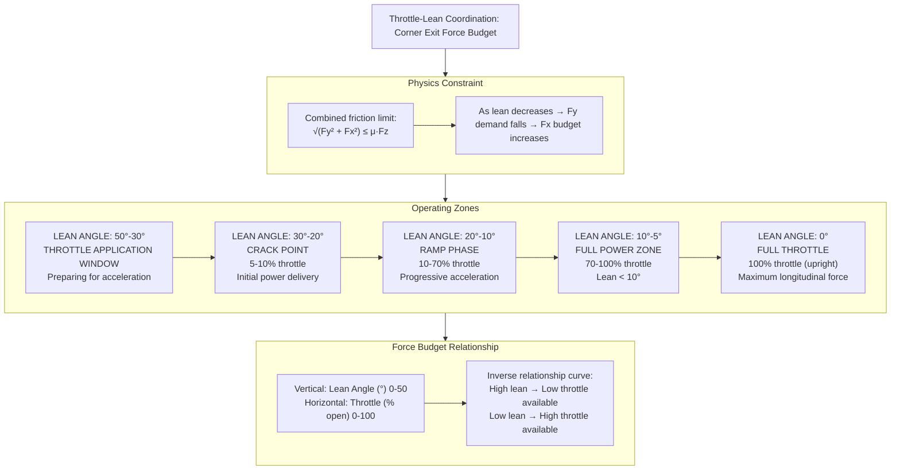

# Lesson 4: Cornering Dynamics, Combined Braking, and Throttle Control

## 1. First-Principles Intuition & Invariants

The motorcycle occupies a singular position among wheeled vehicles because its fundamental stability mechanism is inseparable from its cornering mechanism. A four-wheeled car corners by generating lateral force at the tire contact patch while remaining upright; the chassis rolls against its suspension geometry but the occupants are never more than a few degrees from vertical. A motorcycle corners by *falling*. The rider initiates a controlled topple toward the inside of the turn, and the entire physics of forward motion conspire to arrest that fall at a precise lean angle where gravitational torque and centripetal reaction force reach equilibrium. Understanding this distinction is not merely academic. It reframes every subsequent question about trail braking, throttle control, and combined force management, because on a single-track vehicle the lean angle is not a consequence of the cornering forces—it *is* the cornering force vector made visible.

### The Lean Angle Geometry and Equilibrium Condition

Consider a rider and machine of combined mass $m$ traveling at speed $v$ through a corner of radius $r$. For the system to be in steady-state equilibrium, the resultant of gravitational force $mg$ acting vertically downward through the center of mass and centripetal acceleration $v^2/r$ acting horizontally toward the center of curvature must be aligned with the line connecting the center of mass to the tire contact patch. This resultant defines the lean angle $\phi$ from vertical:

$$\tan(\phi) = \frac{v^2}{r \cdot g}$$

The elegance of this relationship is its independence from mass. A 90 kg superbike and a 190 kg adventure tourer at identical speed and radius must achieve the same lean angle; the heavier machine generates proportionally greater lateral force but its greater gravitational restoring torque demands the same geometric lean for equilibrium. What changes with mass is the *magnitude* of forces acting on the contact patch, and therefore the energy absorbed by the tire during any deviation from that ideal equilibrium line.

The practical implication is that lean angle is a proxy for cornering speed divided by radius—it encodes the g-loading demand on the tire contact patch with elegant directness. When you see a MotoGP rider at 62° of lean through the first chicane at Mugello, that number is a compressed statement about the speed and radius combination they have selected, and by extension the fraction of available tire grip they are consuming in the lateral direction alone. Any remaining grip capacity is what the rider has available for simultaneous braking or acceleration—the core currency of racecraft.

### The Friction Circle and Its Single-Track Implications

The friction ellipse, more accurately described for a tire than a perfect circle, represents the total friction force available at the contact patch in any direction. If we define the longitudinal axis as the direction of travel and the lateral axis as perpendicular to it, then at any instant the vector sum of lateral cornering force $F_y$ and longitudinal braking or drive force $F_x$ cannot exceed the product of tire normal load and peak coefficient of friction: $\sqrt{F_x^2 + F_y^2} \leq \mu F_z$.

On a car, this constraint applies somewhat independently to each corner of the vehicle, and the suspension geometry decouples the pitch and roll planes sufficiently that an engineer can analyze them with reasonable independence. On a motorcycle, all of this collapses onto two contact patches—and far more critically, onto a chassis that *changes its geometric relationship to gravity* as the demand on those two patches changes. When a motorcycle decelerates hard while leaned over, the nose dives, the fork compresses, the rake angle increases, the mechanical trail changes, and the steering response transforms. The chassis is not a passive container for the tire forces; it is a dynamically reconfiguring structure whose instantaneous geometry is a function of the very forces passing through it. This coupling between longitudinal load transfer, chassis kinematics, and lateral force generation is the central challenge of high-performance motorcycle dynamics.

### Tire Slip Angle, Slip Ratio, and the Transition Region

A tire generates lateral force through slip angle $\alpha$: the angular difference between the direction the wheel is pointed and the direction it is actually traveling. As $\alpha$ increases from zero, lateral force rises steeply, reaches a peak at typically 6°–10° for a modern performance motorcycle tire, and then declines as the contact patch transitions from elastic deformation into sliding. The peak of this curve—maximum lateral force per unit normal load—is the grip ceiling the rider is trying to operate just below.

Simultaneously, braking and driving forces are generated through longitudinal slip: a dimensionless ratio between the tire's free-rolling speed and its actual velocity. A locked wheel operates at 100% slip ratio and generates maximum longitudinal force, but at that point the lateral force capability of that tire drops to nearly zero. The practical consequence is not abstract: if you lock the front wheel while leaned over at 45°, the contact patch instantly loses the lateral force that was holding the front of the motorcycle on its arc, and the bike falls to the inside. This is why front-wheel lockups in corners are so reliably catastrophic compared to rear lockups, where the geometry at least offers the possibility of a recoverable slide if the rider responds quickly enough.

The combined slip model—relating lateral and longitudinal forces simultaneously through Pacejka's Magic Formula or similar empirical tire models—reveals a continuous trade-off surface rather than two independent limits. At any given slip angle, the introduction of longitudinal slip *reduces* the available lateral force, tracing a path inward along the friction ellipse. Race engineers working with tire data channels from MoTeC or Pi Research loggers spend significant effort cross-correlating slip angle estimates (derived from GPS-based velocity vector versus wheel heading) with slip ratio channels to identify where and how often their rider is operating in the combined-slip region, and whether the balance of that combined loading is managed gracefully or abruptly.

---

## 2. Core Architecture & Mechanics

### The Corner Entry Phase: Trail Braking as a Precision Instrument

Trail braking is the technique of maintaining brake pressure beyond the initial turn-in point, allowing brake application to diminish progressively as lean angle increases. It is not, as it is sometimes characterized, an aggressive limit-chasing technique for specialists—it is in fact the physically correct response to the geometry of a motorcycle corner entry, and understanding *why* reveals the biomechanics of a skilled rider in granular detail.

As the motorcycle begins to decelerate before the corner, weight transfers forward. The front suspension compresses, increasing normal load on the front contact patch and improving its grip capacity. This is the ideal moment to request lateral force from the front tire, because the normal load—and therefore the friction budget—is at its maximum. If the rider releases all brake pressure before initiating the lean, two things happen simultaneously: the suspension extends (unloads the front tire), and the chassis pitches nose-up (shifting weight rearward and reducing front normal load further). The rider then asks the now-lightly-loaded front tire to generate the peak lateral cornering force needed for the apex, which is precisely the moment the front tire's grip ceiling is lowest. Trail braking solves this by keeping the nose loaded through the transition from straight-line deceleration into combined cornering, managing the handoff of the contact patch's workload from the longitudinal dimension into the lateral dimension on the high side of the friction ellipse.

The execution requires a progressive, non-linear release of brake pressure. As lean angle increases and the lateral force demand on the front tire rises, braking force must fall in a carefully coordinated diminuendo. If brake release is too abrupt, the front suspension extends suddenly, unloading the tire just as the steering geometry is under maximum demand, often producing a "wash-out" where the front tire runs wide. If the rider holds too much brake too deep into the corner, they consume more of the friction ellipse than they intended with the longitudinal vector, leaving insufficient grip for the lateral vector, again causing a push to the outside of the corner.

The qualitative signal the rider uses to calibrate this release is the sensation in the front end: a well-executed trail-brake entry feels like a gradual softening of the front contact patch's "bite," a tactile migration of loading from the compressed fork feeling of deceleration toward the lateral resistance of a tire working against centripetal acceleration. At the elite level, riders like Dani Pedrosa were extraordinary precisely because their modulation of this transition was so fine that telemetry traces showed brake-pressure release curves that were nearly perfectly inversely proportional to lean-angle increase rates—a feat of neuromuscular calibration that takes years to develop.

```
Corner Entry: Combined Force Budget During Trail Braking

BRAKE PRESSURE (bar)
80 |▓▓▓▓▓▓▓
60 |▓▓▓▓▓▓▓▓▓▓
40 |          ▓▓▓▓▓▓
20 |               ▓▓▓▓▓▓
 0 |                      ───────────────
   |──────────────────────────────────────► TIME
      BRAKING ZONE     TURN-IN     APEX


LEAN ANGLE (°)
50 |                      ▓▓▓▓▓▓▓▓▓▓
30 |             ▓▓▓▓▓▓▓▓
10 |▓▓▓▓▓▓▓▓▓▓▓
 0 |──────────────────────────────────────► TIME
      BRAKING ZONE     TURN-IN     APEX


FRONT NORMAL LOAD (% peak)
100|▓▓▓▓▓▓▓▓▓▓▓▓▓▓▓▓▓
 80|                   ▓▓▓▓▓▓▓▓
 60|                           ▓▓▓▓▓▓
   |──────────────────────────────────────► TIME

Trail braking keeps front normal load elevated through turn-in,
maintaining the grip budget precisely when lateral demand peaks.
```

### Chassis Response to Combined Loading: Fork Geometry Under Trail Braking

The front fork of a sport motorcycle is not merely a linear spring-damper element. Its angle of inclination (the steering head angle, or more precisely the fork axis inclination) determines how the mechanical trail changes under fork compression. As the fork dives under braking, the front axle moves rearward and downward along the arc of the fork axis. This rearward movement of the contact patch relative to the steering axis pivot point *increases* the mechanical trail, making the steering heavier and more self-centering. The rider counteracts this by applying slightly more steering torque to maintain the desired arc, a demand that feeds back through the handlebar as a characteristic stiffness or reluctance that experienced riders interpret as a signal of how hard the front is working.

When trail braking is combined with lean, this geometry becomes three-dimensional. The steering axis is no longer in the plane that contains the gravitational and centripetal force vectors, and the trail—now projecting at an angle onto the road surface—changes character. A fork that feels planted and communicative under upright hard braking may feel vague or nervous when the same braking force is applied at 35° of lean, because the geometric relationships that generated those clean proprioceptive signals have been rotated out of their design plane. This is why setup work for trails braking on a circuit is not simply a matter of finding maximum fork compression stiffness—it requires a carefully balanced compromise between the upright braking stability and the leaned combined-state feel.

Suspension engineers address this by tuning the front fork's compression damping asymmetrically: a moderate initial velocity sensitivity allows the fork to absorb initial dive during upright braking while a steeper high-velocity damping ramp resists bottoming when the wheel hits a mid-corner bump with the fork already partially compressed. The setup table below reflects typical click ranges used as a starting baseline for a 600cc-class sport motorcycle on a technical medium-speed circuit:

| Channel | Baseline Setting | Toward More Trail Braking Stability | Toward Better Mid-Corner Comfort |
|---|---|---|---|
| Front compression (LSC) | 10 clicks from full stiff | +3 clicks (softer) | +5 clicks (softer) |
| Front rebound | 8 clicks from full stiff | −2 clicks (stiffer) | +3 clicks (softer) |
| Front spring preload | Standard race sag: 30–32 mm | Reduce sag 2 mm | Increase sag 3 mm |
| Rear compression (LSC) | 10 clicks from full stiff | −2 clicks (stiffer) | +2 clicks (softer) |
| Rear rebound | 10 clicks from full stiff | +2 clicks (softer) | No change |
| Rear ride height | Nominal | Lower 3 mm (reduces anti-squat) | Raise 2 mm |

### The Apex and Mid-Corner Phase: Steady-State Lean Management

Once trail braking is complete and the motorcycle is settled at its minimum speed at or near the apex, the rider enters what is functionally a brief steady-state cornering phase. Brake pressure is zero, throttle is neutral or barely cracked, and the chassis is at or near its maximum lean angle for the corner. This is the moment at which the tire contact patches are under their purest lateral demand, and the chassis setup work done in terms of ride height, anti-roll bar stiffness distribution, and tire pressures is most directly expressed in the motorcycle's behavior.

Tire temperature and pressure are the hidden variables that determine the character of this phase. A cold tire—below 80°C for a modern performance compound—operates in a regime where the rubber's viscoelastic damping properties are outside their design window, producing a contact patch that feels slippery and noncommunicative. The tire generates lateral force through adhesion as well as through hysteresis (mechanical interlocking of the tread compound with road asphalt micro-texture), and both mechanisms are strongly temperature-dependent. A tire at 95°C feels alive, responsive, and communicative; it telegraphs the approach to its limit through progressive buildup of steering resistance and subtle chassis vibrations that the rider learns to read as a warning system. The same tire at 60°C gives almost no warning: lateral force simply disappears rather than degrading gracefully.

Tire pressures interact with temperature to determine the contact patch shape. An overinflated tire runs on a narrower, more convex contact patch with a small footprint; it may respond quickly to steering inputs but exhausts its lateral grip ceiling abruptly and can overheat the central tread band while leaving the shoulders underloaded. An underinflated tire presents a larger, flatter contact patch but introduces sidewall flex that acts as an unintended spring element, absorbing steering inputs and creating a lag between rider command and tire response. For track use on dry asphalt, the typical working range for a 600cc-class motorcycle is 2.0–2.1 bar front and 1.9–2.0 bar rear cold (ambient temperature), rising to 2.3–2.5 bar front and 2.1–2.3 bar rear at race operating temperature. Deviations of more than 0.3 bar from these target hot pressures should trigger an immediate setup review, as they indicate a thermal management problem rather than a simple inflation issue.

### Corner Exit: Throttle Progression and Traction Management

The transition from apex to corner exit is the phase where the motorcycle's drive forces and lateral forces must coexist, and it is where the distinction between a rider who is fast through corners and one who is fast out of corners—and therefore down the subsequent straight—is most clearly revealed. The fundamental challenge is that opening the throttle at lean angle introduces three simultaneous phenomena: an increase in rear wheel slip (a demand on the rear contact patch's longitudinal grip capacity), a rearward weight transfer (reducing front normal load and potentially destabilizing the arc if the front is still on its cornering limit), and a squat reaction through the rear suspension that changes ride height and therefore steering geometry.

A skilled rider manages this by beginning throttle application before the apex—sometimes well before, depending on the corner's exit geometry—so that by the time the motorcycle passes the geometric apex, the rear tire is already gently loaded in drive and the chassis is pitched into a squat posture that keeps the rear contact patch working. This is the concept of a "late apex" in racecraft: by turning in slightly later than the geometric center of the corner, the rider creates a straight-line exit trajectory that allows full throttle much earlier, maximizing the time spent accelerating toward the next braking zone. The late apex sacrifices a small amount of mid-corner speed for a larger gain in exit speed, and since exit speed compounds through the subsequent straight, the exchange is almost universally profitable on a circuit.

The throttle progression itself must be carefully calibrated to the available rear grip. Modern sport motorcycles generate enormous torque at the rear wheel; a 1000cc superbike can produce over 180 Nm at the crank, and even after drivetrain losses, that translates into rear-wheel torque capable of far exceeding the contact patch's traction limit at any lean angle above roughly 15°. The progression follows a recognizable pattern at the elite level: an initial "crack"—perhaps 5–10% throttle opening—that loads the rear suspension and settles the chassis, followed by a smooth, continuous ramp toward full throttle as the lean angle decreases and the contact patch's available longitudinal grip increases with the improving vertical orientation of the resultant force vector.



### Chain Torque, Squat, and Anti-Squat Mechanics

The rear suspension's response to drive torque is not simply rearward weight transfer. The chain drive introduces an additional moment acting through the swingarm pivot: as the engine applies torque to the rear wheel, the chain tension creates a force couple that attempts to rotate the swingarm upward or downward depending on the relative geometry of the sprockets, the chain line, and the swingarm pivot. When the chain pulls down on the sprocket mounted below the swingarm pivot's height relative to the contact patch, it generates a moment that counteracts squat—this is anti-squat, and it is deliberately engineered into the rear suspension geometry of sport motorcycles to manage the pitch behavior during acceleration.

The anti-squat percentage is a function of swingarm angle, sprocket center height relative to the swing arm pivot, and the chain line geometry. A 100% anti-squat configuration would mean that drive torque produces zero suspension compression—all of the rearward weight transfer reaction passes through the rigid chain geometry rather than compressing the suspension spring. In practice, most sport motorcycles are set up with 60–80% anti-squat, leaving the suspension free to absorb road surface inputs while still resisting the pitch change that full squat would produce. Raising the rear ride height lowers the swingarm angle and typically reduces anti-squat, allowing the rear to squat more under power and softening the transition onto the throttle at the cost of a more pronounced pitch-and-recover cycle between braking and acceleration.

For a rider struggling with rear-end instability on corner exit—a "stepping out" tendency where the rear contact patch loses traction suddenly rather than progressively—increasing anti-squat by raising the front sprocket height (via a taller front sprocket carrier or adjusting rear ride height) can stabilize the chassis by preventing the sudden geometry change that accompanies abrupt squat. This is a chassis-level intervention that does not require changing tire pressures or damper settings, and it often reveals that what appeared to be a tire traction problem was in fact a suspension geometry instability.

---

## 3. High-Performance Optimization & Failure Modes

### Reading Telemetry for Combined Braking and Cornering Quality

The most revealing telemetry overlay for evaluating a rider's trail braking execution is the cross-plot of front brake pressure against lean angle, with lap time delta encoded as color or a third axis. A rider who is executing trail braking correctly will show a smooth, continuous curve in this space: high brake pressure at low lean angle, transitioning to zero brake pressure at maximum lean angle, with no discontinuities or abrupt drops. A rider releasing brakes before initiating lean appears as a cluster of points near the axes—brake pressure goes to zero before lean angle begins to build—with a gap in the combined-load region that represents a missed opportunity to maintain front normal load through the transition.

Longitudinal and lateral G-force channels from an IMU (inertial measurement unit) mounted near the chassis center of mass provide the complementary picture. During well-executed trail braking, the longitudinal deceleration trace and the lateral acceleration trace will overlap at the transition: as lateral G builds, longitudinal G diminishes at an equal and opposite rate, tracing a quarter-circle arc on the G-G diagram. A poorly executed entry shows a gap between the end of significant longitudinal G and the buildup of lateral G—a "dead zone" on the G-G diagram where neither force is effectively loading the contact patch, representing lost corner entry speed.

Modern data acquisition systems like MoTeC's M1 architecture or Cosworth's Pi Toolbox allow engineers to construct these cross-channel analyses with relatively straightforward math channels. Defining lean angle from the IMU's lateral and vertical accelerometer outputs (corrected for centripetal contamination using GPS-derived speed and heading rate) and correlating it against brake pressure channels at a 100 Hz sample rate provides sufficient resolution to discriminate between rider styles and identify the precise corner where technique changes.

### Failure Mode Analysis: Front End Washout

Front end washout—the sudden and largely unrecoverable loss of front tire lateral traction during cornering—is the most dangerous failure mode in this phase of a corner. It occurs when the front contact patch is asked to operate beyond the peak of its lateral force-slip angle curve, transitioning from elastic deformation to full sliding. The precipitating causes fall into a small number of repeating categories: excessive trail braking that takes more of the friction ellipse in the longitudinal direction than the cornering radius can accommodate with the remaining lateral fraction; a cold or pressure-incorrect tire whose grip ceiling is below the demand; a mid-corner bump that momentarily reduces front normal load while lateral demand is at its maximum; or a fork geometry that produces a suspension extension event (from hitting a crest mid-corner) that unloads the contact patch instantaneously.

The rider-detectable warning signs of impending front washout are subtle but learnable: a gradual decrease in the steering feedback "bite" as the fork loses its compressed feeling; a slight tendency for the front wheel to run wide despite steering input; and in some cases a high-frequency vibration in the handlebar as the contact patch transitions between stick and slip. Riders who have high sensitivity to these cues can recover by releasing lean angle (which reduces lateral demand) or further trail braking pressure—but the window to do so is measured in tenths of a second and demands trained reflexes rather than conscious decision-making.

The setup countermeasures for a prone-to-washout front end involve increasing front normal load through the trail braking phase: stiffening front rebound damping so the fork does not extend rapidly when terrain reduces the compression load; reducing front spring preload to maintain a lower static ride height that keeps the contact patch in a more favorable rake geometry; and ensuring tire pressures are on the lower end of the working window to maximize contact patch size during the combined loading event. Each adjustment carries a trade-off—slower rebound damping that aids stability during trail braking may feel wooden and uncommunicative during the steady-state mid-corner phase—and the engineer's task is to find the balance that the specific rider's technique demands from the specific circuit's corner characteristics.

### Rear Traction Loss and High-Side Risk

The rear-wheel traction failure mode divides into two categories with radically different risk profiles. A low-side rear slide occurs when the rear tire's lateral force runs out before it reaches the grip ceiling in the longitudinal direction; the rear contact patch slides outward and the motorcycle falls to the inside. This is typically recoverable with experienced riders and is the basis of "controlled slides" that elite dirt track and supermoto riders execute deliberately. A high-side is a different and far more violent phenomenon: it occurs when a rear tire that has been sliding—having exceeded its longitudinal grip limit and lost lateral force—suddenly regains traction, most commonly when a rider applies a throttle snap that overcomes the slip and grips the asphalt abruptly. The suddenly recovered grip generates a large lateral force that pivots the rear of the motorcycle back into line faster than the chassis can absorb, projecting the rider over the high side of the motorcycle.

The high-side is fundamentally a traction recovery event gone wrong, and understanding this changes how engineers think about traction control calibration. A traction control system that reduces ignition retard or fuel cut too aggressively—returning to full torque delivery in one sharp step rather than a ramp—can induce the same high-side dynamics electronically that an overexcited throttle hand produces mechanically. MotoGP teams spend significant development time on the ramp-out characteristics of their engine control units' traction control intervention: the rate of torque recovery after a TC event must be slow enough to prevent the contact patch from snapping back from slip to full grip, but fast enough that the rider does not experience excessive drive loss. On typical race hardware using the standard electronics platform (the Magneti Marelli MRU in the intermediate and junior classes), this is adjusted through TC ramp rate maps in the calibration software, with values typically ranging from 20–80 Nm/100ms depending on the grip level and corner exit radius.

### Tire Management Across a Stint

One failure mode that operates on a longer time scale than a single corner is thermal degradation of the tire compound across a stint. Modern performance tires operate through several phases over their useful life on a circuit: an initial cold phase where temperatures rise toward the working window; a "green" phase of perhaps 2–3 laps where temperatures and pressures stabilize and the compound is at peak grip; a stable performance phase of variable length depending on compound hardness and circuit abrasiveness; and a degradation phase where rubber loss and carcass heat buildup begin reducing the grip ceiling.

The engineer monitoring tire health through telemetry looks primarily at the front and rear tire temperature channels (from infrared sensors reading the tread surface, available on more sophisticated amateur and all professional setups) and correlates them with the lap time delta channel. A front tire that is showing higher temperatures on the outer shoulder than the inner shoulder during left-hand corners is operating with insufficient camber compensation—the contact patch is rolling onto its outer edge under lean, indicating the motorcycle's front end geometry is producing insufficient camber gain. This can be corrected by adjusting fork offset (via triple clamp offset change) to alter the relationship between geometric lean angle and contact patch center, or by modifying tire pressure to change the contact patch crown radius.

Maintaining consistent corner entry technique is as much a tire management strategy as a performance strategy: a rider who varies their braking and turn-in point by more than 5–10 meters per lap is not simply losing lap time variance—they are cycling the tire's thermal and mechanical state repeatedly between different regimes, accelerating degradation and reducing the useful performance window of the compound. The smoothest riders are often also the gentlest on tires not because they are slow, but because their consistency prevents the thermal cycling that eats into compound life, allowing them to maintain peak lap times later into a stint when their competitors' tires have already begun to degrade.

The practical synthesis of everything this lesson covers reduces to a single operating principle that informs every session, every corner, and every setup discussion: the motorcycle's contact patches are small, transient windows of communication between the rider's intent and the physical world, and every technique, every chassis adjustment, and every tire management decision is in service of keeping those windows as large, as thermally stable, and as clearly communicative as possible for as long as possible. Trail braking, throttle progression, lean angle management, and suspension geometry are not separate skills—they are facets of a single continuous act of negotiation with a contact patch the size of a hand.
