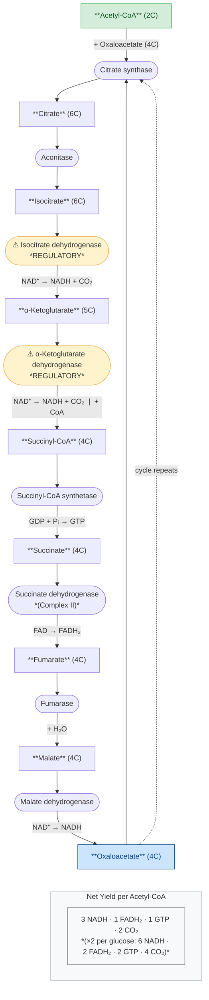
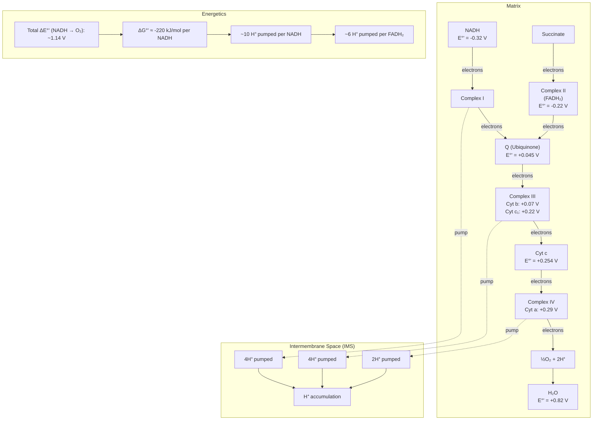
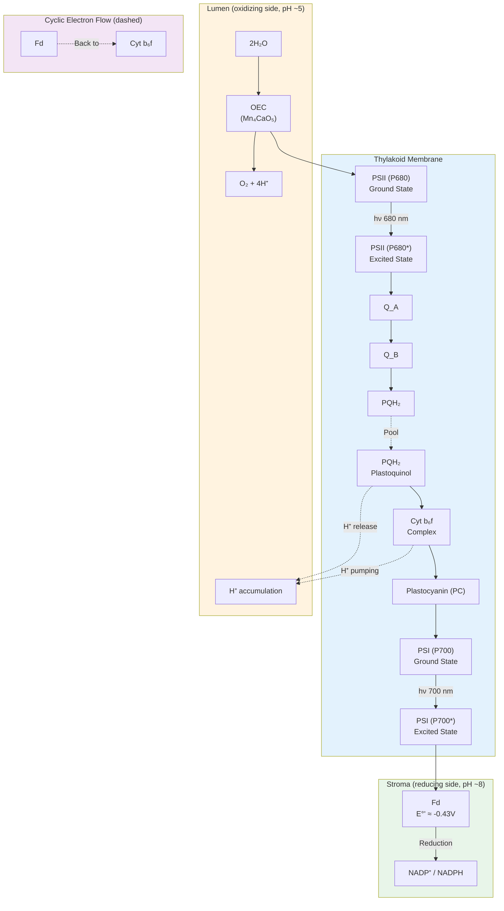

# Lesson 3: Energy Metabolism, Cellular Respiration, Photosynthesis

## 1. First-Principles Intuition & Invariants

The story of life is fundamentally a story about energy transformation. Every living cell operates as a thermodynamic engine that harvests energy from its environment and couples spontaneous exergonic reactions to drive the endergonic biosynthetic processes required for growth, reproduction, and homeostasis. At the heart of this universal metabolic machinery lies adenosine triphosphate (ATP), the canonical energy currency that mediates energy coupling across all domains of life. Understanding cellular energetics requires tracing the flow of electrons through redox cascades, quantifying free energy changes during bond rearrangements, and dissecting the molecular mechanisms that transduce chemical potential into phosphoanhydride bond energy.

The central thermodynamic invariant governing all metabolic transformations is the Gibbs free energy change, defined as $\Delta G = \Delta H - T\Delta S$, where $\Delta H$ represents enthalpy change, $T$ is absolute temperature, and $\Delta S$ denotes entropy change. For a biochemical reaction to proceed spontaneously under standard physiological conditions, the free energy change must be negative ($\Delta G < 0$). However, cells rarely operate under standard conditions; the actual free energy change depends on reactant and product concentrations according to the relation $\Delta G = \Delta G^\circ + RT \ln Q$, where $Q$ is the reaction quotient and $R = 8.314 \, \text{J mol}^{-1} \text{K}^{-1}$ is the universal gas constant. This concentration dependence allows cells to manipulate reaction favorability by maintaining substrate and product pools far from equilibrium through active compartmentalization and regulated enzyme activity.

ATP serves as the universal energy intermediate because hydrolysis of its terminal phosphoanhydride bond releases approximately $\Delta G^\circ = -30.5 \, \text{kJ mol}^{-1}$ under standard conditions, though cellular conditions typically yield $\Delta G \approx -50 \, \text{kJ mol}^{-1}$ due to maintained high ATP/ADP ratios. The ATP molecule consists of an adenine base linked to a ribose sugar, which carries a triphosphate tail. The high-energy character of the phosphoanhydride bonds arises from electrostatic repulsion between negatively charged phosphate groups, resonance stabilization of hydrolysis products (ADP and inorganic phosphate), and favorable solvation entropy changes. Cells maintain ATP homeostasis through continuous synthesis and consumption, with total cellular ATP pools turning over approximately every one to two minutes in metabolically active tissues.

The thermodynamic challenge facing heterotrophic organisms is extracting this phosphate bond energy from reduced carbon compounds such as glucose. The complete oxidation of glucose to carbon dioxide and water releases $\Delta G^\circ = -2880 \, \text{kJ mol}^{-1}$, but direct combustion would dissipate this energy as heat. Instead, cells employ a staged catabolic cascade that captures energy in discrete packets through sequential redox reactions. The oxidation of glucose proceeds through glycolysis, the citric acid cycle, and oxidative phosphorylation, with each stage extracting electrons and channeling them through carrier molecules NAD⁺ (nicotinamide adenine dinucleotide) and FAD (flavin adenine dinucleotide). These electron carriers become reduced to NADH and FADH₂, storing energy in high-energy C-H and N-H bonds with reduction potentials of approximately $E^\circ = -0.32 \, \text{V}$ and $E^\circ = -0.22 \, \text{V}$ respectively.

The ultimate electron acceptor in aerobic metabolism is molecular oxygen, which has a reduction potential of $E^\circ = +0.82 \, \text{V}$ for the half-reaction $\text{O}_2 + 4\text{H}^+ + 4e^- \rightarrow 2\text{H}_2\text{O}$. The large potential difference between reduced electron carriers and oxygen—exceeding one volt—provides the thermodynamic driving force for the electron transport chain. The free energy released as electrons cascade down this potential gradient is captured through chemiosmotic coupling, a mechanism in which proton pumping generates an electrochemical gradient across the inner mitochondrial membrane. The return flow of protons through ATP synthase drives conformational changes that catalyze phosphorylation of ADP to ATP, directly coupling the spontaneous dissipation of the proton-motive force to endergonic ATP synthesis.

Photosynthetic organisms face the inverse thermodynamic challenge: they must drive endergonic synthesis of reduced carbon compounds using light energy. Photosynthesis represents nature's solution to capturing electromagnetic radiation and transducing it into chemical bond energy. The overall photosynthetic equation $6\text{CO}_2 + 6\text{H}_2\text{O} \xrightarrow{\text{light}} \text{C}_6\text{H}_{12}\text{O}_6 + 6\text{O}_2$ has a positive free energy change of $\Delta G^\circ = +2880 \, \text{kJ mol}^{-1}$, requiring input of approximately 48 photons of visible light per glucose molecule synthesized. Photosynthetic light reactions achieve this feat through specialized protein complexes that contain chlorophyll molecules capable of absorbing photons with energies of approximately 180 kJ per mole of photons (for red light at 680 nm). Excited-state electrons are extracted from chlorophyll and transferred through electron transport chains that generate both ATP and the powerful reducing agent NADPH, which carries electrons at a potential of $E^\circ = -0.32 \, \text{V}$. These high-energy products then drive the Calvin cycle, a series of enzyme-catalyzed reactions that fix atmospheric CO₂ into three-carbon sugar phosphates.

The regulatory architecture governing these metabolic pathways represents a masterpiece of biochemical feedback control. Cells continuously sense their energy charge—defined as $\text{EC} = (\text{[ATP]} + 0.5\text{[ADP]})/(\text{[ATP]} + \text{[ADP]} + \text{[AMP]})$—and modulate catabolic and anabolic flux accordingly. Key regulatory enzymes such as phosphofructokinase in glycolysis and isocitrate dehydrogenase in the citric acid cycle function as allosteric sensors that integrate signals from ATP, ADP, AMP, citrate, and other metabolic intermediates. This distributed control architecture ensures metabolic homeostasis while allowing rapid adaptation to changing energetic demands and nutrient availability.

## 2. Core Architecture & Mechanics

### Glycolysis: Glucose Phosphorylation and Carbon Cleavage

Glycolysis occurs in the cytoplasm and represents the universal first stage of glucose catabolism, conserved across all domains of life from archaea to mammals. The pathway converts one molecule of glucose ($\text{C}_6\text{H}_{12}\text{O}_6$) into two molecules of pyruvate ($\text{CH}_3\text{COCO}_2^-$) through ten enzyme-catalyzed steps, generating a net yield of two ATP and two NADH molecules. The pathway divides conceptually into an energy investment phase, where two ATP molecules are consumed to phosphorylate glucose and its isomers, and an energy payoff phase, where four ATP molecules and two NADH molecules are produced through substrate-level phosphorylation and oxidation.

The pathway initiates when hexokinase catalyzes transfer of a phosphate group from ATP to glucose, forming glucose-6-phosphate (G6P). This phosphorylation reaction serves multiple strategic purposes: it traps glucose inside the cell by rendering it membrane-impermeable, it lowers the activation energy for subsequent isomerization reactions, and it commits glucose to metabolic processing rather than export. Hexokinase exhibits a low Michaelis constant ($K_m \approx 0.1 \, \text{mM}$ for glucose), ensuring efficient phosphorylation even at low glucose concentrations, and is product-inhibited by G6P, providing immediate feedback control. The reaction proceeds with a free energy change of $\Delta G \approx -16.7 \, \text{kJ mol}^{-1}$ under cellular conditions, rendering it essentially irreversible and establishing hexokinase as a committed entry point into glycolysis.

Phosphoglucose isomerase then catalyzes reversible isomerization of G6P to fructose-6-phosphate (F6P), converting an aldose to a ketose. Although this reaction operates near equilibrium under physiological conditions ($\Delta G \approx 0$), it is pulled forward by consumption of F6P in the next step. Phosphofructokinase-1 (PFK-1) represents the primary rate-limiting enzyme and committed regulatory checkpoint of glycolysis. PFK-1 catalyzes phosphorylation of F6P to fructose-1,6-bisphosphate (F-1,6-BP) using ATP as the phosphate donor, proceeding with $\Delta G \approx -14.2 \, \text{kJ mol}^{-1}$ and functioning as an irreversible step under physiological conditions. This enzyme exhibits extraordinary regulatory complexity: it is allosterically activated by AMP and ADP, signaling low energy charge, and inhibited by ATP and citrate, signaling energy sufficiency and abundant biosynthetic precursors. The sigmoidal kinetics of PFK-1 with respect to F6P concentration provide ultrasensitive switching behavior, allowing sharp transitions between low and high glycolytic flux states in response to small changes in energy charge.

Aldolase cleaves the six-carbon F-1,6-BP into two three-carbon molecules: dihydroxyacetone phosphate (DHAP) and glyceraldehyde-3-phosphate (G3P). Triose phosphate isomerase rapidly interconverts these isomers, maintaining near-equilibrium conditions with $\Delta G \approx 0$, and effectively channeling all carbon through G3P for the subsequent oxidation step. This cleavage strategy elegantly solves the stereochemical challenge of processing a six-carbon molecule: by splitting glucose symmetrically, cells can process both halves through identical enzymatic machinery in the energy payoff phase.

The oxidative step of glycolysis occurs when glyceraldehyde-3-phosphate dehydrogenase (GAPDH) catalyzes both oxidation of the aldehyde group in G3P and phosphorylation to form 1,3-bisphosphoglycerate (1,3-BPG). This remarkable coupled reaction oxidizes the aldehyde to an acyl phosphate using NAD⁺ as the electron acceptor, while simultaneously incorporating inorganic phosphate. The acyl phosphate bond in 1,3-BPG has an exceptionally high phosphate transfer potential of approximately $\Delta G^\circ = -49.3 \, \text{kJ mol}^{-1}$, exceeding that of ATP. Phosphoglycerate kinase immediately captures this energy by catalyzing transfer of the phosphate group to ADP, generating ATP through substrate-level phosphorylation—the first ATP-generating step of glycolysis.

The remaining reactions convert 3-phosphoglycerate (3-PG) to pyruvate through phosphate migration, dehydration, and a second substrate-level phosphorylation. Phosphoglycerate mutase relocates the phosphate group from carbon 3 to carbon 2, forming 2-phosphoglycerate (2-PG). Enolase then catalyzes dehydration of 2-PG to phosphoenolpyruvate (PEP), creating a high-energy enol phosphate with a phosphate transfer potential of $\Delta G^\circ = -61.9 \, \text{kJ mol}^{-1}$. Pyruvate kinase catalyzes the final irreversible step, transferring the phosphate from PEP to ADP and generating ATP while producing pyruvate. Pyruvate kinase serves as a second major regulatory point: it is activated by F-1,6-BP through feedforward control, ensuring that committed glucose molecules complete glycolysis, and inhibited by ATP, alanine, and acetyl-CoA, signaling energy and biosynthetic sufficiency.

The net stoichiometry of glycolysis is:

$$\text{Glucose} + 2\text{NAD}^+ + 2\text{ADP} + 2\text{P}_i \rightarrow 2\text{Pyruvate} + 2\text{NADH} + 2\text{H}^+ + 2\text{ATP} + 2\text{H}_2\text{O}$$

Under aerobic conditions, pyruvate enters mitochondria for complete oxidation. Under anaerobic conditions or in cells lacking mitochondria, pyruvate undergoes fermentation to regenerate NAD⁺ and maintain glycolytic flux.

```text
GLYCOLYSIS PATHWAY MAP

Glucose
  | ATP → ADP (Hexokinase)
  ↓
Glucose-6-phosphate (G6P)
  | (Phosphoglucose isomerase)
  ↓
Fructose-6-phosphate (F6P)
  | ATP → ADP (Phosphofructokinase-1) [KEY REGULATORY STEP]
  ↓
Fructose-1,6-bisphosphate (F-1,6-BP)
  | (Aldolase)
  ↓
DHAP ⇌ Glyceraldehyde-3-phosphate (G3P) × 2
  | NAD⁺ → NADH + H⁺, P_i (GAPDH)
  ↓
1,3-Bisphosphoglycerate (1,3-BPG) × 2
  | ADP → ATP (Phosphoglycerate kinase)
  ↓
3-Phosphoglycerate (3-PG) × 2
  | (Phosphoglycerate mutase)
  ↓
2-Phosphoglycerate (2-PG) × 2
  | (Enolase, -H₂O)
  ↓
Phosphoenolpyruvate (PEP) × 2
  | ADP → ATP (Pyruvate kinase) [REGULATORY STEP]
  ↓
Pyruvate × 2

NET: Glucose + 2NAD⁺ + 2ADP + 2Pᵢ → 2 Pyruvate + 2NADH + 2ATP
```

### Pyruvate Oxidation and Entry into the Citric Acid Cycle

Before entering the citric acid cycle, pyruvate must be transported into the mitochondrial matrix and oxidatively decarboxylated to form acetyl-CoA. The pyruvate dehydrogenase complex (PDC), one of the largest enzyme complexes in metabolism with a molecular mass exceeding 10 million daltons, catalyzes this irreversible reaction. The PDC contains three distinct enzymatic activities—pyruvate decarboxylase (E1), dihydrolipoyl transacetylase (E2), and dihydrolipoyl dehydrogenase (E3)—along with five coenzymes: thiamine pyrophosphate (TPP), lipoic acid, coenzyme A (CoA-SH), FAD, and NAD⁺.

The reaction sequence begins with pyruvate decarboxylation by E1 using TPP as a cofactor, releasing CO₂ and forming a hydroxyethyl-TPP intermediate. This activated two-carbon unit is transferred to the lipoamide arm of E2, which simultaneously oxidizes it to an acetyl group while reducing the lipoamide disulfide to a dithiol. The acetyl group is then transferred to coenzyme A, forming acetyl-CoA, the central two-carbon metabolic intermediate that feeds into the citric acid cycle. Finally, E3 reoxidizes the lipoamide dithiol using FAD, which is subsequently reoxidized by NAD⁺, regenerating the active enzyme complex. The overall reaction is:

$$\text{Pyruvate} + \text{NAD}^+ + \text{CoA-SH} \rightarrow \text{Acetyl-CoA} + \text{NADH} + \text{H}^+ + \text{CO}_2$$

The PDC is subject to extensive covalent modification through phosphorylation-dephosphorylation cycles. Pyruvate dehydrogenase kinase (PDK) phosphorylates specific serine residues on E1, inactivating the complex when acetyl-CoA, NADH, and ATP levels are high. Pyruvate dehydrogenase phosphatase (PDP) dephosphorylates and reactivates the complex in response to Ca²⁺ signals and low energy charge. This regulatory mechanism ensures that pyruvate oxidation is tightly coupled to cellular energy demand and carbon availability.

### The Citric Acid Cycle: Complete Oxidation and Electron Harvesting

The citric acid cycle, also known as the tricarboxylic acid (TCA) cycle or Krebs cycle, operates in the mitochondrial matrix and represents the central metabolic hub for oxidative catabolism. The cycle oxidizes the two-carbon acetyl unit of acetyl-CoA to two molecules of CO₂, capturing energy in three NADH molecules, one FADH₂ molecule, and one GTP (or ATP) molecule per turn. Beyond energy extraction, the cycle provides biosynthetic precursors for amino acids, nucleotides, heme, and other biomolecules, functioning as an amphibolic pathway with both catabolic and anabolic roles.

The cycle initiates when citrate synthase catalyzes condensation of the four-carbon oxaloacetate with the two-carbon acetyl-CoA to form the six-carbon citrate. This Claisen condensation reaction proceeds through an intermediate citroyl-CoA and is driven by hydrolysis of the thioester bond in acetyl-CoA, yielding $\Delta G^\circ = -31.4 \, \text{kJ mol}^{-1}$. The highly exergonic nature of this reaction pulls the cycle forward and renders it essentially irreversible under physiological conditions. Citrate synthase exhibits sequential ordered binding kinetics: oxaloacetate binds first, inducing a conformational change that creates the acetyl-CoA binding site, preventing wasteful hydrolysis of acetyl-CoA in the absence of oxaloacetate.

Aconitase catalyzes isomerization of citrate to isocitrate through a dehydration-rehydration mechanism involving the intermediate cis-aconitate. The enzyme contains an iron-sulfur cluster ([4Fe-4S]) that coordinates the hydroxyl group of citrate, facilitating both dehydration and stereospecific rehydration. This isomerization positions the hydroxyl group adjacent to the carboxyl group for subsequent oxidative decarboxylation. Aconitase activity is sensitive to oxidative stress and serves as a cellular indicator of oxidative damage: disruption of the iron-sulfur cluster by reactive oxygen species inactivates the enzyme and can trigger alternative metabolic routing.

Isocitrate dehydrogenase catalyzes the first oxidative decarboxylation, converting isocitrate to α-ketoglutarate (also called 2-oxoglutarate) while reducing NAD⁺ to NADH and releasing CO₂. This reaction proceeds through an intermediate oxalosuccinate, which remains enzyme-bound during the decarboxylation step. The NAD⁺-dependent isocitrate dehydrogenase isoform in the mitochondrial matrix (IDH3) serves as a primary regulatory enzyme of the cycle. It is allosterically activated by ADP and Ca²⁺, coupling cycle flux to energy demand and calcium signals that indicate increased metabolic activity. Conversely, the enzyme is inhibited by ATP and NADH, implementing negative feedback that prevents excessive NADH accumulation when the electron transport chain is saturated.

The α-ketoglutarate dehydrogenase complex catalyzes the second oxidative decarboxylation, converting α-ketoglutarate to succinyl-CoA while generating another NADH and releasing a second CO₂ molecule. This multienzyme complex structurally resembles the pyruvate dehydrogenase complex and employs similar coenzymes (TPP, lipoic acid, CoA-SH, FAD, NAD⁺). The reaction is irreversible under physiological conditions and represents a second committed regulatory point in the cycle. The complex is inhibited by its products (succinyl-CoA and NADH) and by ATP, providing additional feedback control that coordinates cycle activity with energy charge.

Succinyl-CoA synthetase (also called succinate thiokinase) catalyzes substrate-level phosphorylation, cleaving the high-energy thioester bond in succinyl-CoA to drive synthesis of GTP (in mammals) or ATP (in plants and bacteria) from GDP or ADP. The free energy of thioester hydrolysis ($\Delta G^\circ \approx -33 \, \text{kJ mol}^{-1}$) is sufficient to drive phosphorylation, and the enzyme couples these reactions through a phosphorylated histidine intermediate. The resulting succinate is a symmetrical four-carbon dicarboxylate that proceeds through three additional reactions to regenerate oxaloacetate.

Succinate dehydrogenase (Complex II of the electron transport chain) catalyzes oxidation of succinate to fumarate, reducing FAD to FADH₂. This enzyme is unique among cycle enzymes in that it is embedded in the inner mitochondrial membrane and directly feeds electrons into the electron transport chain through its FAD prosthetic group. The enzyme contains iron-sulfur clusters that shuttle electrons from FADH₂ to ubiquinone (coenzyme Q), establishing the connection between the citric acid cycle and oxidative phosphorylation. Succinate dehydrogenase is competitively inhibited by malonate, a structural analog of succinate that has been extensively used in metabolic studies to block the cycle and demonstrate its role in respiration.

Fumarase catalyzes stereospecific hydration of fumarate to L-malate, adding water across the double bond in a highly stereoselective manner. This near-equilibrium reaction ($\Delta G \approx 0$ under physiological conditions) proceeds reversibly and can respond rapidly to changes in substrate and product concentrations. Malate dehydrogenase catalyzes the final oxidation, converting L-malate to oxaloacetate while reducing NAD⁺ to NADH. This reaction operates with a positive standard free energy change ($\Delta G^\circ = +29.7 \, \text{kJ mol}^{-1}$), appearing thermodynamically unfavorable. However, the reaction is pulled forward by the exergonic citrate synthase reaction that continuously consumes oxaloacetate, maintaining its concentration at extremely low levels (typically nanomolar) and rendering the actual free energy change negative.

The net stoichiometry for one turn of the citric acid cycle is:

$$\text{Acetyl-CoA} + 3\text{NAD}^+ + \text{FAD} + \text{GDP} + \text{P}_i + 2\text{H}_2\text{O} \rightarrow 2\text{CO}_2 + 3\text{NADH} + 3\text{H}^+ + \text{FADH}_2 + \text{GTP} + \text{CoA-SH}$$

Combining glycolysis, pyruvate oxidation, and the citric acid cycle, the complete oxidation of one glucose molecule yields four ATP (or GTP), ten NADH, and two FADH₂ molecules before considering oxidative phosphorylation. The NADH and FADH₂ represent stored reducing power that will be oxidized by the electron transport chain to generate the bulk of cellular ATP.



### Electron Transport Chain: Redox Cascades and Proton Pumping

The electron transport chain (ETC) resides in the inner mitochondrial membrane and consists of four large multiprotein complexes (Complexes I-IV) plus two mobile electron carriers (ubiquinone and cytochrome c) that shuttle electrons between complexes. The chain oxidizes NADH and FADH₂, transferring electrons through a series of redox centers with progressively more positive reduction potentials until they ultimately reduce molecular oxygen to water. The free energy released during this electron transfer drives active proton pumping from the mitochondrial matrix to the intermembrane space, generating an electrochemical proton gradient that powers ATP synthesis.

Complex I (NADH:ubiquinone oxidoreductase), the largest complex with over 45 subunits and a molecular mass exceeding 1 million daltons, catalyzes oxidation of NADH and reduction of ubiquinone (coenzyme Q, abbreviated Q) while translocating four protons across the membrane. Electrons enter through an FMN (flavin mononucleotide) prosthetic group bound to the flavoprotein subunit, then traverse a chain of eight iron-sulfur clusters spanning approximately 100 Å through the complex's matrix arm. The electrons finally reduce ubiquinone to ubiquinol (QH₂) in a hydrophobic region of the membrane domain. The redox reactions are coupled to conformational changes that drive proton translocation through a mechanism involving long-range electrostatic interactions and proton-conducting channels. The reduction potential difference between NADH ($E^\circ = -0.32 \, \text{V}$) and ubiquinone ($E^\circ = +0.045 \, \text{V}$) provides $\Delta E^\circ = 0.365 \, \text{V}$, corresponding to $\Delta G^\circ = -nF\Delta E^\circ = -70.3 \, \text{kJ mol}^{-1}$ for the two-electron transfer ($F = 96485 \, \text{C mol}^{-1}$ is the Faraday constant).

Complex II (succinate:ubiquinone oxidoreductase), previously encountered as succinate dehydrogenase in the citric acid cycle, oxidizes succinate to fumarate and transfers electrons to ubiquinone. Unlike Complex I, Complex II does not pump protons but simply feeds electrons into the ubiquinone pool. The enzyme contains a covalently attached FAD prosthetic group, three iron-sulfur clusters, and a heme b group that may protect against reactive oxygen species formation. Electrons flow from succinate through FADH₂ to the iron-sulfur clusters and finally reduce ubiquinone. The smaller reduction potential span compared to Complex I ($\Delta E^\circ \approx 0.19 \, \text{V}$) provides insufficient free energy for proton pumping.

Ubiquinone serves as a mobile lipid-soluble electron carrier that diffuses freely within the inner mitochondrial membrane, collecting electrons from both Complex I and Complex II (as well as from other flavoprotein dehydrogenases) and delivering them to Complex III. The quinone-quinol interconversion involves a semiquinone intermediate (Q•⁻), and this two-step reduction mechanism is exploited by Complex III in the Q cycle.

Complex III (ubiquinol:cytochrome c oxidoreductase or cytochrome bc₁ complex) catalyzes electron transfer from ubiquinol to cytochrome c while pumping four protons per two electrons transferred through an elegant bifurcated mechanism called the Q cycle. The complex contains multiple redox centers: a [2Fe-2S] Rieske iron-sulfur cluster, cytochrome b with two heme groups (low-potential b_L and high-potential b_H), and cytochrome c₁ with one heme. The Q cycle operates through two distinct quinone binding sites: the Q_o site (oriented toward the intermembrane space) where quinol is oxidized, and the Q_i site (oriented toward the matrix) where quinone is reduced. Each catalytic cycle proceeds through two turnovers. In the first turnover, ubiquinol binds at Q_o and donates one electron through the Rieske center to cytochrome c₁ and then to cytochrome c, while the other electron traverses cytochrome b_L and b_H to reduce a quinone to semiquinone at Q_i. Simultaneously, two protons are released to the intermembrane space. In the second turnover, another ubiquinol repeats this process, and the second electron reduces the semiquinone at Q_i to quinol, consuming two matrix protons. This mechanism effectively translocates two additional protons per electron pair to cytochrome c.

Cytochrome c, a small heme-containing protein of approximately 12 kDa, diffuses in the intermembrane space between Complex III and Complex IV, functioning as a one-electron carrier. Its heme iron cycles between Fe³⁺ (oxidized) and Fe²⁺ (reduced) states with a reduction potential of $E^\circ = +0.254 \, \text{V}$. Cytochrome c can accommodate rapid conformational changes required for electron transfer while maintaining structural stability, making it one of the most evolutionarily conserved proteins known.

Complex IV (cytochrome c oxidase) catalyzes the final electron transfer step, oxidizing four molecules of reduced cytochrome c and using the four electrons to reduce molecular oxygen to two water molecules while pumping four protons across the membrane. The complex contains two copper centers (Cu_A and Cu_B) and two heme groups (heme a and heme a₃), arranged to facilitate sequential electron transfer and oxygen reduction chemistry. The oxygen reduction site is formed by heme a₃ and Cu_B in close proximity, enabling the four-electron reduction of O₂ without releasing partially reduced oxygen species that would generate damaging free radicals. The reduction of oxygen proceeds through several intermediates, with protons and electrons delivered in a carefully orchestrated sequence. The large reduction potential difference between cytochrome c and oxygen ($\Delta E^\circ \approx 0.566 \, \text{V}$) releases $\Delta G^\circ \approx -109 \, \text{kJ mol}^{-1}$ per electron pair, providing ample free energy to drive both proton pumping and the thermodynamically demanding oxygen reduction reaction.

The overall reaction catalyzed by the electron transport chain for one NADH molecule is:

$$\text{NADH} + \text{H}^+ + \frac{1}{2}\text{O}_2 + 10\text{H}_{matrix}^+ \rightarrow \text{NAD}^+ + \text{H}_2\text{O} + 10\text{H}_{IMS}^+$$

This equation reflects the pumping of approximately ten protons from the matrix to the intermembrane space per NADH oxidized (four by Complex I, four by Complex III via the Q cycle, and two by Complex IV). For FADH₂ entering at Complex II, approximately six protons are pumped per molecule oxidized.



### Chemiosmosis and ATP Synthesis: The Proton-Motive Force

The chemiosmotic theory, formulated by Peter Mitchell in 1961 and subsequently validated through decades of experimental work, established that the electron transport chain and ATP synthesis are coupled through an electrochemical proton gradient rather than through high-energy chemical intermediates. The proton-motive force consists of two components: a chemical concentration gradient (ΔpH) and an electrical membrane potential (Δψ). The free energy stored in this gradient is quantified as:

$$\Delta G_{\text{H}^+} = RT\ln\frac{[\text{H}^+]_{\text{IMS}}}{[\text{H}^+]_{\text{matrix}}} + F\Delta\psi = 2.303RT\Delta\text{pH} + F\Delta\psi$$

For a typical actively respiring mitochondrion, the pH gradient contributes approximately ΔpH = 0.5 to 1.0 pH units (matrix more alkaline), and the membrane potential contributes approximately Δψ = +150 to +180 mV (matrix negative relative to intermembrane space). At 37°C (310 K), the total proton-motive force amounts to approximately $\Delta G_{\text{H}^+} \approx +20 \, \text{kJ mol}^{-1}$ per proton translocated.

ATP synthase (Complex V or F₁F₀-ATPase) harnesses this proton-motive force to drive ATP synthesis through a rotary catalytic mechanism that represents one of nature's most elegant molecular machines. The enzyme consists of two major domains: the F₁ domain, which projects into the mitochondrial matrix and contains the catalytic sites, and the F₀ domain, which is embedded in the membrane and forms the proton channel. The F₁ domain contains five types of subunits with a stoichiometry of α₃β₃γδε, where the three αβ pairs form the catalytic hexamer arranged around the central γ subunit. Each β subunit contains a catalytic site that binds ADP and inorganic phosphate (P_i) and synthesizes ATP. The F₀ domain contains a ring of 8-15 c subunits (typically 10 in mammals) plus single copies of subunits a, b, and others that form the stator connecting F₀ to F₁.

The rotary catalysis mechanism proceeds as follows: protons flow through the F₀ domain down their electrochemical gradient, passing through the interface between the stationary a subunit and the rotating c-ring. Each proton binds to an aspartate or glutamate residue on a c subunit on the intermembrane space side, causing the c subunit to rotate past the a subunit, and releases on the matrix side. This proton-driven rotation of the c-ring is mechanically coupled to rotation of the central γ subunit (which is attached to the c-ring), causing the γ subunit to rotate within the α₃β₃ hexamer like a crankshaft. As the asymmetrical γ subunit rotates, it sequentially distorts each of the three catalytic β subunits through distinct conformations corresponding to different catalytic states: the open (O) state with low affinity for substrates, the loose (L) state that binds ADP and P_i, and the tight (T) state that catalyzes ATP formation and binds ATP with extremely high affinity. The rotation-induced conformational changes cause the T-state site to synthesize ATP from bound ADP and P_i, convert to the O state and release ATP, then progress through L to bind new substrates and tighten to T to repeat the cycle.

The efficiency of this coupling can be quantified through the H⁺/ATP stoichiometry. For a c-ring containing c subunits and three catalytic sites, one complete 360° rotation translocates c protons and synthesizes three ATP molecules, yielding a stoichiometry of c/3 protons per ATP. For c = 10 (the predominant mammalian form), this gives approximately 3.3 protons per ATP synthesized. The free energy requirement for ATP synthesis under cellular conditions is typically $\Delta G_{\text{ATP}} \approx +50 \, \text{kJ mol}^{-1}$, requiring at least 2.5 protons at $\Delta G_{\text{H}^+} = +20 \, \text{kJ mol}^{-1}$ per proton. The actual stoichiometry of 3.3 provides sufficient thermodynamic margin to drive synthesis even when the proton-motive force fluctuates.

Combining the stoichiometries of the electron transport chain and ATP synthase allows calculation of the P/O ratio—the number of ATP molecules synthesized per oxygen atom reduced (or per pair of electrons transferred). For NADH oxidation pumping approximately ten protons and requiring 3.3 protons per ATP, the theoretical P/O ratio is 10/3.3 ≈ 3.0, though experimental measurements typically yield values of 2.5 to 2.8 due to proton leak and use of the gradient for other transport processes. For FADH₂ oxidation pumping approximately six protons, the P/O ratio is 6/3.3 ≈ 1.8, with experimental values near 1.5 to 1.7.

The complete oxidation of one glucose molecule through glycolysis, pyruvate oxidation, the citric acid cycle, and oxidative phosphorylation yields:
- Glycolysis: 2 ATP (substrate-level) + 2 NADH (cytoplasmic)
- Pyruvate oxidation: 2 NADH (mitochondrial)
- Citric acid cycle: 2 GTP + 6 NADH (mitochondrial) + 2 FADH₂

The cytoplasmic NADH from glycolysis cannot directly cross the inner mitochondrial membrane but must transfer its electrons via shuttle systems. The glycerol-3-phosphate shuttle, predominant in skeletal muscle and brain, transfers electrons to FADH₂, yielding approximately 1.5 ATP per cytoplasmic NADH. The malate-aspartate shuttle, predominant in heart and liver, transfers electrons to mitochondrial NADH, yielding approximately 2.5 ATP per cytoplasmic NADH. Using the malate-aspartate shuttle and P/O ratios of 2.5 for NADH and 1.5 for FADH₂:

$$\text{ATP}_{\text{total}} = 2 + 2 + 2(2.5) + 8(2.5) + 2(1.5) = 4 + 5 + 20 + 3 = 32 \, \text{ATP per glucose}$$

This represents an efficiency of approximately $(32 \times 30.5 \, \text{kJ mol}^{-1}) / (2880 \, \text{kJ mol}^{-1}) \approx 34\%$ for energy capture, with the remainder dissipated as heat.

### Fermentation: Anaerobic ATP Generation and NAD⁺ Regeneration

Under anaerobic conditions or in cells lacking mitochondria, pyruvate cannot be fully oxidized to CO₂ and water. Instead, cells employ fermentation pathways that oxidize NADH back to NAD⁺ using pyruvate or its derivatives as electron acceptors, allowing glycolysis to continue as the sole ATP-generating pathway. Although fermentation generates far less ATP per glucose than oxidative phosphorylation (2 ATP versus approximately 32 ATP), it enables survival under oxygen limitation and provides extremely rapid ATP generation rates due to the high flux capacity of glycolytic enzymes.

In lactic acid fermentation, predominant in mammalian skeletal muscle during intense exercise, lactate dehydrogenase catalyzes reduction of pyruvate to lactate, oxidizing NADH to NAD⁺:

$$\text{Pyruvate} + \text{NADH} + \text{H}^+ \rightarrow \text{Lactate} + \text{NAD}^+$$

This simple one-step reaction maintains the NAD⁺ pool required for glyceraldehyde-3-phosphate dehydrogenase, ensuring continuous glycolytic flux. The accumulation of lactate and associated protons contributes to the decrease in intracellular pH during intense exercise, though lactate itself is not the primary cause of muscle fatigue as historically believed. Lactate is subsequently exported from muscle cells and can be taken up by the liver and converted back to glucose through gluconeogenesis (the Cori cycle) or oxidized by cardiac muscle and slow-twitch muscle fibers as a respiratory fuel.

In alcoholic fermentation, employed by yeast and some plant cells under anaerobiosis, pyruvate is first decarboxylated to acetaldehyde by pyruvate decarboxylase, an enzyme containing thiamine pyrophosphate:

$$\text{Pyruvate} + \text{H}^+ \rightarrow \text{Acetaldehyde} + \text{CO}_2$$

Alcohol dehydrogenase then reduces acetaldehyde to ethanol, regenerating NAD⁺:

$$\text{Acetaldehyde} + \text{NADH} + \text{H}^+ \rightarrow \text{Ethanol} + \text{NAD}^+$$

The net reaction for alcoholic fermentation of one glucose molecule is:

$$\text{Glucose} + 2\text{ADP} + 2\text{P}_i \rightarrow 2\text{Ethanol} + 2\text{CO}_2 + 2\text{ATP}$$

The industrial exploitation of alcoholic fermentation for beverage and biofuel production represents one of humanity's oldest biotechnological applications, dating back thousands of years.

### Photosynthesis: Light Energy Capture and Carbon Fixation

Photosynthesis represents the primary energy input into the biosphere, converting light energy into chemical bond energy and generating molecular oxygen as a byproduct. The process occurs in two spatially and temporally separated stages: the light reactions, which occur in the thylakoid membranes and generate ATP and NADPH, and the Calvin cycle (light-independent reactions), which occurs in the chloroplast stroma and uses ATP and NADPH to fix CO₂ into organic molecules.

### Photosynthetic Light Reactions: Photosystems and Electron Transport

Chloroplasts contain two distinct photosystems—Photosystem II (PSII) and Photosystem I (PSI)—that work in series to extract electrons from water and reduce NADP⁺ to NADPH while generating a proton gradient for ATP synthesis. The photosystems are numbered based on their order of discovery, but electrons flow from PSII to PSI in the Z-scheme.

Photosystem II is a massive multiprotein complex containing over 20 subunits and binding more than 35 chlorophyll molecules plus numerous other cofactors. At its reaction center lies a special pair of chlorophyll a molecules (P680) with an absorption maximum at 680 nm. When antenna chlorophylls absorb photons, the excitation energy migrates through the light-harvesting complex by resonance energy transfer (Förster mechanism) until it reaches P680, exciting an electron to a higher energy state. The excited electron is transferred within picoseconds to pheophytin (a chlorophyll molecule lacking the central Mg²⁺ ion), then to a plastoquinone molecule Q_A, and finally to a second plastoquinone Q_B. After accepting two electrons and binding two protons from the stroma, Q_B dissociates as plastoquinol (Q_BH₂) and diffuses into the thylakoid membrane.

The oxidized P680⁺, with a reduction potential of approximately $E^\circ \approx +1.1 \, \text{V}$, is one of the strongest biological oxidants known. It extracts electrons from the oxygen-evolving complex (OEC), a cluster of four manganese ions, one calcium ion, and several oxygen atoms (Mn₄CaO₅) bound to the D1 protein subunit. The OEC cycles through five oxidation states (S₀ through S₄) in the Kok cycle, accumulating four oxidizing equivalents before catalyzing the four-electron oxidation of two water molecules:

$$2\text{H}_2\text{O} \rightarrow \text{O}_2 + 4\text{H}^+ + 4e^-$$

This water-splitting reaction releases molecular oxygen as a byproduct and generates protons that contribute to the thylakoid lumen proton gradient. The mechanism involves sequential abstraction of electrons and protons from substrate water molecules coordinated to the Mn₄CaO₅ cluster, with O-O bond formation occurring during the S₃ → S₄ → S₀ transition through a nucleophilic attack mechanism.

Plastoquinol diffuses through the membrane to the cytochrome b₆f complex, analogous to Complex III in mitochondria. The b₆f complex oxidizes plastoquinol through a Q cycle mechanism, transferring electrons to plastocyanin (a copper-containing mobile electron carrier) while pumping additional protons into the lumen. For every two electrons transferred, approximately four protons are translocated from the stroma to the lumen.

Photosystem I contains a reaction center with a special pair of chlorophyll a molecules (P700) with an absorption maximum at 700 nm. Reduced plastocyanin donates electrons to oxidized P700⁺, and light excitation ejects an electron from P700 to an even more negative potential. The electron traverses through chlorophyll A₀, phyllo quinone A₁, and three iron-sulfur clusters before reducing ferredoxin, a small iron-sulfur protein with a reduction potential of approximately $E^\circ = -0.43 \, \text{V}$. Ferredoxin-NADP⁺ reductase (FNR), a flavoprotein, catalyzes transfer of electrons from two ferredoxin molecules to NADP⁺, generating NADPH:

$$2\text{Ferredoxin}_{\text{red}} + \text{NADP}^+ + \text{H}^+ \rightarrow 2\text{Ferredoxin}_{\text{ox}} + \text{NADPH}$$

The overall Z-scheme of linear electron flow is:

$$\text{H}_2\text{O} \rightarrow \text{PSII} \rightarrow \text{PQ} \rightarrow \text{b}_6\text{f} \rightarrow \text{PC} \rightarrow \text{PSI} \rightarrow \text{Fd} \rightarrow \text{NADP}^+$$

An alternative cyclic electron flow pathway returns electrons from ferredoxin back to the cytochrome b₆f complex, bypassing PSII and NADP⁺ reduction. This cyclic pathway generates additional proton gradient for ATP synthesis without producing NADPH or O₂, allowing the plant to adjust the ATP/NADPH ratio to match metabolic demands.

The proton gradient generated across the thylakoid membrane (lumen acidic, stroma alkaline) drives ATP synthesis through chloroplast ATP synthase (CF₁CF₀), which operates by the same rotary catalytic mechanism as mitochondrial ATP synthase. The pH gradient in illuminated chloroplasts can reach 3-4 pH units, corresponding to a proton-motive force of approximately $\Delta G_{\text{H}^+} \approx +17 \text{ to } 23 \, \text{kJ mol}^{-1}$ per proton.

The stoichiometry of the light reactions per two photons absorbed (one per photosystem) produces one NADPH and translocates approximately three protons, yielding roughly one ATP per two electrons transferred (corresponding to 1.5 ATP per NADPH if all protons are used for ATP synthesis). However, some proton gradient is consumed for metabolite transport, and cyclic electron flow adjusts the actual ATP/NADPH production ratio.



### The Calvin Cycle: Carbon Dioxide Fixation and Reduction

The Calvin cycle, also known as the reductive pentose phosphate cycle or C₃ cycle, operates in the chloroplast stroma and uses ATP and NADPH generated by the light reactions to fix atmospheric CO₂ into three-carbon sugar phosphates. The cycle can be conceptually divided into three phases: carbon fixation, reduction, and regeneration of the CO₂ acceptor molecule.

The cycle begins when ribulose-1,5-bisphosphate carboxylase/oxygenase (RuBisCO), the most abundant protein on Earth, catalyzes carboxylation of ribulose-1,5-bisphosphate (RuBP), a five-carbon sugar bisphosphate, with CO₂. The reaction proceeds through a six-carbon β-keto acid intermediate that immediately hydrolyzes to form two molecules of 3-phosphoglycerate (3-PG), the first stable product of carbon fixation:

$$\text{RuBP} + \text{CO}_2 + \text{H}_2\text{O} \rightarrow 2 \times \text{3-PG}$$

RuBisCO exhibits notoriously slow catalytic turnover (k_cat ≈ 3 to 10 s⁻¹, among the slowest known enzymes), necessitating enormous concentrations of the enzyme to achieve sufficient carbon fixation rates. Plants compensate by dedicating up to 50% of total soluble leaf protein to RuBisCO, a massive investment that underscores the thermodynamic and kinetic challenges of CO₂ fixation. The enzyme's active site contains a bound Mg²⁺ ion and a carbamylated lysine residue that coordinates CO₂ binding. RuBisCO requires activation by carbamylation in the presence of Mg²⁺, and this activation state is regulated by RuBisCO activase, an AAA+ ATPase that removes inhibitory sugar phosphates from the active site.

The reduction phase begins when phosphoglycerate kinase phosphorylates 3-PG to 1,3-bisphosphoglycerate using ATP, reversing the glycolytic direction of this reaction. Glyceraldehyde-3-phosphate dehydrogenase then reduces 1,3-bisphosphoglycerate to glyceraldehyde-3-phosphate (G3P) using NADPH rather than NADH as the reducing agent:

$$\text{3-PG} + \text{ATP} \rightarrow \text{1,3-BPG} + \text{ADP}$$
$$\text{1,3-BPG} + \text{NADPH} + \text{H}^+ \rightarrow \text{G3P} + \text{NADP}^+ + \text{P}_i$$

For every three CO₂ molecules fixed (requiring three RuBP molecules), six molecules of G3P are produced. One G3P molecule exits the cycle as net carbohydrate production, while five G3P molecules are recycled through a complex series of carbon rearrangement reactions to regenerate three RuBP molecules.

The regeneration phase employs a sophisticated set of sugar phosphate interconversions catalyzed by aldolases, transketolases, and phosphatases. Triose phosphate isomerase interconverts G3P and dihydroxyacetone phosphate (DHAP). Aldolase condenses G3P and DHAP to form fructose-1,6-bisphosphate, which is dephosphorylated by fructose-1,6-bisphosphatase to fructose-6-phosphate. Transketolase transfers two-carbon units between sugar phosphates, while aldolase handles three-carbon transfers, generating erythrose-4-phosphate, sedoheptulose-7-phosphate, sedoheptulose-1,7-bisphosphate, xylulose-5-phosphate, and ribose-5-phosphate. Phosphopentose isomerase and phosphopentose epimerase interconvert these five-carbon sugars. Finally, phosphoribulokinase phosphorylates ribulose-5-phosphate to regenerate RuBP using ATP:

$$\text{Ribulose-5-P} + \text{ATP} \rightarrow \text{RuBP} + \text{ADP}$$

The net stoichiometry for fixing three CO₂ molecules and producing one G3P is:

$$3\text{CO}_2 + 6\text{NADPH} + 6\text{H}^+ + 9\text{ATP} \rightarrow \text{G3P} + 6\text{NADP}^+ + 9\text{ADP} + 8\text{P}_i$$

This corresponds to a requirement of two NADPH and three ATP per CO₂ fixed. The ATP/NADPH ratio of 1.5 matches reasonably well with the production ratio from linear electron flow (approximately 1.3), though cyclic electron flow provides flexibility to generate additional ATP when needed.

The G3P produced exits the chloroplast via the triose phosphate/phosphate translocator, which exchanges cytoplasmic phosphate for stromal triose phosphate, maintaining stromal phosphate levels required for continued ATP synthesis. In the cytoplasm, two G3P molecules condense to form fructose-6-phosphate, which can be converted to glucose-6-phosphate and then to glucose-1-phosphate for starch synthesis, or isomerized to glucose-6-phosphate for entry into glycolysis or the oxidative pentose phosphate pathway. Plants synthesize starch in chloroplasts during the day when photosynthesis exceeds immediate metabolic demands, then mobilize this starch at night to support respiration and biosynthesis.

```text
CALVIN CYCLE (SIMPLIFIED OVERVIEW)

CO₂ Fixation:
3 RuBP (5C) + 3 CO₂ → 6 × 3-PG (3C)  [RuBisCO]

Reduction:
6 × 3-PG + 6 ATP → 6 × 1,3-BPG + 6 ADP  [PG kinase]
6 × 1,3-BPG + 6 NADPH → 6 G3P + 6 NADP⁺  [GAPDH]

Product Export & Regeneration:
6 G3P → 1 G3P (exits) + 5 G3P (regenerate RuBP)
5 G3P + 3 ATP → 3 RuBP  [complex rearrangements + PRK]

NET per 3 CO₂: 
3 CO₂ + 9 ATP + 6 NADPH → 1 G3P + 9 ADP + 8 Pᵢ + 6 NADP⁺

Per CO₂: 3 ATP + 2 NADPH required
```

### Photorespiration: The Oxygenase Activity of RuBisCO

RuBisCO's active site cannot perfectly discriminate between CO₂ and O₂, and the enzyme catalyzes an oxygenase reaction in which O₂ competes with CO₂ for reaction with RuBP. This oxygenase activity initiates photorespiration, a wasteful pathway that consumes ATP and releases previously fixed CO₂. The oxygenase reaction cleaves RuBP into one molecule of 3-phosphoglycerate and one molecule of 2-phosphoglycolate:

$$\text{RuBP} + \text{O}_2 \rightarrow \text{3-PG} + \text{2-Phosphoglycolate}$$

The 2-phosphoglycolate is dephosphorylated to glycolate and exported from the chloroplast to peroxisomes, where it is oxidized to glyoxylate by glycolate oxidase, producing H₂O₂ that is immediately reduced by catalase. Two molecules of glyoxylate transaminate and condense in the peroxisome and mitochondrion through the C₂ photorespiratory cycle, eventually producing one molecule of 3-phosphoglycerate that returns to the Calvin cycle and one molecule of CO₂ that is released. The net effect is that two oxygenase reactions (consuming two RuBP and two O₂) produce three 3-PG molecules and release one CO₂, while consuming ATP and reducing equivalents without generating carbohydrate.

The specificity factor (τ) of RuBisCO is defined as:

$$\tau = \frac{(V_c/K_c)}{(V_o/K_o)}$$

where $V_c$ and $V_o$ are the maximum velocities for carboxylation and oxygenation, and $K_c$ and $K_o$ are the Michaelis constants for CO₂ and O₂. For most plants, τ ranges from 60 to 120, meaning RuBisCO discriminates moderately in favor of CO₂. However, at current atmospheric levels (approximately 415 ppm CO₂ and 21% O₂), the oxygenase reaction occurs in roughly one out of every four RuBisCO catalytic events, substantially reducing photosynthetic efficiency.

C₄ plants (such as maize, sugarcane, and many tropical grasses) have evolved a CO₂-concentrating mechanism that largely suppresses photorespiration. These plants fix CO₂ initially in mesophyll cells using phosphoenolpyruvate carboxylase (PEPC), which has no oxygenase activity, producing the four-carbon oxaloacetate that is reduced to malate or transaminated to aspartate. These C₄ acids are transported to bundle sheath cells, where they are decarboxylated, releasing CO₂ in close proximity to RuBisCO and raising the local CO₂ concentration to levels that strongly favor carboxylation over oxygenation. This spatial separation requires specialized leaf anatomy (Kranz anatomy) with distinct mesophyll and bundle sheath cell layers.

CAM (Crassulacean acid metabolism) plants employ a temporal rather than spatial separation: they open their stomata at night to fix CO₂ into malate using PEPC, store the malate in vacuoles, and then close stomata during the day to minimize water loss. During the day, they decarboxylate the stored malate, releasing CO₂ for the Calvin cycle. This mechanism provides water use efficiency in arid environments but comes at the cost of slower growth rates due to the limited amount of malate storage capacity.

## 3. High-Performance Optimization & Failure Modes

### Experimental Quantification of Metabolic Flux and Regulation

Measuring metabolic flux through cellular energetic pathways requires combining multiple experimental approaches that span enzyme kinetics, isotopic tracer analysis, respirometry, and spectroscopic metabolite quantification. Each technique provides complementary information about pathway activity, regulatory control points, and thermodynamic constraints.

Oxygen consumption measurements using Clark-type polarographic electrodes or optical fluorescence-based sensors quantify respiratory flux in isolated mitochondria, permeabilized cells, or intact tissues. The basic experimental protocol involves suspending biological material in buffered medium at controlled temperature (typically 25°C or 37°C) with continuous stirring, sealing the chamber to prevent gas exchange, and monitoring dissolved oxygen concentration over time. Respiratory control ratios (RCR), defined as the ratio of oxygen consumption rate in the presence of saturating ADP (State 3 respiration) to the rate after ADP depletion (State 4 respiration), provide quantitative assessment of mitochondrial coupling efficiency and membrane integrity. Healthy, tightly coupled mitochondria exhibit RCR values of 5-10, while damaged or uncoupled mitochondria show RCR values approaching 1.

The sequential addition of substrates, inhibitors, and uncouplers allows dissection of electron transport chain activity at each complex. For example, adding glutamate and malate provides NADH-generating substrates that drive Complex I-dependent respiration. Subsequent addition of rotenone specifically inhibits Complex I, and the remaining oxygen consumption reflects alternative entry points. Adding succinate then stimulates Complex II-dependent respiration. Antimycin A inhibits Complex III, and the addition of artificial electron donors like TMPD (N,N,N',N'-tetramethyl-p-phenylenediamine) plus ascorbate drives Complex IV directly. Finally, adding cyanide or azide completely blocks Complex IV and oxygen consumption. The maximal uncoupled respiration rate achieved by adding proton ionophores (FCCP, DNP) reflects the maximum electron transport capacity independent of ATP synthase activity.

Quantitative metabolite profiling using enzymatic spectrophotometric assays or mass spectrometry determines steady-state concentrations of glycolytic intermediates, citric acid cycle intermediates, and adenine nucleotides. For rapid metabolite extraction from cells or tissues, samples are quickly frozen in liquid nitrogen or quenched in acid to instantly halt enzymatic activity, preventing post-extraction metabolic changes. Perchloric acid extraction followed by neutralization provides clean extracts suitable for enzymatic assays. Metabolite concentrations are determined using coupled enzyme assays that link target metabolite levels to NAD(P)H absorbance changes at 340 nm. For instance, ATP is quantified by coupling hexokinase (ATP + glucose → G6P + ADP) with glucose-6-phosphate dehydrogenase (G6P + NADP⁺ → 6-phosphogluconate + NADPH), where the NADPH production is stoichiometrically proportional to ATP concentration.

Stable isotope tracer experiments using ¹³C-labeled glucose or ¹³C-labeled acetate reveal pathway flux distributions and metabolic compartmentation. Cells or tissues are incubated with universally labeled [U-¹³C]glucose, and metabolite labeling patterns are analyzed by mass spectrometry or NMR spectroscopy. The kinetics of label incorporation into downstream metabolites provide flux information: rapid labeling indicates high flux pathways, while slow labeling suggests low flux or dilution by unlabeled carbon sources. Isotopomer distribution analysis uses mathematical modeling to deconvolve complex labeling patterns arising from bidirectional fluxes, anaplerotic reactions, and metabolite cycling. For example, observing M+2 labeling patterns in citric acid cycle intermediates from [1,2-¹³C]glucose reveals the contribution of pyruvate carboxylase (anaplerosis) versus pyruvate dehydrogenase flux into acetyl-CoA.

In vivo ³¹P NMR spectroscopy non-invasively monitors phosphate metabolite dynamics in living cells and tissues. The technique detects resonances from ATP (three distinct peaks for α, β, and γ phosphates), ADP, phosphocreatine, and inorganic phosphate. The chemical shift of the phosphate peak is pH-sensitive, allowing simultaneous pH determination. Measuring the phosphocreatine/ATP ratio and the free ADP concentration (calculated from the creatine kinase equilibrium) permits calculation of the cellular phosphorylation potential $\Delta G_{\text{ATP}}$. Magnetization transfer experiments using saturation pulses selectively saturate the γ-ATP or phosphocreatine resonance and measure the rate of magnetization transfer to other phosphate pools, quantifying the unidirectional ATP synthesis flux through ATP synthase or the creatine kinase flux.

Fluorescence microscopy using genetically encoded biosensors enables real-time monitoring of metabolite concentrations and enzyme activities in single living cells. ATP biosensors based on fluorescence resonance energy transfer (FRET) between cyan and yellow fluorescent proteins flanking bacterial ATP-binding domains report cytoplasmic or mitochondrial ATP levels with subcellular resolution. The ratiometric FRET signal (CFP/YFP emission ratio) changes proportionally with ATP concentration, allowing quantitative measurements independent of expression level. Similar biosensors exist for ADP/ATP ratio, NADH/NAD⁺ ratio (using bacterial transcription factors that bind NADH), and cytoplasmic or mitochondrial pH. Combining these sensors with pharmacological or genetic perturbations reveals regulatory mechanisms and feedback loops governing metabolic homeostasis.

### Regulatory Integration and Metabolic Control Analysis

The distributed regulatory architecture of energy metabolism employs multiple control mechanisms operating on different timescales. Allosteric regulation provides immediate feedback through metabolite binding to regulatory enzymes. Covalent modification through phosphorylation-dephosphorylation cycles modulates enzyme activity on timescales of seconds to minutes. Transcriptional regulation adjusts enzyme expression over hours to days in response to hormonal signals and nutrient availability.

Metabolic control analysis (MCA) quantifies how much control each enzyme exerts over pathway flux through the concept of flux control coefficients. The flux control coefficient $C_i^J$ for enzyme i with respect to pathway flux J is defined as:

$$C_i^J = \frac{\partial J / J}{\partial E_i / E_i} = \frac{E_i}{J} \frac{\partial J}{\partial E_i}$$

This dimensionless coefficient represents the fractional change in pathway flux resulting from a small fractional change in enzyme activity. The summation theorem states that flux control coefficients sum to unity across all pathway enzymes: $\sum_i C_i^J = 1$. This fundamental result demonstrates that metabolic control is distributed rather than concentrated at a single rate-limiting step. Experimental determination of control coefficients involves titrating specific enzyme activities using inhibitors or by varying enzyme expression levels and measuring the resulting flux changes.

For glycolysis in most cell types, phosphofructokinase-1 exhibits the highest flux control coefficient (typically 0.4-0.7), consistent with its role as the primary regulatory checkpoint. However, hexokinase and pyruvate kinase also contribute significant control, particularly under conditions where glucose uptake or ATP demand varies. The distribution of control depends on metabolic state: during high ATP demand (exercise, rapid cell proliferation), enzymes catalyzing ATP-generating steps gain greater control, while during low demand, ATP-consuming reactions exert more control.

The energy charge mechanism proposed by Daniel Atkinson provides a unifying framework for understanding metabolic regulation. The adenylate energy charge, defined as:

$$\text{EC} = \frac{[\text{ATP}] + 0.5[\text{ADP}]}{[\text{ATP}] + [\text{ADP}] + [\text{AMP}]}$$

varies between 0 (all AMP) and 1 (all ATP), with most cells maintaining EC between 0.80-0.95 under normal conditions. ATP-generating pathways (glycolysis, citric acid cycle, oxidative phosphorylation) are activated by low energy charge through AMP and ADP activation of key enzymes, while ATP-consuming biosynthetic pathways are activated by high energy charge through ATP-dependent regulatory mechanisms. This reciprocal regulation stabilizes energy charge around a set point determined by the cell's metabolic program.

The AMP-activated protein kinase (AMPK) system functions as a master energy sensor that coordinates metabolic responses to energy stress. AMPK is allosterically activated by AMP binding and further activated by phosphorylation via upstream kinases (LKB1, CaMKKβ). Activated AMPK phosphorylates numerous metabolic enzymes and transcription factors, simultaneously stimulating catabolic pathways (glucose uptake, glycolysis, fatty acid oxidation) and inhibiting anabolic pathways (fatty acid synthesis, protein synthesis, cholesterol synthesis). AMPK phosphorylates and inhibits acetyl-CoA carboxylase, the committed step in fatty acid synthesis, while phosphorylating and activating transcription factors that induce expression of mitochondrial genes and glucose transporters. This coordinated response restores energy balance during ATP depletion caused by exercise, nutrient deprivation, or hypoxia.

### Mitochondrial Dysfunction and Metabolic Disease

Impairment of mitochondrial oxidative phosphorylation results from genetic mutations affecting electron transport chain complexes, mtDNA deletions that accumulate with age, or acquired damage from oxidative stress, toxins, or ischemia-reperfusion injury. Complex I deficiency is the most common respiratory chain disorder, presenting with heterogeneous clinical manifestations including Leigh syndrome, lactic acidosis, cardiomyopathy, and exercise intolerance. Biochemical diagnosis involves measuring respiratory chain complex activities in isolated mitochondria from patient muscle biopsies or cultured fibroblasts, revealing decreased Complex I-dependent oxygen consumption while Complex II-dependent respiration remains normal.

The threshold effect in mitochondrial disease reflects the fact that oxidative capacity exceeds basal ATP demand by substantial margins in most tissues. Mild respiratory chain impairment (20-40% reduction) may be compensated by increasing mitochondrial number (mitochondrial biogenesis) or optimizing substrate supply without clinical symptoms. More severe impairment exceeds compensatory capacity, causing energy failure in high-demand tissues (brain, heart, skeletal muscle) that manifests as clinical disease. The threshold varies among tissues based on baseline mitochondrial content and ATP turnover rates.

Reactive oxygen species (ROS) production by the electron transport chain occurs primarily at Complex I and Complex III through single-electron reduction of oxygen to form superoxide anion (O₂•⁻). Under conditions of high proton-motive force and reduced ubiquinone pool (high NADH/NAD⁺ ratio), electrons leak from the chain to oxygen. Superoxide dismutase (SOD) rapidly converts superoxide to hydrogen peroxide, which is reduced to water by catalase or glutathione peroxidase. When ROS production exceeds antioxidant capacity, oxidative damage accumulates in mitochondrial proteins, lipids, and DNA, impairing respiratory function in a self-amplifying cycle. Mild uncoupling by endogenous uncoupling proteins (UCPs) dissipates proton gradient without ATP synthesis, lowering membrane potential and reducing ROS production, potentially explaining the life-extending effects of caloric restriction.

The Warburg effect describes the metabolic shift in rapidly proliferating cells, including most cancer cells, toward aerobic glycolysis—high glycolytic flux with lactate production even in the presence of oxygen. Although aerobic glycolysis yields far less ATP per glucose than oxidative phosphorylation (2 ATP versus ~32 ATP), the high flux capacity of glycolysis can actually produce ATP faster than oxidative phosphorylation under conditions of maximum enzyme activity. Moreover, glycolytic intermediates provide biosynthetic precursors for nucleotide synthesis, amino acid synthesis, and lipid synthesis required for cell proliferation. The pyruvate kinase M2 (PKM2) isoform expressed in cancer cells exhibits lower activity than the PKM1 isoform, causing accumulation of upstream glycolytic intermediates that divert into anabolic pathways. Additionally, aerobic glycolysis enables cells to continue ATP production under transient hypoxia common in poorly vascularized tumor microenvironments.

### Photosynthetic Optimization and Environmental Stress Responses

Photosynthetic efficiency is constrained by multiple factors including light intensity, CO₂ availability, temperature, water availability, and nutrient status. The light response curve of photosynthesis exhibits three distinct regions: light-limited linear increase at low light, transition through light saturation, and plateau at light saturation where other factors become limiting. The initial slope represents quantum yield, typically 0.05-0.08 mol CO₂ per mol photons for C₃ plants under optimal conditions. Above the light saturation point, excess absorbed light energy must be dissipated through non-photochemical quenching mechanisms to prevent photodamage.

Non-photochemical quenching (NPQ) dissipates excess excitation energy as heat, protecting photosystem II from photoinhibition. The primary mechanism involves protonation of PSII antenna proteins (PsbS in plants, LHCSR in algae) in response to low lumenal pH, triggering conformational changes that quench chlorophyll excited states. The xanthophyll cycle contributes to NPQ: high lumen proton concentration activates violaxanthin de-epoxidase, converting violaxanthin to zeaxanthin, which directly quenches chlorophyll excitation. This photoprotective mechanism is reversible on timescales of minutes, allowing rapid adaptation to fluctuating light conditions. Chlorophyll fluorescence measurements quantify NPQ non-invasively: the ratio (Fm - Fs)/Fs, where Fm is maximal fluorescence and Fs is steady-state fluorescence under actinic light, reports NPQ magnitude.

Photoinhibition occurs when absorbed light energy exceeds the capacity of photochemistry and photoprotective mechanisms, resulting in damage to photosystem II reaction centers. The primary target is the D1 protein, which undergoes light-dependent turnover even under optimal conditions. During photoinhibition, the damage rate exceeds the repair rate, causing accumulation of inactive PSII centers and decreased quantum yield. Photoinhibition is exacerbated by environmental stresses (high temperature, water stress, nutrient limitation) that impair the D1 repair cycle. Recovery requires chloroplast protein synthesis to replace damaged D1 proteins, a process taking 30-60 minutes under favorable conditions.

Stomatal conductance regulates the trade-off between CO₂ uptake for photosynthesis and water loss through transpiration. Guard cells integrate multiple signals—light, CO₂ concentration, humidity, and the hormone abscisic acid (ABA)—to control stomatal aperture. Under water stress, ABA accumulates and triggers stomatal closure through activation of plasma membrane anion channels, membrane depolarization, and subsequent K⁺ efflux, decreasing guard cell turgor. Reduced stomatal conductance limits CO₂ availability to RuBisCO, decreasing photosynthetic rate while simultaneously preventing excessive water loss. Intrinsic water use efficiency (WUE), the ratio of carbon fixed to water lost, represents a fundamental trade-off that varies among species and is under strong selection pressure in water-limited environments.

The CO₂ response of photosynthesis reveals the mechanistic basis of carbon fixation limitations. At current atmospheric CO₂ levels (~415 ppm), C₃ photosynthesis operates substantially below RuBisCO saturation (Km for CO₂ ~ 10-20 μM, or ~400 ppm in air, considering CO₂ dissolution and diffusion), and increasing CO₂ stimulates photosynthetic rate approximately linearly until reaching light or RuBP regeneration limitations. The CO₂ compensation point, where photosynthetic CO₂ uptake equals respiratory CO₂ release, is approximately 50 ppm for C₃ plants, reflecting the balance between gross photosynthesis and photorespiration. C₄ plants exhibit much lower compensation points (~5 ppm) due to their CO₂-concentrating mechanism that suppresses photorespiration.

Nutrient limitations, particularly nitrogen and phosphorus deficiency, constrain photosynthetic capacity by limiting synthesis of RuBisCO and thylakoid membrane components. Nitrogen constitutes approximately 6% of RuBisCO mass, and leaf nitrogen content correlates strongly with photosynthetic capacity across species and environmental conditions. Phosphorus limitation restricts ATP synthesis by limiting phosphate availability for ADP phosphorylation and impairs expression of phosphate-rich RNA and phospholipids required for ribosome and membrane biosynthesis. Plants respond to nutrient limitation by adjusting resource allocation between light capture (investing in chlorophyll and antenna complexes) and carbon fixation capacity (investing in RuBisCO and Calvin cycle enzymes), optimizing the balance to maximize growth under prevailing conditions.

### Experimental Protocols for Metabolic Pathway Analysis

Measuring respiratory flux through specific pathway segments requires systematic substrate and inhibitor titrations combined with oxygen consumption analysis. For isolated mitochondria, the standard respiratory protocol begins by adding respiratory substrates in the absence of ADP (State 2 respiration), providing background oxygen consumption rates. Adding excess ADP stimulates State 3 respiration, revealing maximal electron transport and ATP synthesis capacity. After ADP depletion, State 4 respiration reflects proton leak across the inner membrane and ATP consumption by minor ATPases. Adding oligomycin, which inhibits ATP synthase, decreases oxygen consumption to the leak rate, while subsequent addition of FCCP maximally uncouples and reveals maximum electron transport capacity independent of ATP synthesis. This sequential analysis yields multiple parameters: RCR, leak respiration, maximal uncoupled respiration, and spare respiratory capacity (maximal minus State 3 respiration).

Measuring glycolytic flux in intact cells or tissue homogenates uses spectrophotometric assays that couple lactate production to NADH consumption via lactate dehydrogenase. The assay mixture contains glucose, NAD⁺, a glycolytic cofactor cocktail (Mg²⁺, phosphate), excess lactate dehydrogenase, and the cell extract or permeabilized cells. Monitoring NADH consumption at 340 nm provides continuous readout of lactate production rate, which equals glycolytic flux under conditions where pyruvate is quantitatively converted to lactate. Pharmacological inhibitors (2-deoxyglucose for hexokinase, iodoacetate for GAPDH, fluoride for enolase) validate the pathway source of lactate production.

Analyzing photosynthetic electron transport uses chlorophyll fluorescence induction kinetics measured with pulse-amplitude modulated (PAM) fluorometry. Dark-adapted leaves are illuminated with weak modulated measuring light to determine minimal fluorescence (F₀) with all PSII reaction centers open. A brief saturating light pulse closes all reaction centers, yielding maximal fluorescence (Fm). The variable fluorescence Fv = Fm - F₀ and the ratio Fv/Fm (typically 0.78-0.84 for healthy plants) report maximum PSII quantum efficiency. Applying continuous actinic light establishes steady-state photosynthesis, and subsequent saturating pulses measure steady-state maximal fluorescence (Fm') and operating quantum efficiency Fv'/Fm'. The electron transport rate through PSII is calculated as ETR = Φ_PSII × PPFD × 0.5 × α, where Φ_PSII = (Fm' - Fs)/Fm' is the effective quantum yield, PPFD is photosynthetically active photon flux density, 0.5 accounts for equal photon distribution between photosystems, and α is leaf absorptance.

Measuring RuBisCO activity requires extraction under conditions that maintain enzyme integrity and activation state. Leaf tissue is rapidly frozen in liquid nitrogen, ground to powder, and extracted in buffer containing bicarbonate (to maintain carboxylation), magnesium (required for activation), and protease inhibitors. RuBisCO activation state in vivo is determined by dividing the initial activity (without incubation) by the total activity (after incubating extract with high CO₂ and Mg²⁺ to fully activate all enzyme molecules). The assay couples RuBisCO carboxylase activity to phosphoglycerate kinase and GAPDH, monitoring NADH oxidation at 340 nm. Alternatively, the ¹⁴CO₂ fixation assay incubates RuBisCO with [¹⁴C]NaHCO₃ and RuBP, quenches with acid, and measures radioactivity in the acid-stable product 3-phosphoglycerate.

Isotope tracer flux analysis begins with administering labeled substrate and collecting time-course samples. For cultured cells, replacing medium with fresh medium containing [U-¹³C]glucose initiates labeling. Samples are collected at intervals (typically 0, 5, 10, 30, 60, 120 minutes), rapidly quenched, and extracted for metabolite analysis. Gas chromatography-mass spectrometry (GC-MS) or liquid chromatography-mass spectrometry (LC-MS) measures the mass isotopomer distributions of metabolites, revealing the fraction of molecules containing 0, 1, 2, ... n ¹³C atoms (M+0, M+1, M+2, ... M+n). The time course of label incorporation into each isotopomer provides kinetic flux information. Steady-state labeling patterns (at isotopic steady state when labeling percentages plateau) reflect the pathways and fluxes contributing to each metabolite pool. Metabolic flux analysis software (INST-MFA, 13CFLUX, INCA) uses constraint-based modeling and nonlinear least-squares fitting to estimate intracellular fluxes that best explain observed isotopomer distributions, yielding a quantitative flux map of central metabolism.

These experimental approaches, when applied systematically and combined with mathematical modeling, provide comprehensive quantitative understanding of energy metabolism that connects molecular mechanisms to cellular physiology and organism-level performance.
