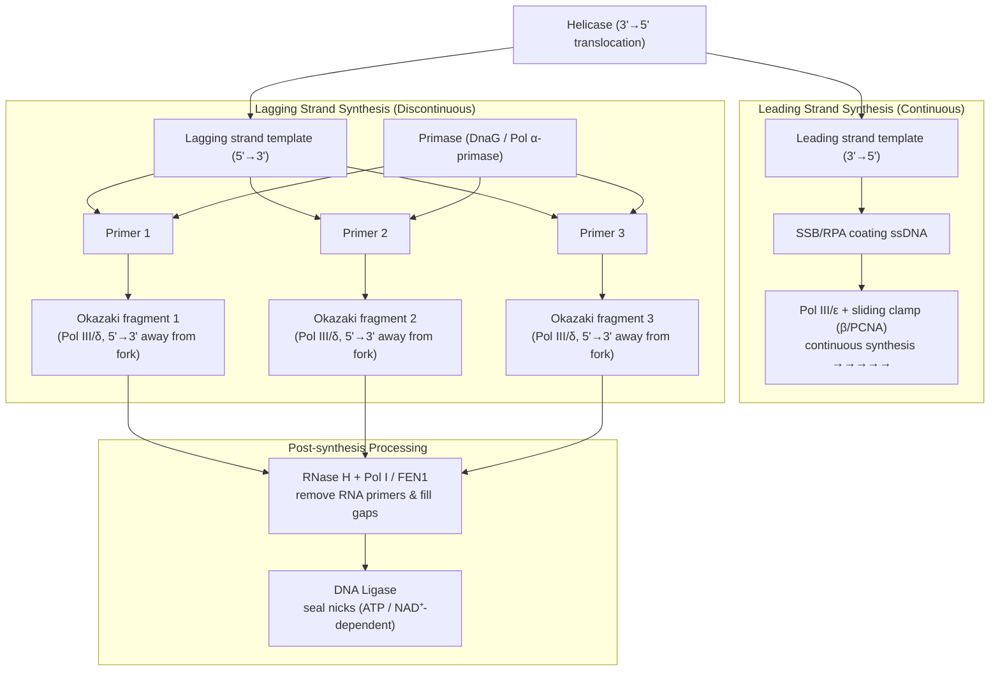

# Lesson 4: Molecular Genetics, DNA Replication, Gene Expression

## 1. First-Principles Intuition & Invariants

The central dogma of molecular biology—DNA replicates itself, transcribes to RNA, and translates to protein—represents one of the most elegant informational architectures in nature. Yet this linear formulation, while pedagogically useful, obscures the staggering mechanical complexity underlying each transformation. DNA replication is not a passive xerographic copy but an orchestrated ballet of enzymatic machinery operating at thermodynamic equilibrium limits. Transcription is not mere tape recording but an active regulatory checkpoint subject to chromatin topology, enhancer logic, and polymerase pausing dynamics. Translation is not simple cipher decoding but a ribozyme-catalyzed condensation reaction that integrates quality control, nascent chain folding, and co-translational targeting signals.

At its foundation, the genetic information system operates on a principle of **chemical complementarity and error correction**. The Watson-Crick base-pairing rules—adenine pairs with thymine (or uracil in RNA) via two hydrogen bonds, guanine pairs with cytosine via three hydrogen bonds—provide both the informational redundancy necessary for replication fidelity and the structural motif for molecular recognition by polymerase active sites. The thermodynamic stability differential between correct and incorrect base pairs, quantified by differences in Gibbs free energy on the order of $\Delta\Delta G \approx 2{-}5 \, \text{kcal/mol}$, drives selectivity but is insufficient alone to achieve observed error rates near $10^{-9}$ to $10^{-10}$ per base per replication. This necessitates kinetic proofreading mechanisms—exonucleolytic editing domains on DNA polymerases that excise mismatched nucleotides before the polymerase advances.

The replication machinery must solve several non-trivial physical problems simultaneously. First, the DNA double helix possesses intrinsic topological constraints: unwinding the duplex at replication forks generates positive superhelical tension ahead of the fork and negative superhelical relaxation behind it, quantified by the linking number invariant $Lk = Tw + Wr$ where $Tw$ denotes twist and $Wr$ writhe. Topoisomerases resolve this tension by transiently nicking or cutting DNA strands, allowing strand passage, then resealing the phosphodiester backbone. Second, DNA polymerases synthesize exclusively in the $5' \to 3'$ direction, yet the two template strands run antiparallel; this asymmetry forces continuous synthesis on the leading strand and discontinuous Okazaki fragment synthesis on the lagging strand, introducing coordination problems between the two polymerase complexes operating at a single replication fork.

Transcription introduces additional layers of control. RNA polymerase II—the enzyme responsible for messenger RNA synthesis in eukaryotes—must navigate nucleosomal arrays, interpret regulatory sequences embedded in promoter and enhancer regions, and integrate signals from dozens of transcription factors that bind cooperatively or competitively. The polymerase undergoes a series of conformational transitions: recruitment and preinitiation complex assembly at the promoter, ATP-dependent promoter melting, promoter escape accompanied by phosphorylation of the C-terminal domain heptapeptide repeat (Ser5 phosphorylation), elongation with pausing and backtracking, and finally termination coupled to polyadenylation signal recognition. Each transition is a regulated checkpoint, permitting cells to modulate gene expression in response to developmental cues, environmental stress, or metabolic state.

Translation occurs on the ribosome, a massive ribonucleoprotein complex ($\sim 2.5 \, \text{MDa}$ in bacteria, $\sim 4.2 \, \text{MDa}$ in eukaryotes) composed of two subunits. The ribosome catalyzes peptide bond formation via a **ribozyme mechanism**: the peptidyl transferase center within the large subunit 23S/28S ribosomal RNA, not protein, positions the aminoacyl-tRNA and peptidyl-tRNA substrates in precise stereochemistry to facilitate nucleophilic attack of the $\alpha$-amino group on the ester carbonyl of the peptidyl-tRNA. The genetic code—a degenerate triplet mapping of 64 codons to 20 amino acids plus stop signals—exhibits non-random structure: codons differing in the third position (wobble position) often encode the same amino acid, reducing the phenotypic impact of point mutations. Codon usage bias, wherein synonymous codons are not used equally, correlates with tRNA abundance and influences translation elongation rates, which in turn affect co-translational folding trajectories and protein solubility.

The fundamental invariants governing molecular genetics are conservation of information content and kinetic accessibility. Information flows directionally but is subject to continuous quality control: DNA repair pathways monitor replication fidelity, mRNA surveillance mechanisms (nonsense-mediated decay, no-go decay) eliminate aberrant transcripts, and ribosome rescue systems (tmRNA in bacteria, ribosome-associated quality control in eukaryotes) resolve stalled translation events. Kinetic accessibility constrains achievable fidelity and throughput: replication fork rates reach $\sim 1000 \, \text{nt/s}$ in bacteria and $\sim 50 \, \text{nt/s}$ in eukaryotes, transcription elongation proceeds at $\sim 20{-}50 \, \text{nt/s}$, and translation extends at $\sim 10{-}20 \, \text{aa/s}$, each limited by diffusional substrate delivery, conformational rearrangement rates, and proofreading dwell times.

## 2. Core Architecture & Mechanics

### DNA Structure and Topological Properties

The B-form DNA double helix, the predominant conformation under physiological salt and hydration conditions, consists of two antiparallel polynucleotide strands wound around a common axis with a helical pitch of $3.4 \, \text{nm}$ per turn (approximately 10.5 base pairs per turn). The sugar-phosphate backbone, linked by $3',5'$-phosphodiester bonds, presents a negatively charged exterior stabilized by cation coordination (primarily $\text{Mg}^{2+}$ and polyamines in vivo), while hydrophobic purine and pyrimidine bases stack in the interior, stabilized by $\pi$-$\pi$ dispersion interactions and shielding from the aqueous milieu. The major and minor grooves of the helix present distinct chemical topographies: the major groove exposes more hydrogen bond donors and acceptors from the base edges, providing higher information content for sequence-specific protein recognition by transcription factors and DNA-binding domains.

Alternative helical geometries arise under specific conditions: A-form DNA (favored under low hydration or in RNA-DNA hybrids) is wider with a deeper major groove and compressed pitch of $2.8 \, \text{nm}$ per 11 base pairs; Z-form DNA (favored by alternating purine-pyrimidine sequences, especially GC repeats, under high ionic strength or negative superhelicity) is a left-handed helix with a zigzag backbone conformation. These structural polymorphisms have functional relevance: Z-DNA formation has been implicated in transcriptional regulation and recombination hotspots, while A-form RNA duplexes serve as substrates for double-strand RNA-binding proteins involved in innate immunity.

Topological properties of circular or chromatinized DNA are quantified by the linking number $Lk$, an integer topological invariant defined as the number of times one strand crosses the other in a planar projection. For relaxed B-form DNA of length $N$ base pairs, $Lk_0 \approx N / 10.5$. Superhelical density $\sigma = (Lk - Lk_0) / Lk_0$ describes the degree of supercoiling; negative supercoiling ($\sigma < 0$) facilitates strand separation during replication and transcription by reducing the free energy barrier to local denaturation, while positive supercoiling accumulates ahead of translocating enzymes and inhibits further unwinding unless relieved by topoisomerases.

### Replication Machinery and Fork Dynamics

DNA replication initiates at replication origins—specific genomic loci defined by consensus sequences (e.g., *oriC* in *E. coli*, containing DnaA boxes) or epigenetic features (origin recognition complex binding in eukaryotes). Origin licensing occurs in G1 phase when the MCM2-7 helicase complex is loaded onto chromatin; firing is triggered in S phase by cyclin-dependent kinase (CDK) and Dbf4-dependent kinase (DDK) phosphorylation events that activate the CMG helicase (Cdc45-MCM-GINS). The helicase translocates along one strand with $3' \to 5'$ polarity, physically unwinding the duplex ahead by disrupting base pairing; this action generates the characteristic Y-shaped replication fork.

Single-strand DNA-binding proteins (SSB in bacteria, RPA in eukaryotes) coat the transiently exposed single-stranded regions, preventing secondary structure formation and protecting DNA from nucleolytic degradation. The leading strand is synthesized continuously: DNA polymerase III (bacteria) or polymerase $\varepsilon$ (eukaryotes) extends an RNA primer synthesized by primase (DnaG in bacteria, Pol $\alpha$-primase in eukaryotes) in the $5' \to 3'$ direction, tracking the advancing helicase with high processivity (polymerase remains bound for thousands of nucleotides) conferred by the sliding clamp protein ($\beta$-clamp in bacteria, PCNA in eukaryotes). The clamp is loaded onto DNA by a clamp loader ATPase complex (the $\gamma$ complex in bacteria, RFC in eukaryotes) in an ATP-dependent reaction that opens the ring, threads DNA through, and closes it around the duplex.

The lagging strand presents a geometric challenge: the template runs $5' \to 3'$ toward the fork, but polymerase can only synthesize $5' \to 3'$ away from the fork. Resolution occurs through repeated cycles of Okazaki fragment synthesis—short segments ($\sim 1{-}2 \, \text{kb}$ in bacteria, $\sim 100{-}200 \, \text{nt}$ in eukaryotes) initiated by new RNA primers every few hundred nucleotides. Each Okazaki fragment is extended until the polymerase encounters the $5'$ end of the previous fragment. The RNA primer is then removed by RNase H (which degrades the RNA portion of RNA-DNA hybrids) and the $5' \to 3'$ exonuclease activity of DNA polymerase I (bacteria) or FEN1 nuclease (eukaryotes). The resulting nick is sealed by DNA ligase, which catalyzes formation of a phosphodiester bond using ATP (eukaryotes) or NAD$^+$ (bacteria) as a cofactor to adenylate the $5'$ phosphate, facilitating nucleophilic attack by the adjacent $3'$ hydroxyl.

Topological stress management is critical. As helicase unwinds $\sim 1000$ bp/s (bacteria), positive supercoiling accumulates ahead at a rate that, if unresolved, would stall the fork within seconds. Type I topoisomerases (e.g., topoisomerase I) relieve tension by transiently nicking one strand, allowing controlled rotation around the intact strand, then religating the break. Type II topoisomerases (e.g., DNA gyrase in bacteria, topoisomerase II in eukaryotes) cleave both strands, pass another DNA segment through the break, then religate, changing $Lk$ by ±2; gyrase uniquely introduces negative supercoils in an ATP-dependent reaction, maintaining the genome in a supercoiled state favorable for replication and transcription initiation.

Fidelity mechanisms operate at multiple layers. DNA polymerase active sites select correct dNTPs through geometric complementarity (Watson-Crick geometry) and induced-fit conformational changes that close the polymerase fingers domain around the nascent base pair. Correct base pairs stabilize the closed conformation, accelerating catalysis; incorrect pairs destabilize it, slowing incorporation by factors of $10^3$ to $10^5$. The $3' \to 5'$ exonuclease domain, located in a separate channel, excises mismatched terminal nucleotides when polymerization stalls due to geometry distortion. Finally, post-replicative mismatch repair systems (MutS, MutL, MutH in bacteria; MSH, MLH, PMS in eukaryotes) scan newly synthesized DNA for base-base mismatches and insertion-deletion loops, excising and resynthesizing error-containing segments. Together, these mechanisms reduce error rates from $\sim 10^{-5}$ (intrinsic polymerase selectivity) to $\sim 10^{-9}$ per base pair per generation.

### Transcription Mechanisms and RNA Polymerase Function

Transcription initiation in bacteria requires RNA polymerase holoenzyme ($\alpha_2\beta\beta'\omega\sigma$, where $\sigma$ is the promoter recognition subunit) to bind promoter sequences characterized by conserved elements at −10 (Pribnow box, consensus TATAAT) and −35 positions upstream of the transcription start site (+1). Sigma factor recognizes these motifs via helix-turn-helix domains, positioning the polymerase catalytic site at +1. The polymerase then melts approximately 13 base pairs of DNA around the start site, forming an open promoter complex (transcription bubble). RNA synthesis initiates with two nucleoside triphosphates base-pairing with the template strand; the polymerase catalyzes phosphodiester bond formation, releasing pyrophosphate. After synthesizing a short transcript ($\sim 8{-}10 \, \text{nt}$), the polymerase undergoes promoter escape, releasing $\sigma$ factor and transitioning to the processive elongation complex.

Eukaryotic transcription is vastly more complex. RNA polymerase II requires assembly of a preinitiation complex (PIC) comprising general transcription factors TFIID (which includes TATA-binding protein TBP and TBP-associated factors), TFIIA, TFIIB, TFIIF, TFIIE, and TFIIH. TFIID recognizes the TATA box (consensus TATAAA) located $\sim 25{-}30$ bp upstream of the start site, binding and bending the DNA. TFIIB positions the polymerase at the start site. TFIIH, a multisubunit complex with helicase and kinase activities, melts the promoter DNA using ATP hydrolysis and phosphorylates Ser5 of the RNA polymerase II C-terminal domain (CTD)—a repetitive heptapeptide sequence (YSPTSPS)$_n$ extending from the largest subunit. Ser5 phosphorylation marks the transition from initiation to early elongation and recruits capping enzymes.

During elongation, RNA polymerase translocates along the template strand in discrete $1 \, \text{nt}$ steps, maintaining an 8–9 bp RNA-DNA hybrid within the transcription bubble. The nascent RNA exits through a channel in the polymerase, while the bubble travels with the enzyme, rewinding DNA behind and unwinding ahead. Elongation is not uniform: polymerases pause at specific sequences due to factors including RNA secondary structure formation, nucleotide starvation, or regulatory pause signals. Pausing can be resolved by elongation factors (e.g., TFIIS in eukaryotes, which stimulates transcript cleavage and resumption) or can lead to termination.

Transcription termination mechanisms differ fundamentally between prokaryotes and eukaryotes. Intrinsic (Rho-independent) termination in bacteria relies on a GC-rich inverted repeat followed by a poly-U tract in the nascent RNA; the inverted repeat forms a stable stem-loop hairpin that destabilizes the RNA-DNA hybrid, while weak rU-dA base pairs facilitate dissociation. Rho-dependent termination employs the Rho hexameric helicase, which binds cytosine-rich rut (Rho utilization) sites on the nascent RNA, translocates $5' \to 3'$ along the transcript using ATP hydrolysis, and physically pulls the RNA out of the polymerase active site upon catching the paused polymerase.

Eukaryotic termination of Pol II transcripts is coupled to $3'$ end processing. The polymerase transcribes past polyadenylation signals (e.g., AAUAAA hexamer and downstream GU-rich or U-rich elements); cleavage and polyadenylation specificity factor (CPSF) recognizes the hexamer while cleavage stimulation factor (CstF) binds downstream sequences. CPSF-associated endonuclease cleaves the pre-mRNA $10{-}30 \, \text{nt}$ downstream of the AAUAAA, and poly(A) polymerase adds approximately 200 adenosine residues without a template. The uncleaved transcript remaining in the polymerase active site is degraded by the $5' \to 3'$ exonuclease Rat1/Xrn2, which "torpedoes" the polymerase, triggering dissociation.

### RNA Processing: Capping, Splicing, and Polyadenylation

In eukaryotes, primary transcripts (pre-mRNAs) undergo extensive co-transcriptional modifications. The $5'$ cap structure—$7$-methylguanosine linked via a $5',5'$-triphosphate bridge ($\text{m}^7\text{G}(5')\text{ppp}(5')\text{N}_1\text{N}_2$)—is added when the nascent transcript reaches $\sim 25{-}30 \, \text{nt}$. The capping enzyme complex, recruited by Ser5-phosphorylated Pol II CTD, first removes the terminal $\gamma$-phosphate from the $5'$ triphosphate of the nascent RNA (triphosphatase activity), then transfers a GMP from GTP to form the unusual $5',5'$-linkage (guanylyltransferase activity). Finally, methyltransferases add methyl groups to the N7 position of the terminal guanosine and the $2'$-O position of the first transcribed nucleotide. The cap protects mRNA from exonucleolytic degradation and is recognized by cap-binding proteins essential for translation initiation and mRNA localization.

Splicing removes introns—non-coding intervening sequences—from pre-mRNA, joining exons to form mature mRNA. The spliceosome, a dynamic ribonucleoprotein complex comparable in size and complexity to the ribosome, catalyzes splicing via two sequential transesterification reactions. Introns are defined by consensus sequences: the $5'$ splice site (GU at the intron start), the branch point (an adenosine typically $20{-}50 \, \text{nt}$ upstream of the $3'$ end), and the $3'$ splice site (AG at the intron end preceded by a polypyrimidine tract). The spliceosome assembles stepwise: U1 snRNP (small nuclear ribonucleoprotein) recognizes the $5'$ splice site; U2 snRNP binds the branch point; the preassembled U4/U6•U5 tri-snRNP joins, forming the catalytically active complex after U4 dissociates and U6 displaces U1.

The first transesterification reaction involves nucleophilic attack by the $2'$ hydroxyl of the branch point adenosine on the phosphodiester bond at the $5'$ splice site, cleaving the RNA and forming a lariat structure where the $5'$ end of the intron is covalently linked to the branch point adenosine via a $2',5'$-phosphodiester bond. The second reaction ligates the $3'$ hydroxyl of the upstream exon to the $5'$ phosphate of the downstream exon, excising the intron lariat. The spliceosome then disassembles, recycling snRNPs for subsequent rounds. Splicing is **not** simply constitutive; alternative splicing produces multiple mRNA isoforms from a single gene by selective inclusion or exclusion of exons, regulated by SR proteins (which promote splicing by binding exonic splicing enhancers) and hnRNPs (which often inhibit splicing by binding silencer elements). Over 90% of human multi-exon genes undergo alternative splicing, vastly expanding proteomic diversity.

Splicing regulation integrates kinetic and thermodynamic signals. Splice site strength (closeness to consensus), exon and intron lengths, secondary structure in pre-mRNA, and chromatin modifications all influence spliceosome assembly rates and splice site selection. The CTD phosphorylation code modulates recruitment of splicing factors: Ser2 phosphorylation, enriched in elongating polymerase, recruits splicing regulators and facilitates co-transcriptional splicing. The physical coupling of transcription and splicing has profound implications: transcription rate affects alternative splicing outcomes, a phenomenon termed "kinetic coupling," wherein slower elongation provides more time for weak splice sites to be recognized before downstream competing sites are transcribed.

Polyadenylation, as described, provides transcript stability and translation efficiency signals. Poly(A) tails are progressively shortened in the cytoplasm (deadenylation), a key step in mRNA decay pathways. Poly(A)-binding proteins (PABPs) coat the tail, circularize mRNA by interacting with cap-binding complexes, and enhance translation initiation by facilitating ribosome recycling.

### Translation and Ribosome Function

Translation occurs in three phases: initiation, elongation, and termination. Initiation in bacteria begins when the small ribosomal subunit (30S) binds mRNA at the ribosome binding site (Shine-Dalgarno sequence, AGGAGGU, located $\sim 8 \, \text{nt}$ upstream of the start codon), positioning the AUG start codon in the P (peptidyl) site. Initiator tRNA (fMet-tRNA$^\text{fMet}$, carrying N-formylmethionine) binds the start codon, facilitated by initiation factors IF1, IF2 (a GTPase), and IF3. The large subunit (50S) then joins, forming the 70S ribosome and displacing initiation factors.

Eukaryotic initiation is more elaborate, employing at least twelve initiation factors (eIFs). The 43S preinitiation complex—comprising the 40S small subunit, eIF1, eIF1A, eIF3, and the ternary complex (eIF2•GTP•Met-tRNA$_i^\text{Met}$)—is recruited to the $5'$ cap by the eIF4F cap-binding complex (eIF4E, eIF4G, eIF4A helicase). The 43S complex scans the $5'$ untranslated region ($5'$ UTR) in the $3'$ direction, unwinding secondary structure using eIF4A helicase activity fueled by ATP hydrolysis, until it encounters the start codon (typically the first AUG in favorable context, the Kozak sequence: GCCRCCAUGG). Recognition triggers eIF2-GTP hydrolysis, release of initiation factors, and 60S subunit joining to form the 80S ribosome with Met-tRNA$_i^\text{Met}$ positioned in the P site.

Elongation proceeds through a repetitive cycle of aminoacyl-tRNA delivery, peptide bond formation, and translocation. Each elongation cycle consumes two GTP molecules. EF-Tu (bacteria) or eEF1A (eukaryotes), a GTPase, delivers aminoacyl-tRNA to the A (aminoacyl) site in a ternary complex (EF-Tu•GTP•aminoacyl-tRNA). Upon correct codon-anticodon base pairing, the ribosome induces GTP hydrolysis by EF-Tu; this conformational proofreading step enhances fidelity by amplifying the free energy difference between correct and near-cognate tRNAs. After EF-Tu•GDP dissociates, the aminoacyl end of the A-site tRNA moves into the peptidyl transferase center.

Peptide bond formation is catalyzed by the 23S rRNA (bacteria) or 28S rRNA (eukaryotes) in the large subunit—a **ribozyme reaction**. The $\alpha$-amino group of the A-site aminoacyl-tRNA performs nucleophilic attack on the ester carbonyl linking the nascent peptide chain to the P-site tRNA, transferring the peptide to the A-site tRNA and lengthening it by one residue. The P-site tRNA is now deacylated. The ribosome then translocates by exactly one codon ($3 \, \text{nt}$) in the $3'$ direction, driven by EF-G (bacteria) or eEF2 (eukaryotes) GTPase; this moves the deacylated tRNA from the P site to the E (exit) site, the peptidyl-tRNA from the A site to the P site, and positions the next codon in the empty A site. The E-site tRNA dissociates, and the cycle repeats.

Termination occurs when a stop codon (UAA, UAG, UGA) enters the A site. No tRNA recognizes stop codons; instead, release factors (RF1 or RF2 in bacteria, recognizing UAA/UAG and UAA/UGA respectively; eRF1 in eukaryotes, recognizing all three) bind the A site and induce hydrolysis of the ester bond linking the completed polypeptide to the P-site tRNA, releasing the protein. A second GTPase, RF3 (bacteria) or eRF3 (eukaryotes), facilitates release factor dissociation. Ribosome recycling factors (RRF in bacteria, ABCE1 in eukaryotes) then disassemble the ribosome into subunits for subsequent rounds.

### Genetic Code and Codon Usage

The genetic code maps 64 triplet codons to 20 amino acids and three stop signals. The code is **degenerate** (multiple codons specify the same amino acid), **unambiguous** (each codon specifies only one amino acid), and nearly **universal** (with minor exceptions in mitochondria and some ciliates). Degeneracy is structured: synonymous codons typically differ in the third (wobble) position, and codons sharing the first two nucleotides often encode chemically similar amino acids (e.g., hydrophobic residues encoded by NUN codons where N is any nucleotide and U in the wobble position). This arrangement minimizes the phenotypic impact of point mutations and translational errors.

Wobble base-pairing, first articulated by Crick, allows non-Watson-Crick pairing at the third codon position: the anticodon first position (which pairs with the codon third position) can form stable pairs beyond A:U and G:C, such as G:U wobble pairs and inosine (a modified nucleoside found in some tRNAs) pairing with U, C, or A. This relaxed pairing requirement permits fewer than 61 tRNA species to decode all sense codons.

Codon usage bias—the preferential use of specific synonymous codons—varies across organisms and genes. Highly expressed genes tend to use a subset of "optimal" codons corresponding to the most abundant tRNAs, maximizing translation rate and minimizing ribosome pausing. Conversely, rare codons slow elongation, providing time windows for co-translational folding or domain insertion into membranes. Recent evidence suggests codon usage influences mRNA stability, protein folding, and post-translational modifications, revealing that synonymous mutations are not necessarily silent in their phenotypic consequences.

### Post-Translational Modifications and Protein Maturation

Nascent polypeptides undergo extensive modifications during and after translation. The N-terminal methionine is often cleaved by methionine aminopeptidases if the second residue is small (Gly, Ala, Ser, Thr, Pro, Val, Cys). N-terminal acetylation, catalyzed by N-terminal acetyltransferases, occurs co-translationally on approximately 80% of human proteins, influencing protein stability, localization, and interaction interfaces.

Phosphorylation—addition of phosphate groups to Ser, Thr, Tyr, and occasionally His residues—is the most common reversible modification, regulating enzyme activity, protein-protein interactions, and cellular localization. Kinases catalyze phosphoryl transfer from ATP (or GTP) to hydroxyl or imidazole side chains; phosphatases remove phosphate groups, creating dynamic regulatory switches. Phosphorylation can alter protein conformation (e.g., inducing active site accessibility) or create docking sites for modular interaction domains such as SH2 (which binds phosphotyrosine) or 14-3-3 (which binds phosphoserine/phosphothreonine motifs).

Ubiquitination—covalent attachment of the 76-residue protein ubiquitin to lysine side chains—serves as a signal for proteasomal degradation, lysosomal targeting, or regulatory modifications depending on ubiquitin chain topology. Monoubiquitination often regulates membrane protein trafficking, while Lys48-linked polyubiquitin chains target proteins for degradation by the 26S proteasome. The ubiquitination cascade requires three enzyme classes: E1 (ubiquitin-activating enzyme), E2 (ubiquitin-conjugating enzyme), and E3 (ubiquitin ligase), with E3s providing substrate specificity through recognition of degrons—short degradation signals often exposed by phosphorylation or misfolding.

Glycosylation—attachment of oligosaccharides to Asn (N-linked) or Ser/Thr (O-linked) residues—occurs in the endoplasmic reticulum and Golgi apparatus. N-linked glycosylation begins co-translationally when oligosaccharyltransferase transfers a preassembled Glc$_3$Man$_9$GlcNAc$_2$ oligosaccharide from a dolichol lipid carrier to Asn residues within the consensus sequence Asn-X-Ser/Thr (where X is any residue except Pro). The glycan is subsequently trimmed and elaborated by ER and Golgi glycosidases and glycosyltransferases, creating diverse glycan structures that modulate protein folding, stability, trafficking, and cell-surface recognition.

Disulfide bond formation between cysteine residues stabilizes extracellular and secreted proteins. In the oxidizing environment of the ER lumen, protein disulfide isomerase (PDI) catalyzes both disulfide formation and isomerization (rearrangement of incorrect disulfide pairs), acting as a foldase. Incorrect disulfide bonding activates ER quality control mechanisms that retain or retrotranslocate misfolded proteins for degradation.

Proteolytic cleavage activates many proteins, including digestive enzymes (trypsinogen → trypsin), hormones (proinsulin → insulin + C-peptide), and apoptotic caspases (procaspases cleaved to active caspases). Signal peptides—N-terminal hydrophobic sequences directing nascent chains to the ER membrane—are cleaved by signal peptidase once translocation is complete. Precursor processing generates mature, functional proteins and provides irreversible activation switches.

## 3. High-Performance Optimization & Failure Modes

### Optimization of Experimental Workflows in Molecular Genetics

Quantifying DNA replication kinetics in vitro requires reconstitution of the multi-protein replisome on defined DNA templates, typically circular plasmids or rolling-circle substrates. Single-molecule techniques such as DNA curtains or optical tweezers permit real-time visualization of individual replication forks. In a DNA curtain assay, biotinylated DNA molecules are tethered to a lipid bilayer on a microfluidic flow cell and hydrodynamically extended; fluorescently labeled replication proteins are introduced, and fork progression is monitored via total internal reflection fluorescence (TIRF) microscopy at subsecond temporal resolution and nanometer spatial precision. Optimization requires rigorous control of buffer ionic strength ($\sim 150 \, \text{mM}$ NaCl or KCl), divalent cation concentration ($\sim 5{-}10 \, \text{mM}$ Mg$^{2+}$, essential for polymerase activity), nucleotide pools (balanced dNTPs at $\sim 100 \, \mu\text{M}$ each), and ATP/GTP for helicase and clamp loader function. Oxygen scavenging systems (glucose oxidase, catalase, and the reducing agent Trolox) prevent photobleaching and photodamage during extended imaging.

Transcription assays leverage both bulk biochemistry and single-molecule methods. In vitro transcription from purified components allows kinetic dissection of initiation, elongation, and termination. Promoter escape kinetics are measured by adding heparin (a polyanion that traps free polymerase but not elongation complexes) at defined times and quantifying transcript length distributions via denaturing polyacrylamide gel electrophoresis (PAGE) and autoradiography or fluorescence detection. Elongation rates are determined from transcript length as a function of time, controlling for pausing by supplementing with elongation factors. RNA secondary structure in nascent transcripts can be probed with structure-specific nucleases or chemical modifiers (dimethyl sulfate for unpaired adenines and cytosines, SHAPE reagents for backbone flexibility), followed by reverse transcription and high-throughput sequencing (DMS-seq, SHAPE-seq) to map folding at single-nucleotide resolution.

Splicing analysis in cellular contexts employs RT-PCR with primers spanning exon junctions to detect alternatively spliced isoforms, quantified by capillary electrophoresis or next-generation sequencing (RNA-seq). Splicing reporters—minigenes containing an exon of interest flanked by constitutive exons—enable high-throughput screening of splicing regulatory elements and trans-acting factors. Deep mutational scanning combined with sequencing (e.g., massively parallel splicing assays) profiles thousands of sequence variants simultaneously, mapping splicing regulatory codes. Temporal resolution of splicing intermediates is achieved by metabolic labeling with 4-thiouridine (4sU) followed by pulse-chase and biotinylation-based purification, isolating nascent RNA populations for structural and compositional analysis by crosslinking-immunoprecipitation (CLIP) of spliceosome components.

Translation kinetics in vivo are monitored via ribosome profiling (Ribo-seq), which captures ribosome positions genome-wide by treating cells with translation elongation inhibitors (e.g., cycloheximide to freeze ribosomes), isolating ribosome-protected mRNA fragments ($\sim 28{-}30 \, \text{nt}$ footprints), and sequencing them. Footprint density maps reveal ribosome occupancy along mRNAs, exposing pausing sites, frameshifting events, and upstream open reading frames (uORFs) that regulate translation of downstream coding sequences. Time-resolved Ribo-seq following stress (amino acid starvation, heat shock) delineates translational reprogramming. Quantitative mass spectrometry (e.g., SILAC—stable isotope labeling by amino acids in cell culture—or tandem mass tags) measures absolute or relative protein abundances, correlating translation rates with protein output and revealing post-translational regulation.

### Scaling Genetic and Molecular Biology Experiments

High-throughput genome editing with CRISPR-Cas systems allows massively parallel functional interrogation. Pooled CRISPR screens deliver libraries of tens of thousands of guide RNAs (gRNAs) targeting genes or regulatory elements, infecting cells at low multiplicity of infection (MOI) such that most cells receive at most one gRNA. Selection or screening (growth, fluorescence-activated cell sorting for a marker, drug resistance) enriches or depletes cells with specific knockouts; deep sequencing of integrated gRNA cassettes identifies genes whose perturbation causes the phenotype. Optimization involves careful gRNA design (minimizing off-target effects by selecting sequences with unique target sites and low homology elsewhere), ensuring high Cas9 activity (optimized nuclear localization signals, codon optimization, stable cell lines), and adequate library coverage (typically $\geq 1000$ cells per gRNA to maintain statistical power).

High-throughput transcriptomics leverages single-cell RNA-seq (scRNA-seq) to profile transcriptomes of thousands to millions of individual cells simultaneously. Droplet-based platforms (10x Genomics Chromium, Drop-seq) encapsulate single cells with barcoded beads in nanoliter droplets, where cell lysis, mRNA capture, reverse transcription, and barcoding occur; pooled libraries are sequenced, and reads are demultiplexed by cell barcode. Optimization balances cell capture efficiency (typical recovery $\sim 50{-}70\%$), sequencing depth per cell (trade-off between number of cells and transcript coverage per cell), and doublet rate (encapsulation of two cells in one droplet, generating artifactual "cell types"). Computational deconvolution using probabilistic models corrects for doublets and ambient RNA contamination.

Proteomics at scale employs data-independent acquisition mass spectrometry (DIA-MS, e.g., SWATH-MS), which fragments all detectable precursor ions within defined mass windows, creating comprehensive fragment ion maps. Compared to data-dependent acquisition (which selectively sequences abundant peptides), DIA achieves greater reproducibility and dynamic range, quantifying thousands of proteins across hundreds of samples. Sample preparation optimization (e.g., using single-pot solid-phase-enhanced sample preparation, SP3, for efficient protein cleanup and digestion) and fractionation (high-pH reversed-phase chromatography to separate peptides before LC-MS) maximize coverage.

### Failure Modes and Troubleshooting in Molecular Genetics Experiments

DNA polymerase stalling and template switching are common failure modes in PCR and sequencing. Secondary structures in template DNA (hairpins, G-quadruplexes) stall polymerases; addition of DMSO ($5{-}10\%$) or betaine ($1{-}2 \, \text{M}$) destabilizes secondary structure. GC-rich templates require higher annealing temperatures and polymerases with enhanced processivity or strand-displacement activity (e.g., Phusion, Q5). Template switching—polymerase jumping between templates—generates chimeric products in multiplex reactions; minimizing cycle number and optimizing primer concentrations reduces this artifact.

RNA degradation is a pervasive problem; RNases are ubiquitous, stable, and require no cofactors. Stringent RNase-free technique involves treating surfaces and solutions with RNase decontamination agents (RNaseZap), using certified RNase-free plasticware and reagents, and working rapidly on ice. RNA extraction methods (TRIzol, guanidinium thiocyanate-phenol-chloroform) simultaneously lyse cells and inactivate RNases; phase separation isolates RNA in the aqueous layer, minimizing contamination from genomic DNA (organic phase) and proteins (interphase). DNase treatment removes genomic DNA contamination before RT-PCR.

Antibody specificity failures in Western blotting and immunoprecipitation generate false positives and negatives. Validation requires multiple independent antibodies, genetic knockouts as negative controls, and epitope-tagged overexpression constructs as positive controls. Blocking with nonfat milk or BSA reduces nonspecific binding; inclusion of detergents (Tween-20, Triton X-100) in wash buffers disrupts hydrophobic interactions. Cross-reactivity with abundant proteins (actin, tubulin, immunoglobulin heavy/light chains) is diagnosed by running samples from knockout cell lines.

Translation artifacts include internal initiation (ribosomes bypassing the $5'$ cap and scanning mechanism to initiate at downstream AUG codons or IRES elements) and readthrough of stop codons (producing extended proteins). Internal initiation is detected by expressing constructs lacking the $5'$ UTR or introducing upstream AUG codons in poor context; true IRES elements function independently of cap-dependent machinery. Stop codon readthrough, elevated under stress or with certain suppressor tRNAs, is quantified using dual-luciferase reporters with a stop codon interrupting the coding sequence; readthrough is calculated as the ratio of downstream to upstream luciferase activity.

Misfolding and aggregation plague recombinant protein expression. Inclusion bodies—insoluble aggregates of misfolded protein—form when expression rates exceed folding capacity or when hydrophobic surfaces are exposed in the absence of chaperones. Strategies include lowering induction temperature ($16{-}18\,^\circ\text{C}$ instead of $37\,^\circ\text{C}$), reducing inducer concentration to slow synthesis, co-expressing chaperones (GroEL/ES, DnaK/DnaJ/GrpE), or fusing the target to solubility-enhancing tags (maltose-binding protein, SUMO). Solubilization from inclusion bodies requires chaotropic denaturants (urea, guanidinium chloride) followed by controlled refolding via stepwise dialysis or on-column refolding, minimizing aggregation by maintaining low protein concentration and including redox shuffling agents (reduced and oxidized glutathione) for disulfide bond formation.

Post-translational modification artifacts include aberrant phosphorylation by off-target kinases and incomplete glycosylation due to ER stress or glycosylation pathway saturation. Phosphatase inhibitors (okadaic acid for serine/threonine phosphatases, sodium orthovanadate for tyrosine phosphatases, β-glycerophosphate as a general inhibitor) preserve phosphorylation states during lysis and immunoprecipitation. Endoglycosidase treatments (PNGase F removes N-glycans, Endo H cleaves high-mannose N-glycans) combined with SDS-PAGE mobility shifts confirm glycosylation; absence of expected shifts suggests trafficking defects or glycosylation site mutations.

Genetic background effects confound interpretation in organismal studies. Phenotypes can result from linked mutations or strain-specific modifiers rather than the targeted gene. Backcrossing mutant lines into an isogenic background for multiple generations ($\geq 6$) reduces linked variation. CRISPR-induced mutations should be complemented by rescuing the phenotype with a wild-type transgene or by generating independent alleles. Spurious CRISPR off-target effects, arising from gRNA promiscuity, are controlled by whole-genome sequencing of edited clones and by designing gRNAs with minimal predicted off-targets (computational tools like Cas-OFFinder, CRISPOR).

### Edge Cases and Atypical Molecular Processes

Non-canonical translation initiation includes cap-independent translation driven by internal ribosome entry sites (IRES), common in viral RNAs and upregulated in stressed or apoptotic cells when cap-dependent translation is suppressed. IRES elements, structured RNA regions ranging from $\sim 40$ to over 500 nucleotides, recruit ribosomes through direct or IRES trans-acting factor (ITAF)-mediated interactions. Functional validation requires bicistronic reporter constructs where the upstream cistron is translated cap-dependently and the downstream cistron via the putative IRES; genuine IRES activity is indicated by downstream expression even when upstream translation is blocked.

Programmed ribosomal frameshifting, utilized by retroviruses and some cellular genes, shifts the ribosome reading frame ($+1$ or $-1$) at defined slippery sequences (e.g., X XXY YYZ motifs) followed by downstream RNA secondary structures (pseudoknots). The frameshift ratio is regulated to control stoichiometry of overlapping open reading frames, producing structural versus enzymatic polyproteins in precise ratios. Mutations disrupting the slippery sequence or pseudoknot abolish frameshifting, confirming mechanism.

RNA editing—post-transcriptional nucleotide modifications that alter coding information—includes adenosine-to-inosine (A-to-I) deamination catalyzed by ADAR enzymes and cytidine-to-uridine (C-to-U) deamination catalyzed by APOBEC family members. Inosine is recognized as guanosine by the translation and splicing machinery, effectively converting A to G. Editing occurs predominantly in double-stranded RNA regions, often within introns or $3'$ UTRs; editing in coding sequences can recode amino acids (e.g., AMPA receptor GluA2 Q/R site editing changes glutamine to arginine, drastically altering Ca$^{2+}$ permeability). Transcriptome-wide editing sites are mapped by comparing RNA-seq to genomic DNA-seq, identifying mismatches not explained by SNPs or sequencing errors.

Trans-splicing joins exons from separate primary transcripts, a rare but functionally significant process in trypanosomes (where a spliced leader sequence is added to the $5'$ end of all mRNAs) and nematodes. Verification requires RT-PCR spanning the junction between exons from distinct genomic loci, ruling out DNA contamination and artifacts from template switching during reverse transcription or PCR.

### Boundary Conditions: Rate Limits and Physical Constraints

Replication fork velocity is constrained by nucleotide pool availability, polymerase processivity, and topological strain. In nucleotide-depleted conditions (e.g., hydroxyurea treatment, which inhibits ribonucleotide reductase), forks slow or stall, leading to fork collapse and DNA damage. Cells respond via replication checkpoint pathways (ATR/Chk1 signaling in eukaryotes) that stabilize stalled forks and inhibit late origin firing.

Transcription rate is limited by RNA polymerase catalytic turnover, chromatin remodeling kinetics, and nucleotide supply. In highly transcribed genes, polymerases are densely packed (as close as one polymerase every $\sim 100 \, \text{bp}$), approaching a physical packing limit. Collisions between converging transcription and replication machineries cause replication-transcription conflicts, inducing DNA damage and genome instability; cells mitigate this by co-orienting replication and transcription directions and by employing specialized helicases (Pif1, Sen1) to resolve R-loops (RNA-DNA hybrids that impede replication).

Translation elongation rate is limited by tRNA diffusion, GTPase cycle times, and ribosome conformational dynamics. Slowdowns caused by rare codons, mRNA secondary structure, or nascent chain interactions with the ribosome exit tunnel trigger ribosome collisions, inducing ribosome-associated quality control: the E3 ligase ZNF598 ubiquitinates collided ribosomes, recruiting factors that split the ribosome and target the nascent chain for degradation.

Post-translational modification enzymes operate at catalytic rates typically $k_\text{cat} \sim 1{-}100 \, \text{s}^{-1}$, but substrate specificity is enforced by recognition motifs and scaffolding proteins that enhance local concentration. Overexpression of kinases without corresponding increases in cognate phosphatases or substrate availability leads to off-target phosphorylation and toxicity, a principle underlying targeted kinase inhibitor therapy.

Protein folding in the crowded cellular environment (total macromolecule concentration $\sim 300{-}400 \, \text{g/L}$) is governed by excluded volume effects and transient interactions. Molecular chaperones such as Hsp70 and Hsp90 prevent aggregation by binding hydrophobic surfaces transiently exposed during folding. The ATP-dependent chaperonin GroEL/ES provides a sequestered folding chamber, iteratively binding and releasing substrate until native conformation is achieved or the misfolded client is targeted for degradation. Quantitative proteomics after heat shock reveals upregulation of chaperones, proteasome subunits, and disaggregases (Hsp104 in yeast, HSPA1A in mammals).

### Experimental Design for Mechanistic Validation

Establishing causality in gene expression regulation requires multi-layered evidence: correlation (RNA-seq, ChIP-seq showing transcription factor binding at regulated genes), perturbation (CRISPR knockout or RNAi depletion of the factor, observing loss of regulation), and rescue (re-expression of the factor restores regulation). Control experiments include catalytically inactive mutants (to distinguish binding from enzymatic activity), domain deletion constructs (to map functional regions), and competition assays (overexpression of dominant-negative mutants).

Kinetic modeling of replication, transcription, and translation requires measuring rates under defined conditions and fitting data to mechanistic models. Ordinary differential equations describing enzyme kinetics (Michaelis-Menten or more complex multi-step schemes) predict concentration time courses; parameter estimation via nonlinear least-squares fitting extracts rate constants and equilibrium dissociation constants. Stochastic models (Gillespie simulations) capture noise in low-copy-number processes (e.g., transcription bursting in single cells), predicting distributions rather than mean trajectories.

Single-molecule experiments provide mechanistic insights inaccessible in bulk assays. Optical tweezers apply calibrated piconewton forces to DNA or RNA, measuring polymerase stall forces ($\sim 20{-}30 \, \text{pN}$ for RNA polymerase, $\sim 40{-}50 \, \text{pN}$ for DNA polymerase), helicase unwinding rates and step sizes, and ribosome translocation kinetics. Magnetic tweezers apply torque, characterizing topoisomerase mechanisms by tracking changes in DNA extension as linking number varies. Förster resonance energy transfer (FRET) between fluorophores attached to specific sites reports conformational changes (e.g., polymerase clamp opening/closing, ribosome inter-subunit rotation) in real time with angstrom-scale sensitivity.

Ultimately, molecular genetics is a discipline where rigorous quantitative measurement, mechanistic hypothesis, and evolutionary context converge. The machinery dissected here—evolved over billions of years—operates with efficiency and fidelity that challenge human engineering, yet remains accessible to systematic experimental interrogation. Mastery requires not only understanding the biochemical choreography but also the ability to design, execute, and interpret experiments that probe the system's behavior at the limits of its operating regime.
