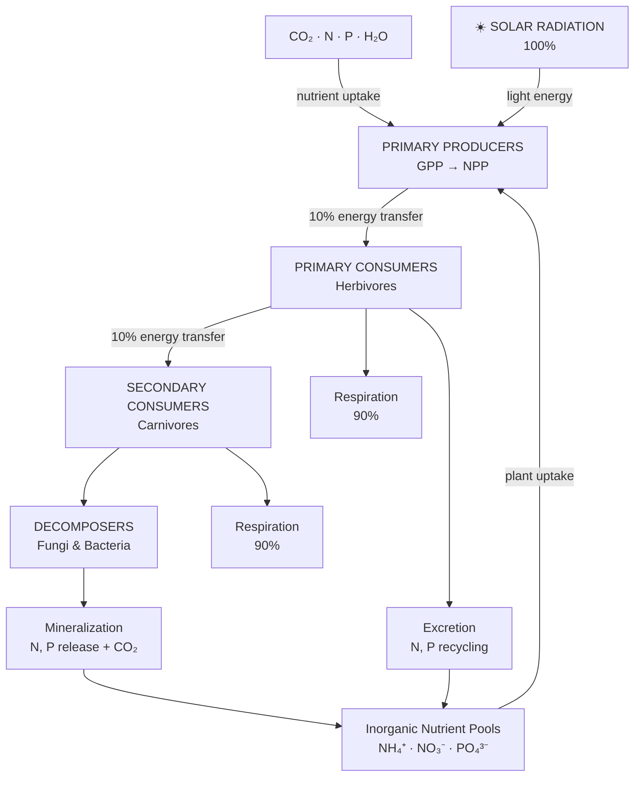

# Lesson 4: Ecosystem Ecology, Energy Flow, Biogeochemical Cycles

## 1. First-Principles Intuition & Invariants

Ecosystem ecology emerges from a deceptively simple physical constraint: the conservation of energy and mass in biological systems. Unlike population or community ecology, which examine organismal interactions and diversity patterns, ecosystem ecology treats the biosphere as a thermodynamic engine—a dissipative structure that captures solar radiation, transforms it through metabolic pathways, and redistributes chemical elements through interconnected biogeochemical cycles. The fundamental invariant governing all ecosystem processes is the First Law of Thermodynamics: energy can neither be created nor destroyed, only transformed from one form to another. In ecological terms, this means every joule of solar energy entering a system must be accounted for as chemical potential energy stored in biomass, heat dissipated through metabolic inefficiency, or radiant energy reflected back to space.

The concept of **primary productivity** quantifies the rate at which autotrophic organisms—primarily photosynthetic plants, algae, and cyanobacteria—convert electromagnetic radiation into chemical bond energy stored in reduced carbon compounds. Gross Primary Productivity (GPP) represents the total photosynthetic carbon fixation rate before accounting for autotrophic respiration losses, while Net Primary Productivity (NPP) subtracts the respiratory carbon costs incurred by primary producers themselves. This distinction is not merely semantic; it reflects the thermodynamic reality that biological machinery operates far from equilibrium and requires continuous energy input to maintain organizational complexity. Mathematically, we express this relationship as:

$$
\text{NPP} = \text{GPP} - R_{\text{autotroph}}
$$

where $R_{\text{autotroph}}$ represents autotrophic respiration, typically consuming 30–60% of GPP depending on temperature, nutrient availability, and plant functional type. Net Ecosystem Productivity (NEP) extends this accounting to include heterotrophic respiration by consumers and decomposers:

$$
\text{NEP} = \text{NPP} - R_{\text{heterotroph}}
$$

When NEP is positive, the ecosystem accumulates carbon as standing biomass or soil organic matter; when negative, it releases previously stored carbon back to the atmosphere. This balance determines whether an ecosystem functions as a carbon sink or source in the global carbon cycle.

**Trophic efficiency** quantifies the Second Law of Thermodynamics in ecological contexts: energy transfer between trophic levels is inherently inefficient due to metabolic heat dissipation, incomplete consumption, and assimilation losses. The canonical estimate of 10% trophic efficiency—meaning only about 10% of energy consumed by one trophic level becomes biomass available to the next—derives from empirical measurements across diverse ecosystems but masks substantial variation. Aquatic food chains with phytoplankton bases often achieve 15–20% efficiency due to the high nutritional quality and digestibility of algal cells, while terrestrial herbivores consuming structural plant tissues (cellulose, lignin) may realize only 5–8% efficiency. This efficiency bottleneck explains why food chains rarely exceed four or five trophic levels: cascading 10% losses mean that after four transfers, only 0.01% of primary productivity remains to support apex predators, imposing an energetic ceiling on ecosystem complexity.

The architecture of **food webs**—the network of feeding relationships connecting species within an ecosystem—reflects both energetic constraints and evolutionary diversification. Unlike the linear food chains depicted in introductory textbooks, real ecosystems exhibit reticulate webs where omnivory, intraguild predation, and detrital pathways create multiple energy flow routes. Mathematical graph theory provides a framework for analyzing web topology: species represent nodes, trophic interactions represent directed edges, and emergent properties like connectance (the fraction of realized feeding links among all possible pairs) and chain length distribution characterize community structure. Empirical food webs typically exhibit connectance values between 0.05 and 0.30, with higher connectance in productive environments where specialist feeding strategies become energetically viable.

Biogeochemical cycles impose additional constraints orthogonal to energetic considerations. While energy flows unidirectionally through ecosystems—entering as solar radiation and exiting as heat—chemical elements cycle repeatedly through biological, geological, and atmospheric reservoirs. The **carbon cycle** couples directly to energy flow because reduced carbon compounds (carbohydrates, lipids, proteins) serve as both energy currency and structural building blocks. Carbon enters ecosystems through photosynthetic CO₂ fixation via the Calvin-Benson cycle, propagates through food webs as consumers assimilate organic carbon, and returns to inorganic pools through respiration and decomposition. The residence time of carbon in different pools varies over nine orders of magnitude: atmospheric CO₂ exchanges with the biosphere on weekly to seasonal timescales, soil organic matter persists for years to centuries depending on chemical recalcitrance and environmental conditions, while carbonate minerals in sedimentary rocks remain sequestered for millions of years.

The **nitrogen cycle** introduces an additional layer of complexity because nitrogen availability limits primary productivity in most terrestrial and many marine ecosystems, despite N₂ comprising 78% of the atmosphere. The thermodynamic stability of the N≡N triple bond (941 kJ/mol bond energy) renders atmospheric nitrogen biologically inert except to specialized prokaryotes possessing the nitrogenase enzyme complex. Biological nitrogen fixation, carried out by cyanobacteria and symbiotic rhizobia in legume root nodules, reduces N₂ to ammonia (NH₃) at enormous metabolic cost—approximately 16 ATP molecules per N₂ molecule reduced. Once fixed, nitrogen cycles through ecosystems via assimilation into amino acids and nucleotides, mineralization during decomposition to release ammonium (NH₄⁺), nitrification by chemolithotrophic bacteria to produce nitrite (NO₂⁻) and nitrate (NO₃⁻), and denitrification under anaerobic conditions to regenerate N₂ and close the cycle.

The **phosphorus cycle** operates on fundamentally different timescales because phosphorus lacks a significant atmospheric reservoir. Unlike carbon and nitrogen, which cycle rapidly through gaseous phases, phosphorus moves primarily through weathering of phosphate-bearing rocks, soil solution transport, biological uptake, and sedimentation. Phosphorus often limits productivity in freshwater ecosystems and tropical forests on ancient, heavily weathered soils where available phosphate has been depleted. The lack of oxidation-state variation in biologically relevant phosphorus chemistry simplifies some aspects of the cycle but concentrates attention on mineral weathering rates and soil adsorption chemistry. Calcium phosphate minerals (apatite) weather slowly under acidic conditions, releasing orthophosphate (PO₄³⁻) that can be taken up by plant roots or microbial cells. However, phosphate readily adsorbs to iron and aluminum oxides in acidic soils or precipitates with calcium in alkaline soils, creating recalcitrant pools unavailable for biological uptake.

**Stoichiometry**—the quantitative relationships among elements in organisms and ecosystems—provides a unifying framework connecting energy flow and nutrient cycling. Alfred Redfield's observation that marine plankton exhibit remarkably consistent C:N:P ratios (106:16:1 by atoms) despite growing in chemically diverse ocean waters led to the recognition that organisms regulate elemental composition within narrow bounds. This homeostatic regulation has profound consequences: when consumers with strict stoichiometric requirements feed on resource pools with mismatched elemental ratios, they must either excrete excess elements or store them in metabolically inert forms, fundamentally altering ecosystem nutrient dynamics. Herbivores consuming nitrogen-poor plant tissues, for example, typically excrete nitrogen-rich waste products (urea, uric acid) at rates far below their carbon respiration, effectively recycling nitrogen more efficiently than carbon and locally enriching soil nitrogen pools beneath grazing areas.

**Decomposition** represents the oxidative metabolism of dead organic matter by saprophytic fungi and bacteria, completing the return pathway for carbon and nutrients from biomass back to inorganic pools. Decomposition rates span five orders of magnitude depending on substrate chemistry, temperature, moisture, and decomposer community composition. Labile compounds like simple sugars and amino acids decompose within days to weeks, while recalcitrant polymers like lignin and suberin persist for years to decades. The quality of organic matter inputs can be quantified using chemical proxies such as C:N ratio (high ratios indicate nitrogen-poor, slowly decomposing material) or lignin:nitrogen ratio (high ratios predict extended decomposition times). Temperature exerts exponential control over decomposition kinetics through its effect on enzymatic reaction rates, typically described by Q₁₀ values (rate increase per 10°C temperature rise) between 2 and 3. Moisture availability imposes an optimum curve: decomposition rates peak at intermediate moisture levels that maximize microbial activity while maintaining oxygen diffusion for aerobic respiration, declining in both waterlogged anaerobic soils and desiccated environments where microbial metabolism halts.

The concept of **limiting nutrients** derives from Justus von Liebig's Law of the Minimum, which posits that productivity is constrained by whichever resource is in shortest supply relative to biological demand. In practice, nutrient limitation exhibits more nuanced behavior than a strict minimum law suggests. Co-limitation occurs when multiple nutrients simultaneously constrain productivity, serial limitation develops when relieving one bottleneck immediately exposes another, and stoichiometric limitation emerges when elemental ratios rather than absolute concentrations govern growth rates. Experimental nutrient enrichment trials, where researchers add nitrogen, phosphorus, or other elements in factorial designs and measure productivity responses, provide the gold standard for diagnosing limitation patterns. In temperate forests, nitrogen typically limits productivity on young soils, phosphorus limitation becomes increasingly severe as soils age and weather over millennia, and calcium or potassium may limit growth on extremely weathered tropical soils.

## 2. Core Architecture & Mechanics

The operational architecture of ecosystem ecology rests on quantitative measurements of energy flux and mass transport rates through carefully defined system boundaries. Unlike cellular or organismal physiology, where the researcher can control most environmental variables, ecosystem-scale measurements must account for spatial heterogeneity, temporal variability, and stochastic disturbance events. This section dissects the experimental protocols and analytical frameworks that convert field observations into mechanistic understanding of ecosystem function.

**Measuring Primary Productivity** requires distinguishing photosynthetic carbon fixation from respiratory carbon losses, a challenge that has driven decades of methodological innovation. The classic light-dark bottle method for aquatic systems exploits the fact that photosynthesis and respiration respond differently to light availability. The protocol begins by collecting water samples containing natural phytoplankton communities and distributing them into matched transparent and opaque bottles. The transparent bottles permit both photosynthesis and respiration, while the opaque bottles exclude photosynthesis, allowing only respiration. After incubation for several hours under standardized light conditions, dissolved oxygen concentration changes are measured using Winkler titration or optical oxygen sensors. Net oxygen production in light bottles equals GPP minus respiration (R), while oxygen consumption in dark bottles directly measures R. Therefore:

$$
\text{GPP} = (\Delta \text{O}_2)_{\text{light}} + (\Delta \text{O}_2)_{\text{dark}}
$$

$$
\text{NPP} = (\Delta \text{O}_2)_{\text{light}}
$$

Converting oxygen flux to carbon flux requires applying the photosynthetic quotient (PQ), the molar ratio of O₂ produced to CO₂ consumed, which typically ranges from 1.0 to 1.4 depending on the nitrogen source assimilated (higher when nitrate is reduced to ammonia, requiring additional reducing power).

For terrestrial ecosystems, eddy covariance towers provide continuous, non-invasive measurements of net CO₂ exchange between vegetation canopies and the atmosphere. This micrometeorological approach measures vertical wind velocity fluctuations using three-dimensional sonic anemometers at high temporal resolution (10–20 Hz) while simultaneously sampling atmospheric CO₂ concentration with infrared gas analyzers. The covariance between vertical wind speed ($w'$) and CO₂ concentration ($c'$) fluctuations, integrated over 30-minute periods to capture the full spectrum of turbulent eddies, yields the net CO₂ flux:

$$
F_{\text{CO}_2} = \overline{w' c'}
$$

where the overbar denotes temporal averaging. Positive fluxes indicate net ecosystem respiration exceeding photosynthesis (carbon source), while negative fluxes indicate net photosynthetic uptake (carbon sink). Partitioning this net flux into GPP and ecosystem respiration requires additional modeling, typically by exploiting nighttime measurements (when photosynthesis is zero) to parameterize temperature-dependent respiration functions that can be extrapolated to daytime periods.

Harvest methods provide an alternative approach that directly quantifies biomass accumulation. For agricultural crops or grasslands, researchers establish permanent quadrats, clip all aboveground biomass at soil level at multiple time points throughout the growing season, dry the material to constant mass at 60–80°C, and weigh it to determine dry biomass per unit area. The temporal derivative of standing crop biomass yields NPP, though this approach systematically underestimates productivity in grazed systems where herbivory removes biomass continuously. Correcting for herbivory requires either excluding grazers from some quadrats using exclosures (creating paired grazed and ungrazed plots) or measuring consumption rates directly through fecal collection and digestibility analysis.

**Quantifying Trophic Transfer Efficiency** demands simultaneous measurements of energy intake, assimilation, production, and respiration at each trophic level. The energetic budget for any consumer population can be decomposed as:

$$
C = P + R + F + U
$$

where $C$ represents consumption (total energy intake), $P$ is production (energy incorporated into growth and reproduction), $R$ is respiration (metabolic heat loss), $F$ is feces (unassimilated energy), and $U$ is urinary/excretory losses. Assimilation efficiency ($A/C$) quantifies the fraction of consumed energy that crosses the gut wall, typically 50–90% for carnivores feeding on digestible animal tissues but only 20–50% for herbivores consuming structural plant material. Production efficiency ($P/A$) measures the proportion of assimilated energy allocated to growth and reproduction versus respired for maintenance, generally 10–40% for ectotherms with low metabolic rates but only 1–3% for endothermic birds and mammals maintaining elevated body temperatures.

Measuring these terms experimentally requires feeding trials where individuals receive known quantities of food and all waste products are collected. For terrestrial invertebrates, this might involve rearing caterpillars on weighed leaf discs in closed containers, collecting frass daily, and determining initial and final caterpillar mass to calculate production. For aquatic systems, radiotracer methods offer higher precision: prey items are labeled with ¹⁴C through photosynthetic incorporation, fed to consumers, and the partitioning of radioactivity into consumer biomass, respired CO₂, and excretory products is tracked over time using liquid scintillation counting.

**Mapping Food Web Structure** begins with comprehensive species inventories and diet analyses to establish who consumes whom. Gut content analysis provides direct evidence of trophic interactions but captures only recently ingested prey and may misrepresent diet breadth if sampling is temporally limited. Stable isotope analysis offers a time-integrated perspective: consumers incorporate the isotopic signatures of their food into their tissues with predictable fractionation patterns. Nitrogen isotope ratios (δ¹⁵N) increase by 3–4‰ with each trophic transfer due to preferential excretion of light ¹⁴N, allowing trophic position to be calculated as:

$$
\text{Trophic Level} = \lambda + \frac{\delta^{15}\text{N}_{\text{consumer}} - \delta^{15}\text{N}_{\text{baseline}}}{\Delta^{15}\text{N}}
$$

where $\lambda$ is the trophic level of the baseline organism (typically a primary consumer assigned trophic level 2), and $\Delta^{15}\text{N}$ is the per-trophic-level enrichment factor (typically 3.4‰). Carbon isotope ratios (δ¹³C) fractionate minimally (~0.5‰ per trophic transfer) but distinguish between carbon sources with different photosynthetic pathways (C3 plants at −27‰, C4 plants at −13‰, marine phytoplankton at −20‰), allowing reconstruction of basal resource contributions to higher trophic levels.

Quantitative food webs require estimating interaction strengths, not merely presence or absence of feeding links. The per capita interaction strength between predator $j$ and prey $i$ can be approximated by the functional response—the relationship between prey density and per capita consumption rate. The Type II functional response, common in invertebrate predators, follows the Michaelis-Menten form:

$$
f(N_i) = \frac{a N_i}{1 + a h N_i}
$$

where $N_i$ is prey density, $a$ is the attack rate (search efficiency × probability of successful capture), and $h$ is handling time (time spent subduing, consuming, and digesting one prey item). These parameters are estimated through feeding trials where predators are offered prey at varying densities and consumption rates are measured. The product of consumption rate and conversion efficiency then yields the energy flux through that particular link.

**Tracing Biogeochemical Cycles** requires measuring element pools and fluxes through coupled reservoirs. For the carbon cycle, researchers partition ecosystem carbon storage into live biomass, dead organic matter (litter and coarse woody debris), and soil organic matter, typically by harvesting vegetation from representative plots, collecting litter from the surface, and extracting soil cores to depth. Total carbon content is determined by combustion analysis: samples are dried, ground to fine powder, combusted at 900–1200°C in pure oxygen, and the evolved CO₂ is quantified by infrared absorption. Organic carbon is distinguished from inorganic carbonates by acidifying samples prior to combustion to drive off carbonate-derived CO₂. Radiocarbon (¹⁴C) dating of soil organic matter fractions separated by density or chemical solubility provides residence time estimates: recent plant inputs contain modern ¹⁴C levels (reflecting atmospheric nuclear weapons testing), while centuries-old humus exhibits ¹⁴C depletion from radioactive decay.

Nitrogen cycle measurements confront the challenge that nitrogen moves rapidly between oxidation states and phases. Soil nitrogen availability to plants depends primarily on inorganic forms—ammonium and nitrate—which typically represent less than 2% of total soil nitrogen but turn over rapidly. Ion-exchange resin capsules buried in soil for weeks to months capture inorganic nitrogen ions as they become available, integrating the supply rate over the deployment period. Removing the capsules and extracting adsorbed ions with potassium chloride solution yields cumulative nitrogen mineralization rates. Gross nitrogen transformation rates (mineralization, nitrification, immobilization) are measured using ¹⁵N pool dilution experiments: researchers inject ¹⁵N-labeled ammonium into soil, incubate for hours to days, then quantify how the ¹⁵N tracer distributes among inorganic and organic nitrogen pools. Dilution of the ¹⁵N label in the ammonium pool indicates gross mineralization (unlabeled NH₄⁺ added from organic matter), while appearance of ¹⁵N in the nitrate pool indicates gross nitrification.

Nitrogen fixation rates in terrestrial ecosystems are challenging to measure directly but can be estimated using the acetylene reduction assay: researchers enclose plant-soil systems (or excised root nodules) in sealed chambers, inject acetylene gas, and measure ethylene production. Nitrogenase reduces acetylene to ethylene with kinetics similar to N₂ reduction, allowing ethylene production rate to serve as a proxy for nitrogen fixation. The conversion factor between acetylene reduced and nitrogen fixed (typically 3:1 or 4:1 based on electron stoichiometry) is calibrated by comparing acetylene reduction rates to ¹⁵N₂ incorporation measured directly in parallel samples.

Phosphorus cycling measurements focus on the partitioning of total soil phosphorus among forms differing in availability. Sequential extraction procedures fractionate phosphorus pools by treating soil samples sequentially with increasingly aggressive chemical extractants: water extracts readily soluble phosphate, sodium bicarbonate extracts loosely adsorbed phosphate, sodium hydroxide extracts phosphate bound to iron and aluminum oxides, and acid digestion extracts phosphate from calcium minerals and resistant organic matter. The phosphorus concentration in each extract is determined colorimetrically by the molybdate blue method: orthophosphate reacts with ammonium molybdate under acidic conditions to form phosphomolybdate, which is reduced to an intensely blue complex that absorbs light at 880 nm. Comparing phosphorus fractionation patterns across soils of different ages reveals long-term weathering dynamics: young volcanic soils contain abundant calcium phosphate minerals, intermediate-aged temperate soils accumulate iron- and aluminum-bound phosphate, and ancient tropical soils sequester most phosphorus in resistant organic forms or occluded minerals.

**Decomposition Kinetics** are experimentally characterized using litter bag experiments where freshly senesced plant material is sealed in mesh bags with controlled pore sizes (fine mesh excludes macro-invertebrates, coarse mesh permits full decomposer access), placed on the soil surface or buried at standardized depths, and retrieved at intervals to measure mass loss. The temporal trajectory of remaining mass typically follows first-order exponential decay during early stages:

$$
M_t = M_0 e^{-kt}
$$

where $M_t$ is mass remaining at time $t$, $M_0$ is initial mass, and $k$ is the decomposition rate constant (units of time⁻¹). The half-life of decomposition ($t_{1/2} = \ln(2)/k$) provides an intuitive metric for comparing decay rates across litter types or environments. As decomposition proceeds and labile compounds are preferentially consumed, decay often transitions to multi-exponential kinetics reflecting multiple carbon pools with distinct turnover rates.

Chemical characterization of litter provides mechanistic insight into decay trajectories. Total carbon and nitrogen content yields C:N ratio, a robust predictor of early-stage decomposition rates: litter with C:N below approximately 25 decomposes rapidly as nitrogen-rich substrates support fast microbial growth, while litter exceeding C:N of 40–60 decomposes slowly as decomposers become nitrogen-limited. Lignin content, measured through acid detergent digestion followed by permanganate oxidation, captures recalcitrance: lignin is an amorphous polyphenolic polymer resistant to enzymatic degradation and its abundance strongly predicts long-term mass retention. The acid-insoluble fraction (lignin plus cutin) divided by nitrogen content—the lignin:N ratio—integrates both recalcitrance and nutrient quality into a single metric explaining 60–80% of variance in late-stage decomposition rates across diverse litter types.

Temperature and moisture effects on decomposition are quantified through common garden experiments where standard substrate (often filter paper or cellulose) is deployed across environmental gradients. Decomposition rate responses to temperature typically exhibit Arrhenius or Q₁₀ kinetics until thermal denaturation occurs above 35–40°C. Moisture effects are more complex: decomposition peaks at water contents near field capacity (water held against gravity in soil pores) where oxygen diffusion remains sufficient for aerobic respiration but water availability does not limit microbial activity. Creating empirical response surfaces for site-specific conditions allows decomposition models to extrapolate from short-term measurements to long-term carbon dynamics.

**Stoichiometric Constraints** on ecosystem processes become evident when nutrient availability diverges from biological demand ratios. Plants exhibit substantial stoichiometric flexibility, with foliar C:N ratios ranging from 10 in nitrogen-rich agricultural crops to over 60 in nitrogen-limited conifer forests. However, animal consumers maintain much stricter homeostasis: herbivorous insects typically exhibit body C:N ratios between 4 and 7, necessitating selective feeding, differential assimilation, or compensatory consumption when feeding on nitrogen-poor foliage. The ecological stoichiometry framework formalizes these constraints through threshold elemental ratios (TERs): when resource C:N exceeds the consumer's TER, growth becomes nitrogen-limited and consumers must increase consumption rates or reduce growth efficiency.

Measuring organism stoichiometry across ecological gradients reveals fundamental allocation trade-offs. Plants growing on nitrogen-poor soils allocate more nitrogen to photosynthetic machinery (Rubisco enzyme) rather than growth, elevating leaf nitrogen concentrations despite low soil supply. Conversely, phosphorus-limited plants may accumulate luxury nitrogen pools, producing nitrogen-rich tissues that decompose rapidly and create positive feedbacks accelerating nitrogen cycling. These patterns can be quantified through regression analyses relating tissue nutrient ratios to soil nutrient availability indices, revealing the reaction norms of stoichiometric plasticity.

Stoichiometric imbalances propagate through food webs with consequences for nutrient regeneration. When herbivores consume nitrogen-poor plants, their nitrogen use efficiency approaches 100% as they catabolize minimal nitrogen to meet metabolic demands, resulting in low-nitrogen feces and slow nutrient return to soil. Conversely, carnivores feeding on protein-rich prey excrete nitrogen-rich urine, creating nutrient hotspots that stimulate plant growth and alter competitive hierarchies in vegetation. Spatial variation in herbivore density thus generates landscape-scale heterogeneity in nutrient availability, a pattern readily quantified by mapping soil nitrogen pools in relation to animal distribution and behavior.

The following schematic represents the integrated structure of ecosystem energy and nutrient flows:

## 3. High-Performance Optimization & Failure Modes

Scaling ecosystem measurements from plot-level observations to landscape and regional scales requires confronting heterogeneity in climate, topography, substrate, and disturbance history. Modern ecosystem ecology increasingly integrates ground-based measurements with remote sensing platforms and numerical models to achieve spatially comprehensive assessments while maintaining mechanistic rigor. Understanding the failure modes and optimization strategies of this multiscale approach is essential for producing reliable results.

**Optimizing Primary Productivity Measurements** begins with addressing the systematic biases inherent in different methods. Eddy covariance towers provide continuous measurements but only sample a limited spatial footprint (typically 100–1000 m radius depending on tower height and canopy roughness) and struggle during periods of low turbulence when atmospheric mixing breaks down. Quality control procedures flag data collected under stable atmospheric conditions (low friction velocity, strong thermal stratification) as unreliable and gap-fill using relationships between validated flux measurements and environmental drivers (temperature, photosynthetically active radiation, vapor pressure deficit). Selecting gap-filling functions requires balancing biological realism against overfitting risk: mechanistic light response curves (rectangular hyperbola or non-rectangular hyperbola) and Lloyd-Taylor temperature functions provide interpretable parameters but may fail to capture complex acclimation dynamics.

Harvest methods avoid the assumptions required for flux partitioning but introduce destructive sampling constraints. Optimizing sampling design requires pilot studies to characterize within-site variation: researchers establish numerous small quadrats (0.1–1 m²), harvest biomass, and compute variance components attributable to spatial heterogeneity versus measurement error. Power analysis then determines the number of replicate quadrats needed to detect ecologically meaningful productivity differences (typically effect sizes of 20–30%) with acceptable statistical power (80% at α = 0.05). In highly heterogeneous systems like old-growth forests, achieving adequate precision may require stratified sampling where distinct vegetation types are sampled separately and area-weighted to estimate stand-level productivity.

Aquatic productivity measurements face unique optimization challenges related to bottle artifacts. Confining phytoplankton in small volumes alters community composition as large, motile cells encounter walls, modifies light and nutrient microenvironments, and permits container-wall biofilm growth. These artifacts can be minimized by using large-volume bottles (1–4 L rather than standard 300 mL BOD bottles), limiting incubation duration to 2–4 hours to reduce confinement stress, and deploying bottles at multiple depths to integrate the vertical light gradient. In situ incubations using floating arrays or subsurface moorings maintain natural temperature and light conditions better than laboratory incubations, though they complicate logistics and increase risk of sample loss.

**Maximizing Food Web Reconstruction Accuracy** requires combining multiple complementary approaches to overcome the limitations of any single method. Gut content analysis excels at identifying rare or ephemeral feeding interactions but produces biased diet estimates when prey items differ in digestion rates or visual identifiability. Hard-bodied prey like seeds and arthropod exoskeletons persist in guts long after soft-bodied prey have been digested, inflating their apparent importance. Quantitative correction factors derived from feeding trials where known diet compositions are fed to consumers and gut contents analyzed after standardized digestion periods can adjust for these biases, though such corrections remain prey-type and consumer-species specific.

Stable isotope mixing models statistically estimate the proportional contribution of multiple food sources to a consumer's assimilated diet. Bayesian mixing models like MixSIAR incorporate both isotopic signatures and prior information about source contributions to generate probability distributions for diet proportions. Model performance depends critically on isotopic separation among sources: when potential food items occupy similar positions in δ¹³C-δ¹⁵N space, mixing models produce highly uncertain estimates with wide credible intervals. Optimization strategies include adding additional isotope tracers (δ³⁴S distinguishing terrestrial versus aquatic sources, δ²H reflecting precipitation sources), incorporating compound-specific isotope analysis of individual amino acids to separate baseline shifts from trophic enrichment, and measuring tissue-specific isotope values that integrate over different temporal windows (blood plasma reflects weeks, muscle reflects months, bone collagen reflects years).

DNA metabarcoding of gut contents or feces provides species-level diet resolution without visual identification challenges. The protocol involves extracting total DNA from homogenized gut samples, amplifying taxonomically informative gene regions (typically mitochondrial COI or chloroplast trnL), and sequencing the resulting amplicon pool using high-throughput platforms. Bioinformatic pipelines match sequence reads to reference databases to identify prey taxa, though quantitative interpretation remains problematic: DNA sequence read abundance does not reliably predict biomass consumed due to variation in prey DNA content, digestibility, and PCR amplification bias. Combining molecular detection (presence/absence of prey DNA) with stable isotope quantification (proportional contribution) offers a synergistic approach leveraging the strengths of both methods.

**Upscaling Nutrient Cycle Measurements** from point samples to ecosystem-scale fluxes requires understanding how small-scale heterogeneity propagates to aggregate behavior. Soil nitrogen availability varies over multiple spatial scales: local hotspots around decomposing logs or animal latrines create 10- to 100-fold enrichment over background levels but cover small areas, topographic convergence zones accumulate leached nutrients producing moderate enrichment over tens of meters, and bedrock geology generates broad patterns over kilometers. Geostatistical methods like kriging interpolate point measurements across space while quantifying uncertainty, but optimal sampling designs depend on matching sample spacing to the dominant scale of variation. Variogram analysis—computing semivariance as a function of separation distance—reveals characteristic length scales that guide sampling: if variation plateaus beyond 50 m, sampling at 100 m intervals captures ecosystem-scale patterns efficiently.

Remote sensing provides spatially comprehensive data on ecosystem properties relevant to nutrient cycling. Multispectral satellite imagery (Landsat, Sentinel-2) captures canopy reflectance in visible and near-infrared bands that relate to leaf nitrogen content and productivity through vegetation indices like the Normalized Difference Vegetation Index (NDVI = [NIR − Red] / [NIR + Red]). Empirical regression models calibrated using ground-truth data link NDVI to leaf area index, chlorophyll concentration, and aboveground biomass, enabling spatial prediction across entire landscapes. However, these relationships saturate in dense canopies (NDVI asymptotes at LAI ≈ 6) and vary with canopy structure, species composition, and sun-sensor geometry, requiring site-specific calibration and careful attention to data quality flags indicating cloud contamination or aerosol interference.

Hyperspectral imaging spectrometers that record hundreds of narrow spectral bands (5–10 nm bandwidth) detect absorption features diagnostic of specific biochemical constituents. Foliar nitrogen produces characteristic absorption features near 1510, 1690, and 2180 nm related to N-H stretching and bending vibrations in proteins. Partial least squares regression or other multivariate calibration methods develop predictive models relating full reflectance spectra to laboratory-measured foliar nitrogen concentration. Airborne hyperspectral campaigns achieve 1–5 m spatial resolution sufficient to resolve individual tree crowns, though data acquisition remains expensive and processing intensive. Satellite hyperspectral missions (PRISMA, EnMAP, soon CHIME) democratize access but sacrifice spatial resolution.

**Decomposition Model Optimization** involves parameterizing carbon pool structures and transfer coefficients that reproduce observed decay trajectories. First-order single-pool models provide mathematical simplicity but poorly represent the long-term asymptotic behavior evident in most litter decay time series. Multi-pool models partition organic matter into labile, intermediate, and recalcitrant fractions with distinct decay constants, capturing the rapid initial mass loss followed by slower late-stage decay. Parameter estimation uses nonlinear regression to fit observed mass remaining data, though identifiability problems arise when multiple parameter combinations produce similar fits. Constraining some parameters using independent chemical measurements (labile pool size estimated from water-soluble carbon, recalcitrant pool from lignin content) improves parameter precision.

Environmental modifiers scale base decay rates to reflect temperature and moisture effects. Most ecosystem models apply multiplicative functions where the realized decay rate equals the base rate times temperature and moisture scalars ranging from 0 to 1. The temperature scalar commonly follows a Q₁₀ exponential form:

$$
f(T) = Q_{10}^{(T - T_{\text{ref}})/10}
$$

with $Q_{10}$ values of 2–3 derived from site-specific decomposition experiments. Moisture scalars are more variable, often using piecewise linear functions that decline from an optimum near field capacity toward zero under both waterlogged and desiccated conditions. Site-specific parameterization dramatically improves model performance: using generic literature-derived parameters produces absolute errors of 30–50% in decomposition rates, while local calibration reduces errors to 10–20%.

**Failure Mode Analysis** identifies systematic biases and edge cases where standard methods break down. Eddy covariance flux measurements fail during low-turbulence nighttime conditions common in closed-canopy forests, leading to systematic underestimation of ecosystem respiration if quality filters are too aggressive or overestimation if poor-quality data are retained. The gap-filling algorithms used to fill rejected periods propagate these biases: using only daytime temperature relationships to predict nighttime respiration misses the negative feedback where leaf respiration acclimates to sustained high temperatures. Evaluating multiple gap-filling approaches and quantifying uncertainty via bootstrap resampling provides more honest estimates of annual carbon balance.

Stable isotope mixing models fail when dietary sources cannot be isotopically distinguished or when consumer isotope values fall outside the mixing polygon defined by potential sources. The latter situation indicates either unconsidered food sources, incorrect trophic enrichment factors, or spatial mixing where consumers migrate between isotopically distinct regions. Diagnostic tools like isotope biplots that overlay consumer values on source polygons immediately reveal such incompatibilities. Collecting complementary data (GPS tracking to quantify movement, expanded source surveys to identify missing inputs) resolves these failures more effectively than forcing models to converge using implausible parameter values.

Nutrient limitation experiments using factorial fertilization sometimes produce counterintuitive results where added nutrients reduce productivity or cause mortality. These responses reflect stoichiometric imbalances: adding nitrogen alone to phosphorus-limited systems intensifies phosphorus deficiency as rapid growth draws down already scarce phosphorus stores. Co-limitation experiments adding all potentially limiting elements simultaneously, alongside single-nutrient treatments, diagnose such interactions. Mortality from over-fertilization results from osmotic stress (excessive soluble salts) or toxicity (ammonium phytotoxicity under acidic conditions); using slow-release formulations and moderate addition rates minimizes these artifacts.

Scaling eddy flux tower measurements to regional carbon budgets confronts the representativeness problem: tower footprints rarely capture the full landscape diversity, and areas selected for flux towers often exhibit atypical characteristics (flat terrain, homogeneous vegetation) that facilitate measurements but bias regional estimates. Upscaling strategies combine tower data with satellite remote sensing and process models: towers provide temporal dynamics and validate model predictions at specific locations, satellite data characterize spatial variation in vegetation properties and environmental drivers, and models synthesize these inputs to predict fluxes across heterogeneous landscapes. Ensemble approaches running multiple models with different structures and comparing predictions quantify structural uncertainty beyond what single-model confidence intervals capture.

The transition from process understanding to predictive capability ultimately depends on capturing the dominant controls on ecosystem function at scales relevant to management and policy. Short-term experiments reveal mechanisms but may miss slow feedbacks and threshold dynamics that govern long-term trajectories. Chronic nutrient addition experiments maintained for decades show declining productivity responses as stoichiometric imbalances develop or soil acidification intensifies, responses invisible in short-term trials. Committing to multi-decadal monitoring of ecosystem properties, even when initial results seem repetitive, generates the temporal perspective required to distinguish transient dynamics from equilibrium behavior. Long-term ecological research sites exemplify this philosophy, producing data sets that document regime shifts, disturbance legacies, and climate responses that would otherwise remain speculative.
