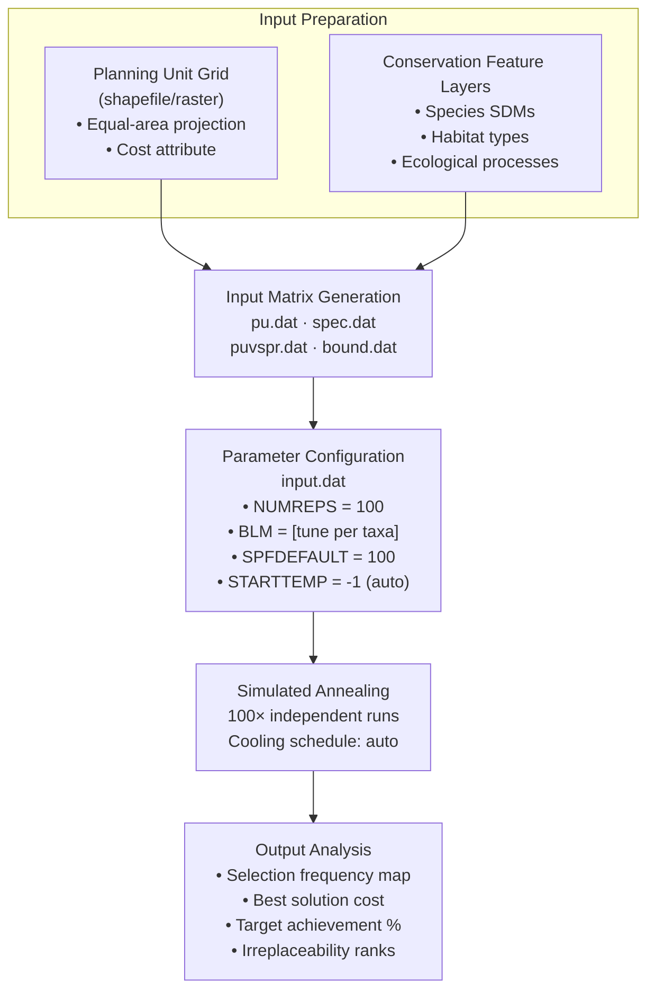
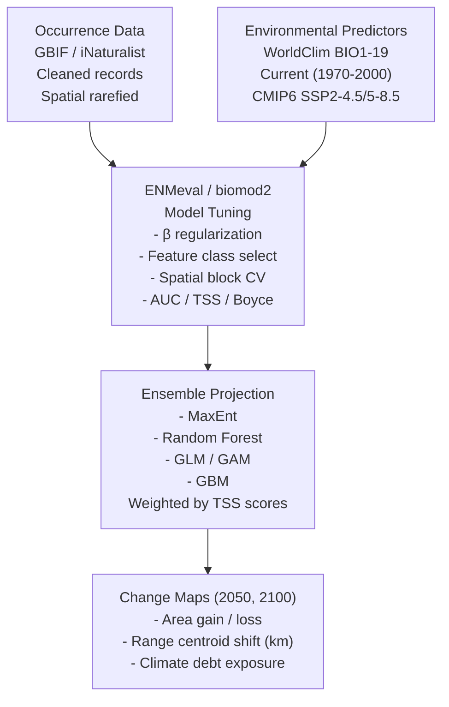

# Lesson 6: Applied Ecology, Conservation Biology, Global Change Impacts

## 1. First-Principles Intuition & Invariants

### The Biodiversity Crisis as a Thermodynamic Problem

There is a useful way to think about the current biodiversity crisis before invoking any of its political or ethical dimensions: treat the biosphere as a dissipative thermodynamic system, one that maintains its organizational complexity by continuously importing free energy from the sun and exporting entropy as heat and metabolic waste. Biological diversity is not merely an inventory of species counts. It is the structural memory of roughly 3.8 billion years of evolutionary optimization against a staggeringly complex, spatially heterogeneous, and temporally variable environment. When we lose species, we are not simply removing items from a list. We are erasing tested solutions to environmental problems — solutions encoded in genome sequences, biochemical pathways, morphological adaptations, and behavioral repertoires — most of which we have never read and never will.

The numbers demand confrontation. The background extinction rate inferred from the fossil record runs at roughly 0.1 to 1 extinction per million species-years, depending on the taxonomic group. Contemporary estimates, conservatively derived from species-area relationships and direct monitoring, place the current rate somewhere between 100 and 1,000 times that background level. The IUCN Red List, which as of 2024 has assessed more than 157,000 species, classifies over 44,000 as threatened with extinction. Among amphibians, the fraction exceeds 40 percent, a figure that reflects the compounding interaction of habitat destruction, chytrid fungal infection (*Batrachochytrium dendrobatidis*), and UV-B radiation penetrating thinned stratospheric ozone. The honest framing is that we are inside a mass extinction event — the sixth in Earth's history — the first driven not by volcanism, bolide impact, or atmospheric chemistry shifts operating on geological timescales, but by a single species operating on the timescale of centuries.

### The HIPPO Framework: A Mechanistic Decomposition of Extinction Drivers

Ecologists decompose extinction pressure using the acronym HIPPO, which orders the five primary drivers roughly by their current destructive magnitude: Habitat destruction, Invasive species, Pollution, Population (human overexploitation), and climate change, which is ascending rapidly toward the top of that hierarchy and will likely dominate in the second half of this century. Understanding these drivers mechanistically, rather than merely cataloging them, is essential for designing interventions that actually work.

Habitat destruction operates through two distinct pathways. Outright conversion — deforestation, wetland drainage, grassland plowing — reduces total habitat area and eliminates the species that require it. The more insidious pathway is fragmentation, where nominally intact habitat is severed into isolated patches. The theory of island biogeography, formulated by Robert MacArthur and E.O. Wilson in 1967, provides the foundational quantitative framework. Their equilibrium model predicts that species richness $S$ on an island (or habitat patch) scales with area $A$ according to:

$$S = cA^z$$

where $c$ is a taxon-specific constant reflecting colonization capacity and $z$ is the scaling exponent, empirically observed to fall between 0.20 and 0.35 for most taxonomic groups. The practical implication is stark: a tenfold reduction in habitat area reduces species richness by roughly 50 percent at equilibrium. For a reserve that shrinks from 10,000 hectares to 1,000 hectares, you should expect to lose approximately half your species over the relaxation timescale, which for long-lived organisms like large mammals or trees can run to centuries — creating an "extinction debt" invisible to casual observation but guaranteed to be collected.

Fragmentation adds edge effects to area loss. The interior-to-edge ratio of a habitat patch scales with patch geometry, and edge environments differ thermally, hydrologically, and in predator community composition from true interior habitat. Forest fragments in Amazonia, the subject of the Biological Dynamics of Forest Fragments Project (BDFFP) running since 1979 in Manaus, Brazil, show measurable ecological degradation up to 300 meters from the forest edge. Temperature variance increases, humidity drops, wind penetration rises, and generalist-disturbance-adapted species replace interior specialists. A 1-hectare fragment has no interior at all by this metric. Even a 10-hectare fragment, which sounds substantial, consists entirely of edge-influenced zone.

Invasive species deserve special mechanistic attention because their impacts operate through several distinct pathways that require different management responses. Direct predation on naive prey, as seen with brown tree snakes (*Boiga irregularis*) devastating bird communities on Guam, is mechanistically different from competitive displacement via superior resource capture, as seen with cheatgrass (*Bromus tectorum*) altering fire regimes across the Great Basin, which is again mechanistically different from hybridization swamping, as seen with introduced mallards (*Anas platyrhynchos*) genetically absorbing the endemic New Zealand grey duck. Getting the mechanism right is prerequisite to designing an effective response.

Climate change as an extinction driver operates through three primary pathways: range shift mismatches, phenological decoupling, and novel climate states with no analogs in recent evolutionary history. The range shift mechanism is in some ways the most tractable: as isotherms migrate poleward and upslope at current rates of roughly 6 kilometers per decade on flat terrain and 6 meters of elevation per decade on mountain slopes, species must track their thermal envelopes or adapt in place. The critical variable is dispersal capacity relative to the velocity of climate change. Thomas et al. (2004) estimated, using species-climate envelope models across multiple continents, that 15 to 37 percent of species would be "committed to extinction" by 2050 under mid-range climate scenarios — a figure that generated substantial methodological debate but has not been definitively overturned by subsequent analyses.

Phenological decoupling is subtler and arguably more dangerous in the near term. Ecological communities are built on timed interactions: the emergence of caterpillars synchronized with bird breeding, the flowering of plants matched to pollinator emergence, the hatching of aquatic insects calibrated to streamflow. If interacting species respond to climate cues at different rates, these phenological relationships come unmoored. In the Netherlands, Visser et al. documented the progressive misalignment of pied flycatcher (*Ficedula hypoleuca*) breeding timing and peak caterpillar abundance over three decades, contributing to a 90 percent population decline in some study areas. The flycatchers advance their breeding date as springs warm, but not as fast as the caterpillars advance their emergence — a lag that cascades directly into nestling survival rates.

### Ecosystem Services: The Functional Value Architecture

A purely species-centric framing of biodiversity conservation has limitations, partly strategic (it is difficult to build broad coalitions around aesthetic preferences) and partly scientific (what matters for ecosystem function is not species presence alone but the functional traits those species carry). The ecosystem services framework, formalized in the Millennium Ecosystem Assessment (2005), categorizes the benefits that functioning ecosystems provide to human wellbeing into provisioning services (food, fresh water, timber, fiber), regulating services (climate regulation, flood control, disease regulation, water purification, pollination), cultural services (recreation, spiritual value, scientific knowledge), and supporting services (soil formation, nutrient cycling, primary production) that underpin all others.

The functional mechanisms behind regulating services are particularly amenable to quantitative treatment. Pollination services, for example, can be estimated spatially by modeling the foraging range of wild bee communities from natural habitat patches overlaid on agricultural land use maps — the approach implemented in the InVEST (Integrated Valuation of Ecosystem Services and Tradeoffs) software platform developed by the Natural Capital Project. Wild pollinators contribute an estimated 35 percent of global food production by volume when measured across crops that benefit from animal pollination. The economic value is real: Gallai et al. (2009) estimated the economic value of pollination services at €153 billion annually, approximately 9.5 percent of the total value of human food production, though such figures carry wide uncertainty intervals and should be treated as order-of-magnitude estimates rather than precise accounting.

The relationship between biodiversity and ecosystem function is now supported by a substantial experimental literature, much of it generated by the Biodiversity and Ecosystem Functioning (BEF) research program and landmark long-term experiments like David Tilman's grassland plots at Cedar Creek in Minnesota. The consistent finding across taxa and ecosystem types is that ecosystems with more species are more productive, more efficient in resource use, more stable against environmental perturbation, and more resistant to invasion. The mechanism is partly complementarity (species with different resource use strategies collectively exploit the resource space more completely) and partly selection effects (more-diverse assemblages are more likely to contain highly productive or functionally critical species). These two effects are statistically separable using additive partitioning methods, and the evidence now clearly demonstrates that complementarity, not selection effects alone, drives most of the biodiversity-function relationship in plant communities.

---

## 2. Core Architecture & Mechanics

### Reserve Design: From Theory to Spatial Implementation

Reserve design is where island biogeography theory, population viability analysis, landscape ecology, and political economy collide. The practitioner's task is to translate ecological principles into defensible spatial configurations that persist through funding cycles, political changes, and land tenure conflicts. This requires not just understanding the biology, but developing operational competence with the specific analytical workflows that conservation planning runs on.

The dominant software platform for systematic conservation planning is **Marxan**, developed by Ian Ball and Hugh Possingham at the University of Queensland. Marxan frames reserve design as a combinatorial optimization problem: given a set of planning units (grid cells, watershed polygons, land parcels) each with associated cost and biodiversity values, find the minimum-cost network of reserves that meets explicit representation targets for all specified conservation features (species, habitats, ecological processes). The objective function Marxan minimizes is:

$$\text{Objective} = \sum_{i} c_i x_i + \text{BLM} \sum_{i,j \in \text{boundary}} b_{ij} x_i x_j + \text{SPF} \sum_s \left[ p_s \left(1 - \frac{\sum_i a_{is} x_i}{T_s}\right)^2 \right]$$

where $c_i$ is the cost of planning unit $i$, $x_i \in \{0,1\}$ is the selection status, $b_{ij}$ is the shared boundary length between units $i$ and $j$ weighted by the Boundary Length Modifier (BLM), $a_{is}$ is the amount of feature $s$ in unit $i$, $T_s$ is the representation target for feature $s$, and $p_s$ is the penalty factor for failing to meet that target. The BLM parameter directly controls the tradeoff between total area selected and spatial compactness of the solution — higher BLM values produce fewer, more spatially cohesive reserves at the cost of higher total area, operationalizing the ecological preference for fewer large patches over many small ones.

Marxan solves this NP-hard optimization by simulated annealing: beginning with a random initial selection, the algorithm iteratively accepts or rejects single-unit additions and removals according to a probabilistic acceptance criterion that depends on the current solution quality and a cooling temperature schedule. Because the solution landscape has many local optima, standard practice runs Marxan through 100 or more independent Monte Carlo repetitions. The output is not a single optimal reserve but a **selection frequency map** in which each planning unit is colored according to the fraction of runs in which it was selected. Units selected in 100 percent of runs are considered "irreplaceable" in the technical sense: no equally good solution omits them. This selection frequency surface, not the best single run, is the primary product delivered to spatial planners.

The practical workflow demands careful attention to input data construction. Conservation feature layers must be rasterized to the same spatial resolution and projection as your planning unit grid. Cost layers require thoughtful selection — opportunity cost (forgone agricultural income) is ecologically more defensible than land purchase price as a proxy for the real cost of protection, and the two are not always correlated. A common practitioner error is using a uniform cost surface, which causes Marxan to find solutions that are geographically efficient but politically infeasible because they concentrate reserves in lands that happen to be spatially central rather than lands that are actually cheap to protect.

### Population Viability Analysis and Minimum Viable Population

A reserve only protects species if the populations inside it persist. Population Viability Analysis (PVA) is the formal quantitative framework for estimating extinction probability as a function of population size, demographic rates, and stochastic perturbations. The practitioner-standard software platform is **VORTEX**, developed by Robert Lacy at the Chicago Zoological Society, though **RAMAS Metapop** is used for explicitly spatial metapopulation scenarios.

VORTEX implements a stage-structured, individual-based simulation that propagates populations forward through time, sampling demographic events stochastically according to user-specified distributions. The core demographic inputs are age- or stage-specific survival rates and fecundity rates derived from field study or life tables, environmental variation expressed as annual variance in those vital rates (EV), inbreeding depression parameterized as lethal equivalents per diploid genome, and catastrophic events specified as annual probabilities with associated multiplier effects on survival and reproduction.

The standard PVA output is a minimum viable population (MVP) curve: extinction probability plotted against initial population size for a specified time horizon (commonly 100 years). The 1987 Shaffer definition specified MVP as the smallest population with a 95 percent probability of persistence for 100 years, though subsequent workers have argued for stricter standards (99% probability, 1000-year horizon) for long-lived species like trees and large vertebrates. The rule-of-thumb "50/500 rule" — 50 individuals to avoid inbreeding depression in the short term, 500 to maintain evolutionary potential over evolutionary time — was formalized by Ian Franklin (1980) based on animal breeding theory and remains widely used as a first-pass estimate despite known limitations for species with specific social structures or strong Allee effects.

Demographic stochasticity, environmental stochasticity, and catastrophic events interact in PVA in ways that are non-obvious and consequential for management. Demographic stochasticity (random variation in individual birth and death outcomes) dominates extinction risk only at very small population sizes (below approximately 50 individuals), where variance in reproductive success can drive populations to zero even when mean vital rates predict growth. Environmental stochasticity (correlated variation in vital rates across all individuals due to weather, food availability, disease) dominates at intermediate population sizes and cannot be overcome by simply having more individuals — if a drought simultaneously reduces survival across an entire population, population size provides only limited buffering. This distinction matters for management: demographic rescue (captive breeding, translocation) addresses demographic stochasticity; habitat improvement and landscape connectivity address environmental stochasticity by reducing the correlation of environmental conditions across sub-populations.

### Species Distribution Modeling: MaxEnt and the Niche Concept

Understanding where species currently occur and where they might shift under climate change requires species distribution modeling (SDM), also called ecological niche modeling (ENM). The dominant algorithm in current practice is **MaxEnt** (Maximum Entropy Species Distribution Modeling), implemented in the Phillips, Anderson, and Schapire software package, though ensemble approaches combining MaxEnt, Bioclim, GLM, GBM, and Random Forest algorithms through the **biomod2** R package are increasingly preferred for their reduced algorithm-specific bias.

MaxEnt estimates a species' realized niche by finding the maximum-entropy probability distribution over geographic space that is consistent with the species' occurrence locations while remaining constrained by environmental predictor variables extracted at those locations. The mathematical formulation finds distribution $\hat{q}$ over geographic space $X$ that maximizes entropy:

$$H(\hat{q}) = -\sum_{x \in X} \hat{q}(x) \ln \hat{q}(x)$$

subject to constraints that the expected value of each environmental feature $f_j$ under $\hat{q}$ matches the empirical mean of $f_j$ at occurrence locations:

$$\sum_{x \in X} \hat{q}(x) f_j(x) = \hat{f}_j$$

The regularization multiplier $\beta$ controls model complexity: low $\beta$ produces tightly-fitting, geographically narrow predictions that risk overfitting to spatial autocorrelation in occurrence records; high $\beta$ produces broader, smoother predictions that may underestimate niche limits. Tuning $\beta$ using the ENMeval R package — which implements spatial cross-validation across a grid of regularization multiplier values and feature class combinations — has become standard practice and should be treated as non-optional for any analysis intended for publication.

For climate change projections, the workflow transfers the fitted niche model from current climate layers (typically derived from WorldClim or CHELSA at 30-arcsecond or 1-km resolution) to future climate scenarios. The standard climate input set includes temperature seasonality (BIO4), mean temperature of warmest quarter (BIO10), precipitation seasonality (BIO15), and precipitation of driest quarter (BIO17) as the most ecologically mechanistic variables from the 19 standard bioclimatic variables. Future climate layers from CMIP6 models, downscaled to match current-climate resolution, provide the projection surface under SSP2-4.5 (moderate) and SSP5-8.5 (high-emission) scenarios. The resulting shift in predicted suitable habitat area, geographic centroid position, and velocity of niche shift quantifies both the magnitude of climate vulnerability and the directionality of likely range shifts.

### Restoration Ecology: Protocol-Level Mechanics

Restoration ecology is the practice of assisting the recovery of degraded ecosystems, and it has matured from conceptually ad hoc revegetation projects into a discipline with explicit ecological theory, standardized monitoring protocols, and emerging evidence-based practice guidelines. The Society for Ecological Restoration's international standards framework (SER, 2019) defines restoration success through nine attributes: physical conditions, species composition, structural diversity, functional groups, absence of threats, interaction with adjacent ecosystems, resilience, natural renewal capacity, and goals achieved. Measuring these attributes requires explicit, spatially replicated field protocols.

**Seed mix design for grassland restoration** exemplifies how ecological theory translates directly into field practice. The functional group framework predicts that high-diversity seed mixes containing multiple functional types — C3 and C4 grasses, nitrogen-fixing legumes, tap-rooted forbs, and clonal rhizomatous species — will out-compete weed invasion relative to monocultures or low-diversity mixes, because complementary resource use reduces the unfilled niche space that invaders exploit. This is the same BEF mechanism described earlier, now applied prescriptively. The practical protocol for seed mix composition follows a decision tree: determine target community type from reference site surveys, calculate target proportional cover of each functional group, source seed from local ecotypes within the same precipitation zone (long-distance seed sourcing can introduce mal-adapted genotypes), and calculate seeding rates as:

$$\text{Seeds m}^{-2} = \frac{\text{Target PLS kg ha}^{-1} \times 10,000}{\text{Seeds per kg} \times \text{Germination rate} \times \text{Purity fraction}}$$

where PLS (pure live seed) is the actual viable seed content of a commercial seed lot after germination testing. The factor of 10,000 converts hectares to square meters. Seeding rates typically range from 300 to 1,000 PLS seeds per square meter for mixed prairie assemblages, with higher rates recommended for disturbed sites with high weed pressure.

Soil microbiome restoration is an increasingly recognized bottleneck in restoration projects. Many degraded sites, particularly post-agricultural lands and post-mining substrates, lack the arbuscular mycorrhizal fungal (AMF) community required by native plants. AMF colonization rates can be measured by clearing and staining root samples with trypan blue and examining under compound microscopy at 200× for the characteristic arbuscule and vesicle structures, expressing results as percent root length colonized according to the gridline intersection method. Inoculation with commercially available AMF consortia or locally sourced donor soil can accelerate trajectory to target community states, though the evidence for persistent effects beyond initial establishment is mixed and requires site-specific validation.

---

## 3. High-Performance Optimization & Failure Modes

### Scaling Monitoring Systems: Biodiversity Metrics Under Pressure

Field ecologists collecting data for conservation assessments face a consistent tension between statistical power and logistical feasibility. The relationship is quantitative and unforgiving. For detecting a specified minimum effect size $\delta$ (say, a 20 percent decline in species richness) with power $1 - \beta = 0.80$ and significance threshold $\alpha = 0.05$, the required sample size per treatment group for a two-sample t-test scales as:

$$n = \frac{2 \sigma^2 (z_{\alpha/2} + z_\beta)^2}{\delta^2}$$

where $\sigma^2$ is the within-group variance estimated from pilot data. In highly variable ecological systems — species diversity across heterogeneous landscapes, abundance estimates of rare animals — $\sigma^2$ is often large relative to $\delta$, requiring sample sizes that exceed practical field capacity. The practitioner response is not to accept underpowered designs and report false negatives as "no effect," but to adopt monitoring designs that use variance-reduction techniques: stratified random sampling (which reduces $\sigma^2$ within strata), paired before-after designs (which remove site-level random effects), and BACI (Before-After-Control-Impact) designs that partition treatment effects from temporal trends.

Occupancy modeling, specifically the MacKenzie et al. (2002) single-season occupancy framework and its multi-season dynamic extensions, deserves particular attention because it solves a problem endemic to wildlife monitoring: imperfect detection. If a species is present at a site but not detected during a survey, naively treating absences as true absences produces biased occupancy estimates. The occupancy model separates the observation process (detection probability $p$) from the ecological state process (site occupancy $\psi$), and estimates both simultaneously from repeated visits to survey sites. The likelihood for a single site with detection history $(1, 0, 1)$ across three visits is:

$$\mathcal{L} = \psi \cdot p \cdot (1-p) \cdot p$$

and for history $(0, 0, 0)$:

$$\mathcal{L} = \psi (1-p)^3 + (1-\psi)$$

because the all-zero history is consistent with both true absence and presence with missed detections. Maximum likelihood estimation across all sites and visit histories yields unbiased estimates of $\psi$ and $p$ along with their standard errors. The standard implementation uses the **RPresence** or **unmarked** R package, with covariates on both $\psi$ (habitat area, connectivity, land use) and $p$ (observer experience, weather conditions, survey method) entered as separate model formulas and evaluated by AIC model comparison.

A scaling failure mode that frequently undermines monitoring programs is spatial autocorrelation. Ecological data are almost always spatially autocorrelated: nearby sites are more similar than distant sites, violating the independence assumption of standard statistical tests. Failing to account for spatial autocorrelation inflates the apparent degrees of freedom, reduces standard errors, and produces false significance — a systematic error that biases conservation decisions toward overstating effects. The diagnostic is a Moran's I test on model residuals, implemented in the **spdep** R package. Remediation options include spatial eigenvector filtering (adding Moran eigenvectors as covariates to absorb spatial structure), geostatistical models with exponential or spherical covariance structures, or spatial generalized additive models with a 2D smooth on geographic coordinates using **mgcv**. The choice depends on whether spatial structure is a nuisance to control for or is itself scientifically interesting.

### Remote Sensing at Ecosystem Scale

The practical impossibility of monitoring all ecosystems from the ground has made remote sensing indispensable to conservation biology. The Normalized Difference Vegetation Index (NDVI), derived from the ratio of near-infrared and red band reflectance:

$$\text{NDVI} = \frac{\rho_\text{NIR} - \rho_\text{Red}}{\rho_\text{NIR} + \rho_\text{Red}}$$

has been computed at continental to global scales using MODIS (250-m to 500-m spatial resolution, 16-day composite), Landsat (30-m resolution, 16-day revisit), and Sentinel-2 (10-m resolution, 5-day revisit) platforms. NDVI time series are the workhorse of deforestation monitoring in systems like PRODES (Brazil's INPE deforestation monitoring system) and Global Forest Watch. However, NDVI saturates at high biomass densities (tropical dense forest), is sensitive to atmospheric aerosol loading, and conflates greenness with structural biomass, which makes it inadequate for distinguishing forest degradation from intact canopy.

Enhanced vegetation indices (EVI), which correct for atmospheric interference and soil brightness:

$$\text{EVI} = 2.5 \cdot \frac{\rho_\text{NIR} - \rho_\text{Red}}{\rho_\text{NIR} + 6\rho_\text{Red} - 7.5\rho_\text{Blue} + 1}$$

perform better in dense vegetation and are the preferred index for tropical forest monitoring applications. For structural attributes — canopy height, above-ground biomass, vertical foliage distribution — LiDAR (Light Detection and Ranging) provides irreplaceable 3D canopy architecture data. Airborne discrete-return LiDAR at 2 to 8 pulses per square meter resolves individual crown boundaries and produces canopy height models at sub-meter resolution. The NASA Global Ecosystem Dynamics Investigation (GEDI) mission aboard the International Space Station provides global-coverage spaceborne LiDAR at 25-m footprint spacing, enabling forest carbon stock estimation and habitat vertical structure mapping at scales impossible for airborne surveys.

The analysis workflow for change detection begins with atmospheric correction of raw imagery to surface reflectance using MODTRAN-based algorithms (implemented in tools like FORCE, Sen2Cor for Sentinel-2, or LEDAPS for Landsat), followed by cloud/cloud-shadow masking, and then time-series analysis using algorithms like LandTrendr or BFAST (Breaks for Additive Season and Trend) in R. BFAST decomposes a NDVI time series into seasonal, trend, and remainder components and detects structural breaks in the trend component that correspond to disturbance events. The sensitivity is set by the minimum detectable change threshold and the number of historical years used to establish baseline seasonality, requiring calibration against ground-truth disturbance records before deployment in operational monitoring.

### Failure Modes in Conservation Interventions

Conservation planning fails in characteristic, recurring patterns that practitioners need to recognize and mitigate before they invest resources.

The first critical failure mode is **planning under surrogate error** — the assumption that protecting a subset of well-studied taxa (usually birds and vascular plants) will automatically protect biodiversity more broadly. This assumption is called the "umbrella species" or "indicator species" hypothesis, and the empirical evidence for it is disappointingly weak in most tested systems. Cross-taxon congruence in species richness hotspots and in species turnover patterns is inconsistent across biogeographic regions and spatial scales. Fungi, soil invertebrates, freshwater invertebrates, and bryophytes routinely fail to show correlated diversity patterns with vertebrates or vascular plants. The implication for practice is to include multiple taxonomic proxies representing different trophic levels and life forms in Marxan analyses, and to validate reserve network designs against independently collected data for unstudied taxa when feasible.

The second failure mode is **connectivity neglect** in reserve design. A reserve network that meets representation targets for static habitat suitability will fail to maintain gene flow, re-colonization dynamics, or seasonal migrations if the patches are functionally isolated from one another. The metric that operationalizes connectivity in a reserve network is Probability of Connectivity (PC), a graph-theoretic metric implemented in **Conefor** software that integrates patch areas and interpatch dispersal probabilities over a landscape graph. The PC index for a landscape with $n$ patches is:

$$\text{PC} = \frac{\sum_{i=1}^{n} \sum_{j=1}^{n} a_i a_j p_{ij}^*}{A_L^2}$$

where $a_i$ is the area of patch $i$, $p_{ij}^*$ is the maximum-product probability dispersal path between patches $i$ and $j$ through the landscape graph, and $A_L$ is total landscape area. The dPC index (the fractional decline in PC caused by removing a given patch) identifies which patches are most critical for maintaining landscape connectivity — information that is not captured by area or biodiversity content alone. High-dPC patches are essential stepping stones even if they contain relatively few species, and failing to protect them while protecting large but isolated high-diversity patches is a systematic error that Marxan's standard formulation will commit unless connectivity objectives are explicitly added.

The third failure mode is **ecological time vs. political time**. Conservation interventions are designed on decadal to centennial timescales, but funding cycles, political administrations, and institutional attention spans operate on two- to four-year timescales. This mismatch is not merely logistical; it is structurally built into the incentives of most conservation institutions. Restoration projects show trajectories of canopy closure, soil organic matter recovery, and species recruitment that span 30 to 100 years. Measuring success at year three by species counts in freshly seeded plots is both ecologically meaningless and institutionally destructive because it generates false negative evaluations. The professional response is to establish leading indicators — soil respiration rates, root biomass density, mycorrhizal colonization, canopy cover progression — that are mechanistically linked to long-term community development trajectories and can be measured credibly within funding timescales. Failure to establish and defend these leading indicators in advance of monitoring programs is one of the most common and consequential errors practitioners make.

The fourth failure mode is **climate stationarity assumption in reserve design**. Most existing protected area networks were designed under the implicit assumption that the species and ecosystems they contain will remain there. As climate envelopes shift poleward and upslope, reserves designed for historical distributions will increasingly contain unsuitable climate for the species they were nominally established to protect, while future suitable climate occurs on unprotected land. Correcting for this requires climate-smart reserve design: identifying and protecting predicted future climate refugia — areas that remain thermally stable under multiple climate scenarios — and ensuring that the landscape connectivity between current and future suitable habitat is itself protected. The workflow combines SDM projections under multiple CMIP6 scenarios, refugia identification using multivariate climate stability metrics (e.g., the macroclimatic dissimilarity between current and future climate at each grid cell), and Marxan analyses that explicitly include future-scenario habitat suitability layers alongside current layers with scenario-weighted representation targets.

### Invasive Species Management: Optimization Under Uncertainty

The economics and logistics of invasive species management present optimization problems with high uncertainty and convex cost structures. Early detection and rapid response (EDRR) consistently outperforms containment and control of established populations by several orders of magnitude in cost-benefit analyses: the cost of eradicating an island population of an invasive rodent scales roughly as $C \propto N \log N$ with population size $N$ (from empirical data compiled by Brooke et al. and others), which means that every year of delay during which the population grows multiplies the ultimate control cost non-linearly.

Operational eradication protocols for island rodent eradications — which represent the most evidence-rich domain in invasive species management — illustrate the precision required at the execution level. The poisoned bait station density must exceed the home range radius of the target species such that every individual's home range overlaps at least one station. For *Rattus rattus* (black rat) with a home range radius of approximately 50 to 100 meters, this requires a minimum bait station spacing of 25 to 50 meters in a grid pattern, with stations placed at both ground level and elevated positions (tree branches, rock ledges) because black rats are highly arboreal. The brodifacoum concentration in bait must maintain sub-lethal exposure from a single feeding at the detection station, with lethal doses requiring 3 to 5 days of continuous feeding — a pharmacokinetic constraint that dictates minimum bait replenishment intervals of no more than three days during active eradication phase. Tracking tunnels with ink cards, snap traps, and remote cameras provide detection probability data to generate occupancy models that quantify eradication completeness with explicit uncertainty bounds rather than assuming success from absence of detections alone.

For mainland invasions where eradication is impossible, the management objective shifts from eradication to **containment** or **suppression to below damage threshold**, requiring the construction of a spread model. Integrodifference equation models, which combine a population growth kernel with a dispersal kernel, are the theoretical foundation:

$$N_{t+1}(x) = \int_{-\infty}^{\infty} K(x - y) \cdot f[N_t(y)] \, dy$$

where $K(x-y)$ is the dispersal kernel (probability of an individual moving from location $y$ to location $x$) and $f[N_t(y)]$ is the local population growth function. The asymptotic spread velocity $c^*$ of this model depends on the shape of the dispersal kernel: for thin-tailed Gaussian dispersal, spread velocity converges to a constant; for fat-tailed kernels (Cauchy, leptokurtic), spread velocity accelerates over time, producing the explosive range expansions seen in many invaders with rare long-distance dispersal events. Identifying whether a given invasive population has fat-tailed dispersal is therefore not an academic question but a management-critical determination, because it fundamentally changes whether spatially fixed buffer zones will slow spread or be episodically leapfrogged.

### Synthesis: The Operational Frame of Conservation Biology

The practitioner working at the intersection of conservation biology, climate change, and ecosystem management is operating under a consistent set of constraints that cannot be engineered away: deep uncertainty in long-term projections, nonlinear ecological dynamics with threshold behaviors, limited monitoring resources, and the institutional reality that the timescales of ecological processes do not align with the timescales of human decision cycles. The professional response to this situation is not to retreat from quantitative rigor into vague qualitative prescription. It is to build analytical workflows that make uncertainty explicit, that identify the monitoring signals most sensitive to management outcomes, that design interventions with high robustness across a range of ecological scenarios rather than optimizing for single-scenario performance, and that communicate results in terms of decision-relevant probabilities rather than categorical statements.

The most consequential error a conservation scientist can make is not a methodological error in MaxEnt regularization or an incorrect PVA parameter. The most consequential error is working on the wrong problem at the wrong scale with the wrong resolution of spatial or temporal data, or accepting a monitoring program too weak to detect the effect that matters for the management decision at hand. Statistical and analytical rigor — occupancy models, spatial autocorrelation correction, ensemble SDMs, properly tuned Marxan runs — matter only insofar as they feed into decisions that actually change which landscapes are protected, which invasions are detected early, and which restoration trajectories are sustained. The theory and the methods described in this lesson are not ends in themselves. They are instruments, and their value is entirely determined by the precision with which they are aimed.
