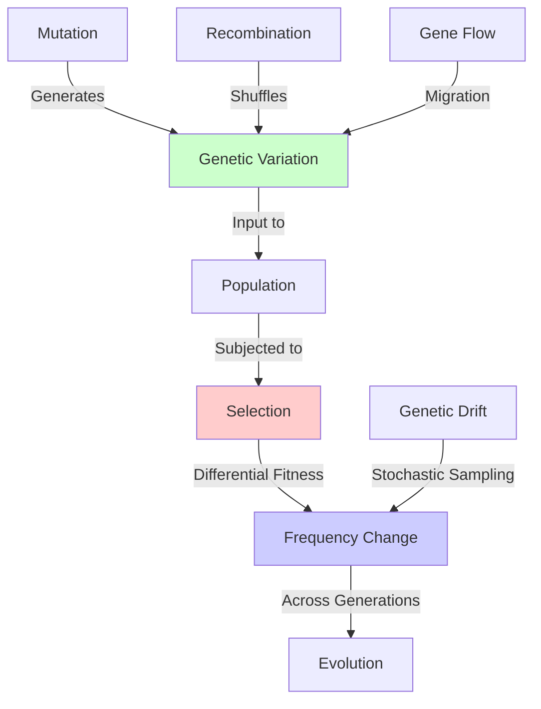

# Lesson 1: Foundations of Evolution—Variation, Heredity, Selection

## 1. First-Principles Intuition & Invariants

Evolution by natural selection stands as one of the most profound organizing principles in the natural sciences, a theory whose explanatory power rivals Newtonian mechanics or thermodynamics in its capacity to unify disparate observations into a coherent framework. At its core, evolution is not merely a historical narrative about the origin of species but a dynamical process governed by mathematical invariants that operate across all scales of biological organization—from molecular sequences to ecosystems. Understanding evolution requires us to think like physicists analyzing a dissipative system far from thermodynamic equilibrium, where information flows through hereditary channels, variation introduces stochasticity, and selection imposes directional constraints on the accessible state space.

The intellectual foundation of evolutionary theory emerged in the mid-nineteenth century through the independent work of Charles Darwin and Alfred Russel Wallace, both naturalists who synthesized observations from biogeography, paleontology, and artificial breeding into a mechanistic explanation for the adaptive complexity of life. Darwin's magnum opus, *On the Origin of Species* (1859), presented the argument with methodical precision: organisms produce more offspring than can survive, individuals within populations vary in heritable traits, and those variants better suited to their environment leave more descendants. This differential reproductive success, accumulated over generations, generates the appearance of design without invoking a designer. Wallace arrived at nearly identical conclusions through his fieldwork in the Malay Archipelago, recognizing that the struggle for existence drives a sorting process that amplifies advantageous variations.

The Darwinian framework rests on three indispensable preconditions that must be satisfied simultaneously for natural selection to operate. First, there must exist phenotypic variation within populations—individuals must differ in measurable characteristics such as beak morphology, enzyme kinetics, or behavioral strategies. Second, this variation must exhibit heritability, meaning that offspring resemble their parents more than they resemble random individuals from the population; without transmission fidelity across generations, selection cannot produce cumulative change. Third, variation in traits must correlate with differential fitness, where fitness is operationally defined as the expected reproductive contribution to subsequent generations. When these three conditions hold, populations inevitably evolve, with the frequencies of heritable variants shifting in proportion to their fitness effects.

The mathematical formalization of natural selection begins with the concept of absolute fitness $W_i$, defined for genotype $i$ as the expected number of offspring surviving to reproductive age. In a deterministic model with discrete non-overlapping generations, the frequency $p_i(t)$ of genotype $i$ at generation $t$ evolves according to:

$$p_i(t+1) = \frac{W_i \, p_i(t)}{\bar{W}(t)}$$

where the mean population fitness $\bar{W}(t) = \sum_j W_j p_j(t)$ serves as a normalization constant ensuring that frequencies sum to unity. This recursion reveals an essential property: genotypes with above-average fitness increase in frequency, while those with below-average fitness decline. The rate of evolutionary change depends on both the strength of selection and the amount of genetic variation present.

For continuous phenotypic traits governed by many loci, quantitative genetics provides a complementary framework. The breeder's equation, $R = h^2 S$, relates the response to selection $R$ (the change in mean phenotype between parental and offspring generations) to the selection differential $S$ (the difference between the mean phenotype of selected parents and the population mean) scaled by narrow-sense heritability $h^2$. Heritability quantifies the proportion of phenotypic variance $V_P$ attributable to additive genetic effects $V_A$:

$$h^2 = \frac{V_A}{V_P} = \frac{V_A}{V_A + V_D + V_I + V_E}$$

where $V_D$ represents dominance variance from allelic interactions within loci, $V_I$ captures epistatic variance from interactions between loci, and $V_E$ reflects environmental variance. Only additive genetic variance contributes predictably to parent-offspring resemblance; dominance and epistatic effects are disrupted by the segregation and independent assortment of alleles during sexual reproduction.

The ultimate source of genetic variation lies in mutation, the stochastic alteration of nucleotide sequences during DNA replication, repair, or recombination. Point mutations occur at a per-base-pair rate of approximately $\mu \sim 10^{-9}$ to $10^{-8}$ per generation in eukaryotes, though rates vary substantially across genomic regions and lineages. With a diploid genome of $N \approx 3 \times 10^9$ base pairs in humans, each individual carries roughly $N\mu \sim 30$ to $300$ new mutations. Most mutations are neutral or deleterious, with beneficial mutations constituting perhaps $10^{-4}$ to $10^{-3}$ of the total, yet the cumulative influx of variation from mutation prevents populations from exhausting genetic diversity even under sustained selection.

Sexual recombination amplifies the efficacy of selection by breaking apart deleterious allele combinations and assembling favorable ones. During meiosis, homologous chromosomes exchange segments through crossover events, shuffling parental haplotypes to generate novel multilocus genotypes in gametes. The recombination rate $r$ between two loci determines the probability per generation that alleles at those loci are inherited independently; tightly linked loci ($r \ll 0.5$) exhibit strong linkage disequilibrium, while unlinked loci ($r = 0.5$) assort independently according to Mendel's second law. By creating new combinations, recombination allows selection to act more efficiently on individual loci rather than being constrained by the genetic backgrounds in which alleles happen to arise.

Fitness landscapes provide a geometric visualization of the mapping from genotype space to fitness values. In the simplest case, a single-locus landscape plots fitness $W$ as a function of allele frequency $p$. For a single locus with two alleles $A_1$ and $A_2$ having fitnesses $W_{11}$, $W_{12}$, and $W_{22}$ for genotypes $A_1A_1$, $A_1A_2$, and $A_2A_2$ respectively, the mean fitness surface exhibits a peak at the equilibrium frequency determined by the selection coefficients. When $W_{11} > W_{12} > W_{22}$, directional selection drives $A_1$ to fixation. When the heterozygote has highest fitness ($W_{12} > W_{11}, W_{22}$), balancing selection maintains both alleles at a stable polymorphic equilibrium. Multilocus fitness landscapes become rugged and high-dimensional, with epistatic interactions creating multiple peaks separated by fitness valleys; populations evolve uphill toward local fitness maxima but may become trapped at suboptimal peaks if the fitness cost of crossing valleys exceeds the stochastic power of genetic drift.

The formal theory of population genetics, developed by Fisher, Wright, and Haldane in the early twentieth century, demonstrated that natural selection is a deterministic force that increases mean population fitness over time when certain assumptions hold. Fisher's fundamental theorem of natural selection states that the rate of increase in mean fitness equals the additive genetic variance in fitness divided by mean fitness:

$$\frac{d\bar{W}}{dt} = \frac{V_A(W)}{\bar{W}}$$

This theorem reveals that populations with greater genetic variation in fitness-related traits evolve faster, and that selection inexorably depletes genetic variance by fixing advantageous alleles. However, Fisher's theorem applies strictly only to additive genetic variance in constant environments; frequency-dependent selection, environmental change, and mutation continually regenerate variation, preventing fitness maximization from reaching a static optimum.

Differential reproductive success, the engine of natural selection, arises from variation in survival to reproductive age (viability selection) and variation in mating success and fecundity among survivors (sexual selection). Viability selection operates through ecological interactions—competition for resources, predator-prey dynamics, parasite resistance, and abiotic stress tolerance. Sexual selection, emphasized by Darwin as a distinct evolutionary force, encompasses both intrasexual competition (typically among males for access to mates) and intersexual choice (typically by females selecting among potential mates). Sexual selection can drive the evolution of exaggerated traits that reduce survival but enhance mating success, such as the peacock's tail or the elaborate bower structures of bowerbirds. The net fitness of an individual integrates these components; a genotype that confers superior survival but zero mating success has fitness $W = 0$ just as surely as a genotype that dies before maturity.

The concept of relative fitness clarifies how selection operates on allele frequency dynamics. Defining relative fitness $w_i = W_i / W_{\text{max}}$, where $W_{\text{max}}$ is the fitness of the most fit genotype, rescales the fitness landscape such that the optimal genotype has $w = 1$ and all others have $w \leq 1$. The selection coefficient $s = 1 - w$ measures the proportional fitness disadvantage of a genotype relative to the optimum. In the canonical case of a deleterious recessive allele $a$ with selection coefficient $s$, genotypes $AA$, $Aa$, and $aa$ have fitnesses $1$, $1$, and $1-s$ respectively. The allele frequency dynamics under selection are:

$$\Delta p = \frac{s p q^2}{1 - s q^2}$$

where $p$ and $q = 1-p$ are the frequencies of the dominant and recessive alleles. This recursion shows that rare recessive deleterious alleles decline slowly because they are hidden from selection in heterozygotes; most copies of $a$ reside in $Aa$ individuals with normal fitness when $q \ll 1$.

Understanding natural selection requires recognizing that it is not a teleological force aimed at progress or perfection but a blind algorithmic process that sorts variants based on their immediate reproductive consequences in the prevailing environment. Selection has no foresight; it cannot anticipate future environmental shifts or prepare populations for long-term contingencies. Adaptations are jury-rigged solutions constrained by developmental architecture, phylogenetic history, and the available genetic variation. The human eye, for instance, has a blind spot where the optic nerve penetrates the retina, a suboptimal design that reflects the evolutionary contingencies of vertebrate eye development rather than intelligent optimization.

## 2. Core Architecture & Mechanics

The mechanistic architecture of evolutionary change emerges from the interplay of population structure, genetic transmission, and ecological interactions operating across multiple temporal and spatial scales. To dissect these dynamics rigorously, we must construct explicit models that track allele frequencies, quantify selection pressures, and predict evolutionary trajectories under specified conditions. This section develops the core mathematical machinery and experimental protocols that form the operational toolkit of evolutionary biology.

Consider a sexually reproducing diploid population of constant size $N$ with discrete non-overlapping generations. Each individual carries two copies of a focal gene, with alleles $A_1$ and $A_2$ at frequencies $p$ and $q = 1 - p$ respectively. Random union of gametes (Hardy-Weinberg mating) produces genotypes $A_1A_1$, $A_1A_2$, and $A_2A_2$ at frequencies $p^2$, $2pq$, and $q^2$ in the zygote stage. If fitnesses are $W_{11}$, $W_{12}$, and $W_{22}$, the frequency of $A_1$ among breeding adults is:

$$p' = \frac{p^2 W_{11} + pq W_{12}}{\bar{W}}$$

where the mean fitness $\bar{W} = p^2 W_{11} + 2pq W_{12} + q^2 W_{22}$ normalizes the allele frequency. The change in allele frequency per generation is:

$$\Delta p = p' - p = \frac{pq \left[ p(W_{11} - W_{12}) + q(W_{12} - W_{22}) \right]}{\bar{W}}$$

This fundamental recursion governs deterministic allele frequency evolution under selection. When $W_{11} > W_{12} > W_{22}$, the numerator is always positive for $0 < p < 1$, and $A_1$ increases monotonically toward fixation. When $W_{12} > W_{11}, W_{22}$, the equilibrium $\hat{p} = (W_{12} - W_{22}) / (2W_{12} - W_{11} - W_{22})$ is stable, maintaining both alleles indefinitely through heterozygote advantage (overdominance).

In finite populations, genetic drift introduces stochasticity that can overpower weak selection. The effective population size $N_e$ quantifies the strength of drift as the size of an idealized population that experiences the same rate of genetic drift as the actual population. For a Wright-Fisher model with random sampling of $2N_e$ gametes each generation, allele frequencies fluctuate randomly even in the absence of selection, with variance:

$$\text{Var}(\Delta p) = \frac{pq}{2N_e}$$

The interplay between selection and drift is characterized by the scaled selection coefficient $N_e s$. When $N_e s \gg 1$, selection dominates and allele frequency changes are approximately deterministic. When $N_e s \ll 1$, drift dominates and alleles behave as if effectively neutral, fixing or being lost primarily by chance. When $N_e s \sim 1$, both forces contribute significantly, and stochastic simulations are required to predict evolutionary outcomes.

The architecture of genetic variation at the molecular level reflects the balance between mutation, selection, and drift. Neutral mutations ($s = 0$) fix at rate $\mu$ per generation, equal to the mutation rate, independent of population size. Under the infinite-sites model, the expected number of segregating polymorphisms $S$ in a sample of $n$ chromosomes from a population of size $N_e$ with mutation rate $\mu$ is:

$$\mathbb{E}[S] = \theta \sum_{i=1}^{n-1} \frac{1}{i} \quad \text{where} \quad \theta = 4N_e \mu$$

This prediction, derived from coalescent theory, provides a null model for testing whether observed patterns of genetic variation are consistent with neutral evolution. Deviations from neutrality—such as an excess of rare variants (indicating purifying selection) or an excess of intermediate-frequency variants (suggesting balancing selection)—are detected using summary statistics like Tajima's $D$ or the site-frequency spectrum.

Recombination profoundly affects the efficacy of selection by determining the extent of genetic linkage. In the absence of recombination, selection operates on entire haplotypes, and beneficial mutations must fix sequentially, a phenomenon known as clonal interference in asexual populations. Sexual recombination breaks up linkage disequilibrium, allowing beneficial alleles at different loci to combine into the same genome without waiting for sequential fixations. The rate of adaptation in sexual populations scales approximately as:

$$\frac{dz}{dt} \propto V_A s$$

where $z$ is the mean phenotypic value and $s$ is the selection gradient. In asexual populations, adaptation is slower because beneficial mutations interfere with one another, with the rate scaling sublinearly with mutation supply.

Experimental approaches to measuring selection in the laboratory exploit the controlled replication of evolution. Experimental evolution systems, such as the long-term evolution experiment with *Escherichia coli* initiated by Richard Lenski in 1988, propagate replicate populations under defined conditions for thousands of generations. By periodically assaying fitness (competitive growth rate against an ancestral reference strain) and sequencing evolved genomes, researchers can directly measure the rate of fitness increase and identify the mutations responsible. These experiments have revealed that fitness gains typically follow a decelerating trajectory consistent with Fisher's geometric model, wherein the fitness effects of mutations diminish as populations approach a local optimum.

Molecular evolution data provides a complementary window into selection operating over macroevolutionary timescales. The ratio of nonsynonymous to synonymous substitution rates ($\mathrm{d}_N/\mathrm{d}_S$) tests for selection on protein-coding genes. Nonsynonymous substitutions alter amino acid sequences and are subject to selection, while synonymous substitutions are largely neutral. When $\mathrm{d}_N/\mathrm{d}_S < 1$, purifying selection removes deleterious nonsynonymous mutations; when $\mathrm{d}_N/\mathrm{d}_S > 1$, positive selection drives adaptive amino acid substitutions. Genomic scans for selection use polymorphism data within species and divergence data between species to identify loci with signatures of recent positive or balancing selection.

The phenotypic architecture of fitness-related traits involves complex mappings from genotype to phenotype mediated by gene regulatory networks, metabolic pathways, and developmental programs. Quantitative trait locus (QTL) mapping dissects this architecture by correlating phenotypic variation with genetic markers in experimental crosses. High-resolution mapping and genome-wide association studies (GWAS) in natural populations have revealed that most complex traits are influenced by many loci of small effect (polygenic architecture), with occasional large-effect loci explaining a substantial fraction of variance. The distribution of fitness effects across loci is critical for predicting evolutionary dynamics: traits dominated by large-effect loci respond rapidly to selection, while highly polygenic traits exhibit more gradual evolutionary change.

The operational workflow for quantifying natural selection in field populations integrates demographic monitoring, pedigree reconstruction, and phenotype-fitness regressions. Long-term studies of Darwin's finches on the Galápagos Islands, for example, track banded individuals across their lifetimes, measuring morphological traits (beak dimensions, body mass) and recording survival and reproductive success. Statistical models regress fitness components onto trait values, controlling for confounding variables such as age and environmental conditions. Selection gradients $\beta$ and differentials $S$ are estimated from these regressions, quantifying the strength and direction of selection on each trait. Temporal variation in selection, driven by fluctuating food availability and climate, demonstrates that selection is not constant but responds dynamically to environmental change.

This causal flow diagram encapsulates the core mechanistic architecture: mutation and recombination supply variation, selection and drift sort variation, and the cumulative effect is evolutionary change in allele frequencies and phenotypic distributions. Gene flow (migration between populations) introduces additional variation and can counteract local adaptation when migrants carry maladapted alleles.

## 3. High-Performance Optimization & Failure Modes

Evolutionary processes operate under constraints and trade-offs that limit the rate and extent of adaptation, and understanding these boundary conditions is essential for predicting evolutionary outcomes in natural and experimental systems. Selection is not omnipotent; it faces fundamental limits imposed by mutation supply, population size, genetic architecture, and environmental dynamics. Recognizing these failure modes allows researchers to design more robust experiments, interpret anomalous results, and avoid naive adaptationist reasoning.

One critical constraint is the mutational supply limit: populations cannot adapt to environmental challenges for which no genetic variation exists. If a novel stressor requires a specific mutation that has not arisen, the population may decline or go extinct before adaptation occurs. The waiting time for a beneficial mutation of selective advantage $s$ and effective population size $N_e$ is approximately:

$$t_{\text{wait}} \approx \frac{1}{2N_e \mu s}$$

For small populations or low mutation rates, this waiting time can exceed the time to extinction, creating an evolutionary trap. Conversely, large populations with high mutation rates continuously sample a broader region of genotype space, accelerating adaptation but also accumulating deleterious mutations at a higher absolute rate.

Genetic constraints arise from pleiotropy (single genes affecting multiple traits) and epistasis (gene interactions). Pleiotropy can prevent optimization of one trait without degrading others, creating evolutionary trade-offs. In *Drosophila* life-history evolution, for instance, mutations that increase early fecundity often reduce lifespan, constraining the joint optimization of fitness components. Epistasis generates rugged fitness landscapes with multiple local peaks; populations evolving on such landscapes may become trapped at suboptimal fitness peaks if the accessible mutational paths lead downhill before reaching a higher peak. Evolutionary rescue from suboptimal peaks requires either large population sizes (allowing drift to occasionally cross valleys) or environmental change that reshapes the landscape.

Finite population size limits the efficiency of selection through two mechanisms: drift overpowering weak selection and the accumulation of slightly deleterious mutations. Muller's ratchet, operating in asexual or highly selfing populations, describes the irreversible accumulation of deleterious mutations because the least-loaded class of genomes can be lost by drift, and without recombination, it cannot be reconstituted. Sexual populations avoid this ratchet through recombination, but even they experience a drift load that scales inversely with effective population size. Small populations are predicted to have reduced fitness due to the fixation of mildly deleterious alleles ($N_e s < 1$) that selection cannot efficiently purge.

Environmental heterogeneity in space and time creates frequency-dependent and fluctuating selection that complicate predictions of evolutionary trajectories. Frequency-dependent selection, where fitness depends on genotype frequencies (e.g., predators forming search images for common prey morphs), can maintain polymorphism indefinitely. Fluctuating selection, where fitness rankings reverse across environments or generations, can also maintain variation if the temporal or spatial scale of environmental variation matches the scale of gene flow and selection. However, rapid environmental change can cause evolutionary lag, where populations fail to track shifting optima because the rate of environmental change exceeds the rate of adaptation.

Experimental artifacts and statistical power limitations pose practical challenges in detecting selection. In laboratory evolution experiments, bottlenecks during serial transfer reduce effective population size and introduce drift noise that obscures weak selection signals. Insufficient replication leads to low statistical power, making it difficult to distinguish genuine fitness differences from stochastic fluctuations. In field studies, confounding variables such as spatial heterogeneity, age structure, and cryptic relatedness can bias estimates of selection gradients. Proper experimental design requires adequate replication, randomization, and controls to isolate the causal effects of selection.

Genomic signatures of selection can produce false positives when demographic history mimics selection. Population bottlenecks, expansions, and structure generate patterns in the site-frequency spectrum and linkage disequilibrium that resemble selective sweeps or balancing selection. Distinguishing selection from demography requires joint modeling of both processes, often using composite likelihood or approximate Bayesian computation methods that integrate multiple summary statistics. Failure to account for demography leads to inflated estimates of the proportion of the genome under selection.

Optimization of evolutionary experiments for high-resolution inference of selection coefficients involves trade-offs between temporal resolution, population size, and sequencing depth. Evolve-and-resequence (E&R) experiments propagate replicate populations from a genetically diverse starting pool, applying selection (e.g., tolerance to high temperature or a toxin) for tens of generations, then sequencing pooled samples to detect allele frequency changes. The statistical power to detect selection on an allele depends on the product $2N_e s g$, where $g$ is the number of generations; longer experiments or larger populations improve detection but also allow hitchhiking and genetic draft to complicate interpretation. Pooled sequencing reduces cost but introduces sampling noise that must be modeled statistically.

Scaling evolutionary predictions from laboratory to natural populations requires careful consideration of ecological realism. Laboratory environments are simplified, with abundant resources, controlled conditions, and the absence of biotic interactions such as predation, parasitism, and competition. Selection coefficients measured in the lab may not reflect those in the wild, where organisms face multifaceted stress and fitness is integrated over a lifetime in a complex environment. Reciprocal transplant experiments, where lab-evolved and wild populations are assayed in both environments, quantify the extent of this discrepancy and reveal whether lab adaptation trades off with performance under natural conditions.

The predictability of evolution is constrained by contingency and historical dependence. Replicate populations evolving under identical conditions often converge on similar phenotypic and fitness outcomes but diverge at the genetic level, fixing different beneficial mutations that produce equivalent phenotypic effects (genetic redundancy). This phenotypic convergence despite genetic divergence reveals that fitness landscapes have multiple equivalent peaks reachable via distinct mutational paths. Conversely, epistasis and historical contingency can cause divergent evolutionary outcomes; populations that have diverged in their genetic background may respond differently to the same selection pressure because mutations have background-dependent effects.

Quantifying uncertainty in evolutionary predictions requires integrating stochastic models and conducting sensitivity analyses. Approximate Bayesian computation (ABC) and Markov chain Monte Carlo (MCMC) methods sample posterior distributions of evolutionary parameters (selection coefficients, mutation rates, population sizes) given observed data, propagating uncertainty through predictions. Sensitivity analysis identifies which parameters most strongly influence outcomes, guiding experimental effort toward measuring those parameters with highest precision. Robust evolutionary predictions acknowledge that evolution is inherently stochastic and that forecasts carry irreducible uncertainty due to the contingency of mutation and environmental fluctuation.

The failure mode of adaptationist storytelling—the uncritical assumption that every trait is an optimal solution to a well-defined selective challenge—has been extensively critiqued. Many traits are byproducts of developmental constraints, phylogenetic inertia, or pleiotropic effects of genes under selection for other functions. Demonstrating adaptation requires evidence that trait variation is heritable, that variation correlates with fitness, and that the trait increases in frequency in response to selection. Without such evidence, adaptive explanations remain plausible hypotheses rather than established facts. Rigorous evolutionary biology treats adaptation as a hypothesis to be tested, not an axiom to be assumed.

Operational best practices for evolutionary research emphasize reproducibility, transparency, and mechanistic rigor. Publicly depositing raw data (sequences, phenotypes, fitness measurements) and analysis code ensures reproducibility and allows meta-analyses across studies. Preregistering experimental designs and analysis plans mitigates publication bias and questionable research practices. Using mechanistic models grounded in population genetics theory, rather than purely phenomenological models, provides deeper insight into evolutionary dynamics and more reliable extrapolation to novel conditions. The discipline of evolutionary biology, when practiced with methodological rigor, achieves predictive and explanatory power rivaling that of the physical sciences, transforming the study of life from natural history into a quantitative, hypothesis-driven science capable of engineering evolutionary change and forecasting biological futures.
