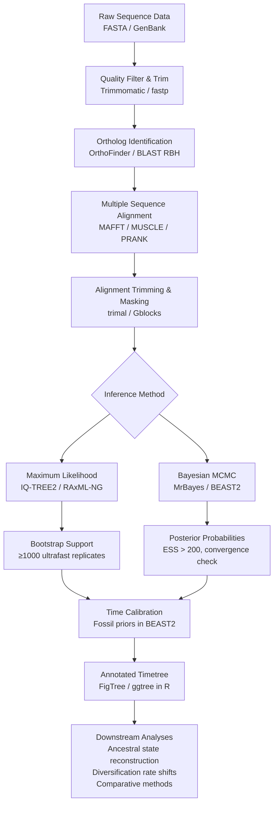

# Lesson 4: Speciation, Phylogenetics, Macroevolution

## 1. First-Principles Intuition & Invariants

### The Architecture of Divergence

Life does not simply change; it branches. This branching structure, the irrevocable splitting of one lineage into two or more independently evolving trajectories, is the central fact of evolutionary biology and the event we call speciation. Understanding it demands that we first establish what a species actually is, a question that sounds simple and turns out to be one of the most contentious in all of biology.

The Biological Species Concept, formalized by Ernst Mayr in 1942, defines a species as a group of actually or potentially interbreeding natural populations that are reproductively isolated from other such groups. This definition is operationally powerful because it anchors species identity in a mechanistic criterion: gene flow. Two populations that exchange genes remain one species; populations that do not exchange genes, or cannot, are on separate evolutionary trajectories and will diverge through the independent accumulation of mutations, the independent action of drift, and the adaptation to their respective environments. The elegance of Mayr's formulation is that it converts the metaphysical question "what is a species?" into the empirical question "is there gene flow between these populations?" — a question that can, in principle, be answered with data.

Yet the Biological Species Concept fractures against reality in several places. It is inapplicable to asexual organisms, which constitute the majority of life on Earth. It fails for the fossil record, where reproductive behavior leaves no trace. It struggles with hybridization, which is rampant in plants, common in birds, and not rare in mammals; populations that hybridize occasionally but maintain distinct morphology, ecology, and genomic identity occupy an uncomfortable liminal space. These difficulties have generated a proliferation of alternative species concepts: the Morphological Species Concept, the Phylogenetic Species Concept, the Ecological Species Concept, the Genotypic Cluster Definition. Each captures something real and misses something else. For the working evolutionary biologist, the most practical modern stance treats species as independently evolving metapopulation lineages — the Unified Species Concept of de Queiroz — in which all the diagnostic criteria (reproductive isolation, monophyly, ecological distinctiveness, morphological diagnosability) are treated as lines of evidence that converge on the same underlying reality: the existence of a separately evolving lineage.

### Reproductive Isolation: The Locks on Divergence

Whatever species concept one adopts, reproductive isolation is the mechanism that makes speciation durable. Without barriers to gene flow, any divergence accumulated between two populations will be erased the moment they come back into contact and begin exchanging migrants. Reproductive isolating barriers are conventionally divided into two categories according to whether they operate before or after the formation of a zygote.

Prezygotic barriers prevent the formation of hybrid zygotes in the first place. Habitat isolation arises when two populations occupy different microhabitats within the same geographic area and therefore rarely encounter one another; the apple maggot fly *Rhagoletis pomonella*, which shifted from hawthorn to domesticated apple in the nineteenth century and now rarely interbreeds across the host-plant boundary, is a textbook example. Temporal isolation occurs when populations breed at different times, as in the case of *Platanus occidentalis* and *P. orientalis* which flower asynchronously. Behavioral isolation, also called ethological isolation, is the most powerful prezygotic barrier in animals: females choose mates based on signals (song, coloration, pheromone profile) that differ between populations, so divergent mate preferences cut off gene flow even in the face of geographic sympatry. Mechanical isolation results from physical incompatibility of reproductive structures, particularly important in plants and invertebrates. Gametic isolation, the final prezygotic barrier, occurs when sperm and egg fail to recognize each other biochemically even when copulation occurs; rapidly diverging sperm surface proteins and egg coat proteins are among the fastest-evolving sequences in animal genomes, suggesting strong selective pressure on gametic compatibility.

Postzygotic barriers operate after fertilization has already occurred. Hybrid inviability means that the hybrid embryo fails to develop normally, as in crosses between different frog species of the genus *Rana* where developmental gene networks become incoherent. Hybrid sterility is the more famous outcome: the mule, offspring of horse and donkey, is vigorous but infertile because the parental chromosomes are sufficiently diverged that they cannot pair properly at meiosis. Hybrid breakdown is a subtler postzygotic barrier in which the F1 hybrids are viable and fertile but their offspring in subsequent generations suffer reduced fitness, as incompatible epistatic combinations are shuffled back together. The molecular underpinnings of postzygotic isolation were illuminated by the Dobzhansky-Muller model, which showed that two allopatrically diverging populations can each accumulate mutations that are individually compatible within their own genetic background but are incompatible when brought together in a hybrid genome. No single mutational step need be deleterious; the breakdown emerges from the interaction.

The relative importance of pre- and postzygotic isolation varies dramatically across taxa and speciation contexts. In *Drosophila*, behavioral isolation between closely related species is typically stronger than hybrid sterility. In plants, where behavioral isolation is irrelevant, pollinator specificity and mechanical barriers do much of the work that mate choice does in animals. This variation tells us that speciation is not a single process with a single mechanism but a family of processes unified by the common outcome: the establishment of independent evolutionary trajectories.

### Geography, the Precondition of Most Speciation

The geographic context in which speciation unfolds determines which forces are available to drive divergence and which obstacles must be overcome. The classical geographic model, allopatric speciation, proceeds when a physical barrier — a mountain range, a river, a glacial advance, the opening of a seaway — divides a population into two or more units between which gene flow drops to zero or near zero. With gene flow suppressed, mutation, natural selection, and genetic drift sculpt each subpopulation independently. If the barrier persists long enough, the populations accumulate sufficient genetic and phenotypic divergence that reproductive isolation is a byproduct. When the barrier eventually dissolves and the populations come back into secondary contact, they may interbreed freely and merge (incomplete speciation), hybridize at a stable hybrid zone but remain otherwise distinct, or fail to interbreed at all (complete speciation). The classic natural experiment is the North American avifauna, where dozens of species-pairs — Baltimore and Bullock's orioles, Indigo and Lazuli buntings, red-shafted and yellow-shafted flickers — represent populations separated during Pleistocene glaciations and reunited afterward, now sitting at various points along the allopatric speciation continuum.

Parapatric speciation relaxes the geographic requirement: populations are adjacent and connected by some gene flow, but strong divergent selection across an environmental gradient maintains divergence despite that exchange. The challenge in parapatric speciation theory is that gene flow imports locally maladapted alleles, so selection must be strong enough to overcome this swamping effect. The Littorina saxatilis snail system along European coastlines is a compelling natural case: populations on wave-exposed rocks are morphologically and genetically differentiated from those in crab-predation-dominated habitats, and partial reproductive isolation has evolved despite continuous contact. Parapatric speciation is real, but it requires specific ecological conditions and tends to be slower and less complete than allopatric divergence.

Sympatric speciation — divergence without any geographic barrier whatsoever — was long viewed with skepticism because gene flow between coexisting populations should continuously dissolve any emerging differences. The theoretical resolution arrived through models of assortative mating: if individuals mate preferentially with others of their own ecotype, gene flow is reduced even without geographic separation, and divergent selection can then act more effectively. The cichlid radiations of African rift lakes, particularly Lakes Victoria and Malawi, have produced hundreds of species in geographic sympatry over remarkably short timescales, with female color preference for male nuptial coloration acting as the primary reproductive barrier. The genomic data, however, have complicated the picture: many apparent sympatric radiations show evidence of multiple colonization events or fine-scale habitat structure that amounts to microallopatry. True sympatric speciation is probably real in several plant systems, particularly allopolyploidy, in which a hybrid between two species undergoes genome duplication to become a new reproductively isolated lineage in a single generation. This is not a gradual process but an instantaneous one, and it has generated a substantial fraction of flowering plant diversity.

### The Physics of Divergence: Time, Rate, and the Molecular Clock

A critical quantitative invariant running through all speciation models is the relationship between time, mutation rate, and genetic divergence. At the molecular level, sequences diverge approximately as a linear function of time since separation, provided that the neutral substitution rate is roughly constant. This is the molecular clock hypothesis, first proposed by Zuckerkandl and Pauling in 1965. The expected sequence divergence between two lineages separated at time $t$ is:

$$d = 2\mu t$$

where $d$ is the number of substitutions per site, $\mu$ is the neutral mutation rate per site per generation, and the factor of two accounts for independent evolution in both lineages. Rearranging to estimate divergence time from observed sequence data gives:

$$t = \frac{d}{2\mu}$$

The practical constraint is accurate calibration of $\mu$, which requires fossil-derived age estimates at specific nodes in the phylogeny. If two sister taxa whose fossil record indicates divergence at time $t_\text{cal}$ show observed molecular divergence $d_\text{cal}$, the rate estimate is:

$$\hat{\mu} = \frac{d_\text{cal}}{2 t_\text{cal}}$$

Empirically, synonymous substitution rates (at fourfold degenerate sites where changes do not alter amino acid sequence and are therefore approximately neutral) cluster around $10^{-9}$ substitutions per site per year for mammals, with considerable variation across lineages and genomic regions. The molecular clock is not a perfect clock — rate heterogeneity across lineages is the rule, not the exception — and modern Bayesian divergence-dating methods such as BEAST2 and MCMCtree explicitly model rate variation using relaxed clock models, treating substitution rates as drawn from a lognormal or gamma distribution across branches.

---

## 2. Core Architecture & Mechanics

### Phylogenetic Trees: Reading the Structure of History

A phylogenetic tree is not merely an illustration; it is a statistical hypothesis about the branching history of a set of taxa, expressed as a topological structure with associated branch lengths. Reading it correctly is a prerequisite for every downstream analysis in evolutionary biology. The two most common formats are the cladogram, in which branch lengths carry no quantitative information and only topology matters, and the phylogram, in which branch lengths are proportional to some metric — number of substitutions per site, or time in millions of years for a time-calibrated tree.

The fundamental unit of a tree is the clade, also called a monophyletic group: a set of taxa consisting of a common ancestor and all of its descendants. Clades are the only biologically meaningful groupings from an evolutionary standpoint because they represent the actual partition of genealogical history. Paraphyletic groups (an ancestor and some but not all descendants, as in the traditional "reptiles" excluding birds) and polyphyletic groups (taxa grouped by convergent similarity rather than shared ancestry, as in "warm-blooded animals") are evolutionary artifacts and should not be treated as natural units.

The standard computational workflow for phylogenetic inference moves through several well-defined stages. Homologous sequences must first be identified — typically through reciprocal best-hit BLAST searches or dedicated orthology databases such as OrthoFinder — and then aligned. Alignment is the step where biological error most easily propagates: a misaligned column will generate false synapomorphies that corrupt the topology. MAFFT and MUSCLE are the workhorse aligners for nucleotide and protein sequences respectively; for highly diverged sequences, PRANK, which explicitly accounts for insertion and deletion events, produces more accurate alignments at the cost of speed.

The alignment is then passed to a tree inference engine. Maximum likelihood methods, implemented in IQ-TREE2 and RAxML-NG, find the tree topology and branch lengths that maximize the probability of observing the data under a specified substitution model. Bayesian methods, implemented in MrBayes and BEAST2, sample from the posterior distribution of trees given the data and the prior, returning not a single tree but a distribution of trees that quantifies topological uncertainty. The substitution model specifies how nucleotides or amino acids change over time: the simplest is Jukes-Cantor (equal rates, equal base frequencies), the most general is GTR+Γ+I (general time-reversible with gamma-distributed rate variation and a proportion of invariant sites). Model selection is performed using AIC, BIC, or the likelihood ratio test, and IQ-TREE2 incorporates ModelFinder to automate this step.

Branch support values quantify confidence in each node. Bootstrap proportions from 1000 or more replicates assess how often a given clade appears when the alignment columns are resampled with replacement; values above 70% are conventionally considered well-supported, though the threshold is context-dependent. Bayesian posterior probabilities, by contrast, represent the fraction of MCMC samples containing a given clade; they tend to be higher than bootstrap values for the same data and are sometimes criticised for overconfidence when the model is misspecified. The key diagnostic for Bayesian convergence is the Effective Sample Size (ESS) of each parameter, which should exceed 200 for all parameters, and the potential scale reduction factor (PSRF), which should be close to 1.0. Tracer is the standard tool for visualizing MCMC convergence diagnostics.

### Measuring Evolutionary Rates and Detecting Selection

Once a timetree is in hand, the branch lengths express rates of molecular evolution per unit time — typically substitutions per site per million years. But not all substitutions are equal. Synonymous substitutions ($d_S$, also denoted $K_S$) change the nucleotide sequence without changing the encoded amino acid; they are approximately neutral and serve as the clock baseline. Nonsynonymous substitutions ($d_N$, also denoted $K_A$) change the amino acid and are therefore subject to selection.

The ratio $\omega = d_N / d_S$ is the fundamental index of selective pressure on a protein-coding gene. When $\omega < 1$, purifying selection is removing most nonsynonymous mutations, as expected for essential conserved genes. When $\omega \approx 1$, the gene evolves neutrally, as in a pseudogene. When $\omega > 1$, nonsynonymous changes are accumulating faster than synonymous ones, which is the signature of positive selection — natural selection is actively favoring amino acid change. PAML (Phylogenetic Analysis by Maximum Likelihood) is the canonical software for $d_N/d_S$ analysis, implementing models that allow $\omega$ to vary across sites (M1a/M2a comparison), across branches (free-ratio model), or across both simultaneously (branch-site model for detecting episodic positive selection on specific lineages).

The detection of selective sweeps in population genomic data follows a complementary logic. When a beneficial mutation rises to fixation rapidly, it carries flanking neutral variation to high frequency, reducing nucleotide diversity in the surrounding genomic region — a "selective sweep" that leaves a recognizable signature. Summary statistics for detecting sweeps include Tajima's $D$:

$$D = \frac{\hat{\pi} - \hat{\theta}_W}{\sqrt{\hat{V}(\hat{\pi} - \hat{\theta}_W)}}$$

where $\hat{\pi}$ is the pairwise nucleotide diversity, $\hat{\theta}_W = S / \sum_{i=1}^{n-1} 1/i$ is Watterson's estimator (with $S$ segregating sites and $n$ sequences), and $V$ the variance. Under neutrality, $D \approx 0$; a significantly negative $D$ indicates an excess of rare variants, consistent with a recent sweep or population expansion. Modern methods such as iHS (integrated haplotype score) and XP-EHH (cross-population extended haplotype homozygosity) detect sweeps from haplotype structure in phased genomes, implemented in scikit-allel and selscan.

### Diversification Rates and the Macroevolutionary Tempo

Speciation and extinction are the birth and death processes of a macroevolutionary system. The net diversification rate $r$ is simply:

$$r = \lambda - \mu$$

where $\lambda$ is the per-lineage speciation rate and $\mu$ is the per-lineage extinction rate. These rates are not directly observable in the fossil record without correction for incomplete sampling, nor are they directly observable in molecular phylogenies without correction for the fact that extinct lineages leave no extant descendants. The BiSSE model (Binary State Speciation and Extinction) and its extensions (MuSSE, HiSSE) test whether a discrete character state — say, presence of a floral spur or a geographic range restriction — is associated with elevated speciation or extinction rates. BAMM (Bayesian Analysis of Macroevolutionary Mixtures) detects rate shifts across a phylogeny by modeling $\lambda$ and $\mu$ as potentially heterogeneous across branches, though debates about its statistical assumptions have driven adoption of alternative approaches such as the RPANDA package in R and the RevBayes framework.

The macroevolutionary tempo exhibits two qualitatively distinct patterns that have driven substantial theoretical debate. The gradualistic model, associated with the Modern Synthesis, holds that evolution proceeds by the continuous accumulation of small changes, with the apparent gaps in the fossil record attributable to incomplete preservation. Punctuated equilibrium, proposed by Niles Eldredge and Stephen Jay Gould in 1972, holds that the fossil record's dominant pattern — morphological stasis punctuated by geologically rapid transitions at speciation events — is real rather than artifactual. Under punctuated equilibrium, most morphological change is concentrated in rapid bursts associated with cladogenesis, with long intervening periods of stasis. The empirical data are mixed: some lineages show clear gradualism (some foram lineages in deep-sea cores), others show clear stasis interrupted by rapid transitions (*Metrarabdotos* bryozoans), and many show neither cleanly. Quantitative tests using trait evolution models on molecular phylogenies — comparing Brownian motion (gradual), Ornstein-Uhlenbeck (stabilizing selection around an optimum), and early-burst models — allow this question to be framed as a statistical model comparison.

### Adaptive Radiation: When Diversity Explodes

Adaptive radiation is the rapid proliferation of a single ancestral lineage into a wide variety of ecological niches, producing high morphological and ecological diversity in a short time. It is the macroevolutionary process most directly responsible for the structure of taxonomic diversity within major groups. The conditions that promote adaptive radiation are increasingly well understood: ecological opportunity (a novel environment with many unfilled niches, as on an isolated island or after a mass extinction), key innovations (a morphological or physiological novelty that opens access to previously unavailable resources), and sexual selection (which can accelerate speciation independent of ecological divergence).

The Darwin's finches of the Galápagos are the paradigmatic textbook example, but the African cichlids are the more spectacular demonstration of radiative power: over 500 species in Lake Victoria evolved in fewer than 15,000 years following the lake's refilling, an astonishing rate that reflects both the ecological opportunity of an empty lake and the accelerant of female color preference driving rapid behavioral isolation. The molecular mechanism underlying much of cichlid jaw diversity — development of a second set of pharyngeal jaws, a key innovation freeing the oral jaws for prey-capture specialization — illustrates how a single developmental change can unlock an entire adaptive zone.

The quantitative signature of adaptive radiation in molecular phylogenies is a high initial rate of diversification that subsequently decelerates as ecological niches fill — a "density-dependent" diversification pattern. The $\gamma$ statistic of Pybus and Harvey tests for this pattern: under a pure-birth process with constant rate, $\gamma \approx 0$; significantly negative $\gamma$ indicates that early branching events are overrepresented relative to recent ones, consistent with an early burst. The MEDUSA algorithm and BAMM both detect rate shifts on specific branches, allowing the identification of which node in a phylogeny marks the onset of an adaptive radiation.

### Evolutionary Developmental Biology: The Genetic Architecture of Form

No account of macroevolution is complete without engaging with the genetic mechanisms that generate morphological novelty. Evolutionary developmental biology, evo-devo, is the discipline that bridges population genetics and paleontology by asking: what classes of genetic change produce the morphological transitions we see in the fossil record?

The central finding of evo-devo is that animal body plans are constructed by an ancient, highly conserved toolkit of developmental regulatory genes — Hox genes, Pax genes, Dll, Nkx, and others — whose spatial and temporal expression patterns, rather than their protein sequences, vary between species. The same Hox gene network that patterns the vertebrate trunk patterns the arthropod body plan, though it has been dramatically co-opted and rewired. This regulatory redeployment means that morphological evolution proceeds predominantly through changes in cis-regulatory elements (enhancers and promoters) rather than changes in protein-coding sequences. The threespine stickleback (*Gasterosteus aculeatus*) provides one of the clearest examples: repeated, independent loss of pelvic spines in freshwater populations across the Northern Hemisphere involves independent mutations disrupting the same pelvic-specific enhancer of the *Pitx1* gene, leaving the gene's other expression domains (and therefore other developmental functions) intact. This phenomenon — repeated evolution via the same molecular mechanism — is called genetic parallelism and suggests that the number of evolutionary paths to a given phenotypic outcome is smaller than naively expected.

The quantitative framework for characterizing developmental constraint is the G-matrix — the genetic variance-covariance matrix of a set of traits:

$$\mathbf{G} = \begin{pmatrix} V_{A_1} & \text{cov}_{A_{12}} & \cdots \\ \text{cov}_{A_{12}} & V_{A_2} & \cdots \\ \vdots & \vdots & \ddots \end{pmatrix}$$

where $V_{A_i}$ is the additive genetic variance of trait $i$ and $\text{cov}_{A_{ij}}$ is the additive genetic covariance between traits $i$ and $j$. The multivariate response to selection is given by the breeder's equation extended to multiple traits:

$$\Delta \bar{z} = \mathbf{G} \boldsymbol{\beta}$$

where $\boldsymbol{\beta}$ is the vector of selection gradients. If two traits are strongly genetically correlated ($\text{cov}_{A_{ij}}$ is large), selection on one will drag the other along, constraining the directions in which the phenotype can evolve. The leading eigenvector of $\mathbf{G}$, termed $g_{\max}$, defines the direction of greatest genetic variation and therefore greatest evolutionary lability; empirical studies consistently find that populations tend to evolve along $g_{\max}$, suggesting developmental constraint channels macroevolutionary trajectories.

---

## 3. High-Performance Optimization & Failure Modes

### Building a Robust Phylogenomic Pipeline

Modern phylogenomics uses hundreds to thousands of loci simultaneously, which amplifies both the signal and the noise. The transition from single-gene phylogenetics to phylogenomics is not simply a matter of scale; it introduces qualitatively new analytical challenges that must be addressed explicitly.

The most consequential is gene tree discordance. Individual gene trees frequently disagree with the species tree and with each other, for three distinct reasons: incomplete lineage sorting (ILS), horizontal gene transfer (HGT), and gene duplication and loss. Incomplete lineage sorting is particularly pervasive in rapidly radiating lineages, where the ancestral population is large relative to the time between successive speciation events. When the ancestral effective population size $N_e$ and the internode time $t$ are such that $t / N_e$ is small (measured in units of $4N_e$ generations, the standard coalescent scaling), polymorphisms present in the ancestor are likely to be retained through the first speciation event and sorted randomly between descendant lineages in the second — generating gene tree topologies that differ from the species tree topology, not by error, but by the stochastic nature of coalescence.

The multispecies coalescent model addresses this problem explicitly. Concordance factor analysis in IQ-TREE2, ASTRAL (a summary coalescent method), and SVDquartets (a site-based coalescent method) all infer species trees from gene tree distributions or quartet frequencies in ways that are statistically consistent under the multispecies coalescent. The practical choice between concatenation (treating all loci as a single super-alignment) and coalescent-based approaches depends on the degree of ILS: for ancient, well-spaced radiations, concatenation and coalescent methods typically agree; for recent rapid radiations, only coalescent methods produce consistent estimates.

A second major failure mode is long-branch attraction (LBA), an artifact of maximum parsimony and, to a lesser extent, maximum likelihood inference. When two lineages both have high substitution rates, they accumulate convergent changes by chance and are incorrectly inferred as sister taxa, regardless of their true relationship. Detecting LBA requires examining whether problematic taxa have exceptionally long branches (indicating high substitution rate), whether the clade in question is supported only by parsimony and not likelihood or Bayesian methods, and whether adding or removing the putatively attracted taxa changes the topology of the remaining lineages. Mitigation strategies include breaking long branches by adding closely related taxa, using better-fit substitution models that allow rate heterogeneity, and removing the fastest-evolving sites from the alignment.

### Practical Protocols for Speciation Research

The empirical study of speciation in the field and laboratory requires integrating population genomic, behavioral, and ecological data. A well-structured speciation study design proceeds through a logical sequence of characterization steps.

**Population sampling and sequencing strategy.** The fundamental requirement is sampling populations from across the contact zone between diverging lineages, with adequate ingroup and outgroup representation. For RADseq (Restriction-site Associated DNA sequencing), aim for a minimum of 15–20 individuals per population and ensure that the restriction enzyme choice generates a consistent fragment size distribution across the taxa of interest; PstI and SbfI are commonly used, but *in silico* digestion of a reference genome (using Stacks' `denovo_map.pl` or `ref_map.pl` with a reference) allows optimization before committing laboratory resources. For whole-genome resequencing, 10–15× coverage is sufficient for population genetic summary statistics; 30× is needed for accurate SNP calling and phasing. Libraries should be prepared with unique dual-index adapters to prevent index hopping on patterned flow cells.

**Reproductive isolation quantification.** Computing the total reproductive isolation between two populations requires summing the contributions of each individual barrier, weighted by the opportunity for that barrier to operate. Following the framework of Sobel and Chen, the cumulative reproductive isolation index $RI_{total}$ is built up sequentially: each barrier $i$ contributes $RI_i \cdot \prod_{j<i}(1 - RI_j)$, so barriers acting early have disproportionate influence. Mate choice trials in the laboratory quantify behavioral isolation through the preference index $PI = (H - H^*)/(H + H^*)$, where $H$ is the number of conspecific matings and $H^*$ the number of heterospecific matings observed; a value of 1 indicates complete isolation, 0 indicates random mating. Hybrid fitness assays in a common garden or controlled greenhouse environment estimate postzygotic isolation by comparing the survival, development time, and reproductive output of hybrids and pure-cross controls through at least the F2 generation.

**FST and isolation-by-distance.** The fixation index $F_{ST}$ between two populations is the proportion of total genetic variance attributable to among-population differences:

$$F_{ST} = \frac{H_T - H_S}{H_T}$$

where $H_T$ is the expected heterozygosity of the total pooled sample and $H_S$ is the average expected heterozygosity within subpopulations. Under the island model at migration-drift equilibrium, $F_{ST} \approx 1 / (4N_e m + 1)$, where $m$ is the migration rate. A genome-wide distribution of $F_{ST}$ values across SNPs identifies outlier loci subject to divergent selection (high $F_{ST}$ outliers) and loci subject to balancing selection (low $F_{ST}$ outliers). The BayeScan and OutFLANK methods identify these outliers while correcting for the background demographic history. Isolation by distance — the pattern that genetic differentiation increases with geographic distance — is tested by a Mantel test of genetic distance (linearized $F_{ST}$) against log-geographic distance; the significance of the correlation is assessed by permutation.

### Failure Modes in Macroevolutionary Analysis

Macroevolutionary inference is plagued by a set of well-characterized biases that the practitioner must actively diagnose. Phylogenetic non-independence is perhaps the most pervasive: because species share evolutionary history, they are not independent data points, and naive statistical analyses that treat them as such produce inflated Type I error rates. The solution is phylogenetic comparative methods — phylogenetic generalized least squares (PGLS), phylogenetic ANOVA, phylogenetically independent contrasts (PICs) — that account for the covariance structure imposed by shared ancestry. The ape, phytools, and geiger packages in R provide comprehensive implementations.

The node density artifact is a subtler failure mode: when a clade has more branches, the molecular clock tends to estimate shorter branch lengths per branch, biasing divergence time estimates toward more recent dates in species-rich clades. This arises because dense taxon sampling captures multiple substitutions that occurred on the same branch and are therefore not counted as multiple hits; it inflates divergence estimates on long sparse branches and deflates them on short dense branches. Correction requires either applying topological correction factors or using methods such as autocorrelated rates models that explicitly parameterize rate variation as a function of tree structure.

The pull of the present is a systematic bias in fossil record analyses of diversification: because the most recent time interval before the present is incompletely sampled (not enough time has passed for fossilization and discovery of very recent organisms), apparent diversification rates in the most recent intervals appear depressed. The equivalent in molecular phylogenetics is the incomplete sampling of extant taxa: unsampled species "pull" the apparent diversification rate toward zero near the tips because the terminal branch lengths are artificially lengthened. All diversification rate methods require explicit specification of the sampling fraction — the proportion of extant species in the clade that are represented in the phylogeny — and incorrect specification of this fraction can generate artifactual rate-shift signals.

The most consequential statistical failure in recent macroevolutionary biology has been the unreliable behavior of BAMM under certain prior settings and model assumptions, documented by Moore and colleagues. The practical response is not to abandon diversification rate analysis but to triangulate across multiple methods — BAMM, RPANDA, MEDUSA, and the episodic diversification models in RevBayes — and treat only those rate shifts that are consistently recovered across methods as well-supported biological signals.

### Integrating Ancient DNA and the Fossil Record

The separation between paleontology and molecular phylogenetics has been dissolving for two decades, accelerated by ancient DNA (aDNA) techniques that now routinely recover high-quality genomes from specimens tens of thousands of years old and, in exceptional cases, from permafrost specimens approaching one million years. The technical constraints of aDNA work are stringent: post-mortem damage converts cytosine to uracil at the ends of fragments (C-to-T transitions on the 5′ end, G-to-A on the 3′ end in the reverse complement strand), generating characteristic miscoding lesions that must be computationally identified and removed using mapDamage2 or accounted for in genotype likelihood frameworks. Contamination by modern human or environmental DNA is the dominant experimental concern, managed through dedicated clean-room facilities, negative extraction controls in every batch, and authentication by the characteristic damage pattern itself.

The integration of aDNA into phylogenomics allows the placement of ancient specimens on a timetree as calibration points with known ages, breaking the correlation between substitution rate and divergence time that plagues node calibration from the fossil record alone. BEAST2's TipDating model treats ancient specimens as tips with fixed sampling times rather than as calibration priors, allowing the molecular clock rate to be estimated directly from the temporal spacing of the data. This approach has revolutionized Quaternary evolutionary biology, producing high-resolution pictures of woolly mammoth population dynamics, Pleistocene horse systematics, Neanderthal introgression into modern humans, and the domestication history of dogs, cattle, and horses with a temporal resolution that fossil morphology alone could never achieve.

Ultimately, speciation, phylogenetics, and macroevolution are unified by a single insight: evolutionary history is a branching, irreversible process that leaves recoverable signatures in DNA, morphology, the fossil record, and the ecological structure of communities. Reading those signatures accurately requires rigorous attention to model assumptions, careful experimental design, and the willingness to let multiple, partially redundant lines of evidence converge on conclusions that no single method could support alone. The practitioner who masters this synthesis holds the tools to reconstruct the deep history of life and to predict, in probabilistic terms, how that history will continue to unfold.
