# Lesson 6: Coevolution, Social Evolution, Human Evolution

## 1. First-Principles Intuition & Invariants

Evolution does not occur in isolation. Every organism exists embedded within a dynamic network of ecological interactions—predators tracking prey, parasites evading immune defenses, mutualists exchanging metabolic currencies, and social groups navigating conflicts over reproduction and resources. These reciprocal selective pressures generate coevolutionary dynamics, where the evolutionary trajectory of one lineage directly shapes the fitness landscape of another, producing arms races, cooperative equilibria, and intricate molecular dialogues that span millions of years. Understanding coevolution requires abandoning the single-species perspective and embracing a systems view where fitness is always relative, selection is frequency-dependent, and evolutionary outcomes emerge from game-theoretic payoff matrices played across geological time.

The fundamental invariant governing coevolution is **reciprocal evolutionary change induced by interspecific interactions**. When a predator evolves enhanced sensory acuity to detect cryptic prey, selection intensifies on prey populations to evolve better camouflage, which in turn selects for predators with sharper pattern-recognition circuitry. This feedback loop—termed an evolutionary arms race—drives continuous trait escalation without necessarily conferring absolute fitness advantages. The Red Queen hypothesis, named after the character in Lewis Carroll's *Through the Looking-Glass* who must run continuously just to remain in place, formalizes this dynamic: coevolving lineages must perpetually adapt merely to maintain their current fitness relative to antagonists. Empirical support comes from host-parasite systems where genotype frequencies oscillate over time in negative frequency-dependent cycles, with rare host resistance alleles rising in frequency when matched parasites are common, only to decline as parasites evolve counter-resistance.

Coevolutionary dynamics partition into three fundamental interaction modes, each governed by distinct selective pressures and evolutionary outcomes. **Antagonistic coevolution** encompasses predator-prey, host-parasite, and herbivore-plant interactions where selection favors traits that increase exploitation efficiency in one species and defense or evasion in the other. These systems typically exhibit escalating trait values—faster running speeds, more potent toxins, more sophisticated immune recognition—constrained only by physiological trade-offs and genetic variation. **Mutualistic coevolution** involves reciprocal benefits, such as pollinator-flower relationships where floral morphology evolves to match pollinator anatomy and pollinators evolve sensory preferences for specific floral signals. Mutualisms face the constant threat of cheating, where one partner exploits the other's investment without reciprocating, stabilized only by partner choice mechanisms, sanctions against cheaters, or tight metabolic integration that aligns fitness interests. **Competitive coevolution** occurs when species compete for shared resources, driving character displacement where sympatric populations evolve divergent trait values to minimize niche overlap, a pattern documented in Darwin's finches where beak morphology shifts in response to the presence or absence of competing species.

The mathematics of coevolution extend classical population genetics to coupled systems of differential equations where allele frequency changes in one species depend on allele frequencies in interacting species. Consider a simple host-parasite model with haploid genetics where host genotype $H$ confers resistance to parasite genotype $P$. Let $h$ represent the frequency of the resistant host allele and $p$ the frequency of the virulent parasite allele. The fitness of resistant hosts depends on parasite composition: when virulent parasites are rare, resistance is costly and selects against $h$, but when virulent parasites become common, resistance confers strong benefits. This produces coupled dynamics:

$$\frac{dh}{dt} = h(1-h) \left[ s_h p - c_h \right]$$

$$\frac{dp}{dt} = p(1-p) \left[ s_p (1-h) - c_p \right]$$

where $s_h$ and $s_p$ represent the selective advantages of resistance and virulence when matched with susceptible partners, while $c_h$ and $c_p$ quantify the costs of maintaining these traits. These equations predict oscillatory dynamics or stable polymorphisms depending on cost parameters, matching observed temporal fluctuations in natural host-parasite systems such as *Daphnia*-microparasite interactions in freshwater lakes.

Geographical mosaics of coevolution add spatial structure to these temporal dynamics. Because local abiotic conditions, community composition, and demographic parameters vary across landscapes, the strength and direction of selection imposed by species interactions differ among populations. A plant species may experience strong herbivore pressure in low-elevation warm sites, favoring investment in chemical defenses, while high-elevation populations face negligible herbivory and evolve reduced defense allocation. When gene flow among populations is intermediate—neither so low that populations evolve independently nor so high that local adaptation is swamped—the result is a geographic mosaic where trait combinations and interaction outcomes vary spatially, with local maladaptation at site boundaries. Empirical documentation of such mosaics comes from *Bromus* grasses and their fungal pathogens, where resistance-virulence interactions show strong genotype-by-environment interactions and population-specific matching.

Social evolution represents a special case of coevolutionary dynamics occurring within species, where the fitness of an individual's phenotype depends on the phenotypes expressed by conspecifics. The central paradox of social evolution is the origin and maintenance of altruism—behaviors that reduce the actor's direct fitness while increasing the fitness of recipients. Classical Darwinian selection favors traits that maximize individual reproductive success, yet nature abounds with examples of organisms helping others: worker honey bees that forego reproduction to rear their queen's offspring, vampire bats that regurgitate blood meals to feed unrelated roost-mates, and humans that cooperate with strangers in large-scale societies. Explaining altruism requires extending fitness concepts beyond individual reproduction to include effects on relatives (kin selection), reciprocal exchanges (reciprocal altruism), and group-level benefits (multilevel selection).

Hamilton's rule provides the quantitative foundation for understanding altruistic cooperation. An altruistic act will be favored by natural selection if:

$$rB > C$$

where $C$ represents the fitness cost to the actor, $B$ the fitness benefit to the recipient, and $r$ the coefficient of genetic relatedness between actor and recipient. Relatedness quantifies the probability that a gene in the actor is identical by descent to a gene in the recipient; for diploid sexual species, $r = 0.5$ for full siblings, $r = 0.25$ for half-siblings or grandchildren, and $r = 0.125$ for first cousins. This framework explains why parental care is universal—parents share 50% of their genes with offspring, making the reproductive success of offspring equivalent to half the parent's own reproduction—and predicts the extreme altruism of eusocial Hymenoptera (ants, bees, wasps) where haplodiploid genetics creates unusually high relatedness among sisters ($r = 0.75$), making workers more related to their sisters than to their own potential offspring.

Inclusive fitness, defined as an individual's direct reproductive success plus the sum of its effects on the reproductive success of relatives weighted by relatedness, captures the total genetic representation an individual achieves in future generations. This concept revolutionized behavioral ecology by shifting the unit of selection from individual organisms to genes, revealing that apparently altruistic behaviors can be selfish at the genetic level. A gene that causes its bearer to help close relatives spreads because copies of that gene in relatives benefit, even if the helper never reproduces. Empirical tests of kin selection span taxa from social insects to cooperatively breeding birds to human genealogies, consistently showing that helping behavior increases with relatedness and that individuals discriminate among potential recipients based on kinship cues.

Reciprocal altruism extends cooperation beyond kin by allowing unrelated individuals to exchange benefits over time, stabilized by the threat of withholding future aid from defectors. The evolutionary stability of reciprocity depends on repeated interactions, partner recognition, and memory of past exchanges—requirements that limit reciprocal altruism to long-lived species with cognitive capacity for individual recognition and conditional strategies. Theoretical models frame reciprocal altruism as iterated games where strategies compete: Tit-for-Tat (cooperate on the first move, then copy the partner's previous move) performs well in tournaments because it is nice (never defects first), retaliatory (punishes defection immediately), and forgiving (resumes cooperation after a single cooperative move). Natural examples include cleaner fish that remove parasites from client fish, with clients returning to cleaners that provided good service and avoiding those that cheated by biting off scales, and vampire bat food sharing where donors preferentially feed individuals that previously shared with them.

Multilevel selection theory addresses the evolution of traits that benefit groups at the expense of individuals within those groups, such as reduced virulence in pathogens or restrained resource consumption in communal foragers. For group-beneficial traits to evolve, between-group selection (favoring groups with more cooperators) must overcome within-group selection (favoring free-riders who exploit cooperators without contributing). This requires spatial or social structure that organizes individuals into groups, variation in group composition, and differential group productivity or survival. Human cultural institutions—norms, laws, religions, reputational systems—create potent group-level selection by reducing within-group variation in cooperative behavior (through punishment and ostracism) and amplifying between-group differences (through intergroup competition and cultural transmission of group-beneficial practices).

The human lineage represents a particularly rich case study in evolutionary dynamics, integrating paleontological, genetic, archaeological, and comparative primate data to reconstruct the origin and dispersal of our species. The hominin phylogeny begins approximately 6-7 million years ago with the split between the chimpanzee and human lineages, evidenced by molecular clock estimates from DNA sequence divergence and the earliest definitive hominin fossils (*Sahelanthropus tchadensis*, *Orrorin tugenensis*) exhibiting bipedal adaptations in pelvic and femoral morphology. Bipedalism, the earliest derived trait distinguishing hominins from other apes, likely evolved in response to changing habitat structure during Miocene-Pliocene climate transitions that replaced closed-canopy forests with mosaic woodlands and grasslands, where efficient terrestrial locomotion and elevated visual surveillance conferred fitness advantages.

The Australopithecine radiation (4-2 million years ago) produced diverse species ranging from gracile forms like *Australopithecus afarensis* ("Lucy") with brain volumes around 400-500 cubic centimeters and arboreal climbing adaptations to robust forms like *Paranthropus boisei* with massive jaws and molars adapted for processing tough vegetation. The archaeological record shows the first stone tools (Oldowan technology) appearing around 2.6 million years ago, coinciding with the origin of the genus *Homo*. Early *Homo* species (*H. habilis*, *H. erectus*) exhibit enlarged brain volumes (600-900 cc), reduced jaw and tooth size indicating dietary shifts toward higher-quality foods including meat, and prolonged juvenile development periods enabling extended learning. *Homo erectus* represents a pivotal transition, with brain volumes approaching 1000 cc, sophisticated Acheulean hand-axe technology, controlled fire use, and the first hominin dispersal out of Africa into Eurasia by 1.8 million years ago.

The evolution of *Homo sapiens* involved both gradual phyletic transformation within Africa and complex population structure with gene flow among partially isolated subpopulations. Fossil and genetic evidence places the origin of anatomically modern humans in Africa around 300,000 years ago, with the earliest fossils (*Jebel Irhoud*, Morocco) showing a mosaic of archaic and modern features. Behavioral modernity—evidenced by symbolic artifacts, complex projectile weapons, long-distance exchange networks, and elaborate burial practices—appears intermittently in the African archaeological record after 100,000 years ago and becomes ubiquitous after 50,000 years ago. The "Out of Africa" dispersal around 60,000-70,000 years ago saw small founding populations migrate into Eurasia, reaching Australia by 50,000 years ago, Europe by 45,000 years ago, and the Americas by 15,000-20,000 years ago. These dispersals left genetic signatures of serial founder effects: human genetic diversity decreases with distance from Africa, and non-African populations represent nested subsets of African genetic variation.

Ancient DNA extracted from Neanderthal, Denisovan, and other archaic hominin fossils revealed that modern humans interbred with archaic populations during their global expansion. Contemporary non-African human genomes contain 1-3% Neanderthal ancestry from admixture events in the Middle East around 50,000-60,000 years ago, while Melanesian and Australian Aboriginal genomes contain 4-6% Denisovan ancestry from encounters in Southeast Asia. These introgressed archaic alleles persist in modern populations because some conferred adaptive advantages in novel environments: Tibetan altitude-adaptation alleles at the *EPAS1* locus originated from Denisovans, while European skin pigmentation and immune function genes show signatures of positive selection on Neanderthal variants. This pattern of adaptive introgression demonstrates that archaic hominins were not evolutionary dead ends but contributed functionally important genetic variation to modern human populations.

Cultural evolution operates alongside genetic evolution in humans, transmitting information through social learning rather than genetic inheritance. Cultural traits—technologies, languages, norms, beliefs—accumulate modifications over generations through innovation and recombination, producing cumulative cultural evolution where later generations inherit and improve upon earlier innovations. The mathematics of cultural transmission parallels population genetics but includes unique features: horizontal transmission (peer-to-peer learning), oblique transmission (learning from non-parental adults), and biased transmission where learners preferentially copy successful, prestigious, or common variants. These transmission modes generate cultural evolutionary dynamics distinct from genetic evolution, including rapid adaptation to local environments through learned behaviors, maintenance of maladaptive traditions through conformist bias, and runaway cultural evolution of arbitrary markers that signal group membership.

Dual-inheritance theory models gene-culture coevolution, where cultural practices alter genetic selection pressures and genetic evolution shapes learning capacities and cultural transmission fidelity. The canonical example is lactase persistence, where the cultural practice of dairy pastoralism selected for genetic variants maintaining lactase enzyme expression into adulthood, allowing adults to digest milk sugars. This allele rose to high frequency in European and African pastoralist populations within the last 7,000-10,000 years, representing one of the strongest signals of recent positive selection in the human genome. Similar gene-culture coevolutionary feedbacks likely operated in alcohol metabolism (agricultural fermentation selecting for enhanced alcohol dehydrogenase activity), starch digestion (agricultural diets selecting for increased salivary amylase gene copy number), and immune function (sedentary high-density settlements increasing pathogen exposure).

Evolutionary medicine applies evolutionary principles to understanding human health and disease, recognizing that many medical conditions arise from mismatches between modern environments and the ancestral conditions in which human physiology evolved. The human genome reflects hundreds of thousands of years of selection in hunter-gatherer environments characterized by high physical activity, intermittent food availability, diverse plant-based diets, and high pathogen exposure. Modern industrialized environments differ radically: sedentary lifestyles, continuous caloric surplus, diets high in refined carbohydrates and saturated fats, and reduced pathogen exposure due to sanitation and antibiotics. This mismatch produces "diseases of civilization" including type 2 diabetes, cardiovascular disease, obesity, and autoimmune disorders that were rare or absent in ancestral populations.

The thrifty genotype hypothesis proposes that genetic variants promoting efficient energy storage and insulin resistance evolved under selection for surviving periodic famines but now predispose individuals to metabolic disease in environments with constant food availability. Empirical support comes from populations that transitioned rapidly from traditional to westernized diets, such as Pima Indians and Pacific Islanders, which show dramatically elevated diabetes and obesity prevalence compared to populations with longer exposure to agricultural diets. Similarly, the hygiene hypothesis suggests that reduced childhood exposure to parasites and microbes in hygienic modern environments leads to dysregulated immune development, increasing susceptibility to allergies and autoimmune conditions. Evolutionary perspectives also illuminate pathogen evolution within hosts: antibiotic resistance evolves rapidly because pathogens have short generation times and large population sizes, while incomplete antibiotic courses select for resistance by allowing survival of intermediate-resistance mutants.

Conservation genetics applies population genetic principles to preserve biodiversity and manage threatened species, recognizing that small population size erodes genetic diversity through drift, increases inbreeding depression, and reduces adaptive potential. The effective population size $N_e$, defined as the size of an idealized randomly mating population that experiences the same rate of genetic drift as the actual population, typically falls far below census population size due to skewed sex ratios, variance in reproductive success, and fluctuating population size. For diploid populations, heterozygosity declines each generation at rate $1/(2N_e)$, meaning populations with $N_e < 50$ lose genetic variation rapidly and accumulate deleterious mutations through drift that overwhelms selection. The 50/500 rule provides minimum viable population guidelines: $N_e = 50$ prevents inbreeding depression over 5-10 generations, while $N_e = 500$ maintains long-term adaptive potential by balancing mutation and drift.

Genetic rescue through immigration introduces new genetic variation into small isolated populations, reducing inbreeding depression and increasing fitness. Empirical examples include Florida panthers, where genetic bottleneck reduced fitness through inbred cardiac defects and kinked tails until translocation of Texas pumas introduced genetic variation and restored population health. However, outbreeding depression can occur if immigrants come from populations adapted to divergent environments, producing F1 hybrids with intermediate phenotypes maladapted to local conditions or F2 breakdown where coadapted gene complexes disassociate. Conservation genomics uses whole-genome sequencing to identify adaptive genetic variation, reconstruct demographic history, detect population structure, and guide management decisions about translocation sources and captive breeding pairings.

## 2. Core Architecture & Mechanics

Experimental investigation of coevolutionary dynamics requires longitudinal field observations coupled with manipulative experiments that perturb species interactions and measure evolutionary responses. The structure of a coevolution study integrates population genetic monitoring, reciprocal transplant experiments, phenotypic selection analysis, and sometimes artificial selection to accelerate evolutionary processes within laboratory microcosms.

The canonical field protocol for documenting host-parasite coevolution in natural populations follows a spatiotemporal sampling design. Researchers establish replicate study sites spanning environmental gradients or isolated habitat patches, then sample both host and parasite populations at regular intervals (often annually) over multiple generations. At each sampling event, investigators quantify genotype frequencies using molecular markers (microsatellites for population structure, specific loci under selection for resistance/virulence phenotypes), measure fitness correlates (host survival and fecundity, parasite transmission success and within-host replication), and phenotype interaction outcomes through cross-infection experiments. In a typical cross-infection assay, investigators expose each host genotype to each parasite genotype in a fully factorial design, scoring infection success, parasite load, and host damage. The resulting infection matrix reveals the specificity of interactions: generalist parasites infect most host genotypes, while specialist parasites show genotype-specific infectivity matching the gene-for-gene model common in plant-pathogen systems.

```mermaid
flowchart TD
    Start["Coevolutionary Field Study Architecture"]
    
    Start --> SiteSelection["Site Selection & Replication"]
    Start --> TemporalSampling["Temporal Sampling (Annual over 5-10 years)"]
    Start --> EvolutionaryAnalysis["Evolutionary Analysis"]
    Start --> SpatialAnalysis["Spatial Analysis"]
    
    SiteSelection --> SS1["Identify 10-20 independent populations across landscape"]
    SiteSelection --> SS2["Record environmental covariates<br/>(temperature, precipitation, community composition)"]
    SiteSelection --> SS3["Ensure sufficient distance between sites<br/>(>10 km to minimize gene flow)"]
    
    TemporalSampling --> HostSampling["Host sampling: Collect 50-100 individuals<br/>per population per year"]
    TemporalSampling --> ParasiteSampling["Parasite sampling: Isolate from infected hosts,<br/>culture if possible"]
    TemporalSampling --> CrossInfection["Cross-infection matrix experiment<br/>(in laboratory or greenhouse)"]
    
    HostSampling --> HS1["Extract DNA for genotyping<br/>(microsatellites + candidate loci)"]
    HostSampling --> HS2["Measure phenotypic traits<br/>(morphology, defenses, life history)"]
    HostSampling --> HS3["Score natural parasite infection<br/>status and load"]
    
    ParasiteSampling --> PS1["Extract DNA for genotyping<br/>parallel markers"]
    ParasiteSampling --> PS2["Maintain live cultures for<br/>cross-infection experiments"]
    ParasiteSampling --> PS3["Quantify transmission stage<br/>production"]
    
    CrossInfection --> CI1["Factorial design: Each host genotype<br/>× each parasite genotype"]
    CrossInfection --> CI2["Replicate 5-10 times per<br/>genotype combination"]
    CrossInfection --> CI3["Score: Infection success (binary),<br/>parasite load (qPCR), host fitness impact"]
    CrossInfection --> CI4["Statistical analysis: G×G interaction<br/>for local adaptation"]
    
    EvolutionaryAnalysis --> EA1["Calculate allele frequency<br/>trajectories over time"]
    EvolutionaryAnalysis --> EA2["Perform selection analysis:<br/>regress fitness on genotype<br/>controlling for environment"]
    EvolutionaryAnalysis --> EA3["Test for time-lagged correlations<br/>(host resistance predicts<br/>parasite virulence shift)"]
    EvolutionaryAnalysis --> EA4["Compare local vs. foreign<br/>parasite infectivity<br/>(local adaptation signal)"]
    
    SpatialAnalysis --> SA1["Map resistance/virulence allele<br/>frequencies across populations"]
    SpatialAnalysis --> SA2["Correlate with environmental variables<br/>and interaction history"]
    SpatialAnalysis --> SA3["Test geographic mosaic hypothesis:<br/>G×G×E interactions predict<br/>spatial variation"]
```

Reciprocal transplant experiments partition the contributions of genetic adaptation and plastic responses by moving organisms between environments and measuring performance. In a coevolutionary context, reciprocal transplants test for local adaptation of hosts to sympatric parasites: if coevolution produces population-specific matching between host resistance and parasite virulence, then hosts should perform better when challenged with sympatric parasites (against which they have evolved defenses) than when challenged with allopatric parasites (which may employ different virulence mechanisms). The canonical design compares four treatment combinations: local hosts × local parasites, local hosts × foreign parasites, foreign hosts × local parasites, and foreign hosts × foreign parasites. A local adaptation signature emerges as a significant host origin × parasite origin interaction, with local host-parasite combinations showing either better host defense (in hosts) or better parasite exploitation (in parasites) depending on which species has stronger coevolutionary impact.

Microbial coevolution experiments compress evolutionary timescales by exploiting rapid bacterial and phage generation times, allowing researchers to observe real-time evolutionary dynamics over hundreds to thousands of generations within months. A typical bacteria-phage coevolution protocol begins with clonal bacterial populations exposed to lytic bacteriophages at controlled multiplicities of infection. Serial transfer every 24-48 hours selects for bacterial resistance mutations (often in phage receptor proteins) and phage counter-adaptations (changes in receptor-binding proteins). Researchers archive samples at regular intervals by freezing glycerol stocks, creating a "frozen fossil record" that enables retrospective resurrection and phenotyping of ancestral genotypes. By thawing samples from different time points and performing cross-infection assays between bacteria and phages from all time combinations, investigators reconstruct the coevolutionary trajectory and test whether evolution follows arms race dynamics (successive unidirectional escalation) or fluctuating selection dynamics (cycling of resistance and infectivity alleles).

Quantitative phenotypic selection analysis measures the strength and form of natural selection on coevolving traits by regressing fitness on trait values. In host-parasite systems, researchers measure fitness components (survival, fecundity) and resistance phenotypes (immune gene expression, behavioral avoidance, tolerance mechanisms) in field-collected individuals that naturally vary in parasite exposure. Multiple regression of fitness on traits while controlling for confounding variables yields selection gradients $\beta$ that quantify the direct fitness change per unit change in trait value. A positive selection gradient on immune investment indicates that stronger immune responses increase fitness in the current parasite environment, while negative gradients suggest costs of resistance outweigh benefits when parasites are rare. Nonlinear selection gradients (quadratic and correlational) reveal stabilizing, disruptive, or correlational selection that constrains evolutionary trajectories. This approach identified strong positive selection on resistance genes in *Daphnia* populations exposed to endemic microparasites, with selection strength correlating with spatial variation in parasite prevalence.

Social evolution experiments in laboratory populations of microbes, invertebrates, and vertebrates manipulate relatedness, group structure, and dispersal patterns to test kin selection and multilevel selection predictions. Microbial cooperation can be studied using yeast strains that vary in production of invertase, an enzyme that cleaves sucrose into glucose and fructose. Invertase producers pay a metabolic cost but generate a public good (monosaccharides) that diffuses to neighbors, including non-producing cheaters. Experiments manipulate population structure by varying the number of founders per patch and the frequency of dispersal/mixing. High relatedness (few founders, limited mixing) favors cooperation because helpers preferentially interact with clone-mates that share the cooperation allele, while low relatedness (many founders, frequent mixing) favors cheating. Empirical results confirm Hamilton's rule: cooperation persists at higher frequencies when $r$ is elevated and when benefit-to-cost ratios $B/C$ exceed the relatedness threshold.

Studies of cooperative breeding in birds and mammals use long-term pedigrees to calculate relatedness between breeders and helpers, test whether helping increases with relatedness, and quantify fitness benefits helpers provide through increased offspring survival or breeder longevity. Statistical models partition direct fitness (helper's own reproduction) from indirect fitness (helper's effect on relatives' reproduction weighted by relatedness), yielding inclusive fitness estimates. Data from species like Seychelles warblers, meerkats, and dwarf mongooses consistently show that helping behavior increases with relatedness to offspring being raised, that helpers gain future breeding opportunities or territories through group augmentation, and that helping sometimes represents "making the best of a bad job" when independent breeding options are limited—a mix of kin selection and mutualistic benefits.

Human evolutionary studies integrate paleogenomics, comparative anatomy, experimental archaeology, and cultural transmission experiments. Ancient DNA extraction from hominin fossils follows strict contamination-control protocols: sampling in clean-room facilities, surface decontamination through physical abrasion and UV irradiation followed by bleach treatment to degrade exogenous DNA, library preparation with unique molecular identifiers to detect PCR duplicates, and high-coverage sequencing (typically 1-30× genome coverage). Bioinformatic pipelines map short degraded reads to modern human reference genomes, call variants while accounting for post-mortem DNA damage patterns (C-to-T transitions), and phase haplotypes to reconstruct archaic genomes. Population genetic analyses then estimate divergence times using coalescent models, detect admixture through D-statistics and f-statistics, and scan for adaptive introgression by identifying archaic haplotypes at high frequency in modern populations with evidence of positive selection (extended haplotype homozygosity, high population differentiation).

Experimental archaeology replicates ancient technologies to understand cognitive and motor skills required for tool manufacture and use. Researchers knap stone tools using raw materials available prehistorically, recording the motor sequences, decision points, and error patterns involved in producing different tool forms. Skilled knappers require years of practice to produce sophisticated forms like Levallois cores and pressure-flaked projectile points, suggesting that technological evolution involved cumulative cultural transmission with high-fidelity imitation and teaching. Biomechanical analysis of tool use patterns—measured through cut-mark morphology, residue analysis, and ergonomic modeling—distinguishes among possible functions (butchery, woodworking, hide processing) and tests hypotheses about subsistence strategies and niche expansion.

Cultural transmission experiments in human subjects quantify how information fidelity and innovation rates depend on transmission mode (vertical from parents, horizontal from peers, oblique from cultural models), learning biases (prestige, conformity, success), and population structure. Transmission chain experiments task participants with learning a skill or information set from a previous participant, then transmitting it to the next in a linear chain. Accumulated copying errors produce characteristic decay patterns that differ between verbal and motor skills and depend on demonstration fidelity. Replacement experiments simulate population turnover by periodically replacing subsets of the population, showing that conformist bias stabilizes high-fidelity transmission while innovation rates depend on population size and interconnectivity (larger, more connected populations sustain more complex technologies).

Evolutionary medicine research employs case-control studies, genome-wide association scans, and experimental models to identify gene-environment mismatches underlying modern disease. Type 2 diabetes genetic architecture is dissected through GWAS comparing diabetic cases to healthy controls, identifying hundreds of risk alleles with small individual effects. Many of these variants map to genes involved in insulin signaling and beta-cell function, and several show signatures of positive selection in ancestral populations (elevated derived allele frequency, extended haplotype homozygosity), supporting the thrifty genotype hypothesis. Functional validation uses knockout mice or CRISPR-edited cell lines to test whether risk alleles alter glucose homeostasis, insulin secretion, or energy storage under different dietary conditions (high-fat versus caloric restriction), directly demonstrating genotype-by-environment interactions.

Pathogen evolution within hosts and across transmission chains is tracked using serial sequencing of pathogen genomes sampled from individual patients over the course of infection or across epidemiological networks. HIV evolution during chronic infection provides a model system: the virus accumulates approximately $10^{-5}$ substitutions per site per replication cycle, generating vast within-host diversity. Sequencing viral populations from blood samples taken months apart reveals positive selection on envelope glycoprotein epitopes targeted by host antibodies (evidenced by elevated non-synonymous to synonymous substitution ratios $dN/dS > 1$) and escape mutations that abolish antibody binding. This within-host evolution drives disease progression as the immune system exhausts its repertoire chasing evolving epitopes. Similar approaches track antibiotic resistance emergence in bacterial infections, identifying the specific mutations conferring resistance and reconstructing transmission networks based on phylogenetic clustering of resistant strains.

Conservation genomics workflows begin with whole-genome sequencing of 10-100 individuals per population at 10-30× coverage, followed by variant calling and filtering to retain high-confidence SNPs. Genome-wide heterozygosity estimates reveal inbreeding: $F = 1 - H_o/H_e$ where $H_o$ is observed heterozygosity and $H_e$ expected heterozygosity under Hardy-Weinberg equilibrium. Runs of homozygosity (ROH)—long chromosomal segments lacking heterozygous sites—indicate recent inbreeding because recombination has not yet broken up shared haplotypes inherited from common ancestors. Deleterious mutation load is quantified by annotating loss-of-function variants (premature stop codons, frameshift indels, splice-site disruptions) and comparing their frequency to demographic models predicting equilibrium between mutation and purifying selection. Populations below critical $N_e$ thresholds show elevated frequencies of deleterious variants fixed by drift despite selection against them.

Landscape genomic approaches correlate allele frequencies with environmental variables (temperature, precipitation, elevation) to identify loci underlying local adaptation. Genome-environment association methods like redundancy analysis or Bayesian sparse factor models detect SNPs whose frequency variation across populations correlates with environmental gradients more strongly than expected under neutral drift. Candidate adaptive loci can then be functionally validated through gene expression studies comparing individuals from contrasting environments or through common-garden experiments that test whether genotypes from different environments show fitness differences when raised under controlled conditions. For example, steelhead trout populations from warm versus cold rivers show differentiated alleles at genes regulating thermal stress response, and these genetic differences predict survival when populations are experimentally exposed to thermal stress in the laboratory.

## 3. High-Performance Optimization & Failure Modes

Optimizing coevolutionary field studies requires balancing spatial and temporal replication against practical constraints of sample collection and experimental logistics. Underpowered sampling—too few populations or individuals per population—limits the ability to detect frequency-dependent selection and spatially variable outcomes, while excessive sampling exhausts resources without proportional gains in statistical power. Power analysis for coevolution studies must account for multiple sources of variance: within-population variation in genotypes and phenotypes, among-population variation in selection pressures, and temporal fluctuations driven by environmental stochasticity. Monte Carlo simulations using preliminary data or published effect sizes guide sample size determination: typically, detecting modest selection gradients ($\beta \approx 0.1-0.3$) in the presence of environmental noise requires 50-100 individuals per population per year across at least 5-10 populations sampled for 5+ years.

Cross-infection experiments present logistical challenges when organisms are slow-growing or require specialized conditions. Microbial systems allow complete factorial designs crossing dozens of host and parasite genotypes with adequate replication, but vertebrate systems often limit crossing to a subset of genotypes due to animal care constraints. Fractional factorial designs sample the genotype space efficiently by crossing genotypes in a structured incomplete design (e.g., North Carolina Design II), allowing estimation of additive genetic variance for resistance and virulence even without complete crossing. However, fractional designs sacrifice ability to detect complex genotype-by-genotype interactions, potentially missing the specific matching patterns characteristic of coevolved systems. When complete crossing is impossible, selecting genetically diverse representative genotypes using neutral marker data maximizes the probability of sampling functionally diverse phenotypes.

Temporal autocorrelation in coevolutionary trajectories violates independence assumptions of standard statistical tests. When host resistance frequencies in one year predict parasite virulence in the next, successive observations are not independent data points. Time-series models that explicitly incorporate lagged effects and autoregressive structure provide appropriate statistical frameworks, but require long time series (typically >20 time points) to estimate autocorrelation parameters reliably. Shorter studies can use permutation tests where observed time-lagged correlations are compared to null distributions generated by randomizing the order of observations, breaking temporal structure while preserving marginal distributions.

Microbial coevolution experiments face trade-offs between evolutionary realism and experimental control. Simple bacteria-phage systems allow tight control and high replication but omit ecological complexity present in nature: spatial structure, environmental fluctuations, community interactions with third-party species. Incorporating spatial structure through metapopulation designs (multiple connected patches with limited migration) increases realism but introduces logistical complexity and makes replication expensive. Experimental evolution in soil or rhizosphere communities better approximates natural complexity but sacrifices ability to track specific genotypes and control for confounding variables. The optimal design depends on research goals: testing fundamental theory about coevolutionary dynamics favors simplified systems with high replication, while understanding specific natural systems favors ecologically realistic complexity.

Freezing samples for retrospective resurrection is essential for microbial evolution experiments but introduces potential artifacts. Not all genotypes survive freezing equally: certain mutations affecting cell membrane integrity or stress response may be overrepresented or underrepresented in thawed populations relative to their true frequency in the original evolving population. Regular checks of freeze-thaw viability and comparison of phenotypes in fresh versus thawed samples ensure that observed evolutionary changes represent genuine evolution rather than differential survival during archiving. Similarly, phage stocks must be stored carefully to prevent evolutionary change during storage or differential degradation of genotypes.

Social evolution experiments manipulating relatedness structure must consider several design challenges. First, enforcing relatedness structure requires preventing mating or dispersal among designated groups, which may impose artificial selection pressures unrelated to cooperation. Second, kin recognition cues in natural systems (odor, familiarity, genetic similarity) may be disrupted in laboratory settings, causing organisms to fail to discriminate kin from non-kin even when relatedness structure favors cooperation. Control treatments that manipulate relatedness without changing cues, or vice versa, disentangle these effects. Third, cooperation assays must measure social effects (how an individual's phenotype affects group-mates' fitness) separately from asocial effects (how phenotype affects own fitness), requiring quantitative genetic designs that partition social and direct genetic effects through breeding designs with known relatedness.

Long-term pedigrees in wild populations suffer from paternity uncertainty and incomplete sampling, introducing relatedness estimation error that biases inclusive fitness calculations. Modern approaches integrate behavioral observations, genetic markers, and spatial data into statistical parentage assignment models that account for uncertainty by marginalizing over probable relatedness values. However, when paternity is highly uncertain (e.g., cryptic extra-pair copulations in socially monogamous species), relatedness estimates may be too imprecise to test quantitative predictions of kin selection theory. Supplementing observational data with experimental manipulation—cross-fostering to manipulate relatedness independently of other confounds—provides stronger tests but is logistically challenging and ethically fraught for some vertebrate species.

Ancient DNA analysis faces unique technical challenges and potential pitfalls. Post-mortem DNA damage, especially cytosine deamination producing C-to-T substitutions, creates false variants that must be distinguished from genuine ancient polymorphisms using damage patterns (enrichment of C-to-T at fragment ends) and computational tools that model damage. Contamination with modern human DNA is pervasive, especially in highly manipulated archaeological specimens, and can overwrite ancient genotypes. Authentication criteria include characteristic damage patterns, short fragment lengths consistent with degradation, mitochondrial haplogroups distinct from modern contaminants, and consistency across independent extractions or laboratories. High-coverage sequencing enables confident calling of heterozygous sites and phased haplotypes, but low-coverage data (< 1×) require specialized statistical methods that probabilistically call genotypes from sparse observations, accepting higher uncertainty for lower sequencing costs.

Ascertainment bias in ancient genomics arises when variant discovery is performed on modern populations and then ancient samples are genotyped at those sites. Variants private to archaic lineages are systematically undercalled, biasing estimates of archaic genetic diversity and admixture timing. Unbiased approaches call variants de novo in ancient samples, but low coverage makes this challenging. Pooled analysis where modern and ancient samples are jointly called reduces bias but requires comparable data quality across samples. Functional interpretation of archaic variants also requires caution: assigning regulatory effects based on modern epigenomic annotations assumes archaic regulatory landscapes were similar, but gene expression patterns may have diverged.

Experimental archaeology's primary limitation is equifinality: multiple behavioral strategies or cognitive processes may produce indistinguishable archaeological signatures. For example, similar stone tool forms can be produced through different knapping techniques with different learning requirements. Distinguishing among alternatives requires converging lines of evidence: biomechanical modeling, ethnographic analogy, neuroimaging of modern tool-making, and phylogenetic analysis of technological traditions. Additionally, modern experimental replication may not capture ancient variation in raw material quality, physiology, or culturally transmitted techniques, so inferences about cognitive capacities must remain conservative.

Cultural transmission experiments in laboratory settings impose simplified transmission environments that may not generalize to complex natural cultural dynamics. Transmission chains use serial dyadic transmission without the richer social networks, prestige hierarchies, and institutional structures that shape real cultural evolution. Population replacement experiments typically model neutral drift and random copying error without realistic selective forces like functional payoffs or prestige-biased transmission. Scaling laboratory findings to real cultural change requires mathematical models that integrate experimental estimates of transmission parameters (fidelity, innovation rate, bias strength) with demographic and ecological factors (population size, contact rates, environmental change) to predict cultural dynamics at evolutionary timescales.

Evolutionary medicine faces challenges in distinguishing adaptive mismatch hypotheses from alternative explanations for disease prevalence. Showing that a genetic variant is ancient and likely adaptive does not prove that its effects are maladaptive in modern environments; pleiotropic effects may produce trade-offs where the same variant is beneficial in one context and harmful in another. Distinguishing mismatch from genetic constraint (inability to adapt due to lack of variation or antagonistic pleiotropy) requires demonstrating that modern environments impose qualitatively different selection pressures and that contemporary human populations are not currently adapting. Some diseases show signals of ongoing selection: obesity-risk alleles have declined in frequency in post-industrial populations, suggesting genetic adaptation to modern diets is possible but slow relative to environmental change.

Conservation genomics decisions about genetic rescue must weigh inbreeding depression relief against outbreeding depression risks. Guidelines recommend selecting source populations from the nearest available location within the same evolutionary significant unit, avoiding populations from drastically different environments or those separated for more than 500 generations, and conducting trial crosses to test F1 and F2 fitness before large-scale translocation. Genomic data refine these guidelines by identifying adaptive differentiation at specific loci (suggesting high outbreeding risk if those alleles are swamped) versus genome-wide drift (suggesting low outbreeding risk). However, predicting outbreeding depression from genomic data alone remains uncertain because epistatic incompatibilities may not be detectable from single-locus patterns.

Effective population size estimation methods vary in assumptions and data requirements. Linkage disequilibrium methods use the correlation between alleles at different loci, which decay over generations through recombination at a rate proportional to $N_e$, enabling $N_e$ estimation from a single time-point sample. However, these methods are sensitive to population structure, age structure, and historical bottlenecks, potentially yielding biased estimates. Temporal methods compare allele frequencies across samples separated by known numbers of generations, leveraging the expectation that allele frequency variance increases with time inversely proportional to $N_e$. This approach avoids some biases but requires archived historical samples or longitudinal sampling. Pedigree methods use observed reproductive success variance to calculate $N_e/N$ ratios, directly capturing the demographic processes that reduce $N_e$ below census size but require detailed life-history data unavailable for most species.

Adaptive genetic variation may be concentrated in a small fraction of the genome, complicating conservation prioritization. Neutral genome-wide diversity poorly predicts adaptive potential if adaptive loci are few and subject to strong selection maintaining variation (balancing selection) or fixing locally advantageous alleles (local adaptation). Conservation strategies should prioritize maintaining variation at functional loci identified through genome-environment associations or functional genomics, but uncertainty about which loci will be adaptive in future environments argues for preserving broad genetic diversity as insurance. Whole-genome sequencing of museum specimens provides historical baselines for assessing diversity loss and identifying which variants were lost during bottlenecks, focusing genetic rescue efforts on restoring lost functional variation rather than indiscriminately increasing heterozygosity.

Human coevolution with domesticated species, mutualists, and pathogens continues to shape contemporary evolution in both humans and interacting species. Antibiotic resistance evolution in bacterial pathogens occurs on timescales of months to years, far faster than human immune evolution, creating a persistent evolutionary mismatch. Evolutionary epidemiology models predict that transmission-blocking interventions (vaccines, quarantine) select for reduced virulence (by preventing transmission regardless of virulence), while symptom-treating interventions (antipyretics, cough suppressants) may select for increased virulence (by enabling transmission despite severe symptoms). Integrating these evolutionary dynamics into public health policy—for example, choosing vaccine antigens that minimize escape evolution or designing antibiotic stewardship protocols that slow resistance—represents applied coevolutionary management.

The Anthropocene presents novel selection pressures on non-human species, from urban environments selecting for bold, innovative behavioral strategies in birds and mammals to climate change driving poleward and upslope range shifts requiring rapid adaptation to new thermal regimes. Evolutionary rescue occurs when adaptation is fast enough to prevent extinction as environments change, requiring sufficient genetic variation, large population sizes, and strong selection. Genomic monitoring of populations under environmental stress can detect early signals of adaptive evolution (directional allele frequency change at functional loci, polygenic score shifts) and predict extinction risk based on adaptive deficit. Human-driven evolution is pervasive but not always beneficial: selection for harvest-resistant traits in fisheries produces smaller body sizes and earlier maturation, reducing population productivity, while pesticide resistance evolution in agricultural pests and herbicide resistance in weeds reduces agricultural yields. Eco-evolutionary feedback loops where evolutionary change alters ecological dynamics, which in turn shape subsequent evolution, complicate prediction and management, requiring integrative models that couple ecological and evolutionary time scales.

Human evolution itself continues in contemporary populations: directional selection persists on traits like birth timing (earlier-reproducing individuals have higher fitness in many populations), body size shows spatially variable selection related to climate and nutrition, and immune system genes undergo balancing selection maintaining diversity. However, the strength of natural selection has weakened in industrialized populations due to reduced infant mortality and relaxed viability selection, potentially allowing accumulation of mildly deleterious mutations. Whether this mutation load will grow to affect population fitness depends on the distribution of mutational effects and whether cultural practices (mate choice, reproductive technologies, genetic engineering) counteract genetic drift and mutation accumulation. The ethical dimensions of human evolutionary medicine and potential interventions in human genetic diversity demand careful consideration balancing individual autonomy, social justice, and long-term evolutionary consequences.
