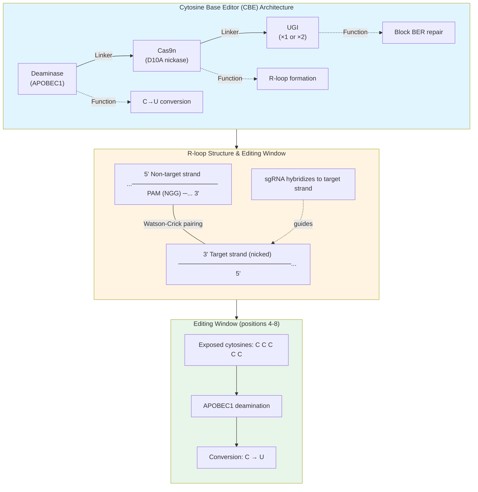
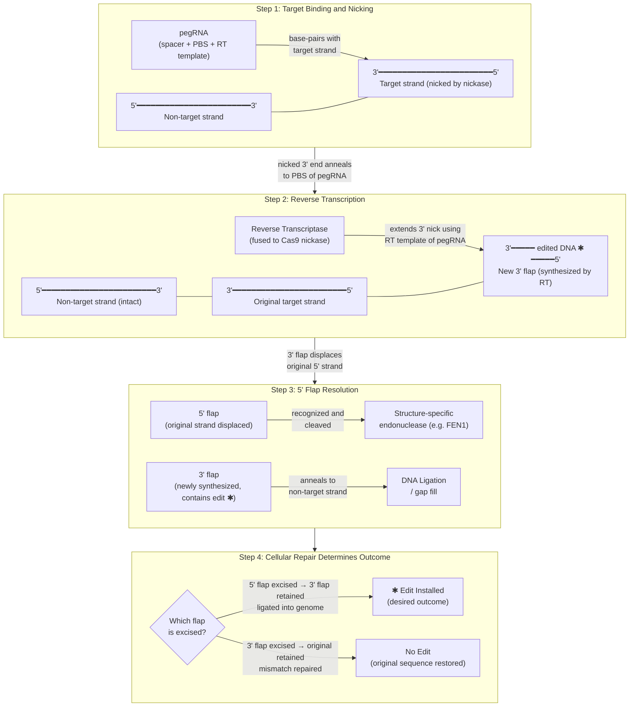
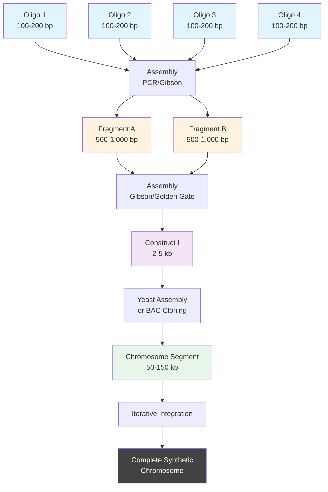

# Lesson 5: Synthetic Biology Approaches to Genome Engineering

## 1. First-Principles Intuition & Invariants

The capacity to rewrite genetic information at will represents one of the most profound technological capabilities humanity has ever developed. Where classical molecular biology provided tools to observe and manipulate genes one at a time through laborious cloning and screening protocols, synthetic biology seeks to engineer living systems with the precision and predictability of electronic circuit design. This transformation from discovery science to engineering discipline rests on a foundation of programmable nucleases, chemical base modification mechanisms, and de novo genome synthesis—each governed by fundamental biochemical constraints that determine what is possible and what remains beyond our current reach.

The central invariant of genome engineering is the Watson-Crick base pairing rule: adenine pairs with thymine (or uracil in RNA) through two hydrogen bonds, while guanine pairs with cytosine through three hydrogen bonds. This thermodynamic preference, with free energy differences of approximately 1-2 kcal/mol per base pair in physiological conditions, creates the molecular recognition specificity that allows guide RNAs to locate target sequences within genomes containing billions of base pairs. Every programmable nuclease system—from zinc finger nucleases through CRISPR-Cas9 to the newest base editors—exploits this fundamental complementarity to achieve sequence-specific DNA binding. The kinetic on-rate for RNA-DNA hybridization follows second-order kinetics with rate constants near 10⁶ M⁻¹s⁻¹ under cellular conditions, while the off-rate depends exponentially on the number and strength of base pair interactions. This creates a search problem: a 20-nucleotide guide sequence must locate its unique genomic target among roughly 3×10⁹ base pairs in a mammalian genome, a task accomplished through three-dimensional diffusion, one-dimensional sliding along DNA, and intersegmental transfer mechanisms that remain incompletely understood.

CRISPR-Cas9 achieved widespread adoption not because it was the first programmable nuclease—zinc finger nucleases and TALENs preceded it—but because it reduced the molecular recognition problem to simple Watson-Crick base pairing. Where zinc finger proteins required laborious selection of amino acid combinations to achieve DNA binding specificity, and TALENs demanded repetitive assembly of near-identical modules, CRISPR systems merely required synthesizing a guide RNA complementary to the target sequence. This architectural simplification reflected the evolutionary origin of CRISPR as a bacterial adaptive immune system: bacteria could not afford to encode thousands of protein variants to combat viral diversity, so natural selection produced a system where sequence specificity arose from a disposable guide molecule rather than from the protein machinery itself.

Yet Cas9, despite its revolutionary impact, possesses significant mechanistic constraints that limit its utility for precision genome engineering. The enzyme functions as a heterodimeric nuclease with two independent catalytic domains: the RuvC domain cleaves the non-targeted DNA strand while the HNH domain cleaves the strand complementary to the guide RNA. Both domains cut simultaneously approximately three base pairs upstream of the protospacer adjacent motif (PAM), a short sequence requirement (typically NGG for SpCas9) that constrains targeting density to roughly one site per eight base pairs in a random sequence. The resulting double-strand break activates cellular DNA repair pathways—primarily non-homologous end joining (NHEJ) in mammalian cells—which introduces stochastic insertions and deletions at the cut site. This outcome proves useful for gene disruption through frameshift mutations but fundamentally inadequate for installing precise sequence changes.

The biochemical reality of double-strand break repair reveals why Cas9-mediated knock-in remains challenging. Homology-directed repair (HDR), the pathway capable of incorporating exogenous donor DNA templates, operates primarily in S and G2 phases of the cell cycle when sister chromatids are available as reference templates. The pathway exhibits low efficiency in most primary cell types, with successful templated repair occurring in perhaps 1-10% of cells even under optimized conditions. The molecular mechanism requires end resection by nucleases including MRE11 and CtIP to generate 3' single-stranded DNA overhangs, followed by RAD51-mediated strand invasion into the homologous donor template, DNA synthesis, and Holliday junction resolution. Each step introduces stochastic variation, and competing repair pathways—particularly NHEJ mediated by the Ku70/80 heterodimer—actively work against HDR by rapidly ligating broken ends before resection can occur.

These mechanistic limitations motivated the development of base editing, a paradigm shift from break-then-repair strategies toward direct chemical modification of nucleotides within intact DNA strands. The conceptual foundation emerged from a simple observation: certain enzymes naturally deaminate cytosine to uracil (cytidine deaminases) or adenine to inosine (adenine deaminases) in DNA or RNA contexts. If such enzymes could be delivered to specific genomic loci without creating double-strand breaks, they might enable C→T or A→G transitions through the cell's normal mismatch repair and replication machinery. The engineering challenge involved fusing a catalytically dead or nickase variant of Cas9 to a deaminase enzyme, creating a molecular machine that retained guide RNA-programmed DNA binding while substituting controlled chemical modification for nuclease activity.

Cytosine base editors (CBEs), first reported in 2016, fuse a cytidine deaminase domain—typically APOBEC1 or activation-induced cytidine deaminase (AID)—to a Cas9 nickase (D10A mutation inactivates the RuvC domain). The resulting architecture positions the deaminase within a window of approximately 5 base pairs where it can access single-stranded DNA in the R-loop structure formed by guide RNA-target DNA hybridization. The deaminase converts cytosine to uracil, creating a U:G mismatch. If left unrepaired, DNA replication interprets uracil as thymine, installing a C→T transition in the daughter strand. The nickase activity on the non-edited strand biases repair toward the edited strand by triggering excision repair that preferentially removes the guanine opposite the uracil, further increasing editing efficiency.

The thermodynamic and kinetic parameters governing base editing efficiency reveal strict biochemical constraints. APOBEC1 exhibits a kcat of approximately 0.1 s⁻¹ for deamination of cytosine in single-stranded DNA, with Km values near 1-10 μM. The residence time of the base editor at the target locus—determined by the off-rate of guide RNA-DNA binding, typically seconds to minutes—thus permits only a limited number of deamination attempts. Processivity becomes critical: the enzyme must efficiently deaminate target cytosines within its activity window before the R-loop collapses. Structural studies of base editor complexes reveal that the deaminase domain maintains flexibility via a linker peptide, allowing it to sample multiple positions within the editing window but also introducing stochastic variation in which cytosines get modified.

Adenine base editors (ABEs) presented a more difficult engineering challenge because natural adenine deaminases evolved to act on RNA rather than DNA. The breakthrough involved directed evolution of tRNA adenosine deaminase (TadA) from E. coli, generating TadA variants capable of deaminating adenine in DNA contexts. The evolved TadA* enzyme converts adenine to inosine, which cellular polymerases and repair machinery interpret as guanine, resulting in A→G transitions. ABE architecture typically employs a heterodimeric TadA-TadA* fusion to Cas9 nickase, where the wild-type TadA monomer appears to enhance the activity of the evolved TadA* monomer through formation of the natural homodimeric interface.

The chemical mechanism of adenine deamination proceeds through nucleophilic attack by a zinc-activated water molecule on the C6 position of adenine, forming a tetrahedral intermediate that collapses to release ammonia and generate inosine. The activation energy for this transformation in aqueous solution exceeds 25 kcal/mol, but the TadA active site reduces this barrier through a combination of substrate positioning, transition state stabilization via hydrogen bonding networks, and electrostatic complementarity to the developing negative charge on the leaving ammonia group. The evolved TadA* variants achieved DNA substrate compatibility through mutations that altered the shape and electrostatics of the nucleotide binding pocket, particularly residues that distinguish the 2'-OH group present in RNA but absent in DNA.

Both CBEs and ABEs face a fundamental constraint imposed by the editing window: they can only modify bases within the region of single-stranded DNA exposed in the R-loop, typically positions 4-8 counting from the PAM-distal end of the protospacer. This window limitation means that many genomically important mutations—including numerous disease-associated single nucleotide polymorphisms—cannot be installed because they fall outside the accessible region for any available PAM. Furthermore, base editors can only perform transition mutations (C→T, A→G and their reverse complements), representing four of the twelve possible single-base substitutions. Transversion mutations (C→A, C→G, T→A, T→G) require fundamentally different chemical mechanisms.

Prime editing, reported in 2019, attempted to overcome these constraints through an ingenious molecular architecture that combines reverse transcriptase activity with Cas9 nickase and an extended guide RNA template. The system encodes the desired edit directly in a prime editing guide RNA (pegRNA), which contains not only the spacer sequence for genomic targeting but also a 3' extension encoding both the reverse transcription template and a primer binding site. Upon target binding, the Cas9 nickase (H840A mutation inactivates HNH domain) cleaves only the non-targeted strand, generating a 3' DNA flap. The reverse transcriptase domain—typically M-MLV RT with mutations to enhance processivity and reduce RNase H activity—uses the pegRNA's RT template to synthesize new DNA that incorporates the desired sequence change. If cellular repair machinery excises the original DNA sequence and ligates the newly synthesized strand, the edit becomes permanently installed.

The thermodynamic landscape of prime editing reveals why efficiency remains limited compared to base editing. The system requires successful completion of multiple sequential steps, each with associated failure modes: initial R-loop formation and nicking (failure rate ~10-20%), reverse transcription initiation at the nicked site (failure rate ~30-50%), complete synthesis of the desired edit (failure rate ~20-40%), 5' flap formation through displacement of the original strand, cellular excision of the 5' flap rather than the newly synthesized 3' flap (failure rate ~50-70%), and finally ligation and resolution favoring the edited strand. The multiplicative probability of these sequential processes explains why prime editing efficiencies typically range from 5-40% depending on cell type and genomic context, significantly lower than the 50-90% efficiencies often achieved with base editors.

The reverse transcriptase kinetics impose particularly stringent constraints. M-MLV RT exhibits a nucleotide incorporation rate of approximately 50-100 nucleotides per second and processivity of 100-200 nucleotides before dissociation under optimal conditions, but these parameters degrade substantially in the complex cellular environment and when operating from a DNA-primed RNA template in the context of a bulky Cas9-DNA complex. The enzyme must synthesize through the edit position and continue several nucleotides beyond to provide sufficient homology for strand displacement and flap formation. Template secondary structure in the pegRNA can stall or terminate reverse transcription prematurely, while misincorporation by the error-prone RT (error rate ~10⁻⁴ per nucleotide) introduces unintended mutations.

Beyond single-gene editing, synthetic biology increasingly confronts the challenge of engineering genomes at much larger scales—installing synthetic regulatory circuits, introducing entire metabolic pathways, or even constructing chromosomes and genomes de novo. The Synthetic Yeast Genome Project (Sc2.0) demonstrated the feasibility of designing and building eukaryotic chromosomes from scratch, incorporating numerous systematic modifications including removal of transposable elements, introduction of inducible recombination sites, and recoding of stop codons. Yet scaling this approach to mammalian genomes encounters exponentially increasing constraints.

The fundamental bottleneck in large-scale genome engineering lies in DNA synthesis fidelity and assembly. Oligonucleotide synthesis via phosphoramidite chemistry achieves coupling efficiencies of approximately 99% per base, meaning a 100-nucleotide oligo contains on average one synthesis error. For genome-scale constructs requiring millions of base pairs, this error rate necessitates extensive error correction through mismatch-binding proteins, enzymatic selection, or next-generation sequencing verification. Current synthesis costs remain near $0.07 per base pair for sequences without difficult motifs, making de novo synthesis of a 3-gigabase mammalian genome economically prohibitive at roughly $200 million for raw synthesis alone, not including assembly, verification, and error correction.

Assembly methods for large DNA constructs typically employ either hierarchical Gibson assembly, which uses overlapping homology regions of 15-40 base pairs for exonuclease-mediated joining, or yeast-based assembly exploiting the organism's highly efficient homologous recombination machinery. Gibson assembly efficiency drops exponentially with construct size, with successful assembly of constructs exceeding 50 kilobases becoming probabilistically unlikely without multiple attempts. Yeast-based assembly can handle larger constructs through transformation-associated recombination (TAR) cloning, but the yeast cell effectively becomes a black box where assembly success depends on factors including repeat content, G/C composition, and presence of cryptic origins of replication or transcription factor binding sites that may interfere with stable maintenance.

Orthogonal genetic systems—biological components that operate independently of the host cell's native genetic machinery—represent an alternative strategy for expanding the functional capacity of engineered organisms without interfering with essential processes. The most thoroughly developed orthogonal systems involve expanded genetic codes, where unnatural amino acids are incorporated into proteins through reassignment of stop codons or quadruplet codons. This requires engineering orthogonal aminoacyl-tRNA synthetase/tRNA pairs that charge the unnatural amino acid onto a suppressor tRNA without cross-reacting with endogenous synthetases or tRNAs.

The molecular recognition problem in creating orthogonal translation systems centers on the aminoacyl-tRNA synthetase active site, which must discriminate between the desired unnatural amino acid and the twenty canonical amino acids present at millimolar concentrations in the cytoplasm. The thermodynamic discrimination factor D, defined as the ratio of kcat/Km for correct versus incorrect substrates, must exceed approximately 100-fold to maintain translation fidelity above 99%. Achieving this specificity requires extensive directed evolution or rational design of the synthetase binding pocket, often involving libraries containing 10⁷-10⁹ variants screened through positive selection for unnatural amino acid incorporation and negative selection against incorporation of natural amino acids.

The tRNA component faces a complementary recognition problem: it must be efficiently recognized by the engineered synthetase but ignored by all endogenous synthetases. In E. coli, orthogonal pairs typically derive from archaeal species such as Methanosarcina or Methanocaldococcus, whose tRNA identity elements differ sufficiently from bacterial tRNAs to avoid cross-reactivity. In eukaryotic cells, the challenge intensifies because the compartmentalization of aminoacylation in the cytoplasm requires that orthogonal components function in the same physical space as hundreds of endogenous synthetase-tRNA pairs. Successful eukaryotic orthogonal systems often employ pyrrolysyl-tRNA synthetase/tRNAPyl pairs from methanogenic archaea, which exhibit natural orthogonality to eukaryotic translation machinery.

Expanding genetic codes through quadruplet codons rather than stop codon suppression offers the potential for incorporating multiple distinct unnatural amino acids simultaneously, but this approach faces severe kinetic penalties. The ribosome evolved to decode triplet codons with high selectivity through induced fit mechanisms in the decoding center, where correct codon-anticodon pairing triggers conformational changes that accelerate GTP hydrolysis by elongation factor Tu and peptide bond formation. Quadruplet decoding requires either frameshift suppression, where the ribosome slips by one nucleotide, or expansion of the anticodon loop to accommodate four-base pairing. Both mechanisms occur with efficiencies typically below 10%, and the incorporation of multiple quadruplet codons in a single gene sequence often results in translation efficiencies below 1% of wild-type levels.

The energetics of ribosomal decoding reveal why frameshift suppression remains inherently inefficient. The ribosome maintains the reading frame through precise positioning of mRNA in the decoding center, with the three-nucleotide spacing between P-site and A-site tRNAs enforced by distance constraints of approximately 30 Å. Quadruplet decoding disrupts this geometry, requiring either distortion of the tRNA anticodon loop or mRNA slippage that must overcome activation barriers imposed by mRNA-rRNA contacts and ribosomal conformational rigidity. Single-molecule FRET studies reveal that quadruplet decoding induces non-native ribosomal dynamics with dwell times orders of magnitude longer than canonical triplet decoding, explaining the severe kinetic penalties observed in vivo.

## 2. Core Architecture & Mechanics

The molecular architecture of CRISPR-Cas systems beyond Cas9 reveals evolutionary strategies for DNA targeting that employ fundamentally different mechanisms while maintaining the core principle of guide RNA-programmed specificity. Cas12a (formerly Cpf1) represents a structurally distinct nuclease family characterized by a T-rich PAM (typically TTTV), single-nuclease domain architecture where a single RuvC-like domain performs both strand cleavage events, and the generation of staggered double-strand breaks with 5' overhangs rather than blunt ends. The staggered break topology alters the repair pathway preferences: while Cas9-generated blunt ends favor NHEJ, the 5' overhangs produced by Cas12a can engage alternative repair mechanisms including microhomology-mediated end joining (MMEJ), potentially expanding the toolkit for targeted deletions and insertions.

The Cas12a structure, solved by X-ray crystallography at resolutions near 2.5 Å, reveals a bilobed architecture with a recognition (REC) lobe that binds the guide RNA and a nuclease (NUC) lobe containing the RuvC domain. The PAM recognition mechanism differs fundamentally from Cas9: where Cas9 employs a combination of major groove readout and minor groove width sensing, Cas12a inserts a lysine-rich wedge domain into the DNA minor groove at the PAM site, inducing DNA bending of approximately 30° that facilitates R-loop nucleation. This structural difference explains the distinct PAM requirements and suggests that Cas12a variants with altered PAM specificity might be engineered through mutations in the wedge domain rather than the distributed PAM-interacting residues in Cas9.

The single-nuclease domain architecture of Cas12a creates unique catalytic constraints. After PAM recognition and R-loop formation, the RuvC domain must sequentially cleave both DNA strands. Structural and biochemical evidence indicates that the targeted strand (complementary to the guide RNA) is cleaved first, followed by repositioning of the DNA to present the non-targeted strand to the same active site. This sequential mechanism introduces temporal separation between the two cleavage events, potentially creating an intermediate nicked state that could be exploited for genome editing applications requiring asymmetric strand processing.

Cas12a's collateral cleavage activity—the non-specific degradation of single-stranded DNA molecules after target-activated catalysis—adds an additional layer of complexity absent in Cas9. Upon binding and cleaving a cognate DNA target, Cas12a enters a promiscuous cleavage mode where it degrades nearby single-stranded DNA without sequence specificity. This activity has been harnessed for ultrasensitive nucleic acid detection (DETECTR technology), but in genome editing contexts it represents a potential source of off-target damage if substantial single-stranded DNA becomes available through replication stress or transcription.

Cas13 systems extend CRISPR targeting to RNA rather than DNA, operating as programmable ribonucleases with two HEPN (Higher Eukaryotes and Prokaryotes Nucleotide-binding) domains that together form the catalytic site. The molecular mechanism of Cas13 involves guide RNA-programmed recognition of target RNA through Watson-Crick base pairing, followed by conformational activation that triggers both cis-cleavage of the target RNA and trans-cleavage of bystander RNAs in a collateral activity similar to Cas12a. The HEPN domains generate single-nucleotide 3' overhangs through cleavage preferentially at uracil residues, though the sequence specificity of cleavage remains relatively relaxed.

The RNA targeting capability of Cas13 enables applications distinct from DNA-targeting systems: knockdown of specific transcripts without genome modification, targeting of RNA viruses, and programmable RNA editing when the nuclease domains are inactivated and the protein is fused to adenosine deaminase acting on RNA (ADAR) enzymes. This latter application creates RNA base editors capable of installing A→I (read as G) changes in transcripts, offering transient modification without heritable genome alterations. The kinetics of RNA base editing differ substantially from DNA editing: cellular mRNA half-lives typically range from 1-10 hours, creating a temporal window during which edits must be installed before transcript turnover, but also ensuring that editing effects are reversible and titratable based on the continued expression of the Cas13-ADAR fusion.

```mermaid
flowchart TD
    subgraph cas9 ["Cas9 — Type II (DNA targeting)"]
        direction TB
        subgraph cas9_rec ["REC Lobe"]
            cas9_rec1["REC1"]
            cas9_rec2["REC2"]
        end
        subgraph cas9_nuc ["NUC Lobe"]
            cas9_ruvc["RuvC\n(non-target strand)"]
            cas9_hnh["HNH\n(target strand)"]
        end
        cas9_sgrna(["sgRNA"])
        cas9_dna[/"DNA Target\n(NGG PAM)"\]
        cas9_out["Blunt DSB"]

        cas9_rec1 --> cas9_sgrna
        cas9_rec2 --> cas9_sgrna
        cas9_sgrna --> cas9_dna
        cas9_dna --> cas9_ruvc
        cas9_dna --> cas9_hnh
        cas9_ruvc --> cas9_out
        cas9_hnh --> cas9_out
    end

    subgraph cas12 ["Cas12a — Type V (DNA targeting)"]
        direction TB
        subgraph cas12_rec ["REC Lobe"]
            cas12_rec["REC"]
            cas12_wed["WED"]
        end
        subgraph cas12_nuc ["NUC Lobe"]
            cas12_ruvc["RuvC (dual)\n(both strands, sequential)"]
        end
        cas12_crrna(["crRNA"])
        cas12_dna[/"DNA Target\n(TTTV PAM)"\]
        cas12_out["Staggered DSB\n(5′ overhang)"]

        cas12_rec --> cas12_crrna
        cas12_wed --> cas12_crrna
        cas12_crrna --> cas12_dna
        cas12_dna --> cas12_ruvc
        cas12_ruvc --> cas12_out
    end

    subgraph cas13 ["Cas13 — Type VI (RNA targeting)"]
        direction TB
        subgraph cas13_rec ["Recognition Domain"]
            cas13_recdom["REC"]
        end
        subgraph cas13_nuc ["Nuclease Domains"]
            cas13_hepn1["HEPN1"]
            cas13_hepn2["HEPN2"]
        end
        cas13_crrna(["crRNA"])
        cas13_rna[/"RNA Target"\]
        cas13_out["ssRNA cleavage\n+ collateral activity"]

        cas13_recdom --> cas13_crrna
        cas13_crrna --> cas13_rna
        cas13_rna --> cas13_hepn1
        cas13_rna --> cas13_hepn2
        cas13_hepn1 --> cas13_out
        cas13_hepn2 --> cas13_out
    end
```

Base editor architecture represents a fusion of CRISPR targeting with enzymatic base modification. The standard CBE design positions the deaminase domain at the N-terminus of Cas9 nickase, connected through a flexible linker peptide typically 16-32 amino acids in length composed of XTEN repeats or similar flexible motifs designed to minimize secondary structure. At the C-terminus, a uracil glycosylase inhibitor (UGI) domain is appended to prevent base excision repair from removing the deaminated uracil before DNA replication can fix the edit. Advanced CBE variants include tandem UGI domains or UGI-dCas9 fusion proteins to further suppress uracil excision.

The spatial arrangement of domains in base editors critically determines editing window position and width. The deaminase must access single-stranded DNA in the R-loop, which extends approximately 10-15 base pairs from the PAM-proximal end of the protospacer. Structural modeling and empirical optimization studies reveal that linker length and composition directly affect the range of positions the deaminase can reach: shorter, more rigid linkers restrict editing to a narrow window but may increase on-target editing efficiency by reducing diffusion, while longer flexible linkers expand the editing window but potentially increase background deamination of non-target cytosines or adenines within the accessible region.



The thermodynamics of R-loop formation and stability define the accessible substrate for base editing. R-loop formation requires overcoming the energetic cost of DNA melting (approximately 1-2 kcal/mol per base pair) offset by the favorable free energy of RNA-DNA hybridization (slightly more stable than DNA-DNA due to the 2'-OH group forming additional interactions with the DNA backbone). The net free energy of R-loop formation depends on guide RNA length, G/C content, and the presence of mismatches between guide and target. Truncated guides (17-18 nucleotides rather than 20) can reduce off-target editing by destabilizing R-loop formation at imperfect match sites, but this comes at the cost of reduced on-target efficiency at sites with difficult-to-access chromatin or high local G/C content.

Adenine base editor architecture evolved from CBE design principles but required extensive optimization to achieve DNA deamination activity. The current state-of-the-art ABE8e employs a heterodimeric TadA-TadA* fusion where both monomers contain multiple evolved mutations. The TadA monomer interface appears to enhance TadA* activity through formation of the natural homodimeric structure, though the precise mechanism remains debated. The evolved mutations in TadA* include alterations throughout the protein: active site mutations that alter substrate binding geometry, second-shell mutations that affect active site dynamics through long-range conformational coupling, and surface mutations that may affect DNA or Cas9 interactions.

The adenine deamination mechanism proceeds through a different chemical pathway than cytosine deamination, requiring zinc coordination for activation of the attacking water nucleophile. The TadA active site contains a conserved His-Cys-Cys zinc-binding motif where the zinc ion polarizes a water molecule, lowering its pKa and generating a hydroxide nucleophile capable of attacking the adenine C6 position. The tetrahedral intermediate formed during this attack must be stabilized by active site residues to prevent non-productive collapse back to adenine. Structural studies of TadA* variants reveal that evolved mutations alter the shape of the adenine-binding pocket to accommodate DNA rather than RNA and adjust the positioning of catalytic residues to optimize transition state stabilization for the DNA substrate.

Prime editing architecture integrates three distinct enzymatic activities—nickase, reverse transcriptase, and 5' flap endonuclease (through cellular machinery)—into a single genome editing event. The prime editor protein consists of Cas9 nickase (H840A) fused to an engineered reverse transcriptase, typically M-MLV RT with five mutations (D200N, L603W, T306K, W313F, T330P) that collectively enhance processivity, reduce RNase H activity, and improve thermostability. The pegRNA encodes both the spacer for genomic targeting and a 3' extension containing a primer binding site (PBS) complementary to the nicked DNA strand and a reverse transcription template encoding the desired edit plus additional homology sequence.



The primer binding site length in the pegRNA critically determines reverse transcription initiation efficiency. PBS sequences typically range from 8-17 nucleotides, balancing competing requirements: longer PBS provides more stable primer-template hybridization, improving RT initiation, but also increases the likelihood of PBS binding to off-target sites in the genome or forming secondary structure with other pegRNA regions. The thermodynamic stability of PBS-DNA hybridization must exceed approximately -8 kcal/mol at 37°C to support efficient RT initiation, which requires roughly 8-10 base pairs of continuous Watson-Crick pairing. However, excessively stable PBS binding (below -15 kcal/mol) can create kinetic barriers to subsequent steps by preventing efficient flap formation or increasing the probability of aberrant binding conformations.

The reverse transcription template encodes the edit and flanking homology in the pegRNA. The template must extend beyond the desired edit position by sufficient length to provide homology for strand displacement and flap formation, typically 10-16 nucleotides past the edit. Secondary structure in the RT template can stall or terminate reverse transcription; poly-T sequences, stable hairpins, or G-quadruplex motifs pose particular challenges. Computational RNA structure prediction tools can identify problematic regions, allowing template redesign through synonymous mutations or PBS repositioning. The template must also avoid creating strong homology to unintended genomic loci, as off-target reverse transcription events can potentially install edits at sites distinct from the pegRNA spacer target.

The reverse transcriptase kinetics impose fundamental limits on prime editing efficiency and fidelity. M-MLV RT exhibits lower processivity than DNA polymerases, typically dissociating after 100-200 nucleotide incorporations even with mutations that enhance processivity. For prime editing templates encoding long insertions (>30 bp), incomplete RT synthesis becomes increasingly probable, generating 3' flaps that lack the intended edit or contain only partial sequences. The RT error rate of approximately 10⁻⁴ per nucleotide means that edits beyond ~30 bp from the nick site increasingly risk unintended mutations introduced during reverse transcription itself.

Twin prime editing, an advanced variant, employs two pegRNAs targeting opposite DNA strands in close proximity, generating two nicked sites with newly synthesized DNA containing complementary edits. When both RT events succeed and flaps resolve correctly, the result is a precise deletion, insertion, or replacement of the intervening sequence. This approach enables installation of larger sequence changes (up to 100+ bp) than single pegRNAs, but the efficiency drops multiplicatively because both pegRNAs must successfully complete all steps. Twin prime editing efficiencies typically range from 1-20% depending on edit size and genomic context, reflecting the compounded failure probabilities of independent editing events.

Whole-genome synthesis confronts fundamental constraints in DNA chemistry, assembly, and error correction. Oligonucleotide synthesis via phosphoramidite chemistry proceeds through iterative coupling cycles where each activated nucleotide phosphoramidite reacts with the 5'-hydroxyl of the growing chain, capping any unreacted 5'-OH groups to prevent deletion products, and removing the 5' protecting group to prepare for the next cycle. The coupling efficiency per base typically reaches 99-99.5% under optimized conditions, but this still produces an exponential decay in full-length product yield: for a 100-mer oligonucleotide, only (0.99)¹⁰⁰ ≈ 37% of molecules are full-length without deletions.

The chemical constraints of oligonucleotide synthesis create sequence-dependent failure modes. Consecutive guanines prove challenging due to depurination during acidic deprotection steps, while long poly-A or poly-T runs resist uniform coupling. Secondary structure formation by partial synthesis products can sequester the 5'-OH terminus, reducing coupling efficiency. These effects mean that certain sequences have synthesis success rates below 90%, requiring synthesis of multiple variants or redesign of the target sequence through synonymous codon changes or alteration of non-coding elements.

Large-scale DNA assembly strategies employ hierarchical methods where small synthesized oligonucleotides are joined into progressively larger fragments. Overlap extension PCR assembles fragments with 15-25 bp terminal homologies through primer-free PCR where overlapping regions anneal and extend. Gibson assembly uses a combination of 5' exonuclease, DNA polymerase, and DNA ligase in an isothermal reaction that chews back the 5' ends of overlapping fragments, fills in gaps, and seals nicks. Golden Gate assembly employs Type IIS restriction enzymes that cut outside their recognition sites, generating defined overhangs that can be directionally ligated in a one-pot reaction.



Error correction in synthetic DNA assembly relies on detecting and eliminating mutant molecules from the population. Mismatch-binding proteins such as MutS can enrich for perfectly matched duplex DNA over molecules containing mismatches, but this approach only works for errors creating base pair mismatches and cannot correct insertions or deletions where both strands contain the error. Deep sequencing of assembled constructs identifies low-frequency errors, but correcting them requires either re-synthesis of affected regions or site-directed mutagenesis, both costly and time-consuming for large constructs.

The Sc2.0 project developed a robust pipeline for yeast chromosome synthesis involving computational design with systematic modifications (removing transfer RNAs, inserting loxPsym sites for inducible recombination, changing all TAG stop codons to TAA), segmenting each chromosome into 60-90 overlapping "chunks" of 2-5 kb, synthesizing chunks with modified sequences, assembling chunks through homologous recombination in yeast, and debugging through iterative identification and correction of synthesis errors that affect growth. This process required approximately 2-3 years per chromosome despite yeast's relatively small genome (12 Mb total) and the availability of sophisticated debugging tools including synthetic chromosome rearrangement and modification by loxP-mediated evolution (SCRaMbLE).

Extending similar approaches to mammalian genomes faces exponential scaling challenges. A 3 Gb mammalian genome contains 250-fold more sequence than yeast, and mammalian cells lack robust homologous recombination for assembly, requiring instead BAC-based or other vector systems with much lower capacity and efficiency. Mammalian genomes also contain vastly more repetitive sequences, including retrotransposons comprising >40% of the human genome, which create assembly ambiguities and recombination hotspots that can scramble synthetic constructs. Even if synthesis and assembly could be achieved, delivering synthetic chromosomes into mammalian cells and verifying their function presents unsolved challenges in transfection, selection, and phenotypic characterization.

## 3. High-Performance Optimization & Failure Modes

Maximizing base editing efficiency requires systematic optimization across multiple parameters: guide RNA design, base editor variant selection, delivery method, and cellular context. Guide RNA design tools have evolved beyond simple on-target and off-target scoring to incorporate predictive models of base editor activity windows, accounting for local sequence context effects where flanking nucleotides influence deamination efficiency. For cytosine base editors, the sequence context surrounding target cytosines significantly affects activity: TCN contexts are typically more efficiently deaminated than CCN or GCN motifs, reflecting the substrate preferences of APOBEC enzymes evolved to act on retroviral genomes enriched in TC dinucleotides.

The positional dependence of base editing within the editing window creates optimization opportunities and constraints. For critical applications requiring high efficiency, multiple guide RNAs can be designed to place the target base at different positions within the editing window, then screened empirically to identify the most efficient guide. This approach proves essential when working in difficult genomic contexts such as heterochromatin, where nucleosome positioning and DNA methylation may restrict R-loop formation. Chromatin accessibility profiling through ATAC-seq or DNase-seq provides predictive information about which genomic loci will be readily accessible to base editors versus sites requiring chromatin remodeling strategies.

Base editor variant selection has become increasingly important as the palette of available editors expands. Beyond the canonical BE3 and ABE7.10 editors, evolved variants offer different editing window positions (BE4max with broader window, miniABEmax with reduced size for AAV packaging), reduced off-target RNA editing (ABE8e with minimal transcriptome-wide RNA deamination), and altered PAM requirements through Cas9 or Cas12a variants (xCas9, SpCas9-NG, SpG for expanded PAM compatibility). Systematic benchmarking studies reveal that optimal editor choice depends on both the genomic target and the cellular context: some variants show strong performance in immortalized cell lines but reduced efficiency in primary cells or in vivo.

Delivery methods profoundly impact base editing outcomes, particularly for therapeutic applications requiring in vivo editing. Ribonucleoprotein (RNP) delivery, where the base editor protein is complexed with guide RNA and introduced directly into cells, provides transient editing activity that minimizes exposure time and thus reduces opportunities for off-target editing, but RNP suffers from poor delivery efficiency except in ex vivo contexts or tissues accessible to local injection. Viral delivery, particularly adeno-associated virus (AAV), enables efficient in vivo transduction but requires splitting large base editors across multiple vectors (dual-AAV approaches) or using compact editor variants that fit within AAV's ~4.7 kb packaging limit.

The kinetics of base editing in different cellular contexts reveal optimization opportunities. In actively dividing cells, the editing window extends from base editor expression through multiple cell divisions, as the uracil or inosine bases installed by the editor become fixed as T or G through DNA replication. In non-dividing cells, mismatch repair and base excision repair actively remove deaminated bases, requiring UGI domains or MMR inhibition to prevent premature reversal of edits before replication fixes them. Some cell types exhibit particularly active DNA repair, including neurons and cardiomyocytes, necessitating stronger UGI domains or transient MMR suppression for efficient editing.

Off-target editing represents the primary failure mode of base editor systems. While guide RNA-dependent off-target editing at imperfectly matched genomic sites can be predicted and minimized through careful guide design, guide RNA-independent off-target activity poses a more insidious challenge. Certain base editor architectures, particularly early ABE variants, exhibited substantial transcriptome-wide RNA editing due to promiscuous deamination of cellular RNAs by the TadA domain when not constrained in the Cas9-DNA complex. ABE8e largely solved this problem through additional mutations that reduce RNA deamination while maintaining DNA editing activity, but the existence of this failure mode underscores the importance of comprehensive off-target characterization including RNA-seq analysis.

Bystander editing—the modification of non-target cytosines or adenines within the editing window when the target base is present—cannot be fully eliminated when multiple editable bases exist in the accessible region. Computational tools can identify guides where target and bystander bases are separated, allowing selective editing, but this strategy fails when the genomic sequence provides no suitable guides. Emerging base editor architectures with narrowed editing windows partially address this problem, trading some on-target efficiency for increased specificity. Base editors with split deaminase domains that reconstitute only upon guide-mediated target binding represent another strategy to reduce background activity.

Prime editing optimization follows different principles because the system involves more mechanistic steps each with distinct failure modes. The pegRNA design requires balancing multiple competing constraints: PBS length affects initiation efficiency, RT template length affects processivity demands, and both components influence secondary structure propensity. Systematic studies have identified general design rules—PBS lengths of 13-15 nt and RT template extensions of 10-16 nt beyond the edit typically perform well—but these guidelines require empirical validation for each target because local sequence context effects remain poorly predictable.

The sequential nature of prime editing steps means that optimization must address the primary bottleneck. If RT synthesis efficiency is limiting, engineering enhanced RT variants with improved processivity or using RT templates with reduced secondary structure may help. If flap resolution is limiting—evident from enrichment of the 3' flap over the edited genomic sequence in deep sequencing analysis—then strategies to bias cellular repair toward excision of the 5' flap become critical. Second-site nicking strategies, where an additional sgRNA guides the nickase to cut the non-edited strand, can bias repair toward the edited strand by creating asymmetry in the repair substrate.

Temperature sensitivity in prime editing reflects the thermodynamics of PBS binding and RT activity. At 37°C, short PBS sequences may not provide sufficient stability for efficient RT initiation, while at lower temperatures RT activity drops. Some protocols employ transient temperature reduction to 30-32°C to stabilize PBS binding during the early editing phase, then return to 37°C for optimal cellular metabolism and repair. This approach proves most useful for PBS sequences near the minimal length threshold where thermal stability becomes limiting.

The prime editing efficiency ceiling—typically 40-60% even under optimal conditions for small edits—appears to result from stochastic variation in flap resolution. Even when both flaps form successfully, cellular repair machinery must make a binary choice between excising the original 5' flap (installing the edit) or the newly synthesized 3' flap (rejecting the edit). The molecular determinants of this choice remain incompletely understood but may involve flap length, sequence composition, and competition between different cellular nucleases (FEN1, EXO1, DNA2) that recognize and process DNA flaps. Rational engineering to bias this choice represents a key frontier for improving prime editing efficiency.

Whole-genome synthesis projects encounter failure modes spanning chemistry, assembly, and biological validation. At the synthesis level, difficult sequences containing repetitive elements, extreme G/C content, or potential secondary structures cause synthesis failure rates to climb above 20%, necessitating iterative redesign cycles. Some sequences appear fundamentally resistant to synthesis using standard phosphoramidite chemistry, requiring alternative synthesis approaches or acceptance that certain genomic regions must be cloned from natural sources rather than synthesized.

Assembly failures typically manifest as rearrangements, deletions, or incomplete assembly where fragments ligate in incorrect orders or orientations. Long terminal repeats, transposable element sequences, and other genomic repetitive elements cause these failures by providing homology sites for aberrant recombination. The Sc2.0 project addressed this by removing or modifying repetitive elements during design, but mammalian genomes contain such extensive repetition that comprehensive removal would fundamentally alter genome function through effects on chromosome structure, gene regulation, and evolutionary processes.

Debugging synthetic genomes—identifying which among hundreds or thousands of individual synthesis errors cause observed phenotypic defects—presents an exponential search problem. Yeast offers powerful genetic tools including SCRaMbLE for systematic rearrangement and complementation testing, but mammalian cells lack comparable genetic manipulation capacity. Deep sequencing identifies sequence-level errors, but distinguishing neutral mutations from deleterious ones requires functional testing. For essential genes, complementation with wild-type copies provides one debugging route, but for non-essential genes or regulatory elements, phenotypic effects may only emerge under specific conditions not tested during initial validation.

The time and resource scaling of genome synthesis projects reveals fundamental economic constraints. The Sc2.0 project, involving ~12 Mb across 16 chromosomes, required roughly 15 years of effort from an international consortium, achieving a synthesis and validation rate of approximately 0.8 Mb per year. Scaling linearly to a 3 Gb mammalian genome would require ~4000 consortium-years, or roughly $400-800 million at academic research costs. These estimates ignore the non-linear scaling of debugging complexity, delivery challenges, and biological validation in mammalian cells versus yeast.

Alternative strategies that minimize de novo synthesis show more promise for near-term mammalian genome engineering. Rather than synthesizing entire genomes, large-scale editing of existing genomes through multiplexed CRISPR or base editing can install hundreds to thousands of targeted changes while preserving the bulk genome structure. This approach has enabled projects such as recoding all UAG stop codons to UAA in E. coli, compressing the genetic code to free the UAG codon for reassignment to unnatural amino acids. Similar strategies in mammalian cells might enable large-scale optimization of codon usage, removal of repetitive elements from non-essential genomic regions, or systematic modification of regulatory elements.

Orthogonal genetic system engineering encounters failure modes rooted in the fundamental biochemistry of translation fidelity. The aminoacyl-tRNA synthetase must achieve extraordinary specificity—discriminating between amino acids differing by only a single methyl group or hydroxyl—through binding pocket geometry and transition state stabilization. Yet this same specificity makes synthetase evolution challenging: improving recognition of the unnatural amino acid often degrades discrimination against natural amino acids, requiring iterative selection cycles that balance positive and negative selection pressure.

The cellular concentration of orthogonal components directly affects incorporation efficiency. The synthetase must charge the orthogonal tRNA faster than cellular aminoacyl-tRNA synthetases can mischarge it, while the charged orthogonal tRNA must compete effectively with the cellular aa-tRNA pool for ribosome binding. This competition typically requires expression of the orthogonal synthetase and tRNA at levels exceeding endogenous components by 10-100 fold, creating metabolic burden that can reduce cell growth and protein expression yields.

Quadruplet codon expansion faces intrinsic kinetic penalties that become multiplicative when multiple quadruplet codons appear in a single gene. If a single quadruplet codon is read with 5% efficiency, two quadruplets reduce overall expression to 0.25% of wild-type (0.05²), and three quadruplets to 0.0125%—orders of magnitude below useful protein expression levels. Current research focuses on engineering ribosomes with expanded decoding centers that naturally accommodate quadruplet codons, but this requires solving the problem of making engineered ribosomes that function well enough to support cell growth while maintaining orthogonality to prevent them from misreading normal triplet codons.

The metabolic cost of maintaining orthogonal translation systems represents a constraint rarely discussed in proof-of-concept studies but critical for practical applications. Each orthogonal aa-tRNA consumes ATP and amino acids for charging, while the unnatural amino acid itself must be synthesized or imported, both processes requiring metabolic investment. Cells engineered with multiple orthogonal systems for incorporating several unnatural amino acids face compounded metabolic demands that can reduce growth rates by 30-50% relative to wild-type, limiting the scalability of this approach for biotechnology applications requiring high-yield protein production.

The path forward in synthetic biology increasingly involves integrating multiple genome engineering modalities: using base editing or prime editing for precise sequence modifications, CRISPR-mediated cutting for structural rearrangements and large deletions, and targeted synthesis for inserting large functional elements that cannot be efficiently edited in place. This hybrid approach acknowledges the distinct strengths and limitations of each technology while building toward the eventual goal of treating genomes as readable and writable code. The constraints we currently face—synthesis error rates, assembly fidelity, editing efficiency ceilings, off-target effects—represent physical and chemical limits that ongoing research continues to push against, gradually expanding the boundaries of what can be designed, built, and validated in living systems.
