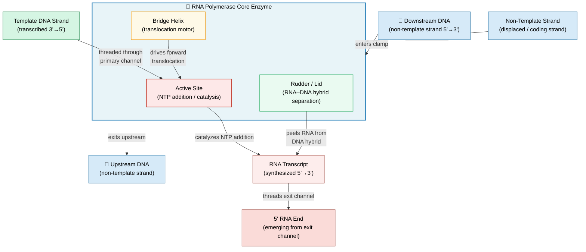
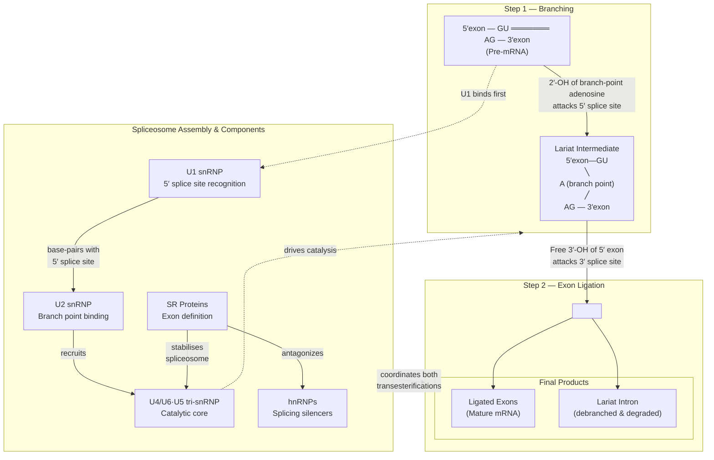
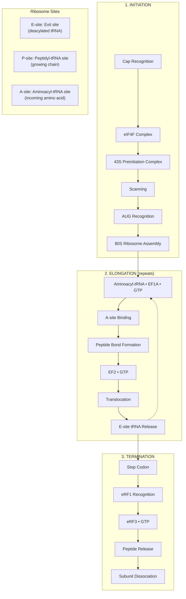
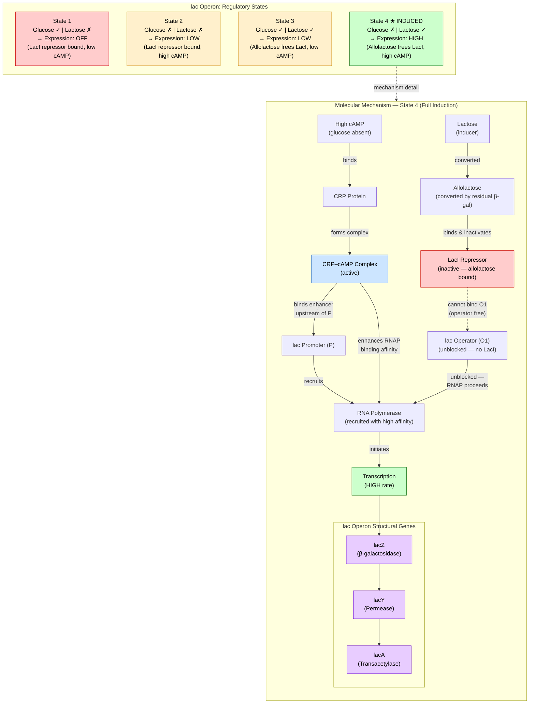

# Lesson 2: Gene Expression Regulation

## 1. First-Principles Intuition & Invariants

The central dogma of molecular biology—DNA to RNA to protein—represents not a simple linear cascade but rather a highly orchestrated regulatory symphony where each step provides multiple control points for modulating gene expression. While the genetic information encoded in DNA remains largely static throughout an organism's lifetime, the phenotypic expression of that information varies dramatically across cell types, developmental stages, and environmental conditions. A neuron and a hepatocyte contain identical genomic sequences, yet express radically different protein profiles. This paradox resolves through the intricate regulatory mechanisms that govern when, where, and to what extent each gene becomes transcribed and translated.

Gene expression regulation operates through a hierarchical cascade of control mechanisms, each layer providing progressively finer temporal and spatial resolution. At the most fundamental level, chromatin architecture determines which genomic regions remain accessible to the transcriptional machinery. Epigenetic modifications—including DNA methylation and histone post-translational modifications—establish heritable patterns of gene activity without altering the underlying nucleotide sequence. These modifications create a molecular memory that persists through cell divisions, explaining how differentiated cell types maintain their identity despite containing identical genetic information.

The transcriptional initiation machinery represents the primary regulatory bottleneck where most gene expression decisions occur. In prokaryotes, this regulation achieves remarkable efficiency through operon structures where multiple functionally related genes cluster under shared promoter control. The *lac* operon exemplifies negative regulation through repressor proteins that block RNA polymerase access in the absence of inducing substrate, while the *trp* operon demonstrates negative feedback where the pathway's end product inhibits its own synthesis. These simple regulatory circuits enable rapid metabolic adaptation to changing nutrient availability, with response times measured in seconds to minutes.

Eukaryotic transcriptional regulation operates through considerably more complex combinatorial logic. Rather than single operators controlling transcription, eukaryotic genes possess multiple regulatory elements—enhancers, silencers, and insulators—that can reside tens of thousands of base pairs distant from the transcription start site. These distal elements communicate with core promoters through DNA looping mediated by protein complexes, creating three-dimensional chromatin architectures that juxtapose distant genomic regions. The combinatorial integration of signals from multiple transcription factors bound at these various elements allows for sophisticated regulatory logic where gene expression responds to complex combinations of developmental signals, hormonal inputs, and environmental stimuli.

The transcription initiation complex itself represents a massive molecular machine assembled stepwise at each transcriptional event. In eukaryotes, RNA polymerase II—the enzyme responsible for transcribing protein-coding genes—cannot recognize promoter sequences directly. Instead, the TATA-binding protein (TBP) and associated factors must first assemble at the core promoter to create a platform for polymerase recruitment. General transcription factors (TFII-D, -E, -F, -H, -B) sequentially associate with this platform, forming the pre-initiation complex. Mediator, a massive multi-subunit complex, bridges sequence-specific transcription factors bound at enhancers with the core transcriptional machinery, integrating regulatory signals into transcriptional output. This multi-step assembly process provides numerous regulatory checkpoints where transcription can be modulated.

The chromatin context adds another regulatory dimension entirely absent in prokaryotes. Eukaryotic DNA wraps around histone octamers to form nucleosomes, creating a fundamental packaging unit that inherently occludes DNA from protein binding. The nucleosome positioning across a promoter profoundly influences transcriptional activity—a well-positioned nucleosome blocking the transcription start site effectively silences the gene. ATP-dependent chromatin remodeling complexes actively reposition or evict nucleosomes, dynamically modulating DNA accessibility. These remodelers fall into distinct families (SWI/SNF, ISWI, CHD, INO80) with different mechanisms and regulatory properties, providing cell-type-specific control over chromatin architecture.

Histone modifications establish a complex "histone code" that recruits specific effector proteins to modify chromatin states. Acetylation of lysine residues in histone N-terminal tails generally correlates with transcriptional activation, as the added acetyl groups neutralize positive charges that normally interact with negatively charged DNA phosphate backbones. Histone acetyltransferases (HATs) catalyze these modifications, while histone deacetylases (HDACs) reverse them, creating dynamic equilibria responsive to cellular signals. Histone methylation presents greater complexity, with different lysine and arginine residues accepting mono-, di-, or tri-methylation marks that can indicate either activation or repression depending on the specific residue modified. H3K4me3 (histone H3 lysine 4 tri-methylation) marks active promoters, H3K36me3 marks actively transcribed gene bodies, while H3K9me3 and H3K27me3 mark heterochromatic and facultatively repressed regions respectively.

DNA methylation—the covalent addition of methyl groups to cytosine bases, primarily in CpG dinucleotide contexts—represents a stable epigenetic mark associated with long-term gene silencing. In mammals, DNA methyltransferases (DNMTs) establish and maintain these methylation patterns, with DNMT1 acting as a maintenance methyltransferase that copies methylation marks to newly synthesized DNA strands during replication, ensuring epigenetic inheritance. Dense methylation at gene promoters, particularly within CpG islands, typically correlates with transcriptional silencing through multiple mechanisms: direct interference with transcription factor binding, recruitment of methyl-binding domain proteins that compact chromatin, and establishment of repressive histone modification patterns.

Post-transcriptional regulation provides additional control layers after RNA polymerase has initiated transcription. Primary transcripts undergo extensive processing before becoming mature mRNA: 5′ capping with 7-methylguanosine protects the transcript and facilitates translation initiation; 3′ polyadenylation adds poly(A) tails that influence mRNA stability and localization; and splicing removes introns to generate the final coding sequence. Each processing step offers regulatory opportunities. Alternative splicing enables single genes to encode multiple protein isoforms with distinct—sometimes antagonistic—functions. Tissue-specific splicing factors direct distinct splicing patterns in different cell types, massively expanding proteomic diversity beyond the limited number of protein-coding genes. SR proteins and heterogeneous nuclear ribonucleoproteins (hnRNPs) regulate splice site selection through complex combinatorial interactions with cis-regulatory elements in the pre-mRNA.

The genetic code itself exhibits fundamental properties that constrain and enable evolutionary adaptation. The code's degeneracy—with 61 codons specifying only 20 amino acids—means most amino acids possess multiple synonymous codons. This redundancy provides buffering against point mutations, as many single-nucleotide changes result in synonymous substitutions that preserve protein sequence. However, codon usage is far from random. Organisms exhibit strong codon bias, preferentially using specific synonymous codons that match their tRNA abundance profiles. Highly expressed genes show extreme codon bias, ensuring rapid translation by utilizing abundant tRNA species. The wobble base pairing rules discovered by Francis Crick explain how single tRNA species recognize multiple synonymous codons through relaxed pairing requirements at the third codon position, reducing the tRNA repertoire required for comprehensive decoding.

Translation regulation controls protein synthesis rates even when mRNA remains abundant. The initiation step determines overall translation rate and represents the primary regulatory target. In eukaryotes, the small ribosomal subunit (40S) initially binds the 5′ cap structure along with initiation factors, then scans in the 3′ direction searching for the start codon (typically AUG in favorable Kozak context). Regulatory elements in the 5′ untranslated region (5′ UTR) profoundly influence this scanning process. Extensive secondary structure or upstream open reading frames (uORFs) can impede ribosome scanning, reducing translation efficiency. Internal ribosome entry sites (IRES) allow cap-independent translation initiation, enabling continued protein synthesis under stress conditions when cap-dependent translation is globally suppressed.

The 3′ UTR contains binding sites for microRNAs (miRNAs) and RNA-binding proteins that post-transcriptionally regulate mRNA stability and translation. MicroRNAs—short (~22 nucleotide) regulatory RNAs—guide the RNA-induced silencing complex (RISC) to complementary sequences in target mRNAs, typically resulting in translational repression and mRNA degradation. Each miRNA can regulate hundreds of target transcripts, and most mRNAs contain multiple miRNA binding sites, creating complex regulatory networks. The combinatorial logic of miRNA regulation—where multiple miRNAs cooperatively target the same transcript, and single miRNAs coordinately regulate functionally related genes—enables sophisticated post-transcriptional regulatory programs controlling developmental transitions, stress responses, and disease states.

RNA stability represents another critical control point. Eukaryotic mRNAs possess highly variable half-lives ranging from minutes to days, with unstable transcripts enabling rapid changes in protein abundance while stable transcripts permit sustained expression from transient transcriptional pulses. Deadenylation-dependent decay represents the predominant mRNA degradation pathway: progressive shortening of the poly(A) tail triggers decapping and 5′-to-3′ exonucleolytic degradation. AU-rich elements (AREs) in 3′ UTRs target transcripts for rapid decay, with ARE-binding proteins determining whether specific AREs promote or prevent degradation depending on cellular context. Nonsense-mediated decay (NMD) provides quality control by recognizing and degrading transcripts containing premature termination codons, preventing synthesis of truncated potentially harmful proteins.

The thermodynamic and kinetic parameters governing each regulatory transition create quantitative constraints that determine system behavior. Transcription factor binding affinities, measured as equilibrium dissociation constants ($K_d$), typically range from nanomolar to micromolar, with tighter binding generally correlating with stronger regulatory effects. However, binding affinity alone inadequately predicts regulatory outcome—residence time on DNA, cooperative interactions with other factors, and competition with nucleosomes all contribute to functional outcomes. The Hill coefficient quantifies cooperativity in regulatory responses, with steep dose-response curves (high Hill coefficients) enabling switch-like behavior where small concentration changes produce large expression changes, while shallow curves (Hill coefficients near unity) generate graded responses proportional to regulator concentration.

## 2. Core Architecture & Mechanics

The molecular architecture of transcriptional regulation begins with the RNA polymerase holoenzyme, a massive protein complex exceeding one megadalton in eukaryotes. Bacterial RNA polymerase consists of a core enzyme (α₂ββ′ω subunits) that gains promoter recognition capability upon associating with sigma factors. The sigma subunit determines promoter specificity by recognizing conserved −10 and −35 hexamer sequences upstream of the transcription start site. Different sigma factors enable coordinated regulation of gene sets: σ⁷⁰ directs transcription of housekeeping genes under normal growth, while alternative sigma factors (σ³², σ⁵⁴, σˢ) redirect polymerase to stress response, nitrogen metabolism, or stationary phase genes respectively.

The bacterial transcription cycle proceeds through distinct mechanistic phases measurable through biochemical and single-molecule techniques. During the closed complex formation, RNA polymerase binds promoter DNA maintaining the double helix intact. Isomerization to the open complex involves unwinding approximately 13 base pairs around the transcription start site, forming the transcription bubble that exposes the template strand for base pairing with incoming nucleoside triphosphates. This isomerization represents the rate-limiting step for many promoters, with the free energy barrier depending on DNA sequence and superhelical tension. Abortive initiation follows, where polymerase synthesizes short 2-9 nucleotide transcripts repeatedly without escaping the promoter—an apparently wasteful process that may allow RNA polymerase to test RNA-DNA hybrid stability before committing to productive elongation.

Promoter escape occurs when the growing transcript reaches 9-11 nucleotides, sufficient to form a stable RNA-DNA hybrid that drives conformational changes releasing sigma factor and enabling processive elongation. The elongating RNA polymerase exhibits extraordinary processivity, transcribing thousands of nucleotides without dissociating while maintaining high fidelity (error rate ~10⁻⁵ per nucleotide). The enzyme translocates along DNA by a Brownian ratchet mechanism: thermal fluctuations drive both forward and backward motion, but nucleotide addition to the growing transcript biases the equilibrium toward forward translocation. The transcription elongation complex maintains a constantly moving transcription bubble with approximately 9 base pairs of RNA-DNA hybrid and 8-9 nucleotides of single-stranded RNA emerging from the RNA exit channel.



Transcriptional pausing regulates elongation kinetics and coordinates transcription with RNA processing. Sequence-dependent pauses occur at specific DNA sequences, particularly those forming hairpin structures in nascent RNA or causing backtracking where polymerase slides backward on the template. The elongation factor NusA stabilizes the paused state, while GreA and GreB rescue backtracked complexes by inducing transcript cleavage that realigns the 3′ end with the active site. In eukaryotes, pausing near promoters provides checkpoints for recruiting capping enzymes and establishing proper chromatin structure over the gene body.

Transcription termination employs distinct mechanisms in prokaryotes versus eukaryotes. Intrinsic (rho-independent) termination in bacteria relies on palindromic sequences that form hairpin structures in nascent RNA followed by poly-U tracts. The hairpin destabilizes the elongation complex while weak rU-dA RNA-DNA base pairs in the hybrid region facilitate dissociation. Rho-dependent termination requires the Rho hexameric helicase, which binds C-rich sequences in nascent RNA, translocates in the 5′-to-3′ direction using ATP hydrolysis, and unwinds the RNA-DNA hybrid upon catching the paused polymerase. This mechanism terminates transcripts lacking strong intrinsic terminators and prevents transcription beyond operon boundaries.

Eukaryotic transcription termination couples to 3′ end processing through recognition of polyadenylation signals. RNA polymerase II continues transcribing hundreds to thousands of nucleotides past the polyadenylation signal while the nascent transcript undergoes cleavage. Cleavage and polyadenylation specificity factor (CPSF) recognizes the AAUAAA hexamer upstream of the cleavage site, while cleavage stimulation factor (CstF) binds U-rich or GU-rich downstream elements. These factors recruit the endonuclease that cleaves the pre-mRNA and poly(A) polymerase that adds approximately 250 adenine residues without requiring a template. The "torpedo model" of termination posits that a 5′-to-3′ exonuclease (Rat1/Xrn2) degrades the uncapped downstream cleavage product, eventually catching and dissociating the elongating polymerase.

The spliceosome represents one of biology's most complex molecular machines, a dynamic ribonucleoprotein complex comparable in size to the ribosome. Pre-mRNA splicing proceeds through two sequential transesterification reactions that precisely remove introns and ligate exons. The spliceosome assembles stepwise on each intron through ordered recruitment of five small nuclear ribonucleoproteins (snRNPs): U1 recognizes the 5′ splice site through base pairing; U2 binds the branch point adenosine; the U4/U6-U5 tri-snRNP joins to form the catalytic core. Extensive conformational rearrangements activate the catalytic site where the branch point adenosine attacks the 5′ splice site, forming the lariat intermediate. The second transesterification joins the exons and releases the lariat intron.



Alternative splicing regulation operates through cis-elements and trans-acting factors that modulate splice site recognition. Exonic and intronic splicing enhancers (ESEs, ISEs) promote nearby splice site usage by recruiting SR proteins that stabilize spliceosome assembly. Conversely, exonic and intronic splicing silencers (ESSs, ISSs) inhibit splicing by recruiting hnRNPs that block spliceosome components. The relative strength of splice sites—determined by their match to consensus sequences—and the balance of positive and negative regulatory factors determine splicing outcomes. Weak splice sites require enhancers for recognition and are more susceptible to regulation than strong constitutive sites.

Tissue-specific splicing factors create cell-type-specific splicing programs. The NOVA proteins regulate splicing in neurons, the MBNL and CELF families control muscle-specific splicing, and epithelial splicing regulatory proteins (ESRPs) define epithelial splicing patterns. These factors regulate hundreds to thousands of target exons, coordinating complex alternative splicing programs that define cell identity. Position-dependent regulation by these factors generates predictable splicing logic: for example, NOVA binding upstream of an alternative exon typically promotes its inclusion, while downstream binding promotes skipping.

Translation initiation in eukaryotes requires orchestrated assembly of the translation initiation complex at the mRNA 5′ cap structure. The heterotrimeric eIF4F complex—comprising eIF4E (cap-binding protein), eIF4G (scaffold protein), and eIF4A (RNA helicase)—recognizes the 7-methylguanosine cap and recruits the 43S pre-initiation complex bearing the 40S ribosomal subunit, initiator methionyl-tRNA, and multiple initiation factors. The eIF4A helicase, stimulated by eIF4B and eIF4H, unwinds 5′ UTR secondary structure to facilitate ribosome scanning. The scanning complex moves in the 3′ direction examining each nucleotide until encountering an AUG codon in favorable context (the Kozak sequence: GCCRCCAUGG, where R = purine).

The scanning model of translation initiation explains many regulatory phenomena but also reveals exceptions. Leaky scanning occurs when ribosomes occasionally bypass upstream AUG codons, particularly those in poor Kozak context, and initiate at downstream AUGs. This mechanism enables differential expression of proteins from distinct start codons, generating N-terminally extended isoforms with altered localization or regulatory properties. Reinitiation allows ribosomes that terminate translation of upstream open reading frames (uORFs) to resume scanning and reinitiate at downstream codons. The efficiency of reinitiation depends on the length and number of uORFs, providing a mechanism for translational control in response to stress or nutrient availability.

Internal ribosome entry sites circumvent the cap-dependent scanning mechanism by recruiting ribosomes directly to internal locations within the 5′ UTR or even coding regions. IRES elements form complex RNA secondary and tertiary structures that create ribosome landing platforms through direct interactions with the 40S subunit and initiation factors. Many IRES elements require auxiliary trans-acting factors (IRES trans-acting factors, ITAFs) that stabilize critical RNA conformations or bridge the RNA-ribosome interaction. Viral IRES elements enable continued translation of viral proteins when cap-dependent translation is suppressed during infection, while cellular IRES elements regulate stress response proteins and growth factors under conditions of eIF4F inactivation.

The peptidyltransferase center within the large ribosomal subunit catalyzes peptide bond formation between the incoming aminoacyl-tRNA and the growing peptide chain. This reaction, one of biology's most fundamental catalytic activities, occurs through a ribozymal mechanism where ribosomal RNA—specifically the A2451 nucleotide in bacterial 23S rRNA (A4493 in eukaryotic 28S rRNA)—positions reactants and stabilizes the transition state without directly participating as an acid-base catalyst. The ribosome accelerates peptide bond formation by approximately 10⁷-fold compared to the uncatalyzed reaction through substrate positioning, electrostatic stabilization, and exclusion of bulk water from the active site.



Elongation factor competition controls translation elongation rates through modulating aminoacyl-tRNA delivery kinetics. EF-Tu (eEF1A in eukaryotes) delivers aminoacyl-tRNAs to the ribosomal A-site in a GTP-dependent manner. The rate of elongation depends on aminoacyl-tRNA concentrations, EF-Tu:GTP regeneration by EF-Ts (eEF1B), and the efficiency of codon-anticodon recognition. Rare codons—those decoded by low-abundance tRNAs—slow elongation locally, creating translational pauses that affect cotranslational folding. The relationship between codon usage, tRNA abundance, and protein folding represents an underappreciated layer of genetic information where synonymous codon choice influences protein structure and function independent of amino acid sequence.

MicroRNA-mediated regulation operates through imperfect base pairing between the miRNA seed sequence (nucleotides 2-8 from the 5′ end) and complementary sites in target 3′ UTRs. This base pairing recruits the Argonaute protein-containing RISC complex, which represses translation through multiple mechanisms: blocking translation initiation by interfering with eIF4F binding, promoting ribosome drop-off during elongation, and enhancing mRNA deadenylation that leads to decay. The degree of complementarity influences regulatory outcome—near-perfect complementarity triggers Argonaute-catalyzed endonucleolytic cleavage, while the more common imperfect pairing induces translational repression and gradual decay.

The thermodynamics of RNA-RNA interactions govern miRNA targeting specificity and affinity. Seed pairing contributes most binding energy, with each Watson-Crick base pair in the seed region contributing approximately -1 to -2 kcal/mol. Additional 3′ pairing, particularly around nucleotide 13-16, enhances affinity and efficacy. However, target accessibility represents a critical parameter—extensive secondary structure or RNA-binding proteins occluding target sites diminish miRNA effectiveness regardless of sequence complementarity. Computational target prediction algorithms integrate sequence complementarity, thermodynamic parameters, and evolutionary conservation to predict functional miRNA-target interactions, though experimental validation remains essential due to context-dependent effects.

Operons represent prokaryotic regulatory modules where multiple genes encoding functionally related proteins cluster under shared transcriptional control. The lactose operon exemplifies inducible regulation: in glucose-rich medium lacking lactose, the lac repressor (LacI) binds operator sequences overlapping the promoter, sterically blocking RNA polymerase binding. Lactose metabolism generates allolactose, which binds LacI inducing a conformational change that reduces DNA-binding affinity by approximately 1000-fold, derepressing transcription. Simultaneously, glucose depletion increases cAMP levels, enabling cAMP-CRP complex formation. The CRP-cAMP complex binds upstream of the promoter, bending DNA and recruiting RNA polymerase through direct protein-protein contacts, amplifying transcription approximately 50-fold. This combinatorial AND logic—requiring both inducer presence and glucose absence—ensures lac operon expression only when lactose is available and preferred carbon sources are exhausted.



The tryptophan operon demonstrates repressible regulation and attenuation. The trp repressor (TrpR) cannot bind DNA in its apo form; tryptophan binding converts TrpR to a high-affinity DNA-binding state, suppressing transcription when the amino acid is abundant. Additionally, attenuation provides fine-tuning through a ribosome-mediated mechanism that senses tryptophan availability. The 5′ leader sequence of the trp mRNA contains two tandem tryptophan codons followed by sequences capable of forming alternative secondary structures. When tryptophan-charged tRNATrp is abundant, ribosomes translate through the leader efficiently, forming a terminator hairpin that halts transcription. When tryptophan is scarce, ribosome stalling at the trp codons allows formation of an alternative antiterminator structure, permitting continued transcription. This elegant mechanism links translation kinetics to transcription termination, achieving graded regulation proportional to tryptophan availability.

Eukaryotic enhancers function as modular regulatory platforms integrating multiple transcription factor inputs to generate complex regulatory logic. Unlike prokaryotic operators positioned adjacent to promoters, enhancers can reside hundreds of kilobases distant from their target genes and operate bidirectionally. Enhancers recruit coactivator complexes—including Mediator, histone acetyltransferases, and chromatin remodelers—that communicate with promoters through DNA looping. The loop formation requires anchoring at both enhancer and promoter, mediated by factors such as Cohesin and architectural proteins like CTCF that organize chromosome topology. Long-range interactions are constrained within topologically associating domains (TADs)—megabase-scale chromatin structures isolated by boundary elements—ensuring enhancers predominantly regulate genes within the same TAD rather than ectopically activating distant genes.

Combinatorial transcription factor binding at enhancers generates sophisticated regulatory logic. Individual transcription factors typically bind DNA weakly (Kd ~ 1-10 nM), providing limited specificity given the abundance of potential binding sites genome-wide. Cooperative binding—where protein-protein interactions between adjacent factors stabilize DNA binding—dramatically increases specificity by requiring simultaneous presence of multiple factors. This cooperativity can be positive, where each factor enhances binding of partners, or negative, where factors compete for overlapping sites or mutually exclusive conformations. The Hill equation quantifies cooperative binding:

$$\theta = \frac{[TF]^n}{K_d^n + [TF]^n}$$

where $\theta$ represents fractional occupancy, $[TF]$ is transcription factor concentration, $K_d$ is the dissociation constant, and $n$ is the Hill coefficient indicating cooperativity degree. Values of $n > 1$ indicate positive cooperativity generating ultrasensitive responses where small concentration changes produce large occupancy shifts, enabling switch-like transcriptional decisions.

Transcriptional memory mechanisms enable cells to remember prior transcriptional states even after the inducing signal dissipates. Certain genes exhibit faster and stronger reactivation upon restimulation compared to initial induction—a phenomenon termed "transcriptional memory." Multiple mechanisms contribute: persistent chromatin modifications, particularly H3K4 methylation maintained by specialized methyltransferases, mark previously active genes for rapid reactivation. Nuclear positioning also contributes, with active genes relocating to transcriptionally permissive nuclear compartments where they remain poised for reactivation. Cytoplasmic inheritance of transcription factors and signaling intermediaries can transmit transcriptional states through cell divisions independent of DNA sequence changes.

## 3. High-Performance Optimization & Failure Modes

Experimental interrogation of gene expression regulation requires combining molecular techniques with quantitative measurements that capture regulatory dynamics across time and cell populations. The classical approach to transcriptional regulation studies employs reporter assays where regulatory elements drive expression of easily quantifiable proteins. Luciferase reporters enable high-throughput screening of regulatory variants by measuring bioluminescence proportional to transcriptional activity. The dual-luciferase system improves rigor by providing an internal control: experimental promoters drive firefly luciferase while a constitutive promoter drives Renilla luciferase, with the ratio normalizing for transfection efficiency and cell viability variations.

Critical experimental parameters for luciferase assays include cell density at transfection (typically 60-80% confluency for optimal uptake), transfection reagent optimization (lipid-based reagents like Lipofectamine versus polyethylenimine require different DNA:reagent ratios), incubation duration post-transfection (24-48 hours balances expression levels against cellular toxicity), and substrate handling (luciferin or coelenterazine stocks must remain protected from light and prepared fresh). The luminescence detection window matters critically—firefly luciferase exhibits initial flash kinetics requiring immediate measurement or inclusion of stabilizing reagents (e.g., Steady-Glo formulations that extend signal half-life to hours). Plate reader settings must be optimized: integration time (typically 1-10 seconds per well balances signal-to-noise against throughput), temperature control (maintaining 37°C prevents thermal artifacts in kinetic measurements), and well position uniformity validation (edge effects from evaporation require careful plate design or exclusion of perimeter wells from analysis).

Northern blot analysis quantifies specific mRNA abundance with single-nucleotide resolution, distinguishing splice variants and revealing RNA processing intermediates. The protocol begins with total RNA extraction using chaotropic agents (guanidinium thiocyanate in TRIzol or similar reagents) that denature RNases and proteins while facilitating organic-aqueous partitioning. RNA integrity assessment via agarose gel electrophoresis should reveal sharp 28S and 18S ribosomal RNA bands with a 2:1 intensity ratio; smearing indicates degradation requiring fresh samples. Denaturing formaldehyde-agarose gel electrophoresis separates RNAs by size under conditions preventing secondary structure, with glyoxal-based alternatives avoiding formaldehyde volatility concerns.

Transfer efficiency and probe specificity determine Northern blot success. Capillary transfer using high-salt buffers (20× SSC) efficiently moves RNA from gel to charged nylon or nitrocellulose membranes over 12-16 hours, with transfer completeness verified by methylene blue staining of both gel and membrane. UV crosslinking (120 mJ/cm² at 254 nm for nylon membranes, heat baking for nitrocellulose) covalently attaches RNA, preventing loss during hybridization. Probe design requires careful consideration: oligonucleotide probes (25-50 nt) provide specificity for distinguishing closely related transcripts but require 5′-end labeling with ³²P-γ-ATP or non-radioactive alternatives; random-primed cDNA probes (200-500 nt) offer higher specific activity and hybridization stability but reduce specificity. Pre-hybridization blocking (salmon sperm DNA or synthesized DNA oligomers at 100 μg/mL) prevents nonspecific binding. Hybridization temperature critically affects specificity—typically 5-10°C below the calculated Tm for stringent conditions.

Quantitative RT-PCR (RT-qPCR) measures mRNA abundance with dynamic range exceeding six orders of magnitude and sensitivity detecting fewer than 10 transcript copies per cell. The technique amplifies and quantifies specific cDNAs generated by reverse transcribing cellular RNA. Primer design represents the critical optimization step: primers should span exon-exon junctions (preventing genomic DNA amplification), exhibit matched melting temperatures (typically 58-62°C), avoid 3′-end complementarity (preventing primer-dimer formation), and generate amplicons of 80-150 bp (optimal for SYBR Green detection) or accommodate probe placement (for TaqMan assays). Primer efficiency must be empirically determined through standard curve analysis, with acceptable efficiency ranging from 90-110% (corresponding to slope values of -3.1 to -3.6 when plotting Ct against log input).

```text
RT-qPCR Quantification Methods:

1. Absolute Quantification (Standard Curve):
   - Serial dilutions of known template quantities
   - Interpolate unknown samples from standard curve
   - Reports copy number or concentration directly
   
   Template Copies = 10^((Ct - b)/m)
   where b = y-intercept, m = slope

2. Relative Quantification (ΔΔCt Method):
   - Normalizes to reference gene(s)
   - Expresses fold-change vs. control
   
   ΔCt = Ct(target) - Ct(reference)
   ΔΔCt = ΔCt(treated) - ΔCt(control)
   Fold Change = 2^(-ΔΔCt)

   Assumptions:
   - Equal primer efficiencies
   - Stable reference gene expression
   - Linear amplification in exponential phase
```

Reference gene selection requires validation of expression stability across experimental conditions. Traditional "housekeeping" genes (GAPDH, β-actin, 18S rRNA) often exhibit variable expression across treatments, making them unreliable normalizers. Comprehensive reference gene validation employs algorithms (geNorm, NormFinder, BestKeeper) that assess expression stability across sample sets and identify optimal combinations. The optimal approach uses multiple reference genes, with geometric mean normalization reducing artifacts from individual reference gene variability.

Chromatin immunoprecipitation (ChIP) maps protein-DNA interactions genome-wide, revealing transcription factor occupancy, histone modifications, and polymerase positioning at single-locus resolution (ChIP-qPCR) or genome-wide (ChIP-seq). The protocol begins with formaldehyde crosslinking (typically 1% for 10 minutes at room temperature) that covalently bonds proteins to DNA within ~2 Å proximity, preserving native chromatin architecture while enabling stringent washing. Crosslinking kinetics matter: under-crosslinking reduces recovery; over-crosslinking creates aggregates that pellet during centrifugation and decreases antibody epitope accessibility. Crosslinking is quenched with glycine (0.125 M final concentration), which reacts with unreacted formaldehyde, preventing continued fixation during subsequent processing.

Chromatin fragmentation determines resolution. Sonication generates random breaks producing fragments of 200-500 bp (encompassing 1-2 nucleosomes), suitable for most applications. Sonication parameters require optimization for each cell type: power, duration, and cycle number must balance efficient fragmentation against excessive shearing and sample heating. Micrococcal nuclease (MNase) digestion offers an alternative, preferentially cleaving linker DNA to generate mononucleosome-sized fragments (~147 bp). However, MNase exhibits sequence bias (preferring AT-rich linkers) potentially skewing results at high-resolution. Fragment size verification via agarose gel electrophoresis should reveal a smear centered on the target size; excessive degradation or incomplete digestion require protocol adjustment.

Immunoprecipitation specificity depends critically on antibody quality and appropriate controls. ChIP-grade antibodies must exhibit high affinity for native epitopes while showing minimal cross-reactivity. Antibody validation should include Western blotting confirming single-band recognition at expected molecular weight, immunofluorescence demonstrating expected subcellular localization, and ideally, ChIP validation with positive and negative control loci. Control samples include IgG immunoprecipitation (assessing nonspecific antibody binding), input chromatin (representing total chromatin content for normalization), and genomic regions known to lack the epitope (negative controls for specificity). The percentage input calculation normalizes ChIP enrichment: % Input = 100 × 2^(Ct(input) - Ct(ChIP)), where input Ct is adjusted for dilution factor.

ChIP-seq library preparation and sequencing depth determine genome-wide mapping resolution and statistical power. Illumina-compatible libraries require end-repair of fragmented DNA, A-tailing, adapter ligation, and PCR amplification (typically 12-15 cycles, minimizing amplification bias). Size selection removes adapter dimers and enriches mononucleosome-sized fragments. Sequencing depth requirements depend on experimental goals: transcription factor ChIP-seq typically requires 20-40 million uniquely mapped reads for adequate peak calling; histone modification ChIP-seq demands greater depth (40-60 million reads) due to broader genomic distribution. Biological replicates (minimum n=2, preferably n=3) are essential for robust peak calling and enable assessment of reproducibility via irreproducible discovery rate (IDR) analysis.

RNA-seq comprehensively quantifies transcript abundance, identifies splice variants, detects novel transcripts, and measures allele-specific expression. Library preparation methodology critically influences data interpretation. Poly(A) selection enriches mRNA by hybridizing poly(A) tails to oligo(dT) magnetic beads, depleting ribosomal RNA (representing >80% of total RNA) while retaining polyadenylated transcripts. This approach misses non-polyadenylated RNAs (histone mRNAs, long noncoding RNAs lacking poly(A) tails) and early processing intermediates. Ribosomal RNA depletion using complementary oligonucleotides represents an alternative preserving non-polyadenylated species, though increasing sequencing depth requirements.

Strand-specific (stranded) library preparation preserves information about which DNA strand was transcribed, critical for resolving overlapping transcripts on opposite strands and distinguishing sense from antisense transcription. Deoxyuridine triphosphate (dUTP) incorporation during second-strand synthesis, followed by selective degradation with uracil-DNA glycosylase, represents the standard approach. The first-strand cDNA (complementary to original RNA) survives while the dUTP-containing second strand is eliminated, preserving strand information through subsequent adapter ligation and amplification.

Sequencing depth requirements depend on experimental goals and transcriptome complexity. Standard differential expression analysis in well-annotated organisms requires 20-30 million paired-end reads per sample to adequately quantify moderately expressed genes. Increased depth (50-100 million reads) improves detection of lowly expressed transcripts and enables robust splicing analysis. Single-cell RNA-seq operates with far lower per-cell depths (10,000-50,000 reads) but compensates through population-level analysis across thousands of cells. Technical replicates (library preparation or sequencing replicates from the same RNA) primarily assess library quality rather than biological variation; biological replicates (independent samples) are essential, with n=3 per condition representing the minimum for statistically robust differential expression analysis.

```text
RNA-seq Analysis Pipeline:

Raw Reads (FASTQ)
    ↓
Quality Control (FastQC, MultiQC)
    ↓ trim/filter
Adapter Trimming (Trimmomatic, Cutadapt)
    ↓
Reference Alignment (STAR, HISAT2)
    ↓
Alignment QC (RSeQC, Qualimap)
    ↓
Quantification (featureCounts, RSEM)
    ↓
Count Matrix (genes × samples)
    ↓
Differential Expression (DESeq2, edgeR)
    ↓
Downstream Analysis:
- PCA/clustering
- Gene ontology enrichment  
- Pathway analysis
- Splicing analysis (rMATS, LeafCutter)

Critical Parameters:
- Read length: 50-150 bp (longer improves splicing analysis)
- Paired-end: preferred for novel isoform detection
- Coverage: ≥20M reads for DE, ≥50M for splicing
- Mapping rate: ≥80% for quality libraries
```

Differential expression analysis requires appropriate statistical models accounting for count-based data characteristics. RNA-seq generates discrete count data exhibiting overdispersion (variance exceeding mean) that violates Poisson distribution assumptions. Negative binomial models accommodate overdispersion through estimating gene-specific dispersion parameters from biological replicates. DESeq2 implements robust normalization (median-of-ratios) accounting for library size differences and RNA composition effects, followed by empirical Bayes shrinkage of dispersion estimates (borrowing information across genes to improve estimates for lowly expressed genes). The Wald test identifies differential expression with false discovery rate (FDR) control via Benjamini-Hochberg adjustment, balancing sensitivity against false positives. Effect size thresholds (typically log2 fold-change > 1) filter biologically meaningful changes from statistically significant but small effects.

Ribosome profiling (Ribo-seq) maps translating ribosomes genome-wide by deep-sequencing ribosome-protected mRNA fragments, revealing translation rates, start codon usage, and ribosome pausing sites. The protocol relies on nuclease digestion of mRNA regions not protected by ribosomes: cycloheximide arrests translation (freezing ribosomes on mRNA), RNase I digestion degrades exposed mRNA while 80S ribosomes protect ~30 nucleotides, and ribosome-protected fragments (RPFs) are purified through size selection (28-32 nt) and deep-sequenced. The 3-nucleotide periodicity of RPF positioning along coding sequences—reflecting ribosome translocation in codon-sized steps—enables precise identification of translated regions and discrimination from random RNA fragments.

Translation efficiency calculated as RPF density normalized to mRNA abundance (measured by parallel RNA-seq) reveals post-transcriptional regulatory effects independent of transcript abundance changes. Genes exhibiting altered translation efficiency despite stable mRNA levels indicate regulatory mechanisms operating at initiation, elongation, or termination. Ribosome occupancy at specific codons identifies pausing sites potentially indicating cotranslational folding checkpoints, nascent chain interactions with the ribosome exit tunnel, or translation of rare codons. Ribosome profiling also detects uORF translation—short translated regions in 5′ UTRs—revealing prevalence of upstream translation and its regulatory impact on downstream coding sequences.

Polysome profiling separates mRNAs by ribosome loading through sucrose gradient centrifugation, revealing translation activity at the transcript level. Cell lysates are layered onto 10-50% sucrose gradients and centrifuged at high speed (e.g., 35,000 rpm for 2 hours in SW41 rotor), sedimenting ribosomes and ribosome-bound mRNAs according to their buoyancy. Continuous absorbance monitoring at 254 nm during gradient fractionation generates polysome profiles showing distinct peaks: the 40S and 60S ribosomal subunit peaks, the 80S monosome peak, and polysome peaks representing mRNAs with multiple ribosomes. The polysome:monosome ratio provides a global translation activity metric, with shifts toward lighter fractions indicating translation inhibition.

Individual mRNA distribution across gradient fractions, measured by qRT-PCR or microarray/RNA-seq of fractionated samples, reveals transcript-specific translation efficiency. Translationally repressed mRNAs accumulate in light fractions (free mRNA or monosomes) while actively translated transcripts populate heavy polysome fractions. Comparing mRNA distributions across conditions (e.g., stress versus control) identifies transcripts with altered translation. However, interpretation requires caution: increased polysome association could indicate either increased initiation or decreased elongation (ribosomes queuing), necessitating complementary approaches like Ribo-seq for definitive conclusions.

CRISPR-based epigenome editing enables targeted manipulation of chromatin states without altering DNA sequence, providing powerful tools for establishing causal relationships between epigenetic modifications and gene expression. Catalytically dead Cas9 (dCas9) retains sequence-specific DNA binding but lacks endonuclease activity, serving as a programmable recruitment platform. Fusing dCas9 to transcriptional activation domains (VP64, p65, VPR) creates synthetic activators enabling targeted gene induction. Multiple guide RNAs tiled across a promoter recruit multiple dCas9-activator fusions, synergistically activating transcription with fold-changes reaching 100-1000x at some loci.

CRISPRi (interference) employs dCas9 bound to promoters to sterically block transcription initiation without requiring effector domains, achieving 50-99% knockdown efficiency depending on guide RNA positioning. Maximal repression typically occurs with guides targeting 50-100 bp downstream of the transcription start site, where dCas9 binding interferes with RNA polymerase elongation. Fusing dCas9 to repressor domains (KRAB, DNMT3A, or histone deacetylases) enhances and prolongs repression by establishing repressive chromatin marks that persist after dCas9 dissociation, creating heritable silencing that can maintain through cell divisions.

Epigenome editors targeting specific histone modifications enable dissection of individual mark functions. dCas9 fusions to histone acetyltransferase catalytic domains (e.g., p300 core) locally increase H3K27 acetylation, activating enhancers. Conversely, dCas9-HDAC fusions remove acetylation marks, repressing transcription. DNA methylation can be written (dCas9-DNMT3A) or erased (dCas9-TET1) at targeted loci, testing methylation's role in gene regulation. Critical controls include catalytically inactive mutant effectors (verifying effects depend on enzymatic activity rather than mere recruitment) and off-target analysis (confirming guide specificity through genome-wide profiling of edits).

ATAC-seq (Assay for Transposase-Accessible Chromatin with sequencing) maps genome-wide chromatin accessibility using hyperactive Tn5 transposase that preferentially inserts into accessible DNA regions while simultaneously fragmenting and tagging DNA with sequencing adapters. The protocol requires minimal cell input (500-50,000 cells), making it suitable for rare cell populations and time-course studies. Nuclei are isolated, permeabilized, and incubated with loaded Tn5 transposome for 30 minutes at 37°C. The transposition reaction simultaneously fragments chromatin and ligates sequencing adapters in a single step, dramatically simplifying library preparation compared to DNase-seq or FAIRE-seq alternatives.

Quality control for ATAC-seq libraries includes fragment size distribution assessment: nucleosome-free fragments (~50-100 bp, representing accessible chromatin between nucleosomes) should dominate, with distinct peaks at ~200 bp (mononucleosomal), ~400 bp (di-nucleosomal), etc., indicating successful nucleosome ladder generation. The ratio of mononucleosomal to nucleosome-free fragments indicates chromatin digestion efficiency. Transcription start site enrichment—calculated as read density in ±2 kb windows around annotated TSSs relative to genomic background—validates library quality, with enrichment scores >5 indicating high-quality data. Mitochondrial read fraction should remain below 20%; excessive mitochondrial reads suggest poor nuclei quality or excessive lysis releasing mitochondria.

Single-cell RNA-seq platforms enable transcriptome profiling of thousands to millions of individual cells, revealing cellular heterogeneity, rare populations, and developmental trajectories invisible to bulk measurements. Droplet-based platforms (10x Genomics, Drop-seq, inDrop) encapsulate individual cells with barcoded beads in nanoliter droplets, enabling massively parallel library preparation. Each bead carries ~100 million copies of an oligonucleotide containing a unique cell barcode, a unique molecular identifier (UMI) for PCR duplicate detection, and a poly(T) sequence for mRNA capture. After cell lysis within droplets, mRNA hybridizes to bead-bound oligonucleotides, reverse transcription generates barcoded cDNAs, droplets are broken, and cDNAs amplified in bulk followed by standard library preparation.

Computational analysis of scRNA-seq data confronts unique challenges: sparsity (most transcript-cell combinations show zero counts due to incomplete capture), amplification noise, and high dimensionality (thousands of cells each measured across thousands of genes). Quality control filters cells by total counts (too few suggests empty droplets or dying cells; excessive counts may indicate doublets), detected gene numbers, and mitochondrial read fraction (elevated in damaged cells with compromised membranes). Normalization accounts for capture efficiency differences across cells, with deconvolution methods (implemented in scran) pooling similar cells before calculating size factors that avoid distortion from differential expression.

Dimensionality reduction projects high-dimensional expression data into 2-3 dimensions enabling visualization and clustering. Principal component analysis (PCA) identifies major axes of variation but assumes linear relationships. Uniform Manifold Approximation and Projection (UMAP) and t-distributed stochastic neighbor embedding (t-SNE) provide nonlinear dimensionality reduction preserving local structure, grouping similar cells while maintaining global topology (UMAP) or emphasizing local neighborhoods (t-SNE). Clustering algorithms (Louvain, Leiden) identify discrete cell populations by grouping cells with similar expression profiles, with cluster number determined through evaluation metrics (silhouette scores, modularity) rather than arbitrary thresholds.

Trajectory inference reconstructs developmental or differentiation paths from snapshot single-cell data by ordering cells along pseudotime—a computational proxy for developmental progression. Algorithms (Monocle, Slingshot, PAGA) infer branching trajectories and assign pseudotime values representing each cell's position along developmental paths. Differential expression testing along pseudotime identifies genes whose expression changes during differentiation, revealing regulatory programs controlling state transitions. However, trajectory inference requires strong assumptions: that sampled cells represent continuous developmental processes, that transcriptional changes precede commitment, and that batch effects don't create artificial trajectories. Validation through time-series experiments, lineage tracing, or perturbation studies strengthens conclusions.

Failure modes in expression profiling experiments often trace to sample quality degradation, inadequate controls, or inappropriate statistical analysis. RNA degradation represents the most common technical failure, occurring rapidly after sample collection through ubiquitous RNases. Working in RNase-free conditions requires dedicated workspace and reagents, nuclease-free plasticware, barrier pipette tips, and proper glove technique. Flash-freezing tissues in liquid nitrogen immediately after collection, avoiding freeze-thaw cycles, and storing RNA at -80°C in stabilization buffers preserves integrity. Some RNA isolation protocols include on-column DNase digestion eliminating genomic DNA contamination that would inflate qPCR quantification; when DNase treatment occurs post-isolation, verification via PCR with intron-spanning primers confirms DNA removal.

Inadequate biological replication undermines statistical inference regardless of technical execution perfection. Single biological replicate experiments confound biological variation with measurement noise, making it impossible to assess whether observed differences represent true biological effects or experimental noise. The minimum n=3 biological replicates enables basic statistical testing, though power analysis often recommends larger sample sizes for detecting modest effect sizes. Pseudo-replication—treating technical replicates (multiple measurements from the same biological sample) as biological replicates—artificially inflates statistical power, generating false confidence in conclusions. Proper experimental design nests technical replicates within biological replicates, analyzing biological replicates as the unit of inference.

Batch effects—systematic technical variation between sample processing groups—confound biological comparisons when correlated with conditions of interest. If all control samples are processed in one batch and all treatment samples in another, observed differences might reflect batch effects rather than treatment effects. Experimental design should randomize samples across batches or include balanced representation of each condition within batches, enabling statistical deconvolution of batch effects from biological signals. Computational batch correction methods (ComBat, Harmony for single-cell data) can partially mitigate batch effects post-hoc, but optimal experimental design preventing confounding remains preferable to post-hoc correction.

Multiple testing correction becomes critical when testing thousands of hypotheses simultaneously, as occurs in genomics experiments. Testing 20,000 genes for differential expression at α=0.05 would generate ~1,000 false positives by chance. The Bonferroni correction (dividing α by number of tests) controls family-wise error rate (probability of any false positive) but proves overly conservative for exploratory genomics. False discovery rate (FDR) methods (Benjamini-Hochberg, Storey q-value) control the expected proportion of false positives among rejected hypotheses, providing better sensitivity-specificity balance. An FDR threshold of 5% means approximately 5% of reported significant results are expected false positives—acceptable for hypothesis generation but requiring validation for individual candidates.

Optimization of regulatory experiments requires iterating between hypothesis generation, experimental testing, and model refinement. Initial transcriptome profiling identifies candidate regulatory genes exhibiting expression changes. Chromatin immunoprecipitation validates which transcription factors bind candidate target promoters. Reporter assays test whether identified regulatory elements drive expression in relevant cell types. Deletion or mutation of regulatory elements (using CRISPR/Cas9 genome editing) tests their functional requirement. Translation profiling distinguishes transcriptional from post-transcriptional regulation. This iterative approach builds mechanistic understanding connecting regulatory inputs through molecular mediators to expression outputs, revealing not just correlation but causation in gene regulatory networks.
