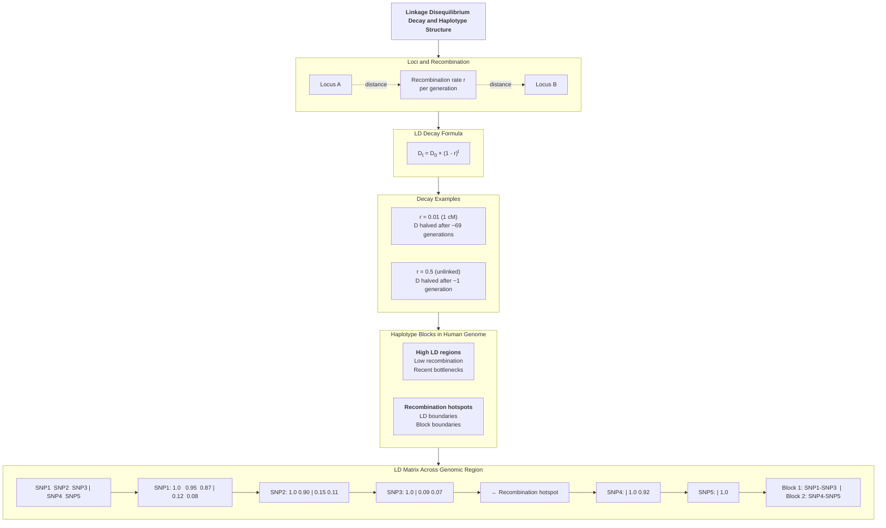
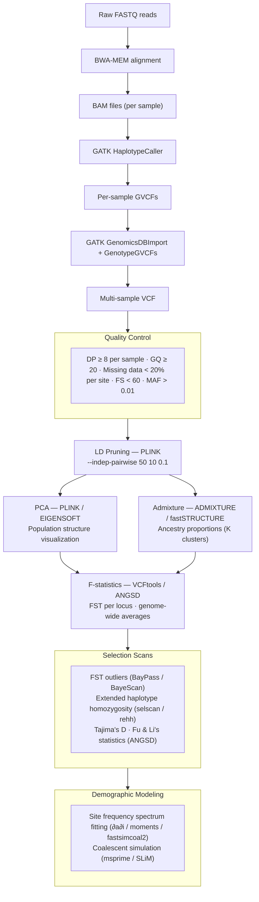

# Lesson 6: Population Evolutionary Genetics

## 1. First-Principles Intuition & Invariants

Population genetics sits at the intersection of Mendelian inheritance, Darwinian selection, and statistical mechanics. Its central project is to describe how allele frequencies change across generations within a population, and to identify which forces drive those changes. Where classical genetics asks what a gene does, population genetics asks what a population of genes does over time — a shift in perspective as consequential as the move from Newtonian particle mechanics to statistical thermodynamics. The individual organism becomes a carrier of alleles; the population becomes the fundamental unit of evolutionary change.

### The Hardy-Weinberg Equilibrium: An Evolutionary Null Hypothesis

The foundation of population genetics is not a description of change but a precise mathematical statement of *stasis*. In 1908, G.H. Hardy and Wilhelm Weinberg independently derived what is now called the Hardy-Weinberg principle: in a population that is infinitely large, randomly mating, free from mutation, free from migration, and subject to no selection, allele frequencies remain constant from generation to generation. This is the population-genetic equivalent of Newton's first law — a body in motion stays in motion unless acted upon, and a gene pool at equilibrium stays there unless perturbed.

For a biallelic locus with alleles $A_1$ and $A_2$ at frequencies $p$ and $q$ respectively, where $p + q = 1$, the Hardy-Weinberg genotype frequencies after one round of random mating are:

$$f(A_1A_1) = p^2, \quad f(A_1A_2) = 2pq, \quad f(A_2A_2) = q^2$$

The derivation is elegant and assumes only that gametes combine at random. Consider a gene pool in which a fraction $p$ of gametes carry $A_1$ and a fraction $q$ carry $A_2$. The probability that two gametes drawn independently both carry $A_1$ is $p \cdot p = p^2$; the probability that one carries $A_1$ and the other $A_2$, in either order, is $2pq$. These are simply the terms of the binomial expansion $(p + q)^2$, expanded across the gamete pool.

The power of Hardy-Weinberg is not in what it predicts about real populations — most real populations violate at least one assumption — but in what it makes visible by contrast. When observed genotype frequencies depart from Hardy-Weinberg expectations, the departure is a signal: something is happening. The challenge of population genetics is to identify which force is responsible and to quantify its magnitude. This is the discipline's central inferential problem.

### Allele Frequency Dynamics: Forces on the Gene Pool

Five forces perturb a population away from Hardy-Weinberg equilibrium: mutation, genetic drift, gene flow, non-random mating, and natural selection. Each has a characteristic signature in allele frequency trajectories, in linkage disequilibrium patterns, and in the genome's spatial structure. A practitioner analyzing real genomic data must decompose observed variation into contributions from each of these forces, often using likelihood frameworks that model them simultaneously.

**Mutation** is the ultimate source of all genetic variation. For a biallelic locus, let $\mu$ be the forward mutation rate from $A_1 \to A_2$ and $\nu$ the reverse rate $A_2 \to A_1$. The change in frequency of $A_1$ per generation is:

$$\Delta p = -\mu p + \nu q = -\mu p + \nu(1-p)$$

At mutation-drift equilibrium, the stationary frequency satisfies $\Delta p = 0$, giving $\hat{p} = \nu / (\mu + \nu)$. For typical nuclear mutation rates on the order of $\mu \sim 10^{-8}$ per site per generation, mutation pressure alone moves allele frequencies with geological slowness. The evolutionary significance of mutation is not in altering existing variation but in continuously injecting new variants into the population for drift and selection to act upon.

**Gene flow** — the migration of individuals or gametes between populations — acts as a homogenizing force, eroding the genetic differentiation that drift and local selection build between subpopulations. For a simple two-population island model in which a fraction $m$ of one population is replaced each generation by migrants from a mainland with allele frequency $p_M$, the change in the island's allele frequency is:

$$\Delta p = m(p_M - p)$$

Gene flow is thus a restoring force proportional to the difference between local and migrant allele frequencies. The $F_{ST}$ statistic, defined as the ratio of between-population variance to total variance in allele frequency, is the canonical measure of population differentiation and is directly interpretable in terms of the balance between drift and migration under Wright's island model: $F_{ST} \approx 1/(1 + 4N_e m)$, where $N_e$ is the effective population size and $m$ is the migration rate.

### Genetic Drift: The Stochastic Engine

Genetic drift is the random change in allele frequencies caused by sampling variance during reproduction. In a finite population of effective size $N_e$, only a subset of potential gametes contribute to the next generation. Each generation, allele frequencies undergo a random walk whose variance per generation is:

$$\text{Var}(\Delta p) = \frac{p(1-p)}{2N_e}$$

The effective population size $N_e$ is the size of an idealized Wright-Fisher population that would experience the same rate of genetic drift as the actual population. It accounts for unequal sex ratios, variance in reproductive success, and temporal fluctuations in census size. For a population with $N_f$ breeding females and $N_m$ breeding males, the effective size under the simplest approximation is:

$$\frac{1}{N_e} = \frac{1}{4N_f} + \frac{1}{4N_m}$$

The long-run behavior of drift is fixation: given sufficient time, any allele in a finite population will either drift to fixation (frequency 1) or loss (frequency 0). For a neutral allele currently at frequency $p$, the probability of ultimate fixation is simply $p$. For a new mutation appearing as a single copy in a diploid population of size $N$, $p = 1/(2N)$ and the probability of fixation is $1/(2N)$ — overwhelmingly likely to be lost. This is the foundation of Kimura's neutral theory: most new mutations are lost by drift before selection can act on them, and the ones that do fix do so largely by chance.

The expected time to fixation for a neutral allele, conditioned on fixation occurring, is approximately $\bar{t} \approx 4N_e$ generations. For human populations with $N_e \approx 10^4$, this is on the order of $4 \times 10^4$ generations — roughly one million years. This timescale makes the neutral theory simultaneously consistent with the rapid molecular evolution observed at synonymous sites and the slower adaptive evolution observed at amino acid-altering sites.

### Natural Selection: Fitness Landscapes and Allele Dynamics

Natural selection is the only evolutionary force that is systematically directional. It operates through differential reproductive success: genotypes that contribute more offspring to the next generation increase in frequency. The fitness of a genotype is defined as its expected relative reproductive contribution, and population genetics formalizes this through a simple but powerful set of recurrence equations.

For a diploid organism at a single biallelic locus, assign fitness values $w_{11}$, $w_{12}$, and $w_{22}$ to genotypes $A_1A_1$, $A_1A_2$, and $A_2A_2$ respectively. The mean fitness of the population is:

$$\bar{w} = p^2 w_{11} + 2pq w_{12} + q^2 w_{22}$$

After one round of selection, the frequency of $A_1$ in the next generation is:

$$p' = \frac{p^2 w_{11} + pq w_{12}}{\bar{w}}$$

The change in allele frequency per generation due to selection is therefore:

$$\Delta p = \frac{p(w_1 - \bar{w})}{\bar{w}}$$

where $w_1 = p w_{11} + q w_{12}$ is the marginal fitness of allele $A_1$. The mean fitness $\bar{w}$ serves as a normalizing constant that keeps frequencies summing to one, and Wright's fundamental theorem of natural selection states that $\Delta \bar{w} \geq 0$ under additive fitness — mean fitness is non-decreasing. This is the population-genetic analog of entropy increase in thermodynamics, though it holds exactly only for the additive case and breaks down under frequency-dependent selection or epistasis.

The concept of a **fitness landscape** — a surface defined over genotype space or allele frequency space, with height corresponding to fitness — was introduced by Sewall Wright and remains one of the most intellectually generative frameworks in evolutionary biology. In the simplest one-locus, two-allele case, the landscape is a one-dimensional curve over allele frequency $p$. Its shape encodes the entire qualitative dynamics of selection. Under directional selection ($w_{11} > w_{12} > w_{22}$ or the reverse), the landscape has a single peak at fixation of the favored allele. Under overdominance — heterozygote advantage — the landscape has an interior maximum at an intermediate frequency $\hat{p} = (w_{12} - w_{22}) / (2w_{12} - w_{11} - w_{22})$, producing a stable polymorphism. The classic example is sickle cell anemia, where heterozygotes ($A_1A_2$) are protected from malaria while homozygotes for the sickle allele ($A_2A_2$) suffer severe anemia, maintaining both alleles at high frequency in malaria-endemic regions.

The selection coefficient $s$ parameterizes the fitness disadvantage of one genotype relative to another, typically with $w_{11} = 1$, $w_{12} = 1 - hs$, $w_{22} = 1 - s$, where $h$ is the dominance coefficient. When $h = 0$, the advantageous allele $A_1$ is fully dominant; when $h = 1$, it is fully recessive; when $h = 1/2$, fitness effects are additive; and when $h < 0$, there is overdominance. The rate at which selection drives a favorable allele from low frequency to near-fixation is fastest when $h = 1$ (dominant) and slowest when $h = 0$ (recessive), because a recessive allele "hides" from selection in heterozygotes when rare.

The interaction between drift and selection is governed by the product $N_e s$. When $|N_e s| \ll 1$, drift dominates and the allele behaves approximately as neutral. When $|N_e s| \gg 1$, selection dominates and the deterministic recurrence equations give accurate predictions. The transition zone $|N_e s| \sim 1$ is the most biologically interesting regime, where the outcome of selection is genuinely probabilistic — a favored allele can still be lost by drift, and a deleterious allele can fix.

### Molecular Evolution and the Neutral Theory

The neutral theory of molecular evolution, developed by Motoo Kimura in the late 1960s, proposed that the vast majority of sequence variation observed within and between species is neutral — neither favored nor disfavored by selection — and that molecular evolution proceeds primarily by the random fixation of these neutral variants by genetic drift. This was a genuinely radical claim at the time, and it transformed molecular biology's relationship to evolutionary theory.

The neutral theory makes quantitative predictions about the rate of molecular evolution. Under strict neutrality, the fixation rate of new mutations is:

$$k = 2N_e \cdot \mu \cdot \frac{1}{2N_e} = \mu$$

where $2N_e$ is the number of new mutations entering the population each generation (in a diploid), $\mu$ is the per-site mutation rate, and $1/(2N_e)$ is the fixation probability of a neutral mutation. The remarkable consequence is that the rate of molecular evolution equals the mutation rate, independent of population size — a prediction consistent with the observed molecular clock, in which synonymous substitution rates are approximately constant across lineages spanning vastly different population sizes.

Departures from the neutral theory are measured by the ratio of nonsynonymous to synonymous substitution rates, $d_N / d_S$ (also written $\omega$ or $K_a/K_s$). Under strict neutrality, $d_N / d_S = 1$. When $d_N / d_S < 1$, purifying selection is removing deleterious nonsynonymous mutations faster than they fix, indicating functional constraint. When $d_N / d_S > 1$, positive selection is driving amino acid changes to fixation faster than the neutral baseline — a signature of adaptive molecular evolution. The McDonald-Kreitman test exploits this logic by comparing the ratio of nonsynonymous to synonymous polymorphism within species to the ratio of nonsynonymous to synonymous divergence between species, with departure from equality indicating the action of selection.

### Quantitative Genetics: The Architecture of Complex Traits

Most traits of biological and medical interest — height, blood pressure, disease susceptibility, agricultural yield — are not controlled by single loci with large effects but by many loci each contributing small, additive effects, overlaid on environmental variation. Quantitative genetics provides the framework for analyzing such traits without requiring knowledge of the underlying loci.

The phenotypic variance of a quantitative trait can be decomposed as:

$$V_P = V_A + V_D + V_I + V_E$$

where $V_A$ is the additive genetic variance (variance due to the average effects of allele substitutions), $V_D$ is the dominance variance, $V_I$ is the epistatic (interaction) variance, and $V_E$ is the environmental variance. The narrow-sense heritability $h^2 = V_A / V_P$ is the fraction of phenotypic variance attributable to additive genetic effects. It is the quantity directly relevant to the response to selection, through the breeder's equation:

$$R = h^2 S$$

where $R$ is the response to selection per generation and $S$ is the selection differential — the difference between the mean phenotype of selected parents and the population mean. This equation, deceptively simple, underlies all of quantitative plant and animal breeding, and its derivation from first principles reveals why $V_A$, not $V_P$ or even total $V_G$, is the currency of evolutionary change.

The additive genetic variance $V_A = 2 \sum_i p_i q_i \alpha_i^2$, where the sum runs over all loci $i$, $p_i$ and $q_i$ are allele frequencies at locus $i$, and $\alpha_i$ is the average effect of an allele substitution at locus $i$. This expression makes explicit that $V_A$ depends on both the effect sizes of loci and their allele frequencies, and therefore changes over time as selection shifts frequencies and drift causes random fluctuations. A population under sustained directional selection depletes its additive variance over time, eventually exhausting the heritable variation the selection can act on — a phenomenon called erosion of genetic variance, which explains the asymptotic plateau in long-term artificial selection experiments.

### Speciation: Reproductive Isolation and the Origin of Species

Speciation is the process by which one lineage splits into two lineages that can no longer exchange genes. Population genetics characterizes speciation in terms of the accumulation of reproductive isolating barriers — genetic, behavioral, or ecological differences that reduce gene flow between diverging populations to the point where they become evolutionarily independent. The genetics of reproductive isolation has been transformed by the concept of Dobzhansky-Muller incompatibilities.

Consider two populations that diverge from a common ancestor. In the ancestral population, suppose the genotype at two interacting loci is $aabb$. In one daughter population, a substitution occurs at the first locus, producing $AAbb$; in the other, a substitution occurs at the second locus, producing $aaBB$. Neither substitution is individually deleterious — each was fixed in its own genetic background, either by selection or by drift. But when hybrids between the two populations produce $AaBb$ offspring, the interaction between $A$ and $B$ alleles, which have never co-occurred in the same organism before, can produce developmental failure. This is the Dobzhansky-Muller model of hybrid incompatibility, and it explains how reproductive isolation can evolve as a byproduct of independent adaptation or drift in allopatric populations, without any selection for isolation per se.

The genomic signature of speciation is a mosaic: regions of high $F_{ST}$ where selection has driven divergence despite gene flow (so-called "islands of speciation" or "islands of differentiation"), interspersed with regions of low $F_{ST}$ where neutral variation has remained homogeneous. Distinguishing these islands — identifying whether they reflect genuine divergent selection or simply local reductions in recombination rate that concentrate linked selective sweeps — is one of the central analytical challenges of speciation genomics.

---

## 2. Core Architecture & Mechanics

### The Wright-Fisher Model: Canonical Mechanics of Drift

The Wright-Fisher (WF) model is the canonical generative model of population genetics. It describes the propagation of a gene pool across discrete, non-overlapping generations, capturing how sampling variance translates into allele frequency change. Understanding its mechanics in full detail is essential before moving to the statistical inference frameworks built atop it.

In the WF model, a population of exactly $N$ diploid individuals produces an effectively infinite gamete pool, from which the next generation's $2N$ gene copies are drawn independently and with replacement. If the current frequency of allele $A_1$ is $p$, then the number of $A_1$ copies in the next generation, $X'$, follows a binomial distribution:

$$X' \sim \text{Binomial}(2N, p)$$

$$p' = \frac{X'}{2N}$$

This single equation encapsulates the entire stochastic dynamics of the WF model. The expected change in allele frequency is zero (drift is unbiased), and the variance in allele frequency change per generation is $p(1-p)/(2N)$. Each generation is an independent random draw, making the trajectory of allele frequencies under pure drift a martingale — a process with no memory beyond the current state, and with the property that its expectation at any future time equals its current value.

The forward-time behavior of the WF model is well described by the diffusion approximation, in which time is rescaled by $2N$ generations and allele frequency is treated as a continuous variable. The probability density $f(x, t)$ of finding allele $A_1$ at frequency $x$ at time $t$ evolves according to the Fokker-Planck (Kolmogorov forward) equation:

$$\frac{\partial f}{\partial t} = -\frac{\partial}{\partial x}\left[M(x) f\right] + \frac{1}{2}\frac{\partial^2}{\partial x^2}\left[V(x) f\right]$$

where the drift coefficient $M(x)$ captures deterministic forces (selection, mutation, migration) and the diffusion coefficient $V(x) = x(1-x)/(2N)$ captures stochastic drift. This equation is the population-genetic analog of the diffusion equation in physics, with allele frequency playing the role of a spatial coordinate, and it admits analytical solutions for many standard combinations of forces.

```text
Wright-Fisher Allele Frequency Dynamics
========================================

Generation 0:    p = 0.5
                 |_____|_____|
                 A1    A2  (equal frequency)

Sampling (2N draws with replacement):
                   ↓  ↓  ↓  ↓  ↓
              [Random binomial sampling]
                   ↓  ↓  ↓  ↓  ↓

Generation 1:    p' ~ Binomial(2N, 0.5) / 2N
                 Drift shifts p' slightly from 0.5

Each generation:
  Variance(Δp) = p(1-p) / 2N
  E[p'] = p        (no bias)
  
Long-run outcomes (all trajectories):
  → Fixation at p = 1.0  (prob = p₀)
  → Loss at p = 0.0      (prob = 1 - p₀)
  
Expected fixation time: ~4Nₑ generations
```

### Selection-Drift Interaction: The Phase Diagram

The qualitative behavior of an allele under combined selection and drift is determined by the product $N_e s$. This parameter partitions the state space of evolutionary dynamics into three qualitatively different regimes:

```text
Selection-Drift Phase Diagram
==============================

      Strong drift         Transition zone        Strong selection
      (neutral regime)     (probabilistic)        (deterministic regime)

Nₑs:  ←————|————————————————|————————————————|————→
           0.1              1.0              10.0

Behavior:
 Nₑs << 1   Allele drifts as if neutral; fate determined by chance
 Nₑs ~ 1    Selection biases fixation probability; drift still matters
 Nₑs >> 1   Deterministic sweep; p(fixation) ≈ 2s for new beneficial mut.

Fixation probability of new beneficial mutation (Kimura 1962):
                    1 - e^{-2s}
   P(fix) = ———————————————————————
              1 - e^{-4Nₑs}
   
   For Nₑs >> 1: P(fix) ≈ 2s
   For Nₑs << 1: P(fix) ≈ 1/(2N)   [neutral]
```

### Linkage Disequilibrium and the Signal Architecture of Population Genomics

Alleles at different loci are not necessarily inherited independently. Linkage disequilibrium (LD) is the statistical association between alleles at different loci within a population. For two biallelic loci with alleles $A/a$ and $B/b$ at frequencies $p_A$, $p_a$, $p_B$, $p_b$, the standard measure of LD is:

$$D = f(AB) - p_A p_B$$

where $f(AB)$ is the observed frequency of the $AB$ haplotype. Under random mating and free recombination, $D$ decays geometrically each generation: $D_t = D_0 (1-r)^t$, where $r$ is the recombination fraction between the two loci. High LD between distant loci indicates that recombination has not had sufficient time to break down their association — either because the population is young, experienced a recent bottleneck, or has restricted recombination in that genomic region.

The normalized measure $r^2 = D^2 / (p_A p_a p_B p_b)$ ranges from 0 (no LD) to 1 (complete LD, one haplotype is absent from the population). It is the standard metric used in GWAS power calculations and in constructing haplotype blocks for genotype imputation.



### Population Structure and F-Statistics

Wright's hierarchical $F$-statistics decompose genetic variation across levels of population structure. For a three-level hierarchy (individuals $I$, subpopulations $S$, total population $T$):

$$F_{IS} = 1 - \frac{H_I}{H_S}, \quad F_{ST} = 1 - \frac{H_S}{H_T}, \quad F_{IT} = 1 - \frac{H_I}{H_T}$$

where $H_I$ is the observed heterozygosity within individuals, $H_S$ is the expected heterozygosity within subpopulations, and $H_T$ is the expected heterozygosity in the total population. These satisfy the relation $(1 - F_{IT}) = (1 - F_{IS})(1 - F_{ST})$. Under the island model, $F_{ST} \approx 1/(1 + 4N_e m)$, making $F_{ST}$ directly interpretable as a function of the balance between drift and gene flow — high $F_{ST}$ means drift wins and populations are differentiated, low $F_{ST}$ means migration wins and populations are homogeneous.

The genomic distribution of $F_{ST}$ across loci reveals the action of natural selection. Under neutral evolution, all loci should have similar $F_{ST}$ values drawn from a common distribution determined by the demographic history. Loci with anomalously high $F_{ST}$ are candidates for local adaptation — divergent selection has pushed them toward different alleles in different populations. Loci with anomalously low $F_{ST}$ are candidates for balancing selection — the same alleles are maintained at similar frequencies across populations, as expected if overdominance or negative frequency-dependent selection is operating. This $F_{ST}$-outlier approach, formalized in tools like BayeScan and BayPass, is a standard first-pass screen for natural selection in population genomic datasets.

---

## 3. High-Performance Optimization & Failure Modes

### Building a Population Genomic Analysis Pipeline

The practical workflow of population genetics begins with raw genomic data — typically whole-genome sequencing reads or genotyping array data — and proceeds through a sequence of analytical steps that must be executed with care at each stage. Each step amplifies or attenuates signal from the population-genetic forces one wishes to study, and analytical errors compound across the pipeline in ways that can produce entirely misleading biological conclusions.

**Variant Calling and Quality Control** is the foundation. For whole-genome sequencing data, the standard workflow uses BWA-MEM for read alignment to a reference genome, followed by GATK's HaplotypeCaller for joint genotyping across samples, producing a multi-sample VCF file. The quality control step must remove variants that fail hard filters — minimum read depth per sample (typically $\geq 8\times$ for population genetic work), genotype quality scores ($GQ \geq 20$), allele balance for heterozygotes (typically $0.25 < AB < 0.75$ to flag potential paralogs), and strand bias statistics (Fisher strand $FS < 60$ for SNPs). Missing data is a particular concern: a site with $>20\%$ missing genotypes across samples introduces systematic bias in allele frequency estimates and must be filtered or imputed before downstream analysis.

**Principal Component Analysis of Genomic Variation** is the first exploratory analysis in any new dataset, and it is interpretable directly in terms of population structure. PCA of a genotype matrix, where rows are individuals and columns are biallelic SNP genotypes coded as 0, 1, or 2, decomposes variation into orthogonal axes. The first few principal components capture the strongest axes of population differentiation in the data. Using PLINK for LD-pruning before PCA is essential: because LD causes nearby SNPs to be correlated, an LD-pruned set of approximately independent markers (typically produced by pruning windows of 50 SNPs with step size 10 and $r^2$ threshold 0.1) prevents genomic regions of extended LD from dominating the PCA axes.



### Selection Scans: Methods and Their Failure Modes

**Tajima's D** is one of the most widely used summary statistics for detecting departures from neutrality in sequence data. For a sample of $n$ sequences from a locus of length $L$, let $S$ be the number of segregating sites, $k$ be the average pairwise nucleotide differences, $\hat{\theta}_W = S / a_1$ be Watterson's estimator of $4N_e\mu$ (where $a_1 = \sum_{i=1}^{n-1} 1/i$), and $\hat{\theta}_\pi = k$ be the pairwise estimator. Tajima's D is:

$$D = \frac{\hat{\theta}_\pi - \hat{\theta}_W}{\sqrt{\text{Var}(\hat{\theta}_\pi - \hat{\theta}_W)}}$$

Under strict neutrality and constant population size, $D \approx 0$. Negative $D$ indicates an excess of rare variants relative to common ones — consistent with either a recent selective sweep (which removes variation at the selected site and neighboring linked sites, leaving a characteristic star-shaped genealogy) or a population expansion (which also generates many rare variants as new lineages rapidly diversify). Positive $D$ indicates an excess of intermediate-frequency variants — consistent with balancing selection maintaining multiple alleles at intermediate frequency, or a recent population bottleneck.

The critical failure mode of Tajima's D is its insensitivity to confounded demographic and selective effects. Population expansions produce negative $D$ that is indistinguishable from positive selection sweeps using $D$ alone. The standard mitigation is to compute $D$ across all loci genome-wide, fit a demographic model to the genome-wide site frequency spectrum, simulate neutral data under that fitted model, and ask whether the $D$ at a candidate locus is an outlier relative to the neutral expectation under realistic demography. Failure to control for demography leads to an overwhelming false positive rate in selection scans — a failure mode that has produced hundreds of spurious selection reports in the literature.

**Extended Haplotype Homozygosity (EHH) methods** — specifically iHS (integrated haplotype score) and XP-EHH (cross-population EHH) — detect ongoing or recent selective sweeps by measuring the length of haplotype homozygosity around a focal variant. A variant that has recently risen from low frequency under strong positive selection will carry a long, identical haplotype in its chromosomal neighborhood, because recombination has not had time to break it down. The iHS statistic compares the integrated EHH for the derived allele to the integrated EHH for the ancestral allele at the same locus, normalized across the genome. iHS is sensitive to incomplete sweeps (the selected allele has not yet reached fixation), while XP-EHH compares EHH between two populations and detects sweeps near completion in one population that are absent in the other.

The practical implementation uses `selscan` or the R package `rehh`. Critical quality control requirements include phased haplotype data (EHH methods require haplotype phase, not just genotype calls; phasing is performed with SHAPEIT4 or BEAGLE), sufficient marker density ($\geq 1$ SNP per 5 kb across the region of interest), and a physical map or recombination rate estimate to properly normalize EHH decay by distance rather than by number of markers.

**Site Frequency Spectrum (SFS) fitting for demographic inference** requires careful handling. The SFS is a vector whose $i$-th entry counts the number of SNPs at which the derived allele occurs in exactly $i$ out of $n$ samples. Under neutrality and constant population size, the expected SFS has a characteristic $1/i$ shape (Watterson's formula). Population contractions, expansions, and bottlenecks each distort the SFS in characteristic ways, and tools like `∂a∂i` (now `moments`) fit parametric demographic models by optimizing the likelihood of the observed SFS under a diffusion-based forward model. The failure modes here are model misspecification (the true demographic history may not be well captured by simple expansion/contraction models) and the non-identifiability of some parameter combinations — multiple different demographic histories can produce nearly identical SFS shapes, requiring careful model comparison via likelihood ratio tests or AIC.

### Coalescent Simulation and Forward-Time Simulation

Realistic population genomic data analysis requires simulated data under null models for calibration, power estimation, and test statistic distribution generation. Two simulation paradigms are in common use.

**Coalescent simulation with msprime** traces genealogies backward in time from sampled sequences. Because it simulates only the ancestry of sampled individuals rather than the entire population, it is computationally efficient for large samples and long chromosomes. `msprime` implements the structured coalescent, allowing multiple populations with arbitrary migration matrices, population size changes, and population splits. It outputs tree sequences — compact representations of genealogical information — that can be used directly to compute summary statistics without materializing full sequence matrices.

```python
import msprime

# Simulate two populations that split 1000 generations ago
# with migration rate 1e-4 per generation after split
demography = msprime.Demography()
demography.add_population(name="A", initial_size=10000)
demography.add_population(name="B", initial_size=8000)
demography.add_population_split(time=1000, derived=["A", "B"], ancestral="ANC")
demography.add_population(name="ANC", initial_size=15000)

ts = msprime.sim_ancestry(
    samples={"A": 50, "B": 50},      # 50 diploid individuals per population
    demography=demography,
    sequence_length=1e6,              # 1 Mb chromosome
    recombination_rate=1e-8,
    random_seed=42
)

mts = msprime.sim_mutations(ts, rate=1.5e-8, random_seed=42)

# Compute FST between populations A and B
import tskit
FST = mts.Fst(sample_sets=[
    mts.samples(population=0),  # Population A
    mts.samples(population=1)   # Population B
])
print(f"Simulated FST: {FST:.4f}")
```

**Forward-time simulation with SLiM** models evolution forward in time, making it straightforward to implement arbitrary selection models, spatial population structures, and time-varying parameters. SLiM uses a scripting language (Eidos) to specify complex evolutionary scenarios that are impossible or awkward to implement in coalescent frameworks — including soft sweeps (selection on standing variation), background selection, and gene drive dynamics.

```text
// SLiM script: directional selection on a quantitative trait
initialize() {
    initializeMutationRate(1e-8);
    initializeRecombinationRate(1e-8);
    initializeMutationType("m1", 0.5, "n", 0.0, 0.1); // additive QTL
    initializeGenomicElementType("g1", m1, 1.0);
    initializeGenomicElement(g1, 0, 999999);           // 1 Mb locus
}

1 early() {
    sim.addSubpop("p1", 1000);  // N = 1000 diploids
}

1:1000 late() {
    // Directional selection: fitness = 1 + beta * phenotype
    inds = sim.subpopulations.individuals;
    phenotypes = inds.sumOfMutationsOfType(m1); // additive genetic value
    inds.fitnessScaling = 1.0 + 0.05 * phenotypes;
}

1000 late() {
    sim.simulationFinished();
    sim.outputFull("output_generation1000.txt");
}
```

### Quantitative Trait Locus Mapping: GWAS and Its Failure Modes

Genome-wide association studies map quantitative or qualitative phenotypic variation to genomic loci by testing for statistical association between each SNP and the phenotype across a sample of individuals. The standard linear model for a continuous trait is:

$$y_i = \mu + \beta x_i + \mathbf{Z}_i \boldsymbol{\gamma} + \epsilon_i$$

where $y_i$ is the phenotype of individual $i$, $x_i \in \{0, 1, 2\}$ is the dosage of the effect allele at the tested SNP, $\beta$ is the effect size to be estimated, $\mathbf{Z}_i \boldsymbol{\gamma}$ is a vector of covariates (top principal components of the genotype matrix, batch effects, sex), and $\epsilon_i \sim \mathcal{N}(0, \sigma^2)$ is residual error. For binary traits (case-control designs), logistic regression replaces the linear model, though mixed-model approaches (SAIGE, REGENIE) are preferred for large unbalanced datasets where logistic regression produces inflated type-I error rates.

Population stratification — systematic differences in allele frequency that covary with phenotype due to ancestry rather than causation — is the most consequential failure mode in GWAS. The classical mitigation is to include the top principal components of the genotype matrix as covariates, which absorbs variation in allele frequency that tracks ancestry. The genomic inflation factor $\lambda_{GC} = \text{median}(\chi^2_{\text{observed}}) / 0.4549$ measures the degree of residual stratification or overdispersion in the test statistics: values $>1.1$ in a large study indicate that stratification is incompletely controlled and the false positive rate is elevated.

The multiple testing burden in GWAS is severe. With $M \sim 10^6$ independent tests (after LD pruning of a typical imputed GWAS dataset), the Bonferroni-corrected significance threshold is $\alpha / M = 0.05 / 10^6 = 5 \times 10^{-8}$. This threshold, now standard in human GWAS, was derived empirically from the linkage disequilibrium structure of the human genome and represents approximately the number of independent haplotype blocks. Applying a less stringent threshold inflates the false discovery rate dramatically, as the prior probability that any given SNP affects any given phenotype is very low even for highly heritable traits.

The **missing heritability problem** — the observation that genome-wide significant SNPs collectively explain far less phenotypic variance than the narrow-sense heritability estimated from twin studies — emerges from several sources. Causal variants with small effects do not reach genome-wide significance in studies of practical size and therefore contribute to heritability but not to explained variance. Rare variants ($MAF < 0.01$) are poorly captured by standard GWAS arrays. Gene-gene interactions (epistasis) and gene-environment interactions contribute to phenotypic variance in ways that additive models cannot capture. And twin-based heritability estimates themselves may be upwardly biased if the equal-environment assumption is violated. The SNP heritability $h^2_{SNP}$, estimated by genomic restricted maximum likelihood (GREML) using GCTA, provides an estimate of the heritability attributable to common variants typed on the array and typically falls between twin-based $h^2$ and the variance explained by significant loci, confirming that many causal variants exist below the significance threshold.

### Inferring Demographic History: The PSMC and SMC++ Approaches

The Pairwise Sequentially Markovian Coalescent (PSMC) uses the density of heterozygous sites along a single diploid genome to infer the history of effective population size over time. The method exploits the fact that the time to the most recent common ancestor (TMRCA) of the two copies of a gene at any genomic position is an exponential random variable whose rate depends on the local $N_e$ at the time of coalescence, and that TMRCA changes along the chromosome as recombination reshuffles genealogies. By fitting a hidden Markov model to the sequence of heterozygous and homozygous blocks in a diploid genome, PSMC infers a piecewise-constant approximation to the $N_e(t)$ trajectory.

The critical limitation of PSMC is its dependence on a single individual, which makes it insensitive to population events in the recent past (the last few thousand years) due to low coalescent probability at shallow times. SMC++ (Terhorst et al. 2017) extends the PSMC framework to multiple samples by modeling the joint genealogy of a "distinguished pair" and additional flanking samples, dramatically improving resolution for recent demographic events. It is the method of choice when recent population dynamics — post-agricultural expansion, founder effects, admixture events — are the target of inference.

Calibrating the absolute timescale of demographic inference requires a generation time and a mutation rate. For human studies, the standard calibration uses a mutation rate of $\mu = 1.25 \times 10^{-8}$ per site per generation and a generation time of 29 years. These values carry substantial uncertainty — mutation rate estimates from parent-offspring trio studies range from $1.0$ to $1.5 \times 10^{-8}$ depending on the sequencing platform and analysis pipeline — and demographic time estimates scale inversely with $\mu$. Reporting demographic results in units of $N_e \cdot \mu$ (which is directly estimated from data without requiring a mutation rate) alongside the calibrated values in generations or years is best practice, as it separates what the data actually constrain from the assumptions made about mutation rate.

### Speciation Genomics: Identifying Barriers to Gene Flow

When two diverging populations still exchange some genes, the genomic landscape of differentiation reflects the interplay between gene flow, local adaptation, and reproductive isolation. Regions of the genome that are resistant to introgression appear as islands of high differentiation ($F_{ST}$) against a background of lower differentiation at neutral loci. The observation of such islands is consistent with two distinct mechanisms, and distinguishing them is a critical analytical challenge.

The first mechanism is genuine divergent selection with ongoing gene flow: at loci where the two populations are adapted to different environments, introgression of the foreign allele is deleterious and selection removes immigrant alleles, keeping local allele frequencies differentiated. The second mechanism is reduced recombination: genomic regions with low recombination rates accumulate differentiation faster than regions with high recombination rates, because selective sweeps and background selection in low-recombination regions affect long chromosomal segments. This creates $F_{ST}$ peaks that co-localize with pericentromeric regions and genomic inversions, regardless of whether those regions contain loci under divergent selection.

The standard diagnostic for these two mechanisms is to compare the genomic distribution of $F_{ST}$ to the genomic distribution of nucleotide diversity $\pi$ within each population, and to the genetic map. Under the reduced recombination explanation, $F_{ST}$ peaks should coincide with low $\pi$ within each population (a signature of reduced neutral diversity caused by linked selection), with pericentromeric regions, and with known chromosomal inversions. Under the divergent selection explanation, $F_{ST}$ peaks should not necessarily co-localize with low within-population diversity, particularly if the selected variants are at intermediate frequency (as expected under balancing selection or incomplete sweeps). The $d_{XY}$ statistic — the absolute sequence divergence between populations, which is less sensitive to within-population diversity than $F_{ST}$ — provides complementary information: regions of genuinely elevated divergence between lineages should show high $d_{XY}$, while regions that appear differentiated only because of depleted within-population diversity (from linked selection) will show normal or low $d_{XY}$.

The practical toolkit for speciation genomics combines VCFtools for per-window $F_{ST}$ and $\pi$ calculation, `pixy` (Korunes and Bhatt 2021) for unbiased $d_{XY}$ estimation from data with missing genotypes, BayPass or Lfmm2 for genotype-environment association analysis to identify candidate locally adapted loci, and coalescent simulation with introgression (using `msprime`'s migration model or the isolation-with-migration model in `fastsimcoal2`) to generate null distributions for the observed level of differentiation given the demographic history.

The overarching lesson of population evolutionary genetics is that every observable pattern in genomic data — the distribution of allele frequencies, the structure of linkage disequilibrium, the spatial variation in genetic diversity, the degree of differentiation between populations — is the product of multiple forces acting simultaneously. The practitioner's task is to build forward-time or coalescent models that faithfully represent those forces, compare their predictions against data using principled statistical methods, and resist the temptation to interpret any single statistic in isolation. The genetic archive of a population, written in its DNA sequences, is both richer and more ambiguous than it first appears, and reading it correctly demands the same rigor that any physical measurement demands: careful experimental design, explicit model assumptions, honest quantification of uncertainty, and the intellectual discipline to report what the data actually say rather than what one hoped to find.
