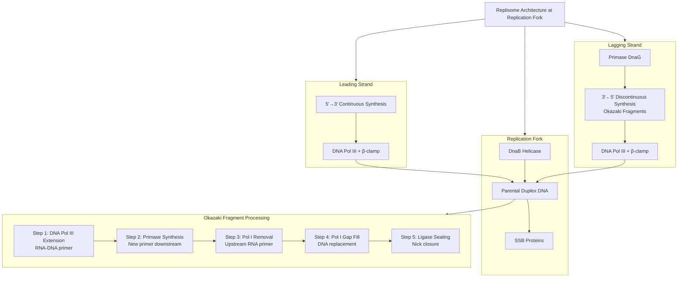

# Lesson 2: Microbial Genetics, Molecular Mechanisms, Horizontal Gene Transfer

## 1. First-Principles Intuition & Invariants

The bacterial cell represents an exquisitely optimized genetic machine, where information flows from DNA to RNA to protein with remarkable fidelity yet retains sufficient plasticity to adapt across evolutionary timescales. Unlike eukaryotic systems with their compartmentalized nuclear architecture and complex post-transcriptional regulation, bacteria execute molecular genetics through a streamlined, spatially coupled process where transcription and translation occur simultaneously in the cytoplasm. This organizational principle—the absence of a nuclear membrane—fundamentally shapes every aspect of bacterial gene expression, from the kinetics of mRNA stability (half-lives measured in minutes rather than hours) to the regulatory strategies bacteria employ to rapidly respond to environmental flux.

At the heart of bacterial genetics lies a profound tension between two competing evolutionary imperatives: genetic stability, which preserves adaptive genotypes across generations, and genetic plasticity, which enables rapid acquisition of novel metabolic capabilities, antibiotic resistance determinants, and virulence factors. The bacterial chromosome, typically a single circular DNA molecule ranging from 500 kilobase pairs in obligate parasites like *Mycoplasma* to over 9 megabase pairs in soil-dwelling *Streptomyces*, replicates with extraordinary precision through the coordinated action of the replisome—a molecular assembly containing DNA polymerase III holoenzyme, helicase, primase, and single-strand binding proteins. DNA polymerase III synthesizes both leading and lagging strands with an error rate of approximately one mistake per $10^7$ to $10^8$ nucleotides incorporated, a fidelity achieved through 3' to 5' exonuclease proofreading and subsequent mismatch repair systems that survey nascent DNA for base-pairing errors.

The central dogma in bacteria manifests through a tightly integrated genetic circuit where spatial proximity governs regulatory efficiency. Transcription initiates when RNA polymerase holoenzyme, containing core enzyme subunits ($\beta, \beta', \alpha_2, \omega$) bound to a sigma factor, recognizes promoter sequences positioned approximately 10 and 35 base pairs upstream of the transcription start site. The sigma factor dictates promoter specificity: the housekeeping sigma-70 ($\sigma^{70}$) in *Escherichia coli* directs transcription of constitutively expressed genes, while alternative sigma factors like sigma-32 ($\sigma^{32}$) activate heat shock response genes when cytoplasmic protein misfolding triggers cellular stress. Once RNA polymerase escapes the promoter and enters elongation phase, ribosomes can immediately bind the emerging 5' ribosome binding site (Shine-Dalgarno sequence) on the nascent mRNA and commence translation while transcription continues—a phenomenon termed coupled transcription-translation that has no eukaryotic counterpart.

Gene regulation in bacteria operates through negative and positive control mechanisms that respond to metabolic intermediates and environmental signals with response times on the order of seconds to minutes. The *lac* operon, perhaps the most thoroughly characterized regulatory circuit in molecular biology, exemplifies negative control through the LacI repressor protein, which binds operator sequences overlapping the promoter when lactose is absent, physically occluding RNA polymerase access. Upon lactose influx, the metabolite allolactose binds LacI, inducing a conformational change that releases the repressor from DNA and permits transcription. Positive control superimposes an additional regulatory layer: when glucose is depleted and cyclic AMP (cAMP) accumulates, the cAMP-CAP complex binds upstream of the promoter, recruiting RNA polymerase through direct protein-protein contacts and enhancing transcription initiation rates by over 50-fold. This combinatorial logic—integrating negative control (LacI) and positive control (CAP-cAMP)—enables bacteria to preferentially metabolize glucose over lactose, a phenomenon termed catabolite repression or the glucose effect.

Riboswitches represent an ancient regulatory strategy where structured RNA elements directly sense small molecule ligands without requiring protein intermediaries. Located in the 5' untranslated region of mRNA, riboswitches undergo ligand-induced conformational changes that either sequester or expose ribosome binding sites, thereby controlling translation initiation. The *Bacillus subtilis* riboflavin riboswitch, for instance, adopts one of two mutually exclusive secondary structures: in the absence of flavin mononucleotide (FMN), an antiterminator structure forms that permits transcription read-through into structural genes encoding riboflavin biosynthetic enzymes; when FMN accumulates and binds the aptamer domain, an alternative terminator hairpin forms, causing premature transcription termination. This direct metabolite sensing circumvents the energetic cost of synthesizing regulatory proteins and achieves response times limited only by ligand diffusion and RNA folding kinetics, typically on the order of milliseconds.

Mutation, the ultimate source of genetic novelty, arises through multiple mechanisms whose relative contributions depend on growth conditions and DNA repair pathway functionality. Spontaneous mutations occur through DNA polymerase misincorporation errors that escape proofreading, spontaneous deamination of cytosine to uracil (subsequently repaired as thymine), and oxidative damage from endogenous reactive oxygen species generated during aerobic respiration. The mutation rate per base pair per generation typically falls between $10^{-9}$ and $10^{-10}$ under non-stressed conditions, but can increase 100- to 1000-fold when bacteria enter stationary phase and activate error-prone DNA polymerases (PolIV, PolV) that lack 3' to 5' exonuclease activity. This stress-induced mutagenesis, while increasing deleterious mutation burden, occasionally generates adaptive mutations that enable escape from nutrient limitation or antibiotic exposure—a phenomenon that blurs the distinction between random mutation and adaptive evolution.

Horizontal gene transfer mechanisms—transformation, transduction, and conjugation—enable bacteria to acquire genetic material across species and even phylum boundaries, fundamentally altering the concept of bacterial species as reproductively isolated populations. Transformation involves uptake of naked extracellular DNA released from lysed cells, followed by recombination into the recipient chromosome or establishment as an autonomously replicating plasmid. Natural competence, the physiological state permitting DNA uptake, is tightly regulated in organisms like *Streptococcus pneumoniae* and *Bacillus subtilis*, where competence develops transiently during specific growth phases and requires dedicated uptake machinery including type IV pili and DNA-binding proteins that protect incoming DNA from nuclease degradation. Transduction occurs when bacteriophages erroneously package host chromosomal or plasmid DNA into phage particles during lytic replication; upon infection of a new host, this DNA can recombine into the recipient genome. Generalized transduction packages random chromosomal fragments, while specialized transduction transfers specific genes flanking integrated prophage sequences following aberrant excision events.

Conjugation represents the most sophisticated horizontal transfer mechanism, requiring direct cell-to-cell contact mediated by a conjugative pilus—a proteinaceous appendage encoded by genes clustered in transmissible plasmids or conjugative transposons. The F (fertility) plasmid of *E. coli*, a 100 kilobase pair episome, encodes a complete conjugation apparatus comprising pilus structural genes, DNA processing enzymes, and regulatory factors. During conjugation, the F plasmid undergoes rolling-circle replication: a plasmid-encoded relaxase nicks one strand at the origin of transfer (*oriT*), and the 5' end of nicked DNA transfers through the mating bridge into the recipient cell while the complementary strand is synthesized in the donor. The transferred single strand is simultaneously replicated in the recipient, yielding two cells each harboring a complete F plasmid copy. When F integrates into the bacterial chromosome (forming Hfr strains), conjugation can transfer chromosomal genes in a polar, time-dependent manner, enabling genetic mapping based on interrupted mating experiments where conjugation is mechanically disrupted at defined time intervals.

Plasmids and transposons constitute mobile genetic elements that replicate semi-independently of the host chromosome and carry genes conferring selective advantages under specific environmental pressures. Plasmids range from small multicopy replicons (fewer than 10 kilobase pairs, present at 20-100 copies per cell) to large low-copy conjugative plasmids exceeding 200 kilobase pairs. Plasmid replication initiates at a unique origin whose activity is controlled by antisense RNAs, iteron-binding proteins, or other incompatibility systems that enforce copy number homeostasis. Transposons, DNA segments capable of relocating within and between replicons, encode transposase enzymes that catalyze excision and reintegration reactions. Composite transposons consist of a central region carrying cargo genes (commonly antibiotic resistance determinants) flanked by insertion sequences providing transposase and terminal inverted repeats required for transposition. Transposon-mediated gene transfer can occur without homologous recombination, enabling integration into essentially any DNA sequence and facilitating rapid dissemination of resistance genes across bacterial populations exposed to antibiotic selection pressure.

The mechanistic details of bacterial genetics—semiconservative bidirectional replication from a single origin, coupled transcription-translation, small-molecule-responsive gene regulation, and promiscuous horizontal gene transfer—converge to create biological systems that balance hereditary stability with evolutionary innovation. Understanding these molecular mechanisms at a quantitative, kinetic level provides the foundation for experimental microbiology: constructing recombinant strains, interpreting genetic screens, predicting regulatory responses, and combating the evolution of antibiotic resistance through rational drug design targeting essential cellular processes.

## 2. Core Architecture & Mechanics

The bacterial chromosome replicates through a highly coordinated molecular machine known as the replisome, which assembles at the chromosomal origin of replication (*oriC*) following activation by the DnaA initiator protein. DnaA binds to multiple 9-base-pair recognition sequences within *oriC*, oligomerizing to form a nucleoprotein complex that induces localized DNA melting at an adjacent AT-rich region (the DUE, or DNA unwinding element). This melting exposes single-stranded DNA that recruits the DnaB helicase, a hexameric motor protein that encircles and translocates along the lagging strand template in the 5' to 3' direction, powered by ATP hydrolysis at approximately 1000 base pairs per second. Helicase activity generates two replication forks that proceed bidirectionally toward the terminus region located diametrically opposite *oriC* on the circular chromosome.

At each replication fork, DNA polymerase III holoenzyme synthesizes both leading and lagging strands, but the intrinsic directionality of DNA polymerase—exclusive 5' to 3' synthesis—creates an asymmetry in replication mechanics. The leading strand is synthesized continuously as helicase unwinds the parental duplex, with DNA polymerase III remaining processively associated with the template through interactions with the $\beta$-clamp, a ring-shaped sliding clamp that encircles DNA and tethers the polymerase for processive synthesis of tens of thousands of nucleotides without dissociation. Lagging strand synthesis proceeds discontinuously through repeated cycles of primer synthesis, elongation, primer removal, and ligation. Primase (DnaG) synthesizes short RNA primers (approximately 10 nucleotides) complementary to exposed lagging strand template; DNA polymerase III extends these primers for roughly 1000-2000 nucleotides, generating Okazaki fragments. When polymerase encounters the 5' RNA primer of the preceding Okazaki fragment, it dissociates, allowing DNA polymerase I to bind, excise the RNA primer through its 5' to 3' exonuclease activity, and fill the resulting gap with DNA. DNA ligase then seals the nick between adjacent Okazaki fragments, producing a continuous lagging strand.

Replication fidelity depends on multiple quality control mechanisms operating at distinct steps. DNA polymerase III achieves base selectivity through an induced-fit mechanism where binding of the correct Watson-Crick base pair stabilizes a catalytically competent polymerase conformation; incorrect base pairing fails to induce this conformational change, reducing the rate of phosphodiester bond formation by several orders of magnitude. Despite this selectivity, polymerase misincorporation occurs approximately once per $10^5$ nucleotides. The 3' to 5' exonuclease domain of DNA polymerase III excises terminal mismatches, improving accuracy to roughly one error per $10^7$ nucleotides. Residual mismatches that escape proofreading are detected by the methyl-directed mismatch repair system: in *E. coli*, hemimethylated GATC sequences transiently mark the newly synthesized strand (which remains unmethylated for several minutes post-replication), enabling MutS to identify mismatches and MutL-MutH to excise the error-containing strand and resynthesize the corrected sequence. This three-tiered quality control cascade achieves a final error rate of approximately $10^{-9}$ to $10^{-10}$ per base pair per generation.

Transcription in bacteria initiates when RNA polymerase holoenzyme recognizes and binds promoter DNA through sequence-specific contacts mediated by the sigma factor. The core promoter consists of two conserved hexameric sequences: the -10 box (Pribnow box, consensus TATAAT) and the -35 box (consensus TTGACA), separated by an optimal spacing of 17 base pairs. RNA polymerase holoenzyme binds initially in a closed complex where DNA remains double-stranded, then undergoes a conformational change producing an open complex in which approximately 12 base pairs surrounding the transcription start site are melted, exposing the template strand for base pairing with incoming ribonucleoside triphosphates. Transcription initiation involves synthesis of short oligonucleotide transcripts (2-10 nucleotides) that often abort and dissociate before polymerase escapes the promoter and commits to elongation. Promoter escape correlates with sigma factor dissociation: upon synthesis of transcripts exceeding 8-10 nucleotides, core RNA polymerase breaks contacts with promoter DNA and sigma factor dissociates, allowing core enzyme to enter the highly processive elongation phase.

During elongation, RNA polymerase translocates at approximately 40-50 nucleotides per second at 37°C, maintaining a transcription bubble of roughly 8 base pairs where template DNA is unpaired and the nascent RNA forms a transient RNA-DNA hybrid spanning 8-9 base pairs. Processivity derives from extensive protein-DNA contacts distributed across the elongation complex: the $\beta$ and $\beta'$ subunits form a crab-claw structure that encircles DNA, while the bridge helix and trigger loop within the active site catalyze phosphodiester bond formation. Transcription termination occurs through two distinct mechanisms: intrinsic termination, where a GC-rich inverted repeat followed by a poly-U tract induces formation of a stem-loop structure in nascent RNA that destabilizes the elongation complex, causing polymerase dissociation; and Rho-dependent termination, where the hexameric Rho helicase recognizes C-rich, unstructured sequences in nascent RNA, binds, and translocates along RNA in the 5' to 3' direction until it contacts paused RNA polymerase, inducing dissociation through ATP-dependent conformational changes.

Translation initiates through recognition of the ribosome binding site (RBS, or Shine-Dalgarno sequence) located 5-9 nucleotides upstream of the start codon (typically AUG, occasionally GUG or UUG). The 16S rRNA component of the 30S ribosomal subunit contains a complementary anti-Shine-Dalgarno sequence (CCUCC) near its 3' end; base pairing between Shine-Dalgarno and anti-Shine-Dalgarno sequences positions the start codon in the ribosomal P site. Initiation requires three initiation factors: IF1 binds the A site, blocking premature tRNA entry; IF2 recruits the initiator tRNA (fMet-tRNA$^{\text{fMet}}$, carrying N-formylmethionine) to the P site; and IF3 prevents premature 50S subunit association until correct positioning is confirmed. Upon start codon recognition and initiator tRNA placement, initiation factors dissociate, the 50S subunit joins to form the 70S ribosome, and elongation commences.

Elongation proceeds through repetitive cycles of aminoacyl-tRNA selection, peptide bond formation, and translocation. Elongation factor EF-Tu delivers aminoacyl-tRNAs to the A site in a ternary complex with GTP; correct codon-anticodon pairing triggers GTP hydrolysis and EF-Tu-GDP dissociation, leaving aminoacyl-tRNA in the A site. The peptidyl transferase center, a ribozyme composed of 23S rRNA, catalyzes nucleophilic attack by the A-site aminoacyl-tRNA amino group on the ester bond linking the nascent peptide to P-site tRNA, forming a new peptide bond and transferring the growing polypeptide to the A-site tRNA. Elongation factor EF-G-GTP then binds and induces ribosomal ratcheting, translocating peptidyl-tRNA from A site to P site and deacylated tRNA from P site to E site (from which it subsequently dissociates), while simultaneously advancing mRNA by three nucleotides to expose the next codon in the A site. Translation terminates when a stop codon (UAA, UAG, UGA) enters the A site; release factors RF1 or RF2 recognize stop codons and catalyze hydrolysis of the ester bond linking the polypeptide to tRNA, releasing the completed protein.

Gene regulation through operons exploits polycistronic mRNA to coordinately control genes encoding functionally related proteins. The *trp* operon in *E. coli* encodes five biosynthetic enzymes required for tryptophan synthesis and is regulated through both transcriptional repression and attenuation. When tryptophan is abundant, it binds the TrpR repressor protein, enabling DNA binding to operator sequences that overlap the promoter, blocking RNA polymerase access and reducing transcription initiation by 70-fold. Attenuation provides an additional regulatory mechanism: a 140-nucleotide leader region upstream of the structural genes contains two adjacent tryptophan codons within a coding sequence for a short leader peptide. When tryptophan is scarce, ribosomes stall at these codons, allowing formation of an antiterminator hairpin that permits transcription to continue into structural genes. Conversely, when tryptophan-charged tRNA$^{\text{Trp}}$ is abundant, ribosomes rapidly translate the leader peptide, preventing antiterminator formation and instead promoting a terminator hairpin that causes transcriptional abortion in the leader region. This attenuation mechanism amplifies repression an additional 8- to 10-fold beyond that achieved by TrpR alone.

Riboswitch-mediated regulation operates through ligand-induced conformational changes in structured RNA elements. The thiamine pyrophosphate (TPP) riboswitch, widespread across bacteria, consists of a complex three-dimensional RNA fold containing two structural domains connected by a hinge. TPP binding to the aptamer domain induces a conformational change that stabilizes a terminator hairpin overlapping the ribosome binding site, preventing ribosome access and blocking translation of TPP biosynthetic enzymes. The kinetic and thermodynamic parameters governing riboswitch function—ligand binding affinity ($K_d$ typically 10-1000 nM), RNA folding rates (milliseconds to seconds), and ligand association/dissociation rates—determine dynamic range and response time. High-affinity riboswitches achieve sharp concentration thresholds and respond rapidly to ligand fluctuations, while lower-affinity riboswitches provide graded responses over broader concentration ranges.

Transformation requires development of natural competence, a transient physiological state encoded by dedicated gene clusters. In *Bacillus subtilis*, competence develops during late exponential phase under nutrient limitation, triggered by accumulation of two quorum-sensing peptides (ComX and CSF) that activate a complex phosphorelay signal transduction cascade culminating in expression of ComK, the master transcriptional regulator of competence genes. ComK activates expression of DNA uptake machinery including type IV pili (encoded by *comG* operon), DNA-binding proteins, membrane transporters, and recombination proteins. Type IV pili bind extracellular double-stranded DNA, retract through pilus depolymerization (powered by the ComGA ATPase), and deliver DNA to the cell surface where a nuclease degrades one strand while transporting the complementary strand through the membrane into the cytoplasm. Single-stranded DNA is immediately bound by RecA recombinase, which catalyzes homologous pairing with the chromosome and strand invasion, initiating recombination that integrates donor sequences into the recipient genome.

Conjugation initiates when a donor cell expressing conjugative pili contacts a recipient lacking the cognate plasmid. The F pilus extends from the donor surface, binds recipient outer membrane, and retracts, drawing cells together to form a mating bridge (likely composed of multiple pili or a dedicated translocation channel). Within the donor cell, the plasmid-encoded relaxase recognizes *oriT*, nicks one strand at a specific phosphodiester bond, and remains covalently attached to the 5' end of nicked DNA through a tyrosine-phosphate linkage. DNA transfer proceeds through rolling-circle replication: as the 5' end passes through the mating bridge into the recipient, DNA polymerase extends the 3' end remaining in the donor, displacing the transferred strand. Simultaneously, the complementary strand is synthesized in the recipient using the transferred single strand as template. The entire process transfers plasmid DNA at approximately 50 kilobase pairs per minute, completing F plasmid transfer in roughly 2 minutes. Transfer of integrated chromosomal DNA from Hfr donors occurs sequentially from a fixed origin and proceeds until mating bridge breakage interrupts transfer, typically after 10-100 minutes, allowing mapping of chromosomal genes based on entry time.

Transposition mechanisms vary by transposon class but generally involve element excision, target site recognition, and reintegration through transposase-catalyzed reactions. Composite transposons like Tn10 (encoding tetracycline resistance) contain two flanking insertion sequences (IS10-L and IS10-R) in inverted orientation; only IS10-R encodes functional transposase. Transposition initiates when transposase binds terminal inverted repeats, pairs both ends of the transposon, and catalyzes double-strand breaks that excise the element. The liberated transposon, complexed with transposase, binds target DNA and transposase catalyzes staggered cleavage of target strands separated by 9 base pairs (for Tn10). The transposon ends are ligated to target strand ends, leaving 9-nucleotide single-strand gaps flanking the inserted element. DNA polymerase fills these gaps using the complementary strand as template, generating 9-base-pair direct repeats flanking the integrated transposon—a diagnostic signature of transposition events. Replicative transposons employ a distinct mechanism where the original element remains at the donor site while a copy inserts at the target site, doubling transposon copy number per event. This mode involves formation of a cointegrate intermediate (donor and target replicons fused with transposon copies at both junctions), followed by resolution through site-specific recombination that separates replicons, each now carrying a transposon copy.

## 3. High-Performance Optimization & Failure Modes

Experimental investigation of bacterial genetics requires precise control of culture conditions, timing, and environmental variables to achieve reproducible molecular phenotypes. When examining DNA replication kinetics through incorporation of radioactive precursors, grow cells to mid-exponential phase (OD$_{600}$ 0.4-0.6) in minimal medium supplemented with unlabeled thymidine (10 μg/mL) to suppress endogenous thymidine synthesis, then pulse-label with [$^3$H]-thymidine (20 μCi/mL, specific activity 60-80 Ci/mmol) for defined intervals ranging from 10 seconds to 5 minutes. Rapidly quench incorporation by adding ice-cold trichloroacetic acid to a final concentration of 10% w/v, precipitating macromolecules while leaving unincorporated nucleotides in solution. Collect precipitates on glass fiber filters, wash extensively with cold 5% TCA followed by ethanol, dry filters, and quantify incorporation by liquid scintillation counting. Replication fork velocity can be calculated from the relationship $v = L/t$, where $L$ is genome length contributed per fork and $t$ is labeling time, accounting for bidirectional replication from *oriC*. Typical measurements yield fork velocities of 800-1000 nucleotides per second at 37°C in rich medium, declining to 400-600 nucleotides per second in minimal medium where nucleotide pool sizes limit polymerase processivity.

Transcriptional profiling through quantitative reverse transcription PCR demands rigorous RNA handling to prevent degradation by ubiquitous RNases. Harvest bacterial cultures by immediately mixing with two volumes of ice-cold RNA stabilization solution (95% ethanol, 5% phenol, pH 4.3) to simultaneously halt metabolism and inactivate RNases. Pellet cells by centrifugation at 4°C, resuspend in lysis buffer containing chaotropic agents (guanidinium thiocyanate, 4 M), and mechanically lyse through bead-beating or enzymatic digestion with lysozyme followed by proteinase K treatment. Isolate total RNA through phenol-chloroform extraction: mix lysate with acid phenol (pH 4.5), vortex vigorously, centrifuge to separate phases, and recover the aqueous phase containing RNA while protein and DNA partition to the interface and organic phase. Precipitate RNA with isopropanol, wash with 75% ethanol to remove residual salts, air-dry briefly, and resuspend in nuclease-free water. Treat with DNase I (RNase-free, 2 units per μg RNA, 30 min at 37°C) to eliminate contaminating genomic DNA that would confound subsequent PCR analysis. Verify RNA integrity by denaturing agarose gel electrophoresis: intact bacterial RNA displays sharp 23S and 16S ribosomal RNA bands with a 23S:16S intensity ratio near 2:1; smearing indicates degradation requiring sample rejection.

Perform reverse transcription using gene-specific primers or random hexamers depending on analytical goals. For targeted gene quantification, design reverse primers complementary to sequences 150-250 nucleotides downstream of the transcription start site; for global transcriptome analysis, use random hexamer priming to synthesize cDNA from all polyadenylated and non-polyadenylated transcripts. Set up reverse transcription reactions with 1 μg total RNA, 200 units reverse transcriptase (M-MLV or SuperScript III), 0.5 mM each dNTP, 1× RT buffer, and 10 mM dithiothreitol to maintain enzyme activity. Incubate at 50°C for 60 minutes, heat-inactivate enzyme at 70°C for 15 minutes, and dilute cDNA 1:10 for PCR amplification. Quantitative PCR employs intercalating dyes (SYBR Green) or hydrolysis probes (TaqMan) to monitor amplicon accumulation in real time. Design primer pairs yielding 80-150 base pair amplicons with melting temperatures between 58-62°C and minimal secondary structure. Include no-RT controls (RNA template without reverse transcriptase) to detect genomic DNA contamination, no-template controls to detect reagent contamination, and serial dilutions of purified amplicon standards to construct standard curves relating threshold cycle ($C_t$) to transcript abundance. Calculate relative expression using the $2^{-\Delta\Delta C_t}$ method: normalize target gene $C_t$ values to housekeeping gene controls (e.g., *rpoD*, *gyrA*) to account for RNA input variation, then compare normalized expression between experimental and control conditions.

Genetic complementation tests to assign mutations to specific genes require construction of merodiploid strains where wild-type gene copies are introduced on plasmids into mutant backgrounds. Clone candidate genes with native promoters into low- or medium-copy vectors (pBR322 derivatives, 15-20 copies/cell, or pSC101 derivatives, 5-10 copies/cell) to avoid overexpression artifacts. Transform mutant strains by electroporation: grow cells to mid-exponential phase, harvest by centrifugation, wash three times with ice-cold 10% glycerol to remove salts that cause arcing during electroporation, resuspend at approximately $10^{10}$ cells/mL, mix with 0.1-1.0 μg plasmid DNA, transfer to chilled electroporation cuvettes (0.2 cm gap), and pulse at 2.5 kV, 25 μF, 200 Ω (yielding time constants of 4-6 milliseconds). Immediately dilute into SOC medium (2% tryptone, 0.5% yeast extract, 10 mM NaCl, 2.5 mM KCl, 10 mM MgCl$_2$, 20 mM glucose) and incubate at 37°C for 1 hour to allow expression of antibiotic resistance markers before plating on selective media. Score complementation by assessing whether plasmid-borne wild-type gene restores mutant phenotype to wild-type levels; quantitative phenotypes require measuring multiple independent transformants to control for plasmid copy number variation.

Transposon mutagenesis for forward genetic screens exploits random insertion to generate loss-of-function alleles. Deliver transposon via conjugation from a donor strain harboring a suicide vector (unable to replicate in the recipient due to incompatible replication origin) carrying a transposon with antibiotic resistance marker. Perform conjugation by mixing exponential-phase donor and recipient cultures at 1:10 ratio, concentrating cells by centrifugation, resuspending in 100 μL rich medium, spotting onto membrane filters placed on agar plates, and incubating 4-6 hours to allow mating. Resuspend mated cells and plate on selective medium containing antibiotics targeting both transposon marker (to select transposition events) and counter-selection against donor (e.g., nalidixic acid if donor is nalidixic acid-sensitive). Individual colonies represent independent transposon insertion mutants. Screen colonies for desired phenotypes—altered colony morphology, loss of motility on swim plates, inability to utilize specific carbon sources, or sensitivity to antimicrobial compounds. Map insertion sites by arbitrary PCR: perform initial PCR with one primer specific to the transposon end and a second degenerate primer matching random genomic sequences, then perform nested PCR with internal transposon primer and a primer matching the arbitrary primer sequence tag. Sequence PCR products and align to the reference genome to identify disrupted genes.

Site-directed mutagenesis through allelic exchange enables installation of precise mutations at endogenous loci. Clone the target gene region with approximately 500-1000 base pairs of flanking sequence on each side into a suicide vector containing a counter-selectable marker (e.g., *sacB*, which converts sucrose to levan—a toxic product causing cell death in the presence of sucrose). Introduce the desired mutation (point mutation, deletion, insertion) into the cloned sequence by overlap extension PCR: design mutagenic primers containing the desired change, amplify upstream and downstream fragments in separate reactions using mutagenic primers paired with external primers, then combine purified fragments and amplify with external primers only; the overlapping mutagenic primers anneal in the combined reaction, generating a full-length product containing the mutation. Transform or conjugate the suicide plasmid carrying the mutagenized allele into the wild-type strain and select for chromosomal integration events by plating on antibiotic (selecting for plasmid resistance marker). Integrants harbor the plasmid inserted into the chromosome through a single recombination event, creating a merodiploid with both wild-type and mutant alleles flanking integrated vector sequences. Passage integrants in non-selective medium to allow spontaneous excision through a second recombination event, then plate on medium containing sucrose to counter-select against *sacB* (killing cells retaining plasmid sequences). Surviving colonies represent excision events; screen by colony PCR and sequence verification to identify clones that retained the mutant allele while excising plasmid sequences.

Quantifying horizontal gene transfer frequencies requires distinguishing donor, recipient, and transconjugant populations through selectable markers. For conjugation frequency measurements, use donor and recipient strains each carrying distinct antibiotic resistance markers, with donors bearing the conjugative plasmid carrying a third resistance marker. Mix exponential-phase donor and recipient cultures at defined ratios (typically 1:10 donor:recipient), concentrate by centrifugation or filtration, and incubate on solid medium or in liquid culture for 1-4 hours to allow mating. Serially dilute mating mixtures and plate on media selecting for donors only, recipients only, and transconjugants (requiring resistance markers from both recipient chromosome and conjugative plasmid). Calculate conjugation frequency as transconjugants per donor cell: $f = T/(D \times t)$, where $T$ is transconjugant count, $D$ is final donor count, and $t$ is mating time in hours. High-frequency conjugative plasmids like F yield transfer frequencies of $10^{-1}$ to $10^{-2}$ per donor per hour, while low-frequency plasmids transfer at $10^{-5}$ to $10^{-7}$ per donor per hour.

Transformation efficiency is maximized through careful preparation of competent cells and optimization of DNA concentrations. For chemical competence using CaCl$_2$ treatment, grow cells to early exponential phase (OD$_{600}$ 0.3-0.4), harvest by centrifugation at 4°C, resuspend in ice-cold CaCl$_2$ solution (50-100 mM), and incubate on ice for 30 minutes to allow calcium penetration of the cell wall and outer membrane. Calcium ions interact with lipopolysaccharide and phospholipids, creating transient pores that permit DNA entry upon heat shock. Mix chilled competent cells with plasmid DNA (10-100 ng for high-copy plasmids, 0.1-1 μg for low-copy plasmids), incubate on ice 30 minutes to allow DNA-cell surface binding, heat shock at 42°C for 45-90 seconds to drive DNA uptake, then immediately place on ice to prevent heat damage. Dilute into pre-warmed rich medium and incubate at 37°C for 45-60 minutes to allow expression of plasmid-encoded antibiotic resistance before plating on selective media. Transformation efficiency is quantified as colony-forming units per microgram of plasmid DNA; competent *E. coli* prepared by CaCl$_2$ method typically achieve $10^6$ to $10^7$ transformants per microgram, while electrocompetent cells reach $10^9$ to $10^{10}$ transformants per microgram.

Failure modes in bacterial genetic experiments arise from several common sources. RNA degradation during transcript profiling produces artifactual gene expression patterns; prevent by working rapidly at 4°C, using certified RNase-free reagents and plasticware, and including RNase inhibitors in lysis buffers. Genomic DNA contamination in RT-PCR generates false positive signals from genes transcribed at undetectable levels; control through rigorous DNase treatment and inclusion of no-RT controls in every experiment. Plasmid instability in the absence of selection causes loss of plasmid-borne genes during extended culture, confounding complementation and overexpression studies; maintain continuous antibiotic selection or use auxotrophic complementation systems where plasmid loss is lethal. Transposon insertion hotspots bias mutagenesis screens toward specific genomic regions while leaving others under-sampled; address by using multiple transposon systems with different insertion specificities or supplementing with chemical mutagenesis. Polar effects from transposon insertions in operons disrupt downstream genes in addition to the directly interrupted gene, confounding phenotype assignment; resolve through complementation with individual genes rather than operons, or use non-polar transposons carrying transcriptional terminators flanking resistance markers to prevent read-through disruption of downstream genes.

Optimizing gene expression constructs requires balancing promoter strength, ribosome binding site efficiency, and plasmid copy number to achieve desired protein levels without toxicity. Strong constitutive promoters (P$_{\text{tac}}$, P$_{\text{T7}}$) combined with high-copy plasmids can drive expression to 30-50% of total cellular protein, often causing growth defects through metabolic burden and protein aggregation. Reduce expression by substituting weaker promoters, using low-copy vectors, or introducing tunable systems like arabinose-inducible P$_{\text{BAD}}$ (titratable from essentially zero to high expression by varying arabinose concentration from 0 to 0.2%) or anhydrotetracycline-inducible P$_{\text{tet}}$ (fully repressed in the absence of inducer, strongly activated by 100-200 ng/mL anhydrotetracycline). Optimize ribosome binding site strength through computational prediction (RBS Calculator tools estimate translation initiation rates based on mRNA secondary structure near start codons) or empirical testing of synthetic RBS libraries spanning a dynamic range of 100- to 1000-fold in translation efficiency.

Protein purification from recombinant bacterial expression requires optimization of induction conditions and lysis methods. Express proteins as N- or C-terminal fusions to affinity tags: hexahistidine tags enable purification by immobilized metal affinity chromatography, glutathione S-transferase tags bind glutathione-agarose resin, maltose binding protein tags bind amylose resin. Induce expression in exponential-phase cultures (OD$_{600}$ 0.5-0.7) by adding inducer (IPTG for P$_{\text{lac}}$-based promoters, arabinose for P$_{\text{BAD}}$) and incubating for 3-4 hours at 37°C for rapid high-level expression, or 16-18 hours at 16-25°C for slower expression favoring protein folding over aggregation. Harvest cells by centrifugation, resuspend in lysis buffer containing protease inhibitors (PMSF, leupeptin, aprotinin), and lyse by French press (15,000-20,000 psi), sonication (10-15 cycles of 30 seconds on/30 seconds off at 40-60% amplitude), or enzymatic digestion (lysozyme 0.5-1.0 mg/mL plus benzonase nuclease to digest DNA reducing viscosity). Clarify lysates by centrifugation at 15,000-20,000 × $g$ for 30 minutes at 4°C, then apply supernatant to pre-equilibrated affinity resin, wash extensively to remove non-specific binding proteins, and elute target protein by competitive displacement (imidazole for His-tags, reduced glutathione for GST-tags, maltose for MBP-tags). Confirm purity by SDS-PAGE: load 5-10 μg purified protein per lane, electrophorese through 10-15% polyacrylamide gels, and visualize by Coomassie staining (detection limit approximately 50-100 ng/band) or silver staining (detection limit 1-10 ng/band).

Advanced applications leverage bacterial genetics to engineer novel metabolic capabilities and construct synthetic gene circuits. Metabolic pathway engineering for production of valuable compounds (biofuels, pharmaceuticals, specialty chemicals) involves expressing heterologous biosynthetic enzymes, deleting competing pathways that divert carbon flux, and tuning gene expression to balance pathway intermediate levels. CRISPR-based genome editing in bacteria uses catalytically inactive dCas9 fused to transcriptional activators or repressors, enabling programmable gene regulation without permanent DNA modification. Synthetic oscillators, toggle switches, and logic gates built from characterized regulatory parts (promoters, ribosome binding sites, transcription factor binding sites) demonstrate that bacterial gene regulation operates predictably under quantitative models, permitting rational design of circuits with specified input-output transfer functions and dynamic behaviors.
