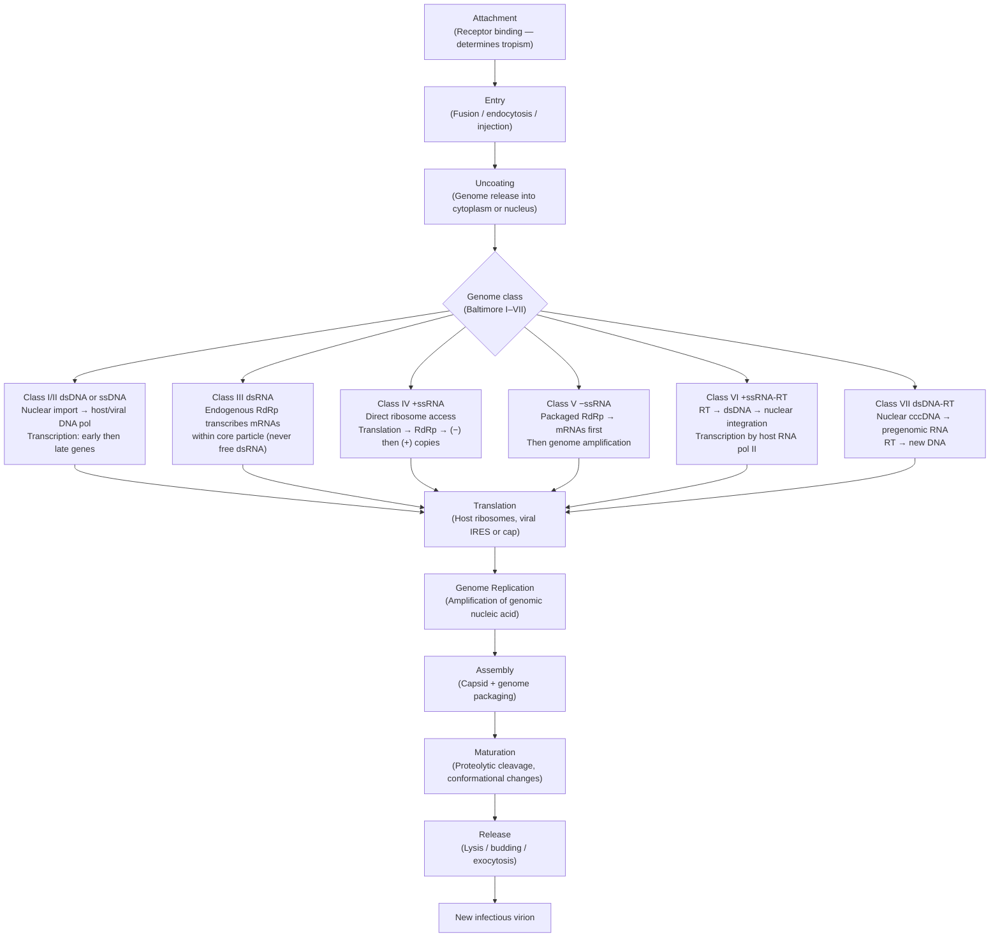

# Lesson 03: Virology — Viral Replication & Pathogenesis

**Course:** Natural Sciences > Microbiology
**Level:** Advanced undergraduate / early graduate
**Prerequisites:** Cell biology (membrane dynamics, receptor signaling), molecular biology (central dogma, transcription factors), basic immunology (innate/adaptive arms)

---

## 1. First-Principles Intuition & Invariants

### 1.1 What a Virus Actually Is

A virus is a genetic parasite constrained to the minimum possible material footprint. Strip away every biological system that can be borrowed from a host cell and you are left with the irreducible core: a nucleic acid encoding replication instructions and a protein shell that protects it and mediates cell entry. Everything else — enzymes, ribosomes, ATP synthesis — is stolen from the host at the moment of infection.

This creates a first invariant: **viruses cannot replicate outside a permissive host cell.** A bacterium can be cultured in a flask of salts and glucose. A virus in that flask is a stable chemical but a biological dead end.

### 1.2 Evolutionary Pressure on Viral Design

Natural selection acts on viral genomes with extraordinary intensity because mutation rates are high, generation times are short (hours to days), and population sizes are enormous. The resulting designs are not arbitrary; they converge on solutions that balance four competing pressures:

1. **Genome stability** — the nucleic acid must survive extracellular transit.
2. **Information density** — genome packaging space is physically constrained by capsid geometry, so overlapping reading frames, polyproteins, and segmentation are common solutions.
3. **Host range** — receptor-binding proteins must match host cell-surface molecules; this single interaction defines host tropism.
4. **Immune escape** — antigenic variation, latency, and suppression of interferon signaling all increase transmission fitness at the cost of other traits.

These four pressures explain most of viral diversity. When you encounter an unfamiliar virus, asking "which pressures dominate its biology?" will organize your thinking.

### 1.3 Invariants That Hold Across All Viruses

The following statements are true of every virus characterized to date.

**Genetic invariant.** The genome encodes at minimum: one or more structural proteins (capsid, envelope), a replication enzyme or the information to commandeer one, and signals recognized by that enzyme for genome duplication. No known virus escapes all three requirements simultaneously.

**Replication invariant.** Viral genomes are replicated by a polymerase. If the host cell does not supply a compatible polymerase, the virus encodes its own. RNA viruses almost universally encode an RNA-dependent RNA polymerase (RdRp) because eukaryotic cells lack this enzyme. DNA viruses with nuclear replication often co-opt host DNA polymerase, though many encode accessory replication factors.

**Assembly invariant.** Capsid proteins spontaneously self-assemble around genomic nucleic acid if the thermodynamic environment is correct. No external scaffold is strictly required for icosahedral capsids, though many use scaffolding proteins transiently. This self-assembly principle means that the information for three-dimensional virion structure is encoded within the primary sequence of the capsid proteins themselves.

**Release invariant.** Virions must exit the cell to infect new cells. Exit strategies — lysis, budding, exocytosis — are not random; they correlate with whether the virus acquires an envelope (budding/exocytosis) or not (usually lysis or non-lytic extrusion).

### 1.4 Why Taxonomy Matters for Mechanism

Viral taxonomy is not mere cataloging; it predicts biology. Knowing that influenza A is a negative-sense, single-stranded RNA virus with a segmented genome immediately tells you: it must carry its own RdRp into the cell (because negative-sense RNA cannot be translated directly), reassortment between co-infecting strains is possible (because segments can swap), and the virus cannot integrate into the host chromosome in its normal life cycle (no reverse transcriptase).

The International Committee on Taxonomy of Viruses (ICTV) classifies viruses in a hierarchy of realm → kingdom → phylum → class → order → family → genus → species. For the purposes of mechanism, family and genus are most informative.

### 1.5 Baltimore Classification: The Mechanistic Framework

David Baltimore's 1971 classification groups viruses by the relationship between their genome and mRNA, because mRNA is the universal currency of gene expression. The logic is simple: ribosomes read only mRNA in the plus-sense orientation. Any genome that is not already plus-sense mRNA requires enzymatic conversion before the cell can produce viral proteins.

| Class | Genome type | Polarity | Key enzyme required | Canonical example |
|---|---|---|---|---|
| I | dsDNA | — | Host DNA pol (± viral factors) | Herpesviruses, Adenoviruses |
| II | ssDNA | +/− | Viral Rep protein | Parvoviruses, Circoviruses |
| III | dsRNA | — | Viral RdRp (endogenous) | Reoviruses, Rotaviruses |
| IV | +ssRNA | + | Viral RdRp (after translation) | Picornaviruses, Flaviviruses, Coronaviruses |
| V | −ssRNA | − | Viral RdRp (must be packaged) | Influenza, Rabies, Ebola |
| VI | +ssRNA-RT | + | Reverse transcriptase | Retroviruses (HIV) |
| VII | dsDNA-RT | — | Reverse transcriptase | Hepadnaviruses (HBV) |

Baltimore Class V deserves emphasis: the virus must package functional RdRp in every virion, because without it the genome is permanently unreadable. This is why negative-sense RNA viruses are not infectious as naked nucleic acid.

---

## 2. Core Architecture & Replication Mechanics

### 2.1 Capsid Symmetry: Geometry Encodes Function

Viral capsids adopt one of three symmetrical architectures, determined by the physics of protein-protein packing.

**Icosahedral symmetry.** An icosahedron has 20 equilateral triangular faces, 12 vertices, and 30 edges. It achieves the most efficient enclosure of volume per unit of protein material. Capsomers — the basic structural units — are typically pentamers at vertices and hexamers on faces. The T-number (triangulation number) describes the number of structural units per icosahedral face: T = h² + hk + k² for integer h and k. T=1 is the smallest possible icosahedron (12 pentamers only, e.g., small satellite viruses). Adenovirus uses T=25, accommodating a larger genome. The rule is that genome size scales loosely with T-number.

**Helical symmetry.** Protein subunits wind in a helix around the nucleic acid. Tobacco mosaic virus is the textbook example; among animal pathogens, negative-sense RNA viruses (influenza, rabies) package their genomes in helical ribonucleoprotein (RNP) complexes. Helical capsids have no fixed length limit: the helix simply extends as far as the nucleic acid requires, which makes them suited to large RNA genomes.

**Complex/asymmetric.** Poxviruses (vaccinia, monkeypox) have no defined icosahedral or helical symmetry. Their large dsDNA genomes are packaged in an ovoid core surrounded by multiple membrane layers and an outer lipoprotein envelope. Bacteriophages such as T4 use a composite architecture (icosahedral head + helical tail), which is distinct from the architectures of animal viruses.

**Envelope.** Many animal viruses acquire a lipid bilayer envelope by budding through host membranes (plasma membrane, ER, Golgi). The envelope contains host-derived lipids but virus-encoded glycoproteins, which perform receptor binding and fusion. Enveloped viruses are sensitive to detergents and desiccation; non-enveloped (naked) viruses are more environmentally stable. This distinction predicts transmission route: naked viruses (norovirus, poliovirus) survive on fomites and are transmitted fecal-orally; enveloped viruses (influenza, HIV) generally require close contact or fluid transfer.

### 2.2 Replication Cycle: Universal Stages

Every viral replication cycle passes through the same conceptual stages regardless of genome type. The molecular details vary enormously, but the logic is invariant.

### 2.3 Attachment and Entry: Receptor Determinism

Receptor binding is the primary determinant of host range and tissue tropism. The viral attachment protein (VAP) recognizes a specific host receptor with structural complementarity. Examples that illustrate the principle:

- **HIV gp120** binds CD4 on T-helper lymphocytes, then engages a co-receptor (CCR5 or CXCR4). Individuals homozygous for the CCR5-Δ32 deletion are largely resistant to CCR5-tropic (R5) HIV.
- **Influenza hemagglutinin (HA)** binds sialic acid. Human influenza strains prefer α-2,6-linked sialic acid (abundant in upper respiratory epithelium); avian strains prefer α-2,3 (abundant in duck intestine and human lower respiratory tract). This receptor preference explains both human transmission efficiency and the relative rarity of avian-to-human spillover.
- **SARS-CoV-2 spike protein** binds ACE2 with roughly 10–20× higher affinity than SARS-CoV-1 spike, partially explaining greater transmissibility.

Entry mechanisms fall into three categories. Membrane fusion at neutral pH (paramyxoviruses, HIV) occurs directly at the plasma membrane after receptor binding. Endosomal fusion after receptor-mediated endocytosis (influenza, VSV) requires acidification of the endosome to trigger conformational change in the fusion protein. Non-enveloped viruses (adeno, picorna) undergo endosomal escape or pore formation rather than membrane fusion.

### 2.4 RNA Virus Replication: Error Rates and Quasispecies

RdRps lack the 3′→5′ proofreading exonuclease present in most cellular DNA polymerases. The resulting error rate is approximately 10⁻⁴ to 10⁻⁵ substitutions per nucleotide per replication cycle, compared with 10⁻⁸ to 10⁻¹⁰ for host DNA replication. For a 10-kb RNA genome, this means roughly one mutation per genome per replication cycle.

The practical consequence is the **quasispecies model**: at any moment, the viral population within a host is not a single sequence but a cloud of closely related variants centered on a consensus sequence. Most variants are defective or neutral; a small fraction carry mutations that are advantageous under selective pressure (e.g., drug treatment, immune recognition). This is why monotherapy with a single antiviral rapidly selects resistance in RNA viruses, and why combination antiretroviral therapy (simultaneous targeting of multiple viral functions) is required to suppress HIV.

Coronaviruses are a notable exception among RNA viruses: they encode a 3′→5′ exonuclease (nsp14-ExoN) that corrects replication errors, reducing their mutation rate by roughly 10-fold relative to other RNA viruses. This proofreading mechanism is thought to be necessary to maintain the fidelity of their unusually large (~30 kb) RNA genomes.

### 2.5 DNA Virus Replication Strategies

Nuclear dsDNA viruses (herpesviruses, adenoviruses) generally replicate in the nucleus and exploit host transcription machinery. Herpesviruses express three temporal gene classes in sequence: immediate-early (IE) genes encode transcription factors that activate early gene expression; early genes encode replication enzymes (thymidine kinase, DNA polymerase); late genes encode structural proteins expressed after DNA amplification. This ordered cascade ensures that structural protein production, which is metabolically expensive and antigenically visible, occurs only after genome amplification is underway.

Poxviruses are the exception: they replicate entirely in the cytoplasm and therefore encode their own RNA polymerase and capping enzymes, because they cannot access the nuclear transcription machinery.

### 2.6 Retroviral Integration: The Provirus

HIV and other retroviruses reverse-transcribe their RNA genome into dsDNA (the provirus), which integrates into host chromatin via the viral integrase enzyme. Integration is non-random but not entirely site-specific: retroviruses favor transcriptionally active chromatin. Once integrated, the provirus is a permanent genetic element in that cell and all daughter cells. This integration explains latency: in resting CD4+ T cells, the provirus transcribes minimally, is invisible to cytotoxic T cells, and persists indefinitely despite antiretroviral therapy that suppresses active replication.

### 2.7 Replication Kinetics: One-Step Growth Curve

The one-step growth experiment — infecting a cell population at high multiplicity of infection (MOI) so that all cells are infected simultaneously — reveals the kinetics of a single replication cycle.

The curve has three phases. During the **eclipse phase**, no infectious virus is detectable inside or outside cells; this represents the time from uncoating to the first assembly of complete virions. During the **maturation phase**, intracellular infectious virus accumulates as assembly proceeds. At **release**, intracellular virus appears extracellularly and total virus titer climbs sharply, then plateaus as the host cells die or as the cycle completes.

Typical one-step cycle durations: poliovirus ~6–8 hours; influenza ~8–12 hours; HIV ~24 hours; herpesviruses ~18–24 hours. Burst size (virions produced per cell) ranges from ~10³ for HIV to ~10⁵ for some adenoviruses.

---

## 3. Pathogenesis & Host-Pathogen Dynamics

### 3.1 Determinants of Pathogenesis

Pathogenesis is the process by which infection causes disease. The severity of disease is determined by the interaction of three variables: **viral factors** (replication speed, cell tropism, cytopathic effect, toxin production), **host factors** (age, immune competence, receptor genetics, prior immunity), and **route of exposure** (inoculum size and site). No single factor is sufficient; pathogenesis is an emergent property of the interaction.

### 3.2 Stages of Infection: From Exposure to Resolution

**Primary infection at the portal of entry.** Virus contacts mucosal surfaces (respiratory, gastrointestinal, genital) or skin. Local replication occurs if susceptible cells expressing the viral receptor are present. Innate immune responses (interferon, NK cells, macrophages) begin within hours.

**Local dissemination.** Virus spreads to draining lymph nodes via free virions in lymph or by trafficking in infected migratory cells (dendritic cells, macrophages). Lymph nodes serve as an amplification site and as the primary location where adaptive immunity is initiated.

**Primary viremia.** Virus enters the bloodstream, either as free virions or within circulating cells. This delivers virus to distant target organs. The magnitude of viremia correlates with disease severity in many infections (HIV viral load, dengue viremia, SARS-CoV-2 RNAemia).

**Target organ infection.** Virus reaches its principal site of pathology, which is determined by the distribution of the cognate receptor. HIV targets CD4+ lymphocytes and macrophages throughout the body. Hepatitis B and C target hepatocytes (HBsAg receptor complex; CD81/claudin-1/occludin respectively). Rabies travels retrogradely along peripheral nerves to the central nervous system.

**Resolution or persistence.** In most acute infections, adaptive immunity clears the infection and establishes memory. In persistent infections (HIV, herpesviruses, HBV, HCV before direct-acting antivirals), the virus evades clearance through mechanisms described in section 3.4.

### 3.3 Mechanisms of Cell and Tissue Injury

Viral disease arises from multiple non-exclusive injury mechanisms.

**Direct cytopathic effect (CPE).** Virus replication physically disrupts cells. Poliovirus shuts off host cap-dependent translation (by cleaving eIF4G with the 2A protease) while continuing its own IRES-dependent translation, starving the cell of its own proteins. Adenovirus disrupts nuclear pore structure. Enveloped viruses budding through the plasma membrane progressively deplete membrane integrity.

**Immune-mediated pathology.** The adaptive immune response itself can be pathogenic. Dengue hemorrhagic fever results partly from antibody-dependent enhancement (ADE): non-neutralizing IgG from a prior dengue serotype infection binds new-serotype virus and facilitates FcγR-mediated uptake into macrophages, amplifying replication and triggering a cytokine storm. Hepatitis B surface antigen-specific cytotoxic T lymphocytes (CTLs) kill infected hepatocytes; in high-titer HBV infection, CTL-mediated killing causes fulminant hepatitis.

**Cytokine storm.** Dysregulated innate immune activation produces systemic inflammatory response syndrome. Influenza H5N1 (avian influenza) induces disproportionately high levels of TNF-α, IL-6, and IL-1β. Severe SARS-CoV-2 infection drives IL-6-mediated vascular endothelial damage and hypercoagulability. The severity of cytokine storm correlates inversely with proportional adaptive immune control.

**Oncogenesis.** Several viruses cause cancer by stable genomic integration of oncogenic sequences, by producing proteins that inactivate tumor suppressor pathways, or by causing chronic inflammation. Epstein-Barr virus (EBV) latent membrane protein 1 (LMP1) mimics constitutively active CD40 signaling, driving B-cell proliferation. Human papillomavirus (HPV) E6 protein targets p53 for proteasomal degradation; E7 binds and inactivates Rb. High-risk HPV types 16 and 18 together account for approximately 70% of cervical cancers globally.

### 3.4 Immune Evasion Strategies

Evolution has produced a toolkit of immune evasion mechanisms across unrelated virus families, demonstrating convergent selection toward the same functional endpoints.

**Interferon antagonism.** Type I interferons (IFN-α/β) are the central antiviral cytokines of the innate immune response. They are induced by pattern recognition receptors (RIG-I, MDA5, cGAS-STING) detecting viral RNA or DNA, and they induce expression of hundreds of interferon-stimulated genes (ISGs) that restrict viral replication. Virtually every successful mammalian virus encodes at least one IFN antagonist.

- Influenza NS1 binds dsRNA to prevent RIG-I activation and inhibits polyadenylation of host mRNAs including IFN-β.
- SARS-CoV-2 nsp1 blocks ribosomal entry of host mRNAs; ORF6 blocks nuclear export of IFN mRNAs.
- Ebola VP35 caps dsRNA ends, shielding them from RIG-I recognition.
- HIV Vpr and Vpx in related lentiviruses degrade host restriction factors (SAMHD1, which depletes the dNTP pool needed for reverse transcription).

**MHC class I downregulation.** Cytotoxic T lymphocytes recognize viral peptides presented on MHC class I. Herpesviruses encode multiple proteins targeting this pathway: HSV-1 ICP47 blocks TAP (transporter associated with antigen processing), preventing peptide loading of MHC class I in the ER. HCMV US11 retrotranslocates assembled MHC class I molecules from the ER to the cytoplasm for degradation. HIV Nef downregulates surface MHC class I. This strategy buys time before adaptive immunity clears the infection, and in latently infected cells it can prevent CTL killing indefinitely.

**Antigenic variation.** The influenza HA and NA surface glycoproteins undergo two types of change. **Antigenic drift** is the gradual accumulation of point mutations in HA epitopes under antibody pressure, explaining why influenza vaccine formulations require annual updating. **Antigenic shift** is the sudden emergence of a novel HA or NA subtype by reassortment of gene segments from different influenza A strains (e.g., human, avian, swine). Shift produces pandemic viruses against which no prior population immunity exists; the 1918, 1957, 1968, and 2009 pandemics all involved antigenic shift events.

HIV uses hypervariable loops (V1–V5) in gp120 to shield the conserved CD4-binding site from antibody access. Broadly neutralizing antibodies (bNAbs) targeting conserved epitopes — the CD4-binding site, the gp41 MPER, the V1V2 apex — are a major focus of HIV vaccine design precisely because they target regions the virus cannot vary without losing function.

**Latency.** Herpesviruses establish true latency: a transcriptionally silent or minimal state in which no viral structural proteins are expressed, the viral genome persists as a circular episome in the nucleus, and the cell is therefore invisible to both CTLs (no viral peptide on MHC class I) and antibodies (no surface antigen). HSV-1 latency in trigeminal ganglion neurons is maintained by latency-associated transcripts (LATs) that suppress lytic gene expression and promote neuron survival. Reactivation is triggered by physiological stresses (UV exposure, fever, immunosuppression) and produces recurrent disease at the original site of infection.

**Complement evasion.** Herpesviruses (HSV gC, CMV UL144), poxviruses, and HIV incorporate host complement regulatory proteins (DAF/CD55, CD59) into their envelopes during budding, using the host's own regulatory machinery to prevent complement-mediated virion destruction.

### 3.5 Viral Determinants of Transmission

Transmission fitness is distinct from virulence. Within-host replication fitness (how fast and how much virus is produced) must be balanced against between-host transmission fitness (how efficiently virus reaches a new susceptible host). Extreme virulence that kills the host before transmission occurs is an evolutionary dead end, explaining why many highly virulent viruses (Ebola, Nipah) do not cause sustained global pandemics despite high case fatality rates.

The basic reproduction number R₀ describes the average number of secondary infections caused by one infectious individual in a fully susceptible population. R₀ > 1 is required for epidemic spread; R₀ < 1 leads to extinction. R₀ is a function of transmission probability per contact (β), the contact rate (c), and infectious duration (d): R₀ = β × c × d. Viral biology influences β (shedding titer, environmental stability) and d (viremia duration); social structure and behavior determine c.

SARS-CoV-2 Omicron variants achieved R₀ estimates of 10–18 through a combination of enhanced ACE2 binding (via specific spike mutations), enhanced upper respiratory tract replication (reduced lower respiratory tropism correlating with reduced severity), and reduced neutralization by pre-existing immunity — a textbook example of how viral evolution can simultaneously optimize transmissibility and partial immune escape.

### 3.6 Zoonotic Spillover and Pandemic Risk

The majority of emerging human viral pathogens are zoonotic: they originate in an animal reservoir and cross species barriers into humans. Bats are the reservoir hosts for a disproportionate number of high-impact RNA viruses (SARS-CoV, SARS-CoV-2, MERS-CoV, Nipah, Hendra, Ebola, Marburg, Rabies-related lyssaviruses). Bat immune systems tolerate high viral loads without damaging inflammation, partly because of constitutive interferon expression and dampened NLRP3 inflammasome activation — evolutionary adaptations to flight-associated metabolic stress that also limit immunopathology from RNA virus infection.

Spillover requires three events in sequence: contact between reservoir and susceptible host, infection of the new host, and onward transmission within the new host species. Most spillovers are dead-end infections (Nipah, Ebola in isolated outbreaks). Pandemic emergence additionally requires adaptation for efficient human-to-human transmission, typically involving mutations in receptor-binding proteins and replication complex components.

---

## 4. Summary & Verification Matrix

### 4.1 Conceptual Summary

Viruses are genetic parasites with the minimum self-replicating information set. Their biology is organized around four evolutionary pressures — genome stability, information density, host range, and immune escape — and all major features of viral diversity can be traced to trade-offs among these pressures.

Baltimore classification organizes viruses by genome-to-mRNA pathway, which directly predicts which enzymatic functions the virus must encode and which it can borrow from the host. Capsid geometry (icosahedral, helical, complex) is determined by protein packing physics and constrains genome packaging capacity.

The replication cycle is universal in its stages (attachment, entry, uncoating, expression, replication, assembly, maturation, release) but diverges in molecular mechanism according to genome class. RNA viruses replicate with high error rates, generating quasispecies clouds that enable rapid adaptation but require proofreading mechanisms for large genomes (coronaviruses). DNA viruses generally replicate with higher fidelity and are more genomically stable.

Pathogenesis emerges from direct cytopathic effects, immune-mediated injury, and oncogenic transformation. Host-pathogen coevolution drives a continuous arms race, with viruses evolving IFN antagonism, antigen presentation disruption, latency, and antigenic variation against host immune pressure. Pandemic emergence requires both within-host replication fitness and between-host transmission efficiency, explaining why the most virulent pathogens rarely become pandemic.

### 4.2 Verification Matrix

| Concept | Key fact to verify understanding | Predicted answer |
|---|---|---|
| Baltimore classification | Why must negative-sense RNA viruses package RdRp in the virion? | Negative-sense RNA cannot be translated; without packaged RdRp, no mRNA can be made and infection fails. |
| Icosahedral T-number | What does T=1 imply about capsid composition? | Only 12 pentamers, no hexamers; the minimum possible icosahedral capsid. |
| Quasispecies | Why does HIV monotherapy fail rapidly? | High RdRp error rate generates pre-existing resistant variants; single-drug selective pressure rapidly amplifies them. |
| Influenza receptor | Why does H5N1 cause severe lower respiratory disease but poor human-to-human transmission? | H5N1 HA binds α-2,3 sialic acid, found in lower respiratory tract; poor binding to upper respiratory α-2,6 reduces airborne transmission efficiency. |
| Herpesvirus MHC evasion | Mechanistically, how does HSV-1 ICP47 prevent CTL killing? | ICP47 blocks TAP, preventing viral peptide transport into the ER; MHC class I is not loaded with viral peptides and is not displayed. |
| Retroviral latency | Why can't antiretroviral therapy (ART) cure HIV? | Integrated provirus in resting CD4+ T cells is transcriptionally silent, invisible to immune clearance, and not targeted by polymerase inhibitors. |
| Antigenic shift vs. drift | Which mechanism produces pandemic influenza strains? | Antigenic shift (reassortment producing novel HA/NA subtypes), because it creates hemagglutinins against which no prior population immunity exists. |
| Cytokine storm | In severe SARS-CoV-2, what cytokine drives vascular pathology? | IL-6, which promotes endothelial dysfunction and the hypercoagulable state underlying thrombotic complications. |
| R₀ formula | If a mutation doubles shedding duration without changing β or c, what happens to R₀? | R₀ doubles, because R₀ = β × c × d and d doubles. |
| Bat reservoir | Why do bats tolerate high RNA virus loads without severe pathology? | Constitutive interferon expression and dampened NLRP3 inflammasome activation limit immunopathology; immune tolerance rather than immune clearance is the bat strategy. |
| Coronavirus proofreading | Why is nsp14-ExoN important for coronavirus genome evolution? | It reduces the per-nucleotide error rate ~10-fold, maintaining genome integrity at ~30 kb — a size that would otherwise accumulate lethal mutation loads per cycle. |
| Oncogenesis | How does HPV E6 protein cause cancer? | E6 binds E6AP ubiquitin ligase, redirecting it to p53 for proteasomal degradation; loss of p53 tumor suppressor function permits uncontrolled cell proliferation. |

### 4.3 Common Misconceptions to Reject

**"Viruses are alive."** This is a definitional question, not an empirical one. Viruses do not carry out metabolism, do not maintain homeostasis, and do not respond to stimuli outside a host cell. They satisfy some definitions of life (genetic information, evolution by natural selection) but not others. The claim is framework-dependent and should not substitute for understanding their actual biology.

**"More mutations = more dangerous."** Higher mutation rates increase adaptability but also increase the fraction of defective genomes. High mutation rate can be disadvantageous in a stable environment where the consensus sequence is already well-adapted. Mutation rate and virulence are not correlated.

**"Enveloped viruses are always more infectious."** Enveloped viruses are more fragile environmentally, which typically reduces transmission by fomite and fecal-oral routes. Respiratory enveloped viruses (influenza, SARS-CoV-2) are highly infectious by aerosol but survive poorly on surfaces.

**"Latent virus is not replicating so it's harmless."** EBV latency drives continuous B-cell proliferation via LMP1 and other latency proteins, and is directly oncogenic. CMV latency in immunosuppressed patients can reactivate catastrophically. Latency is a replication strategy, not a benign state.

---

*End of Lesson 03.*
