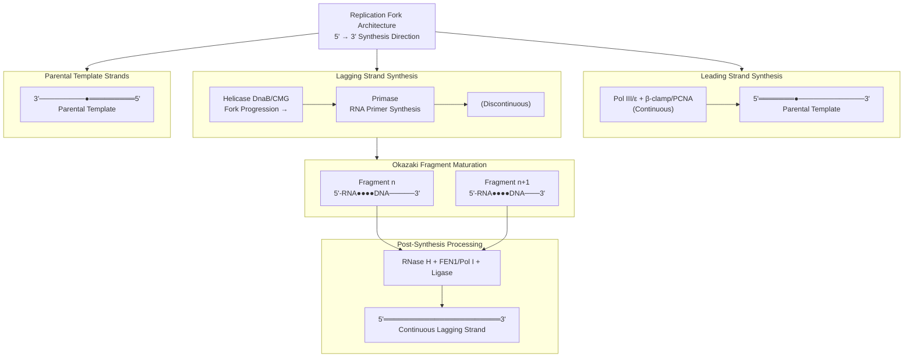

# Lesson 1: Nucleic Acid Structure, Chemistry, DNA Replication Mechanisms

## 1. First-Principles Intuition & Invariants

The central dogma of molecular biology—the unidirectional flow of genetic information from DNA to RNA to protein—rests upon a deceptively simple foundation: the chemical architecture of nucleic acids. Yet beneath this conceptual simplicity lies an extraordinary universe of stereochemical precision, topological complexity, and enzymatic choreography that governs how genetic information is stored, replicated, and transmitted across generations. To understand DNA replication at a mechanistic level, we must first dissect the molecular anatomy of nucleic acids themselves, examining the forces that stabilize the double helix, the geometric constraints that dictate base pairing fidelity, and the thermodynamic principles that drive strand separation and synthesis.

At its most fundamental level, a nucleic acid polymer consists of three core chemical components: a nitrogenous base (purine or pyrimidine), a five-carbon sugar (ribose in RNA, 2'-deoxyribose in DNA), and a phosphate group. These components assemble into nucleotide monomers through covalent phosphoester linkages, forming the sugar-phosphate backbone that defines the polymer's polarity. The critical invariant here is the 5'-to-3' directionality: the phosphodiester bond connects the 3'-hydroxyl group of one sugar to the 5'-phosphate of the next, establishing an inherent asymmetry that pervades all nucleic acid biochemistry. This polarity is not merely structural bookkeeping—it determines the direction of polymerase synthesis, the orientation of complementary strand pairing, and the thermodynamic favorability of chain elongation.

The nitrogenous bases themselves fall into two structural classes. Purines—adenine (A) and guanine (G)—possess a fused bicyclic ring system with nine atoms, while pyrimidines—cytosine (C), thymine (T), and uracil (U)—feature a single six-membered ring. This size differential is the first geometric constraint governing base pairing: a purine-pyrimidine pair produces a uniform helical diameter of approximately 2.0 nanometers, whereas purine-purine or pyrimidine-pyrimidine pairs would distort the helix geometry. The second constraint arises from hydrogen bonding specificity: adenine forms two hydrogen bonds with thymine (or uracil in RNA), while guanine forms three with cytosine. These Watson-Crick base pairs obey strict geometric complementarity, with the glycosidic bonds (connecting base to sugar) positioned to maintain parallel alignment of the paired bases within the helix interior.

The thermodynamic stability of the DNA double helix emerges from multiple cooperative interactions. Hydrogen bonds between complementary bases contribute enthalpic stabilization, with G-C pairs conferring greater stability than A-T pairs due to the additional hydrogen bond. However, base stacking interactions—π-π orbital overlap between adjacent aromatic rings along the helical axis—often dominate the energetics. These stacking forces are hydrophobic in nature: the burial of nonpolar aromatic surfaces away from aqueous solvent drives helix formation through entropic gain from released water molecules. The sugar-phosphate backbone, meanwhile, is highly polar and remains solvated on the helix exterior, where electrostatic repulsion between negatively charged phosphates is counterbalanced by cation coordination (typically $\text{Mg}^{2+}$ or polyamines in physiological conditions).

The canonical B-form DNA helix—the predominant structure under physiological salt and hydration conditions—exhibits right-handed helical twist with approximately 10.5 base pairs per complete turn, translating to a helical pitch of 3.4 nanometers and an axial rise of 0.34 nanometers per base pair. The helix is not uniform: the sugar-phosphate backbones trace two distinct grooves of unequal width. The major groove (width ~1.2 nm) exposes more of the base pair edges and thus presents richer information content for sequence-specific protein recognition, while the minor groove (width ~0.6 nm) is narrower and deeper. This groove asymmetry has profound functional consequences—transcription factors, DNA-binding domains, and repair enzymes exploit major groove contacts to discriminate specific sequences without disrupting Watson-Crick pairing.

Alternative helical forms exist under specific solution conditions or sequence contexts. A-form DNA, favored in low-humidity environments or RNA-DNA hybrids, adopts a wider, more compact geometry with 11 base pairs per turn and a major groove so deep it becomes nearly inaccessible. Z-form DNA, stabilized by alternating purine-pyrimidine sequences (especially GC repeats) under high salt or negative superhelical tension, exhibits a left-handed helix with a zigzag backbone trajectory—hence its name. While Z-DNA was long considered a crystallographic curiosity, recent evidence implicates transient Z-form structures in transcriptional regulation and chromatin remodeling.

The antiparallel orientation of the two DNA strands—one running 5'-to-3', the other 3'-to-5'—introduces a fundamental asymmetry into replication machinery design. All known DNA polymerases synthesize exclusively in the 5'-to-3' direction, adding incoming deoxyribonucleoside triphosphates (dNTPs) to the 3'-hydroxyl terminus of the growing strand. This directionality constraint arises from the enzymatic mechanism: polymerases catalyze nucleophilic attack by the 3'-OH on the α-phosphate of the incoming dNTP, releasing pyrophosphate ($\text{PP}_i$) and forming the new phosphodiester bond. The subsequent hydrolysis of pyrophosphate by ubiquitous pyrophosphatases renders the reaction thermodynamically irreversible, with $\Delta G^\circ \approx -33 \, \text{kJ/mol}$ under standard conditions.

Semiconservative replication—the elegant mechanism elucidated by Meselson and Stahl in their landmark 1958 density-labeling experiment—dictates that each daughter DNA duplex inherits one parental strand and one newly synthesized strand. This mode of replication ensures both fidelity (each parental strand serves as a template) and efficiency (both strands can be replicated simultaneously). Yet the antiparallel geometry creates a mechanical paradox at the replication fork: if the two parental strands run antiparallel, and polymerase synthesizes only 5'-to-3', how can both daughter strands be synthesized simultaneously in the direction of fork progression? The answer lies in asymmetric synthesis: one strand (the leading strand) grows continuously in the direction of fork movement, while the other (the lagging strand) must be synthesized discontinuously in short fragments—Okazaki fragments—oriented opposite to fork progression.

The initiation of DNA replication requires specialized machinery to overcome the polymerase's inability to start synthesis de novo. Unlike RNA polymerases, DNA polymerases absolutely require a primer—a short oligonucleotide with a free 3'-OH group—to initiate strand synthesis. In cellular replication, this primer is a short RNA segment (~10 nucleotides) synthesized by primase, a specialized RNA polymerase that does not require a pre-existing primer. The primase-polymerase handoff represents a critical transition: after primase lays down the RNA primer, the replicative DNA polymerase extends from the RNA 3'-end using the parental strand as template. On the lagging strand, this process repeats every 100-200 nucleotides in eukaryotes (or ~1000-2000 in prokaryotes), generating a series of RNA-primed DNA fragments that must subsequently be processed into continuous duplex.

Topological constraints impose another layer of complexity. As the replication fork advances, unwinding the double helix ahead of the fork introduces positive supercoiling (overwinding) in the unreplicated DNA. This topological tension would rapidly stall replication if not relieved by topoisomerases—enzymes that transiently break one or both DNA strands, allow controlled rotation to dissipate superhelical stress, then religate the break. Type I topoisomerases cleave one strand, enabling the intact strand to pass through the break before religation; Type II topoisomerases cleave both strands transiently, allowing passage of a double-stranded DNA segment. In prokaryotes, DNA gyrase (a Type II topoisomerase) actively introduces negative supercoiling, which can facilitate strand separation during replication initiation. In eukaryotes, topoisomerase I and II isoforms manage both positive supercoiling ahead of the fork and catenation (topological linking) of daughter duplexes after replication.

The fidelity of DNA replication—typically one error per $10^9$ to $10^{10}$ nucleotides incorporated—arises from a multi-tiered error-correction strategy. The first tier is base selection: the polymerase active site geometrically discriminates correct Watson-Crick base pairs from mismatches through induced-fit conformational changes. High-fidelity replicative polymerases (such as E. coli DNA polymerase III or eukaryotic Pol δ and Pol ε) employ a "closed" active site that sterically excludes mismatched base pairs, which distort the minor groove geometry and fail to trigger the catalytic conformational transition. This geometric selectivity alone achieves error rates of approximately $10^{-4}$ to $10^{-5}$ per nucleotide.

The second tier is proofreading: most replicative polymerases possess an intrinsic 3'-to-5' exonuclease activity that excises misincorporated nucleotides before continued synthesis. When a mismatch is incorporated, the resulting distortion at the primer-template junction destabilizes polymerase binding and favors transfer of the primer strand to the exonuclease active site (typically located 2-3 nm away from the polymerase site). The exonuclease hydrolyzes the terminal phosphodiester bond, removing the incorrect nucleotide and regenerating a 3'-OH terminus. The primer strand then returns to the polymerase site for another incorporation attempt. This proofreading mechanism improves fidelity by an additional 100- to 1000-fold, reducing overall error rates to $10^{-7}$ or better.

A third tier of error correction operates post-replication through mismatch repair (MMR) systems, which scan newly synthesized DNA for distortions indicative of base-base mismatches or small insertion-deletion loops. In E. coli, the MutS protein recognizes mismatches and recruits MutL and MutH to excise a segment of the error-containing strand, which is then resynthesized. Strand discrimination—determining which strand is nascent and thus likely to harbor errors—relies on transient hemimethylation at GATC sequences in E. coli (the parental strand is methylated, the daughter strand not yet) or, in eukaryotes, on strand discontinuities inherent to lagging-strand synthesis. Mismatch repair contributes another 100-fold reduction in mutation rate, achieving the extraordinary fidelity observed in living cells.

The chemical stability of DNA is also imperfect: spontaneous hydrolytic deamination converts cytosine to uracil at a rate of ~100 events per mammalian genome per cell cycle, and depurination (hydrolysis of the N-glycosidic bond linking purine bases to deoxyribose) occurs at even higher frequency (~10,000 events per cell per day). These lesions, if left unrepaired, would generate C→T transition mutations or abasic sites that block replication. Base excision repair (BER) pathways counteract these spontaneous lesions: DNA glycosylases recognize and excise damaged bases, creating abasic sites that are processed by AP endonucleases, followed by gap-filling synthesis and ligation. The interplay between DNA chemistry, polymerase fidelity, and multi-layered repair systems ensures that genomic information is preserved across cellular and organismal generations with remarkable accuracy.

## 2. Core Architecture & Mechanics

The replication fork is the central hub of DNA synthesis, a dynamic macromolecular assembly where template strand separation, primer synthesis, polymerase elongation, and topological management converge. Understanding the fork's architecture requires dissecting the roles and interactions of its constituent protein complexes: the replicative helicase that unwinds duplex DNA, the primase that initiates Okazaki fragments, the polymerase holoenzyme that catalyzes chain elongation, the single-strand DNA-binding proteins (SSB or RPA) that stabilize unwound templates, and the clamp-loader complexes that tether polymerase to DNA through sliding clamp processivity factors.

At the leading edge of the fork, the replicative helicase encircles one strand of the parental duplex (typically the lagging-strand template in bacterial systems or the leading-strand template in eukaryotes, depending on helicase architecture) and translocates 5'-to-3' or 3'-to-5' along that strand, powered by ATP hydrolysis. The helicase functions as a molecular motor: each ATP hydrolysis cycle drives a conformational change that advances the protein along the DNA, physically separating the complementary strands through steric exclusion. In E. coli, the DnaB helicase forms a hexameric ring with a central channel that accommodates single-stranded DNA while excluding duplex, ensuring directional unwinding. In eukaryotes, the CMG complex (Cdc45-MCM2-7-GINS) performs analogous functions, with the MCM2-7 hexameric core providing the ATP-dependent motor activity.

As the helicase advances, it generates single-stranded template regions that must be stabilized against secondary structure formation and protected from nuclease attack. Single-strand DNA-binding proteins (SSB in prokaryotes, Replication Protein A or RPA in eukaryotes) coat these regions cooperatively, binding with nanomolar affinity and high cooperativity to maintain extended ssDNA conformations. The SSB-DNA complex is dynamic: individual SSB tetramers bind approximately 65 nucleotides but can reorganize along the template as polymerase approaches, transiently dissociating to allow polymerase access before rebinding behind the elongating strand.

On the leading strand, polymerase synthesizes continuously from a single RNA primer laid down at the replication origin. The leading-strand polymerase (Pol III core in E. coli, Pol ε in eukaryotes) remains engaged with the template for tens to hundreds of kilobases, achieving this remarkable processivity through association with a sliding clamp. The β-clamp in E. coli or PCNA (Proliferating Cell Nuclear Antigen) in eukaryotes is a ring-shaped protein complex that encircles the DNA duplex and tethers the polymerase to the template through protein-protein interactions. The clamp dramatically enhances processivity—from tens of nucleotides for clamp-free polymerase to tens of thousands with clamp—without directly contacting DNA bases or otherwise constraining polymerase movement along the template.

Loading the sliding clamp onto DNA requires the clamp-loader complex (the γ-complex in E. coli, RFC in eukaryotes), an ATP-dependent molecular machine that opens the clamp ring, positions it around a primer-template junction, and closes it behind the polymerase. The clamp loader recognizes primer-template junctions through specific contacts with the duplex-ssDNA boundary and the 3'-primer terminus, ensuring clamp placement precisely where polymerase initiates synthesis. Once loaded, the closed clamp slides freely along duplex DNA, its ring architecture providing topological linkage without sequence-specific or orientation-specific binding.

The lagging strand presents a more complex synthesis problem. As the fork progresses, the lagging-strand template is continuously exposed in the 3'-to-5' direction relative to fork movement—opposite to the 5'-to-3' direction required for polymerase synthesis. The cell solves this paradox through discontinuous synthesis: primase periodically binds the lagging-strand template and synthesizes short RNA primers (~10 nucleotides), each of which serves as the initiation point for a new Okazaki fragment. In E. coli, DnaG primase is recruited to the replication fork through direct interaction with DnaB helicase, coupling primer synthesis to helicase-mediated unwinding. In eukaryotes, the Pol α-primase complex performs this function, synthesizing a short RNA-DNA hybrid primer (~30 nucleotides total: 10 nt RNA followed by 20 nt DNA) before handing off to the processive Pol δ polymerase.

Each Okazaki fragment is extended by the lagging-strand polymerase (Pol III in prokaryotes, Pol δ in eukaryotes) until it encounters the 5'-RNA-DNA end of the preceding fragment. At this point, a remarkable maturation process ensues to convert the discontinuous, RNA-primed fragments into continuous duplex DNA. The key enzyme here is RNase H, which degrades most of the RNA primer, leaving only the 5'-terminal ribonucleotide attached to DNA. In E. coli, the 5'-to-3' exonuclease activity of Pol I removes this final ribonucleotide while simultaneously synthesizing replacement DNA in a process called nick translation. In eukaryotes, the flap endonuclease FEN1 excises the displaced 5'-RNA-DNA flap structures generated when Pol δ synthesizes into the preceding fragment, creating a ligatable nick. DNA ligase then seals the nick, covalently joining adjacent Okazaki fragments into continuous lagging-strand duplex.

The coordination between leading- and lagging-strand synthesis is achieved through the replisome—a multi-protein assembly that physically couples the two polymerases, the helicase, and accessory factors into a single processive machine. In E. coli, the two Pol III cores are linked through shared contact with the DnaX clamp-loader subunit and the DnaB helicase, forming a dimeric polymerase that replicates both strands in a coordinated fashion. The lagging-strand template loops out (forming a structure called the trombone loop) to allow the lagging-strand polymerase to synthesize in the same overall direction as fork movement, despite template polarity reversal. When the lagging-strand polymerase completes an Okazaki fragment and encounters the preceding fragment's 5'-end, it dissociates, the trombone loop is released, and a new primer site on the newly exposed lagging-strand template is engaged, restarting the cycle.

In eukaryotic replisomes, the architecture is conceptually similar but mechanistically distinct. The CMG helicase interacts with both Pol ε (leading strand) and Pol δ (lagging strand), although the precise coupling mechanism remains debated. Current models suggest that Pol ε travels with the CMG helicase at the fork, synthesizing the leading strand continuously, while Pol δ—possibly in multiple copies—binds and dissociates dynamically to synthesize successive Okazaki fragments on the lagging strand. The eukaryotic replisome also includes additional factors such as Ctf4/AND-1 (which couples helicase and polymerase), Mcm10 (which stabilizes Pol α-primase at the fork), and Tof1-Csm3/Timeless-Tipin (fork protection complexes that stabilize stalled forks).

Topological stress management is inseparable from fork mechanics. As the helicase unwinds ~10.5 bp per helical turn, each 360° of unwinding generates one positive superhelical turn in the duplex ahead (assuming the DNA cannot freely rotate). This accumulating tension is released by topoisomerases, which introduce transient strand breaks. Type I topoisomerases (Topo I) relax supercoiling by cleaving one strand, allowing controlled rotation, then religating without requiring ATP. Type II topoisomerases (Topo II, or DNA gyrase in bacteria) pass one DNA duplex segment through a transient double-strand break in another segment, changing the linking number by ±2 and consuming ATP in the process. In bacterial systems, gyrase actively introduces negative supercoiling, which not only counteracts replication-induced positive supercoiling but also facilitates origin melting and transcription initiation.

Behind the fork, newly synthesized DNA must be processed to resolve topological linkages between sister duplexes. Even after replication is complete, the two daughter chromosomes remain topologically intertwined—catenated—due to the helical winding of the parental duplex. Decatenation requires Type II topoisomerases, which resolve these links before chromosome segregation in mitosis. Failure of decatenation leads to chromosome breakage or missegregation, underscoring the topoisomerase's essential role in maintaining genomic integrity.

The remarkable coordination of these components—helicase, polymerase, clamp, clamp-loader, primase, SSB/RPA, topoisomerase, and maturation enzymes—achieves replication rates of ~1000 nucleotides per second in E. coli and ~50 nucleotides per second per fork in eukaryotes, with error rates below one mistake per billion incorporated bases. This extraordinary performance emerges from finely tuned kinetic coupling: primer synthesis is rate-matched to helicase unwinding, polymerase elongation is coordinated with clamp loading, and Okazaki fragment maturation is timed to avoid collisions with the advancing fork. Disruption of any component—through mutation, chemical inhibition, or protein depletion—destabilizes the entire assembly, leading to fork stalling, collapse, and genomic instability.

## 3. High-Performance Optimization & Failure Modes

Achieving high-fidelity, high-throughput DNA replication in cellular environments requires optimization strategies that address kinetic bottlenecks, thermodynamic constraints, and stochastic failure modes. The cell's solutions to these challenges reveal engineering principles applicable across biochemical systems: kinetic proofreading, cooperative binding, kinetic coupling, and redundant error-correction pathways.

The kinetic proofreading mechanism implemented by replicative polymerases exemplifies how multi-step discrimination can amplify selectivity beyond thermodynamic equilibrium limits. Consider the incorporation of a correct nucleotide versus a mismatch. If selectivity relied solely on the difference in binding affinity (ΔΔG between correct and incorrect base pairs), the discrimination factor would be:

$$
\text{Selectivity} = \exp\left(-\frac{\Delta \Delta G}{RT}\right)
$$

For Watson-Crick versus mismatched base pairs, $\Delta \Delta G \approx 2$-$4 \, \text{kcal/mol}$, yielding selectivity of only ~100-fold at 37°C—far below the observed $10^4$-$10^5$ fold discrimination. Polymerases achieve higher selectivity through a multi-step induced-fit mechanism: initial nucleotide binding is followed by a conformational change that positions catalytic residues for phosphodiester bond formation. This conformational step is much faster for correct base pairs than for mismatches, because correct pairs induce precise geometric complementarity in the active site. The rate constant for the conformational transition ($k_{\text{conf}}$) differs by 100-1000 fold between correct and incorrect pairs, and this kinetic difference multiplies with the thermodynamic selectivity:

$$
\text{Total Selectivity} = \frac{K_{\text{d,mismatch}}}{K_{\text{d,correct}}} \times \frac{k_{\text{conf,correct}}}{k_{\text{conf,mismatch}}} \approx 10^2 \times 10^{2\text{-}3} = 10^{4\text{-}5}
$$

This kinetic amplification is irreversible—once pyrophosphate is released and hydrolyzed, the reaction cannot reverse—making the selectivity intrinsically non-equilibrium.

The 3'-to-5' exonuclease proofreading mechanism adds another kinetic layer. After nucleotide incorporation, the polymerase must choose between two kinetic pathways: (1) continue elongation by binding the next dNTP, or (2) transfer the primer strand to the exonuclease site for hydrolysis. For correctly paired termini, the polymerase active site remains stably bound and elongation proceeds rapidly. For mispaired termini, the geometric distortion destabilizes polymerase binding, increasing the probability of primer transfer to the exonuclease site. The ratio of elongation rate to excision rate determines net fidelity:

$$
\text{Proofreading Enhancement} \approx \frac{k_{\text{exo,mismatch}} / k_{\text{pol,mismatch}}}{k_{\text{exo,correct}} / k_{\text{pol,correct}}}
$$

Because mismatches are excised 100-1000 times more efficiently than correct pairs, proofreading improves overall fidelity by an additional two to three orders of magnitude, achieving combined error rates of $10^{-7}$ per nucleotide or better.

Processivity optimization through sliding clamps illustrates how topological tethering can overcome diffusional dissociation. Without the clamp, a polymerase dissociates from the template every 20-100 nucleotides, requiring re-association and repositioning for each synthesis burst. The dissociation rate constant $k_{\text{off}}$ typically ranges from 0.01 to 0.1 s$^{-1}$ for clamp-free polymerase. The clamp reduces $k_{\text{off}}$ by 100-1000 fold (to $\sim 10^{-5}$ s$^{-1}$) by maintaining polymerase proximity to DNA through protein-protein interactions, even when the polymerase-DNA contacts transiently dissociate during the catalytic cycle. This topological strategy achieves processivity of 50,000-500,000 nucleotides per binding event—sufficient to replicate an entire E. coli genome from a single clamp-loading event or to synthesize megabase-scale eukaryotic replicons without dissociation.

Kinetic coupling between helicase unwinding and polymerase synthesis prevents ssDNA accumulation that would otherwise promote secondary structure formation or nuclease attack. The helicase unwinding rate (~1000 bp/s in E. coli) closely matches the leading-strand polymerase elongation rate, ensuring that exposed ssDNA is rapidly converted to duplex. On the lagging strand, primase activity is coupled to helicase progression through direct protein-protein interactions: in E. coli, DnaG primase binds DnaB helicase transiently every 1-2 seconds, synthesizing a new primer each time and maintaining Okazaki fragment spacing of ~1000-2000 nucleotides. In eukaryotes, the spacing is tighter (~100-200 nt), reflecting shorter primer intervals dictated by Pol α-primase recruitment kinetics.

Resource management in eukaryotic replication involves thousands of replication origins distributed across the genome, each licensed for firing during S phase. Origin licensing occurs in G1 phase, when the origin recognition complex (ORC) recruits Cdc6 and Cdt1 to load MCM2-7 helicase complexes onto chromatin. Licensing does not trigger immediate firing; activation requires additional factors (DDK and CDK kinases, Cdc45, GINS) recruited during S phase entry. This temporal separation ensures that origins fire only once per cell cycle, preventing re-replication and genomic instability. Origins fire stochastically but asynchronously, with early-replicating regions (typically euchromatin and gene-rich loci) firing first and late-replicating regions (heterochromatin, pericentromeric DNA) firing last. The stochastic nature of origin firing provides robustness: if one origin fails, adjacent backup origins can compensate, ensuring complete genome duplication.

Fork stalling and collapse represent critical failure modes. Replication forks encounter numerous obstacles: DNA lesions (abasic sites, pyrimidine dimers, interstrand crosslinks), transcription complexes, tightly bound proteins (e.g., nucleosomes, transcription factors), and secondary structures (hairpins, G-quadruplexes). When a fork stalls, uncoupling between helicase and polymerase can generate extended ssDNA regions, which are vulnerable to breakage or nuclease degradation. Stalled forks are stabilized by checkpoint kinases (ATR/Chk1 in eukaryotes) that sense RPA-coated ssDNA and activate downstream signaling to arrest cell cycle progression, recruit repair factors, and prevent origin firing in unreplicated regions.

Fork restart mechanisms involve specialized helicases and recombination proteins. In E. coli, the PriA helicase recognizes stalled forks and reloads DnaB helicase to restart replication. In eukaryotes, the restart process is less well defined but involves homologous recombination proteins (RAD51, BRCA2) that stabilize stalled forks and promote template switching or fork regression to bypass lesions. Fork regression—reversal of the fork structure to form a "chicken foot" intermediate—allows reannealing of nascent strands and repositioning of the fork behind the lesion, enabling lesion bypass via translesion synthesis polymerases.

Translesion synthesis (TLS) polymerases are specialized enzymes with relaxed geometric constraints in their active sites, enabling replication across damaged or distorted templates that would block replicative polymerases. TLS polymerases (e.g., Pol η, Pol ι, Pol κ, Rev1 in eukaryotes) exhibit lower fidelity than replicative polymerases (~$10^{-2}$ to $10^{-3}$ error rates) but can accommodate bulky lesions such as UV-induced thymine dimers or benzo[a]pyrene adducts. After bypass synthesis across a short lesion-containing segment (~5-10 nucleotides), the replicative polymerase resumes elongation, minimizing the mutagenic window. The polymerase-switching process is regulated by PCNA ubiquitination: monoubiquitination of PCNA at Lys164 creates a binding platform for TLS polymerases, promoting their recruitment to stalled forks.

Chromatin replication introduces an additional layer of complexity: nucleosomes must be disassembled ahead of the fork, and newly synthesized DNA must be rapidly re-packaged into chromatin behind the fork. Histone chaperones (e.g., FACT, Asf1, CAF-1) facilitate nucleosome disassembly and reassembly, ensuring that parental histones—carrying epigenetic marks such as methylation and acetylation—are segregated to daughter duplexes to maintain chromatin states through cell division. Replication-coupled chromatin assembly is tightly coordinated: CAF-1 binds PCNA and deposits histone H3-H4 tetramers onto nascent DNA within seconds of polymerase passage, followed by H2A-H2B dimer addition to complete nucleosome assembly. Defects in chromatin assembly disrupt epigenetic inheritance and promote genomic instability.

Telomere replication presents a unique end-replication problem: because lagging-strand synthesis requires RNA priming, removal of the terminal RNA primer leaves a 3'-overhang on the lagging-strand template that cannot be filled by conventional polymerase. In the absence of a compensatory mechanism, chromosomes would shorten by ~50-200 nucleotides per replication cycle. Eukaryotic cells solve this through telomerase, a specialized reverse transcriptase that extends the 3'-overhang using an internal RNA template. Telomerase adds tandem repeats (TTAGGG in vertebrates) to the chromosome end, providing substrate for conventional lagging-strand synthesis to fill the complementary C-rich strand, thus maintaining telomere length. In cells lacking telomerase (most somatic cells), telomeres progressively shorten, triggering replicative senescence or apoptosis after ~50-70 divisions (the Hayflick limit). Telomerase reactivation in stem cells and most cancers enables unlimited replicative potential, underscoring its role in cellular immortalization.

Quality control mechanisms extend beyond replication. Post-replicative mismatch repair (MMR) scans newly synthesized DNA for base-base mismatches and insertion-deletion loops that escaped proofreading. In E. coli, MutS homodimers recognize mismatches and recruit MutL, which in turn activates MutH endonuclease to cleave the nascent strand at hemimethylated GATC sites (the parental strand is transiently methylated by Dam methylase, while the daughter strand remains transiently unmethylated). The segment between the mismatch and the cleavage site is excised by helicases and exonucleases, then resynthesized and ligated. In eukaryotes, the MMR system (MSH2-MSH6 or MSH2-MSH3 recognizing mismatches, MLH1-PMS2 coordinating excision) uses strand discontinuities (primarily Okazaki fragment junctions on the lagging strand or nicks introduced during nucleotide excision repair) as signals to identify the nascent strand. Defective MMR increases mutation rates 100-1000 fold and predisposes to cancer—most notably Lynch syndrome, caused by germline mutations in MLH1 or MSH2.

Experimental protocols for studying replication mechanisms leverage both in vitro reconstitution and in vivo labeling strategies. In vitro replication assays using purified proteins (polymerase, helicase, SSB, primase, clamp, clamp-loader) on defined DNA substrates (plasmids, oligonucleotide-primed single-stranded circles) allow dissection of kinetic parameters: polymerase elongation rates measured by quench-flow rapid kinetics, processivity determined by gel electrophoresis of extended products, and fidelity quantified by sequencing progeny DNA after multiple replication cycles. Single-molecule techniques—optical tweezers, magnetic tweezers, fluorescence microscopy—enable real-time observation of helicase unwinding, polymerase synthesis, and fork dynamics at sub-nanometer and millisecond resolution.

In vivo replication dynamics are monitored through pulse-labeling with thymidine analogs (BrdU, EdU) followed by immunofluorescence or click-chemistry detection, revealing S-phase progression and origin firing patterns. DNA fiber assays—spreading individual DNA molecules on glass slides after pulse-labeling—measure replication fork rates (typically 1-2 kb/min in mammalian cells) and inter-origin distances (50-300 kb). Replication-coupled chromatin immunoprecipitation (ChIP) identifies proteins associated with replication forks, while isolation of proteins on nascent DNA (iPOND) enables mass spectrometry-based proteomic characterization of replisome composition and dynamics during unperturbed replication or in response to fork stalling.

Nucleotide pool management is critical for replication fidelity and efficiency. Imbalances in dNTP pools—caused by ribonucleotide reductase dysregulation, nucleotide salvage pathway defects, or drug-induced perturbations—skew polymerase selectivity and increase misincorporation rates. Elevated dUTP levels (due to dUTPase deficiency) lead to uracil incorporation into DNA, triggering futile cycles of base excision repair that generate strand breaks. Conversely, dNTP depletion stalls replication forks and induces DNA damage checkpoints. Cells tightly regulate dNTP synthesis through allosteric feedback (ribonucleotide reductase is inhibited by dATP and activated by ATP/dATP ratios) and transcriptional control (S-phase upregulation of biosynthetic enzymes).

Antibiotics and chemotherapeutics targeting replication machinery exploit vulnerabilities in bacterial or cancer cell replication. Fluoroquinolones (e.g., ciprofloxacin) inhibit bacterial DNA gyrase and topoisomerase IV, stabilizing the covalent enzyme-DNA intermediate and converting topoisomerases into DNA-cleaving agents that fragment the genome. Camptothecins (e.g., irinotecan, topotecan) similarly target eukaryotic topoisomerase I, trapping the enzyme-DNA complex and causing replication fork collisions with the stalled topoisomerase, leading to double-strand breaks. Nucleoside analogs (e.g., gemcitabine, cytarabine, azidothymidine) are incorporated into DNA by polymerases but lack a 3'-hydroxyl group or introduce steric clashes that terminate elongation, thereby blocking replication in rapidly dividing cells.

Understanding replication at this mechanistic depth—from base-pair geometry to multi-protein assemblies to genome-scale dynamics—provides the foundation for interpreting mutation spectra, designing replication inhibitors, and engineering synthetic replication systems. The principles governing DNA replication fidelity, processivity, and coordination are not unique to nucleic acids; they recur across molecular biology in RNA synthesis, protein translation, and metabolic pathway regulation, revealing universal strategies cells employ to achieve specificity, efficiency, and robustness in biochemical information processing.
