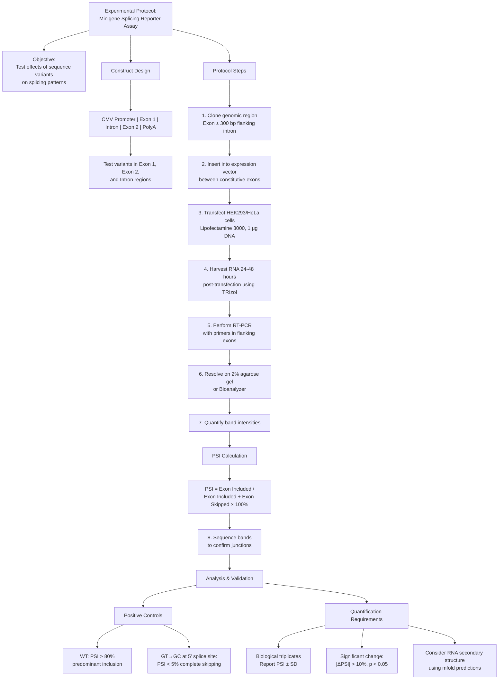

# Lesson 2: Transcription Machinery, RNA Processing, Splicing Mechanisms

## 1. First-Principles Intuition & Invariants

The flow of genetic information from DNA to functional protein constitutes one of molecular biology's most exquisitely orchestrated processes. While Lesson 1 established the foundational architecture of gene structure and the central dogma's directional flow, we now dissect the molecular machinery that executes transcription and the subsequent processing events that transform primary transcripts into mature, translation-competent messenger RNAs. This lesson centers on three interlinked phenomena: the catalytic synthesis of RNA from DNA templates by RNA polymerase complexes, the cotranscriptional modifications that protect and stabilize nascent transcripts, and the spliceosome-mediated removal of introns that generates the final mRNA architecture.

Transcription in eukaryotic cells operates under fundamentally different constraints than its prokaryotic counterpart. The spatial segregation of transcription within the nucleus and translation in the cytoplasm creates a temporal window during which extensive RNA processing occurs. This processing is not a passive aftermath of transcription but rather a tightly coupled series of molecular recognition events that begin even before RNA polymerase II completes elongation. The carboxy-terminal domain (CTD) of RNA polymerase II serves as a landing platform for processing enzymes, coordinating capping, splicing, and polyadenylation through precisely timed phosphorylation patterns that recruit specific enzymatic complexes at defined stages of the transcription cycle.

The energetics of transcription derive from nucleoside triphosphate hydrolysis, with each phosphodiester bond formation releasing pyrophosphate that is subsequently hydrolyzed by cellular pyrophosphatases to drive the reaction forward. The standard free energy change for NTP incorporation approximates $\Delta G^\circ \approx -3.5$ kcal/mol under physiological conditions, but the subsequent pyrophosphate hydrolysis ($\Delta G^\circ \approx -8$ kcal/mol) renders the overall process essentially irreversible, establishing transcription as a unidirectional information transfer mechanism. RNA polymerase operates with remarkable fidelity, maintaining error rates near $10^{-4}$ to $10^{-5}$ per nucleotide incorporated, achieved through a combination of geometric selectivity in the active site and kinetic discrimination against incorrect base pairs.

The spliceosome represents one of evolution's most complex molecular machines, rivaling the ribosome in compositional intricacy. Assembled from five small nuclear RNAs (snRNAs) and over 150 associated proteins, this dynamic ribonucleoprotein complex catalyzes two sequential transesterification reactions that excise introns and ligate exons with single-nucleotide precision. The reaction mechanism proceeds through a defined branched intermediate, where the 2'-hydroxyl group of a conserved adenosine within the intron attacks the 5' splice site phosphodiester bond, creating a lariat structure that is subsequently resolved by attack of the 3'-hydroxyl of the upstream exon on the 3' splice site. These reactions occur without external energy input beyond the inherent free energy stored in the phosphodiester bonds, making splicing a thermodynamically self-sufficient process driven by RNA catalysis.

The informatic complexity of splicing decisions emerges from the degenerate nature of splice site consensus sequences. The canonical eukaryotic 5' splice site conforms to the pattern (A/C)AG|GU(A/G)AGU, where the vertical bar denotes the cleavage point, while the 3' splice site exhibits the pattern (Y)nNCAG|G, with Y representing pyrimidines and n typically ranging from 10 to 30 nucleotides constituting the polypyrimidine tract. The branch point sequence, located 20-50 nucleotides upstream of the 3' splice site, contains a conserved adenosine within the motif YURAY (where R denotes purines). However, these consensus sequences alone provide insufficient information for accurate splice site selection, as sequences matching these patterns occur far more frequently in genomes than actual splice sites. The cell resolves this ambiguity through combinatorial recognition involving exonic and intronic splicing enhancers (ESEs and ISEs) and silencers (ESSs and ISSs) that recruit SR proteins and heterogeneous nuclear ribonucleoproteins (hnRNPs) to promote or repress specific splice site usage.

The physical architecture of pre-mRNA imposes additional constraints on splicing efficiency through secondary structure formation. Introns must maintain sufficient flexibility to permit spliceosome assembly, yet stable stem-loop structures near splice sites can sequester recognition sequences and inhibit splicing. Conversely, structured elements within introns sometimes serve regulatory functions, as in the case of iron-responsive elements (IREs) that modulate ferritin and transferrin receptor expression through iron-dependent protein binding that occludes splice sites. The thermodynamic stability of RNA secondary structures follows nearest-neighbor base-pairing rules, with free energy contributions from individual base pairs combining additively. A GC base pair contributes approximately $\Delta G^\circ \approx -3$ kcal/mol, while AU pairs contribute roughly $\Delta G^\circ \approx -2$ kcal/mol, modified by context-dependent stacking interactions with adjacent base pairs.

Alternative splicing amplifies proteomic diversity by generating multiple mRNA isoforms from single genes through differential exon inclusion, intron retention, or alternative splice site selection. The human genome contains approximately 20,000 protein-coding genes, yet proteome complexity exceeds several hundred thousand distinct proteins, with alternative splicing accounting for the majority of this expansion. The regulatory logic governing alternative splicing decisions integrates developmental stage-specific factors, tissue-specific expression of splicing regulators, and signal-responsive pathways that alter SR protein phosphorylation states. Neurons exhibit particularly extensive alternative splicing, with estimates suggesting that over 95% of human multi-exon genes undergo alternative splicing in neural tissues, generating isoform repertoires that fine-tune synaptic properties and neuronal excitability.

RNA editing introduces a distinct layer of information diversification through post-transcriptional nucleotide modification. Adenosine-to-inosine (A-to-I) editing, catalyzed by ADAR enzymes (adenosine deaminases acting on RNA), alters coding sequences because inosine is read as guanosine by the translation machinery and reverse transcriptases. This mechanism permits single nucleotide substitutions without genomic mutation, enabling dynamic proteome adaptation. The GluA2 subunit of AMPA-type glutamate receptors undergoes A-to-I editing at the Q/R site within the ion channel pore, converting a glutamine codon (CAG) to an arginine codon (CIG→CIG read as CGG), which dramatically reduces calcium permeability and prevents excitotoxicity. Neurons lacking GluA2 Q/R site editing exhibit uncontrolled calcium influx and neurodegeneration, demonstrating the physiological necessity of this editing event.

## 2. Core Architecture & Mechanics

The RNA polymerase II holoenzyme comprises a 12-subunit catalytic core with a molecular mass exceeding 500 kDa, augmented during transcription initiation by association with general transcription factors (GTFs) that orchestrate promoter recognition and polymerase positioning. The catalytic mechanism centers on a two-metal-ion mechanism in the active site, where two magnesium ions coordinate the incoming nucleoside triphosphate and the 3'-hydroxyl group of the growing RNA chain, facilitating nucleophilic attack on the α-phosphate. The polymerase active site resides within a cleft formed by the largest subunits (RPB1 and RPB2), creating a channel approximately 25 Å wide that accommodates the DNA-RNA hybrid helix during elongation.

Promoter architecture in eukaryotic genes exhibits modular organization, with core promoter elements residing within approximately 100 base pairs upstream and downstream of the transcription start site (TSS). The TATA box, located roughly 25-30 base pairs upstream of the TSS, conforms to the consensus sequence TATAAA and serves as the primary recognition element for the TATA-binding protein (TBP), a component of the general transcription factor TFIID. TBP binding induces a dramatic 90-degree bend in the DNA through insertion of phenylalanine residues into the minor groove, widening the minor groove and compressing the major groove. This structural distortion facilitates assembly of the pre-initiation complex (PIC) by creating proper geometric alignment for subsequent GTF recruitment.

```text
DNA Template Strand:    5'---[Upstream Regulatory]---[TATA Box]---[Inr]---[TSS]---[DPE]---3'
                                                         -30      -1    +1     +30

Pre-Initiation Complex Assembly:

Step 1: TFIID Recognition
   TBP binds TATA box → DNA bending (90°)
   TAFs recognize Inr and DPE elements

Step 2: TFIIB Recruitment  
   TFIIB binds TBP-DNA complex
   Positions RNA Pol II active site at TSS

Step 3: RNA Pol II + TFIIF Loading
   TFIIF escorts Pol II to promoter
   ATP-independent positioning

Step 4: TFIIE and TFIIH Assembly
   TFIIH helicase unwinds promoter DNA
   TFIIH kinase phosphorylates Pol II CTD (Ser5)

Step 5: Promoter Clearance
   ATP hydrolysis by TFIIH → transition to elongation
   Abortive transcripts released until productive elongation
```

The carboxy-terminal domain of RPB1 consists of tandem heptapeptide repeats with the consensus sequence YSPTSPS, numbering 52 repeats in humans. Each repeat contains multiple phosphorylation sites, with serine-5 (Ser5) and serine-2 (Ser2) serving as primary regulatory targets. TFIIH-associated kinase CDK7 phosphorylates Ser5 during initiation, creating a binding platform for capping enzymes. As elongation proceeds, the Ser5 phosphorylation pattern diminishes while Ser2 phosphorylation increases through the action of P-TEFb (positive transcription elongation factor b, consisting of CDK9 and cyclin T), recruiting splicing factors and ultimately polyadenylation machinery near the 3' end of genes. This dynamic phosphorylation code couples transcription progression to RNA processing events with exquisite temporal precision.

The 5' capping reaction occurs cotranscriptionally once the nascent transcript extends approximately 25-30 nucleotides beyond the polymerase. The capping machinery recognizes the Ser5-phosphorylated CTD and catalyzes three sequential enzymatic steps. First, RNA triphosphatase removes the γ-phosphate from the 5'-triphosphate end of the nascent RNA, generating a 5'-diphosphate terminus. Second, guanylyltransferase catalyzes attack by the terminal β-phosphate on the α-phosphate of GTP, forming an unusual 5'-5' triphosphate linkage and releasing pyrophosphate. Third, methyltransferases sequentially add methyl groups to the N7 position of the terminal guanosine (forming the cap-0 structure) and potentially to the 2'-hydroxyl groups of the first and second nucleotides (forming cap-1 and cap-2 structures). The resulting m7G cap structure serves multiple functions: protecting the mRNA from 5' exonuclease degradation, facilitating ribosome recruitment through cap-binding protein interactions, and marking the transcript as "self" to evade innate immune detection by cytoplasmic RNA sensors.

The thermodynamic favorability of capping derives from the release of pyrophosphate during cap formation, with subsequent pyrophosphate hydrolysis providing an additional $\Delta G^\circ \approx -8$ kcal/mol driving force. The methyl donor S-adenosylmethionine (SAM) drives methyltransferase reactions with a standard free energy change of approximately $\Delta G^\circ \approx -4$ kcal/mol per methylation event, ensuring irreversibility under cellular conditions where SAM concentrations typically exceed 100 μM while S-adenosylhomocysteine (SAH) concentrations remain below 10 μM.

Splicing proceeds through spliceosome assembly on pre-mRNA substrates in a highly ordered pathway designated the spliceosome cycle. The U1 small nuclear ribonucleoprotein (snRNP) initiates complex formation by base-pairing with the 5' splice site through complementarity between the 5' end of U1 snRNA and the splice site consensus sequence. Simultaneously, splicing factor 1 (SF1) recognizes the branch point sequence, while U2 auxiliary factor (U2AF) binds the polypyrimidine tract and the AG dinucleotide at the 3' splice site. This early complex, termed the E (early) complex, undergoes ATP-dependent rearrangement as the U2 snRNP displaces SF1 and forms base pairs with the branch point sequence, bulging out the branch point adenosine. This configuration defines the A (pre-spliceosome) complex.

The tri-snRNP particle, consisting of pre-assembled U4/U6 and U5 snRNPs, then joins the A complex to form the B (pre-catalytic) complex. Extensive structural rearrangements follow, including unwinding of U4 and U6 base pairing to allow U6 to interact with both the 5' splice site and U2 snRNA near the branch point. U1 and U4 snRNPs dissociate, yielding the activated Bact complex, which further rearranges into the catalytically competent B* complex. The U2 and U6 snRNAs position two catalytic metal ions (typically Mg2+) in the active site through coordination by specific nucleotides, establishing the geometry required for the first transesterification reaction. Following exon ligation in the C complex, the spliceosome disassembles, releasing the ligated exons and the excised intron lariat for degradation.

```text
Spliceosome Catalytic Mechanism:

Exon 1      Intron           Exon 2
5'---AG|GUAAGU---[Branch Point A]---(Yn)nNCAG|G---3'

Step 1: First Transesterification
        2'-OH of branch point A attacks 5' splice site

        Exon 1                    Intron Lariat
        5'---AG-OH     +     A---GUAAGU---(Yn)nNCAG|G---Exon 2---3'
                            2'↑_______________|
                            5'

Step 2: Second Transesterification  
        3'-OH of Exon 1 attacks 3' splice site

        Ligated Exons              Intron Lariat (degraded)
        5'---Exon 1-Exon 2---3'    A---GUAAGU---(Yn)n
                                  2'↑___________|
                                  5'         NCAG-OH

Energetics:
- Each transesterification: ~0 kcal/mol net (isoenergetic)
- ATP hydrolysis drives conformational changes: 8 ATP per splicing event
- DeBranching enzyme hydrolyzes lariat: ΔG° ≈ -7 kcal/mol
```

Alternative splicing decisions emerge from the combinatorial action of trans-acting splicing factors that recognize cis-regulatory elements embedded within exons and introns. SR proteins, characterized by arginine-serine-rich (RS) domains, typically promote splicing by binding to exonic splicing enhancers (ESEs) and recruiting U2AF to adjacent 3' splice sites or stabilizing U1 snRNP binding at 5' splice sites. The RS domains undergo extensive phosphorylation by SR protein kinases (SRPKs and CLKs), modulating protein-protein and protein-RNA interactions. Conversely, hnRNPs often antagonize splicing by binding to exonic or intronic splicing silencers (ESSs and ISSs), either sterically blocking spliceosome assembly or inducing RNA secondary structures that sequester splice sites.

The tissue-specific splicing of the fibronectin EIIIB exon illustrates combinatorial control. In fibroblasts, this exon is included in the mature mRNA, while in hepatocytes it is skipped. The difference arises from differential expression of PTB (polypyrimidine tract-binding protein), which binds to intronic silencers flanking EIIIB in hepatocytes and loops out the exon, preventing U2AF recruitment. In fibroblasts, PTB expression is lower, permitting constitutive splicing factors to include EIIIB. This binary decision exemplifies how the concentration of a single splicing repressor can toggle exon inclusion states.

Sex determination in Drosophila depends on a splicing cascade where the presence or absence of Sex-lethal (Sxl) protein determines the splicing pattern of transformer (tra) pre-mRNA. In females (XX), Sxl binds to polypyrimidine tracts near a male-specific exon in tra pre-mRNA, blocking U2AF binding and causing skipping of this exon, which contains a premature stop codon. The resulting functional Tra protein, together with Tra2, promotes female-specific splicing of doublesex (dsx) pre-mRNA by binding to dsxRE enhancer elements, producing Dsx-F isoform that activates female differentiation genes. In males (XY), absence of Sxl permits inclusion of the stop-codon-containing tra exon, yielding nonfunctional Tra and consequently male-specific dsx splicing to produce Dsx-M isoform. This regulatory cascade demonstrates how splicing decisions propagate through gene regulatory networks to determine developmental outcomes.

Polyadenylation at the 3' end of mRNAs involves recognition of two cis-elements: the hexanucleotide AAUAAA sequence located 10-30 nucleotides upstream of the cleavage site, and a downstream U-rich or GU-rich element. The cleavage and polyadenylation specificity factor (CPSF) recognizes AAUAAA through its CPSF160 subunit, while cleavage stimulation factor (CstF) binds the downstream element. Together with additional factors including symplekin, CFI, and CFII, these proteins assemble a cleavage complex that cleaves the pre-mRNA 10-30 nucleotides downstream of the AAUAAA sequence. Poly(A) polymerase (PAP) then adds approximately 200-250 adenosine residues to the new 3' end in a template-independent manner, with each addition hydrolyzing ATP and releasing pyrophosphate.

The poly(A) tail undergoes dynamic regulation in the cytoplasm through opposing activities of deadenylases and cytoplasmic poly(A) polymerases. Deadenylation typically marks the first step in mRNA decay, with CCR4-NOT complex serving as the major deadenylase. As the poly(A) tail shortens below approximately 25 nucleotides, poly(A)-binding proteins (PABPs) dissociate, exposing the mRNA body to decapping enzymes and 5'-3' exonuclease degradation by XRN1. Alternatively, shortened poly(A) tails can trigger 3'-5' decay by the exosome complex. This deadenylation-dependent decay pathway establishes a molecular clock that determines mRNA half-life, with different transcripts exhibiting characteristic poly(A) tail shortening rates ranging from minutes to days.

## 3. High-Performance Optimization & Failure Modes

Experimental interrogation of transcription dynamics requires single-molecule approaches that resolve polymerase movement and RNA synthesis in real time. Optical tweezers experiments have measured the force-velocity relationship of RNA polymerase II, revealing that the enzyme maintains a velocity of approximately 20 nucleotides per second under zero load, decreasing to half-maximal velocity at forces near 25 pN. These measurements indicate that polymerase operates near thermodynamic equilibrium, with forward translocation balanced against backtracking under opposing force. The free energy released per nucleotide incorporation ($\Delta G \approx -12$ kcal/mol under cellular conditions) translates to a theoretical maximum force of roughly 35 pN before stalling, consistent with experimental observations.

Nascent RNA sequencing (NET-seq and related methods) maps RNA polymerase positions genome-wide by capturing and sequencing RNA molecules still attached to engaged polymerases following nuclear run-on with labeled NTPs. These approaches reveal pervasive polymerase pausing at specific sequence elements, particularly at +1 nucleosome positions downstream of promoters and at exon-intron boundaries. Pause sites often correspond to sequences that form stable RNA secondary structures in the exit channel, suggesting that RNA folding kinetics influence elongation rates. The NELF (negative elongation factor) and DSIF (DRB sensitivity-inducing factor) complexes enforce promoter-proximal pausing, with release requiring P-TEFb-mediated phosphorylation of NELF, DSIF, and the Pol II CTD Ser2 residues.

Quantitative analysis of splicing kinetics using metabolic labeling with 4-thiouridine (4sU) followed by time-resolved RNA-seq reveals that splicing occurs predominantly cotranscriptionally, with median splicing completion times of 5-10 minutes for introns in human cells. Intron length correlates inversely with splicing rate, as longer introns require more time for spliceosome assembly across the full intron span. First introns are often retained longer than downstream introns, potentially serving as quality control checkpoints. Splicing efficiency can be quantified by calculating the ratio of spliced to unspliced transcripts for each intron junction, typically measured using junction-spanning reads in RNA-seq data. Well-defined splice sites with strong consensus sequences exhibit splicing efficiencies exceeding 95%, while weak or alternative splice sites may show efficiencies below 50%.

```text
Experimental Protocol: Nuclear Run-On Transcription Assay

Objective: Measure transcription rates and map active RNA polymerase positions

Materials:
- Isolated nuclei from cultured cells (10^7 cells)
- Transcription buffer: 10 mM Tris-HCl pH 8.0, 5 mM MgCl2, 300 mM KCl
- NTP mix: 1 mM ATP, GTP, CTP; 0.1 mM UTP; 50 μCi [α-32P]UTP (3000 Ci/mmol)
- DNase I (RNase-free, 10 U/μL)
- TRIzol reagent for RNA extraction
- Slot-blot apparatus with nylon membrane

Procedure:
1. Permeabilize cells with 0.5% NP-40 in ice-cold PBS for 5 min
2. Pellet nuclei (500 × g, 5 min, 4°C), resuspend in transcription buffer
3. Initiate run-on: add NTP mix to nuclei, incubate 30 min at 30°C
4. Stop reaction with DNase I (10 U per 10^7 nuclei, 10 min at 37°C)
5. Extract labeled RNA with TRIzol, precipitate with isopropanol
6. Hybridize labeled RNA to gene-specific probes immobilized on membrane
7. Wash membrane (2× SSC, 0.1% SDS, 65°C), expose to phosphorimager
8. Quantify signal intensity, normalize to probe length and specific activity

Expected Results:
- Transcription rate: 1-5 kb/min for most genes
- Paused polymerases accumulate at promoter-proximal regions (+30 to +60)
- Elongating polymerases distribute across gene bodies

Critical Parameters:
- Nuclei must remain intact; lysis releases chromatin-bound polymerases
- NTP concentration affects elongation rate; standard conditions: 1 mM
- Temperature must not exceed 30°C to prevent aberrant reinitiation
```

Splice site mutations constitute a major class of disease-causing variants, accounting for approximately 10% of pathogenic mutations in inherited disorders. Point mutations that disrupt the invariant GT or AG dinucleotides at splice junctions typically abolish splicing at the affected site, triggering exon skipping, intron retention, or cryptic splice site activation. Mutations in the branch point sequence or polypyrimidine tract weaken U2 snRNP recruitment, reducing splicing efficiency and promoting alternative splicing outcomes. The β-thalassemias exemplify splicing defects causing human disease, with over 100 distinct splice site mutations in the β-globin gene documented. A common mutation (IVS1-110 G>A) creates a cryptic splice site within intron 1 that competes with the authentic site, generating aberrant transcripts with premature stop codons and triggering nonsense-mediated decay.

Antisense oligonucleotide (ASO) therapy exploits the sequence-specific nature of splice site recognition to redirect splicing patterns in disease. ASOs complementary to exonic or intronic splicing enhancers can induce exon skipping by sterically blocking SR protein binding. Eteplirsen, an FDA-approved ASO for Duchenne muscular dystrophy, targets exon 51 of the dystrophin gene, inducing skipping of this exon to restore the translational reading frame in patients with specific frame-shifting deletions. The 2'-O-methyl phosphorothioate chemistry stabilizes the ASO against nuclease degradation while maintaining high-affinity hybridization to target sequences. Optimal ASO design requires empirical testing of multiple target sites within the exon, as secondary structure and protein binding can occlude access to certain sequences.



The fidelity of splicing depends on accurate discrimination of authentic splice sites from pseudo-splice sites, a problem complicated by the high genomic abundance of sequences matching splice site consensus. Human genomes contain approximately 5 × 10^5 AG dinucleotides in intronic contexts, yet only ~2 × 10^5 serve as authentic 3' splice sites. The exon definition model explains splice site selection in vertebrate genes, where recognition across exons (typically 50-250 nucleotides) dominates over intron definition (which applies to introns shorter than ~250 nucleotides). SR proteins bound to ESEs within an exon recruit U2AF and U1 snRNP to the flanking 3' and 5' splice sites respectively, pairing splice sites across the exon. This mechanism explains why internal exons require both flanking introns for efficient recognition, while isolated exons lacking intronic context exhibit poor splicing in minigene assays.

Nonsense-mediated decay (NMD) couples splicing to translation quality control by degrading transcripts containing premature termination codons (PTCs) located more than 50-55 nucleotides upstream of the last exon-exon junction. During splicing, the exon junction complex (EJC) deposits on mRNAs 20-24 nucleotides upstream of each splice junction. In the cytoplasm, scanning ribosomes displace EJCs encountered during translation, but EJCs downstream of termination codons persist and recruit UPF proteins that trigger mRNA decay. This mechanism ensures that aberrant transcripts arising from splicing errors, frameshift mutations, or premature stop codons are eliminated before producing truncated proteins. NMD efficiency varies with PTC position, with maximal decay when PTCs reside >200 nucleotides from the final exon junction.

Single-molecule fluorescence in situ hybridization (smFISH) combined with intronic and exonic probe sets enables visualization of splicing kinetics in living cells. Intronic probe signals indicate nascent transcription sites where unspliced pre-mRNA accumulates, while exonic probe signals detect both nascent and mature transcripts. The ratio of exonic-only to exonic-plus-intronic signals quantifies splicing completion. Time-lapse imaging following transcriptional pulse-chase with small-molecule inhibitors reveals that individual introns splice with characteristic mean times ranging from 1 to 30 minutes, with longer introns exhibiting broader distributions reflecting stochastic spliceosome assembly kinetics.

CRISPR-based screens targeting splicing regulators have identified factors essential for specific alternative splicing programs. Genome-wide knockout screens using splice-switching reporters that link splicing outcomes to antibiotic resistance or fluorescent protein expression systematically map trans-acting factors regulating individual exons. These approaches discovered that SRRM1 (serine/arginine repetitive matrix protein 1) scaffolds SR proteins at nuclear speckles and influences splicing of thousands of exons, while RBM39 (RNA binding motif protein 39) specifically controls splicing of retained introns in proliferation genes. Chemical degradation of RBM39 using molecular glue degraders (e.g., indisulam) triggers widespread intron retention and cancer cell death, demonstrating therapeutic potential for targeting splicing dependencies.

The energetic cost of mRNA production integrates transcription, processing, and quality control expenditures. Synthesizing a typical 2 kb mRNA requires approximately 2000 NTP hydrolyses for transcription ($\Delta G \approx -24,000$ kcal/mol), 8 ATP per spliced intron (~3 introns average, 24 ATP total, $\Delta G \approx -192$ kcal/mol), capping (3 high-energy bonds, $\Delta G \approx -24$ kcal/mol), and polyadenylation (250 ATP, $\Delta G \approx -2000$ kcal/mol). Accounting for proofreading, abortive transcripts, and degradation of defective RNAs, the actual cellular cost likely exceeds 3000 ATP equivalents per mature mRNA. This substantial investment underscores the selective pressure for accurate processing and explains why mRNA stability mechanisms have evolved to protect transcripts from premature decay.

Advanced mass spectrometry approaches enable proteome-wide measurement of alternative splicing outcomes. Isoform-resolved proteomics using high-resolution MS/MS identifies peptides unique to specific splice isoforms, quantifying relative protein abundance for alternatively spliced variants. These studies reveal that alternative splicing at the RNA level often fails to produce corresponding protein isoform diversity, suggesting that many splice variants undergo selective degradation or translation repression. The discordance between transcript and protein isoform ratios indicates that post-splicing regulatory mechanisms filter alternative transcripts, permitting only functionally relevant variants to access the translation machinery.

Human genes exhibit median pre-mRNA half-lives of 6-10 hours, determined by metabolic labeling with 4sU or 5-ethynyluridine (EU) followed by time-course RNA-seq. Mature cytoplasmic mRNA half-lives average 4-8 hours for typical transcripts but span a 1000-fold range, from < 1 hour for immediate early genes to >24 hours for housekeeping transcripts. The AU-rich elements (AREs) in 3' untranslated regions confer rapid decay by recruiting deadenylases and decapping enzymes through ARE-binding proteins like TTP (tristetraprolin) and AUF1. Conversely, iron-responsive elements (IREs), when bound by iron regulatory proteins under iron-depleted conditions, stabilize transferrin receptor mRNA by blocking endonucleolytic cleavage.

Failure modes in RNA processing generate transcriptomic noise that cells must tolerate or eliminate. Intron retention, the most prevalent splicing error, occurs at rates of 1-5% for most introns in healthy human cells. These unspliced transcripts typically undergo nuclear retention and degradation by the exosome complex, preventing cytoplasmic export of aberrant RNAs. Cellular stress, aging, and disease states often increase intron retention rates, overwhelming quality control capacity and permitting translation of cryptic open reading frames within retained introns. Such cryptic peptides can elicit immune responses through MHC presentation, potentially contributing to autoimmunity or anti-tumor immunity.

The fidelity-speed tradeoff in splicing optimization reflects fundamental kinetic constraints. Increasing splice site strength accelerates spliceosome assembly but reduces regulatory flexibility, while weak splice sites permit more nuanced regulation at the cost of occasional splicing errors. Evolution appears to have optimized splice site strengths to balance rapid gene expression with appropriate tissue-specific and signal-dependent regulation, accepting low error rates as inevitable consequences of operating near the kinetic edge of accurate recognition.
