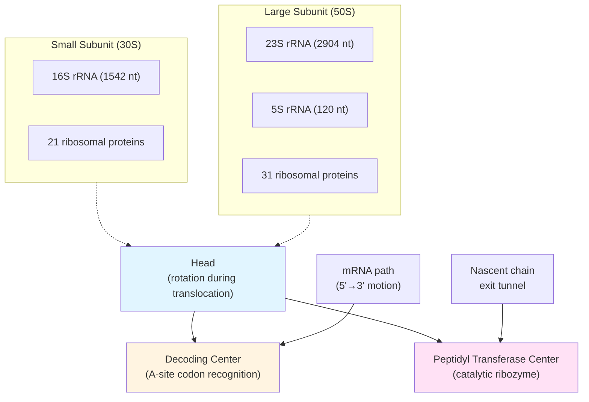

# Lesson 3: Translation, Genetic Code, Protein Synthesis Regulation

## 1. First-Principles Intuition & Invariants

Translation stands as the final informational transformation in the central dogma of molecular biology, converting the linear nucleotide sequence of messenger RNA into the three-dimensional functional architecture of proteins. Where transcription preserves the language of nucleic acids, translation performs a discrete symbol-space transformation: the four-letter alphabet of RNA bases maps through a degenerate code into the twenty standard amino acids that constitute the proteomic machinery of life. This conversion operates not through direct chemical complementarity, as in Watson-Crick base pairing, but through an elaborate adapter mechanism orchestrated by transfer RNAs and the catalytic RNA-protein megacomplex called the ribosome.

The genetic code itself exhibits profound mathematical structure. Each codon—a triplet of consecutive mRNA nucleotides—specifies a single amino acid or chain termination signal. With four possible bases at each position, the codon space contains $4^3 = 64$ distinct triplets. Yet only twenty amino acids demand specification, creating inherent degeneracy: most amino acids correspond to multiple synonymous codons. This redundancy proves non-random. Synonymous codons typically differ only in their third position, the so-called wobble position, where relaxed base-pairing geometry permits non-Watson-Crick hydrogen bonding patterns. The wobble pairing rules, first articulated by Francis Crick, reveal that the third codon position tolerates G·U pairs and allows single tRNA species to recognize multiple codons through conformational flexibility in the anticodon loop.

The degeneracy pattern encodes error-correction features at the physicochemical level. Chemically similar amino acids—those sharing hydrophobic, polar, or charged side-chain properties—cluster in codon families distinguished primarily by wobble-position variation. A point mutation altering the third base often produces a synonymous substitution, preserving the amino acid identity, or substitutes an amino acid of similar character, minimizing functional disruption. This arrangement suggests selection pressure optimized the code for robustness against the stochastic noise inherent in replication and transcription.

Three codons—UAA, UAG, and UGA—function as nonsense or stop signals, recognized not by tRNAs but by polypeptide release factors that trigger hydrolytic cleavage of the nascent chain from the peptidyl-tRNA bond. The start codon AUG, encoding methionine, defines the translation initiation site and establishes the reading frame. Frame maintenance proves absolutely critical: a single nucleotide insertion or deletion shifts the grouping of triplets, altering every downstream codon and typically producing catastrophic loss of function. The ribosome, once committed to a reading frame at initiation, advances strictly in three-nucleotide steps, ensuring fidelity through mechanical constraint rather than active proofreading.

Transfer RNAs serve as the physical adapters bridging codon and amino acid. Each tRNA molecule folds into a characteristic cloverleaf secondary structure that collapses into an L-shaped three-dimensional architecture. One arm of the L presents the anticodon triplet, which base-pairs with the mRNA codon in antiparallel orientation. The opposite arm terminates in a conserved CCA sequence whose 3′-hydroxyl group forms an ester linkage with the carboxyl group of the cognate amino acid. This aminoacyl-tRNA represents the activated substrate for peptide bond formation, with the ester bond storing the chemical potential energy required for peptidyl transfer.

Aminoacyl-tRNA synthetases catalyze the charging reaction that couples amino acids to their cognate tRNAs. Each of the twenty synthetases recognizes a specific amino acid and the set of tRNA isoacceptors bearing the corresponding anticodons. This dual recognition enforces the genetic code's mapping: the synthetase, not the ribosome, determines which amino acid corresponds to which codon. The charging reaction proceeds through an aminoacyl-adenylate intermediate, where ATP hydrolysis drives the formation of a mixed anhydride between the amino acid carboxyl and AMP. The activated amino acid then transfers to the tRNA 3′-hydroxyl, releasing AMP and forming the aminoacyl ester. The overall stoichiometry consumes two high-energy phosphate bonds per amino acid incorporated into protein, reflecting the thermodynamic cost of information transduction.

Synthetase fidelity constitutes a critical constraint. Discrimination between chemically similar amino acids—isoleucine versus valine, for instance—challenges even highly evolved enzymes. Many synthetases employ double-sieve editing mechanisms. The synthetic active site excludes amino acids larger than the cognate substrate through steric occlusion, while a separate editing domain hydrolyzes aminoacyl-tRNA products formed with smaller, incorrect amino acids. This proofreading occurs both pre-transfer, cleaving the misactivated aminoacyl-adenylate, and post-transfer, hydrolyzing the mischarged aminoacyl-tRNA. The combined selectivity of synthesis and editing achieves error rates below $10^{-4}$ per codon, far exceeding the discrimination achievable by binding energy differences alone.

The ribosome itself represents one of nature's most intricate molecular machines, a ribonucleoprotein complex exceeding 2.5 MDa in prokaryotes and approaching 4 MDa in eukaryotic cytoplasm. Comprising two subunits—small (30S in bacteria, 40S in eukaryotes) and large (50S bacterial, 60S eukaryotic)—the ribosome orchestrates the iterative cycle of codon recognition, peptide bond formation, and mRNA translocation. High-resolution crystallography and cryo-electron microscopy have revealed that the catalytic core responsible for peptidyl transfer resides entirely within ribosomal RNA, specifically the 23S rRNA in bacteria. Proteins stabilize the structure and modulate dynamics, but the peptidyl transferase center itself is a ribozyme, underscoring RNA's catalytic antiquity and supporting the RNA world hypothesis for early molecular evolution.

Three tRNA binding sites traverse the ribosome interface between subunits: the aminoacyl site (A-site) accepts incoming aminoacyl-tRNA, the peptidyl site (P-site) holds the tRNA bearing the growing polypeptide chain, and the exit site (E-site) transiently binds deacylated tRNA before its dissociation. The ribosome decodes mRNA through induced-fit mechanisms in the small subunit decoding center, where conserved 16S rRNA bases monitor the geometry of codon-anticodon base pairing. Cognate pairing induces a conformational shift that closes the decoding center, positioning the aminoacyl-tRNA acceptor stem into the large subunit peptidyl transferase center. Non-cognate or near-cognate pairings fail to trigger this closure, leading to tRNA rejection. The conformational proofreading provides kinetic selectivity: cognate tRNAs proceed rapidly to accommodation, while near-cognate tRNAs dissociate preferentially during the extended interrogation period.

Peptide bond formation itself occurs through nucleophilic attack of the A-site aminoacyl-tRNA α-amino group on the P-site peptidyl-tRNA ester carbonyl. The reaction proceeds without external energy input—the ester bond energy suffices—but requires precise geometric alignment of substrates. Ribosomal RNA residues stabilize the transition state through hydrogen bonding and electrostatic interactions, lowering the activation barrier and accelerating the reaction by a factor exceeding $10^6$ relative to the uncatalyzed rate. The resulting peptidyl-tRNA in the A-site then translocates to the P-site, the deacylated tRNA moves to the E-site, and mRNA advances exactly three nucleotides, resetting the cycle. This translocation, driven by elongation factor G (EF-G) GTPase activity in bacteria, involves large-scale ratcheting motions of the ribosomal subunits relative to one another.

Translation initiation in prokaryotes depends on direct ribosome recruitment to the Shine-Dalgarno sequence, a purine-rich motif positioned approximately eight nucleotides upstream of the AUG start codon. The Shine-Dalgarno sequence base-pairs with a complementary region in the 16S rRNA of the small ribosomal subunit, aligning the start codon in the P-site. Initiation factors IF1, IF2, and IF3 facilitate this process: IF3 prevents premature large subunit association, IF1 blocks the A-site, and IF2, a GTPase, delivers the initiator tRNA—formylmethionyl-tRNA (fMet-tRNA)—to the P-site. GTP hydrolysis by IF2 upon large subunit joining releases the factors and commits the ribosome to elongation.

Eukaryotic initiation follows a scanning mechanism fundamentally distinct from prokaryotic direct recruitment. The small ribosomal subunit, in complex with initiator methionyl-tRNA and initiation factors eIF1, eIF1A, eIF2-GTP, and eIF3, binds the 5′ methylguanosine cap of mRNA via the eIF4F cap-binding complex. The preinitiation complex then scans the 5′ untranslated region in the 3′ direction, hydrolyzing ATP via the eIF4A helicase to melt secondary structure. Scanning continues until the complex encounters an AUG codon in favorable context—typically defined by a purine at position −3 and a guanine at position +4 relative to the adenine of AUG. Recognition triggers GTP hydrolysis by eIF2, factor release, and large subunit recruitment mediated by eIF5B. This scanning mechanism permits translational control through upstream open reading frames and structured 5′ UTR elements that modulate initiation efficiency.

Elongation cycles iteratively append amino acids through a GTPase-driven ratchet. EF-Tu in bacteria (eEF1A in eukaryotes) binds aminoacyl-tRNA in a ternary complex with GTP, delivering the charged tRNA to the A-site. Cognate codon recognition triggers GTP hydrolysis, EF-Tu-GDP release, and tRNA accommodation into the peptidyl transferase center. Peptide bond formation ensues immediately. EF-G (eEF2 in eukaryotes) then catalyzes translocation, consuming a second GTP per codon. The energy expenditure—two GTP molecules hydrolyzed per peptide bond, plus two ATP equivalents in aminoacyl-tRNA synthesis—translates to approximately four high-energy phosphate bonds per residue incorporated, underscoring translation's metabolic expense. At cellular protein synthesis rates, translation consumes a substantial fraction of ATP production, particularly in rapidly dividing bacteria where ribosomes constitute the largest single RNA and protein investment.

Termination occurs when a stop codon enters the A-site. Class I release factors—RF1 and RF2 in bacteria, eRF1 in eukaryotes—recognize stop codons through specific peptide motifs and bind the A-site, mimicking tRNA geometry. The release factor catalyzes hydrolysis of the peptidyl-tRNA ester bond, liberating the completed polypeptide chain with a free carboxyl terminus. Class II release factors (RF3 in bacteria, eRF3 in eukaryotes) are GTPases that stimulate class I factor dissociation. Ribosome recycling factors then disassemble the post-termination complex, releasing mRNA and deacylated tRNA and dissociating the ribosomal subunits for subsequent initiation rounds.

Post-translational modifications vastly expand the proteomic complexity beyond the twenty amino acids encoded genetically. Phosphorylation, acetylation, methylation, ubiquitination, glycosylation, and lipidation introduce chemical diversity and regulatory switches. Proteolytic cleavage removes signal peptides, generates active forms from inactive zymogens, and produces distinct functional domains from polyprotein precursors. Many proteins undergo obligate modifications for proper localization or activity: secreted proteins require signal peptide cleavage and disulfide bond formation in the endoplasmic reticulum, mitochondrial proteins demand N-terminal targeting sequence removal, and nuclear proteins acquire nuclear localization signals that direct karyopherin-mediated import.

Protein folding, long viewed as a spontaneous thermodynamic relaxation to the global free energy minimum, involves extensive cellular machinery ensuring correct topology and preventing aggregation. Molecular chaperones such as Hsp70 and Hsp60/GroEL recognize exposed hydrophobic surfaces characteristic of unfolded or misfolded states, shielding these regions from intermolecular interactions that lead to aggregation. Chaperones operate through ATP-driven binding and release cycles, providing kinetic partitioning between productive folding pathways and aggregation traps. Chaperonins like GroEL-GroES enclose single polypeptide chains in an isolated folding chamber, iterating encapsulation and release until native structure emerges. This Anfinsen cage mechanism proves essential for proteins with complex topologies prone to kinetic traps during folding.

Quality control pathways surveil the proteome for misfolded species. The ubiquitin-proteasome system targets misfolded cytoplasmic and nuclear proteins: E3 ubiquitin ligases recognize misfolding signatures and catalyze polyubiquitin chain attachment, marking substrates for degradation by the 26S proteasome. In the endoplasmic reticulum, the unfolded protein response senses accumulation of misfolded proteins and upregulates chaperone expression, attenuates translation to reduce folding load, and activates ER-associated degradation pathways that retrotranslocate terminally misfolded proteins to the cytoplasm for proteasomal destruction. These homeostatic systems balance protein synthesis rates against folding capacity, preventing proteotoxic stress.

## 2. Core Architecture & Mechanics

The ribosome's functional architecture emerges from the interplay of its RNA scaffold and protein cofactors. The small subunit contains a single rRNA molecule—16S in bacteria, 18S in eukaryotes—folded into a complex three-dimensional structure stabilized by approximately thirty ribosomal proteins. The small subunit's body, platform, and head domains undergo dynamic motions during the elongation cycle, with the head rotating relative to the body during translocation. The decoding center, located in the neck region between head and body, comprises highly conserved rRNA nucleotides that interrogate codon-anticodon helix geometry.



The large subunit houses two rRNA species—23S and 5S in bacteria, 28S, 5.8S, and 5S in eukaryotes—along with thirty or more ribosomal proteins. The peptidyl transferase center resides in a deep cleft formed by 23S rRNA domain V, where the 3′ ends of A-site and P-site tRNAs converge. The active site contains no protein components within a 20 Å radius of the reaction center; catalysis depends entirely on rRNA functional groups. Crystallographic studies identified a universally conserved adenine residue (A2451 in E. coli) positioned to stabilize the tetrahedral transition state through hydrogen bonding, though the precise catalytic mechanism—whether involving proton shuttling or electrostatic stabilization—remains debated.

The nascent polypeptide exits through a tunnel traversing the large subunit, approximately 100 Å long and 10-20 Å in diameter. Tunnel walls comprise predominantly rRNA with several ribosomal proteins forming constriction points. The tunnel is not merely passive conduit: it recognizes specific sequence motifs, triggering translation arrest for certain regulatory nascent chains. Electrostatic interactions and steric clashes within the tunnel can stall the ribosome, coupling translation rate to nascent chain sequence. Macrolide antibiotics such as erythromycin bind within the exit tunnel, sterically blocking polypeptide egress and halting translation.

Transfer RNA molecules exhibit modular domain architecture. The acceptor stem, formed by base pairing between the 5′ and 3′ terminal sequences, presents the CCA tail for aminoacylation. The D-arm and TψC-arm, named for characteristic modified bases, form the elbow of the L-shape, while the anticodon arm extends from the opposite end. Anticodon loop conformation proves critical for decoding fidelity. The three anticodon bases adopt stacked configurations, but positions 34 and 35 (the first two anticodon bases) maintain rigid geometry enforced by 32-38 base pairing and modified nucleosides flanking the anticodon triplet. Position 36 (the wobble position) exhibits greater conformational freedom, enabling non-Watson-Crick pairing.

Modified nucleosides pervade tRNA structure, particularly in the anticodon loop and at the 3′ side of the anticodon (position 37). Inosine at position 34 permits wobble pairing with A, C, or U, expanding codon recognition. Pseudouridine (ψ), 7-methylguanosine (m7G), and dihydrouridine (D) stabilize RNA structure through altered hydrogen bonding and stacking properties. The hypermodified nucleoside N6-threonylcarbamoyladenosine (t6A) at position 37 restricts conformational flexibility, enhancing decoding accuracy for ANN codons. The diversity of tRNA modifications—over 100 distinct chemical variants identified—fine-tunes codon recognition, translational efficiency, and reading frame maintenance.

Aminoacyl-tRNA synthetases partition into two evolutionarily distinct classes based on active site architecture and aminoacylation chemistry. Class I synthetases possess a Rossmann fold ATP-binding domain and aminoacylate the tRNA 2′-hydroxyl, while class II synthetases feature an antiparallel β-sheet active site and charge the 3′-hydroxyl. Despite mechanistic differences, both classes achieve aminoacyl transfer to the 3′-hydroxyl as the final product through post-transfer isomerization or initial 3′-charging. The ten amino acids assigned to each class likely reflect an ancient bifurcation predating the last universal common ancestor.

Synthetase tRNA recognition employs identity elements distributed across the tRNA structure. For alanine tRNA, a single G3:U70 wobble pair in the acceptor stem suffices for recognition by alanyl-tRNA synthetase. Other identity sets involve anticodon bases, discriminator base (position 73, immediately 5′ of CCA), long variable arm length, and specific modified nucleosides. This distributed recognition provides robustness: multiple weak interactions sum to high specificity without relying on a single high-affinity determinant susceptible to mutation. Synthetases scan the tRNA surface, integrating information from multiple sites to achieve error rates of approximately one misacylation per $10^4$ to $10^5$ charging reactions.

Decoding at the ribosomal A-site involves a two-stage selection mechanism. Initial selection occurs when EF-Tu-GTP-aminoacyl-tRNA ternary complex binds the ribosome and samples the A-site codon. Cognate codon-anticodon pairing stabilizes a closed decoding center conformation, accelerating GTP hydrolysis by EF-Tu and promoting EF-Tu-GDP dissociation. The rate enhancement of GTPase activation for cognate versus near-cognate tRNAs provides the first level of selectivity. Following GTP hydrolysis, the aminoacyl-tRNA remains associated with EF-Tu-GDP in an intermediate state. Cognate tRNAs rapidly accommodate—rotating fully into the A-site—while near-cognate tRNAs predominantly dissociate during this proofreading phase. The two-step mechanism multiplies selectivity factors, achieving overall error rates of approximately $10^{-4}$ per codon, representing a 100-fold improvement over the intrinsic discrimination of codon-anticodon binding energies.

Structural studies reveal that cognate base pairing induces three universally conserved 16S rRNA adenines (A1492, A1493, and G530 in E. coli) to flip into the minor groove of the codon-anticodon helix, making specific hydrogen bonds with the 2′-hydroxyls of the codon and anticodon riboses. This monitoring occurs in the minor groove because Watson-Crick base pairs present identical hydrogen bonding patterns in the minor groove regardless of base identity, allowing the ribosome to verify pairing geometry without reading base sequence. Non-Watson-Crick pairs distort the minor groove geometry, preventing the stabilizing interactions with A1492/A1493/G530 and leaving the decoding center open. This induced-fit mechanism couples thermodynamic discrimination to kinetic partitioning, ensuring that only cognate tRNAs proceed efficiently through the accommodation pathway.

Translocation after peptidyl transfer involves coordinated movement of two tRNAs and three nucleotides of mRNA through the ribosome. Prior to translocation, the P-site tRNA, now deacylated, and the A-site tRNA, now peptidyl-tRNA, occupy classical binding states with their anticodon stems in the small subunit A- and P-sites and their acceptor stems in the large subunit A- and P-sites. Spontaneous fluctuations rotate the small subunit body relative to the large subunit, shifting the tRNAs into hybrid states: the P-site tRNA adopts a P/E configuration (anticodon in small subunit P-site, acceptor in large subunit E-site) and the A-site tRNA adopts an A/P configuration. EF-G binding to the hybrid-state ribosome stabilizes the rotated configuration and, upon GTP hydrolysis, drives the small subunit back to its non-rotated position. This return motion drags the mRNA-tRNA complex forward, completing translocation and restoring the tRNAs to classical E-site and P-site positions.

```
Elongation Cycle State Transitions

Classical State (pre-translocation):
    Small Subunit:  [E]   [P-tRNA]  [A-tRNA]
    Large Subunit:  [E]   [P-tRNA]  [A-tRNA]
                           (deacyl)  (peptidyl)

Hybrid State (post-peptidyl transfer, pre-translocation):
    Small Subunit:  [E]   [P-tRNA]  [A-tRNA]
    Large Subunit: [tRNA] [E-site]  [P-tRNA]
                   (P/E)             (A/P)

EF-G·GTP binds → GTP hydrolysis → subunit counter-rotation

Classical State (post-translocation):
    Small Subunit:  [tRNA] [P-tRNA]  [A]
    Large Subunit:  [tRNA] [P-tRNA]  [A]
                    (E)    (peptidyl)
                    
mRNA advanced +3 nucleotides →
```

The energetics of translocation present a thermodynamic puzzle. GTP hydrolysis by EF-G releases approximately 12 kcal/mol under cellular conditions, yet the ribosome undergoes spontaneous fluctuations into hybrid states even in the absence of EF-G, suggesting that the free energy barrier between classical and hybrid states is surmountable by thermal energy. EF-G-GTP does not provide the brute thermodynamic force to drive translocation against a steep gradient; instead, it rectifies the stochastic fluctuations, capturing the hybrid state and biasing the conformational equilibrium forward. GTP hydrolysis makes the transition functionally irreversible by committing EF-G to dissociate in its GDP-bound form, which has low affinity for the ribosome. The GTPase activity thus serves as a Brownian ratchet, converting undirected thermal motion into directional mechanical work through asymmetric binding affinities.

Initiation factor dynamics govern start site selection. In bacteria, IF3 binds the small subunit platform and discriminates against non-initiator tRNAs at the P-site, ensuring that only fMet-tRNA occupies the P-site during initiation. IF3 also destabilizes non-canonical initiation complexes, promoting dissociation from spurious start sites and enhancing the fidelity of Shine-Dalgarno-directed initiation. IF2 contacts both fMet-tRNA and the small subunit, bridging the initiator tRNA into the P-site and facilitating large subunit joining. The GTP-bound form of IF2 exhibits high affinity for fMet-tRNA and the 30S subunit; GTP hydrolysis triggered by 50S subunit docking converts IF2 to the GDP form, which releases from the 70S ribosome, freeing the ribosome for elongation.

Eukaryotic initiation involves a larger ensemble of factors reflecting the additional complexity of scanning and cap-dependent recruitment. The eIF4F complex, comprising the cap-binding protein eIF4E, the scaffolding protein eIF4G, and the DEAD-box helicase eIF4A, binds the mRNA 5′ cap structure. eIF4G also interacts with the poly(A)-binding protein (PABP) at the 3′ poly(A) tail, circularizing the mRNA and enhancing reinitiation efficiency. The 43S preinitiation complex, containing the 40S subunit, initiator Met-tRNA, eIF2-GTP, eIF3, eIF1, and eIF1A, attaches to the mRNA via eIF4G-eIF3 interaction and begins scanning. eIF4A hydrolyzes ATP to unwind RNA secondary structure in the 5′ UTR, enabling the 43S complex to progress 5′ to 3′ until reaching the start codon.

Start codon recognition depends on the Kozak consensus sequence, particularly the −3 purine and +4 guanine flanking the AUG. eIF1 enforces stringent start codon selection by destabilizing the closed, scanning-arrested complex until an optimal Kozak context is encountered. Upon recognition, eIF1 dissociates, eIF5 stimulates eIF2 GTPase activity, and eIF2-GDP and other factors release. eIF5B then recruits the 60S subunit in a GTP-dependent manner analogous to bacterial IF2. Following 60S joining and eIF5B GTP hydrolysis, the 80S ribosome enters elongation, indistinguishable mechanistically from prokaryotic elongation apart from the identity of elongation factor orthologs.

Regulatory upstream open reading frames (uORFs) in the 5′ UTR modulate translation of the main coding sequence. Short uORFs that terminate before the main AUG allow reinitiation, with efficiency inversely related to uORF length and termination-to-AUG spacing. Long or overlapping uORFs suppress downstream initiation, either through ribosome dissociation after termination or collision with scanning complexes. The GCN4 mRNA in yeast encodes four uORFs; under amino acid starvation, eIF2 phosphorylation slows ternary complex recycling, altering the probability that ribosomes reinitiate at each uORF and thereby permitting bypassing to the GCN4 start codon. This elegant mechanism couples nutrient availability to transcription factor expression through kinetic modulation of scanning reinitiation.

Internal ribosome entry sites (IRES) provide cap-independent initiation mechanisms, particularly prevalent in viral mRNAs and certain cellular stress-response transcripts. IRES elements form elaborate RNA structures that directly recruit the 40S subunit near the start codon, bypassing the requirement for 5′ cap and scanning. Viral IRES, such as those in poliovirus and hepatitis C virus, employ distinct structural motifs: some recruit the 40S subunit with minimal dependence on canonical initiation factors, while others require specific IRES trans-acting factors (ITAFs). IRES-mediated initiation proves advantageous when cap-dependent translation is suppressed, as occurs during poliovirus infection when viral protease cleaves eIF4G, severing the eIF4E cap-binding domain from the eIF3-interacting domain.

Selenocysteine incorporation represents a programmed exception to the canonical genetic code. The UGA stop codon, in the context of a downstream stem-loop structure termed the SECIS element (selenocysteine insertion sequence), directs insertion of selenocysteine rather than termination. Selenocysteine, the 21st amino acid, arises through modification of serine attached to a specialized tRNA (tRNASec). Selenophosphate synthetase converts the serine seryl-tRNA to selenocysteyl-tRNA using selenophosphate as selenium donor. A dedicated elongation factor, SelB in bacteria or eEFSec in eukaryotes, delivers selenocysteyl-tRNA to the A-site when the UGA codon and SECIS element are appropriately positioned, overriding the termination signal. This recoding event enables incorporation of the highly reactive selenocysteine residue into proteins such as glutathione peroxidase and thioredoxin reductase, where selenium's redox chemistry provides catalytic advantages over cysteine.

Programmed ribosomal frameshifting permits a single mRNA to encode multiple proteins in different reading frames. Typically, a slippery sequence—often heptanucleotides such as XXXYYYZ, where X and Y are identical triplets and Z permits wobble pairing—induces the ribosome to slip backward one nucleotide, shifting from the 0 frame to the −1 frame. Frameshifting efficiency, usually 5-50%, depends on the slippery sequence itself and downstream RNA structures that stall the ribosome, increasing the dwell time during which slippage can occur. Retroviruses exploit frameshifting to generate Gag-Pol fusion proteins from a single transcript, ensuring stoichiometric production of structural and enzymatic proteins. The HIV-1 frameshift signal includes a slippery sequence followed by a stable stem-loop, achieving approximately 5% frameshifting efficiency, sufficient to generate reverse transcriptase and integrase from the gag-pol transcript.

Ribosome stalling and rescue mechanisms prevent accumulation of ribosomes trapped on truncated or problematic mRNAs. In bacteria, tmRNA (transfer-messenger RNA) serves a dual function, acting as both tRNA and mRNA. When a ribosome stalls at the 3′ end of a broken mRNA, tmRNA charges with alanine, enters the empty A-site, and undergoes peptidyl transfer, adding alanine to the nascent chain. The ribosome then switches templates, translating a short ORF encoded within tmRNA that appends a degradation tag (the SsrA peptide) to the nascent protein. This tag directs the incomplete protein to proteases for degradation, while ribosome release factors terminate translation at the tmRNA stop codon, liberating the ribosome for recycling.

Eukaryotes employ distinct ribosome rescue pathways. No-go decay targets ribosomes stalled on mRNAs with strong secondary structures or rare codon clusters. Endonucleolytic cleavage near the stall site generates uncapped 5′ and non-polyadenylated 3′ fragments susceptible to exonucleases. Non-stop decay recognizes mRNAs lacking stop codons, recruiting factors that ubiquitinate stalled ribosomes and nascent chains, targeting both for degradation. The ribosome quality control complex (RQC) extracts stalled ribosomes from mRNAs, ubiquitinates the nascent peptide, and recruits chaperones to prevent aggregation during proteasomal degradation. These surveillance pathways integrate translational fidelity with RNA and protein quality control, ensuring that aberrant translation products do not accumulate to toxic levels.

## 3. High-Performance Optimization & Failure Modes

Translation optimization extends far beyond codon usage frequency. Synonymous codon choice influences translation elongation rate, nascent chain folding kinetics, and protein abundance. Highly expressed genes exhibit strong codon bias toward codons recognized by abundant tRNA species, minimizing ribosome stalling due to tRNA depletion. Conversely, rare codons can serve regulatory functions, slowing elongation at specific positions to allow cotranslational folding of upstream domains before synthesis of downstream regions. This phenomenon, termed codon-mediated translational pausing, proves essential for proper folding of multidomain proteins where premature interaction between domains can produce misfolded aggregates.

Ribosome profiling (Ribo-seq) enables genome-wide measurement of translation by deep sequencing ribosome-protected mRNA fragments. Cells treated with translation elongation inhibitors (such as cycloheximide) freeze ribosomes on mRNA. Nuclease digestion degrades unprotected RNA, while ribosome-bound fragments (~28 nucleotides) survive. High-throughput sequencing of these fragments, mapped to the transcriptome, reveals ribosome density at single-codon resolution. Ribosome profiling quantifies translation initiation rates, elongation kinetics, frameshifting frequencies, and uORF usage. Analysis of ribosome density fluctuations along coding sequences identifies pause sites, which correlate with rare codons, proline residues (which induce slow peptide bond formation), charged amino acid clusters, and RNA secondary structures.

Optimizing heterologous protein expression in bacterial or eukaryotic hosts requires balancing codon usage, mRNA structure, and host proteostasis capacity. Codon harmonization, adjusting synonymous codon frequencies to match those in the native organism rather than the expression host, preserves translation elongation kinetics and cotranslational folding. Excessive codon optimization, replacing all codons with the most frequent host variants, can accelerate elongation beyond the native rate, disrupting folding. Maintaining rare codon clusters at structurally critical positions often improves yields of correctly folded protein. mRNA secondary structure in the 5′ UTR and early coding region profoundly impacts translation efficiency. Strong hairpins downstream of the ribosome binding site or start codon impede initiation or scanning; mutagenizing these regions to destabilize structure frequently enhances expression without altering the amino acid sequence.

Chaperone co-expression strategies mitigate aggregation of difficult-to-fold recombinant proteins. Co-expression of DnaK (Hsp70) and DnaJ in E. coli or overexpression of cytoplasmic chaperonins GroEL-GroES rescues aggregation-prone substrates by partitioning nascent chains into productive folding pathways. In eukaryotic systems, co-expression of protein disulfide isomerase (PDI) in the endoplasmic reticulum accelerates disulfide bond formation for secreted proteins, while co-expression of peptidyl-prolyl isomerases (PPIases) catalyzes cis-trans isomerization of proline peptide bonds, often rate-limiting in folding. Matching chaperone stoichiometry to substrate load proves critical: excess chaperone can sequester substrate, preventing productive folding, while insufficient chaperone allows aggregation.

Temperature shifts modulate protein expression quality by altering folding kinetics relative to synthesis rate. Lowering culture temperature from 37°C to 16-20°C slows elongation, ribosome initiation, and enzymatic processes, providing additional time for cotranslational and post-translational folding. This approach frequently increases the soluble fraction of expressed protein, though at the cost of reduced absolute yield. The optimal temperature varies with substrate; proteins with high intrinsic folding barriers benefit most from low-temperature expression. Induction strategies also impact outcome: gradual induction with low inducer concentrations distributes synthesis over longer periods, reducing instantaneous load on the chaperone network and minimizing inclusion body formation compared to high-level induction pulses.

Aminoacyl-tRNA synthetase engineering enables incorporation of non-canonical amino acids (ncAAs) at defined positions through genetic code expansion. The approach requires evolving an orthogonal aminoacyl-tRNA synthetase-tRNA pair—one that does not cross-react with endogenous synthetases or tRNAs—to recognize a specific ncAA and an unassigned codon, typically the amber stop codon UAG. Directed evolution selects synthetase variants that charge the orthogonal tRNA with the ncAA but not with the twenty canonical amino acids. Suppression of UAG by the ncAA-charged tRNA enables site-specific incorporation during translation. Over 200 ncAAs have been incorporated through this methodology, introducing diverse functionalities: fluorophores for live-cell imaging, photocrosslinkers for interaction mapping, bioorthogonal handles for selective labeling, post-translational modification mimics for functional studies, and backbone modifications for stabilization or conformational constraint.

Orthogonal translation systems extend genetic code expansion by segregating ncAA incorporation from canonical translation. An orthogonal ribosome, engineered to recognize a distinct ribosome binding site or mRNA element, translates mRNAs carrying this recognition tag while ignoring normal mRNAs. Combining orthogonal ribosomes with orthogonal synthetase-tRNA pairs creates parallel translation channels, allowing multi-site ncAA incorporation without crosstalk. Orthogonal ribosomes also enable synthesis of mirror-image proteins (composed of D-amino acids) by pairing an orthogonal ribosome with synthetases that charge tRNAs with D-amino acids, producing protease-resistant, right-handed proteins with inverted pharmacological profiles.

Cotranslational protein complex assembly optimizes stoichiometry and folding efficiency for multisubunit complexes. Polycistronic bacterial operons coordinate translation of interacting subunits, and in eukaryotes, clustering genes on a single transcript or synchronizing translation through shared regulatory elements achieves similar coordination. Nascent chains can engage binding partners before translation termination, nucleating complex assembly. This cotranslational assembly prevents aggregation of isolated subunits and reduces off-pathway folding. Engineering fusions or artificial polycistronic transcripts that mimic natural operons can improve heterologous complex production, particularly for membrane protein complexes where subunit imbalance leads to proteotoxicity.

Membrane protein translation and insertion intertwine with cotranslational targeting. Signal recognition particle (SRP) recognizes hydrophobic signal sequences as they emerge from the ribosome, binds the nascent chain-ribosome complex, and arrests translation. SRP targets the complex to the SRP receptor at the ER membrane (eukaryotes) or plasma membrane (prokaryotes), where the ribosome docks onto the Sec61 translocon. Translation resumes, threading the nascent chain through the translocon channel. Transmembrane helices exit laterally into the lipid bilayer, while hydrophilic loops remain in the aqueous environment. The translocon itself recognizes hydrophobic segments and gates them into the membrane. For polytopic membrane proteins, successive transmembrane domains orient according to the positive-inside rule—cytoplasmic loops enriched in positively charged residues—resulting from electrostatic interactions with the negatively charged membrane inner leaflet.

Failure modes in translation manifest as ribosome stalling, frameshifting errors, premature termination, and misfolding-induced aggregation. Ribosome collisions on stalled ribosomes trigger quality control pathways that ubiquitinate colliding ribosomes and target the mRNA for degradation. Excessive stalling depletes free ribosomes, reducing global translation capacity and inducing the integrated stress response via phosphorylation of eIF2α by kinases such as GCN2 (amino acid starvation) or PERK (ER stress). Phosphorylated eIF2α inhibits ternary complex formation, globally attenuating translation while selectively enhancing translation of specific mRNAs, such as ATF4, through uORF-mediated mechanisms.

Missense suppression by near-cognate tRNA misreading typically occurs at frequencies of $10^{-4}$ to $10^{-3}$ per codon, sufficient to introduce deleterious amino acid substitutions in a fraction of protein molecules. Aminoglycoside antibiotics increase misreading rates by stabilizing near-cognate codon-anticodon interactions in the decoding center, disrupting translational fidelity. Natural suppressor tRNAs, arising from mutations in anticodon sequences, can suppress nonsense mutations by inserting an amino acid at stop codons, rescuing truncated proteins. Engineered suppressor tRNAs, particularly those recognizing amber codons, find wide use in molecular biology for site-specific ncAA incorporation and for read-through of premature termination codons in genetic disease contexts.

Proteostasis collapse under high translation load triggers cytotoxicity when unfolded or misfolded proteins exceed chaperone and degradation capacity. Aggregates sequester chaperones, exacerbating the burden. Inclusion body formation, once viewed as a terminal misfolding fate, can serve a protective function by sequestering aggregation-prone species from the functional proteome. However, large inclusion bodies interfere with cell division and can mechanically damage organelles. Heat shock response and unfolded protein response upregulate chaperones, foldases, and proteasome subunits to restore homeostasis. Chronic proteostasis stress associates with aging and neurodegenerative diseases, where long-lived proteins accumulate damage and aggregation-prone conformers.

Translational frameshifting errors, whether spontaneous or induced by slippery sequences without compensatory mechanisms, generate truncated or aberrant proteins. Frameshifts typically introduce premature stop codons in the new frame, yielding truncated products degraded by quality control. When frameshifts occur late in the coding sequence, near-full-length proteins with C-terminal sequence alterations may escape degradation, producing dominant-negative or toxic variants. In disease contexts, frameshift mutations underlie numerous genetic disorders; therapeutic strategies include antisense oligonucleotides that modulate splicing to restore the reading frame or suppress premature stop codons.

Codon bias mismatch between expression host and source organism can produce low yields or inactive protein due to tRNA limitation or altered folding. Rare codon clusters deplete the cognate tRNA pool, stalling ribosomes and triggering premature termination or mRNA decay. Supplementing expression strains with additional tRNA genes for rare codons alleviates this bottleneck. Alternatively, synonymous codon substitution in the expression construct replaces rare codons with synonymous frequent codons, though excessive optimization, as noted, risks disrupting cotranslational folding. Balancing codon frequency to avoid extreme rarity while preserving native elongation kinetics at functionally critical sites represents the optimal strategy.

Post-translational modification errors, such as aberrant glycosylation or incomplete disulfide bond formation, compromise protein stability and activity. Glycosylation site occupancy depends on the folding state of the substrate and the availability of oligosaccharyltransferase. Asparagine residues in the consensus sequon Asn-X-Ser/Thr (where X is not proline) serve as N-glycosylation sites if accessible to the enzyme during translocation into the ER. Rapid folding or aggregation can occlude sites, leading to heterogeneous glycosylation. Disulfide bond formation in the ER lumen requires oxidizing conditions maintained by the thioredoxin-like enzyme Ero1 and protein disulfide isomerase (PDI). Incorrect disulfide pairing produces non-native structures that PDI must reshuffle, a slow process prone to aggregation if kinetically trapped in misfolded states.

Quality control mechanisms extensively survey translation products. Ribosome-associated quality control degrades nascent chains that fail to exit the ribosome tunnel due to stalling. The Listerin E3 ubiquitin ligase recognizes stalled 60S subunits, ubiquitinates the nascent chain, and targets it for proteasomal degradation. ER-associated degradation (ERAD) retrotranslocates misfolded ER proteins to the cytoplasm via the Sec61 translocon or Derlins, where cytoplasmic ubiquitin ligases ubiquitinate the extracted protein, directing it to the proteasome. Mitochondrial and peroxisomal quality control pathways similarly extract misfolded proteins from these organelles. The ubiquitin-proteasome system thus serves as the terminal sink for translation errors, preventing accumulation of defective proteins.

Experimental ribosome profiling protocols require careful optimization to avoid artifacts. Flash-freezing cells before lysis preserves ribosome positions, preventing run-off during sample processing. Nuclease digestion must be titrated to produce uniform footprint sizes (~28-30 nt) without over-digestion that generates false peaks or under-digestion that leaves longer fragments complicating mapping. Linker ligation to ribosome-protected fragments, reverse transcription, and PCR amplification introduce biases; control libraries from fragmented total RNA enable normalization. Analyzing ribosome density requires accounting for mRNA abundance through parallel RNA-seq; dividing ribosome footprint density by mRNA abundance yields translation efficiency.

Cell-free protein synthesis systems bypass cellular complexity, enabling direct control of translation components. Prokaryotic lysates (E. coli, S30 extract) or eukaryotic lysates (rabbit reticulocyte, wheat germ, insect cell) supplemented with amino acids, energy sources (ATP, GTP), nucleotides (for coupled transcription), and RNA polymerase support robust protein synthesis from added mRNA or DNA templates. Cell-free systems tolerate toxic proteins, simplify isotopic labeling for NMR, enable incorporation of ncAAs without synthetase engineering, and permit rapid screening of constructs. Yields range from micrograms to milligrams per milliliter depending on the system, sufficient for structural and functional studies. Reconstituted cell-free systems, assembled from purified ribosomes, factors, synthetases, and tRNAs, define minimal translation machinery and enable mechanistic dissection unattainable in whole-cell contexts.

Ribosome engineering through directed evolution or rational design generates ribosomes with altered properties: expanded substrate specificity, altered codon recognition, or orthogonal behavior. Selections for ribosomes capable of synthesizing D-amino acid polypeptides or incorporating β-amino acids into the nascent chain push the boundaries of translation chemistry. These engineered ribosomes reveal the catalytic plasticity of the peptidyl transferase center and enable synthesis of unnatural biopolymers with potential pharmaceutical applications, including protease-resistant peptides and novel macrocyclic scaffolds inaccessible through standard chemical synthesis.

Cryo-electron microscopy advances have revolutionized structural understanding of translation. Single-particle cryo-EM achieves near-atomic resolution of ribosome complexes in defined functional states, capturing transient intermediates of initiation, elongation, termination, and recycling. Time-resolved cryo-EM, synchronizing ribosomes through factor addition or rapid mixing, visualizes conformational transitions along the reaction coordinate. These structural snapshots, integrated with biochemical kinetics, reveal the molecular choreography of translation at unprecedented detail, linking structure to mechanism and informing therapeutic design targeting bacterial translation as antibiotic strategy or modulating eukaryotic translation in disease.
