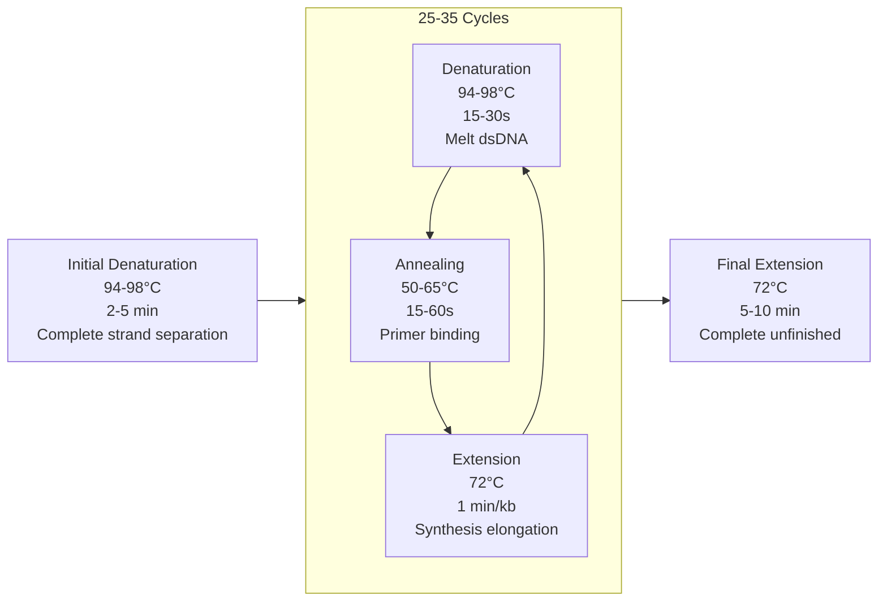

# Lesson 6: Genomics, Molecular Cloning, Analytical Techniques

## 1. First-Principles Intuition & Invariants

The experimental manipulation of genetic material represents one of molecular biology's most transformative achievements. At its foundation lies a deceptively simple insight: DNA, despite encoding the profound complexity of living systems, behaves as a predictable chemical polymer that can be cut, copied, modified, and reassembled using enzymatic catalysts originally discovered in bacteria. The revolution that began with restriction endonucleases in the 1970s has cascaded through decades of technical refinement, producing an experimental toolkit that allows researchers to interrogate genomes at single-nucleotide resolution, engineer arbitrary genetic circuits, and systematically perturb gene function across entire organisms.

The conceptual invariant underlying all modern genomic and cloning methodologies is **sequence specificity mediated by Watson-Crick base pairing**. Whether we consider the hybridization of oligonucleotide primers in polymerase chain reaction, the recognition sequences of restriction enzymes, the guide RNA targeting in CRISPR-Cas systems, or the probe-target binding in Southern blotting, the thermodynamic favorability of A-T and G-C hydrogen bonding provides the molecular address system that enables precise manipulation. This specificity is quantified through the melting temperature $T_m$, which for oligonucleotides can be approximated by:

$$T_m = 4(G + C) + 2(A + T) \quad \text{(°C, for short oligos)}$$

For longer sequences and more accurate predictions accounting for nearest-neighbor thermodynamics and salt concentration, the extended formula becomes:

$$T_m = \frac{\Delta H^\circ}{\Delta S^\circ + R \ln(C_t)} - 273.15 + 16.6\log_{10}[\text{Na}^+]$$

where $\Delta H^\circ$ represents the enthalpy of duplex formation (negative, exothermic), $\Delta S^\circ$ the entropy change, $R$ the gas constant (8.314 J·mol⁻¹·K⁻¹), and $C_t$ the total strand concentration. Salt concentration profoundly affects duplex stability because cations shield the negatively charged phosphate backbone, reducing electrostatic repulsion. Experimental protocols exploit these thermodynamic parameters to control stringency—the selectivity with which nucleic acid hybridization occurs. High-stringency conditions (temperatures near $T_m$, low salt) permit only perfectly matched duplexes to remain stable, while low-stringency conditions tolerate mismatches.

Genome organization itself imposes structural constraints that modern techniques must navigate. Eukaryotic genomes are partitioned into chromosomes, with DNA wound around histone octamers to form nucleosomes, further condensed into chromatin fibers. The human genome spans approximately 3.2 billion base pairs distributed across 23 chromosome pairs, yet protein-coding exons constitute merely 1.5% of this sequence space. The remainder consists of introns, regulatory elements, repetitive sequences (SINEs, LINEs, tandem repeats), and intergenic regions of unclear function. This architectural complexity means that genomic analysis cannot treat DNA as a uniform linear tape but must account for chromatin accessibility, methylation patterns, and three-dimensional nuclear topology that brings distant regulatory elements into spatial proximity.

The **Central Dogma processing pipeline**—DNA transcription to RNA, RNA translation to protein—establishes the logical flow that analytical techniques probe at different stages. DNA-level analysis (genome sequencing, PCR, Southern blotting) interrogates the genetic blueprint. RNA-level analysis (Northern blotting, RT-PCR, RNA-seq) measures transcriptional activity and post-transcriptional regulation. Protein-level analysis (Western blotting, immunoprecipitation) assesses the functional output. Each stage introduces regulatory complexity: alternative splicing generates multiple mRNA isoforms from single genes, post-translational modifications alter protein function, and feedback loops create non-linear dynamics. Experimental design must therefore specify which molecular layer is being interrogated and recognize that perturbations at one level may not propagate linearly to downstream layers.

Cloning, in its essence, is the engineering problem of introducing foreign DNA into a replicative context—typically a bacterial plasmid or viral vector—such that the host cell's transcriptional and replication machinery produces many identical copies. The thermodynamic barrier to spontaneous DNA uptake by cells necessitates transformation protocols that temporarily permeabilize membranes (chemical competence via calcium chloride, electroporation). Once inside, successful cloning requires three molecular components to function in concert: an **origin of replication** (ori) that recruits the host's DNA polymerase complex, a **selectable marker** (typically antibiotic resistance genes like ampicillin resistance $bla$ or kanamycin resistance $kan^R$) that allows survival screening, and a **multiple cloning site** (MCS) containing unique restriction enzyme recognition sequences where the insert DNA is ligated.

The conservation of restriction enzyme recognition sequences across evolution reflects their original biological function as bacterial immune systems. Type II restriction endonucleases like *EcoR*I (recognition sequence 5'-GAATTC-3') and *BamH*I (5'-GGATCC-3') cleave double-stranded DNA at specific palindromic sequences, generating either cohesive (sticky) or blunt ends. Sticky ends with complementary single-stranded overhangs dramatically accelerate ligation kinetics because they pre-align the DNA fragments through Watson-Crick pairing before T4 DNA ligase catalyzes phosphodiester bond formation. The ligation reaction consumes ATP to drive the otherwise unfavorable condensation:

$$\text{ATP} + \text{DNA-}3'\text{-OH} + \text{5'-PO}_4\text{-DNA} \rightarrow \text{AMP} + \text{PP}_i + \text{DNA-DNA}$$

Blunt-end ligation, lacking this alignment mechanism, requires higher ligase concentrations and longer incubation times. The strategic choice of restriction enzymes defines cloning compatibility—fragments excised with the same enzyme can be seamlessly joined, while incompatible ends necessitate additional processing (fill-in reactions with Klenow fragment, or phosphatase treatment to prevent vector self-ligation).

Modern genomic techniques increasingly leverage **amplification-based methods** that exponentially copy target sequences, enabling detection from minimal starting material. The polymerase chain reaction (PCR) epitomizes this approach: two oligonucleotide primers flanking the target region, a thermostable DNA polymerase (*Taq* from *Thermus aquaticus* or high-fidelity variants like *Pfu* or Q5), deoxynucleotide triphosphates (dNTPs), and thermal cycling through denaturation (94–98°C), annealing (50–65°C), and extension (72°C). Each cycle theoretically doubles the target, yielding $2^n$ copies after $n$ cycles, though practical amplification efficiency ranges from 80–95% per cycle due to enzyme degradation, primer depletion, and product inhibition. The exponential growth creates detectable quantities from single-molecule templates—a 30-cycle PCR amplifies by a factor of approximately $10^9$.

The analytical power of gel electrophoresis arises from the charge-to-mass ratio invariance of nucleic acids. Since every nucleotide contributes one negative charge from its phosphate group, DNA and RNA molecules migrate through agarose or polyacrylamide matrices strictly according to size. Larger fragments experience greater frictional drag and migrate more slowly, producing size-based separation. The relationship between migration distance $d$ and fragment size $L$ (in base pairs) follows an approximately logarithmic dependence:

$$d \propto -\log(L)$$

Agarose concentration determines resolution range: 0.5% agarose resolves 1–30 kb fragments, while 2% agarose optimally separates 0.1–2 kb. Polyacrylamide gels, with smaller pore sizes, resolve single-nucleotide differences in the 10–500 bp range, enabling Sanger sequencing and oligonucleotide quality control. Electrophoretic mobility is also sensitive to DNA topology—supercoiled plasmids migrate faster than relaxed circular or linear forms of identical sequence, a phenomenon exploited in plasmid preparation quality checks.

Southern blotting, named after its inventor Edwin Southern, extends gel electrophoresis into a sequence-specific detection method. After electrophoretic separation, DNA is denatured in alkaline solution and transferred by capillary action or vacuum-driven flow onto a nylon or nitrocellulose membrane, preserving the spatial resolution achieved in the gel. The membrane is then hybridized with a labeled probe—traditionally radioactive ³²P-dCTP incorporated during probe synthesis, increasingly replaced by chemiluminescent or fluorescent labels—complementary to the target sequence. Washing steps at controlled stringency remove non-specifically bound probe, and autoradiography or fluorescence imaging reveals bands where the probe has hybridized. This technique enables genome-wide surveys of specific sequences, detection of restriction fragment length polymorphisms (RFLPs), and verification of transgene integration.

Northern blotting applies identical principles to RNA analysis, with critical modifications for RNase contamination control. RNA's 2'-hydroxyl group makes it chemically labile and a substrate for ubiquitous RNases. All solutions must be treated with diethyl pyrocarbonate (DEPC) to inactivate RNases, glassware baked, and disposable plasticware certified RNase-free. Western blotting shifts to protein analysis, substituting SDS-PAGE (sodium dodecyl sulfate polyacrylamide gel electrophoresis) for size separation and antibody-based detection for sequence specificity. Primary antibodies bind target epitopes, secondary antibodies conjugated to horseradish peroxidase (HRP) or alkaline phosphatase amplify signal through enzymatic substrate conversion, producing chemiluminescent emission captured on X-ray film or CCD cameras.

## 2. Core Architecture & Mechanics

The polymerase chain reaction operates as a recursive enzymatic amplification engine with three mechanistically distinct thermal phases per cycle. During **denaturation** (94–98°C, 15–30 seconds), thermal energy disrupts hydrogen bonds, separating the double helix into single strands. The thermodynamics favor complete denaturation when:

$$\Delta G_{\text{denature}} = \Delta H - T\Delta S > 0$$

where the positive entropy change ($\Delta S > 0$, increasing disorder) and high temperature make the free energy positive, destabilizing the duplex. Modern thermostable polymerases tolerate these temperatures without significant activity loss, unlike early protocols using *E. coli* DNA polymerase I that required fresh enzyme addition each cycle.

The **annealing phase** (50–65°C, 15–60 seconds) drops temperature below the primers' $T_m$, allowing them to bind their complementary sequences on the now-single-stranded template. Optimal annealing temperature is typically set 3–5°C below the lower primer's $T_m$ to ensure sufficient binding without permitting excessive mispriming. Primer design follows strict criteria: 18–24 nucleotides long, 40–60% GC content, minimal secondary structure (avoiding hairpins or self-dimers), and terminal 3' GC clamp to stabilize binding at the polymerase initiation site. Mismatches near the 3' end catastrophically reduce amplification efficiency because DNA polymerase extends only from correctly base-paired primer-template junctions.

During **extension** (72°C, 1 minute per kilobase for *Taq*, 15–30 seconds per kb for high-processivity enzymes), polymerase synthesizes the complementary strand at rates of 60–100 nucleotides per second. The catalytic mechanism involves a two-metal-ion active site where divalent cations (Mg²⁺) coordinate the α-phosphate of the incoming dNTP and activate the 3'-OH for nucleophilic attack:

$$\text{DNA-}3'\text{-OH} + \text{dNTP} \xrightarrow{\text{Mg}^{2+}} \text{DNA-dNMP} + \text{PP}_i$$

Pyrophosphate release is highly exergonic ($\Delta G^\circ \approx -33$ kJ/mol), thermodynamically driving the polymerization forward. High-fidelity polymerases (Q5, Phusion, *Pfu*) incorporate 3'→5' exonuclease proofreading domains that excise misincorporated nucleotides, reducing error rates from *Taq*'s ~$10^{-4}$ per base to ~$10^{-6}$ per base. This 100-fold accuracy improvement is critical for cloning applications where sequence fidelity is mandatory.

Quantitative PCR (qPCR) extends this framework by monitoring amplification in real-time using fluorescent reporters. SYBR Green intercalates into double-stranded DNA, producing fluorescence proportional to product accumulation. Alternatively, TaqMan probes—oligonucleotides with 5' fluorophore and 3' quencher—hybridize to internal target sequences; during extension, *Taq*'s 5'→3' exonuclease activity cleaves the probe, physically separating fluorophore from quencher and generating signal. Amplification is tracked through cycle threshold ($C_t$) values, defined as the cycle number where fluorescence crosses a detection threshold. Since $C_t$ is inversely proportional to initial template quantity:

$$C_t \propto -\log(N_0)$$

relative quantification between samples becomes possible. The $\Delta\Delta C_t$ method normalizes target gene expression to reference housekeeping genes (GAPDH, β-actin) and compares experimental to control conditions:

$$\text{Fold Change} = 2^{-\Delta\Delta C_t}$$

where $\Delta\Delta C_t = (C_{t,\text{target}} - C_{t,\text{ref}})_{\text{exp}} - (C_{t,\text{target}} - C_{t,\text{ref}})_{\text{ctrl}}$.

Restriction enzyme digestion follows Michaelis-Menten kinetics with enzyme-substrate recognition governed by protein-DNA binding thermodynamics. Type II restriction endonucleases recognize palindromic sequences (e.g., *EcoR*I's GAATTC reads identically 5'→3' on both strands), binding as homodimers that clamp onto the duplex and catalyze symmetric double-strand breaks. The cleavage reaction rate depends on enzyme concentration, DNA concentration, temperature (typically 37°C for mesophilic bacterial enzymes), and buffer conditions providing necessary cofactors (Mg²⁺ or other divalent cations). Complete digestion requires sufficient enzyme units (defined as the amount needed to completely digest 1 μg substrate DNA in 1 hour) and adequate incubation time—typically 2–4 hours for genomic DNA, 1 hour for plasmid DNA.

Star activity, a failure mode where enzymes exhibit relaxed specificity under suboptimal conditions (high glycerol concentration, incorrect pH, excessive enzyme), produces spurious cleavage at near-cognate sites differing by one or two nucleotides. Protocol stringency demands adherence to manufacturer-specified buffer compositions and enzyme-to-DNA ratios. Incomplete digestion manifests as partial cleavage patterns with residual high-molecular-weight bands on gels, while overdigestion (excessive enzyme or time) can cause non-specific degradation.

Ligation efficiency is maximized by optimizing the insert-to-vector molar ratio. For sticky-end ligation, a 3:1 insert:vector ratio provides statistical favorability for insert incorporation while minimizing vector self-ligation and insert concatamerization. The reaction is driven by T4 DNA ligase, which catalyzes phosphodiester bond formation between adjacent 3'-OH and 5'-phosphate groups:

$$E + \text{ATP} \rightleftharpoons E\text{-AMP} + \text{PP}_i$$
$$E\text{-AMP} + \text{DNA-}5'\text{-PO}_4 \rightleftharpoons E\text{-AMP-DNA} + \text{H}_2\text{O}$$
$$E\text{-AMP-DNA} + \text{DNA-}3'\text{-OH} \rightarrow E + \text{AMP} + \text{DNA-DNA}$$

The enzyme first adenylates itself using ATP, then transfers the AMP to the 5'-phosphate, creating a reactive intermediate that the 3'-OH attacks to form the sealed phosphodiester bond. Ligation reactions proceed optimally at 16°C overnight for sticky ends (balancing hybridization stability with enzymatic activity) or 4°C for 16–24 hours for blunt ends (maximizing end-to-end collision frequency).

Transformation introduces recombinant plasmids into competent bacterial cells. Chemical competence protocols treat *E. coli* with ice-cold CaCl₂, which neutralizes surface charge and creates transient membrane perturbations during heat shock (42°C, 30–90 seconds). The calcium ions complex with phosphate groups on both the cell membrane and DNA backbone, facilitating membrane crossing. Electroporation applies high-voltage electrical pulses (1.8–2.5 kV, 5 ms) that transiently create nanometer-scale pores in the membrane through dielectric breakdown, allowing DNA entry. Transformation efficiency ranges from $10^6$ to $10^8$ colony-forming units per microgram DNA for chemical competence, up to $10^{10}$ CFU/μg for electroporation.

Selection on antibiotic-containing plates eliminates non-transformed cells. Only bacteria harboring plasmids with functional resistance genes survive. Blue-white screening provides secondary selection for recombinants: vectors like pUC19 contain the lacZ gene encoding β-galactosidase, with the MCS inserted within its coding sequence. Intact lacZ produces blue colonies on X-gal-containing plates (X-gal is cleaved by β-galactosidase into a blue chromogenic product), while successful inserts disrupt lacZ, yielding white colonies. Colony PCR confirms insert presence and orientation by amplifying across the junction using vector-specific primers.

Gel electrophoresis mechanics arise from the interplay between electric field force and gel matrix frictional resistance. DNA migrates toward the anode (positive electrode) because its phosphate backbone carries uniform negative charge. In an electric field $\vec{E}$, the electrophoretic mobility $\mu$ relates migration velocity $v$ to field strength:

$$v = \mu E$$

where mobility depends on molecular size, shape, and gel pore size. For linear DNA in agarose, mobility decreases logarithmically with fragment length, producing exponential band spacing. Voltage and run time are balanced: excessive voltage generates Joule heating ($P = I^2R$) that distorts band patterns, while excessive run time allows diffusion to broaden bands. Typical conditions apply 5–10 V/cm (measured as voltage divided by inter-electrode distance) for 30–120 minutes.

Agarose concentration determines pore size distribution following random coil polymer theory. Lower concentrations (0.5–0.7%) create larger pores suitable for resolving megabase-scale DNA in pulsed-field gel electrophoresis (PFGE), where the electric field alternates direction to reorient large molecules, enabling separation of entire bacterial chromosomes. Higher concentrations (1.5–2%) compress pore size, optimizing resolution for PCR products and restriction fragments in the 100–2000 bp range.

DNA staining employs intercalating dyes that fluoresce upon binding. Ethidium bromide, historically standard, intercalates between base pairs and increases fluorescence 20-fold upon UV excitation (302 nm or 366 nm). Its mutagenicity has driven adoption of safer alternatives like SYBR Safe or GelRed, which exhibit similar sensitivity (~1 ng detection limit per band) with reduced toxicity. Visualization under UV transilluminators excites the bound dye, emitting visible light (orange, ~590 nm for ethidium bromide) captured by CCD cameras or gel documentation systems.

Southern blotting's membrane transfer step is governed by capillary flow or vacuum-driven convection. In capillary transfer, a reservoir of high-salt buffer (20× SSC: 3 M NaCl, 0.3 M sodium citrate) sits below the gel, with absorbent material (paper towels or specialized blotting pads) stacked above the membrane. Capillary action draws buffer upward through the gel, carrying denatured DNA onto the membrane where it binds irreversibly. Transfer efficiency depends on fragment size (small fragments transfer rapidly, large fragments require prolonged transfer times or acid depurination pretreatment to fragment DNA), gel thickness, and buffer flow rate. Vacuum transfer accelerates the process by applying negative pressure, completing transfer in 1–2 hours versus overnight for capillary methods.

Probe labeling strategies have evolved from radioactive to non-isotopic methods. Random priming incorporates labeled nucleotides during synthesis by using a mixture of random hexamers that anneal throughout the probe template, with Klenow fragment (lacking 5'→3' exonuclease activity) extending from these priming sites in the presence of ³²P-dCTP or fluorescent dNTPs. Nick translation employs DNase I to introduce random single-strand breaks, then DNA polymerase I simultaneously degrades forward from the nick (5'→3' exonuclease) while synthesizing replacement strands incorporating labeled nucleotides (5'→3' polymerase). Chemiluminescent probes conjugated to alkaline phosphatase or horseradish peroxidase allow direct detection via enzymatic substrate conversion, avoiding radioactive waste disposal and providing comparable sensitivity.

High-stringency washes post-hybridization remove mismatched probe-target duplexes. Stringency is controlled by temperature and salt concentration: increasing temperature toward $T_m$ or reducing salt (0.1× SSC instead of 2× SSC) destabilizes duplexes with mismatches more than perfect matches. The thermodynamic penalty for each mismatch typically reduces $T_m$ by 1–1.5°C, so stringency can be tuned to distinguish single-nucleotide polymorphisms from perfect matches by washing 5–10°C below $T_m$ of the perfect duplex.

Northern blotting follows parallel architecture with RNA-specific modifications. Formaldehyde or glyoxal denatures RNA secondary structure during electrophoresis, ensuring migration strictly by size. Formaldehyde crosslinks to amino groups, preventing renaturation; glyoxal forms reversible Schiff-base adducts. RNA transfer uses identical membrane chemistries (nylon or nitrocellulose), though RNA binds less efficiently than DNA due to its single-stranded nature, sometimes requiring UV crosslinking to covalently attach RNA to the membrane via photochemical reactions between pyrimidine bases and membrane polymers.

Western blotting introduces SDS-PAGE for protein separation. SDS is an anionic detergent that denatures proteins and coats them with uniform negative charge proportional to mass, overriding intrinsic charge differences. Proteins migrate through polyacrylamide gels (not agarose, which has pores too large for protein resolution) according to molecular weight. Gel polymerization involves acrylamide monomer crosslinked by N,N'-methylenebisacrylamide, catalyzed by ammonium persulfate (APS) and accelerated by TEMED (tetramethylethylenediamine), forming a crosslinked meshwork:

$$\text{Acrylamide} + \text{Bis} \xrightarrow{\text{APS, TEMED}} \text{Polyacrylamide gel}$$

Acrylamide percentage dictates resolution range: 6–8% gels separate 50–200 kDa proteins, 10–12% resolve 20–100 kDa, and 15–20% optimize for < 20 kDa peptides. After electrophoresis, proteins are transferred to PVDF or nitrocellulose membranes via electroblotting (wet transfer in buffer-filled tank) or semi-dry transfer (membrane and gel sandwiched between buffer-soaked filter papers with electrodes in direct contact). Transfer efficiency is verified by Ponceau S staining, a reversible red dye that binds proteins.

Antibody incubations follow blocking steps to saturate non-specific binding sites with inert proteins (5% nonfat milk or bovine serum albumin in Tris-buffered saline with Tween-20, TBST). Primary antibody (raised against target protein, typically in rabbit or mouse) binds specific epitopes; secondary antibody (anti-rabbit or anti-mouse IgG conjugated to HRP or AP, raised in goat or donkey) amplifies signal. HRP catalyzes luminol oxidation in the presence of hydrogen peroxide, producing chemiluminescence:

$$\text{Luminol} + \text{H}_2\text{O}_2 \xrightarrow{\text{HRP}} \text{3-aminophthalate} + \text{light (425 nm)}$$

Alkaline phosphatase cleaves chemiluminescent substrates like CDP-Star, generating sustained light emission detectable on film or imaging systems. Signal intensity correlates with target protein abundance, enabling semi-quantitative comparison across samples when normalized to loading controls (β-actin, GAPDH, or total protein stains).

## 3. High-Performance Optimization & Failure Modes

Next-generation sequencing (NGS) technologies have transformed genomics by parallelizing the sequencing reaction across millions of spatially separated clusters. Illumina sequencing, the dominant platform, employs reversible terminator chemistry on flow cells patterned with oligonucleotide adapters. Library preparation fragments genomic DNA (by sonication, enzymatic digestion, or tagmentation using Tn5 transposase) and ligates platform-specific adapters containing primer binding sites and barcode indices for sample multiplexing. Fragments are diluted to single-molecule concentration and amplified on the flow cell surface via **bridge amplification**: each molecule hybridizes to a complementary surface-bound oligonucleotide, forms a bridge by hybridizing its other end to an adjacent oligo, and is amplified by polymerase to create a clonal cluster of ~1000 copies. This spatial amplification provides signal intensity sufficient for fluorescence detection while maintaining single-molecule spatial resolution.

Sequencing proceeds through iterative cycles of four-color imaging. Each cycle adds a single reversible-terminator nucleotide (A, C, G, or T, each labeled with a distinct fluorophore) that blocks further extension. After incorporation, the cluster is imaged to identify which nucleotide was added, then the terminator and fluorophore are chemically cleaved, regenerating a 3'-OH for the next cycle. Base calling algorithms convert raw fluorescence intensities into nucleotide calls with associated quality scores (Phred scores, $Q = -10\log_{10}(P_{\text{error}})$), where Q30 indicates 99.9% accuracy. Modern Illumina platforms generate 300–600 million reads per run, each 50–300 bp long, yielding 50–500 Gb total output.

Nanopore sequencing represents an alternative paradigm based on single-molecule electrical detection. Oxford Nanopore Technologies' devices thread DNA through biological pores (protein nanopores embedded in synthetic membranes) while applying a voltage bias. Nucleotides passing through the pore modulate ionic current in characteristic patterns decoded by recurrent neural networks into base calls. This real-time sequencing achieves read lengths exceeding 100 kb, enabling resolution of complex structural variants and repetitive regions that short-read technologies cannot span. Error rates (~5–10% for raw reads) are higher than Illumina but are mitigated by high coverage or polishing algorithms that use read consensus to correct errors.

Genome assembly from short reads is an NP-hard computational problem equivalent to solving a massive jigsaw puzzle where pieces overlap imperfectly. De Bruijn graph assemblers (Velvet, SPAdes, MEGAHIT) decompose reads into $k$-mers (overlapping subsequences of length $k$, typically 21–127 bp), construct a graph where nodes represent $k$-mers and edges represent $(k-1)$-base overlaps, then traverse the graph to find paths corresponding to the original genome. Repeats longer than read length create ambiguous graph structures with multiple valid traversals, fragmenting assemblies into contigs. Long-read sequencing or Hi-C proximity ligation (capturing in vivo spatial DNA interactions to infer long-range connectivity) can scaffold contigs into chromosome-scale assemblies.

Variant calling from sequencing data identifies differences between sequenced samples and reference genomes. Alignment algorithms (BWA-MEM, Bowtie2) map reads to the reference, producing BAM files encoding read positions and CIGAR strings describing alignments (matches, mismatches, insertions, deletions). Variant callers (GATK HaplotypeCaller, FreeBayes, Strelka) statistically test whether observed read evidence supports a variant versus sequencing error. Bayesian models incorporate prior probabilities of different variant types, base quality scores, mapping quality, and strand bias to compute posterior probabilities. Single-nucleotide variants (SNVs) are called when alternate allele depth exceeds thresholds (typically ≥3 reads, ≥20% allele frequency), with higher stringency for clinical applications. Indels (insertions and deletions) require local realignment around candidate sites to correctly interpret read gaps.

CRISPR-Cas9 genome editing exploits bacterial adaptive immunity machinery repurposed for targeted DNA cleavage. The Cas9 endonuclease, guided by a 20-nucleotide single-guide RNA (sgRNA) complementary to the target locus, scans genomic DNA for protospacer adjacent motifs (PAM sequences, typically NGG for *Streptococcus pyogenes* Cas9). Upon PAM recognition, Cas9 unwinds the adjacent DNA, allowing sgRNA to hybridize. If the match is sufficient (typically requiring ≥17 bp complementarity), Cas9's RuvC and HNH nuclease domains each cleave one DNA strand, generating a blunt double-strand break (DSB) precisely three base pairs upstream of the PAM.

The cellular DNA repair response to DSBs determines editing outcome. **Non-homologous end joining (NHEJ)**, the dominant pathway in most cell types, rapidly ligates broken ends with minimal processing, often introducing small insertion-deletion mutations (indels) at the junction that disrupt reading frames and knock out gene function. **Homology-directed repair (HDR)** uses a provided DNA template with homology arms flanking the break to guide precise sequence replacement, enabling knock-ins, point mutations, or reporter insertions. HDR is active primarily in S/G2 cell cycle phases and is far less efficient than NHEJ (~1–20% of events), requiring selection strategies to enrich edited cells.

CRISPR specificity is constrained by off-target cleavage at genomic loci tolerating sgRNA mismatches. Empirical studies reveal that mismatches in the PAM-distal region (beyond 12–15 bp from PAM) are better tolerated than PAM-proximal mismatches, with the last 8–12 bp (the "seed sequence") being most critical. Bioinformatics tools (Cas-OFFinder, CRISPOR) predict off-targets by enumerating all genomic sequences differing by ≤3–4 mismatches from the intended target. High-fidelity Cas9 variants (SpCas9-HF1, eSpCas9, HypaCas9) incorporate structure-guided mutations that weaken non-specific DNA contacts, reducing off-target activity 10–100-fold while preserving on-target efficiency.

Delivery modality critically determines CRISPR efficacy. For cultured cells, plasmid transfection or electroporation of Cas9-sgRNA ribonucleoprotein (RNP) complexes achieves high editing rates. For in vivo applications, adeno-associated virus (AAV) vectors package Cas9 and sgRNA genes under tissue-specific promoters, providing transient expression sufficient for editing but avoiding genomic integration. Lipid nanoparticles (LNPs) encapsulate Cas9 mRNA and sgRNA, enabling systemic delivery with preferential liver tropism. Base editors and prime editors extend CRISPR's capabilities: base editors fuse catalytically dead Cas9 (dCas9, with inactivated nuclease domains) to deaminase enzymes that chemically convert C→T or A→G without DSBs, while prime editors use dCas9 fused to reverse transcriptase, copying template sequences directly onto the target locus via a prime editing guide RNA (pegRNA) that encodes both the sgRNA and the reverse transcription template.

RNA interference (RNAi) provides an alternative gene knockdown mechanism by exploiting endogenous microRNA pathways. Synthetic small interfering RNAs (siRNAs), 21-nucleotide duplexes with 2-nucleotide 3' overhangs, are transfected into cells where they associate with Argonaute-2 (AGO2) protein in the RNA-induced silencing complex (RISC). The siRNA guide strand directs RISC to complementary mRNA targets, which AGO2's Slicer endonuclease activity cleaves between nucleotides 10 and 11 of the guide-target duplex. Cleaved mRNA is degraded by cellular exonucleases, reducing protein expression.

RNAi efficacy depends on siRNA design rules: optimal thermodynamic asymmetry (weaker base pairing at the 5' end of the guide strand relative to the passenger strand) ensures correct strand loading into RISC; avoiding sequences with strong secondary structure or repetitive elements minimizes off-target seed-mediated effects. Chemical modifications (2'-O-methylation, phosphorothioate linkages) enhance nuclease resistance and reduce immunogenicity. Short hairpin RNAs (shRNAs) expressed from plasmid or viral vectors mimic endogenous microRNA precursors: the shRNA folds into a stem-loop structure, is processed by Drosha and Dicer enzymes into mature siRNA, and enters the RISC pathway. This allows stable, long-term knockdown but risks position-effect variegation depending on integration site.

Off-target effects in RNAi arise from partial complementarity between the siRNA seed region (nucleotides 2–8 from the 5' end of the guide strand) and unintended mRNA targets. Microarray or RNA-seq profiling of siRNA-transfected cells often reveals hundreds of off-target transcripts downregulated by seed-mediated repression. Pooling multiple siRNAs targeting different regions of the same gene reduces false positives (true on-target effects should appear with all siRNAs; off-targets are likely distinct for each siRNA), and rescue experiments expressing siRNA-resistant cDNA (with synonymous codon changes disrupting siRNA binding sites) verify specificity.

Quantitative PCR troubleshooting demands systematic diagnosis of failure modes. Absent amplification (no fluorescence increase) indicates primer design failure (mispriming, primer-dimers, failure to anneal), template degradation (RNase contamination for RT-qPCR), or polymerase inhibition (carryover of EDTA, SDS, or ethanol from purification). Primer-dimer artifacts appear as low-molecular-weight products (< 100 bp) on melt curves or gels, generating premature fluorescence that distorts $C_t$ calculations. This is mitigated by redesigning primers to eliminate 3' complementarity, increasing annealing temperatures, or using hot-start polymerases that remain inactive until initial denaturation completes.

Uneven amplification efficiency across samples biases relative quantification. Amplification efficiency $E$ is empirically measured from standard curve slopes ($E = 10^{-1/\text{slope}}$), ideally 90–110% (slope −3.1 to −3.6). Efficiencies deviating from this range indicate co-purified inhibitors, suboptimal primer concentrations, or secondary structures in the template. Reference gene stability is validated by comparing variability (standard deviation of $C_t$ values) across experimental conditions; unstable reference genes (affected by the experimental treatment) introduce systematic bias. GeNorm and NormFinder algorithms rank candidate reference genes by stability.

Gel electrophoresis artifacts include smeared bands (degraded DNA from nuclease contamination or excessive vortexing), curved band fronts (uneven buffer levels or ionic strength gradients), and inverted band order (sample loaded in the wrong well or gel run in reverse polarity). Combing artifacts appear as streaks connecting bands when gel is inadequately set (insufficient agarose concentration or incomplete polymerization) or when too much DNA is loaded, saturating the gel matrix. UV exposure during gel excision for band purification introduces thymine dimers and crosslinks, reducing cloning efficiency; minimizing exposure time or using blue-light transilluminators reduces photodamage.

Southern blot optimization addresses transfer inefficiency for large fragments. Acid depurination pretreatment (0.25 M HCl, 10–15 minutes) hydrolyzes purine glycosidic bonds, introducing random single-strand breaks that reduce effective fragment size, improving transfer. However, excessive depurination fragments DNA into pieces too small to retain signal, requiring empirical optimization. Incomplete transfer is diagnosed by staining the gel post-transfer (residual DNA indicates need for longer transfer time or depurination), while background signal arises from incomplete probe removal (insufficient wash stringency) or non-specific probe binding (probe complexity insufficient—using labeled genomic DNA or repetitive sequences generates ubiquitous signal).

Western blot quantification requires linearity validation. Signal intensity must be proportional to protein amount across the sample dilution range; saturated bands (overexposed) yield non-linear response. Loading controls verify equal protein input, but housekeeping protein expression can vary with experimental conditions (GAPDH changes with glucose availability, β-actin with cytoskeletal disruptions). Total protein stains (Ponceau S, REVERT, or Coomassie) provide loading normalization independent of individual protein regulation.

Antibody specificity is the Achilles' heel of Western blotting. Polyclonal antibodies recognize multiple epitopes on the target, providing strong signal but higher risk of cross-reactivity; monoclonal antibodies bind a single epitope, offering greater specificity but vulnerability to epitope loss from denaturation or post-translational modifications. Multiple bands at unexpected molecular weights indicate non-specific binding, antibody degradation, or detection of protein isoforms/degradation products. Validation requires genetic controls: knockout or knockdown samples should abolish target band, while overexpression should enhance it. Preincubation of antibody with immunizing peptide (peptide competition) blocks specific binding, reducing target band intensity without affecting non-specific bands, confirming antibody specificity.

The integration of genomic, molecular cloning, and analytical techniques into coherent experimental workflows transforms isolated methodologies into hypothesis-testing engines. CRISPR-based screens knock out every gene in the genome individually, coupling knockouts to deep sequencing to identify genes conferring resistance or sensitivity to selection pressures (drug resistance, viral infection, metabolic stress). Chromatin immunoprecipitation followed by sequencing (ChIP-seq) maps protein-DNA interactions genome-wide, revealing transcription factor binding sites and histone modification landscapes. These methodologies, when executed with attention to thermodynamic fundamentals, enzymatic kinetics, and rigorous controls, provide the empirical foundation for mechanistic molecular biology.
