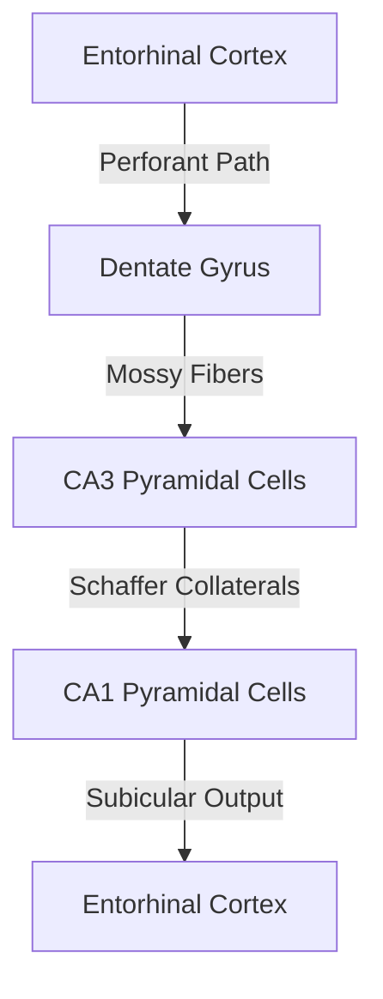

# Lesson 4: Cognition, Plasticity, Learning

## 1. First-Principles Intuition & Invariants

The physical substrate of cognition is not a static archive but a dynamically evolving electrical circuit. To understand learning from a first-principles perspective, we must abandon the metaphor of memory as a recording and instead frame it as a continuous alteration of conductance across biological membranes. The fundamental invariant of neuroscience is that information is encoded in the spatial-temporal patterns of action potentials, and memory is the persistent modification of the synaptic weights that route those patterns. This is the physical manifestation of the Hebbian postulate: cells that fire together, wire together. 

At the molecular level, learning is a problem of electrochemical transduction. A neuron is a leaky capacitor, resting at approximately $-70 \text{ mV}$, constantly bombarded by ions. A synapse is a variable resistor in this circuit. When an action potential invades the presynaptic terminal, voltage-gated calcium channels open, and the resulting $Ca^{2+}$ influx drives vesicle fusion. The resulting neurotransmitter spillage alters the postsynaptic conductance. The persistence of this conductance change—synaptic plasticity—is the physical instantiation of memory. 

The theoretical upper bound of this process is governed by Spike-Timing-Dependent Plasticity (STDP), a temporally asymmetric form of Hebbian learning. If a postsynaptic neuron fires an action potential within a few milliseconds *after* a presynaptic neuron fires, the synapse strengthens. If the postsynaptic neuron fires *before* the presynaptic neuron, the synapse weakens. This temporal precision forces the nervous system to map strict causal relationships between external events. The mathematical abstraction of this rule dictates the boundary of learning:

$$ \Delta w = \begin{cases} 
A_+ \exp\left(-\frac{\Delta t}{\tau_+}\right) & \text{if } \Delta t > 0 \text{ (pre before post)} \\
-A_- \exp\left(\frac{\Delta t}{\tau_-}\right) & \text{if } \Delta t < 0 \text{ (post before pre)}
\end{cases} $$

Where $\Delta w$ represents the change in synaptic weight, $\Delta t$ is the spike timing difference ($t_{post} - t_{pre}$), and $A_+, A_-$ are the maximum amplitudes of potentiation and depression, respectively, with $\tau_+, \tau_-$ defining the exponential decay time constants (typically $10 - 20 \text{ ms}$). 

To translate this theory into experimental reality, the neuroscientist must manipulate the biophysical invariants of the cell. Because biological tissue is subject to thermal noise, metabolic degradation, and continuous protein turnover, a memory cannot be stored as a static structural fixture. Instead, long-term memory requires structural remodeling—changing the physical size and number of dendritic spines, the microscopic protrusions that receive excitatory input. The challenge of the experimentalist is to induce, measure, and sustain these physical changes under the harsh constraints of biological decay.

## 2. Core Architecture & Mechanics

The physical architecture of mammalian learning is anchored in the hippocampal formation, a bilateral seahorse-shaped structure deep in the medial temporal lobe. The hippocampus acts as a high-bandwidth convergence zone, mapping sensory associations into cohesive episodic memories. The canonical circuit is the trisynaptic loop, a strict, unidirectional pathway:

The Dentate Gyrus (DG) performs pattern separation, using sparse coding to orthogonalize overlapping sensory inputs so that highly similar experiences do not activate identical neuronal ensembles. CA3 acts as an auto-associative network, using recurrent collateral connections to complete partial patterns. If a fragment of a memory is triggered, the CA3 region reconstructs the full pattern. CA1 acts as a comparator, evaluating whether the retrieved pattern from CA3 matches the current sensory reality arriving directly from the Entorhinal Cortex. 

To observe the mechanics of plasticity at the cellular level, the practitioner relies on whole-cell patch-clamp electrophysiology. In a standard acute hippocampal slice preparation, a recording electrode (pipette resistance $3 - 5 \text{ M}\Omega$) is pressed against the membrane of a CA1 pyramidal neuron. A brief suction ruptures the patch, providing electrical access to the cell interior. The internal pipette solution contains cesium-based ions to block potassium channels, ensuring a stable space clamp. 

To induce Long-Term Potentiation (LTP), the experimentalist applies a high-frequency stimulation (HFS) protocol—typically a $100 \text{ Hz}$ tetanus for $1 \text{ second}$—to the Schaffer collateral axons. This bombardment depolarizes the CA1 postsynaptic membrane, expelling the magnesium ($Mg^{2+}$) ion that physically blocks the NMDA-type glutamate receptor (NMDAR). 

The NMDAR is the molecular coincidence detector of the nervous system. Its conductance is governed by both ligand binding (glutamate release from the presynaptic terminal) and voltage gating (postsynaptic depolarization). The receptor's current is defined by:

$$ I_{NMDA} = \bar{g}_{NMDA} \cdot s \cdot \frac{V_m - E_{Ca^{2+}}}{1 + \frac{[Mg^{2+}]_{out}}{3.57} \exp(-0.062 V_m)} $$

Where $I_{NMDA}$ is the current, $\bar{g}_{NMDA}$ is maximum conductance, $s$ is the fraction of receptors bound by glutamate, $V_m$ is the membrane potential, and $E_{Ca^{2+}}$ is the reversal potential for calcium. The denominator represents the voltage-dependent magnesium block. 

Once unblocked, the NMDAR pore opens, and calcium ions flood the postsynaptic spine. Calcium binds to calmodulin, activating Ca2+/calmodulin-dependent protein kinase II (CaMKII). CaMKII undergoes autophosphorylation, becoming persistently active even after calcium levels fall. It phosphorylates the GluA1 subunit of the AMPA-type glutamate receptor, increasing its single-channel conductance and driving the exocytosis of reserve AMPA receptors from intracellular vesicles into the postsynaptic density. The synapse is now structurally and functionally stronger.

Above the cellular mechanics of memory formation sits the cortical architecture of attention and executive function, governed primarily by the prefrontal cortex (PFC). The PFC does not store content but maintains representations of goals and rules in working memory through persistent, recurrent firing. This persistent activity is modeled as a bi-stable network where pyramidal cells excite each other via NMDA-mediated recurrent connections, creating a stable attractor state. 

Attention is physically routed via the frontoparietal network, which exerts top-down control over sensory cortices. When a subject focuses on a specific visual stimulus, gamma-band oscillations ($30 - 80 \text{ Hz}$) in the PFC synchronize with the visual cortex, effectively amplifying the signal-to-noise ratio of the attended stimulus. This top-down gating is mediated by GABAergic interneurons in the cortex, which selectively inhibit irrelevant inputs, routing the executive command to the appropriate sensory processing stream.

## 3. High-Performance Optimization & Failure Modes

Inducing plasticity in a controlled laboratory setting is fundamentally an optimization problem. The standard HFS protocol is highly unphysiological; neurons in vivo rarely fire at $100 \text{ Hz}$ for a full second. To achieve maximum LTP induction while adhering to biological realism, the experimentalist optimizes the protocol using Theta-Burst Stimulation (TBS). TBS mimics the natural theta rhythm ($4 - 8 \text{ Hz}$) observed in the hippocampus during active exploration. 

A TBS protocol consists of short bursts of $4 - 5$ pulses at $100 \text{ Hz}$, repeated every $200 \text{ ms}$ (i.e., $5 \text{ Hz}$). This timing capitalizes on the intrinsic membrane dynamics of the pyramidal cells, allowing each successive burst to ride the summated excitatory postsynaptic potential (EPSP) of the previous burst, vastly increasing the efficiency of NMDAR activation. Optimization here means maximizing the calcium signal for the minimum metabolic cost, avoiding excitotoxicity. 

When optimizing a patch-clamp rig for plasticity studies, mechanical stability is paramount. The primary failure mode in LTP experiments is not biological, but mechanical. Thermal fluctuations in the room or vibrations in the air table cause micro-drift between the recording electrode and the cell membrane. Because LTP is measured as a sustained percentage increase in the EPSP slope, a slow drift in the baseline access resistance ($R_a$) will mimic or mask true synaptic potentiation. The practitioner must continuously monitor $R_a$ and discard data where it increases beyond $20\%$ of the baseline value. 

A critical biological failure mode occurs when the plasticity mechanism itself goes awry, leading to pathological states such as epilepsy or neurodegeneration. If LTP is unchecked, the recurrent excitatory loops in the hippocampus become hyper-synchronized, resulting in seizure activity. This is why the nervous system enforces homeostatic scaling. If global firing rates drop, the cell upregulates the expression of AMPA receptors across all its synapses to maintain a target firing rate. Conversely, runaway excitation triggers homeostatic downscaling. The experimentalist can pharmacologically block this homeostatic mechanism using the mTOR pathway inhibitor rapamycin, demonstrating that protein synthesis is an invariant requirement for long-term structural consolidation.

Furthermore, the failure of attention networks in the PFC characterizes the cognitive decline seen in aging and schizophrenia. In the healthy brain, recurrent PFC networks rely on a delicate balance of NMDA and GABA currents to maintain persistent activity. In advanced age, there is a selective loss of the inhibitory parvalbumin-positive interneurons. This loss of inhibitory control causes the PFC's attractor networks to become overly sensitive to noise, degrading the signal-to-noise ratio and causing the "distractibility" typical of aging prefrontal circuits. Similarly, chronic stress elevates glucocorticoids, which preferentially prune dendritic spines in the PFC while causing hypertrophy in the amygdala, physically shifting the brain's operating mode from top-down executive control to bottom-up reactive survival reflexes.

In experimental workflows, another failure mode is the misattribution of behavioral outcomes. If a researcher applies an NMDAR antagonist like AP5 to a rat and observes a failure in the Morris Water Maze (a spatial memory task), the immediate conclusion is often that spatial learning is blocked. However, NMDARs are also present in the motor cortex and cerebellum. The observed failure may simply be a motor coordination deficit. To mitigate this, the rigorous experimentalist must perform a thorough battery of control tasks—such as a visible platform version of the water maze—to isolate the cognitive deficit from motor or sensory impairment, ensuring the observed failure is strictly localized to the hippocampal plasticity substrates.
