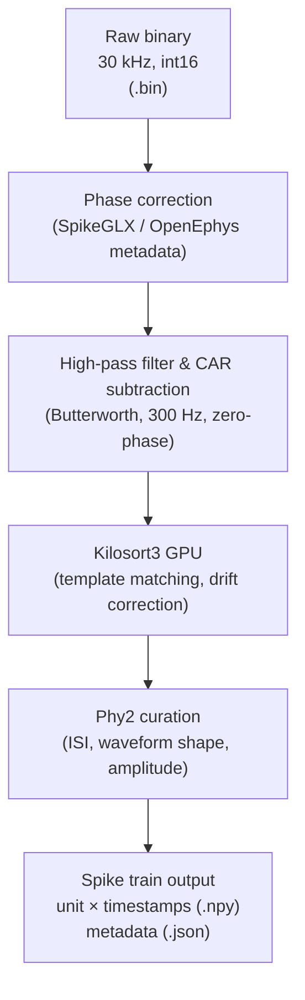

# Lesson 6: Experimental Methods & Neural Computation

## 1. First-Principles Intuition & Invariants

The neuron is, at its most fundamental level, an electrochemical machine. Charged ions dissolved in aqueous solution move across a lipid membrane whose permeability is controlled by protein channels that open and close with a molecular precision that still astonishes researchers who have studied it for decades. Everything we know about how the brain processes sensory input, generates movement, consolidates memory, or produces the subjective texture of conscious experience ultimately traces back to our ability to measure and perturb that electrochemical machinery at scales ranging from a single ion channel pore to the coordinated dynamics of billions of cells acting in concert. The experimental and computational tools neuroscience has developed to accomplish this form one of the most technically demanding and intellectually rich methodological arsenals in all of natural science.

The foundational invariant governing neuronal electrical behavior is the cable equation, a partial differential equation that describes how voltage propagates along a dendrite or axon as though the neurite were a lossy electrical cable. In its full form it reads:

$$\tau_m \frac{\partial V}{\partial t} = \lambda^2 \frac{\partial^2 V}{\partial x^2} - V + R_m I_{ext}$$

where $\tau_m = R_m C_m$ is the membrane time constant (units: seconds), $\lambda = \sqrt{R_m / R_i}$ is the electrotonic length constant (units: meters), $V$ is the membrane voltage relative to rest (units: V), $R_m$ is specific membrane resistance ($\Omega \cdot \text{m}^2$), $C_m$ is specific membrane capacitance ($\text{F/m}^2$), $R_i$ is intracellular resistivity ($\Omega \cdot \text{m}$), and $I_{ext}$ is injected current per unit length ($\text{A/m}$). This equation encodes one of the core intuitions of cellular neuroscience: signals attenuate as they travel. A synaptic current injected at a distal dendrite is electrotonically filtered before it reaches the soma, meaning the neuron performs a spatial integration that is physically determined by its geometry and passive membrane properties. No amount of computational modeling can substitute for a direct measurement of $\lambda$ in a real cell, which requires the patch clamp techniques described in the next section.

The action potential itself is governed by the Hodgkin-Huxley equations, a system of four coupled ordinary differential equations that model the conductances of voltage-gated sodium and potassium channels. The membrane voltage evolves according to:

$$C_m \frac{dV}{dt} = -g_{Na} m^3 h (V - E_{Na}) - g_K n^4 (V - E_K) - g_L (V - E_L) + I_{ext}$$

where $g_{Na}$, $g_K$, and $g_L$ are the maximal conductances (in $\text{S/cm}^2$) of sodium, potassium, and leak channels respectively, $E_{Na}$, $E_K$, and $E_L$ are their reversal potentials (in V) set by the Nernst equation, and $m$, $h$, $n$ are dimensionless gating variables that evolve with their own voltage-dependent time constants. Each gating variable obeys a first-order kinetic equation of the form:

$$\frac{dm}{dt} = \alpha_m(V)(1 - m) - \beta_m(V) m$$

where $\alpha_m(V)$ and $\beta_m(V)$ are empirically measured rate functions with units of $\text{s}^{-1}$. The model is not an approximation or a theoretical convenience. Hodgkin and Huxley derived it directly from voltage clamp experiments on squid giant axons in 1952, fitting the rate functions to real data before they had any structural knowledge of ion channels. This historical fact carries a profound methodological lesson: the most powerful theoretical model in cellular neuroscience was built from the inside out, measurement first, equation second. The same philosophy must guide the practitioner entering the laboratory today.

The Nernst equation, which sets the reversal potential for any given ionic species, is derived from the balance between chemical and electrical driving forces at equilibrium. For an ion of valence $z$, the equilibrium potential is:

$$E_{ion} = \frac{RT}{zF} \ln \frac{[ion]_o}{[ion]_i}$$

where $R = 8.314 \, \text{J mol}^{-1} \text{K}^{-1}$ is the gas constant, $T$ is absolute temperature (K), $F = 96485 \, \text{C mol}^{-1}$ is Faraday's constant, and $[ion]_o / [ion]_i$ is the ratio of extracellular to intracellular ion concentrations. At 37°C, the prefactor $RT/F \approx 26.7 \, \text{mV}$, which means that for a monovalent cation with a tenfold concentration gradient, the reversal potential is approximately $+61.5 \, \text{mV}$. These numbers are not abstract. When you are in the middle of a patch clamp experiment at two in the morning and your excitatory postsynaptic currents are reversing at the wrong voltage, you trace back to this equation to diagnose whether your internal solution was prepared incorrectly or whether the cell you are recording is expressing unexpected conductances.

At the systems level, the invariant that shapes experimental design and computational theory alike is the tuning curve: the relationship between a neuron's firing rate and some parametric dimension of a stimulus. A simple V1 orientation-selective cell fires maximally to a grating at its preferred orientation $\theta_0$ and its response falls off as a function of angular distance, often well described by a von Mises distribution:

$$r(\theta) = r_0 + r_{max} \exp\left(\kappa \cos(\theta - \theta_0) - \kappa\right)$$

where $\kappa$ is the concentration parameter governing tuning width and $r_0$ is the spontaneous firing rate. The existence of such systematic, parametric tuning is what makes neural coding theoretically tractable: it implies that the firing pattern of a neuron, or of a population of neurons, carries structured information about the external world, and that information can be decoded. The central question of neural coding theory is precisely how that decoding works, what algorithm the downstream circuit is implicitly implementing, and whether the geometric structure of population responses in high-dimensional state space reflects computational principles that generalize across brain regions, species, and task types.

---

## 2. Core Architecture & Mechanics

### Electrophysiology: From Ion Channel to Network

The patch clamp technique, developed by Erwin Neher and Bert Sakmann in the late 1970s, remains the gold standard for measuring ionic currents with single-channel and whole-cell resolution. The fundamental physical requirement is the formation of a gigaohm seal (gigaseal) between the fire-polished tip of a borosilicate glass pipette and the outer leaflet of the cell membrane. When tip resistance reaches $1\text{–}10 \, \text{G}\Omega$, the thermal noise contribution from the seal resistance falls to:

$$\sigma_I = \sqrt{\frac{4 k_B T \Delta f}{R_{seal}}}$$

where $k_B = 1.38 \times 10^{-23} \, \text{J K}^{-1}$, $T$ is temperature, $\Delta f$ is the recording bandwidth in Hz, and $R_{seal}$ is seal resistance in ohms. At $R_{seal} = 10 \, \text{G}\Omega$, $T = 310 \, \text{K}$, and $\Delta f = 10 \, \text{kHz}$, this evaluates to approximately $4 \, \text{fA}$ RMS. Only with this noise floor suppressed can you resolve the $\sim 1\text{–}5 \, \text{pA}$ unitary currents through individual ion channels in cell-attached or inside-out patch configurations.

**Practical pipette preparation** begins with pulling borosilicate glass capillaries (1.5 mm OD, 0.86 mm ID) on a programmable puller such as the Sutter P-97. A two-stage pull protocol with filament temperature near 850°C, pull force 50–80 g, and velocity 30–50 m/s produces tips with 1–3 µm diameter and resistances of 3–6 MΩ when filled with standard internal solution. Fire-polishing on a microforge with a platinum wire heated to roughly 800°C for 0.5–1.0 seconds rounds the tip edge and dramatically improves seal probability. The internal solution composition for a whole-cell current clamp recording targeting mammalian cortical neurons is typically: 130 mM K-gluconate, 10 mM KCl, 10 mM HEPES, 10 mM phosphocreatine-Na, 4 mM ATP-Mg, 0.3 mM GTP-Na, adjusted to pH 7.3 with KOH, osmolarity 285–290 mOsm. The low chloride content minimizes perturbation of inhibitory reversal potentials; the ATP and phosphocreatine sustain the Na/K-ATPase and prevent rundown of voltage-gated currents during prolonged recordings.

Once the gigaseal forms, brief suction or a voltage zap ($-1 \, \text{V}$, 0.5–1.0 ms) ruptures the membrane patch beneath the pipette tip, establishing whole-cell access. The amplifier (typically an Axon Multiclamp 700B, Heka EPC-10, or equivalent) then compensates for pipette capacitance ($C_{fast}$) and series resistance ($R_s$). Series resistance compensation is not merely a cosmetic correction. In voltage clamp, the actual membrane voltage $V_m$ differs from the command voltage $V_{cmd}$ by the voltage drop across the access resistance:

$$V_m = V_{cmd} - I \cdot R_s$$

Uncompensated series resistance of 10–15 MΩ during a sodium current of 1–2 nA introduces a 10–30 mV voltage error that completely invalidates the kinetic interpretation of the current. Standard practice is to compensate 60–80% of $R_s$ electronically and correct the remainder offline, or to include a 10 µs lag in the compensation circuit to prevent oscillation. Access resistance should be monitored throughout the recording via the amplitude of the capacitive transient in response to a 5 mV test pulse; if $R_s$ rises more than 20–30% above its initial value, the data epoch should be discarded.

For recording from intact tissue, multielectrode arrays (MEAs) and silicon probes such as the Neuropixels 1.0 have transformed the field. The Neuropixels 1.0 probe carries 960 recording sites along a 10 mm shank at 25–35 µm inter-site spacing, with 384 simultaneously addressable channels sampled at 30 kHz with 10-bit ADC resolution. The raw data stream from a single Neuropixels probe generates roughly 23 MB/s continuously. Over a one-hour recording session this amounts to approximately 83 GB of raw binary data, which immediately mandates a disciplined data management strategy before the experiment begins.

The processing pipeline for Neuropixels data begins with phase-corrected high-pass filtering (300–6000 Hz bandpass for spike detection, 0.5–300 Hz for local field potentials). Common-average referencing (CAR), where the median across all channels at each time sample is subtracted, removes broadband noise correlated across the probe. Spike detection then proceeds via threshold crossing at $-4\sigma$ to $-5\sigma$ of the filtered signal, where $\sigma$ is estimated as:

$$\sigma = \text{median}\left(\frac{|x|}{0.6745}\right)$$

This robust estimator of the noise standard deviation, using the median absolute deviation, is preferred over the sample standard deviation because it is insensitive to the spike events themselves. Kilosort2 or Kilosort3, running on a GPU (NVIDIA RTX 3090 or better for practical turnaround time), then performs the template-matching spike sorting that clusters extracted waveforms into putative single units. Cluster quality is evaluated by the fraction of interspike intervals (ISIs) below the absolute refractory period of 1–2 ms, isolation distance, and L-ratio, all computed within Phy2's manual curation interface. A unit with less than 1% ISI violations and isolation distance above 20 is generally considered well-isolated.

### Optical Imaging and Two-Photon Calcium Microscopy

Where electrophysiology offers microsecond temporal resolution but limited spatial coverage, two-photon calcium imaging offers the complementary strength: simultaneous access to hundreds or thousands of identified neurons at single-cell resolution across fields of view exceeding 1 mm². The physical principle exploits the nonlinear interaction between photons and fluorophore molecules. Near-infrared photons (typically 920–940 nm for GCaMP indicators) have insufficient individual energy to excite the fluorophore, but when two arrive simultaneously within the sub-femtosecond temporal coherence window of a pulsed titanium-sapphire laser, their energies sum to produce an excitation event equivalent to a single ultraviolet photon. Because the probability of two-photon absorption scales as the square of the instantaneous photon flux, fluorescence is generated only at the focal volume, inherently providing optical sectioning without a confocal pinhole. This confinement also means that out-of-focus fluorophores are not photobleached, which is critical for longitudinal chronic imaging.

The de facto calcium indicator family in modern systems neuroscience is GCaMP, specifically the GCaMP6 and jGCaMP8 variants engineered by the Janelia Research Campus. GCaMP6s has a calcium affinity $K_d \approx 144 \, \text{nM}$, a Hill coefficient of 2.96, a peak $\Delta F/F$ of approximately 1.6 for a single action potential in vivo, and a decay time constant of roughly 1.8 s. The slow kinetics mean that individual action potentials are not resolved at typical imaging rates of 15–30 Hz; rather, the fluorescence trace represents a calcium-convolved version of the spike train. Deconvolution using algorithms such as OASIS (Online Active Set method to Infer Spikes) or the cascade deep learning approach can recover inferred spike rates with reasonable fidelity when the signal-to-noise ratio is high ($\Delta F/F > 5\%$), but the researcher must never conflate the deconvolved signal with the electrophysiologically verified spike train without explicit validation in the same preparation.

The fluorescence change is quantified as:

$$\frac{\Delta F}{F_0} = \frac{F(t) - F_0}{F_0}$$

where $F_0$ is the baseline fluorescence estimated from a rolling percentile (typically the 8th percentile of a 60-second sliding window), which minimizes the influence of active neural responses on the baseline estimate. Motion artifacts in head-fixed but non-anesthetized animals are corrected using rigid or non-rigid registration algorithms (NoRMCorre is the standard for large datasets) prior to region-of-interest (ROI) extraction. Suite2p is the dominant end-to-end pipeline for two-photon data processing, performing registration, ROI detection via a convolutional neural network trained on manually annotated data, neuropil subtraction ($F_{cell} = F_{raw} - 0.7 \cdot F_{neuropil}$), and $\Delta F/F$ computation in a single configurable workflow. The neuropil coefficient of 0.7 is an empirical approximation; rigorous analysis should validate this value for the specific preparation and imaging depth.

### Optogenetics: Precision Causal Intervention

Optogenetics provides causal intervention with the cellular specificity and millisecond temporal resolution that pharmacological methods cannot approach. The technique delivers light-sensitive opsins genetically to defined cell populations, allowing activation or silencing of those cells with patterned light delivery. The channelrhodopsin-2 (ChR2) variant from *Chlamydomonas reinhardtii*, an algal cation channel, opens within ~1 ms of 470 nm illumination and closes with a time constant of ~10 ms, permitting reliable following of light pulses up to ~40 Hz. Halorhodopsin (eNpHR3.0), a chloride pump from *Natronobacterium pharaonis*, drives membrane hyperpolarization under 580 nm illumination and achieves steady-state silencing within ~20 ms.

Opsin delivery in rodents is typically achieved by stereotaxic injection of adeno-associated viral vectors (AAVs). A standard surgical protocol for targeting mouse primary visual cortex (V1) proceeds as follows. The animal is anesthetized with isoflurane (4% induction, 1–1.5% maintenance), mounted in a stereotaxic frame with bite bar and ear bars, and core temperature maintained at 37°C with a feedback-controlled heating pad. After exposing the skull through a midline incision, bregma is zeroed, and coordinates for V1 are located (approximately $-3.0$ mm posterior, $+2.5$ mm lateral from bregma in C57BL/6J). A 0.5 mm craniotomy is made with a pneumatic drill, and 200–500 nL of AAV (typically AAV2/9-CaMKII-ChR2-H134R-eYFP, titer $\geq 10^{12}$ gc/mL) is injected at 300 µm depth using a glass pipette at 50 nL/min via a nanoliter injector. The pipette is held in place for 10 minutes post-injection before withdrawal to prevent backflow along the pipette track. Expression reaches functional levels within 2–4 weeks.

For in vivo photostimulation, fiber optic cannulas (200–400 µm core, 0.37–0.48 NA) are implanted 100–200 µm above the injection site. Light power at the fiber tip should be calibrated with a power meter (Thorlabs PM100D or equivalent) before each experiment. The irradiance at the fiber tip required to reliably activate ChR2 in vivo is typically 1–10 mW/mm², translating to roughly 0.3–3 mW for a 200 µm fiber. At powers above 20–30 mW/mm², photothermal artifacts and direct neural heating become non-negligible, an artifact that must be controlled with matched-wavelength light delivery into an opsin-negative control animal or brain region. The on/off kinetics of the opsin also impose a duty cycle constraint: for ChR2-H134R, sustained 40 Hz pulsing at 5 ms pulse width produces reliable spiking in fast-spiking interneurons but may desensitize more slowly in excitatory cells due to ChR2's channel inactivation during prolonged illumination. ChRmine and soma-targeted CoChR (soCoChR) variants offer improved photocurrent magnitude and reduced desensitization for applications demanding sustained high-frequency drive.

### Lesion Studies and Causal Circuit Mapping

The logic of a lesion study is to infer function from deficit: if damaging structure X impairs behavior Y, and no other interpretation survives controlled analysis, then X contributes to Y. This logic, though intuitive, is riddled with confounds that have burned researchers for over a century. A focal excitotoxic lesion with ibotenic acid (5–10 µg/µL in phosphate-buffered saline, injected at 0.1 µL/site) destroys neuronal cell bodies while sparing fibers of passage, which is a methodological improvement over electrolytic lesions that damage both. Nonetheless, the downstream circuit reorganizes in the days and weeks following the lesion through compensatory plasticity. Any behavioral test conducted more than 48–72 hours post-lesion is measuring the behavior of a reorganized system, not the function of the absent structure in isolation. Reversible inactivation approaches, including muscimol microinjection (a GABA-A agonist, 0.5–1.0 µg in 0.5 µL per site) or Designer Receptors Exclusively Activated by Designer Drugs (DREADDs), circumvent this problem by allowing the same animal to serve as its own control across active and inactive sessions.

---

## 3. High-Performance Optimization & Failure Modes

### Neural Coding: Rate Codes, Temporal Codes, and Population Geometry

Having acquired data, the central interpretive challenge is decoding what the neural activity represents and how it represents it. The simplest hypothesis, the rate code, posits that information is carried in the mean firing rate of individual neurons averaged over a window of tens to hundreds of milliseconds. This framework, grounded in the work of Edgar Adrian and refined through the tuning curve analyses of Hubel and Wiesel, Georgopoulos, and O'Keefe, has been enormously productive. Its formal machinery centers on the Fisher information, which quantifies how precisely a stimulus parameter $\theta$ can be estimated from a neuron's response:

$$I_F(\theta) = \mathbb{E}\left[\left(\frac{\partial}{\partial \theta} \ln p(r|\theta)\right)^2\right] = -\mathbb{E}\left[\frac{\partial^2}{\partial \theta^2} \ln p(r|\theta)\right]$$

where $p(r|\theta)$ is the likelihood of observing spike count $r$ given stimulus $\theta$, and the Cramér-Rao bound states that the variance of any unbiased estimator $\hat{\theta}$ satisfies:

$$\text{Var}(\hat{\theta}) \geq \frac{1}{I_F(\theta)}$$

For a Poisson neuron with tuning curve $f(\theta)$, the Fisher information evaluates to $I_F(\theta) = [f'(\theta)]^2 / f(\theta)$, which is maximized at the flanks of the tuning curve, not at the peak. This counterintuitive result means that a population of neurons with diverse preferred stimuli spanning the range of interest carries the most information near the boundaries between adjacent tuning curve peaks, and that optimal decoding from a population should weight neurons at their steep flanks most heavily.

The rate code framework, however, faces a fundamental limitation in contexts where the brain operates on sub-100 ms timescales, as in sensory-guided decisions, motor preparation, and predictive coding. Here, temporal coding hypotheses become relevant. Phase precession in hippocampal place cells, wherein the theta-cycle phase at which a CA1 cell fires shifts systematically as the animal traverses the place field, encodes positional information at a resolution finer than the place field size alone would suggest. Gamma-band synchronization (30–90 Hz) between stimulus-selective cortical ensembles has been proposed as a mechanism for binding distributed representations, though the causal evidence for binding by synchrony remains contested. The practitioner should approach temporal coding not as an alternative to rate coding but as a richer description that may be selectively relevant depending on the timescale and circuit under investigation.

The most consequential shift in systems neuroscience over the past decade has been the move from single-neuron to population-level analysis. The core insight is that the relevant computational object is not the tuning curve of a single cell but the trajectory of the population state vector through a high-dimensional neural state space, where each axis corresponds to the firing rate of one neuron. For a population of $N$ neurons at time $t$, the population state is the vector:

$$\mathbf{r}(t) = [r_1(t), r_2(t), \ldots, r_N(t)]^T \in \mathbb{R}^N$$

Empirically, the variance in $\mathbf{r}(t)$ across time and conditions is not distributed uniformly across all $N$ dimensions. Dimensionality reduction methods such as principal component analysis (PCA), demixed PCA (dPCA), and UMAP reveal that neural population activity lives on a low-dimensional manifold embedded in the full state space. In motor cortex during reaching, the first two or three PCs capture rotational dynamics whose angular velocity predicts the kinematics of the upcoming movement, a structure that emerges not from any single neuron's tuning properties but from the geometry of the collective. This manifold perspective reframes the question of neural coding: the brain's computation is the transformation of one manifold into another, and understanding that transformation requires both the right experimental design to populate the manifold richly and the right geometric tools to characterize it.

### Computational Models of Neural Circuits

The leaky integrate-and-fire (LIF) neuron, despite its simplicity relative to the Hodgkin-Huxley model, captures the essential input-output behavior of a spiking neuron at a computational cost low enough to simulate networks of $10^4$–$10^6$ cells in real time. The membrane potential evolves according to:

$$\tau_m \frac{dV}{dt} = -(V - V_{rest}) + R_m I(t)$$

When $V$ reaches a threshold $V_{th}$, the neuron emits a spike and $V$ is reset to $V_{reset}$ for a refractory period $\tau_{ref}$. For a neuron receiving a large number of independent Poisson synaptic inputs, the input current $I(t)$ can be treated as a Gaussian white noise process with mean $\mu$ and variance $\sigma^2$, and the firing rate can be computed analytically via the Fokker-Planck equation, yielding the gain function. This diffusion approximation, known as the mean-field approach, is the foundation for analytically tractable network models. For an excitatory-inhibitory network with connection strengths $J_{EE}$, $J_{EI}$, $J_{IE}$, and $J_{II}$, the coupled mean-field equations for population firing rates $\nu_E$ and $\nu_I$ determine whether the network operates in an asynchronous irregular state (physiologically realistic), a synchronous oscillatory state (epileptiform or rhythmic), or a bistable state (a potential substrate for working memory).

Spiking network simulations in practice are implemented in NEURON (for morphologically detailed compartmental models) or Brian2 (for large networks of simplified neurons). A minimal recurrent network model in Brian2 that captures cortical E-I balance requires specifying the following parameters:

| Parameter | Symbol | Typical Value |
|---|---|---|
| Excitatory time constant | $\tau_E$ | 20 ms |
| Inhibitory time constant | $\tau_I$ | 10 ms |
| E→E synaptic weight | $J_{EE}$ | 0.1 mV |
| I→E synaptic weight | $J_{IE}$ | −0.4 mV |
| E→I synaptic weight | $J_{EI}$ | 0.3 mV |
| I→I synaptic weight | $J_{II}$ | −0.3 mV |
| External Poisson rate | $\nu_{ext}$ | 2000 Hz per neuron |
| Spike threshold | $V_{th}$ | −50 mV |
| Reset potential | $V_{reset}$ | −60 mV |
| Membrane time constant | $\tau_m$ | 20 ms |

The balance condition for the asynchronous irregular regime requires that excitation and inhibition cancel to leading order: $J_{EE} \nu_E N_E \approx |J_{IE}| \nu_I N_I$, where $N_E$ and $N_I$ are the number of excitatory and inhibitory presynaptic neurons, respectively. This balance is not a fine-tuned coincidence but an emergent property of the network: inhibition is faster than excitation (the smaller $\tau_I$), so any excess excitation rapidly recruits inhibitory feedback that restores balance. This self-correcting dynamic is robust over a wide range of parameters and is consistent with the observation that cortical neurons in vivo operate under conditions of high-conductance bombardment that keeps them near but below threshold.

Recurrent neural networks (RNNs) trained by gradient descent, specifically through backpropagation through time (BPTT) on neuroscience tasks, have emerged as a powerful tool for generating and testing hypotheses about circuit-level computation. A continuous-time RNN evolves as:

$$\tau \frac{d\mathbf{x}}{dt} = -\mathbf{x} + W^{rec} \mathbf{r} + W^{in} \mathbf{u}(t) + \boldsymbol{\eta}(t)$$

$$\mathbf{r} = \phi(\mathbf{x}), \quad \mathbf{z} = W^{out} \mathbf{r}$$

where $\mathbf{x} \in \mathbb{R}^N$ is the vector of recurrent unit activities, $\mathbf{r}$ is their nonlinear output through activation function $\phi$ (typically $\tanh$ or a rectified polynomial), $\mathbf{u}(t)$ is the external input, $\boldsymbol{\eta}(t)$ is noise, $W^{rec}$ and $W^{in}$ are recurrent and input weight matrices, and $\mathbf{z}$ is the network output. Training with BPTT minimizes a task loss $\mathcal{L}$ over the output trajectory; the resulting weight matrices are then analyzed geometrically and compared to neural recordings from animals performing the same task. When trained on a delayed match-to-sample task, RNNs develop line attractors or ring attractors in $W^{rec}$ that maintain stimulus identity across the delay, structures that can be directly tested against the population geometry of prefrontal cortex data. When trained on motor generation tasks, they spontaneously exhibit the rotational dynamics observed experimentally in monkey motor cortex.

### Failure Modes, Confounds, and Mitigation

The most pervasive technical failure in patch clamp is series resistance runup during the recording, which typically results from partial re-sealing of the membrane at the pipette tip or accumulation of debris. Mitigation requires monitoring $R_s$ every 2–5 minutes via the capacitive transient response to a 5 mV step, discarding epochs where $R_s$ exceeds 1.3× its initial value, and including only cells whose initial access resistance was below 20 MΩ in the final dataset. Liquid junction potential, arising from the difference in ionic mobilities between the pipette solution and the bath, introduces a systematic offset of 10–15 mV that must be measured empirically and corrected offline. The junction potential for the K-gluconate internal solution described above against standard ACSF is approximately $-14 \, \text{mV}$, calculated from the Henderson equation and experimentally verified by zeroing the pipette potential in bath solution before forming the gigaseal.

In calcium imaging, the dominant false-positive failure mode is neuropil contamination: the fluorescence from unmyelinated axons and dendrites passing beneath a somatic ROI bleeds into the somatic signal, creating spurious correlations between cells whose somas share an underlying neuropil process. The standard correction subtracts a neuropil coefficient times the neuropil ring signal, but this coefficient varies with depth, indicator expression level, and objective NA, and the standard 0.7 value can over-subtract in superficial layers and under-subtract in deep layers. Validation against simultaneous electrophysiology, using Neuropixels probes during two-photon imaging, is currently the most reliable approach to calibrating neuropil subtraction in a specific preparation.

Optogenetics carries a family of unique confounds that have produced several prominent replication failures in the literature. Photoelectric artifacts from metallic recording electrodes exposed to the stimulation light can produce artifact signals with the precise timing of action potentials, completely mimicking evoked spiking. The artifact is distinguishable by its amplitude linearity with light power, instantaneous onset, and identical waveform regardless of recording depth; it is eliminated by using non-metallic electrodes (glass pipettes) or by designing electrode geometries that shield the recording site from direct illumination. Heating artifacts from sustained high-power illumination raise local tissue temperature and directly modulate firing rates in the absence of any opsin. The control is identical light delivery in animals injected with a fluorophore-only virus lacking the opsin sequence, which should produce no behavioral or electrophysiological response at matched power levels. These controls are not optional refinements; they are the minimum standard of evidence required to claim an optogenetic result.

Population-level analyses carry their own family of statistical failure modes. Dimensionality reduction methods applied to neural population data are sensitive to the choice of trial-averaging window, the number of conditions sampled, and whether the data are $z$-scored or variance-normalized before the decomposition. PCA on firing rates that differ greatly in magnitude across neurons will be dominated by the highest-firing cells; variance normalization ensures equal contribution, but it also amplifies noise in low-firing neurons. The practitioner should report variance explained by the first three PCs, check that the loading structure is robust to leave-one-neuron-out resampling, and test whether the low-dimensional manifold structure is statistically significant against a shuffled null distribution that preserves single-neuron statistics while destroying population structure. The tangled-ness measure, introduced by Russo and colleagues, provides a principled quantification of manifold geometry that is invariant to affine transformations and interpretable across datasets collected with different numbers of cells and different behavioral conditions.

The ultimate discipline of experimental neuroscience is the integration of these modalities into a coherent mechanistic account. Correlative evidence from imaging, causal evidence from optogenetics, and circuit constraints from electrophysiology must be triangulated before claiming that a given population dynamic is not merely correlated with behavior but is a necessary and sufficient computational step in its generation. This triangulation is what separates a mature mechanistic understanding from a collection of well-crafted observations, and it is the standard to which the practitioner must hold their own work.
