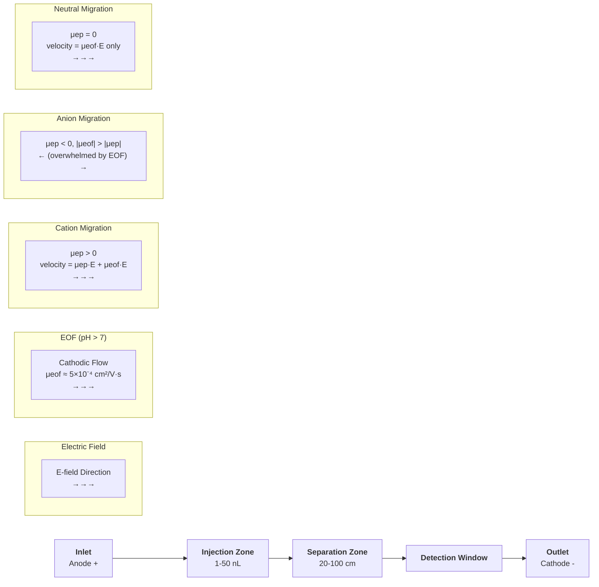

# Lesson 5: Separation Science: Gas Chromatography, Liquid Chromatography, Capillary Electrophoresis

## 1. First-Principles Intuition & Invariants

Separation science stands as the cornerstone of modern analytical chemistry, enabling the resolution of complex mixtures into individual molecular constituents through carefully orchestrated physical and chemical interactions. The fundamental challenge in analyzing real-world samples—whether environmental pollutants in river water, pharmaceutical impurities in drug formulations, or metabolites in biological fluids—lies not in detecting chemical species, but in isolating them from interfering matrix components that would otherwise confound measurement. Chromatographic and electrophoretic techniques solve this problem by exploiting differential partitioning behavior: molecules migrate through separation media at rates determined by their chemical structures, physical properties, and interactions with carefully designed stationary phases or electric fields.

The theoretical foundation of all chromatographic separations rests on a deceptively simple premise: when a mobile phase transports analytes through a stationary phase, molecules distribute themselves between these two phases according to thermodynamic equilibrium constants. Consider a solute molecule oscillating between dissolved mobile phase and adsorbed stationary phase states. The distribution coefficient $K_d$ quantifies this equilibrium as the ratio of analyte concentration in the stationary phase to its concentration in the mobile phase. A molecule with high affinity for the stationary phase ($K_d \gg 1$) spends more time immobilized and therefore travels slowly through the column, eluting late. Conversely, molecules with weak stationary phase interactions ($K_d \ll 1$) remain predominantly in the mobile phase and elute early.

The retention factor $k$, also called the capacity factor, translates this distribution coefficient into an experimentally measurable quantity that directly relates to chromatographic peak position. Defined as $k = K_d (V_s / V_m)$, where $V_s$ represents stationary phase volume and $V_m$ represents mobile phase volume within the column, the retention factor connects thermodynamic partitioning to observable retention times. The adjusted retention time $t_R'$ for any analyte equals $t_R' = t_R - t_0$, where $t_R$ is the measured retention time from injection to peak maximum and $t_0$ is the column dead time—the transit time for an unretained marker compound that experiences zero stationary phase interaction. The retention factor then follows directly as $k = t_R' / t_0 = (t_R - t_0) / t_0$. This relationship reveals a critical insight: retention behavior depends not only on analyte-stationary phase chemistry but also on the phase ratio geometry of the chromatographic system itself.

Selectivity, the ability to differentiate between two chemically similar analytes, emerges as the ratio of their retention factors: $\alpha = k_2 / k_1$ where $k_2 > k_1$ by convention. Perfect selectivity ($\alpha \to \infty$) would separate any two peaks completely regardless of column efficiency, while lack of selectivity ($\alpha = 1$) produces coelution no matter how many theoretical plates the column possesses. In practice, selectivity originates from stationary phase chemistry: reversed-phase C18 columns separate nonpolar compounds by hydrophobic interactions, normal-phase silica exploits hydrogen bonding and dipole moments, chiral stationary phases create diastereomeric transition states that resolve enantiomers, and ion-exchange resins discriminate based on charge density and ionic radius.

Column efficiency, quantified through the theoretical plate number $N$, measures peak sharpness and therefore the system's ability to exploit selectivity differences. The plate height $H = L / N$, where $L$ represents column length, describes the variance in analyte zone broadening per unit length traveled. Lower plate heights correspond to sharper peaks and superior resolving power. The van Deemter equation governs plate height behavior as a function of mobile phase linear velocity $u$:

$$H = A + \frac{B}{u} + Cu$$

This equation dissects band broadening into three independent physical mechanisms. The $A$ term represents eddy diffusion arising from multiple flow paths through the packed stationary phase—analyte molecules traverse different routes with varying path lengths, creating spatial dispersion independent of flow rate. The $B/u$ term captures longitudinal molecular diffusion: analytes diffuse along the concentration gradient of their own migrating zone, with broadening inversely proportional to velocity because slower flow allows more time for diffusive spreading. The $Cu$ term describes resistance to mass transfer between mobile and stationary phases—at high velocities, analyte molecules lack sufficient time to achieve equilibrium partitioning, creating concentration gradients within stationary phase pores or the mobile phase boundary layer that increase linearly with flow rate.

The van Deemter curve exhibits a characteristic minimum at the optimal linear velocity $u_{\text{opt}}$, where the competing effects of longitudinal diffusion (decreasing with velocity) and mass transfer resistance (increasing with velocity) balance. Operating at $u_{\text{opt}}$ maximizes efficiency for a given column geometry and chemistry, though practical considerations often favor slightly higher velocities that sacrifice modest efficiency for significantly reduced analysis times. Modern sub-2-micron particle columns have shifted the van Deemter minimum to higher velocities compared to classical 5-micron materials, enabling ultra-high-performance liquid chromatography (UHPLC) to achieve both superior efficiency and faster separations through elevated operating pressures exceeding 1000 bar.

Resolution $R_s$ synthesizes selectivity, retention, and efficiency into a single figure of merit that predicts peak separation quality. The fundamental resolution equation:

$$R_s = \frac{\sqrt{N}}{4} \cdot \frac{\alpha - 1}{\alpha} \cdot \frac{k_2}{1 + k_2}$$

reveals the multiplicative interplay of these parameters. Resolution scales with the square root of plate number, meaning quadrupling column length doubles resolution at the cost of quadrupling analysis time and mobile phase consumption. The selectivity term $(\alpha - 1)/\alpha$ demonstrates that small selectivity improvements yield disproportionate resolution gains when $\alpha$ approaches unity—this explains why method development focuses intensely on optimizing stationary phase chemistry and mobile phase composition to maximize $\alpha$. The retention term $k_2/(1 + k_2)$ asymptotically approaches unity as retention increases, showing diminishing returns: retention factors between 2 and 10 capture most achievable resolution benefits, while $k > 20$ produces excessive analysis times with minimal resolution enhancement.

Gas chromatography operates in a fundamentally different thermodynamic regime than liquid-phase techniques because the mobile phase—an inert carrier gas such as helium, hydrogen, or nitrogen—provides negligible solvation or interaction with analytes. All retention selectivity originates from stationary phase chemistry, typically high-boiling polymeric liquids coated on fused silica capillary walls or bonded to porous solid supports. Volatile and thermally stable analytes vaporize in a heated injection port, then partition between the gaseous mobile phase and liquid stationary phase according to their boiling points and polarity matching with the stationary phase. A nonpolar dimethylpolysiloxane phase (DB-1, HP-1) separates compounds primarily by vapor pressure differences, eluting in approximate boiling point order. Moderately polar phases incorporating phenyl or cyanopropyl substituents (DB-5, DB-1701) introduce dipole and polarizability selectivity, while highly polar polyethylene glycol phases (DB-WAX) create hydrogen bonding interactions that dramatically alter elution patterns for hydroxyl and carbonyl-containing analytes.

Temperature programming provides the crucial dimension for gas chromatography method optimization. Isothermal operation at a single oven temperature produces a chromatogram where early peaks appear sharp and well-separated while late peaks become progressively broader and shallower as longitudinal diffusion broadens zones during extended residence times. A linear temperature ramp—typically 5 to 30°C per minute from an initial hold temperature to a final plateau—continuously decreases analyte retention factors as the run progresses, maintaining relatively constant peak widths across the entire elution window. The practical effect mimics gradient elution in liquid chromatography: volatile compounds separate during the low-temperature isotherm where their retention factors remain comfortably in the optimal range, while higher-boiling analytes experience accelerated elution as rising temperatures reduce their stationary phase partition coefficients.

Liquid chromatography decouples stationary phase selectivity from mobile phase contributions, enabling orthogonal optimization strategies unavailable in gas phase separations. Reversed-phase liquid chromatography, accounting for over 70% of contemporary HPLC applications, employs nonpolar stationary phases—most commonly octadecylsilane (C18) bonded to silica—paired with polar aqueous-organic mobile phases. Analytes partition from the polar mobile phase into the hydrophobic stationary phase according to their octanol-water partition coefficients. Increasing mobile phase organic content (acetonitrile or methanol) reduces retention by strengthening analyte solvation in the mobile phase and decreasing the thermodynamic favorability of stationary phase partitioning.

Isocratic elution maintains constant mobile phase composition throughout the separation, appropriate when all analytes exhibit similar retention factors in a single solvent mixture. The general elution problem—where optimal conditions for early peaks produce excessive retention for late peaks and vice versa—necessitates gradient elution for complex mixtures spanning wide polarity ranges. A typical reversed-phase gradient begins with high aqueous content (5% organic) and ramps linearly or with curved profiles to high organic content (95% organic) over 10 to 60 minutes. Early-eluting hydrophilic compounds separate under strongly retentive conditions, while late-eluting hydrophobic analytes encounter progressively weaker retention as the organic fraction increases, compressing the overall elution window and sharpening late peaks through the gradient compression effect.

Mobile phase pH exerts profound control over retention for ionizable compounds through suppression or enhancement of analyte ionization. A weak acid with $\mathrm{p}K_a = 4.5$ exists predominantly in neutral form at pH 3.0 (two units below its $\mathrm{p}K_a$), experiencing strong reversed-phase retention. Raising mobile phase pH to 6.0 shifts the equilibrium toward the ionized carboxylate form, which exhibits minimal retention on nonpolar stationary phases due to its hydrophilicity and electrostatic repulsion from the stationary phase surface. Buffer selection balances ionization control, UV transparency, and mass spectrometry compatibility: formate and acetate buffers maintain pH in the 3.0–5.5 range with good MS volatility, while phosphate provides excellent buffering capacity at pH 6.0–8.0 but suffers from ion suppression effects in electrospray ionization.

Ion-pairing chromatography extends reversed-phase capabilities to permanently charged analytes like quaternary ammonium compounds and sulfonate groups that otherwise elute near the void volume. Adding an oppositely charged ion-pairing reagent—alkylsulfonates for cationic analytes, tetraalkylammonium salts for anionic compounds—creates neutral ion pairs that retain through hydrophobic interactions between the reagent alkyl chain and the C18 stationary phase. The resulting retention depends on ion-pair formation equilibria and the hydrophobicity of the pairing reagent: longer alkyl chains produce stronger retention at the cost of column equilibration time and potential irreversible stationary phase modification.

Hydrophilic interaction liquid chromatography (HILIC) provides the complementary selectivity space to reversed-phase methods, retaining polar compounds like amino acids, nucleotides, and carbohydrates that challenge C18 columns. A polar stationary phase—bare silica, amide-bonded silica, or zwitterionic sulfobetaine—operates with high organic content mobile phases (typically 70–95% acetonitrile) containing a small aqueous fraction. The polar stationary phase surface adsorbs a water-enriched layer from the bulk mobile phase, creating a partitioning system where analytes distribute between the acetonitrile-rich bulk phase and the aqueous surface layer. Retention increases with analyte polarity and decreases with mobile phase water content, producing elution patterns inversely correlated with reversed-phase behavior.

Size-exclusion chromatography separates molecules by hydrodynamic volume rather than chemical interactions, employing porous stationary phases with calibrated pore size distributions. Large molecules unable to penetrate the pore network elute first in the interstitial void volume, while small molecules accessing the full pore volume elute last after exploring the maximum available path length. The technique provides gentle, non-denaturing conditions ideal for protein and polymer analysis, though it suffers from limited peak capacity—typically 10 to 20 baseline-resolved peaks maximum—compared to interaction-based modes. Accurate molecular weight determination requires calibration with narrow-dispersity standards of known molecular weight, and the relationship between elution volume and molecular weight follows a logarithmic calibration curve within the column's fractionation range.

Capillary electrophoresis separates charged analytes through differential electrophoretic mobility in an applied electric field, providing orthogonal selectivity to chromatographic techniques with remarkably low sample and reagent consumption. A fused silica capillary with inner diameter 25–100 micrometers and length 20–100 centimeters contains a background electrolyte buffer—typically 20–100 millimolar phosphate, borate, or acetate at controlled pH. Applying high voltage (10–30 kilovolts) across the capillary generates electric field strengths of 200–600 volts per centimeter, driving electrophoretic migration of charged species toward the electrode of opposite polarity.

The electrophoretic mobility $\mu_{\text{ep}}$ of an analyte depends on its charge-to-size ratio according to $\mu_{\text{ep}} = q / (6\pi\eta r)$, where $q$ represents the analyte's effective charge, $\eta$ denotes buffer viscosity, and $r$ indicates the hydrodynamic radius. Small highly charged ions migrate fastest, while large proteins with modest charge-to-mass ratios migrate slowly despite carrying multiple charges. This size-to-charge discrimination enables baseline separation of inorganic anions—chloride, nitrate, sulfate—that coelute in most chromatographic modes, and provides exceptional resolution of protein charge variants differing by a single ionized residue.

Electroosmotic flow (EOF) arises from the interaction between the applied electric field and the charged capillary surface. Fused silica walls contain surface silanol groups that deprotonate above pH 3, creating a negatively charged surface that attracts a diffuse layer of cations from the bulk buffer. The applied field mobilizes this cation-enriched layer, dragging bulk solvent toward the cathode through viscous coupling. The resulting electroosmotic flow exhibits plug-like flow profile—uniform velocity across the capillary radius except in the thin electrical double layer—contrasting sharply with the parabolic Poiseuille flow profile in pressure-driven chromatography. This flat flow profile minimizes longitudinal dispersion, contributing to capillary electrophoresis efficiency that routinely exceeds one million theoretical plates.

The observed migration velocity $v_{\text{obs}}$ for any analyte combines its electrophoretic mobility and the electroosmotic flow velocity: $v_{\text{obs}} = \mu_{\text{obs}} E = (\mu_{\text{ep}} + \mu_{\text{eof}}) E$, where $E$ represents the electric field strength. At typical operating pH above 7, electroosmotic flow toward the cathode dominates, sweeping both cations (migrating with the EOF) and anions (migrating against the EOF but overwhelmed by EOF magnitude) past the detector at the cathodic end. Only at low pH where surface silanol ionization suppresses EOF, or in capillaries with chemically deactivated walls, do anionic analytes migrate away from the detector.

Micellar electrokinetic chromatography extends capillary electrophoresis to neutral compounds by adding micelle-forming surfactants—most commonly sodium dodecyl sulfate (SDS)—to the background electrolyte at concentrations above the critical micelle concentration. The anionic SDS micelles migrate electrophoretically toward the anode but are swept toward the cathode by the stronger electroosmotic flow, creating a pseudo-stationary phase. Neutral analytes partition between the aqueous buffer and the micellar interior according to their hydrophobicity, experiencing retention analogous to reversed-phase chromatography but driven by electrophoresis rather than pressure. Hydrophobic analytes partition strongly into micelles and migrate near the micelle velocity, while hydrophilic analytes remain in the aqueous phase and migrate at the electroosmotic flow velocity, with intermediate polarities spanning the separation window between these extremes.

## 2. Core Architecture & Mechanics

The physical architecture of a gas chromatograph reflects the thermodynamic requirements of vapor-phase separations and the necessity for precise temperature control. Sample introduction occurs through an injector—split, splitless, or on-column—that vaporizes liquid samples in a heated metal chamber held 20–50°C above the column operating temperature. Split injection diverts the majority of vaporized sample through a split vent, introducing only 1:10 to 1:100 of the injected volume onto the column. This approach suits concentrated samples and prevents column overload, but suffers from discrimination effects where high-boiling components preferentially condense in the injection port while volatile analytes transfer efficiently to the column. Splitless injection closes the split vent during sample introduction, transferring the complete injected volume to the column over 30–60 seconds while the column temperature remains 20–30°C below analyte boiling points. This cold trapping focuses the sample into a narrow initial band despite slow transfer kinetics, providing superior sensitivity for trace analysis at the cost of potential discrimination against volatile compounds that fail to refocus effectively.

The separation column itself—a fused silica capillary with 0.1–0.53 millimeter inner diameter and 10–100 meter length—resides within a temperature-controlled oven providing programmable heating from ambient to 450°C with ramp rates from 0.5 to 50°C per minute. Capillary columns with 0.25 millimeter inner diameter and 0.25 micrometer stationary phase film thickness represent the workhorse configuration, balancing efficiency (3000–4000 theoretical plates per meter), sample capacity (10–100 nanograms per component before overload), and analysis speed. Narrow-bore 0.1 millimeter columns offer superior efficiency approaching 6000 plates per meter and faster separations due to shorter diffusion distances, but restrict sample capacity to low nanogram levels and demand specialized low-volume detectors. Wide-bore 0.53 millimeter megabore columns tolerate higher sample loads and flow rates compatible with packed-column detectors, though efficiency drops to 1000–2000 plates per meter.

Carrier gas selection involves tradeoffs among efficiency, analysis speed, and safety considerations. Helium provides optimal efficiency across a broad velocity range with a flat van Deemter minimum, forgiving suboptimal flow rates while maintaining plate heights near 0.3 millimeters. Hydrogen delivers superior efficiency with an even broader optimal velocity range and enables 30–40% faster analyses than helium at equivalent efficiency, but introduces flammability hazards requiring leak detection and explosion-proof laboratory design. Nitrogen offers the safest option with minimal cost, though its steep van Deemter curve and higher optimal plate height (0.5–0.6 millimeters) reduce both maximum achievable efficiency and the acceptable velocity range for high-performance separations.

Detection strategies in gas chromatography exploit the physical and chemical properties of analytes emerging from the column in a stream of inert carrier gas. The flame ionization detector burns column effluent in a hydrogen-air flame, where organic compounds undergo thermal decomposition and chemi-ionization to produce CHO+ cations. A polarized collector electrode captures these ions, generating a current proportional to the carbon mass flow rate—typically one picocoulomb per picogram carbon per second. The detector responds nearly universally to organic compounds with sensitivity spanning six to seven orders of magnitude and detection limits in the low picogram range, but exhibits complete insensitivity to permanent gases, water, and carbon dioxide, making it ideal for quantitative organic analysis with minimal interference from atmospheric gases or moisture.

The electron capture detector creates a standing population of thermal electrons through beta emission from a radioactive 63-Ni foil, measuring the current produced when these electrons reach a positively biased anode. Electrophilic molecules—halogenated compounds, nitroaromatics, organometallic species—capture thermal electrons through dissociative attachment reactions, reducing detector current in proportion to their concentration. The resulting sensitivity reaches femtogram levels for highly electrophilic analytes like chlorinated pesticides and PCB congeners, providing 100 to 1000-fold enhancement over FID for these compound classes. However, the narrow linear range (three orders of magnitude), sensitivity to detector temperature and makeup gas flow, and complete insensitivity to hydrocarbons limit applications to selective trace analysis of electron-capturing analytes in complex matrices.

Hyphenated gas chromatography-mass spectrometry links capillary GC directly to mass spectrometric detection, combining chromatographic separation with molecular structure identification. The GC capillary terminates inside the mass spectrometer ion source—typically electron ionization at 70 electron volts—where analytes undergo fragmentation to characteristic ion patterns. Scanning the mass analyzer across 50–500 daltons every 0.1–0.5 seconds captures full mass spectra for each eluting component, enabling library searching against databases containing 300,000+ reference spectra for compound identification with high confidence. Selected ion monitoring mode sacrifices spectral completeness for sensitivity, monitoring only a few characteristic ions per analyte to achieve detection limits in the low femtogram range while providing structural confirmation through diagnostic fragment ion ratios.

The architecture of a high-performance liquid chromatograph separates into five functional subsystems: solvent delivery, sample injection, column thermostatting, detection, and data acquisition. The pumping system must deliver mobile phase at precisely controlled flow rates from 0.01 to 5 milliliters per minute with composition gradients formed by proportional mixing of up to four solvents. Reciprocating piston pumps with dual heads operating 180° out of phase provide pulse-dampened flow by maintaining one head in the delivery stroke while the other refills. Check valves—typically ruby ball-on-sapphire seat designs—prevent backflow during the refill stroke but represent common failure points when particulates or precipitated buffer salts compromise sealing.

Modern UHPLC systems tolerate pressures up to 1500 bar (22,000 psi) through reinforced pump heads, titanium frits, and peek-lined stainless steel tubing that resist the plasticizer extraction and swelling that compromise conventional HPLC polymer components. These elevated pressures enable sub-2-micron particle columns to operate at linear velocities approaching 3–5 millimeters per second—well above the van Deemter optimum—while maintaining efficiency through reduced mass transfer resistance. A 100-millimeter UHPLC column packed with 1.7-micrometer particles operated at 1000 bar delivers 30,000 theoretical plates in 3–5 minutes, providing resolution equivalent to a conventional 250-millimeter column packed with 5-micrometer particles requiring 30–40 minutes at 200 bar.

Sample introduction through autosampler injection valves introduces 0.1 to 100 microliters of sample solution onto the column with precision better than 0.5% relative standard deviation. The six-port rotary valve configuration alternates between load and inject positions: in load position, the autosampler needle fills a fixed-volume sample loop at atmospheric pressure while mobile phase flows directly to the column; rotating to inject position places the sample loop in-line with mobile phase flow, sweeping loop contents onto the column as a compact plug. Partial loop injection with metered volumes smaller than loop capacity sacrifices precision (1–2% RSD) for flexibility, while full loop injection with sample overfill ensures complete loop volume reaches the column with maximum precision at the cost of sample waste.

Column thermostatting maintains temperature within ±0.1°C through forced-air circulation or Peltier heating/cooling modules that compensate for thermal fluctuations affecting retention reproducibility and baseline stability. Temperature effects on retention follow the van't Hoff relationship relating the logarithm of the retention factor to inverse absolute temperature: $\ln k = -\Delta H^\circ / RT + \Delta S^\circ / R$, where $\Delta H^\circ$ and $\Delta S^\circ$ represent standard enthalpy and entropy changes for analyte transfer from mobile to stationary phase. Typical temperature coefficients for reversed-phase separations range from 1.5 to 3% retention change per degree Celsius, demanding precise thermal control for reproducible retention times and quantitative accuracy.

Detection in liquid chromatography faces the challenge of measuring analyte concentration in the presence of a flowing solvent stream that often contributes significant background signal. UV-visible absorbance detection measures light attenuation according to Beer's law: $A = \epsilon b c$, where $\epsilon$ represents the molar absorptivity, $b$ denotes the optical path length through the flow cell, and $c$ indicates analyte concentration. Modern detectors employ deuterium and tungsten lamps providing continuous spectral coverage from 190 to 900 nanometers, with photodiode array detection capturing complete spectra every 0.1–0.5 seconds for qualitative peak purity assessment through spectral deconvolution. Absorption maxima correlate with chromophore structure: aromatic systems absorb strongly below 220 nanometers and exhibit characteristic band structure in the 250–280 nanometer region, conjugated systems red-shift absorption toward the visible, and aliphatic compounds lacking chromophores remain invisible above 210 nanometers unless derivatized with chromogenic reagents.

Fluorescence detection excites analytes with monochromatic light at a characteristic absorption maximum, measuring longer-wavelength emission at 90° to the excitation beam. Quantum efficiency—the fraction of absorbed photons reemitted as fluorescence—determines sensitivity, with strongly fluorescent analytes like polycyclic aromatic hydrocarbons, coumarins, and fluorescein derivatives providing detection limits in the femtomole range, 100 to 1000-fold lower than UV absorbance. However, the selectivity works bidirectionally: only intrinsically fluorescent compounds or those derivatized with fluorescent tags generate signal, providing clean chromatograms free from matrix interferences but requiring pre- or post-column derivatization for non-fluorescent analytes.

Electrochemical detection oxidizes or reduces electroactive analytes at a working electrode held at controlled potential, measuring the resulting current proportional to analyte flux to the electrode surface. The technique excels for easily oxidized phenolic compounds, catecholamines, and thiols, providing low picomole detection limits with selectivity determined by applied potential—only compounds with oxidation potentials below the working electrode potential generate signal. Thin-layer amperometric cells with 50-micrometer electrode-to-electrode spacing minimize ohmic drop in poorly conductive mobile phases while maintaining fast mass transfer, but suffer from electrode fouling that gradually degrades sensitivity and necessitates periodic repolishing.

Refractive index detection measures the deflection of a light beam passing through the flow cell, responding to differences between mobile phase and analyte refractive indices. The detector achieves universal response for all solutes including carbohydrates and lipids that lack UV chromophores, but suffers from poor sensitivity (microgram detection limits) and incompatibility with gradient elution due to baseline drift from changing mobile phase refractive index. Applications focus on isocratic size-exclusion chromatography for polymer and protein molecular weight determination where UV-transparent analytes preclude absorbance detection.

Evaporative light scattering detection nebulizes column effluent into a heated drift tube, evaporating volatile mobile phase components while leaving analytes as aerosol particles. A laser beam passes through the drift tube, with light scattering intensity proportional to particle concentration detected at a forward angle. The technique provides universal detection for any analyte less volatile than the mobile phase, enabling gradient elution and exhibiting insensitivity to analyte UV absorption or chromophore presence. However, response follows a power-law relationship to concentration rather than linear proportionality, complicating quantitation and requiring logarithmic calibration curves.

Mass spectrometry coupled to liquid chromatography through electrospray ionization represents the most powerful detection strategy, providing simultaneously universal detection, femtomole sensitivity, and molecular structure information. The electrospray interface nebulizes column effluent through a charged needle held at 3–5 kilovolts, creating charged droplets that undergo solvent evaporation and coulombic fission to produce gas-phase ions. Analytes enter the mass spectrometer ion optics and reach the mass analyzer—quadrupole, time-of-flight, ion trap, or Orbitrap—for mass-to-charge ratio separation and detection. Full-scan acquisition from 100–2000 daltons enables post-acquisition extracted ion chromatogram generation for any mass of interest, while selected reaction monitoring fragments precursor ions in a collision cell and monitors specific product ions, providing ultra-sensitive quantitation with unambiguous structural confirmation through characteristic fragmentation pathways.

The physical architecture of a capillary electrophoresis instrument reflects the demanding requirements of high-voltage operation and nanoliter sample volumes. A fused silica capillary with polyimide outer coating runs between two buffer reservoirs held at controlled temperature in a thermostated cartridge. High-voltage power supplies capable of delivering 30 kilovolts with current compliance to 300 microamperes connect to platinum electrodes in each reservoir, establishing the electric field that drives separation. Safety interlocks prevent high-voltage exposure, and current monitoring provides diagnostics for buffer depletion, capillary breakage, or bubble formation that manifest as sudden current deviations.

Sample introduction occurs through hydrodynamic injection—applying 50 millibar pressure to the inlet reservoir for 5–10 seconds—or electrokinetic injection where the inlet reservoir is elevated to separation voltage for 5–20 seconds. Hydrodynamic injection introduces a representative sample plug independent of analyte mobility, while electrokinetic injection discriminates based on electrophoretic mobility, enriching high-mobility species and depleting slow-migrating or neutral compounds. Injection volumes range from 1–50 nanoliters, typically 0.5–2% of the capillary volume to minimize injection band broadening.

On-column detection occurs through a window in the capillary located 5–10 centimeters from the outlet, where the polyimide coating has been removed through brief flame exposure to create an optical aperture. UV absorbance detection at 200–600 nanometers provides universal applicability with concentration detection limits in the low micromolar range, limited by the short optical path length (50–100 micrometers) defined by capillary inner diameter. Laser-induced fluorescence detection focuses an argon-ion or solid-state laser through the detection window, collecting emission through a spatial filter and interference filter onto a photomultiplier tube, achieving femtomolar detection limits for intrinsically fluorescent analytes or derivatives but requiring sub-micromolar analyte concentrations for efficient tagging with fluorogenic reagents.

Capillary coating chemistry controls electroosmotic flow magnitude and direction, enabling optimization for specific applications. Bare fused silica provides strong cathodic EOF above pH 4 through surface silanol ionization, but suffers from irreproducibility as protein or surfactant adsorption alters the surface charge. Covalently bonded neutral coatings like polyacrylamide or polyethylene glycol suppress EOF through steric shielding of surface silanols, enabling separation of anions that require migration against EOF or analysis of proteins that adsorb to bare silica. Cationic coatings reverse EOF direction, creating anodic flow that enables fast separation of anionic analytes migrating with reversed EOF toward the detector at the anodic end.

## 3. High-Performance Optimization & Failure Modes

Resolution optimization in chromatographic separations demands systematic evaluation of the fundamental resolution equation variables—efficiency, selectivity, and retention—with full awareness of the tradeoffs among resolution, analysis time, and pressure. The square-root dependence of resolution on plate number means that doubling resolution through efficiency alone requires quadrupling column length, analysis time, and pressure drop. This harsh scaling makes efficiency enhancement the least favorable path to improved resolution, relegated to final optimization after selectivity and retention have been maximized.

Selectivity optimization exerts the most powerful influence on resolution because even modest changes in $\alpha$ produce dramatic effects when initial selectivity is poor. For a marginally resolved critical pair with $\alpha = 1.05$, increasing selectivity to $\alpha = 1.10$ improves resolution by nearly 50% without changing column dimensions or flow rate. Selectivity tuning exploits stationary phase chemistry differences: switching from a monomeric C18 column (high silanol activity, strong shape selectivity) to a bidentate C18 column (minimal silanol effects, reduced shape selectivity) can reverse elution order for geometric isomers. Mobile phase optimization adjusts organic modifier identity (acetonitrile versus methanol—acetonitrile provides stronger elution strength but weaker hydrogen bond donation), pH (0.5 unit changes dramatically affect ionizable compounds near their pKa), and buffer concentration (ionic strength modulates electrostatic interactions with residual silanols). Ternary mobile phase mixtures combining acetonitrile, methanol, and tetrahydrofuran access selectivity spaces inaccessible to binary mixtures, though method robustness suffers when operating in selectivity-sensitive regions where small composition changes produce large retention shifts.

Temperature elevation increases diffusion coefficients and decreases mobile phase viscosity, reducing both the B and C terms in the van Deemter equation. Operating at 60°C instead of 30°C can improve efficiency by 30% while reducing pressure drop proportionally, enabling longer columns or faster flow rates within the pressure limit. However, thermal optimization must respect stationary phase stability limits—most reversed-phase columns tolerate 80–90°C with neutral pH mobile phases, but basic conditions at elevated temperature accelerate silica dissolution and stationary phase hydrolysis, limiting lifetimes to hundreds rather than thousands of injections.

Gradient optimization balances initial and final mobile phase compositions, gradient time, and flow rate to achieve target resolution with minimal analysis time. Shallow gradients (1% organic per minute) provide maximum peak capacity and resolution but extend run times, while steep gradients (10% per minute) compress late peaks and reduce separation quality. The gradient steepness parameter $b = t_G \cdot F \cdot \Delta\phi / V_m$, where $t_G$ represents gradient time, $F$ denotes flow rate, $\Delta\phi$ indicates the change in volume fraction of organic modifier, and $V_m$ represents column dead volume, predicts retention behavior: gradients with similar $b$ values produce comparable separations regardless of the specific combination of time, flow, and steepness. This relationship enables method transfer between different column dimensions by adjusting gradient time proportional to column volume.

Sample preparation failures account for the majority of chromatographic troubleshooting, particularly when transitioning from clean standards to complex biological or environmental matrices. Particulates and insoluble material damage frits, injector seals, and column inlet regions, causing pressure increases and peak splitting. Syringe filtration through 0.45 or 0.2-micrometer PTFE or nylon membranes removes particulates, but analyte adsorption to filter media introduces recovery losses for highly hydrophobic or charged compounds. Protein precipitation with acetonitrile or methanol removes biological matrix from plasma or serum samples but co-precipitates hydrophobic analytes associated with albumin unless dissociation is promoted through acidification or detergent addition. Solid-phase extraction provides selective cleanup and enrichment, employing reversed-phase, mixed-mode, or ion-exchange cartridges to bind target analytes while matrix components wash through, followed by elution with a strong solvent chosen to maximize analyte recovery while minimizing co-extracted interferences.

Peak shape pathologies signal specific instrument or column failures requiring diagnosis before quantitative accuracy suffers. Fronting peaks—sharp leading edge with gradually tailing rear—indicate column overload where analyte concentration exceeds the stationary phase isotherm's linear range, causing fast-migrating molecules in the concentrated peak center to overtake slower-migrating molecules in the dilute wings. Reducing injection mass 10-fold confirms overload if peak symmetry improves. Tailing peaks—sharp rear edge with extended leading edge—arise from secondary retention mechanisms: residual silanol interactions (requiring end-capping reagents or mobile phase silanol blockers), slow mass transfer kinetics in deep stationary phase pores (indicating stationary phase degradation), or extra-column band broadening from excessive injector or detector volume.

Split peaks reveal catastrophic column failures or injection problems. A doublet peak for a single analyte indicates column voiding—a gap in the packed bed—allowing part of the sample band to bypass the stationary phase while the remainder experiences normal retention. Repacking is impossible; column replacement is required. Peak doublets affecting only early-eluting compounds while late peaks remain normal suggest injection port issues: sample precipitation from solvent incompatibility or discrimination in split/splitless injectors. Solvent strength matching—dissolving samples in a solvent weaker than mobile phase—prevents precipitation and band broadening at the column inlet.

Baseline disturbances during gradient elution manifest as rising or drifting signals that complicate integration and degrade detection limits. System peaks—regularly spaced disturbances at characteristic times—arise from contamination in mobile phase reservoirs or mixing proportioning valve irregularities. High-purity solvents and clean glassware minimize these artifacts. Refractive index effects from the mixing process produce detector-dependent baseline curvature in UV absorbance at wavelengths where acetonitrile and water exhibit different refractive indices (below 220 nanometers). Background subtraction or wavelength selection above 230 nanometers mitigates these optical artifacts. Ghost peaks appearing reproducibly at fixed retention times independent of sample injection indicate contamination in the autosampler, injector, or column that elutes during every gradient; blank injections between samples and periodic system cleaning with strong solvents flush accumulated contamination.

Pressure abnormalities diagnose flow path restrictions and column degradation. Sudden pressure increases indicate frit blockage from particulates or precipitated buffer salts, resolvable through backflushing or frit replacement. Gradual pressure increases over hundreds of injections suggest accumulation of irreversibly bound matrix components compressing the column inlet, requiring cutting 2–5 millimeters from the column inlet to restore performance. Pressure decreases signal system leaks at fittings or injector seals, identifiable by solvent accumulation at connection points. The critical pressure-flow relationship $\Delta P = \eta L u / d_p^2$ reveals that pressure varies linearly with flow rate and viscosity, inversely with the square of particle diameter—halving particle diameter from 5 to 2.5 micrometers requires quadrupling pressure to maintain equivalent flow.

Gas chromatography optimization confronts the competing demands of resolution, analysis time, and thermal stability. The Golay equation for capillary columns predicts plate height as:

$$H = \frac{B}{u} + C_m u + C_s u$$

where $C_m$ represents mobile phase mass transfer resistance and $C_s$ denotes stationary phase mass transfer. Narrow-bore columns (0.10–0.18 millimeter inner diameter) minimize the $C_s$ term through short diffusion distances in thin stationary phase films, enabling high-speed operation at 2–3 times the optimal velocity with minimal efficiency loss. However, sample capacity scales with the square of inner diameter—a 0.10 millimeter column accepts only 4% the mass of a 0.25 millimeter column before overload broadening destroys resolution.

Temperature programming rate optimization recognizes that slow ramps waste time when peaks are well-resolved, while fast ramps sacrifice resolution for speed. The practical optimum starts with 1–2 minute initial isotherms to focus the injection band and separate volatile components, followed by 10–25°C per minute ramps that maintain comfortable 5–15 second peak widths, and terminates with 5–10 minute final isotherms to elute and bake out high-boiling residues. Ballistic temperature programming—maximum rate heating without regard to peak resolution—followed by cooling and reinjection with a slower, optimized program provides rapid sample screening to identify complexity before investing time in full resolution.

Detector optimization requires matching detector characteristics to analyte properties and quantitative requirements. Flame ionization detector response uniformity depends critically on hydrogen and air flow rates: too little hydrogen produces a weak reducing flame with low sensitivity, excess hydrogen creates a rich flame that consumes oxygen needed for chemi-ionization. Makeup gas flow—inert gas added post-column to carry analyte bands into the detector—must balance sensitivity (high flow dilutes analytes) against peak broadening (low flow allows diffusion before detection). Typical FID optimization maintains hydrogen at 30–40 milliliters per minute, air at 300–400 milliliters per minute, and makeup nitrogen at 20–30 milliliters per minute with flame positioned 5–8 millimeters below the collector to maximize ion collection efficiency.

Mass spectrometry hyphenation introduces source tuning parameters that determine sensitivity and spectral quality. Electrospray ionization requires volatile mobile phases—acetonitrile, methanol, with formate or acetate buffers below 20 millimolar—that evaporate cleanly without salt deposition on the spray needle or ion optics. Source temperature (250–350°C), desolvation gas flow (500–1000 liters per hour), and capillary voltage (2–4 kilovolts) balance complete solvent evaporation against thermal degradation of labile analytes. Ion suppression effects arise when matrix components compete for ionization charge, reducing analyte response unpredictably—phosphate buffers and ion-pairing reagents devastate ESI sensitivity through non-volatile residues that suppress analyte ionization and contaminate the source. Post-column infusion tests quantify suppression by introducing analyte at constant rate through a tee while injecting matrix blanks: signal reduction during blank elution reveals suppression regions requiring chromatographic optimization to separate analytes from interfering matrix zones.

Capillary electrophoresis method development confronts the dual challenge of optimizing resolution while maintaining acceptable analysis times in a format that scales poorly to longer separation lengths. Unlike chromatography where doubling column length doubles plate number, electrokinetic separations suffer from longitudinal diffusion and Joule heating that eventually limit efficiency gains. The theoretical plate number in capillary electrophoresis follows $N = \mu V / (2D)$, where $\mu$ represents electrophoretic mobility, $V$ denotes applied voltage, and $D$ indicates the diffusion coefficient. Efficiency increases linearly with applied voltage up to the point where Joule heating—resistive dissipation proportional to $I^2 R = V^2 / R$—creates radial temperature gradients that destroy the flat electroosmotic flow profile and introduce thermal band broadening.

Buffer selection determines pH, ionic strength, and electroosmotic flow properties simultaneously. Low ionic strength buffers (10–20 millimolar) minimize Joule heating and enable high field strengths but suffer from poor buffering capacity and analyte adsorption to incompletely shielded capillary walls. High ionic strength buffers (100–200 millimolar) provide excellent pH control and suppress wall adsorption through double-layer compression but generate excessive heat requiring aggressive cooling and voltage limitation. The practical compromise operates at 25–50 millimolar buffer concentrations with borate (pH 8–10), phosphate (pH 6–8), or acetate (pH 4–6) selected to maintain analytes 1–2 units from their pKa values where charge state is controlled and buffering capacity is high.

Electroosmotic flow manipulation provides orthogonal optimization when pH adjustment fails to resolve critical pairs. Dynamic coatings—cationic polymers or surfactants added to the buffer at low concentration—adsorb to the capillary wall, reversing surface charge and EOF direction or suppressing EOF magnitude. Cationic polyelectrolytes like polybrene create stable anodic EOF (toward the positive electrode), enabling rapid separation of anions that now migrate with EOF rather than against it. Neutral polymers like hydroxypropylcellulose shield wall charges without introducing new charged groups, producing near-zero EOF that extends the separation window for anionic analytes to the full capillary length rather than restricting them to the short distance between injection and detection windows.

Stacking techniques amplify detection sensitivity by concentrating dilute sample zones prior to separation. Field-amplified sample stacking dissolves samples in a low-conductivity matrix (pure water or low ionic strength buffer) while the capillary contains normal high-conductivity run buffer. Upon voltage application, the high field strength in the low-conductivity sample zone drives rapid analyte migration until molecules encounter the conductivity boundary at the high-conductivity buffer interface, where field strength drops precipitously and migration velocity decreases proportionally. Analytes accumulate at this boundary in a narrow concentrated band before proceeding through normal electrophoretic separation. Concentration enhancements of 10- to 100-fold enable sub-nanomolar detection limits from injections of dilute biological samples, though the technique requires careful buffer design to prevent boundary distortion that causes peak splitting.

Chiral separations through cyclodextrin additives exploit the formation of transient diastereomeric inclusion complexes between enantiomers and the chiral cavity of native or derivatized cyclodextrins. The three-dimensional structure differences between R and S enantiomers produce subtle differences in complex stability and electrophoretic mobility, enabling baseline resolution with proper cyclodextrin selection and concentration. Neutral cyclodextrins (α, β, γ) separate neutral chiral compounds through differential partitioning into the hydrophobic cavity, while charged cyclodextrin derivatives (sulfobutyl ether, carboxymethyl, quaternary amine) create mobility differences through electrostatic interactions beyond simple inclusion binding. Typical separations employ 10–30 millimolar cyclodextrin in pH 2.5–3.0 buffers where carboxylic acid groups remain protonated and neutral, minimizing electrostatic repulsion from anionic cyclodextrin derivatives that would reduce binding.

Failure mode diagnosis in capillary electrophoresis requires systematic elimination of electrical, chemical, and fluidic faults. Current instability manifesting as baseline noise or wandering signals originates from bubble formation (audible as popping sounds, visible as sudden current drops), buffer depletion at electrodes (gradual current decay over hours, pH shifts visible as retention time changes), or capillary cracking (sudden current increase as voltage arcs through the polyimide coating). Bubble purging requires extended pressure rinses with buffer filtered and sonicated to remove dissolved gases, while depleted buffer reservoirs need replacement and current monitoring to verify stable operation. Short capillary lifetimes—peak broadening and protein adsorption within 20–50 runs—suggest insufficient rinsing protocols; aggressive 0.1 M sodium hydroxide flushes for 10–20 minutes between sample sets regenerate bare silica surfaces by dissolving adsorbed protein and restoring silanol ionization.

Peak distortion pathologies in capillary electrophoresis differ from chromatographic mechanisms due to electrokinetic injection discrimination and electrodispersion effects. Fronting peaks indicate sample overload—analyte concentrations exceeding 1 millimolar disrupt local conductivity and field strength, causing self-focusing or self-defocusing depending on whether analyte mobility exceeds background electrolyte mobility. Diluting samples 10-fold confirms overload if symmetry improves. Tailing peaks often arise from analyte-wall interactions rather than slow mass transfer: cationic drugs adsorb to negatively charged silanol groups through electrostatic attraction, creating a population that desorbs slowly throughout the separation and produces characteristic exponential tails. Dynamic coatings or high ionic strength buffers (100 millimolar) minimize adsorption through surface shielding and double-layer compression.

The integration of separation science into high-throughput analytical workflows demands automation strategies that preserve method reproducibility while maximizing sample throughput. Autosamplers with multi-plate capacity and integrated mixing stations enable unattended analysis of 100+ samples with solvent changeover, internal standard addition, and dilution performed robotically. Method validation across this throughput requires rigorous system suitability testing: injecting quality control standards every 20–30 samples verifies that retention times remain within ±2% of target values, peak areas maintain ±5% precision, and resolution of critical pairs exceeds 1.5 throughout the batch. Acceptance criteria encoded in chromatography data systems automatically flag outliers and halt acquisition when performance drifts beyond specification, preventing invalid data from corrupting quantitative results.
