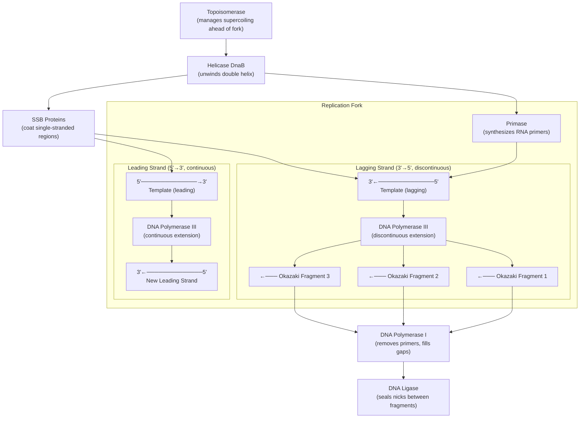

# Lesson 5: Genetic Information Flow

## 1. First-Principles Intuition & Invariants

The central dogma of molecular biology—the directional flow of genetic information from DNA to RNA to protein—represents one of the most profound mechanistic discoveries in twentieth-century science. This information transfer paradigm, first articulated by Francis Crick in 1958 and refined throughout the 1960s, establishes the causal chain linking genotype to phenotype through a series of precisely orchestrated molecular transactions. At its core, genetic information flow obeys thermodynamic imperatives: the system must maintain fidelity while operating under kinetic constraints, balance error correction against metabolic cost, and regulate flux through feedback mechanisms that couple biosynthetic demand to resource availability.

DNA serves as the archive medium, a double-helical polymer whose Watson-Crick base pairing—adenine with thymine, guanine with cytosine—provides both informational redundancy and structural stability. The antiparallel arrangement of sugar-phosphate backbones, with 3' hydroxyl and 5' phosphate termini defining directionality, imposes vectorial constraints on all enzymatic transactions. The B-form helix, with its major and minor grooves, presents sequence-specific recognition surfaces for regulatory proteins while maintaining a uniform diameter of approximately 2 nm. Local deviations from B-form geometry—A-form regions, Z-form left-handed helices, cruciform structures at inverted repeats, and triple-helical H-DNA—emerge from sequence-dependent flexibilities that enzymes exploit for recognition and catalysis.

Topological constraints arising from the closed circular chromosomes of prokaryotes and the enormous contour lengths of eukaryotic chromosomes necessitate active management of superhelical tension. Linking number, a topological invariant defined as $Lk = Tw + Wr$ where $Tw$ represents twist and $Wr$ writhe, remains constant in the absence of strand breakage. Negative supercoiling, maintained by type II topoisomerases that consume ATP to transport one DNA duplex through a transient break in another, facilitates local strand separation required for replication and transcription initiation. The energetic cost of unwinding B-form DNA, approximately 10 kcal/mol per base pair disrupted, establishes a thermodynamic barrier that helicases must overcome through coordinated ATP hydrolysis.

Replication fidelity represents an exquisite optimization problem: the polymerase active site must discriminate correct Watson-Crick base pairs from mismatches while operating at speeds approaching 1000 nucleotides per second. The raw error rate of approximately one mismatch per $10^4$ to $10^5$ incorporations, determined by the free energy difference between correct and incorrect base pairs (roughly 2-4 kcal/mol), proves insufficient for long-term genomic stability. Exonucleolytic proofreading, where the polymerase reverses direction upon mismatch detection and excises the incorrectly incorporated nucleotide, reduces error rates by two to three orders of magnitude. Post-replicative mismatch repair systems provide an additional one to two orders of magnitude improvement, achieving final mutation rates of approximately $10^{-9}$ to $10^{-10}$ per base pair per generation.

The kinetic partitioning between polymerase extension and exonuclease excision depends on the conformational flexibility of the polymerase-DNA complex. Correct base pairs stabilize the polymerase in an extension-competent conformation, with the 3' primer terminus positioned in the polymerase active site. Mismatches destabilize this geometry, increasing the probability of thermal fluctuations that transfer the primer terminus to the spatially distinct exonuclease active site. The ratio of forward polymerization rate to reverse excision rate, modulated by base pair stability, implements a kinetic discrimination mechanism that amplifies thermodynamic selectivity through temporal gating.

Transcription, the synthesis of RNA complementary to a DNA template strand, introduces messenger RNA as an intermediate carrier of genetic information. The transient nature of mRNA—half-lives ranging from minutes to hours in prokaryotes, hours to days in eukaryotes—enables rapid temporal regulation of gene expression without altering the genomic sequence. RNA polymerase, a multi-subunit enzyme complex exceeding 400 kDa in mass, performs template-directed synthesis using nucleoside triphosphates as substrates, releasing pyrophosphate to drive the reaction forward. The thermodynamics of phosphodiester bond formation, with $\Delta G^\circ \approx -3.5$ kcal/mol under physiological conditions, become highly favorable when coupled to pyrophosphate hydrolysis by cellular pyrophosphatases, which contribute an additional $-7$ kcal/mol.

The transcription cycle—initiation, elongation, and termination—imposes distinct mechanistic requirements. Promoter recognition requires sequence-specific DNA binding, typically mediated by sigma factors in prokaryotes or general transcription factors in eukaryotes that position RNA polymerase at transcription start sites. The transition from initiation to elongation involves conformational changes that release promoter-bound factors and establish a stable elongation complex capable of processively synthesizing transcripts thousands of nucleotides in length. Elongation rate, averaging 20-50 nucleotides per second in eukaryotes and up to 85 nucleotides per second in prokaryotes, reflects a balance between catalytic speed and fidelity requirements.

RNA processing in eukaryotes—5' capping, 3' polyadenylation, and splicing—transforms primary transcripts into mature mRNAs competent for translation. The 7-methylguanosine cap, added co-transcriptionally when nascent transcripts reach approximately 25 nucleotides, protects against exonucleolytic degradation and facilitates ribosome recruitment. Polyadenylation, the template-independent addition of adenosine residues to the 3' terminus, similarly enhances stability while regulating mRNA localization and translational efficiency. Splicing, the removal of intervening sequences (introns) and ligation of coding sequences (exons), proceeds through a two-step transesterification mechanism catalyzed by the spliceosome, a massive ribonucleoprotein complex exceeding 4 MDa.

The genetic code, the mapping of 64 possible nucleotide triplets (codons) to 20 amino acids plus termination signals, exhibits redundancy (degeneracy) wherein multiple codons specify the same amino acid. This redundancy follows a pattern: codons differing only in the third position (wobble position) frequently encode the same amino acid, a consequence of relaxed base pairing geometry at the codon-anticodon interface. The near-universality of the genetic code across domains of life—with minor variations in mitochondria, ciliated protozoa, and certain bacteria—provides compelling evidence for common descent and constrains hypotheses regarding the evolutionary origins of translation machinery.

Translation, the ribosome-catalyzed synthesis of polypeptide chains using mRNA as template and transfer RNAs as amino acid adaptors, represents the culminating step in genetic information flow. The ribosome, a two-subunit ribonucleoprotein complex (2.5 MDa in prokaryotes, 4.2 MDa in eukaryotes), contains three tRNA binding sites—aminoacyl (A), peptidyl (P), and exit (E)—that undergo coordinated conformational transitions during each elongation cycle. The catalytic mechanism for peptide bond formation, conclusively demonstrated to be RNA-catalyzed, resides in the peptidyl transferase center of the large ribosomal subunit, where the 23S rRNA (prokaryotes) or 28S rRNA (eukaryotes) positions substrates for nucleophilic attack by the aminoacyl-tRNA α-amino group on the peptidyl-tRNA carbonyl carbon.

Translational fidelity, like replication fidelity, emerges from multi-tiered selectivity mechanisms. Initial selection discriminates cognate from non-cognate aminoacyl-tRNAs through induced-fit conformational changes in the ribosome that occur only upon correct codon-anticodon pairing. GTP hydrolysis by elongation factor EF-Tu (prokaryotes) or eEF1A (eukaryotes) provides an irreversible kinetic checkpoint, rejecting mismatched tRNAs before peptide bond formation. Proofreading after GTP hydrolysis but before peptidyl transfer offers a second opportunity to reject near-cognate tRNAs, achieving overall error rates of approximately $10^{-4}$ per codon—sufficient to maintain functional protein production while tolerating occasional errors that might provide adaptive flexibility under selective pressure.

## 2. Core Architecture & Mechanics

### DNA Structural Organization and Topological Dynamics

The canonical B-form DNA double helix, stabilized in aqueous solution under physiological ionic strength, exhibits a right-handed helical repeat of approximately 10.5 base pairs per turn, corresponding to a helical pitch of 3.4 nm. Each base pair contributes roughly 0.34 nm to the axial rise, with adjacent base pairs rotated 34° relative to one another. The sugar-phosphate backbone, composed of 2'-deoxyribose units linked through phosphodiester bonds connecting the 3' hydroxyl of one sugar to the 5' hydroxyl of the next, carries a net negative charge at physiological pH due to the ionized phosphate groups. This electrostatic burden necessitates neutralization by cations—predominantly Mg²⁺ and polyamines such as spermine and spermidine—which condense DNA structure and modulate its flexibility.

Major and minor grooves present chemically distinct recognition surfaces. The major groove, approximately 2.2 nm wide and 0.85 nm deep, exposes hydrogen bond donors and acceptors from base pairs in a sequence-specific pattern that transcription factors exploit for recognition without disrupting Watson-Crick pairing. The narrower minor groove, approximately 1.2 nm wide and 0.75 nm deep, provides a more uniform topography less readily interpreted for sequence-specific recognition but accessible to minor groove-binding proteins and drugs. Sequence-dependent variations in groove width and depth, arising from differences in base pair stacking energies and propeller twist angles, create recognition codes beyond simple base sequence.

Topological stress accumulates during any process that alters the local winding of the double helix. Replication forks, advancing at speeds up to 1000 base pairs per second, generate positive supercoiling ahead of the fork (overwinding) and negative supercoiling behind (underwinding) if the DNA cannot freely rotate. In a circular chromosome of 4.6 million base pairs such as *Escherichia coli*, complete replication would require approximately 440,000 rotations of the entire chromosome—a physically impossible scenario absent topological management. Type I topoisomerases, which cleave a single DNA strand, allow the intact strand to pass through the break, and religate, relax supercoiling in steps of one linking number unit without ATP expenditure. Type II topoisomerases, including DNA gyrase in bacteria and topoisomerase II in eukaryotes, cleave both strands of one DNA duplex, pass another duplex through the transient gate, and religate in an ATP-dependent reaction that can introduce negative supercoils (gyrase) or relax positive supercoils (topoisomerase II).

The quantitative relationship between linking number and superhelical density provides a framework for understanding topological states. For a relaxed circular DNA molecule, the linking number $Lk_0$ equals the number of helical turns $N$ divided by the helical repeat $h$: $Lk_0 = N/h$. Any deviation from this relaxed state represents supercoiling, quantified by $\Delta Lk = Lk - Lk_0$. The specific linking difference or superhelical density, defined as $\sigma = \Delta Lk / Lk_0$, typically ranges from -0.03 to -0.09 in living cells, corresponding to approximately 3-9% underwinding. This negative supercoiling stores free energy of approximately 10-15 kcal/mol per superhelical turn, providing a thermodynamic reservoir that facilitates local strand separation during transcription initiation and replication origin firing.

### Replication Fork Architecture and Enzymatic Coordination

The replication fork represents a multi-component molecular machine that converts the information encoded in template DNA into two identical daughter duplexes. At the apex of the fork, a hexameric helicase encircles and translocates along one DNA strand, using ATP hydrolysis (approximately 1 ATP per base pair unwound) to disrupt Watson-Crick base pairing and generate single-stranded DNA templates. In prokaryotes, the DnaB helicase forms a ring-shaped structure that translocates 5' to 3' along the lagging strand template, powered by a rotary mechanism wherein sequential ATP binding and hydrolysis events in the six subunits drive conformational changes that pull DNA through the central channel.

Single-stranded DNA binding protein (SSB in prokaryotes, RPA in eukaryotes) immediately coats the exposed single strands, preventing secondary structure formation and protecting against nucleolytic degradation. SSB binds cooperatively with binding site sizes of approximately 65 nucleotides per tetramer, extending the DNA contour length by roughly 50% and reducing the energy penalty for strand separation. The thermodynamic stabilization provided by SSB, quantifiable through DNA melting temperature shifts, contributes an effective $\Delta G$ of approximately -2 to -3 kcal/mol per bound SSB tetramer.

On the leading strand template, continuous DNA synthesis proceeds in the same direction as fork movement, with DNA polymerase maintaining continuous contact with the helicase. The leading strand polymerase extends a single RNA-DNA primer synthesized by primase, incorporating deoxyribonucleoside triphosphates at rates approaching the helicase translocation speed. In prokaryotic systems, DNA polymerase III holoenzyme, with a processivity exceeding 500,000 nucleotides per binding event, achieves this continuity through association with the β-clamp, a circular sliding clamp protein that encircles DNA and tethers the polymerase core to the template.

Lagging strand synthesis, proceeding opposite to fork movement, must occur discontinuously in short segments (Okazaki fragments: 1000-2000 nucleotides in prokaryotes, 100-200 nucleotides in eukaryotes). Primase synthesizes short RNA primers at intervals, each approximately 10 nucleotides long, providing the 3' hydroxyl terminus required for polymerase extension. DNA polymerase III extends each primer until encountering the 5' terminus of the preceding fragment. Polymerase exchange, mediated by clamp loader complexes that couple ATP hydrolysis to clamp opening and closing, enables rapid cycling of polymerases between completed and newly primed fragments. The result is a trombone-like looping of lagging strand template that maintains spatial coupling between leading and lagging strand polymerases within a dimeric replisome architecture.

Primer removal and fragment ligation complete lagging strand maturation. In prokaryotes, the 5' to 3' exonuclease activity of DNA polymerase I removes ribonucleotides as the polymerase extends the upstream fragment in a process termed nick translation. In eukaryotes, RNase H and FEN1 (flap endonuclease 1) perform sequential cleavages to remove primers. DNA ligase catalyzes phosphodiester bond formation between adjacent fragments, consuming ATP (prokaryotes use NAD⁺-dependent ligases; eukaryotes use ATP-dependent ligases) to drive the thermodynamically unfavorable ligation reaction. The ligase mechanism proceeds through a covalent enzyme-AMP intermediate, transfers AMP to the 5' phosphate terminus, and resolves the activated intermediate through nucleophilic attack by the 3' hydroxyl to form the sealed phosphodiester bond.

### Transcription Initiation and Promoter Recognition

Transcription initiation in prokaryotes begins with RNA polymerase holoenzyme—core enzyme (α₂ββ'ω) bound to a sigma factor—scanning DNA for promoter sequences. The σ⁷⁰ sigma factor, the predominant specificity determinant in *E. coli*, recognizes two conserved hexameric sequences: the -10 box (Pribnow box, consensus TATAAT) and the -35 box (consensus TTGACA), separated by approximately 17 base pairs. The thermodynamic penalty for DNA bending required to simultaneously contact both elements contributes specificity, as only appropriately spaced and oriented motifs allow productive polymerase binding.

Closed complex formation, the initial recognition state, positions polymerase on duplex DNA without strand separation. Transition to open complex involves localized melting of approximately 13 base pairs around the transcription start site, creating a transcription bubble within which the template strand becomes accessible to the polymerase active site. The energetic cost of this melting, typically 100-150 kcal/mol, is offset by the intrinsic flexibility of AT-rich -10 box sequences (A-T base pairs require less energy to disrupt than G-C pairs) and conformational changes in the polymerase that stabilize the unwound state. Isomerization energy landscapes, characterized by multiple intermediate states, reflect the complex choreography of DNA unwinding coupled to polymerase conformational transitions.

RNA polymerase initiates synthesis by forming the first phosphodiester bond between two nucleoside triphosphates aligned on the template strand, without requiring a primer. Abortive initiation, the synthesis and release of short transcripts (2-9 nucleotides), occurs repeatedly until the polymerase escapes the promoter. Promoter escape, triggered when the nascent transcript reaches approximately 10 nucleotides, involves structural rearrangements that break polymerase-promoter contacts, release the sigma factor, and establish a stable elongation complex. The transition from initiation to elongation represents a kinetic checkpoint: strong promoters allow rapid escape, while weak promoters exhibit prolonged abortive cycling that reduces effective transcription rates.

In eukaryotes, RNA polymerase II (Pol II) transcribes protein-coding genes through a mechanism requiring multiple general transcription factors (GTFs) and a core promoter architecture more complex than prokaryotic promoters. The TATA box, located approximately 25-30 base pairs upstream of the transcription start site in TATA-containing promoters, recruits TATA-binding protein (TBP), a component of the TFIID complex. TBP binding induces severe DNA bending (approximately 90°), widening the minor groove and providing a platform for assembly of additional factors. TFIIB binds downstream of TBP, contacting BRE (TFIIB recognition element) sequences and recruiting Pol II through direct protein-protein interactions. TFIIF stabilizes the Pol II-TFIIB-TFIID assembly, while TFIIE and TFIIH complete pre-initiation complex formation.

TFIIH, a multi-subunit complex with ATP-dependent helicase and kinase activities, plays dual roles in transcription initiation. Its XPB and XPD helicase subunits catalyze promoter melting, unwinding DNA around the start site to create the transcription bubble. Simultaneously, the kinase subunit (CDK7 in humans) phosphorylates the C-terminal domain (CTD) of Pol II's largest subunit, triggering promoter clearance and transition to productive elongation. The CTD, consisting of tandem heptapeptide repeats (YSPTSPS), serves as a dynamic signaling platform whose phosphorylation state recruits RNA processing machinery co-transcriptionally.

### Elongation Complex Dynamics and Fidelity Mechanisms

The transcription elongation complex, a highly stable nucleoprotein assembly, maintains a transcription bubble of approximately 8-9 unwound base pairs as it translocates along the DNA template. The RNA-DNA hybrid, typically 8-9 base pairs in length, occupies the polymerase active site channel, with the growing RNA 3' terminus positioned for incoming nucleotide addition. Behind the polymerase, nascent RNA emerges through an exit channel and spontaneously dissociates from the template strand, allowing the DNA duplex to re-anneal. This trailing re-annealing, coupled with DNA unwinding ahead of the polymerase, drives a net translocation that advances the enzyme without requiring major conformational changes in the DNA-RNA scaffold.

Elongation rate, while averaging 20-50 nucleotides per second, exhibits significant heterogeneity reflecting sequence-dependent pausing. Intrinsic pauses, lasting seconds to tens of seconds, occur at sequences that stabilize polymerase backtracking or hairpin formation in the nascent RNA. These pauses provide temporal windows for regulatory factors to access the elongation complex, coupling transcription kinetics to RNA processing, chromatin remodeling, and DNA repair. Elongation factors such as prokaryotic NusA or eukaryotic DSIF modulate pause duration and frequency, tuning transcription dynamics to cellular requirements.

Transcriptional fidelity, while lower than replication fidelity (error rates of approximately $10^{-4}$ to $10^{-5}$ per nucleotide), suffices for RNA's transient role. The polymerase active site discriminates correct from incorrect base pairs through induced-fit conformational changes analogous to those in replicative polymerases: correct Watson-Crick geometry triggers active site closure, aligning catalytic residues and activating nucleotidyl transfer. Misincorporation destabilizes this catalytically competent state, slowing the reaction and increasing the probability of proofreading. RNA polymerase proofreading involves endonucleolytic cleavage of the nascent transcript, excising a short 3' segment containing the mismatch. Transcript cleavage factors such as GreA and GreB (prokaryotes) or TFIIS (eukaryotes) stimulate this intrinsic cleavage activity by accessing the polymerase active site through a pore and stabilizing a catalytic conformation competent for hydrolysis.

### RNA Processing: Splicing Mechanism and Fidelity

Pre-mRNA splicing in eukaryotes removes introns through two sequential transesterification reactions that require no external energy input, relying instead on the inherent chemical reactivity of phosphodiester bonds. The first transesterification attack occurs when the 2' hydroxyl of a conserved adenosine residue within the intron (the branch point, typically 20-50 nucleotides upstream of the 3' splice site) performs nucleophilic substitution on the phosphodiester bond at the 5' splice site. This reaction cleaves the 5' exon-intron junction and forms a 2'-5' phosphodiester bond, creating a lariat intermediate in which the intron is circularized. The second transesterification, performed by the 3' hydroxyl of the liberated 5' exon attacking the 3' splice site phosphodiester, ligates the exons and releases the intron lariat for degradation.

The spliceosome, the molecular machine catalyzing these reactions, assembles de novo on each intron through an ordered pathway of small nuclear ribonucleoprotein (snRNP) recruitment and conformational maturation. U1 snRNP recognizes the 5' splice site through base pairing between U1 snRNA and the splice site consensus sequence (GU at the intron boundary). U2 snRNP identifies the branch point, with U2 snRNA base pairing to sequences flanking the reactive adenosine, bulging the nucleophile into a conformation poised for attack. The U4/U6.U5 tri-snRNP joins subsequently, with U5 snRNA positioning exon boundaries and U6 snRNA displacing U1 at the 5' splice site. Major conformational rearrangements, including U4 release and formation of the catalytic U2-U6 snRNA helix, activate the spliceosome for chemistry.

The spliceosome active site, structurally analogous to group II self-splicing intron active sites, positions reactive groups for transesterification through RNA-RNA interactions and coordination of divalent metal ions (likely Mg²⁺). The catalytic mechanism, proceeding through transition states stabilized by metal coordination and general acid-base catalysis, demonstrates RNA's capacity to perform complex chemistry. Splicing fidelity, estimated at error rates below $10^{-5}$ per splice junction, arises from multi-tiered selectivity: initial splice site recognition by snRNPs, proofreading mechanisms that discard incorrectly assembled spliceosomes before catalysis, and kinetic competition between splicing and spliceosome disassembly that favors correct substrates.

Alternative splicing, wherein a single pre-mRNA generates multiple mRNA isoforms through differential exon inclusion or splice site selection, exponentially expands proteomic diversity. Splicing regulators—SR proteins that promote exon inclusion through binding to exonic splicing enhancers, and hnRNPs that enforce exon skipping through silencer binding—modulate spliceosome assembly kinetics in response to developmental cues, tissue-specific programs, and signaling pathways. The combinatorial logic of these regulators, integrated across multiple binding sites spanning hundreds of nucleotides, implements a code that specifies which splice sites are recognized in a given cellular context.

### Ribosome Structure and Peptidyl Transferase Mechanism

The ribosome's two-subunit architecture—small (30S in prokaryotes, 40S in eukaryotes) and large (50S in prokaryotes, 60S in eukaryotes)—reflects functional specialization. The small subunit binds mRNA and monitors codon-anticodon interactions at the decoding center, ensuring translational fidelity. The large subunit harbors the peptidyl transferase center, the catalytic site for peptide bond formation, and provides the exit tunnel through which nascent polypeptides emerge. High-resolution crystal structures, refined to near-atomic resolution, reveal that ribosomal RNA forms the structural and catalytic core, with ribosomal proteins occupying predominantly peripheral positions and stabilizing RNA tertiary structure.

The three tRNA binding sites—A (aminoacyl), P (peptidyl), and E (exit)—span both subunits, with anticodon stem-loops binding in the small subunit and acceptor stems (bearing amino acids or nascent polypeptides) binding in the large subunit. During each elongation cycle, an aminoacyl-tRNA•EF-Tu•GTP ternary complex samples the A site. Correct codon-anticodon pairing at the small subunit decoding center triggers a conformational change that positions three universally conserved 16S rRNA nucleotides (A1492, A1493, and G530 in prokaryotic numbering) to form stabilizing interactions specifically with Watson-Crick geometry. This induced fit stabilizes the ternary complex, increasing GTP hydrolysis probability. Following GTP hydrolysis and EF-Tu release, the aminoacyl-tRNA accommodates into the A site, positioning its aminoacyl ester for peptidyl transfer.

The peptidyl transferase reaction, formation of a peptide bond between the P-site peptidyl-tRNA and A-site aminoacyl-tRNA, proceeds through nucleophilic attack by the A-site α-amino group on the P-site ester carbonyl. The ribosome does not employ protein-based acid-base catalysis; instead, 23S rRNA nucleotides in the peptidyl transferase center position substrates with exquisite precision, enforcing a geometry that lowers the activation barrier for ester aminolysis. The transition state, stabilized by hydrogen bonding interactions with 23S rRNA 2' hydroxyls and precise electrostatic preorganization of the active site, achieves rate enhancements exceeding $10^6$-fold over uncatalyzed peptide bond formation. The ribosome thus functions as an entropy trap, reducing the configurational space of substrates to conformations proximal to the reaction coordinate.

Following peptide bond formation, the tRNAs occupy hybrid binding states: P/E (P site in the small subunit, E site in the large subunit) and A/P (A site in the small subunit, P site in the large subunit). EF-G (prokaryotes) or eEF2 (eukaryotes), a GTPase structurally mimicking the aminoacyl-tRNA•EF-Tu complex, binds the A site and catalyzes translocation. GTP hydrolysis drives large-scale ribosome conformational changes that advance mRNA by precisely three nucleotides, resetting tRNAs into canonical A, P, and E sites and positioning the next codon in the A site for decoding. The deacylated tRNA in the E site dissociates, completing the cycle and preparing the ribosome for the next aminoacyl-tRNA binding event.

### Translational Fidelity and Proofreading Checkpoints

Translational accuracy, maintained at error rates of approximately $10^{-4}$ per codon, results from two sequential selection mechanisms that discriminate cognate from non-cognate aminoacyl-tRNAs. Initial selection, occurring before GTP hydrolysis by EF-Tu, exploits the kinetic partitioning between correct and incorrect codon-anticodon complexes. Cognate tRNAs stabilize the decoding center in a closed conformation that accelerates EF-Tu's GTPase activity, committing the ternary complex to the hydrolysis pathway. Near-cognate tRNAs, differing by a single base pair, induce decoding center closure less efficiently, reducing GTP hydrolysis rates by approximately 100-fold and increasing dissociation probabilities.

GTP hydrolysis by EF-Tu represents an irreversible commitment step, consuming approximately 12 kcal/mol of free energy (under physiological GTP and GDP concentrations). This energy investment creates a kinetic barrier that separates pre-hydrolysis (initial selection) from post-hydrolysis (proofreading) states. Following hydrolysis, EF-Tu undergoes conformational changes that reduce its affinity for aminoacyl-tRNA, releasing the tRNA for accommodation into the A site. Near-cognate tRNAs, less stabilized by codon-anticodon interactions, exhibit higher dissociation probabilities during this proofreading phase, providing a second opportunity for rejection before peptide bond formation.

The ribosome thus implements a Hopfield proofreading mechanism wherein two selection steps, separated by an irreversible GTP hydrolysis event, amplify fidelity beyond the equilibrium discrimination achievable in a single selection step. The mathematical framework for this amplification predicts an error rate: 

$$\varepsilon \approx \varepsilon_0^2 / \left(1 + k_{\text{proof}} / k_{\text{chem}}\right)$$

where $\varepsilon_0$ represents the intrinsic equilibrium error rate (approximately $10^{-2}$ based on free energy differences), and the ratio of proofreading to chemistry rates modulates the final fidelity. Experimental measurements confirm error rates of approximately $10^{-4}$, consistent with two sequential selection steps each achieving roughly 100-fold discrimination.

Aminoacyl-tRNA synthetases, the enzymes that charge tRNAs with cognate amino acids, implement their own proofreading mechanisms to ensure correct amino acid attachment. The charging reaction proceeds through an aminoacyl-adenylate intermediate: ATP reacts with an amino acid to form aminoacyl-AMP plus pyrophosphate, then the activated amino acid transfers to the tRNA 3' terminal adenosine. Synthetases discriminate among amino acids primarily through steric complementarity in the active site, but this selectivity proves insufficient for closely related amino acids such as valine and threonine or isoleucine and valine, which differ by only a single methyl or hydroxyl group.

Pre-transfer editing, occurring at the aminoacylation active site, hydrolyzes incorrect aminoacyl-adenylates before transfer to tRNA. Post-transfer editing, occurring at a distinct editing site that sterically excludes the cognate amino acid but accommodates smaller non-cognate amino acids, hydrolyzes mischarged aminoacyl-tRNAs. These editing mechanisms reduce charging error rates to below $10^{-4}$ per aminoacylation event, ensuring that the aminoacyl-tRNA pool entering translation maintains high fidelity. The combined selectivity of aminoacyl-tRNA synthetases and the ribosome decoding center produces overall translational error rates—including both mischarging and misdecoding—of approximately $10^{-4}$ per incorporated amino acid.

## 3. High-Performance Optimization & Failure Modes

### Experimental Workflow: DNA Isolation and Quantitative Topology Analysis

High-quality genomic DNA isolation from bacterial cultures begins with cell lysis under conditions that preserve topological integrity. Harvest mid-log phase cultures by centrifugation at 5000 × g for 10 minutes at 4°C. Resuspend the cell pellet in lysis buffer containing 50 mM Tris-HCl pH 8.0, 10 mM EDTA, and 100 μg/mL RNase A to degrade contaminating RNA. Add lysozyme to 1 mg/mL and incubate at 37°C for 30 minutes to digest peptidoglycan. Subsequent addition of SDS to 0.5% and proteinase K to 100 μg/mL, followed by incubation at 50°C for 1 hour, degrades proteins and releases DNA from protein-DNA complexes. Crucially, avoid excessive mechanical shearing during pipetting or vortexing, as such forces fragment high-molecular-weight genomic DNA and obscure topological analysis.

Extract DNA by phenol-chloroform extraction: add an equal volume of phenol:chloroform:isoamyl alcohol (25:24:1), mix gently by inversion, and centrifuge at 12000 × g for 10 minutes. Transfer the aqueous phase to a fresh tube, add 0.1 volumes of 3 M sodium acetate pH 5.2 and 2 volumes of ice-cold 100% ethanol, mix gently, and precipitate DNA by centrifugation at 12000 × g for 20 minutes at 4°C. Wash the pellet twice with 70% ethanol, air dry briefly, and resuspend in TE buffer (10 mM Tris-HCl pH 8.0, 1 mM EDTA). Quantify DNA concentration spectrophotometrically at 260 nm, confirming purity by verifying that the A260/A280 ratio falls between 1.8 and 2.0.

To resolve topoisomers and quantify superhelical density, perform agarose gel electrophoresis under conditions that separate DNA based on linking number. Prepare 1% agarose gels in TAE buffer (40 mM Tris-acetate, 1 mM EDTA) containing chloroquine at concentrations ranging from 0 to 10 μg/mL. Chloroquine, a DNA intercalator, unwinds the helix by approximately 26° per bound molecule, altering the superhelical distribution. Load identical DNA samples into lanes containing different chloroquine concentrations and electrophorese at 2-3 V/cm for 12-16 hours at 4°C to maintain constant temperature and minimize thermal relaxation. Stain gels with ethidium bromide and photograph under UV illumination. Supercoiled topoisomers migrate as discrete bands, with more highly negatively supercoiled forms migrating faster than relaxed forms in the absence of intercalator. As chloroquine concentration increases, migration order inverts when the intercalator-induced unwinding compensates for native negative supercoiling.

Quantify superhelical density by analyzing migration patterns. The chloroquine concentration at which a topoisomer migrates most slowly corresponds to its relaxed state (zero supercoiling under that intercalator concentration). By plotting relative mobility versus chloroquine concentration for each topoisomer, construct a titration curve whose minimum identifies the relaxation point. The shift in this minimum relative to the untreated control quantifies $\Delta Lk$. For a plasmid of known base pair length, calculate $\sigma = \Delta Lk / (N / 10.5)$, where $N$ is the number of base pairs and 10.5 represents the helical repeat in relaxed B-form DNA.

### Polymerase Chain Reaction Optimization and Kinetic Parameter Extraction

Polymerase chain reaction (PCR) amplifies specific DNA sequences through iterative cycles of denaturation, primer annealing, and extension. Optimize reaction conditions to balance amplification efficiency, specificity, and fidelity. Begin with a standard reaction mixture: template DNA (typically 10-100 ng for genomic DNA or $10^3$-$10^6$ copies for plasmid templates), forward and reverse primers (200-500 nM each), dNTPs (200 μM each), thermostable DNA polymerase (0.5-2.5 units), polymerase buffer containing Mg²⁺ (typically 1.5-2.5 mM optimized for the specific polymerase), and sterile water to a final volume of 25-50 μL. Overlay reactions with mineral oil if using a thermal cycler without a heated lid to prevent evaporation.

Design primers with melting temperatures ($T_m$) between 55-65°C, calculated using nearest-neighbor thermodynamic parameters: 

$$T_m = \frac{\Delta H^\circ}{\Delta S^\circ + R \ln(c)} - 273.15$$

where $\Delta H^\circ$ and $\Delta S^\circ$ represent the sum of nearest-neighbor enthalpy and entropy contributions, $R$ is the gas constant, and $c$ is the primer concentration (in molar). Ensure that forward and reverse primers have similar $T_m$ values (within 5°C) to enable simultaneous annealing. Avoid primer self-complementarity, particularly at 3' termini, to minimize primer-dimer formation. Screen primers computationally for specificity against the target genome using BLAST or similar tools, ensuring that no significant off-target binding sites exist.

Thermal cycling parameters profoundly influence amplification efficiency and specificity. Initial denaturation at 94-98°C for 2-5 minutes denatures template DNA and activates hot-start polymerases that require thermal activation. Cycling typically consists of 25-35 iterations of: (1) denaturation at 94-98°C for 15-30 seconds to separate template strands; (2) annealing at a temperature 3-5°C below primer $T_m$ for 15-30 seconds to allow primer hybridization; (3) extension at 68-72°C (depending on polymerase optimum) for a duration determined by amplicon length and polymerase processivity (typically 1 minute per kilobase for Taq polymerase, 15-30 seconds per kilobase for high-processivity enzymes). A final extension at 72°C for 5-10 minutes ensures complete synthesis of all amplicons.

High-fidelity polymerases, possessing 3' to 5' exonuclease proofreading activity, reduce error rates from approximately $10^{-4}$ per nucleotide per cycle (Taq polymerase) to $10^{-6}$ or lower (e.g., Pfu, Q5, Phusion polymerases). The tradeoff is reduced processivity and extension rate: proofreading polymerases synthesize approximately 15-30 nucleotides per second compared to 60-150 nucleotides per second for non-proofreading Taq. For cloning applications requiring sequence fidelity, use proofreading polymerases despite longer extension times. For applications tolerating higher error rates, such as screening or diagnostic PCR, Taq suffices and offers cost savings.

Quantitative PCR (qPCR) extends PCR to enable real-time monitoring of amplification kinetics, providing quantitative information about initial template abundance. Fluorescent reporters—either intercalating dyes such as SYBR Green that bind any double-stranded DNA, or sequence-specific probes labeled with fluorophore-quencher pairs—emit signals proportional to amplicon concentration. Plot fluorescence versus cycle number to generate amplification curves. The threshold cycle ($C_t$ or $C_q$), defined as the cycle at which fluorescence exceeds a fixed threshold above background, correlates inversely with initial template quantity. Construct standard curves by amplifying serial dilutions of template with known copy numbers, plotting $C_t$ versus $\log(\text{copy number})$, and fitting a linear model. Use this standard curve to quantify unknown samples by interpolation.

### In Vitro Transcription and RNA Yield Optimization

In vitro transcription systems, employing purified bacteriophage RNA polymerases (T7, T3, or SP6), synthesize large quantities of RNA from linearized plasmid or PCR-generated templates containing the appropriate promoter sequence. T7 RNA polymerase, the most widely used, recognizes a 17-nucleotide promoter sequence (5'-TAATACGACTCACTATAG-3') with extraordinary specificity, initiating transcription at the +1 position immediately following the promoter. Design templates to position the desired RNA sequence directly downstream of the T7 promoter, ensuring that the +1 nucleotide is a purine (G or A) for optimal initiation efficiency.

Template preparation critically influences transcription yield. Linearize plasmid templates by restriction digestion at a site immediately downstream of the insert to prevent readthrough transcription that generates heterogeneous products. Verify complete digestion by agarose gel electrophoresis, confirming conversion of supercoiled plasmid to a single linear band. Purify digested DNA by phenol-chloroform extraction or column-based methods, removing enzymes and buffer components that might inhibit polymerase. Alternatively, generate templates by PCR, incorporating the T7 promoter sequence at the 5' end of the forward primer. PCR templates eliminate cloning steps but require higher template input (typically 0.5-1 μg per 20 μL reaction) due to lower transcription efficiency.

Assemble transcription reactions containing linearized template (0.5-1 μg), T7 RNA polymerase (20-50 units), NTPs (2.5 mM each ATP, CTP, GTP, UTP), transcription buffer (typically 40 mM Tris-HCl pH 7.9, 6 mM MgCl₂, 10 mM DTT, 2 mM spermidine), and RNase inhibitor (20-40 units) to prevent RNA degradation. Incubate at 37°C for 2-4 hours. For maximal yields, add pyrophosphatase (0.01 units/μL) to hydrolyze released pyrophosphate and drive the reaction forward thermodynamically. Monitor reactions by removing aliquots at hourly intervals, quenching with EDTA, and analyzing by denaturing agarose or polyacrylamide gel electrophoresis. Transcription yields typically reach 10-50 μg RNA per μg template, depending on template quality, promoter strength, and transcript length.

Incorporate modified nucleotides (pseudouridine, 5-methylcytidine, N6-methyladenosine) by substituting modified NTPs for native NTPs at defined ratios. Modifications reduce immunogenicity of transcribed RNA for therapeutic applications and can alter RNA stability, folding, and protein interactions. Optimize modification ratios empirically: complete substitution (100% modified NTP) maximally suppresses immune recognition but may impair translation or folding, while partial substitution (25-50%) balances modification benefits against functional preservation. Purify transcribed RNA by DNase I digestion (37°C for 15 minutes) to remove template, followed by lithium chloride precipitation (2.5 M LiCl, 4°C overnight) or column-based purification. Verify RNA integrity by denaturing gel electrophoresis, confirming a single band at the expected size without degradation smears.

### Ribosome Profiling: Genome-Wide Translation Mapping

Ribosome profiling (Ribo-seq) globally maps ribosome positions on mRNAs, providing nucleotide-resolution snapshots of active translation. The technique exploits the protective footprint of ribosomes: mRNA regions occupied by translating ribosomes resist nuclease digestion, generating protected fragments (ribosome-protected fragments, RPFs) of approximately 28-30 nucleotides. Deep sequencing of RPFs reveals which mRNAs are translated, at what levels, and where ribosomes pause.

Begin with rapidly growing cells or tissues of interest. Ribosome positions must be fixed by adding translation elongation inhibitors (cycloheximide, 100 μg/mL for mammalian cells; chloramphenicol, 100 μg/mL for bacteria) directly to culture media or by flash-freezing in liquid nitrogen. Cycloheximide stabilizes elongating ribosomes by blocking the translocation step, preventing ribosome runoff that would otherwise occur during cell harvesting and lysis. Harvest cells immediately by centrifugation or filtration, wash once with ice-cold PBS containing inhibitor, and flash-freeze pellets.

Lyse cells in polysome lysis buffer (20 mM Tris-HCl pH 7.4, 150 mM NaCl, 5 mM MgCl₂, 1 mM DTT, 1% Triton X-100, 100 μg/mL cycloheximide, protease inhibitors) on ice. Clarify lysates by centrifugation at 20000 × g for 10 minutes at 4°C, removing cell debris and nuclei. Measure RNA concentration spectrophotometrically, normalizing all samples to equivalent RNA input. Treat lysates with RNase I (100-500 units per 10-20 A₂₆₀ units of lysate) at room temperature for 45-60 minutes with gentle rotation to digest mRNA not protected by ribosomes. Titrate RNase I concentration empirically to achieve optimal digestion: insufficient nuclease leaves long undigested mRNA fragments, while excess degrades RPFs. Quench digestion by adding SUPERase•In RNase inhibitor to 100 units/mL.

Isolate ribosome-mRNA complexes by sucrose cushion ultracentrifugation or size-exclusion chromatography. For cushion purification, layer digested lysate over 1 M sucrose in ribosome buffer (20 mM Tris-HCl pH 7.4, 150 mM NaCl, 5 mM MgCl₂, 1 mM DTT, 100 μg/mL cycloheximide) and centrifuge at 70000 rpm for 4 hours at 4°C in a TLA-110 rotor or equivalent. Ribosomes pellet through the sucrose cushion, sedimenting away from free RNA and protein contaminants. Resuspend ribosome pellets in 10 mM Tris-HCl pH 7.0, extract RNA by hot acidic phenol, and precipitate overnight with ethanol.

Prepare sequencing libraries from purified RPFs using small RNA library construction protocols. Perform size selection by denaturing polyacrylamide gel electrophoresis, excising gel slices corresponding to 28-30 nucleotide fragments. Dephosphorylate RPF 3' ends with T4 polynucleotide kinase lacking ATP to remove terminal phosphates left by RNase I digestion. Ligate 3' adapters, reverse transcribe with primers specific to the adapter, circularize cDNA, and PCR amplify using primers that add sequencing adapters and barcodes. Deep sequence on Illumina or equivalent platforms, generating 20-50 million reads per sample for mammalian transcriptomes, adjusted for transcriptome complexity.

Align sequencing reads to the reference genome or transcriptome, assigning ribosome positions by mapping the ribosome P-site to a fixed offset (typically +12 to +15 nucleotides from the 5' end of the read, determined empirically from start codon alignments). Generate ribosome density profiles for each mRNA, plotting reads per nucleotide position. Calculate translation efficiency as the ratio of ribosome density (RPF reads) to mRNA abundance (from parallel RNA-seq), normalizing for gene length. Identify translated open reading frames, including non-canonical upstream ORFs (uORFs) and polycistronic messages, by searching for ribosome density peaks with characteristic triplet periodicity reflecting codon-by-codon translocation.

### Failure Mode Analysis: Replication Stress and Genome Instability

Replication fork stalling, a common failure mode, arises from DNA lesions, secondary structures, protein-DNA barriers, or nucleotide depletion. Stalled forks risk collapse into double-strand breaks if not properly managed. Cells employ multiple pathways to stabilize stalled forks and promote replication restart. The replisome includes fork protection factors—proteins such as Timeless-Tipin (mammalian) or Tof1-Csm3 (yeast)—that stabilize polymerase-helicase coupling and prevent uncoupling that would leave extensive single-stranded gaps vulnerable to nucleolytic degradation.

When forks encounter insurmountable barriers, homologous recombination proteins stabilize the fork and mediate template switching mechanisms that bypass lesions. Fork reversal, the regression of the fork to form a four-way Holliday junction-like structure, protects nascent DNA and facilitates lesion bypass. Structure-specific nucleases, including Mus81-Eme1 and the SLX1-SLX4 complex, process reversed forks and stalled replication intermediates, generating substrates for homologous recombination repair. Nuclease hyperactivity, however, produces pathological fork degradation, particularly in BRCA-deficient cells where protective mechanisms fail.

Replication-transcription conflicts, occurring when replication forks collide with RNA polymerase elongation complexes, represent intrinsic sources of replication stress. Head-on collisions, where replication and transcription proceed in opposite directions, prove more deleterious than co-directional encounters. The resulting fork stalling activates checkpoint kinases—ATR in eukaryotes—that phosphorylate effector proteins to slow cell cycle progression, stabilize forks, and suppress origin firing. Experimental detection of replication stress employs DNA fiber assays: pulse-label cells sequentially with halogenated nucleotide analogs (CldU, then IdU), spread DNA fibers on microscope slides, and immunostain with analog-specific antibodies to visualize replication tracks. Shortened track lengths, asymmetric fork progression, or increased fork stalling frequencies diagnose replication stress.

Transcriptional infidelity, while less catastrophic than replication errors due to RNA's transience, can produce aberrant protein isoforms that impair cellular function. RNA polymerase backtracking, in which the enzyme reverses direction without dissociating, extrudes the nascent transcript 3' end from the active site, rendering it inert for nucleotide addition. Prolonged backtracking arrests transcription, triggering recruitment of termination factors or ubiquitin ligases that mark the polymerase for degradation. Transcript cleavage factors rescue backtracked polymerases by stimulating endonucleolytic cleavage of the extruded RNA, regenerating a 3' hydroxyl within the active site and allowing elongation to resume.

Translational frameshifting, a low-frequency error mode wherein ribosomes shift reading frame during elongation, produces truncated or aberrantly extended proteins. Programmed frameshifting, exploited by viruses and some cellular genes, occurs at specific "slippery" sequences (e.g., XXXYYYZ, where ribosomes slip from XXX-YYY-Z to XX-XYY-YZ) followed by downstream RNA structures (pseudoknots, stem-loops) that pause the ribosome. Non-programmed frameshifting, a translational error occurring at approximately $10^{-5}$ per codon, results from tRNA slippage or misreading. Quality control mechanisms detect aberrantly translated proteins through nascent chain-associated complexes and target misfolded products for proteasomal degradation. Ribosome stalling on problematic mRNAs triggers ribosome-associated quality control (RQC), recruiting E3 ubiquitin ligases that ubiquitinate the nascent chain and mark it for degradation, while endonucleases cleave the problematic mRNA.

The fidelity-speed tradeoff permeates genetic information flow: increasing accuracy demands slower kinetics and greater energetic expenditure, while accelerating synthesis risks increased errors. Evolutionary optimization has converged on error rates that balance genomic integrity against the metabolic costs of proofreading. For DNA replication, error rates of $10^{-9}$ to $10^{-10}$ ensure stable inheritance across thousands of generations while permitting rare mutations that fuel adaptation. For translation, error rates of $10^{-4}$ accept occasional protein misfolds as the price of rapid biosynthetic output, relying on post-translational quality control to manage defective products. Understanding these tradeoffs informs biotechnological applications: high-fidelity polymerases for cloning and sequencing, balanced against fast polymerases for diagnostic amplification; engineered ribosomes with altered decoding stringency for non-canonical amino acid incorporation; and synthetic biology constructs that deliberately tune error rates to explore fitness landscapes.
