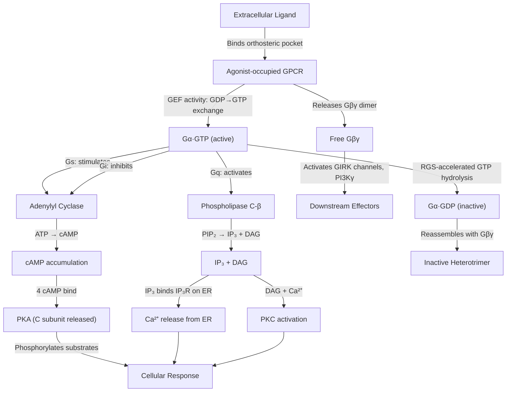
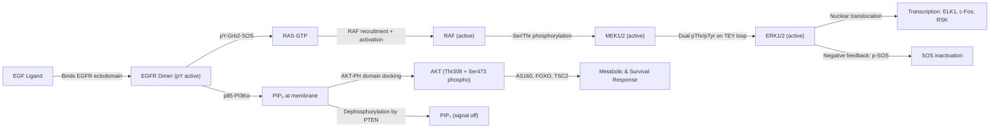

# Lesson 6: Signal Transduction Architectures

## 1. First-Principles Intuition & Invariants

Every living cell exists in a state of perpetual negotiation with its environment. Nutrients appear and vanish, oxygen partial pressures fluctuate, neighboring cells broadcast molecular distress signals, and hormones arrive from tissues located centimeters away across a circulatory highway. The cell must interpret all of this simultaneously, integrate the information, and mount a coherent biochemical response — often within milliseconds for electrical signals in neurons, or within minutes to hours for gene expression changes in hepatocytes. The molecular machinery that performs this feat is collectively called signal transduction: the conversion of an extracellular chemical event into an intracellular biochemical state change.

The word "transduction" is borrowed from physics, where it describes the conversion of energy from one form to another. The analogy is precise. A ligand binding to a receptor carries chemical potential energy in the form of favorable non-covalent interactions — hydrogen bonds, van der Waals contacts, hydrophobic burial. That energy is transduced into a conformational change in the receptor protein, which is then amplified through enzymatic cascades, diffusion of second messengers, and cooperative binding events, ultimately driving work: activating a transcription factor, opening an ion channel, or initiating vesicle fusion. The entire system operates as a molecular signal processor, and understanding it requires the same analytical instincts one brings to any physical transducer: sensitivity, dynamic range, noise rejection, and amplification gain.

### The Fundamental Invariant: Molecular Recognition and Conformational Change

At every node in a signaling pathway, the same molecular event recurs. A protein in a low-activity conformation encounters a ligand — another protein, a small molecule, a phosphate group, a metal ion — and the resulting binding energy drives a conformational change that exposes or buries a functional surface. This is not a metaphor but a physical reality measurable by X-ray crystallography, cryo-electron microscopy, and hydrogen-deuterium exchange mass spectrometry. The inactive form of a G protein-coupled receptor (GPCR), for instance, maintains its transmembrane helices in a configuration that sterically occludes the intracellular binding site for heterotrimeric G proteins. Agonist binding — which buries hydrophobic ligand surfaces against the orthosteric pocket deep within the transmembrane bundle — induces a ~14 Å outward displacement of transmembrane helix 6 (TM6), exposing a cytoplasmic cavity of approximately 1,000 Ų that accommodates the C-terminal alpha-5 helix of the Gα subunit. Every subsequent amplification event in the cascade has this same character: a binding event drives a conformational change that creates a new binding surface or catalytic active site.

The thermodynamic invariant governing all of this is the Gibbs free energy of activation. For any signaling reaction to proceed at a physiologically useful rate, the activation barrier must be surmountable at 310 K. This is why cells rely almost exclusively on enzymatic catalysis — particularly protein kinases and phosphatases — rather than spontaneous chemical reactions for signal propagation. The phosphorylation of a serine residue by protein kinase A (PKA) lowers the apparent $\Delta G^\ddagger$ of downstream enzyme activation by providing the electrostatic reorganization energy that the substrate alone cannot supply.

Formally, the relationship between signal velocity and thermodynamics is captured through transition state theory. The rate constant $k$ for a phosphoryl transfer step is:

$$k = \frac{k_B T}{h} \exp\!\left(-\frac{\Delta G^\ddagger}{RT}\right)$$

where $k_B$ is Boltzmann's constant, $h$ is Planck's constant, $T$ is absolute temperature, $R$ is the universal gas constant, and $\Delta G^\ddagger$ is the Gibbs activation energy. The catalytic power of a kinase lies in its ability to reduce $\Delta G^\ddagger$ by positioning the $\gamma$-phosphate of ATP and the hydroxyl nucleophile of the substrate in near-attack geometry, stabilized by two Mg²⁺ ions that neutralize the negative charge developing on the phosphate oxygens in the transition state.

### Receptor Classes: A Physical Taxonomy

Receptors are classified not by their ligands but by their signaling mechanism, which is to say, by the physical mechanism of transduction. This distinction matters enormously for predicting pharmacological behavior and designing biochemical assays.

**G protein-coupled receptors** are seven-transmembrane helical proteins that act as guanine nucleotide exchange factors (GEFs) for heterotrimeric G proteins. Their defining physical feature is their coupling of extracellular ligand binding to intracellular catalytic activity without any enzymatic activity residing in the receptor itself. The receptor is a conformational transducer, nothing more; all catalytic work is outsourced to the G protein and to the downstream effector enzymes (adenylyl cyclase, phospholipase C) that the activated Gα subunit regulates.

**Receptor tyrosine kinases** (RTKs) carry the enzymatic activity directly in their intracellular domain. Ligand binding to the extracellular domain — typically a growth factor such as epidermal growth factor (EGF) or platelet-derived growth factor (PDGF) — drives receptor dimerization (or conformational activation in pre-formed dimers, as with the insulin receptor). Dimerization brings the two intracellular kinase domains into proximity, enabling trans-autophosphorylation on specific tyrosine residues in the activation loop. The key biophysical point is that the unphosphorylated activation loop occludes the substrate-binding groove in an autoinhibitory conformation; phosphorylation of a critical tyrosine (Tyr-1158, Tyr-1162, Tyr-1163 in the insulin receptor $\beta$ subunit) causes the loop to swing outward, increasing $k_{cat}$ by one to two orders of magnitude.

**Nuclear receptors** represent the most thermodynamically direct transduction mechanism. Lipophilic ligands — steroid hormones, thyroid hormones, retinoids, oxysterols — diffuse across the plasma membrane and cytoplasm, binding directly to transcription factors in the cytoplasm or nucleus. The ligand-binding domain of a nuclear receptor contains a conserved 12-helix bundle; agonist binding causes helix 12 (the activation function-2, or AF-2 helix) to fold over the ligand-binding pocket, creating a hydrophobic cleft that recruits coactivator proteins bearing the LXXLL motif. This architecture skips all second messenger machinery entirely and places the metabolic state of the lipid environment in direct conversation with the transcriptional program of the cell.

### Amplification and Ultrasensitivity

One of the defining features of signaling cascades is signal amplification. A single agonist-occupied GPCR can activate hundreds of G protein molecules before it is desensitized by GPCR kinase (GRK)-mediated phosphorylation, because the receptor acts catalytically as a GEF — cycling through G proteins faster than it is inactivated. Each activated Gα subunit, in turn, stimulates a single adenylyl cyclase molecule, but that cyclase produces many cAMP molecules before the GTP on Gα is hydrolyzed. The cascade thus achieves multiplicative amplification at each enzymatic step.

The quantitative measure of amplification is gain, defined as the ratio of output molecules to input molecules at each node. For the visual transduction cascade in rod photoreceptors — the most thoroughly characterized GPCR cascade — a single photon activates one rhodopsin molecule, which catalyzes the activation of approximately 500 transducin (Gt) molecules per second. Each activated Gt stimulates one phosphodiesterase (PDE6) molecule, which hydrolyzes approximately 1,000 cGMP molecules per second. The overall amplification from a single photon to cGMP hydrolysis exceeds 10⁵ in well-dark-adapted conditions, enabling single-photon detection.

Beyond simple linear amplification, many signaling systems exhibit ultrasensitivity: a switch-like, sigmoidal input-output response with a Hill coefficient $n > 1$. The Hill equation describes the fraction of activated output $Y$ as a function of input signal $X$:

$$Y = \frac{X^n}{K^n + X^n}$$

where $K$ is the half-maximal effective concentration and $n$ is the Hill coefficient measuring cooperativity. For $n = 1$, the response is hyperbolic (Michaelis-Menten). For $n > 1$, the response becomes increasingly switch-like, with a sharper transition between low and high output states. Zero-order ultrasensitivity, described by Goldbeter and Koshland in 1981, arises when competing kinase and phosphatase enzymes both operate near saturation (zero-order kinetics). Under these conditions, small changes in kinase-to-phosphatase activity ratios drive the substrate almost completely to one phosphorylation state or the other — a molecular bistable switch with no requirement for cooperative binding.

---

## 2. Core Architecture & Mechanics

### The GPCR–G Protein–Effector Axis

The canonical GPCR signaling unit consists of three molecular components: the receptor itself (a monomer or functional dimer embedded in the plasma membrane), the heterotrimeric G protein (composed of Gα, Gβ, and Gγ subunits), and the primary effector enzyme. Understanding the mechanical sequence of events requires following the GTP hydrolysis cycle with precision.

In the basal state, the heterotrimeric G protein is assembled at the inner leaflet of the plasma membrane, with Gα bound to GDP and physically associated with the Gβγ dimer. This GDP-bound Gα has low affinity for downstream effectors. When an agonist-occupied receptor encounters a G protein (a collision event whose probability depends on the lateral diffusion coefficients and local membrane densities of both species), the receptor's cytoplasmic face contacts Gα and acts as a GEF: it destabilizes the GDP-binding pocket, lowering the affinity for GDP by roughly three orders of magnitude, allowing GDP dissociation and subsequent GTP binding (driven by the approximately 10:1 cytoplasmic GTP:GDP ratio). GTP binding induces a conformational change in three flexible switch regions (Switch I, II, III) of Gα, causing dissociation from both Gβγ and the receptor. The activated GTP-bound Gα and the liberated Gβγ dimer are both capable of modulating downstream effectors simultaneously — a physical mechanism for signal bifurcation built into the G protein cycle itself.

The signaling state terminates when the intrinsic GTPase activity of Gα hydrolyzes GTP to GDP. This GTPase activity is slow on its own ($k_{cat} \approx 0.02\ \text{min}^{-1}$ for Gs), but it is dramatically accelerated by **regulators of G protein signaling (RGS) proteins**, which act as GTPase-accelerating proteins (GAPs). RGS proteins insert an arginine "finger" into the Gα active site, stabilizing the transition state for GTP hydrolysis by neutralizing the developing negative charge on the $\gamma$-phosphate oxygen. This provides the cell with a tunable termination signal: different cell types express different RGS proteins, setting the duration of G protein activation.

### The cAMP Second Messenger System: Physical Chemistry and Kinetics

Cyclic adenosine 3',5'-monophosphate is synthesized from ATP by **adenylyl cyclase** (AC), a membrane-spanning enzyme with two tandem catalytic domains (C1 and C2) that together form a pseudosymmetric active site. The reaction is:

$$\text{ATP} \xrightarrow{\text{Adenylyl Cyclase}} \text{cAMP} + \text{PP}_i$$

The pyrophosphate ($\text{PP}_i$) product is rapidly hydrolyzed by inorganic pyrophosphatase ($\text{PP}_i \rightarrow 2\text{P}_i$), making the reaction thermodynamically irreversible under physiological conditions. The concentration of cAMP in a resting cell is approximately 0.1–1 µM; receptor activation can increase this to 10–50 µM within seconds, representing a 10 to 500-fold concentration jump that creates a steep diffusion gradient driving cAMP from the plasma membrane toward cytoplasmic targets.

cAMP exerts its primary effects through three classes of effector proteins. The most historically characterized is **protein kinase A (PKA)**, a holoenzyme consisting of two catalytic (C) subunits held in an inactive conformation by a regulatory (R) subunit dimer. Each R subunit contains two tandem cyclic nucleotide-binding domains (CNBDs). When cAMP concentration rises, four cAMP molecules bind cooperatively to the two R subunits (two per R monomer), inducing an allosteric conformational change that releases the two C subunits as active monomers. The cooperativity of this activation — with a Hill coefficient of approximately 1.6–2.2 — means that PKA activation is not proportional to cAMP concentration but instead activates sharply above a threshold, providing a noise-rejection mechanism against transient cAMP fluctuations.

The spatial organization of PKA signaling is controlled by **A-kinase anchoring proteins (AKAPs)**, scaffold proteins that tether the PKA holoenzyme to specific subcellular locations — the nuclear envelope, mitochondrial outer membrane, plasma membrane, centrosome, and postsynaptic density among them. This compartmentalization ensures that when PKA is activated, it phosphorylates substrates in its immediate vicinity rather than diffusing throughout the cytoplasm. The existence of AKAPs also explains why the same second messenger, cAMP, can produce radically different responses in different cell types: the ensemble of AKAPs expressed determines which substrates are accessible to activated PKA.

cAMP is degraded by **phosphodiesterases (PDEs)**, a family of eleven genes (PDE1–PDE11) encoding enzymes with varying affinities, specificities (cAMP, cGMP, or dual-substrate), and regulatory mechanisms. PDE activity creates local sinks that shape cAMP gradients. PDE4, the major cAMP-hydrolyzing enzyme in cardiac myocytes, is itself a PKA substrate; phosphorylation of PDE4 by PKA increases its $V_{max}$, creating a negative feedback loop that limits the duration and amplitude of cAMP signaling — a classic example of integral feedback control embedded in the biochemistry of the pathway itself.

### Calcium as a Second Messenger: Oscillations and Spatial Waves

Calcium is thermodynamically one of the most potent second messengers available to eukaryotic cells, precisely because the cytoplasmic free Ca²⁺ concentration ([Ca²⁺]$_i$) is maintained at approximately 100 nM by the energy-consuming activity of Ca²⁺-ATPase pumps (SERCA in the ER, PMCA in the plasma membrane), while the extracellular concentration and ER luminal concentration are both in the millimolar range. The resulting electrochemical gradient across the ER membrane, dominated by the concentration term, is:

$$\Delta\mu_{\text{Ca}^{2+}} = RT \ln\!\left(\frac{[\text{Ca}^{2+}]_{\text{ER}}}{[\text{Ca}^{2+}]_i}\right) + 2F\Delta\psi$$

For a typical ER lumen/cytoplasm Ca²⁺ ratio of approximately 10,000:1 and a membrane potential of approximately −10 mV (ER lumen slightly positive), $\Delta\mu_{\text{Ca}^{2+}}$ is roughly 23 kJ/mol, meaning that Ca²⁺ release from the ER is thermodynamically spontaneous and irreversible without active resequestration by SERCA.

The molecular gatekeeper for ER Ca²⁺ release via the IP₃ pathway is the **IP₃ receptor (IP₃R)**, a tetrameric ligand-gated ion channel in the ER membrane. IP₃ (inositol 1,4,5-trisphosphate) is generated by the hydrolysis of phosphatidylinositol 4,5-bisphosphate (PIP₂) by phospholipase C-β (PLCβ, activated by Gq-coupled receptors) or phospholipase C-γ (PLCγ, activated by RTKs). The IP₃R has a bell-shaped dependence on cytoplasmic Ca²⁺ concentration: low [Ca²⁺]$_i$ (< 100 nM) renders the channel insensitive to IP₃; optimal [Ca²⁺]$_i$ (300–500 nM) potentiates IP₃-induced channel opening through the phenomenon of **calcium-induced calcium release (CICR)**; and high [Ca²⁺]$_i$ (> 1 µM) inhibits the channel. This non-monotonic Ca²⁺ dependence is the biochemical basis for cytoplasmic Ca²⁺ oscillations.

The quantitative description of IP₃R gating combines the IP₃ binding affinity ($K_{d,\text{IP}_3} \approx 0.1$–1 µM, cell-type dependent) with the Ca²⁺ activation and inhibition constants in a kinetic model. A simplified De Young–Kepler model treats IP₃R gating as occupancy of eight possible states defined by IP₃ binding, activating Ca²⁺ binding, and inhibitory Ca²⁺ binding, with the open probability expressed as:

$$P_o = x_{110}^3$$

where $x_{110}$ is the fraction of subunits in the IP₃-bound, Ca²⁺-activated, non-inhibited state. The cubic dependence arises because three of the four subunits must be in the active state for the channel to conduct, conferring cooperativity. Ca²⁺ oscillation frequency encodes signal amplitude — a faster oscillation indicates stronger receptor activation — while the cytoplasmic Ca²⁺ effectors (calmodulin, calcineurin, CaM kinases) decode frequency through their different kinetics of Ca²⁺-dependent activation and inactivation.

### Receptor Tyrosine Kinase Cascades: RAS/MAPK and PI3K/AKT

The activation of an RTK creates phosphotyrosine docking sites that recruit SH2 (Src homology 2) domain-containing adaptor proteins and signaling enzymes. The selectivity of this recruitment is determined by the sequence context of the phosphotyrosine (pTyr): the two to five residues C-terminal to pTyr make the dominant contacts with the SH2 domain binding groove. This combinatorial code of pTyr context sequences creates a molecular barcode on each activated RTK that specifies which downstream pathways are activated.

The **RAS/MAPK cascade** illustrates how a RTK signal is processed through a three-tier kinase cascade into a transcriptional response. The EGFR activates RAS (a small GTPase) through the adaptor Grb2 (SH2 domain binds pTyr-1068 on EGFR) and the GEF SOS (Sos1), which promotes GDP/GTP exchange on membrane-anchored RAS. GTP-bound RAS then recruits RAF kinase (BRAF or CRAF) to the plasma membrane, activating it through a complex mechanism involving dimerization, 14-3-3 protein release, and phosphorylation. Activated RAF phosphorylates and activates **MEK1/2** (a dual-specificity kinase), which phosphorylates and activates **ERK1/2** on both a threonine and a tyrosine residue in its activation loop (the TEY motif). ERK1/2 then phosphorylates over 200 documented substrates, including transcription factors (ELK1, c-Fos, RSK), cytoskeletal regulators, and other kinases.

The cascade architecture accomplishes two things simultaneously. First, it provides additional amplification: each RAF molecule can phosphorylate many MEK molecules; each MEK molecule can phosphorylate many ERK molecules. Second, the three-tier structure generates a low-pass filter: the kinase cascade preferentially transmits sustained signals while attenuating brief pulses. Mathematical modeling using coupled ordinary differential equations for each activation/deactivation step reveals that the cascade time constant $\tau$ scales with the product of the individual phosphorylation and dephosphorylation rate constants across all three tiers, inherently filtering high-frequency noise.

The **PI3K/AKT axis** runs in parallel from RTK activation and governs cell survival and metabolic responses. Class I PI3Kα (p110α/p85α heterodimer) is recruited to activated RTKs through its SH2-domain-containing p85 regulatory subunit, which binds pTyr-608 and pTyr-628 on IRS-1 (in the insulin receptor pathway) or directly to the RTK. PI3K phosphorylates the 3-position of the inositol ring of PIP₂ to generate **phosphatidylinositol 3,4,5-trisphosphate (PIP₃)**. PIP₃ is a lipid second messenger that recruits PH (pleckstrin homology) domain-containing proteins to the plasma membrane, most critically PDK1 and AKT itself. PDK1 phosphorylates AKT on Thr-308 in its activation loop; mTORC2 phosphorylates AKT on Ser-473 in its hydrophobic motif. Full dual phosphorylation activates AKT to phosphorylate substrates governing glucose uptake (GLUT4 translocation via AS160), protein synthesis (via TSC1/2 and mTORC1), and apoptosis suppression (via FOXO transcription factor nuclear exclusion and MDM2-mediated p53 degradation).

### Phosphorylation Networks and Signaling Integration

Protein phosphorylation is the dominant post-translational modification in eukaryotic signal transduction. The human kinome comprises 518 protein kinases encoded in the genome, and phosphoproteomics studies using titanium dioxide (TiO₂) enrichment followed by LC-MS/MS have identified over 200,000 unique phosphorylation sites across the human proteome. The functional readout of phosphorylation on a given site depends on its location: phosphorylation in an activation loop typically increases kinase activity by displacing an autoinhibitory conformation; phosphorylation on a docking motif recruits signaling partners bearing phosphopeptide-recognition domains (SH2, 14-3-3, FHA, WD40 phosphopeptide-binding modules); phosphorylation near a nuclear localization sequence can regulate nuclear import; and phosphorylation adjacent to a ubiquitination site can target a protein for proteasomal degradation (as with IκB, which is phosphorylated by IKK and then ubiquitinated and degraded to release NF-κB).

The logic of a phosphorylation network is fundamentally combinatorial. Consider a transcription factor regulated by four phosphorylation sites: the transcriptional outcome depends not on any individual site but on the combination of sites occupied, potentially encoding $2^4 = 16$ distinct regulatory states. This combinatorial logic is the molecular basis for context-dependence in signaling: the same extracellular signal (EGF, for instance) produces proliferation in fibroblasts, differentiation in PC12 pheochromocytoma cells, and no effect in post-mitotic neurons, because the complement of kinases and scaffolds present in each cell type routes the EGFR signal through different subsets of the network.

---

## 3. High-Performance Optimization & Failure Modes

### Experimental Measurement of Signaling Dynamics: Protocols and Instrumentation

Understanding signaling architecture at a mechanistic level requires not just reading the literature but measuring pathway activity with temporal and spatial precision in living cells or defined biochemical systems. The practitioner must choose the right tool for the right question.

**FRET-based biosensors** are the gold standard for measuring second messenger concentrations with subcellular spatial resolution and sub-second temporal resolution in living cells. For cAMP measurement, the EPAC-based Förster resonance energy transfer (FRET) sensor EPAC-SH187 (or the improved single-fluorophore circularly-permuted variant cADDis) is expressed via transient transfection or viral transduction. In a typical confocal measurement protocol, cells are imaged on a Zeiss LSM 980 or equivalent confocal system at 37°C with 5% CO₂ using a Plan-Apochromat 40×/1.4 NA oil-immersion objective. FRET is measured as the ratio of acceptor (YFP, ~530 nm) to donor (CFP, ~480 nm) emission upon donor excitation at 405 nm. Ligand application is performed using a rapid perfusion system (e.g., Warner Instruments perfusion pencil) to achieve solution exchange within < 500 ms. The percent FRET change (%ΔR/R₀) is calibrated to absolute cAMP concentration using the in vitro $K_d$ of the sensor domain (~1.4 µM for EPAC-SH187) and by intracellular calibration with saturating cAMP via ionomycin + IBMX + forskolin treatment.

For calcium imaging, the ratiometric dye Fura-2 AM (acetoxymethyl ester for cell permeability) remains the most quantitatively rigorous approach, though genetically encoded Ca²⁺ indicators (GECIs) such as GCaMP6s and jGCaMP8 provide cell-type specificity via promoter-driven expression. The Fura-2 protocol requires loading cells with 2–5 µM Fura-2 AM in HEPES-buffered saline for 30–45 minutes at 25°C (37°C loading increases compartmentalization artifacts), followed by a 15-minute de-esterification wash. Excitation is alternated between 340 nm and 380 nm; emission is collected at 510 nm. The Ca²⁺ concentration is calculated from the ratiometric emission $R = F_{340}/F_{380}$ using the Grynkiewicz equation:

$$[\text{Ca}^{2+}]_i = K_d \cdot \frac{R - R_{\min}}{R_{\max} - R} \cdot \frac{S_{f2}}{S_{b2}}$$

where $K_d$ is the Fura-2 dissociation constant for Ca²⁺ (224 nM at 37°C, 135 nM at 25°C — temperature must be controlled precisely), $R_{\min}$ is the ratio in zero Ca²⁺ (measured with 10 mM EGTA + ionomycin), $R_{\max}$ is the ratio in saturating Ca²⁺ (measured with 5 mM Ca²⁺ + ionomycin), and $S_{f2}/S_{b2}$ is the ratio of fluorescence intensities at 380 nm in zero versus saturating Ca²⁺. This in-cell calibration corrects for variability in dye loading and cell geometry.

**Kinase activity measurement by phosphoproteomics** requires a tightly controlled workflow. Cells are stimulated with the ligand of interest for the desired time course, then rapidly quenched by aspiration of medium and addition of ice-cold lysis buffer (8 M urea, 20 mM HEPES pH 8.0, 1 mM sodium orthovanadate, 2.5 mM sodium pyrophosphate, 1 mM $\beta$-glycerophosphate). The denaturing buffer immediately inhibits kinases and phosphatases, preserving the phosphorylation state at the moment of lysis. Protein concentration is measured by BCA assay; 500 µg to 2 mg of total protein is reduced with 4.5 mM DTT (56°C, 25 min), alkylated with 10 mM iodoacetamide (25°C, 30 min, dark), and digested overnight with sequencing-grade trypsin at a 1:50 (enzyme:protein) ratio. The resulting peptide mixture is acidified to pH < 3, desalted on C18 StageTips, and enriched for phosphopeptides by immobilized metal affinity chromatography (IMAC) using Fe³⁺-NTA or Ti⁴⁺-IMAC resin, or by TiO₂ bead enrichment with 300 mg/mL lactic acid as a selectivity modifier. LC-MS/MS analysis on a Thermo Orbitrap Exploris 480 or Orbitrap Eclipse, with 60-minute gradient separation on a 25 cm × 75 µm ID C18 column (1.6 µm beads), provides identification and quantification of several thousand phosphopeptides per experiment. For quantification across time points, tandem mass tag (TMT) isobaric labeling (10-plex or 16-plex) allows multiplexed comparison with a single MS run, reducing missing values and instrument time.

### Kinase Assay: Radiometric and Fluorescence Approaches

For measuring the activity of a purified kinase, two approaches dominate the biochemist's toolkit. The **radiometric assay** using [γ-³²P]-ATP is the most sensitive and direct measurement of phosphoryl transfer. In a standard PKA activity assay, a 50 µL reaction contains: 50 mM MOPS pH 7.2, 10 mM MgCl₂, 1 mM DTT, 0.1 mg/mL BSA, 100 µM Kemptide (the PKA-specific substrate peptide LRRASLG), 100 µM ATP spiked with [γ-³²P]-ATP at approximately 500 cpm/pmol, and purified PKA catalytic subunit at 10 nM. Reactions are initiated by ATP addition, incubated at 30°C, and quenched at defined time points (0, 2, 5, 10, 20 minutes) by spotting 40 µL onto P81 phosphocellulose filter paper squares. Unincorporated [γ-³²P]-ATP is removed by washing $4 \times 10$ min in 75 mM phosphoric acid; the filters are dried and counted in liquid scintillant. A linear rate of phosphate incorporation (reported as pmol phosphate per minute per mg enzyme) confirms that the assay is in the linear range of the kinetic progress curve, away from substrate depletion and product inhibition.

For higher-throughput applications without radioactivity, **fluorescence polarization (FP) kinase assays** using the Transcreener platform (BellBrook Labs) or the HTRF KinEASE system provide quantitative kinase activity in 384-well format. In the Transcreener ADP² FP assay, all kinase reactions produce ADP from ATP; a fluorescently labeled ADP tracer competes with reaction-generated ADP for binding to an anti-ADP antibody. High tracer binding (high FP signal, ~200 mP) indicates low kinase activity; displacement by reaction ADP gives low FP signal (~100 mP). The $Z'$ factor for assay quality should be validated:

$$Z' = 1 - \frac{3(\sigma_p + \sigma_n)}{|\mu_p - \mu_n|}$$

where $\sigma_p$ and $\sigma_n$ are the standard deviations, and $\mu_p$ and $\mu_n$ are the means of the positive (maximum kinase activity) and negative (no kinase) controls respectively. A $Z' \geq 0.5$ indicates an acceptable assay for HTS; $Z' \geq 0.6$ is preferred. Empirically, Mg²⁺ concentration (8–10 mM optimal for most kinases), ATP concentration (at or below $K_m$ for competition assays, saturating for Vmax assays), DMSO tolerance (< 1% v/v for most kinases), and detergent (0.01% Brij-35 or Tween-20 reduces non-specific binding) must be systematically optimized before the assay is used for inhibitor characterization.

### Feedback Loops: Architecture, Failure Modes, and Disease

Signaling pathways are not simple linear relays; they are control systems with feedback architectures that determine stability, robustness, and adaptability. Identifying the feedback topology is a prerequisite for predicting the behavior of a pathway under perturbation — including pharmacological inhibition.

**Negative feedback** is the dominant stability mechanism in signaling. In the EGFR/RAS/MAPK pathway, activated ERK1/2 phosphorylates SOS on multiple serine residues, reducing SOS's catalytic activity as a RAS GEF and thereby reducing its own activation — a classic negative feedback that limits the duration of sustained MAPK signaling. ERK also phosphorylates and stabilizes the transcription factor EGR1, which induces the transcription of DUSP6 (also known as MKP-3), an ERK-specific phosphatase that provides a delayed transcriptional negative feedback. The existence of multiple feedback loops operating on different timescales (the rapid SOS phosphorylation acting within minutes, the transcriptional DUSP6 loop acting over 30–90 minutes) creates a pathway that adapts precisely to sustained inputs and responds acutely to new inputs — the biochemical analogue of an integral controller in control theory.

**Positive feedback** creates bistability and irreversible switches. In the mitogen-activated protein kinase cascade controlling Xenopus oocyte maturation, Mos kinase activates MEK, which activates ERK, which stabilizes Mos by inhibiting its ubiquitin-dependent degradation. This positive feedback loop, in combination with the ultrasensitive response of the kinase cascade, creates a bistable system with two stable steady states: unactivated and fully activated. The transition between states is sharp and hysteretic — once the system switches on, it remains on even if the initial stimulus (progesterone) is removed. This is the molecular basis for the irreversible commitment to meiosis.

The failure modes of these feedback systems are the molecular origins of disease. The KRAS G12D and G12V mutations, found in over 90% of pancreatic ductal adenocarcinomas and approximately 32% of all cancers, eliminate the GTPase activity of RAS (and prevent GAP-mediated GTPase acceleration) by substituting the glycine at position 12 with either aspartate or valine. The side chain of the mutant residue sterically clashes with the arginine finger of RAS GAP, preventing insertion and arresting RAS in the GTP-bound, constitutively active state. The result is a loss of negative feedback on the entire cascade: RAS becomes a permanently active switch. Critically, this means that pathway inhibitors targeting upstream (EGFR inhibitors such as cetuximab) are ineffective in KRAS-mutant tumors — the pathway is activated constitutively downstream of the target, a pharmacological resistance mechanism that is entirely predictable from the feedback architecture.

A similar logic governs acquired resistance to BRAF inhibitors (vemurafenib, dabrafenib) in BRAF V600E melanoma. BRAF V600E activates MEK independently of RAS, bypassing normal upstream regulation. Treatment with vemurafenib inhibits monomeric BRAF V600E effectively, suppressing ERK. However, because ERK suppression removes ERK-mediated negative feedback on SOS, RAS-GTP levels rise in treated cells. Elevated RAS-GTP promotes RAS-dependent BRAF dimerization, and the BRAF V600E/BRAF-WT or BRAF V600E/CRAF dimers have a paradoxically reduced sensitivity to vemurafenib — the drug-bound protomer allosterically activates the drug-free protomer through a conformational change in the dimer interface. This "paradoxical ERK activation" is a feedback-topology-driven drug resistance mechanism that was predicted theoretically and subsequently validated experimentally, and it motivates the clinical use of combined BRAF + MEK inhibitor regimens (e.g., dabrafenib + trametinib) to close the feedback loop at both levels simultaneously.

### Metabolic Signal Integration: AMPK, mTORC1, and the Nutrient Rheostat

Cells must integrate growth factor signals with nutrient and energy availability before committing to energetically expensive responses such as protein synthesis, cell division, or migration. The **AMP-activated protein kinase (AMPK)** and **mechanistic target of rapamycin complex 1 (mTORC1)** form the core of this integration network, acting as sensors of cellular energy status and nutrient sufficiency respectively.

AMPK is a heterotrimeric kinase consisting of a catalytic α subunit, a scaffolding β subunit, and a regulatory γ subunit containing four cystathionine-β-synthase (CBS) domains that form two Bateman domains, each capable of binding one adenine nucleotide. The critical regulatory mechanism is competitive binding of AMP, ADP, and ATP to these sites. As cellular energy status declines and the AMP:ATP ratio rises (ATP depletion causes both ATP to fall and AMP to rise due to the adenylate kinase reaction: $2\text{ADP} \rightleftharpoons \text{ATP} + \text{AMP}$), AMP binds the Bateman domains and produces three synergistic effects: it allosterically activates AMPK approximately 10-fold, it promotes phosphorylation of Thr-172 in the AMPK α subunit activation loop by the upstream kinase LKB1, and it inhibits Thr-172 dephosphorylation by protein phosphatase 2C (PP2C). The combined effect means that AMPK activity is exquisitely sensitive to small changes in energy charge, with apparent cooperativity arising from the interplay between competitive binding (favoring AMP over ATP at low energy charge) and the multiple regulatory mechanisms.

Activated AMPK redirects metabolism toward ATP production and away from ATP consumption: it phosphorylates and inhibits acetyl-CoA carboxylase (ACC) to reduce fatty acid synthesis and promote fatty acid oxidation, it inhibits glycogen synthase to prevent glucose storage, and it phosphorylates and activates the TSC1/TSC2 complex (and directly phosphorylates the mTORC1 component Raptor) to suppress mTORC1-dependent protein synthesis. This creates a coherent, integrated response to energy deficit that simultaneously increases catabolism and decreases anabolism.

mTORC1 integrates signals from growth factors (via the PI3K/AKT axis, which phosphorylates and inhibits TSC2), amino acids (sensed via the Ragulator-RagGTPase system at the lysosomal surface, which recruits mTORC1 to the lysosome where RHEB activates it), glucose (via AMPK and glycolytic intermediates), and oxygen (via REDD1, which activates TSC1/2 under hypoxic conditions). The layered convergence of these inputs onto mTORC1 — each acting through a distinct molecular mechanism — means that all conditions must be simultaneously satisfied for mTORC1 to remain active: high growth factor tone, sufficient amino acids, adequate ATP, and normoxia. Any single deficiency suppresses the entire anabolic program. This AND-gate logic, built from independent molecular inputs to a single kinase, is a beautiful example of biological signal integration architecture that the cell engineer can leverage through combinatorial perturbation experiments and that the drug developer must respect when targeting the pathway.

### Experimental Error Propagation and Data Quality

No kinase assay, biosensor measurement, or phosphoproteomic experiment is interpretable without rigorous error analysis. The measurement of an EC₅₀ for a signaling response (e.g., the cAMP concentration that half-maximally activates PKA, or the EGF concentration that half-maximally activates ERK phosphorylation) involves fitting a four-parameter logistic (4PL) curve to replicate dose-response data:

$$y = \text{Bottom} + \frac{\text{Top} - \text{Bottom}}{1 + \left(\frac{x}{\text{EC}_{50}}\right)^{-n}}$$

The propagated uncertainty in EC₅₀ depends on the number of replicates at each concentration, the spacing of the concentration series (logarithmically uniform spacing is optimal for minimizing EC₅₀ uncertainty), and the signal-to-noise ratio at the assay boundaries. For a Fura-2 Ca²⁺ imaging experiment, the dominant sources of systematic error are the temperature dependence of the Fura-2 $K_d$ (3–4 nM/°C near 37°C, meaning a 2°C temperature drift introduces approximately 7 µM error at high [Ca²⁺]$_i$), dye compartmentalization into organelles with different [Ca²⁺], and photobleaching during long time courses. These sources of systematic error are not captured by replicate measurements and standard deviation alone; they require parallel control experiments specifically designed to detect and quantify each artifact.

For phosphoproteomics, the statistical threshold for calling a phosphosite as regulated requires correction for multiple testing across the thousands of sites quantified simultaneously. A permutation-based false discovery rate (FDR) correction (such as the Benjamini-Hochberg procedure or the more conservative Storey q-value) should be applied to the volcano plot of $\log_2$ fold-change versus $-\log_{10}$ p-value, with a typical threshold of $q < 0.05$ and $|\log_2 \text{FC}| > 1$. Sites passing this threshold should be subjected to kinase-substrate enrichment analysis (KSEA) using the PhosphoSitePlus or PhosphoELM database of known kinase-substrate relationships, allowing quantitative inference of which upstream kinases are activated or inhibited from the global phosphorylation pattern — a systems-level readout that no single kinase assay can provide.

The practitioner who masters these experimental architectures — from the thermodynamic principles governing receptor activation, through the molecular mechanics of second messenger generation and kinase cascade amplification, to the feedback topologies that give pathways their computational properties, and finally to the precise measurement protocols that make claims about these mechanisms quantitatively defensible — has built the analytical vocabulary needed to understand not just how cells talk to themselves, but why they sometimes get the message catastrophically wrong, and how to intervene with physical and chemical precision.
